# AADays 2015 - How to Improve Your Technical Test Ability

## Introduction

\

My name is Alan Richardson, I'm a test consultant, that means I test things and I help people test better. I'm very often, what I'm called in to do is to help people improve their technical skills and test more deeply in the applications because that's pretty much how I approach the testing. 

This talk is about how we can improve our technical test abilities. I'm going to explain why we should do that, the results we get and how we go about doing that because I know that this can be a hard process for some people. Some of the tools and add ins that we use for doing it. 

This is a self-help talk, everything I'm talking about here is something that you have to do and do the work in order to improve. That's why some of the images I've really adapted from some self-help books that I found on my bookcase in order to make this work. How to improve your technical test ability. First of all I guess I should say why you want to do this, not even why you want to do this, what's happened because I've been able to do this.

## Confessions Of A Technical Tester

\

A couple of weeks ago or a month ago or whatever it was, time just flies past, who knows. A couple of weeks ago I was in an online conference.

I was watching, I was a participant. I was on their online system, it had chat rooms and forums and quizzes and it would live stream the lectures. I started doing one of the quizzes and got bored and dropped out. I saw that my dreadful score was now a high score and that was quite embarrassing. I couldn't have people seeing my utterly rubbish score in this quiz because I dropped out early as part of the high score table.

I started up a proxy, an HTTP debug proxy so I could see the traffic going back to the server. I did the quiz again and dropped out early again so I now had a really bad score. But I could look back through the traffic this online conferencing system had sent and see where the quiz was entered because I had no intention of finishing the quiz, I just wanted to get a high score.

When testers want to do something they don't want to go through the whole process, we cheat. We test under the covers, we manipulate the system a lower level in order to bypass various processes and admin results and that's what I was going to do with the quiz.

I searched through the requests because I'd been seeing them as they happened. I was looking for my name and I found a few requests with my name. I find one in particular that had more data than I was expecting. It had my phone number and my address and my email, these are not things I was expecting to see in the list.

What was worse is it didn't just have mine, it had other people's. It had the names and addresses and emails and phone numbers of everyone that was in the chat room at that time.

I had a look at the request and I could see that it was a number of users on the URL, so it was saying get the next 20 users. I resent that request to the server, I changed the number of users in that request so it was 400 or 600 users, I can't remember. I received back from the server a big list of 600 users, all the users that had registered for this conference whether they were online or not because I changed the login flag as well.

I saw all the users on the system that were registered.

That, to me, seemed like a problem. I shouldn't be seeing their details, they shouldn't be able to see mine. I flagged this to the conference organizers, they flagged it to the supplier, they fixed this problem in a couple of hours which is great because that means I can now talk about it, still not going to tell you who it is.

This is a testing conference, so all the users on there were testers, this is a big software vendor that makes this online conferencing software.

None of their testers had caught it. Other conferences use this software, other technical conferences, online streaming of conferences use this software. Out of all these people using this software the only person that had spotted and reported this bug was me.

Why was that?

It's not because I'm evil and malicious, it's because I had the opportunity to see it. I use tools that observe the traffic and gave me the opportunity to do this.

I'm lucky like this now, I'm lucky that I spot security problems on a lot of the sites that I go in.

Most of them are not security problems, they're functional issues that expose more data than they're supposed to, which we treat as security issues. I didn't do anything clever, all I did was observe some traffic, look at the traffic, resend a request, change a URL, these are things that pretty much everyone can do. But is an incredibly serious issue that we fixed.

This is something that we do through technical testing, we develop the skills to do this. That's a fairly simple example, but it's a fairly major defect and I think it's an example of pretty much anyone here could have done if you use the tools and the approaches that we're going to talk about today.

## What is Testability?

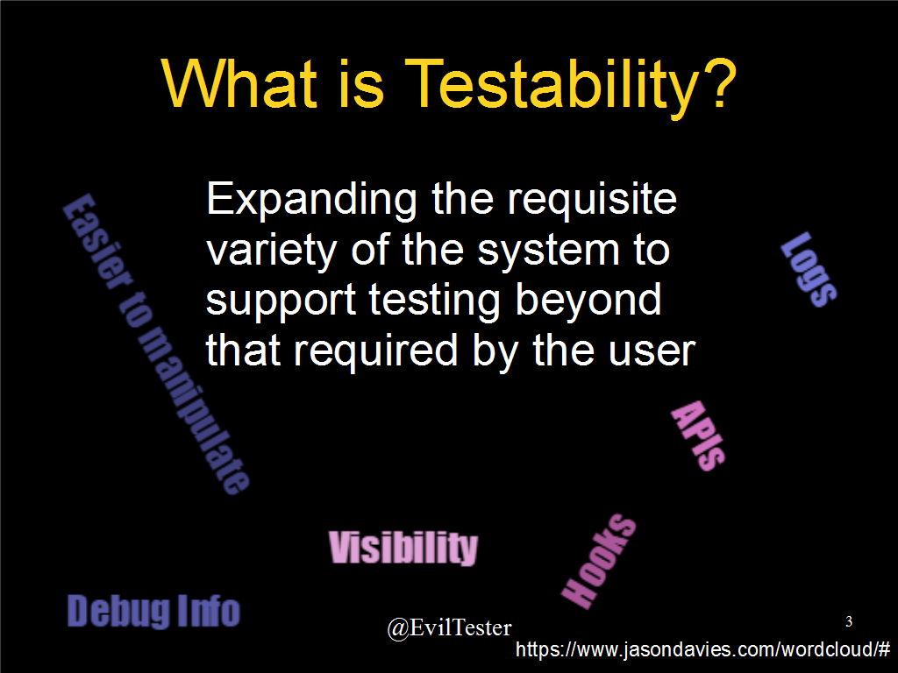\

We should start with what is testability. The word testability, not the concept of test 'ability'.

Very often we talk about testability in the concept of an application, so we talk about it being easier to manipulate, easier to work with, showing me more information as a tester so I get debug information, I get visibility into the variables that are going on. There's hooks for me to automate against, there's APIs that I can use, maybe private APIs that are not public. We make this thing more testable. Because testers want to do things to the system that a normal user wouldn't.

What we're doing is we're expanding the requisite variety of the system to support the activities that a tester needs that a user doesn't.

I'm bringing this concept of requisite variety in early because it's probably the most important concept that I'm going to talk about in this talk as the thing that drives my entire approach to improving testing.

## Requisite Variety

\

What I want is the ability to do as a varied approach to testing as I can. Use as many skills as I can. I want to push the system into as many states as possible. Requisite variety is a concept that comes from cybernetics. I've picked a couple of quotations here, Ross Ashby and Stafford Beer. Ross Ashby is generally credited with coming up with the law of requisite variety.

Stafford Beer defines variety in terms of "the total number of possible states of a system or of an element of a system".

Those are things, as a tester, that we want to explore. We want to put the system into lots of different states and see how it handles it. Does it have the requisite variety and processing ability to handle the input that we give it? To handle the different states that we put it in?

That's a fairly good description of what I'm trying to do in my testing.

Now requisite variety works both ways. A system is trying to regulate the variety that comes in so it can process it. It can't handle an infinite amount of inputs each within a unique process. It has to somehow regulate it to handle it in a defined process.

When we add a user, we don't have a unique process for adding each user, we have a standardized process. Now if the variety of data that comes through that process is too big, it is not something that the system can handle, it is beyond it's requisite variety, then we've exposed a bug and we've got a problem. The system doesn't have the requisite variety.

Generally a bug means the system doesn't have the requisite variety to support the data that we just put in.

That's what I focus on, I focus on having the ability to generate more variety into systems. The ability to understand where the systems work so that I can add variety in there.

## Test Ability

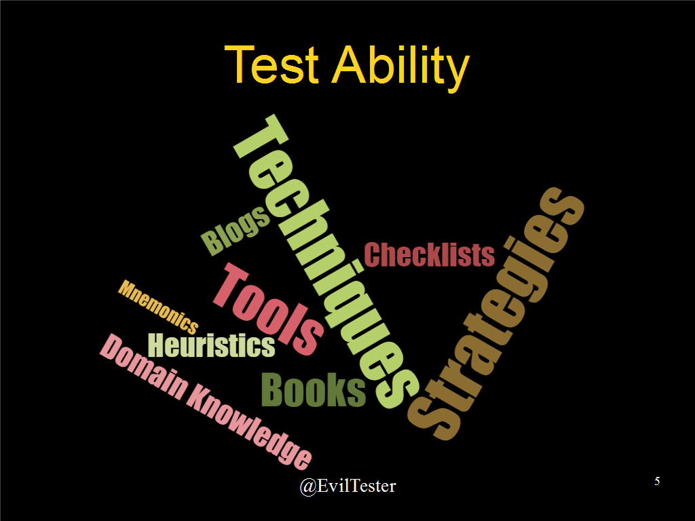\

"Test Ability" or "Ability to Test" is fairly standard.

We know this as testers, we have to learn all the techniques for testing, we use checklists, we read blogs and books to understand this, there are various tools that we use, we develop strategies for testing, Mnemonics and Heuristics, domain knowledge, whatever else. This is a given.

For me it's a standard part that all testers have the ability to test and work on them and improve them.

## Technical Test Ability

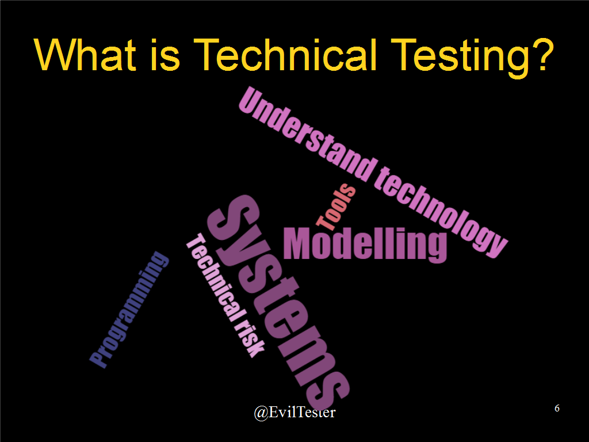\

When I talk about technical testing, I'm talking about going beyond just the ability to test. When I talk about technical testing I'm talking about having an understanding of the technology that we're testing, having access to more tools.

And we have access to those tools for a reason. We don't just hunt out tools, we hunt out tools to help us and I'll explain why.

We have the ability to model the systems. Modeling is fundamental part of our testing ability and it's even more important when we come into technical testing because we model the system at different levels.

A general understanding of systems is so important. Systems are what we test, we are systems, we work in systems of development, everything that we do and interact with is a system. We study systems, we start to develop techniques that we can use on people and the applications and ourselves and our processes.

Now we also have to understand all this to identify technical risks that we can test. Having access to driving testing from a technical perspective or a technical risk perspective allows us to go beyond requirements and test the system more deeply.

Doesn't mean you need to know programming. Doesn't mean you need to have the ability to program. But if you can, then it will give you, it will expand your requisite variety. You have more options in how you approach your testing, that's really what the programming skills are for, to increase our variety.

## A Reminder to go deeper

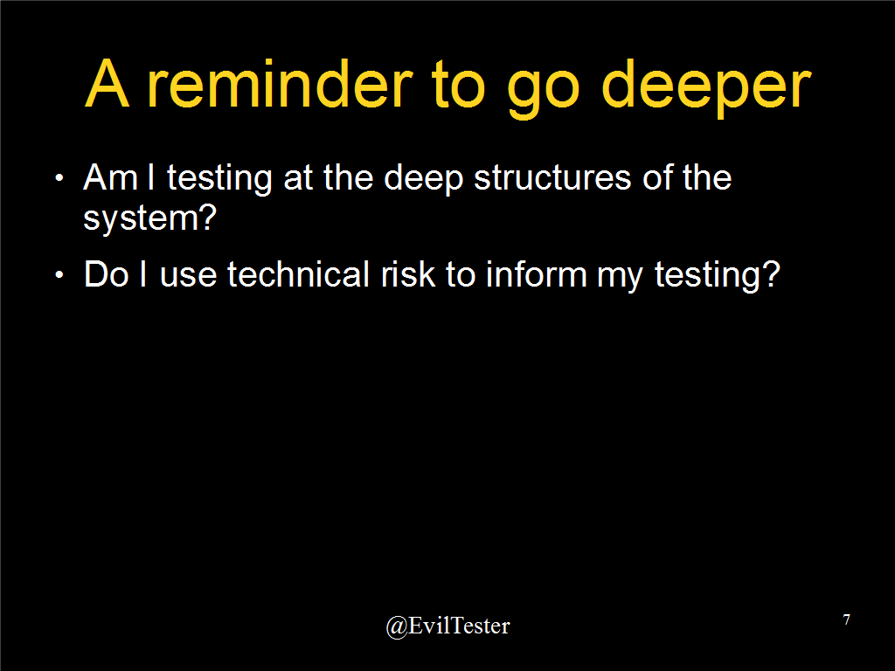\

I use the notion of technical testing as a reminder to go deeper into the application, so that we don't just test the surface structures of the application, we go deeper on multiples levels.

We're observing at the traffic level, observing in the system, we're looking in the database.

I use technical risk to inform my testing so that I can go beyond the actual requirements that we have.

## Limiting Beliefs

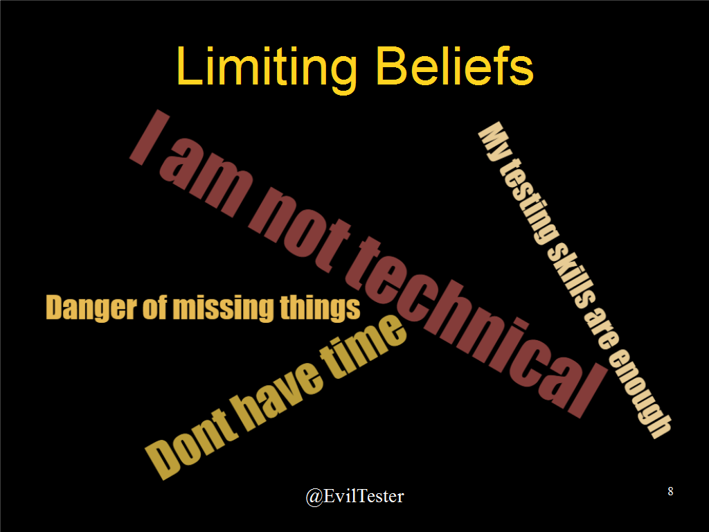\

I've spoken about this enough times to know that people have limiting beliefs in here.

These are beliefs that limit what we do.

People think "I'm not technical", "I'm not technical I can't do this". The stuff that I explained at the start pretty much anyone that uses a website could do. We all know what a URL is, we could all change that URL. Now we might not know the tools that we use to replay those requests, but that's just a small extension of our existing technical knowledge. Because knowing about a URL is technical understanding of how websites work.

This is an excuse, "I'm not technical". What they mean is very often "I don't have the time to learn this". Now that might be a fairly valid point but if you don't have the time to learn this, do you actually have the time to learn testing? Are you actually working on your skill sets, which you need to do to maintain relevance in the workplace.

People seem to think that their testing skills are enough. "Well I've got my testing skills, that is enough". Well it might be, but there's going to be bugs that you are missing, you're limiting what you can do.

People get concerned that there's a danger that they'll miss requirements because the focus on the technical part. That might be true. Whenever we test we have to identify a subset of things we're going to focus on. We manage that risk through our own processes. Very often technical testing is about observing, to build a model of the system, to understand it. It's not necessarily about going in deep until we identify technical risks that we're going to pursue and we can do the observation in parallel with our normal stuff. We will see more things rather than miss things.

These are essentially limiting beliefs that stop us doing the work of improving our test process. 

## If you choose to not do the work...

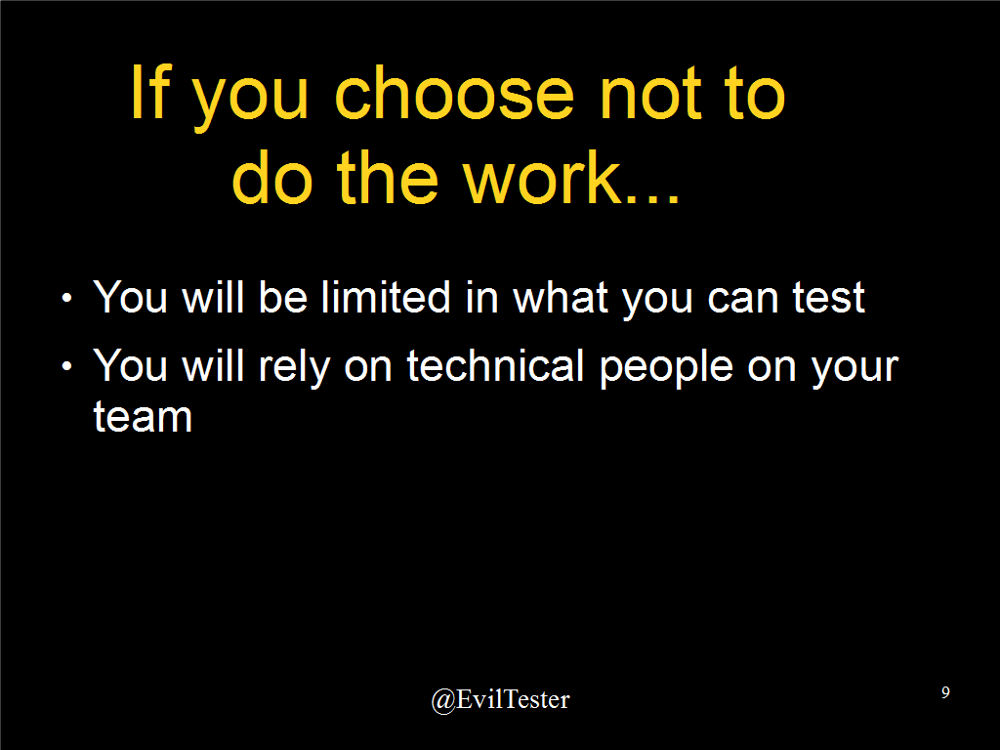\

If you choose to do that, that's fine. But you will be limited in what you can test and how you can test it.

You will rely on technical people on the team, which means you then need to be nice to them because you want them to do things.

I would rather work on teams where everyone is a peer and everyone can contribute what they need to, and everyone is developing their skillsets to add as much value as they can.

Now we do need people at different technical levels, however not out of an excuse that we don't want to learn this activity.

I guarantee that if you do the work, you will improve your ability to test.

## Our technical world changes all the time

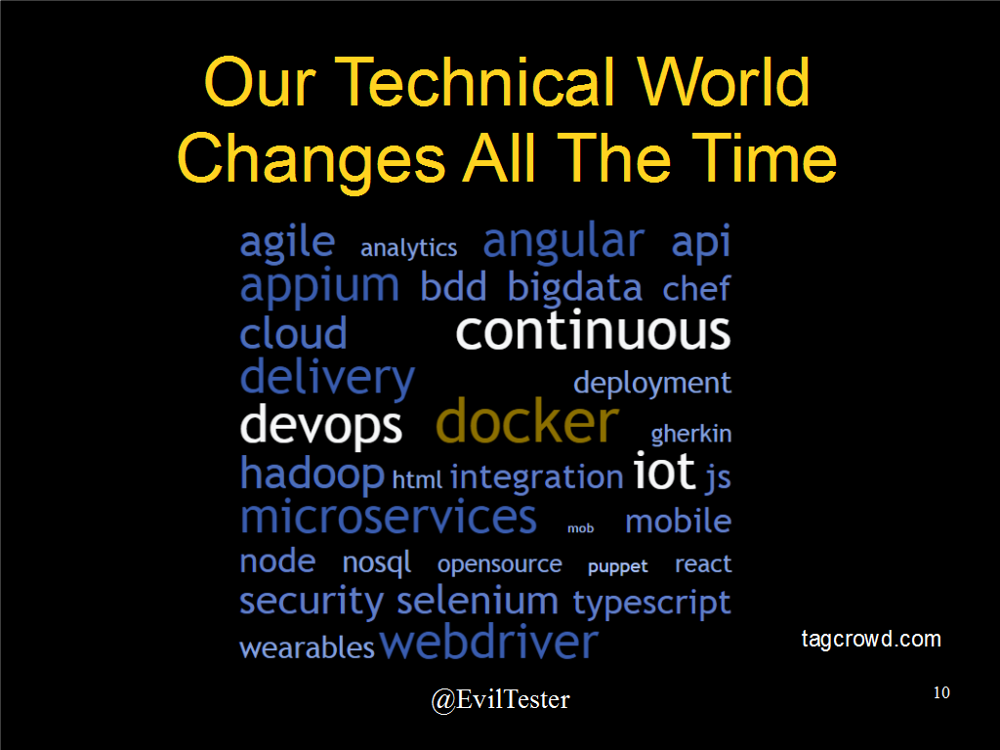\

The thing is, our technical world changes all the time.

We have different notions of Dev ops, Docker. I work with teams that use Docker now. I don't fully understand Docker. I couldn't set up a Docker environment properly yet. It's on my list, I don't know when I'll get there. But if I was working on a project that was using Docker I would make an absolute effort to understand that. If I was working on a project that had an environment that was hard to install I would probably look at Docker and see if I could find a way of making that more easy.

But our technical world changes all the time which means we have to stay up to date, which means this takes work.

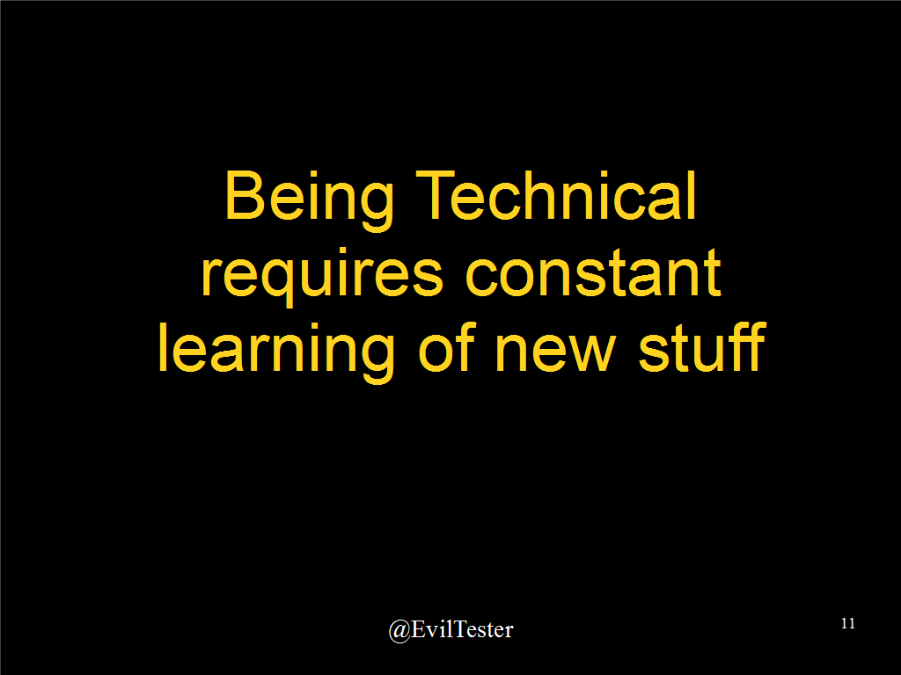\

Constantly learning new stuff if we want to maintain our technical knowledge.

Some people like that. I like that personally so this is an easy thing for me to recommend.

## It is hard work

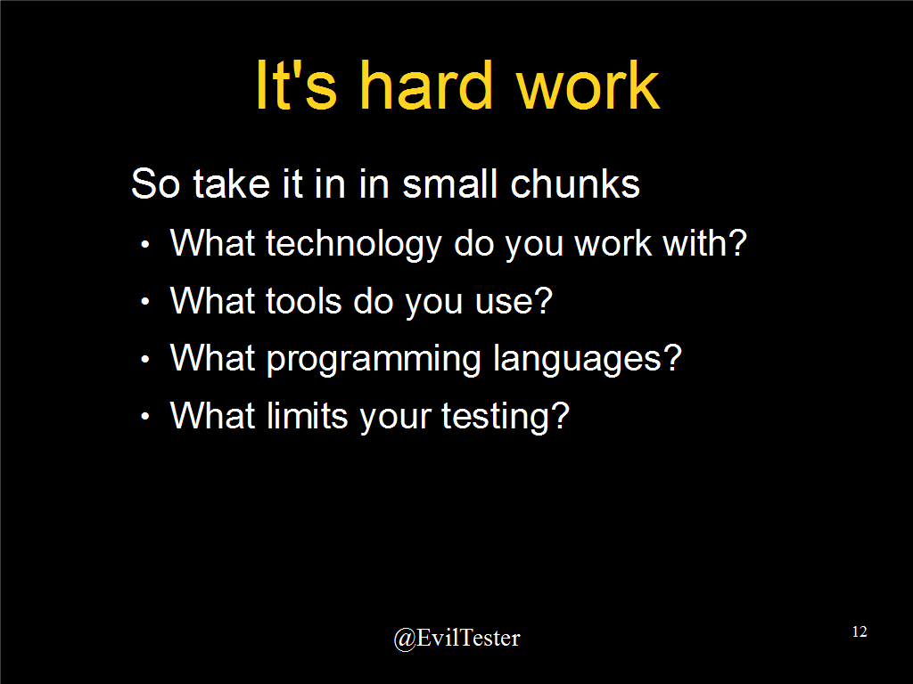\

It's a choice, you have to decide to do that.

Problem is, you've seen the big list. It looks like there's an awful lot of stuff to learn.

What we have to do is break it down into small chunks because it's hard to learn this, it's hard to learn all of this in one go, so we don't.

We break it into small chunks. Start with what technology are we currently working with on the project? Learn that.

What tools are we currently using on the project? Learn to use those in more depth.

You're presumably using programming languages on your projects, if you want to learn how to program, learn the ones that are being used on that project because chances are you'll be able to use them more immediately and there will be people to help you.

What we should also do is look at what limits are testing. Where are we currently testing? If we are checking all our results on the GUI, our result checking is limited to the GUI. We really want to expand that throughout the system.

## Why do the work?

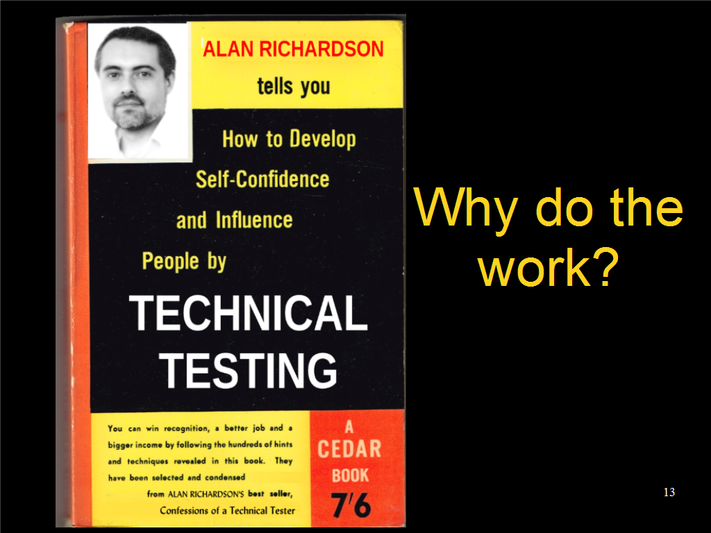\

Why should you do this work?

Other than developing your own internal abilities what promises can we make for this?

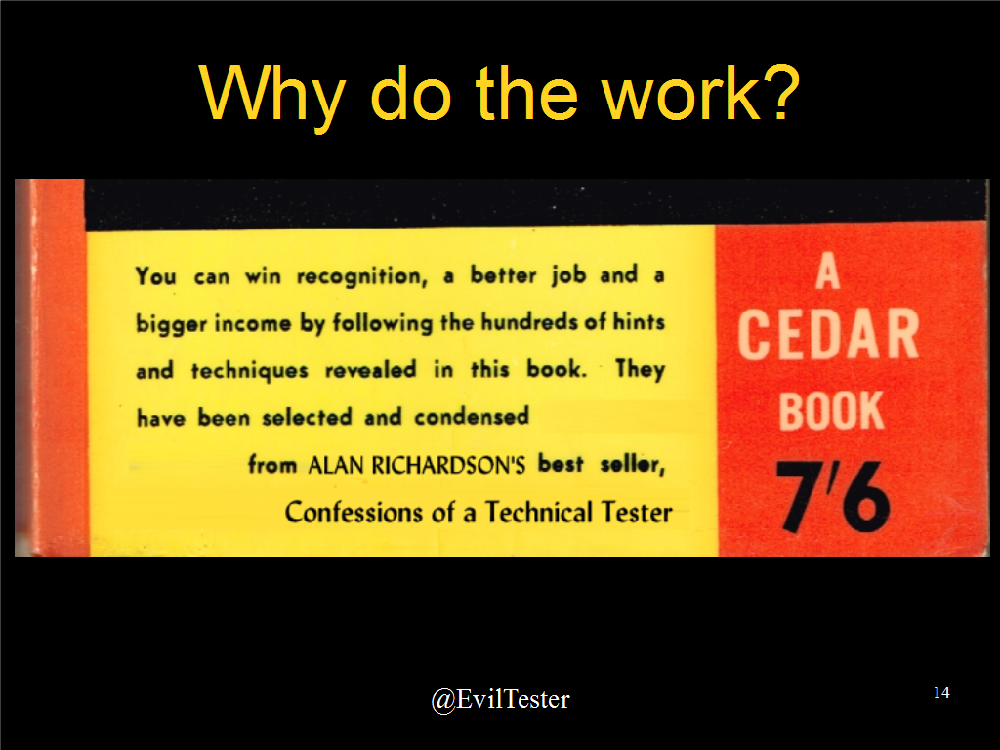\

I can't guarantee that you're going to win recognition on your team. You might find bugs no one else has, that might be a form of recognition.

Can't guarantee you'll get a better job but I know that when I approach work more technically I'm more interested in what I'm doing and I learn more and that contributes to being a better job.

I certainly can't guarantee a bigger income from this.

However, what I'm about to tell you are hints and techniques based on my experience of doing this.

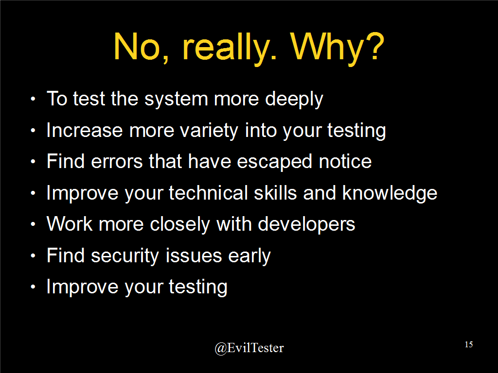\

I'm going to try and demonstrate that you can go further than you might currently do in your testing. To test more deeply, to increase the variety that you have in your testing, to find errors that no one else has seen, building your current knowledge so that you can work more closely with developers and do more stuff.

Functional problems that we find at a technical level very often turn out to be security issues like the one that I mentioned earlier.

I guarantee this will improve your approach to testing, it will improve your ability to find defects, it will improve your ability to question the requirements and go more deeply into this application.

## The Secrects of Technical Testing

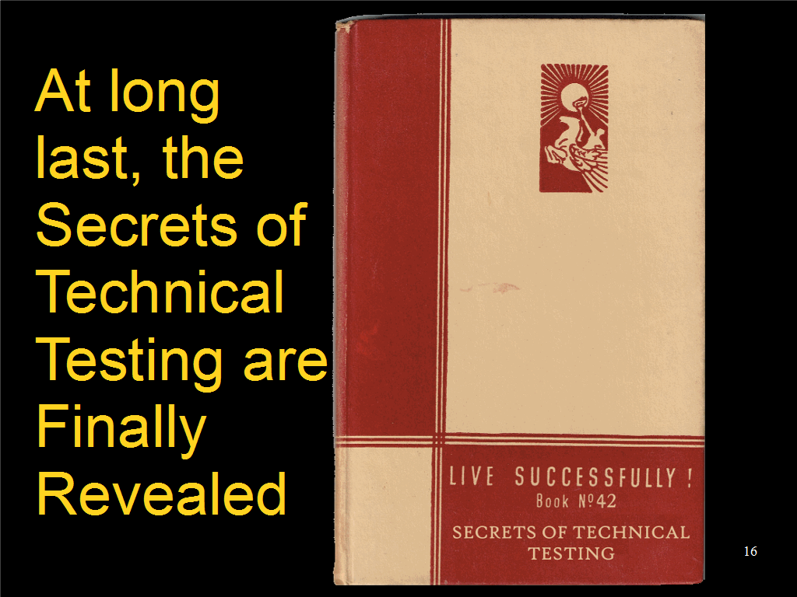\

Having said all of that stuff, now we're going to look at what is technical testing in a technical level, how can we do this?

## Modelling

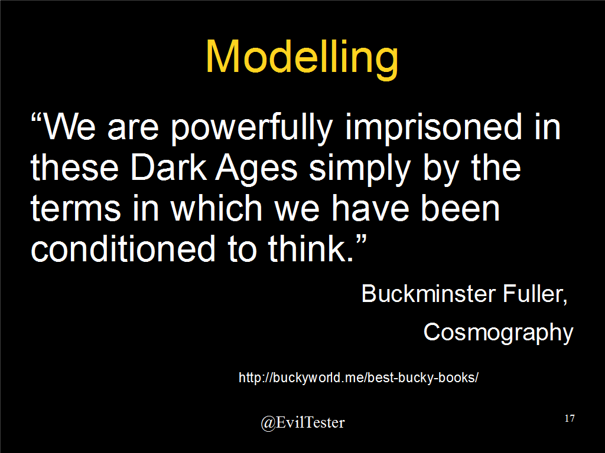\

I'm going to start with modeling. Buckminster Fuller, in his very last book that apparently was written in manuscript form sitting on his deathbed.

"We are powerfully imprisoned in these dark ages simply by the terms in which we have been conditioned to think."

We approach the world based on our models of the world. If we can improve how we model the world and the limits of our model and expand them, we have more requisite variety in how we view and deal with the world.

Modeling is so important.

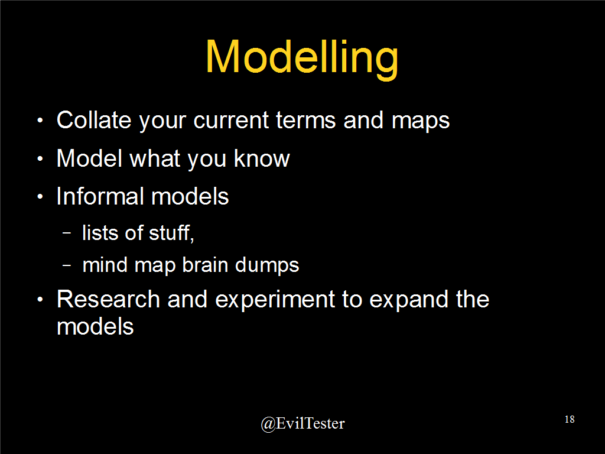\

What I suggest you do is look at your current terms and maps that you have, what current technologies you're using, create lists of the buzz words.

Model what you know to start with. Then you know what model you've got, you know how rich it is. You might write down buzz words that you don't understand, that's a good identifier for learning new things.

These can be informal models, you just have lists of stuff, brain dumps, mind maps, whatever else. This is where we start our research, to experiment with these terms to make sure we know them, to experiment with tools associated with the technology and to expand the models. The modeling is going to be so important.

## An Early Model

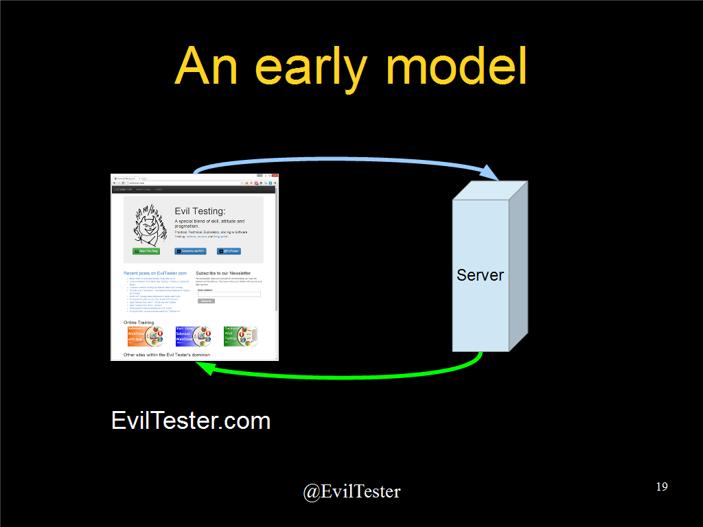\

If I was working with a website, say my eviltester.com site, a very basic model of that site would be the website and the server and there's some sort of messaging going back and forwards.

I might just start with the GUI and the GUI resides in the browser, so I'm really expanding a browser model. 

## Expanding the Browser Model

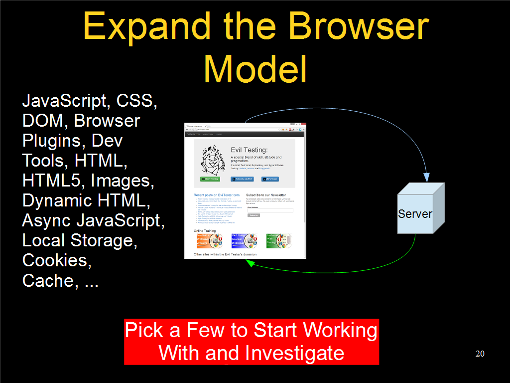\

What is involved here? We've got JavaScript, let's work out the terms that we know about JavaScript CSS, the DOM, the document object model. The browser plugins that we might have installed, the dev tools in the browser, they exist by standard. HTML, HTML5, if we don't know the difference we might want to investigate it. If we don't know how to write it or read it well we might want to do that, as a start point for this.

We've got images, how do they work? Do they all exist? Are any hidden? The dynamic HTML and AJAX that's done by the JavaScript, how does that work, do we understand it? Is it using any local storage? Does it have cookies? Is it dealing with a cache? How does that help us with our testing? When we do something on the website and it's supposed to be reflected in the cookie do we know how to check that? Do we know if the cookie has the right information? Are we giving more away in the cookie then we need? Can a change in the cookie impact our application and should it?

These are all questions that start to happen when we start looking at the technology that we're using for the website.

Again, we want to break this down in chunks, so pick a few, pick a few to work with. Find some ways of observing what is going on here.

## Expanding the Message Model

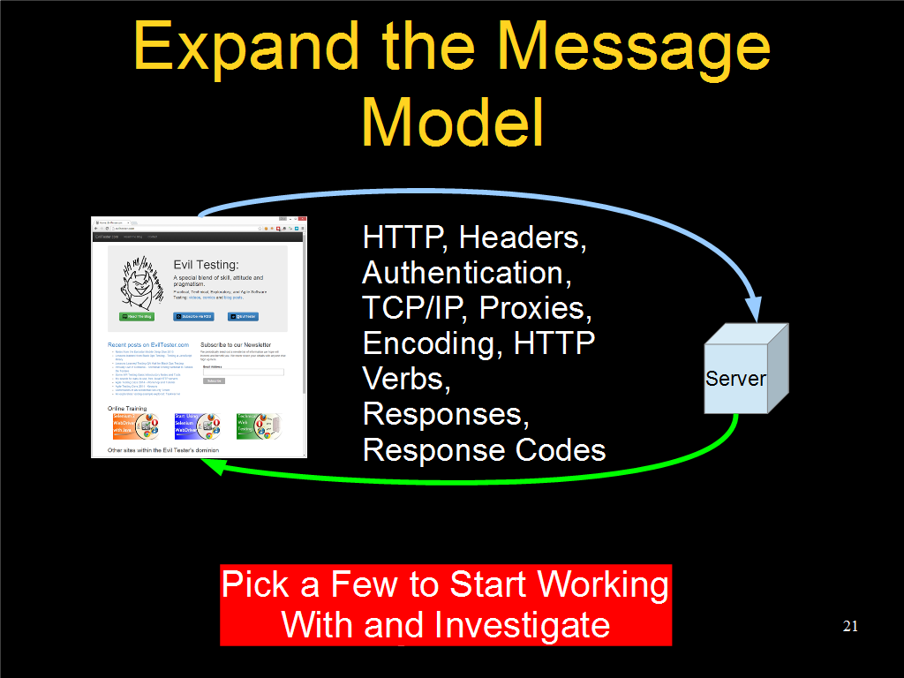\

We might want to look at the message model. Every time we deal with a website we're sending messages back and forth to the system and then we're dealing on a HTTP level, transport protocol.

We're dealing with headers in those messages, do we understand what they all mean? Is there any authentication involved? Is it good enough? We might want to go down at the network level with TCP/IP.

We might want to use proxies to investigate these messages. We might look at how they're encoded. We have to understand the different variables and how they're used. The PUT, the POST, the GET, the DELETE, is that verb being used? What happens if we send in variables that it's not expecting?

We have to start understanding the response codes and being able to assimilate them and being able to read the responses. Again this is a big model if we treat it like that. But if we take it in bite size chunks we can start to slowly learn this and improve our ability to go deeper in the system.

## Stafford Beer on Modelling

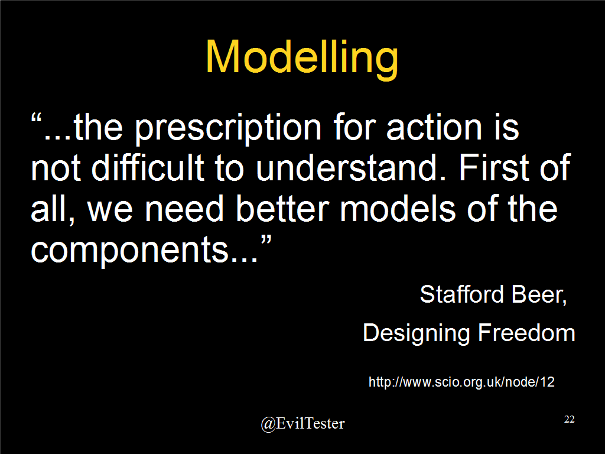\

Stafford Beer, in his book Designing Freedom, talks about the first step to changing a system as better models of the components.

"The prescription for action is not difficult to understand. First of all we need better models of the components."

Modeling is fundamental to what we do, it's where we start, it's where we think, it's where we spot gaps in what we're doing. Learning how to do that is important.

Once we have the models we can start to explore them.

## Explore the models

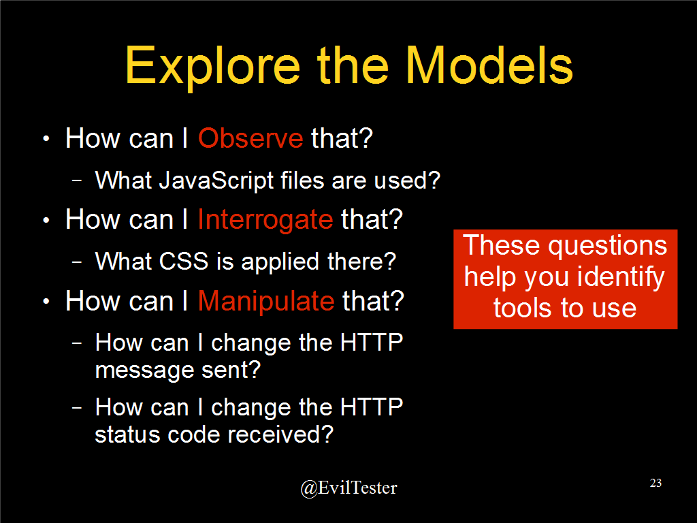\

Three words in here that I think are important.

Observation. How can we observe what is happening in the model? What JavaScript files are used? What messages are sent?

How can we interrogate the parts in our model? What CSS is applied on this DOM element at this time? Going deeper into it. What were the headers in that message that was sent? Going more deeply into it, interrogating it specifically for a reason and an intent.

And really important for testing. How can I manipulate that?

What we do with testing is we manipulate the system.

We manipulate the messages going to the back end to test for conditions that the GUI might not let us test. We can manipulate in the GUI itself to have the GUI send the messages to make sure we're not introducing risk when we send messages directly. 

How can we change the HTTP messages that we send? How can we change the responses and status codes coming back from the server to simulate server errorss without having to mess with the server?

These are questions because we use these questions to then identify tools.

## Use tool capabilities to expand models

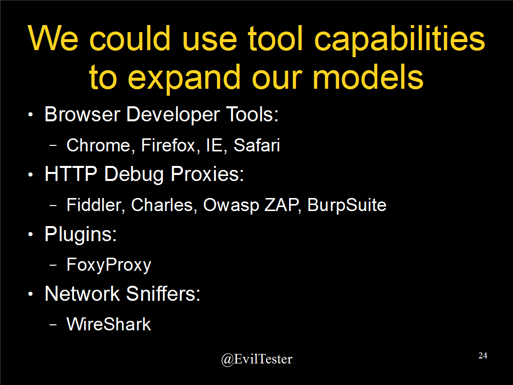\

How can I observe? Then we find a tool to do that. Then when we have a tool, we can start looking at the tool capabilities to expand our models.

What does the tool do that I could then use?

When we start looking at the browser developer tools and you'll see examples of that in a minute, there may be functionality in there that you hadn't thought about.

Functionality that you, as a tester, can identify how to use in your testing.

We use debug proxies, I'm going to explain about those a little bit later.

There's various proxies we can add and if we really have to, we can drop down to network sniffers like Wireshark. When we start using the tools, we start to see things that we don't understand. We see more information and that gives us a richer model which we can then use to expand and experiment with.

## Observation in Browser

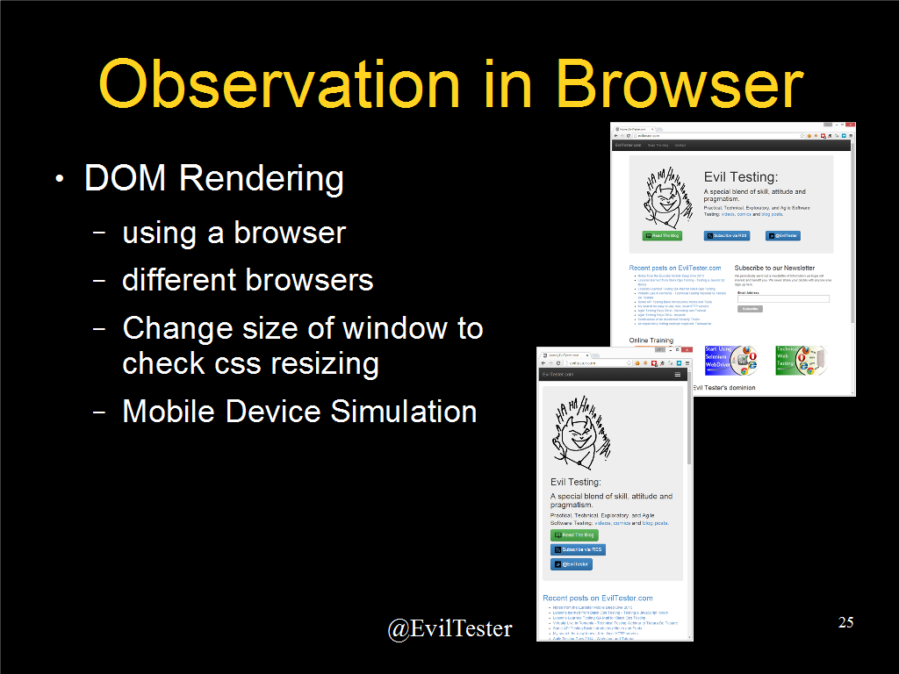\

The first step is we have a browser, we can observe in the browser, that's essentially what we do. We are observing in the browser, we're already seeing something technical in terms of the DOM we're entering.

That's why we use different browsers, because different browsers might render the information differently. There's a technical risk associated with the rendering of the HTML.

If we understand where in our HTML or CSS or JavaScript that there might be issues, we can specifically target those in different browsers rather than trying to test everything in different browsers.

Technical risk can inform our testing and then mean that we might have to do less testing.

Simple things with the browser we can change the size to see whether the CSS is scaling properly.

There are mobile device simulations in the browsers that we can use to simulate the mobile device earlier than actually going on a mobile device. The mobile device simulation in the browser tools will allow us to send different headers to the server to pretend to be the device. The server doesn't know that we're not on a mobile device. It will respond adaptably if it has to.

The first thing is when we're in the browser, we've seen the rendering, can we view the HTML?

## Can I observe the HTML?

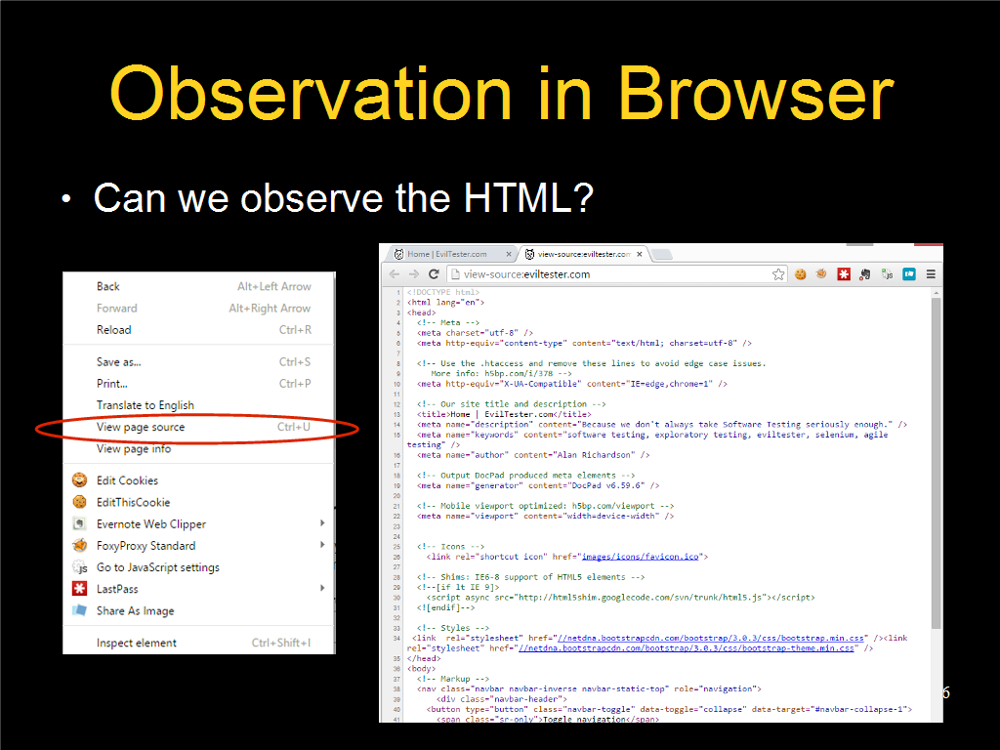\

Can we observe the HTML in the browser? Yes we can. We've always been able to do that for a long time and the easiest thing to do is to view page source, then we will see the HTML.

Nowadays you don't just see a text rendering, you see a syntax highlighted version which makes it easier to distinguish content from HTML. You start to see tags that you may not understand, more information on HTML that you may want to read up on. You may not understand what all the meta tags mean. There may be information in the comments that suggest technical issues. Maybe we want to investigate why there's a comment saying that we need to add something in the `.htaccess` file to bypass some sort of edge case. I don't know what that means, I might need to investigate that in more detail, that might be a potential bug.

We can see from the HTML that we're bringing in files from a CDN, a content delivery network that is not hosted on our site, that might be a technical risk. We may even when we we're testing things, see environment information that is not supposed to be exposed or released. We get more information here, we have a richer model not just of what the system might be doing but what the system is actually doing.

That's really important and that's the first step, observing the HTML, we have gained so much more information about the technology, we know that the site is using Bootstrap, we can research that. Even if we're not told anything, we have the information there and we can investigate it ourselves.

## How else can I observe the HTML?

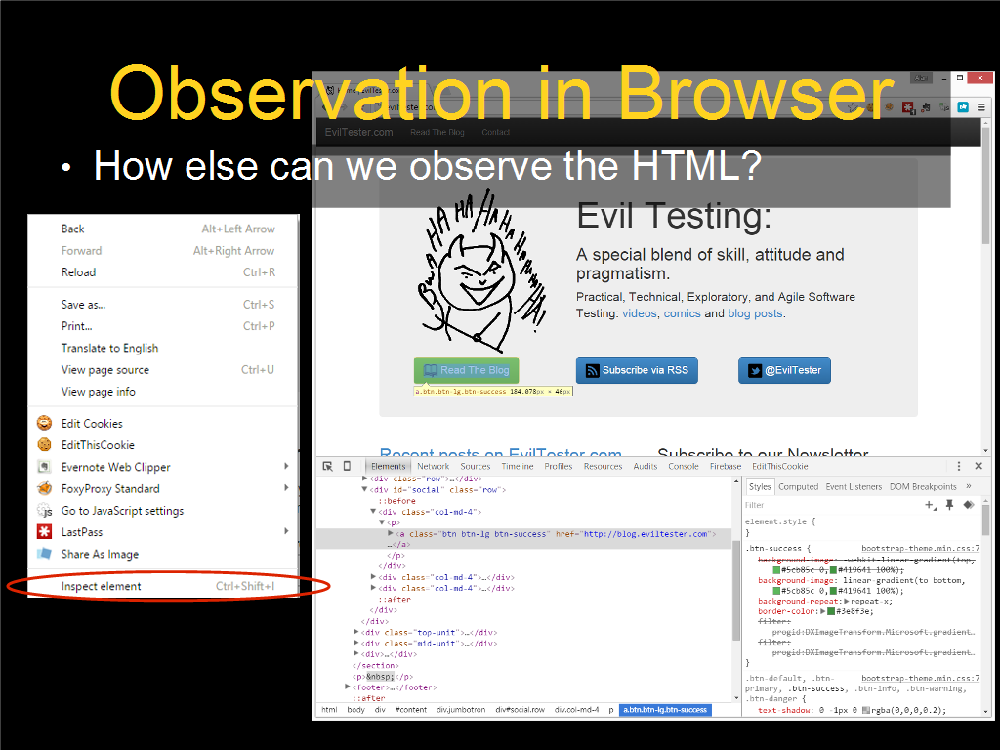\

How else can we observe the HTML?

Well we've got developer tools built in. We can inspect elements on the page and we'll see them in the DOM view. This is a very flexible view, it means we can search, it means we can see what CSS is being applied instantly in the developer tools.

Remember these tools are now available to everyone, so all of your users have access to these tools.

The amazing thing is we can change the HTML, we can change the values on there, we can change the values in the drop down. Even if you have a web form and your choices are limited to 10 things in a drop down you can change that, your users can change that. You can have hidden fields in a form that your users can change. 

## Manipulating the HTML in the Browser

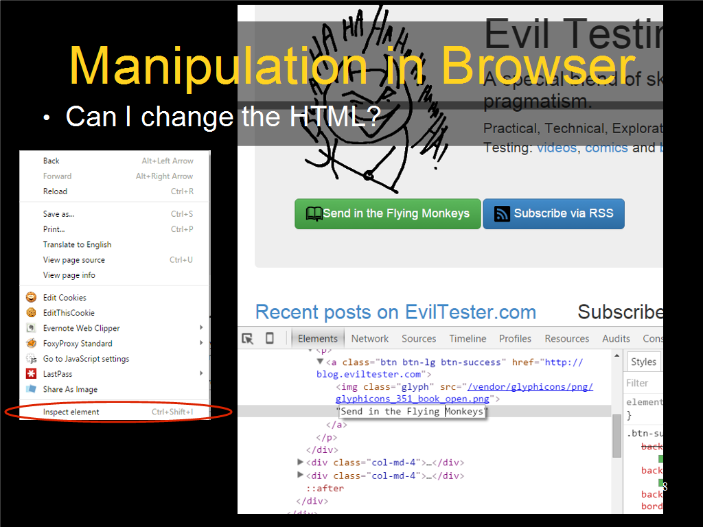\

If we assume that no one does, then we have left a whole area of our testing a gap, which might turn into a functional defect later on, which might turn into a security issue.

If we have a hidden field in our form when we're purchasing something for the price and if it isn't validated on the server and the person who's using it changes that value to zero and they get the product for free that's a problem. We can manipulate the DOM now to do these things. We should use that in our testing. 

## Traffic Observation in the Browser

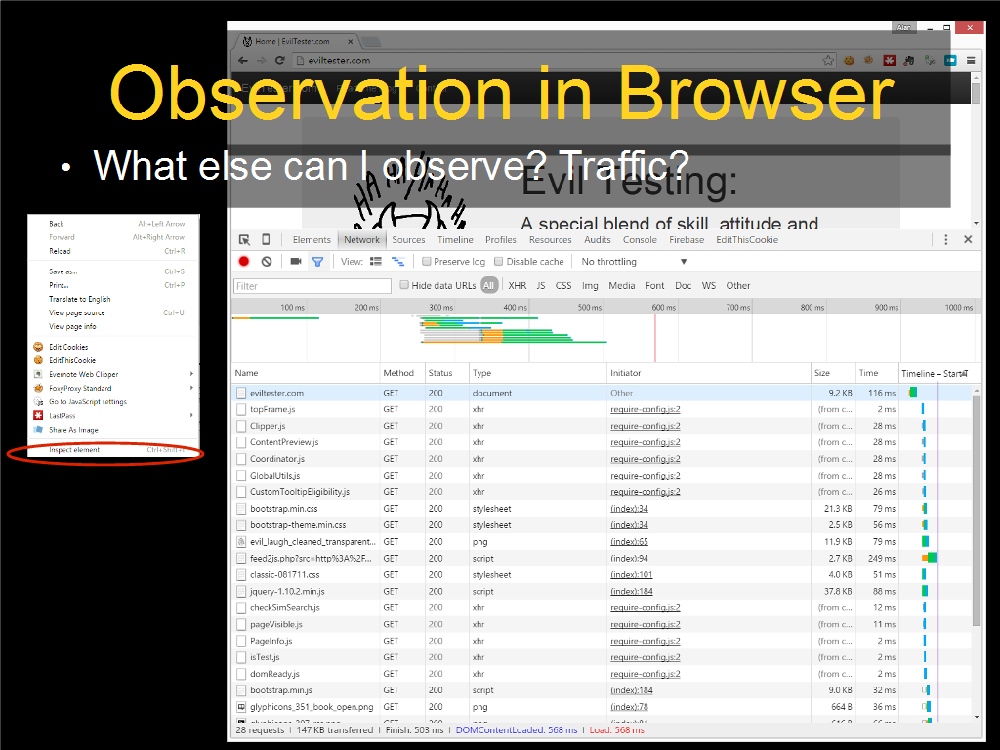\

We can now do way more in the browser than we ever could before. We can now observe the traffic.

You can have insights into the application and what it's doing. You can see all the requests are made. You can see that some of the JavaScript files that we've loaded in are making requests for assets. They are not listed in the HTML. There's more stuff going on than the HTML itself suggested. We can see whether they're direct requests, whether they're XML HTTP requests that are happening in a different thread under the covers.

We can see the timings of the different parts of the web application. There might be parts that are slow. If the website feels slow, we can check whether it actually is slow or whether there's stuff going on. Maybe it's not the traffic issue, maybe it comes back really quickly but then we process the JavaScript and that's slow. There are different ways of looking at the application.

## Traffic Interrogation in the Browser

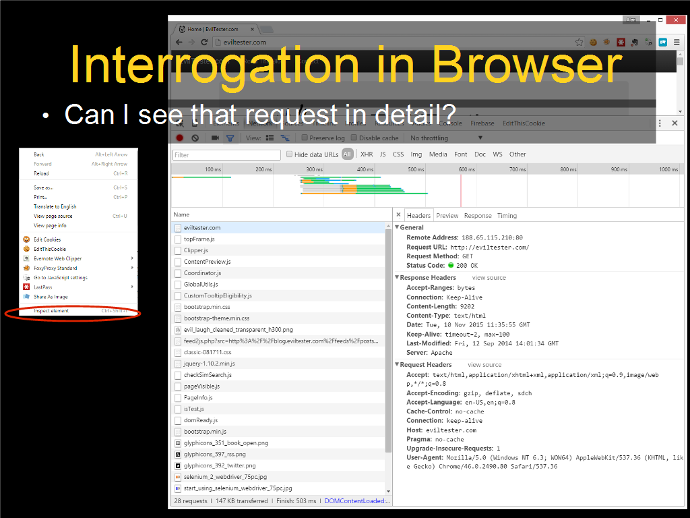\

Using the traffic view in the browser we can drill down into the request in more detail.

Now we can't manipulate requests, we can't resend them but we can observe and interrogate them in the browser. Again, this gives us more information.

Do we know what all of this means? Is this important? Is it important that there is no cache header set here? It may be, it may not. These are things that we have to learn and evaluate and assess whether they're risks are not.

But over time we start looking up on the web what does this mean, what does that mean and then we can find out. 

## Source Observation in the Browser

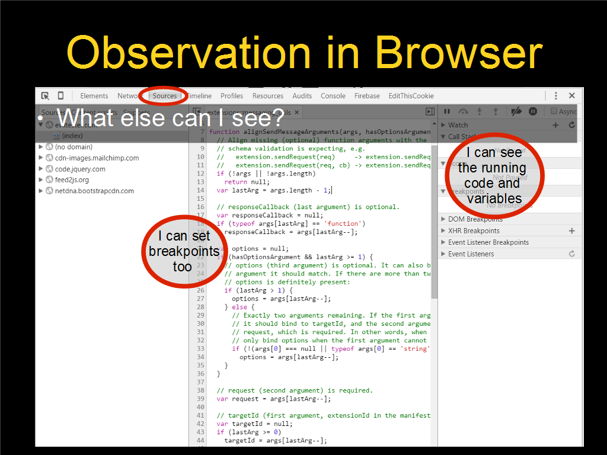\

I can see all the sources that it's drawn in, so I can see all the JavaScript, I can see all the CSS as raw files.

But more than that, the browser is now a development environment. I can put break points in the JavaScript so when I do exercise the application and we hit one of those break points in the code I can then see what variables are running. I could change them, I could hack around with the JavaScript code, possibly put the front end into states that might take a long time to get into. Possibly put the front end in the states that are harder to get into. I might be able to do that fairly quickly.

Now there's a risk when I do that because I'm using the system in a non-standard way. But we can assess that risk technically, we can make decisions about is that a good thing to do or not? 

## Even more stuff we can Observe in the Browser

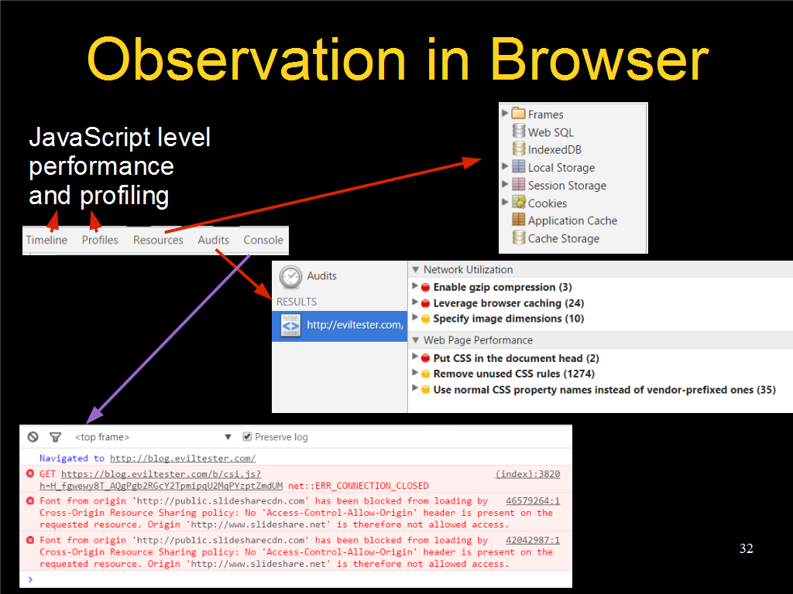\

Now the dev tools have a whole range of things, so I'm not going to go into too much detail here and it's worth just looking at them to see how much value you can get. I tend not to use the timelines and profiles that JavaScript profiling and performance. 

I do use the resources to look into the local storage, HTML5 has a concept of local storage where we can store items in our browser beyond just cookies. If we're using that it's important to look in there to make sure that we're not giving too much away and when we log out that stuff is cleared down so there's no security risk sitting around. It's a functional aspect of the system but it has a longer impact. Are we storing the right things in there? If we hack about in the local storage and amend it, does it impact the system in ways we don't expect?

Same with the cookies.

There are audits built in in Chrome. All the examples I'm giving here are from Chrome, but every browser has dev tools, there are audits built in so I can see that there's issues on this website. Maybe I should be having compression, maybe there's CSS that should be put in a different place. If I don't understand this I should look into it and evaluate whether it's important or not.

Similarly when I put the console on which is the JavaScript console and I see and preserve the log, I immediately get a log of where I've navigated. It can tell me I've navigated to this page, I've navigated to this page. I have a log of where I've been automatically built up by the browser itself and I will see error messages in there that I wasn't aware were being flagged up because they were hidden in the console.

There might be debug information shown in the console that I'm not aware of.

By having it open I can observe what is going on more readily in the application.

Remember all of that is happening in the browser, we haven't even gone beyond the browser at this point but we've opened up a whole technical world that we can observe and interrogate and manipulate in.

## Mobile Testing Hints

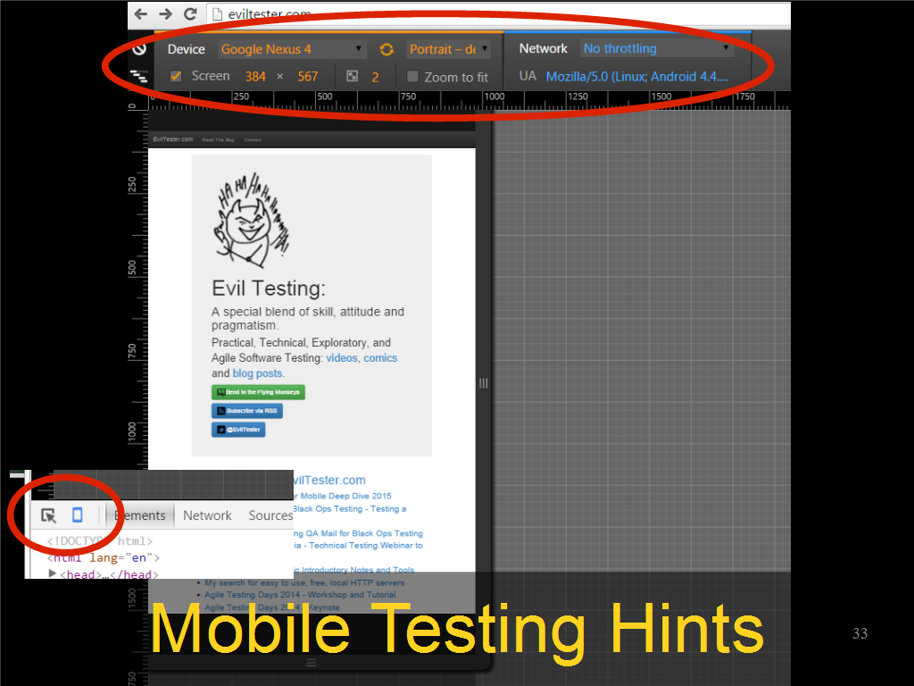\

There's browser emulation tools built into Chrome.

Just click the little tablet button on the dev tools and instantly we can emulate different devices. We will see the resolution that those devices work at, we will have a simulation of that screen. It's not the actual rendering engine used on that device, so there's some risk there, there's technical risk there that if we view important we might want to go test on that device. We can simulate on the server sending the request through. This is a first place to start when you're testing mobile devices. It's a simulation but it might allow us to mitigate some technical risk that we're looking for.

## Why Observe?

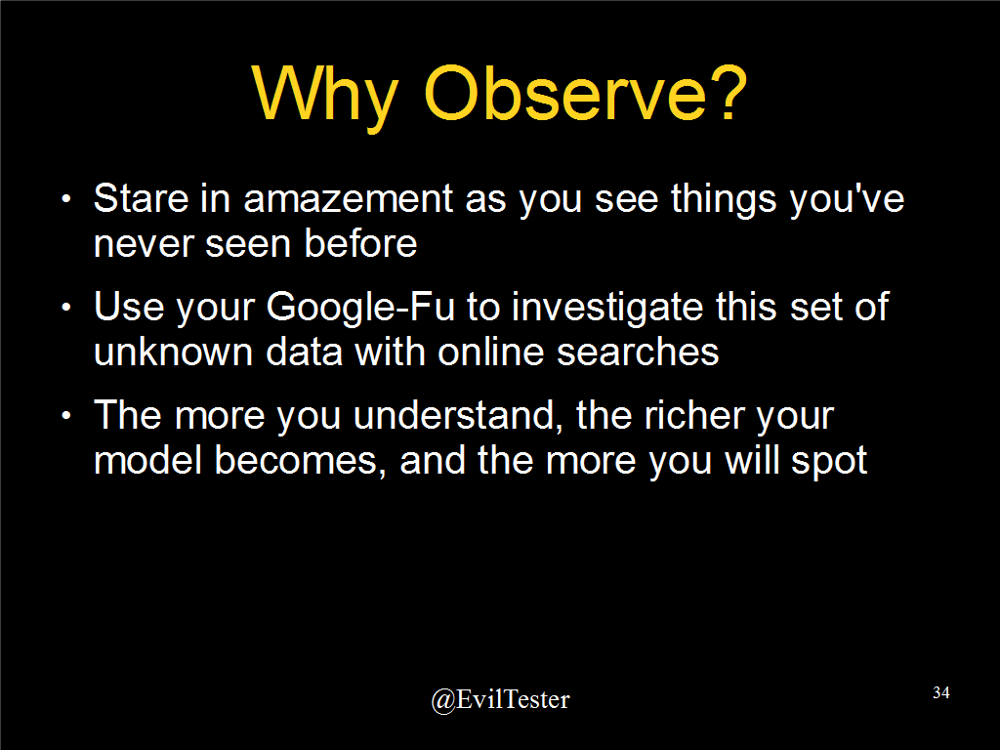\

Part of the reason for doing all this is that we expand our model.

You will see things that you've never seen before. You will see things you do not understand and you use those to help you trigger your technical model. Later on when you see them you increase your ability to spot problems. You get luckier in spotting problems.

I'm very lucky when I look at websites that I see security issues.

But I'm only lucky because I have learned how to observe and learned how to observe at a more technical level. When you see gaps we use our Google-fu to investigate them because the more we understand, the richer our models become, the more we will spot and the better our testing becomes.

## Why Manipulate?

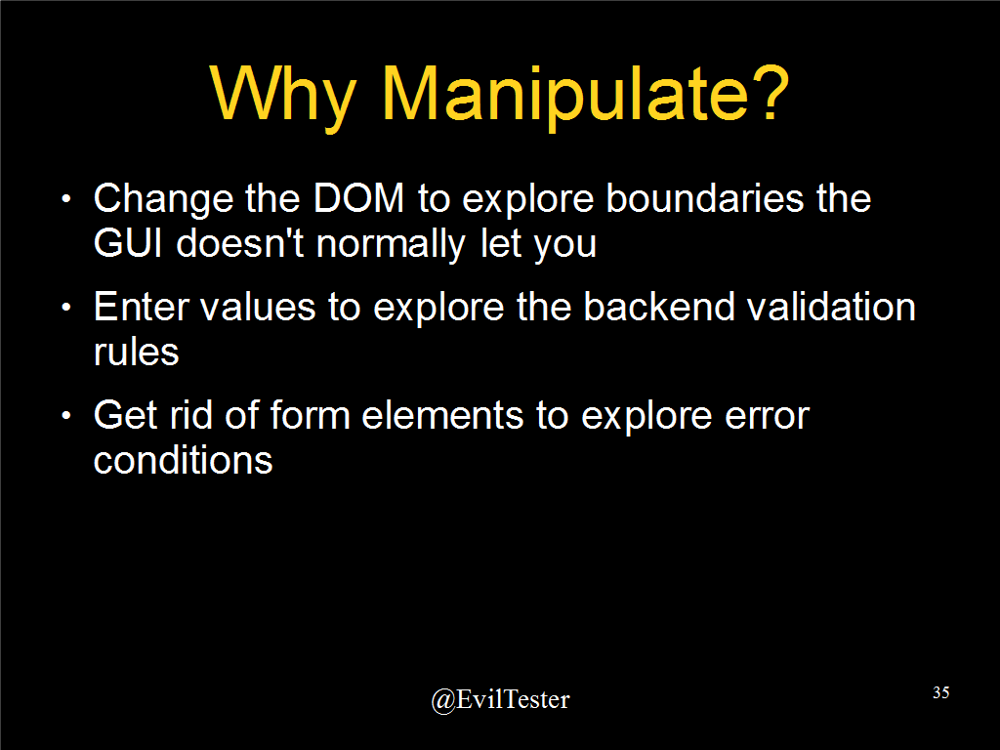\

We manipulate because that's what testers do.

We change the DOM to explore boundaries that the GUI doesn't normally let us do. We change the value in drop downs to try and ... 

We're given a date drop down that has months 1 to 12. We change that to have date 0, we change that to have date 14 to see how the system responds. Possibly bypassing front end validation, making sure that the server doesn't rely on a front end validation and actually validates the back end data. This is stuff that previously we would have had to test in the back end. Now we can test it through the GUI quite easily.

We can entirely delete elements.

Now all of this will help you in your daily life when you are browsing the web. When websites show up and ads overlaying the page you want to read, you can just delete them. When it auto starts videos you can just stop it. You can stop traffic coming through. You learn how to take control over your environment and that's a very empowering thing. A lot of people have to use ad blockers, a lot of people have to use extra tools. Testers don't need that because we know how to change the DOM and manipulate it and work with the traffic. If you do that in your real world, if you do that in your personal world all those skills will feed back into your testing and make you a more technical tester.

## Fill in gaps in my model

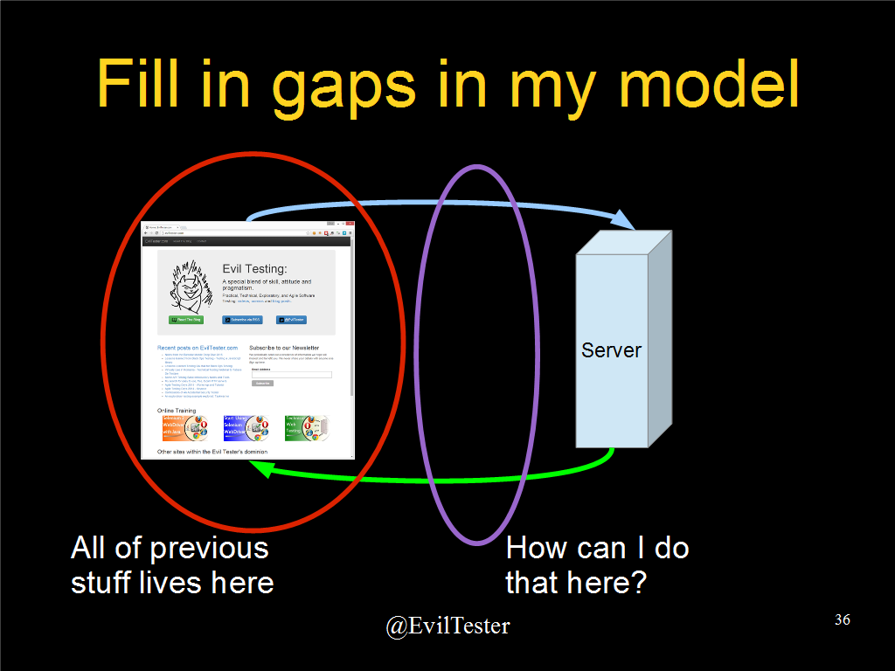\

What I have to do is I have to fill in gaps in my model. All the previous stuff we've talked about lives at the browser level. We haven't even talked about the HTTP level. That's a gap, so how can I do those things in there? How can I observe HTTP traffic?

## How to observe HTTP traffic?

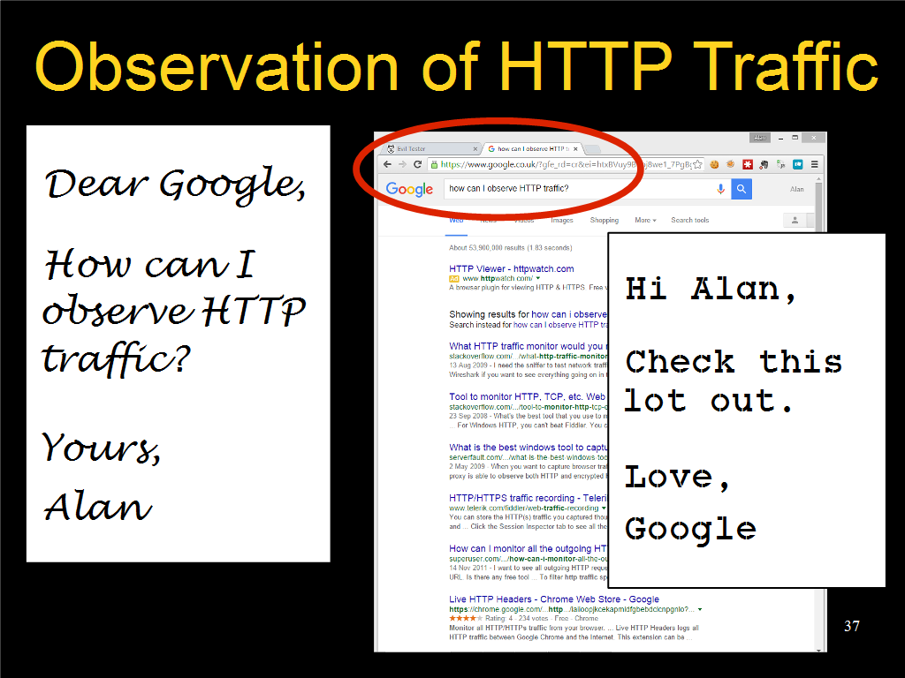\

Well that's why I ask Google and Google tells me and it gives me a list of links that I can use to research. Then I learn about HTTP proxies. This is how I found the problem that I talked about at the start, using HTTP proxies that can monitor the traffic.

## HTTP Proxies

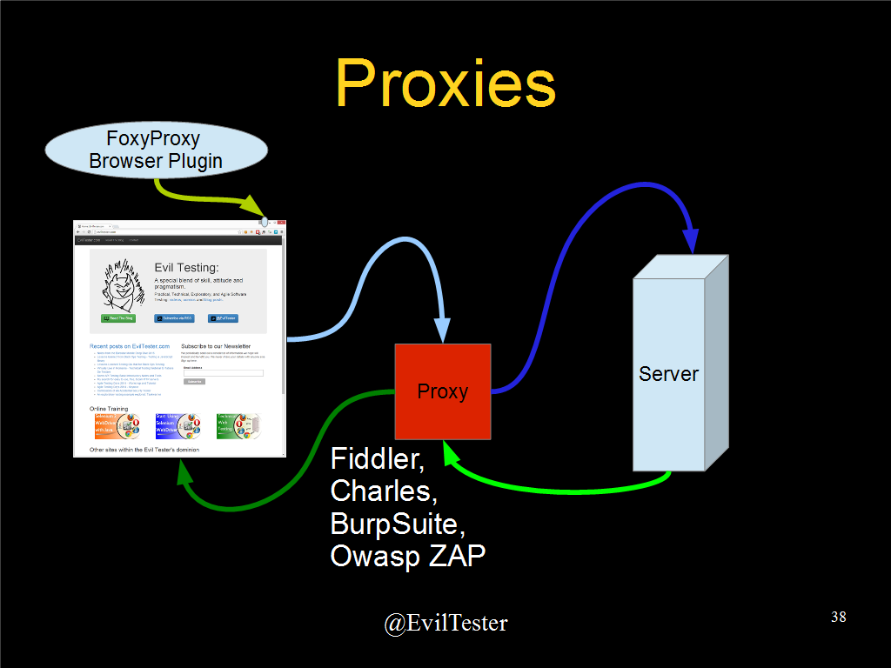\

Now the proxies I tend to use are Fiddler, Charles, Burp Suite and OWASP ZAP and they all have different features and I use them for different things.

If you're just starting out investigating proxies and you're on a Windows machine I recommend you use Fiddler. Fiddler is easy to use, it automatically hooks into the networking layout on your Windows machine so you don't have to configure your browsers to point into it. That's a great place to start and it's completely free.

If you're on Mac Charles is very similar too. Charles is Shareware, it only costs $50 if you do use it. It has essentially a 30 day trial that I don't think ever runs out but it starts to time out and slow down the longer you use it. Charles will also run on Windows, if you buy a copy you can use it on Windows.

If I'm on a Mac I can still use Fiddler but I run Fiddler within a virtual machine. That's a little bit harder to do, but it's possible. Because Fiddler, all a proxy does is listen on a port, you send messages into that port it will deal with them for you. A proxy can point to other proxies, it can point to other ports so you can chain these things and use all the different features of them.

What do these proxies let me do? Burp Suite and OWASP are security tools. They're designed as security tools so they have a lot of hacking type behavior built in. Fiddler and Charles are debug proxies, so they're a little bit higher level and a little bit easier to use.

## What do proxies do?

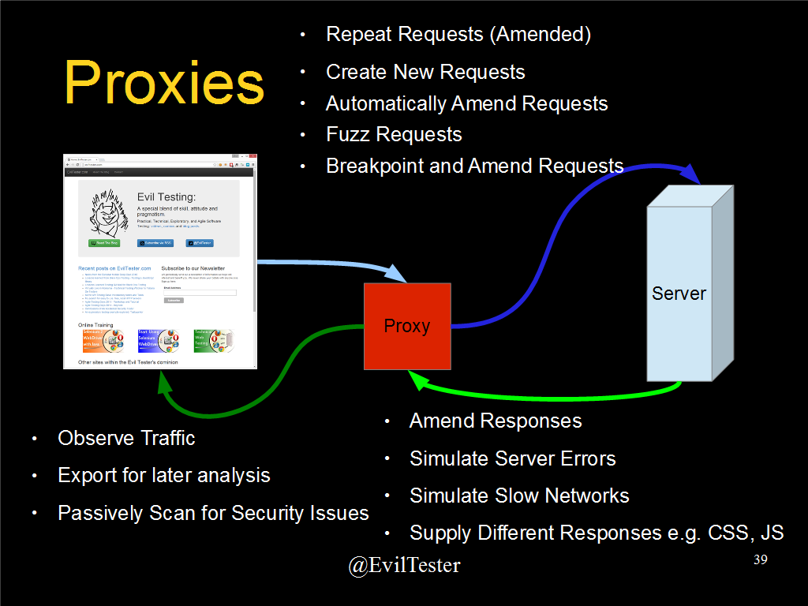\

With a proxy we can observe the traffic. What we're looking here is what can I observe, what can I interrogate, what can I manipulate, so we can observe the traffic. We can export the traffic for later analysis, we can export it as a HAR file, an HTTP archive file.

I once worked on a project, we were testing APIs and we had a lot of automated code, feeding in values through the API. We didn't really know how much of we'd covered. I built a simple model of the API, when we reran all our tests I ran them through the proxy. That meant that I could save out the HAR file and process the HAR file and compare the actual request against our model. I could see whether we were hitting all the URLs we wanted to, whether we were using all the variables we needed to, whether we were exploring all the different variations of data and we find gaps doing that. We can use this to help us analyze our coverage.

If you're using something like OWASP ZAP or Burp Suite you can scan for security issues. Fiddler has some security plugins. But we also have the ability to manipulate at this level so we can repeat requests. We can do things through the front end, we'll see them happen. We can choose a request, then we can resend it out of sequence, possibly trigger a different event or to double check that something happens.

When we resend it we can edit it, so we don't have to start from scratch with each request. We can create requests completely from scratch, but we can edit the ones that are there. We can automatically amend requests, so we can change headers automatically when they feed through. We can automatically change the responses that come back.

We can fuzz requests, fuzzers are great, they are part security tool where you basically send request with lots and lots of different types of data, data that's designed to explore different error conditions. As testers we can use that to feed in data that we want, so we can fuzz user creation requests to create model port users. We can fuzz and purchase requests to have multiple purchases without doing any automation just using stuff that came through the GUI and editing it and sending it in an automatic way using the tools.

We can have break points so that when we do a certain thing we stop in the proxy, amend the request, then send it through. Or when we receive certain requests back, we can amend those and then we can test error conditions from the server into the front end. We can simulate as slow network connections through most of these proxies. If we are testing on mobile devices we can feed them through the proxy and simulate slower connections. Some of the tools have connections that will drop and come back, chaos modes in there to simulate real error conditions in the connection.

We can supply different files, if I'm testing and have, I've tested a games HTML5 games application which had JavaScript issues. They fixed the JavaScript, I reviewed the JavaScript before it went to server but not only did I review it, I was able to test the game against the updated JavaScript because when the application asked the server for the JavaScript file, the proxy sent back the one that was on my disk. We can do that in Fiddler, we can do that in Charles, both of them have the ability to send back local files.

Fiddler has the ability to send back 404s and 500 errors a lot easier but we can send local files in both proxies. We can observe the traffic, interrogate it and manipulate it at lots of different levels. That opens up a whole new set of testing for us and a whole new ability to observe the system in action.

## Chaining Proxies

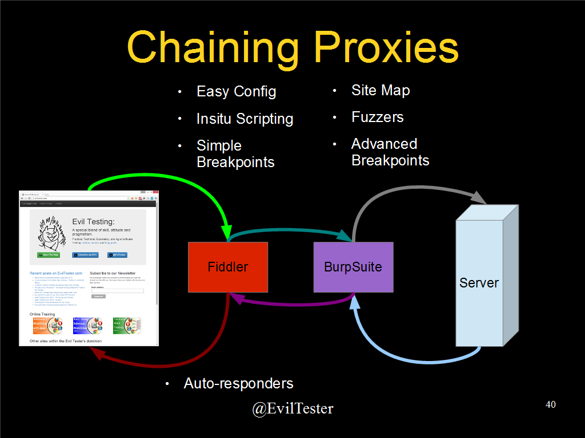\

We can chain these. I mentioned that the proxies have different functionality. Fiddler is really easy to script, it's got a really easy scripting capability which the other tools don't have so I might want to start putting the message through Fiddler and creating simple scripts in there. Fiddler's really easy to do break points, so is Charles, it's really easy to filter the requests. The security tools like Burp Suite and OWASP ZAP build site maps a lot easier. Charles builds a site map, so I may want to use that functionality but I may still want to use the editing in Fiddler so I chain the proxies.

I have the browser point to one proxy, then the proxy point to another proxy, then that proxy points to the outside world. Remember these things can do HTTPS as well because they act as a man in the middle and have their own security certificates.

## A Mobile Lab Setup

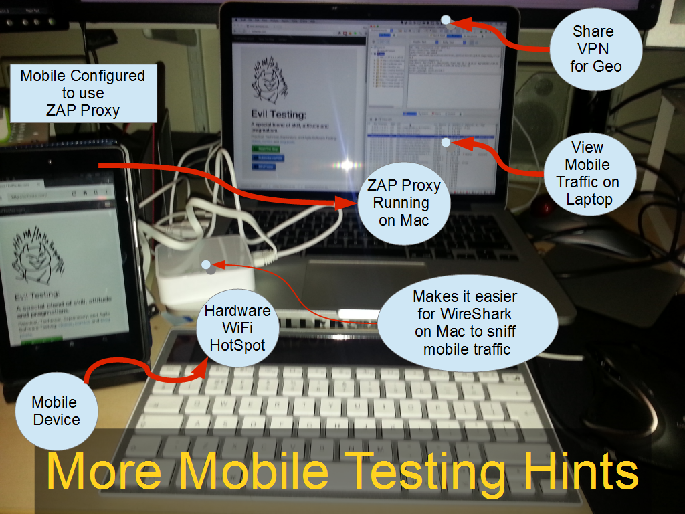\

Now when I'm doing mobile testing I'll generally work through proxies. Sometimes it's hard to set the mobile apps to point to a proxy because they bypass the operating system proxies. I have hotspots, I have a little portable Wi-Fi hotspot that I point the mobile device at, that chains through into my laptop which is connected so I can monitor the traffic. I can monitor the traffic a lot easier using the Wireshark when it's going through my portable Wi-Fi hotspot which makes it easier to sniff the traffic that I can't change it.

Benefit of doing all this is my laptop can hook into a VPN and I can do geolocation testing a lot easier. It can be pretty fiddly to change the geo stuff on your mobile device. If you're working with multiple mobile devices it's a real pain to change them all to different geo locations. If they're all going through my Wi-Fi hotspot and I change my laptop to a different geolocation I can test the geolocation on lots of different devices at the same time, makes things a little bit easier. I can see all the traffic coming from the mobile device and then I can do the same thing. I can amend it, I can interrogate, I can manipulate it, I can simulate server errors coming back from the server with the mobile device. It opens up an entirely new world for doing this.

## Reflection

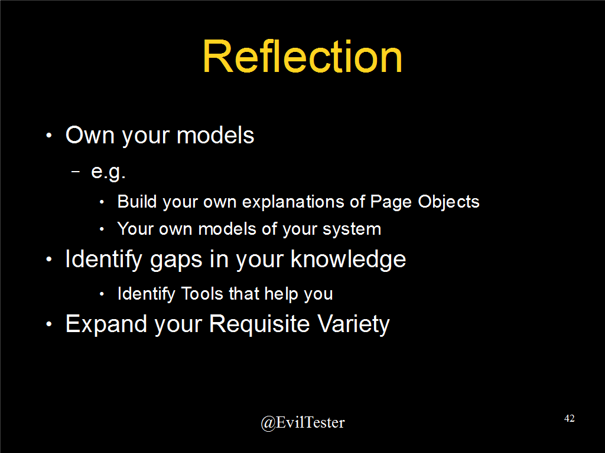\

The other important part is and I've already mentioned this is when you build up your models is to look at them for gaps. You have to own your model. Don't assume that the models you see online are good enough for you because they may have assumptions built in. They may have more technical knowledge than you understand. But it's important that you own your model, that you identify gaps in the model and that you cover them and expand them because you want to focus on your requisite variety.

## Some Recent Tools I Used

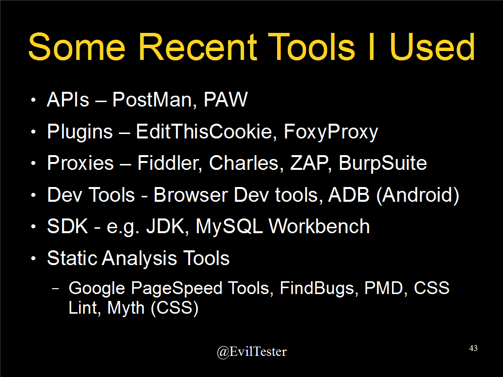\

I'm going to tell you some tools that I use. Just to kick start your investigations.

For APIs I've been using Postman, which is a Chrome plugin or Paul on the Mac, I prefer to use Postman. I don't use a lot of plugins in my browsers. I have edit this cookie in Chrome because we can't really edit the cookies, we can't really manipulate the cookies, we can inspect them and observe them, but very often we can't change them and certainly can't create new ones. I use plugins to help me do that. I use FoxyProxy to switch between the different proxies, makes it easy. FoxyProxy's just a little plugin, runs in FireFox and Chrome and I can say right, go off to port 8888, go off to port 800, go off to Fiddler running on my Mac, I can set it up a little easier. I use the dev tools in whatever browsers we've got. I use the dev tools that come with the device, so the Android debug tools. I'll use whatever tools are available in the Dev Kit for profiling or for static analysis.

I'll use whatever tool I've got too hand.

This is a list to investigate but really it's not about the tools.

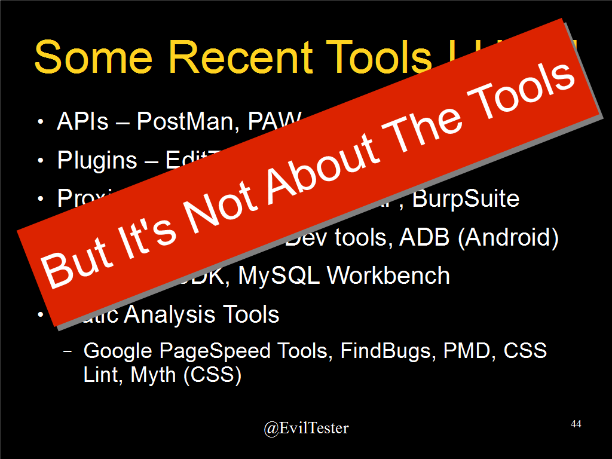\

It's about the thought processes that lead to the tools. It's about I need to send requests into the API, how can I do that? There's a whole bunch of different ways I can do it, Postman makes it easy so I try that. It's about knowing what your model is, knowing what you're trying to target in that model and then finding tools to help you do that.

## Books used during this talk

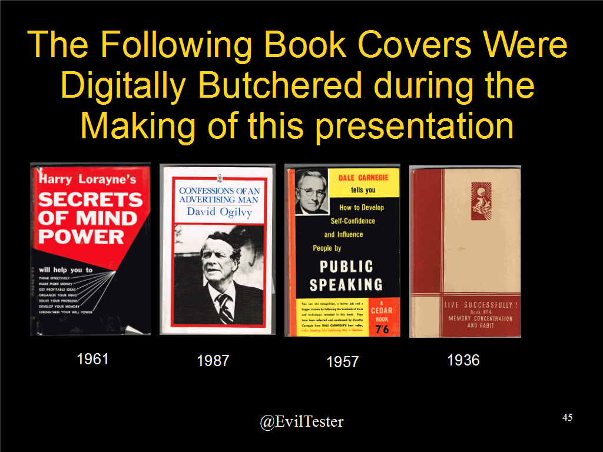\

I use these self-help books during the presentation, just as covers.

* Harry Lorayne's Secrets of Mind Power, 
* David Ogilvy's Confessions of an Advertising Man, 
* Dale Carnegie's Secrets of Public Speaking 
* and one of the Live Successfully books from 1936

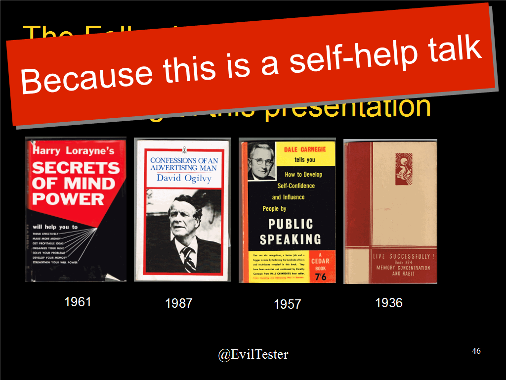\

The reason I did that is that this is a self-help talk. Fundamentally you have to do the work and it is work. It might seem like hard work but the benefits are massive. I guarantee you the benefits are massive to your test approach.

## The 5 secret keys

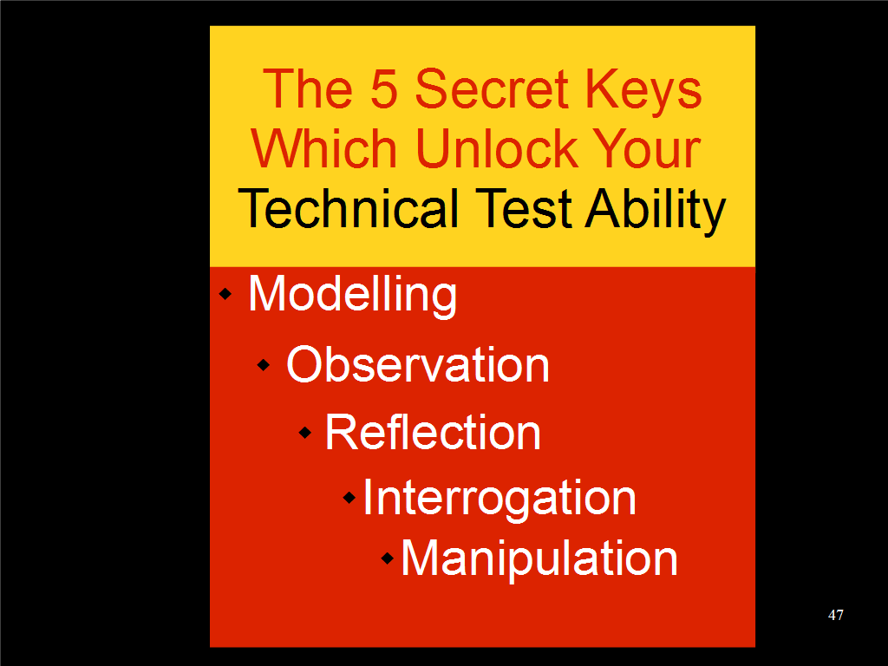\

The 5 secret keys which unlock your technical test ability which we have already covered and all I want you to do is work on them a little bit.

Modeling, owning your model of the world, understanding your system, understanding what technology is in use so that you can then identify tools and you can identify risks. 

Having the ability to observe, observation is really important. Having the ability to observe the traffic. Knowing what you're observing, understanding what you're seeing and looking at.

And making sure you think about this to continually expand and refine it because then you will come back to your testing with an intent, built on technical risk or built on things you've observed and not just the requirements.

We have to have the ability to interrogate this in more detail. To ask specific questions of the traffic, did we cover this particular request? To ask specific questions in the database, to ask specific questions on the server logs.

And fundamentally for testing we need the ability to manipulate. 

If you keep those 5 keys in mind, are you able to model this? Do you understand the model? Can you observe, reflect, interrogate and manipulate? Then you will start to adopt the technical testing approach and way of thinking.

## The End

With that I leave you, thank you very much. 

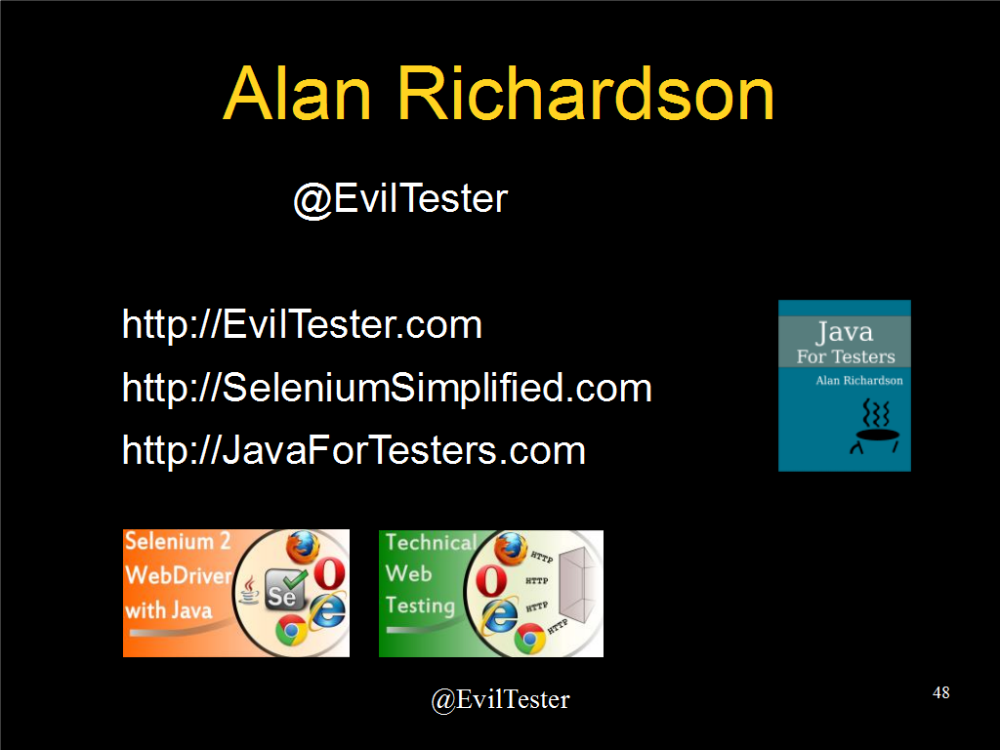\

