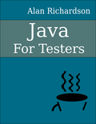
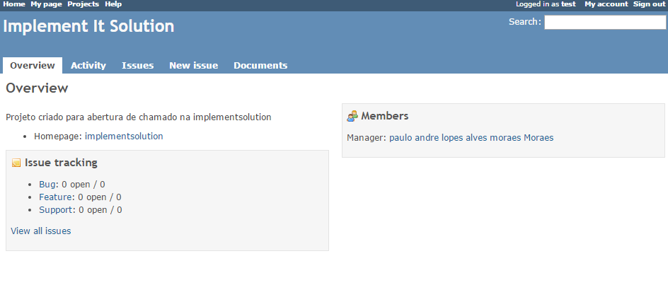
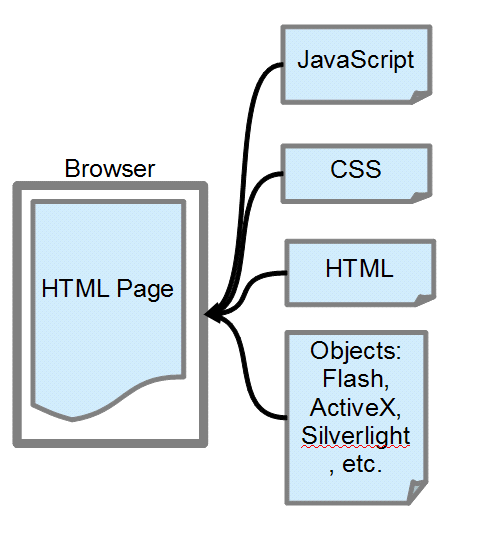
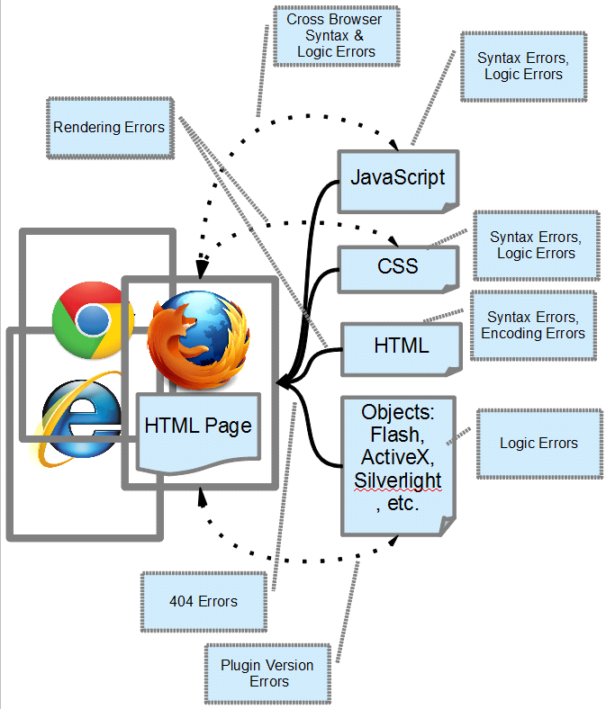
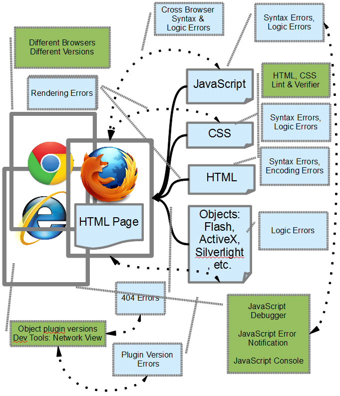

<!-- footer: @EvilTester -->

<!-- Slide 1 -->

# Technical Testing in An Agile Environment

Agile And Automation Days Tutorial

Alan Richardson

www.eviltester.com

www.SeleniumSimplified.com

www.JavaForTesters.com

www.CompendiumDev.co.uk

---

<!-- Slide 2 -->

# Section 01: Introduction

---

<!-- Slide 3 -->

# Blurb 1

Let’s adopt the view that when we test on Agile projects we want to add value as often and quickly as possible.

On this tutorial we will use a mix of discussion, instruction, exercises and debriefs to explore what it means to work in an Agile Environment and how we can push our testing beyond user stories and test at a technical level.

We will test an application together, and you will be challenged to add your unique value to the group. You will draw upon your experience as you test, share your thoughts and ideas, and learn nuances and new approaches from the group, and your own explorations.

Bring a laptop, or other electronic computing device which you think can use for testing, because this is a practical class and you will engage in hands on testing. Load your chosen device with whatever tools and resources you think you need. You can use them, and share them, because we want to learn from each other and explore what it means to conduct Technical Testing in an Agile Environment.

---

<!-- Slide 4 -->

# Blurb 2

Some stuff we will cover:

- How to use Systems Thinking to test technically and understand the “System under development”
- How to use System Thinking to understand the “System of development” and adjust your test approach accordingly
- What does “Technical Testing” mean?
- How far to push the boundaries of user stories
- How to improve your technical skills and abilities
- Technical Testing does not mean Automation
- What are your existing “technical skills” – you probably have more than you think.
- Risks and Issues with technical testing, and strategies to counter them
- How to document and describe your technical testing to others
- How to justify, and use Technical Testing in an Agile Environment

---

<!-- Slide 5 -->

# Alan Richardson

Blogs and Websites

- CompendiumDev.co.uk
- SeleniumSimplified.com
- EvilTester.com
- JavaForTesters.com
- Twitter: @eviltester

Online Training Courses

- Technical Web Testing 101
- Intro to Selenium
- Selenium 2 WebDriver API

Videos

youtube.com/user/EviltesterVideos

Books

Selenium Simplified

Java For Testers

leanpub.com/javaForTesters

Alan Richardson

uk.linkedin.com/in/eviltester

Independent Test Consultant & Custom Training

Contact Alan

http://compendiumdev.co.uk/contact

---

<!-- Slide 6 -->

# I've worked on Agile as

- Tester
- Test Manager
- Test Consultant
- Automator
- Automation Consultant
- Agile Consultant

---

<!-- Slide 7 -->

# Barriers

- Expectations & Beliefs
- Skills
- Experience

These tend to be what I focus on with projects.

---

<!-- Slide 8 -->

# Tools

- Systems Thinking & Modelling
    - Modelling, Cybernetics, Psychotherapy, ...
- Technical Knowledge
    - Programming, Databases, Protocols, ...
- Testing Knowledge
    - Techniques, Exploration, Note Taking, etc.

Not so much 'Agile' knowledge

---

<!-- Slide 9 -->

# What about you?

- Roles?
- Technical? Y/N
- Initial Questions?
- Aims?

---

<!-- Slide 10 -->

# We will be testing...

- Redmine
    - http://redmine.org
        - http://demo.redmine.org
    - Web GUI
    - API
- Project – issue management system
    - Basic CRUD system
- Open Source - Rails

---

<!-- Slide 11 -->

# Logistics & Check Environment Up

- [ ] Check
    - admin \ settings \ authentication
    - automatic account activation
    - enable rest web service
- [ ] Allocate Admin Users
    - User01, user0x, user1x, user2x
    - aPassword

---

<!-- Slide 12 -->

# Section 02: Baseline Exercise

---

<!-- Slide 13 -->

# Exercise: Recognise the Baseline

- Test The Following Stories
    - 10 mins testing, however you want
        - “A user should be able to register on the system and login using their registration details”
    - 5 mins testing, however you want
        - “A user can only login with the correct credentials, an error message is shown when invalid, this should maintain privacy”
    - 10 – 15 mins debrief

OR: http://demo.redmine.org

Or install from bitnami.org or from redmine.org

---

<!-- Slide 14 -->

# 10 Min Debrief

- What did you do / find / use?
- How did you
    - Decide what to test?
    - Make Notes?
- My notes
    - 13:00 Redmine Testing Notes
    - 13:10 Redmine Testing Notes
- Any Questions/Comments?

---

<!-- Slide 15 -->

# Section 03: Expectations & Beliefs

- A series of short discussions to identify current beliefs and expectations

---

<!-- Slide 16 -->

# Expectations & Beliefs

- A series of short discussions to identify current beliefs and expectations
    - What is Agile?
    - What is Testing?
    - What is Agile Testing?
    - What is Technical Testing?
    - What is Technical Testing in Agile?
    - What are your existing “Technical Skills”

---

<!-- Slide 17 -->

# What 'is' Agile?

- Build a model, not a definition

---

<!-- Slide 18 -->

# What 'is' Testing?

- Build a model, not a definition
- What do we do?

---

<!-- Slide 19 -->

# What 'is' Agile Testing

- Build a model, not a definition
- What do we do?
- How do we do it?
- When do we do it?

---

<!-- Slide 20 -->

# What is Technical Testing?

---

<!-- Slide 21 -->

# A description of Technical Testing

- A reminder to keep “going deeper”
- Tool Augmentation
- Technical details will:
    - inspire more testing
    - identify more risks
    - Identify different problems
- Not limit our testing to Acceptance Criteria

---

<!-- Slide 22 -->

# MORIM

- Model
    - What I think I understand. Different viewpoints.
- Observe
    - at different points to corroborate/invalidate model
- Reflect
    - find gaps, lack of depth, derive intent
- Interrogate
    - Focussed, deep dive observation with intent
- Manipulate
    - Hypothesis exploration and “how we do stuff”

---

<!-- Slide 23 -->

# It means "Tool Augmentation"

- Is not automation, I automate when appropriate
- Tools to passively observe, maintain history of observations
- Tools to alert on specific conditions
- Tools to observe the unobserved, and interrogate the inaccessible
- Tools to help me model and reflect
- Tools to help me manipulate
- ... etc.

Never tools to control. Tools to augment.

---

<!-- Slide 24 -->

# How I describe what I do

- Not a definition
- A description of my current approaches
- I try get as deep and technical as I can
- I need to keep learning so that I can understand the technology

---

<!-- Slide 25 -->

# Go Beyond the surface structure

- Transformational Grammar
    - Surface & Deep Structure
    - Chomsky
    - Multiple surface structures
    - Single Deep structure
        - Filtered, biased, distorted → Surface Structure
- Questions operate as tools to investigate Surface to Deep mapping people

---

<!-- Slide 26 -->

# Questions operate as tools to investigate Surface to Deep Mapping

“login doesn't work”

- How specifically?
- How do you know?
- Ever? At all?
- ...etc.

We ask the system questions

---

<!-- Slide 27 -->

# How to do Technical Testing?

- Identify tools to work with System Surface Structures
- Questioning Systems at different Surface Levels
- Learning System Structure Technology
- Model System Surface Structures
- Observe System Surface Structures

---

<!-- Slide 28 -->

# What is Technical Testing in Agile?

- How far to push the boundaries of user stories?
- If we go too far:
    - is it a bug?
    - does it add value?
    - did we estimate for that?
    - how do you justify that?

---

<!-- Slide 29 -->

# Why Technical?

- Work with current system, not with an ideal
- Work with current system, not a generalised model

---

<!-- Slide 30 -->

# Exercise: What are your existing “Technical Skills”?

- Collate and build a model of your skills
- For bonus points, identify some skills you want to develop:
    - now
    - short term
    - medium term
    - long term

---

<!-- Slide 31 -->

# Section 04: Browser Based Exploration

---

<!-- Slide 32 -->

# Demo of Browser Based Tools

- Dev Tools - Chrome
- Dom Manipulation
- Traffic Viewing
- Resources – cookie manipulation
- Mobile Simulation

---

<!-- Slide 33 -->

# Exercise: exploration using only Browser Based Tools

- Using only browser based tools, explore system
- Use parts of the dev tools you haven't used before
- If you have used them before, use them to test the system from a more technical perspective
- Take enough notes to allow you to debrief with the group

---

<!-- Slide 34 -->

# Debrief

- What did you explore?
- What features of the tool did you use to help?
- How did they help?
- How else could you do that?
- What did you want to do but couldn't figure out how to do?

---

<!-- Slide 35 -->

# Section 05: Agile Story Testing

---

<!-- Slide 36 -->

# Working with stories

- What can we test from a story?
- How do we test with stories?
- What do we need on the story to test?

---

<!-- Slide 37 -->

# What is your test strategy/approach for Agile Testing?

- How do/will you estimate?
- How do/will you plan your testing?
- How do/will you track your testing?
- What results do/will you keep?
- Scripted? Exploratory?
- How do/will you report your testing?
- Would you automate?

---

<!-- Slide 38 -->

# Group Exercise: Discuss and plan testing for

- “A user can only log in with the correct credentials, an error message is shown when invalid, this should maintain privacy”

---

<!-- Slide 39 -->

# Group Exercise: Discuss & Plan Testing For

- “A user should be able to register on the system and login using their registration details”

---

<!-- Slide 40 -->

# Would you test differently from the first time you tested these stories?

---

<!-- Slide 41 -->

# Exercise: Hands On Testing to Implement your approach/strategy

- “A user should be able to register on the system and login using their registration details”
- “A user can only log in with the correct credentials, an error message is shown when invalid, this should maintain privacy”

---

<!-- Slide 42 -->

# Debrief

- Did you test differently?
- What notes did you make?
- Would this work in the real world?
- Any 'technical testing' observations?

---

<!-- Slide 43 -->

# Observations: Working From Stories

- Ask questions
- What are the acceptance criteria?
    - Understood? Clear? Checkable? Examples?
- Questioned limits in the planning?
- Document testing 'in the story'
    - Whatever system used for Agile Planning – use for test documentation & tracking
- Other Observations?

---

<!-- Slide 44 -->

# Section 06: Systems Thinking & Modelling

---

<!-- Slide 45 -->

# Web Context: A Browser View

---

<!-- Slide 46 -->

# Exercise: Browser Web Context Risks

- What risks exist at this level?
    - Identify
    - Discuss
- What tools could help?

---

<!-- Slide 47 -->

# Web Context: A Browser View – Technical Risks

---

<!-- Slide 48 -->

# Web Context: A Browser View – Technical Tooling Augmented

---

<!-- Slide 49 -->

# Exercise: Generic Web Application

Browser ↔ Server ↔ Database

Build a model:

- What happens where?
- What risks exist?
- What could we observe where?
- Where could we manipulate?
- What tools could you use?

---

<!-- Slide 50 -->

# Generic Web Application

Browser ↔ Server ↔ Database

HTTP Traffic

Cookie Creation

JSON, XML

Files: img, pdf, etc.

Rendering

CSS

Cookies

JavaScript

HTTP Logs

Application Logs

Schema

Data

---

<!-- Slide 51 -->

# Exercise: Redmine Web Application

Browser ↔ Server ↔ Database

Build a more specific Model:

- What technologies used?
- What risks exist?
- What happens where?
- What could we observe where?
- Where could we manipulate?

---

<!-- Slide 52 -->

# Modelling Redmine

- Redmine is a 'Web Application'
- GUI in Browser
- Has a REST API
- Written in Ruby using Rails
- MySQL Database

---

<!-- Slide 53 -->

# Redmine Web Application

Browser ↔ Server ↔ Database

HTTP Traffic

Cookie Creation

JSON, XML

Files: img, pdf, csv

Rendering

CSS

Cookies

JavaScript

Apache HTTP Logs

Application Logs

Ruby

Mysql

Schema

Data

---

<!-- Slide 54 -->

# What tools do we need to augment our testing?

- What can we observe?
- What tools do we need to observe?
- What can we manipulate?
- What tools do we need to manipulate?

---

<!-- Slide 55 -->

# What tools do we need?

- What can we observe?
    - Http traffic, cookies, javascript execution, log files, data in the database, DB schema used
- What tools do we need to observe?
    - HTTP Proxy (Burpsuite, ZAP Proxy, Fiddler), Browser Developer Tools (in browser), DB Tool (mysql, mysql workbench), Text Editors, Log File Viewers (tail -f)
- What can we manipulate?
    - HTTP Traffic, DOM, Cookies, DB, Config
- What tools do we need to manipulate?
    - All of the above

---

<!-- Slide 56 -->

# Exercise: What questions do we need answered?

- From a technical perspective, what questions do we need answered to allow us to observe and manipulate this particular system?

---

<!-- Slide 57 -->

# What questions do we need answered?

- How can I log on to the server?
- What are the user name and password?
- What is the hostname?
- How can I access the database?
- Where are the logs?
- Do I have permissions?
- Etc.

---

<!-- Slide 58 -->

# How does this help us with 'testing'?

---

<!-- Slide 59 -->

# How does this help us with 'testing'?

- The GUI might not show everything
- The DB might have something different from the GUI
- We might see something in the log that triggers a test idea
- We might see errors and exceptions in the logs
- We want to remove all limits to our test ability
- etc.

---

<!-- Slide 60 -->

# Section 07: Tool Demos

---

<!-- Slide 61 -->

# Demos to answer - Generic Questions based on system

How do I use?

- Browser Tools
- HTTP Proxies
- API

---

<!-- Slide 62 -->

# Tools

- API
    - PostMan – https://www.getpostman.com/
- Proxy
    - Easy
        - Fiddler - http://www.telerik.com/fiddler (windows .net)
        - Charles - http://www.charlesproxy.com/
    - Advanced
        - BurpSuite - https://portswigger.net/burp/
        - Owasp ZAP - https://github.com/zaproxy/zaproxy
- Browser addons
    - FoxyProxy - https://getfoxyproxy.org/
    - EditThisCookie - http://www.editthiscookie.com/
    - FireBug - http://getfirebug.com/

---

<!-- Slide 63 -->

# Section 08: Hands On Testing

---

<!-- Slide 64 -->

# Hands on Exploratory Learning Exercises

- Pick an area of the system to test
- Choose a technical approach:

a) Browser & Dev Tools only

b) Add Proxy tools into the mix and work at the Message level too

c) Work from the API and conduct testing there

d) On your own install you could look at the DB or the Server

- Test the system, and for each of the above: track your questions and how you answer them

- what do you learn?

- How did you do it?

- How else could you do it?

- What do you not know that you need to know?

20 mins then debrief

---

<!-- Slide 65 -->

# Debrief

- Questions?
- Observations?

---

<!-- Slide 66 -->

# Section 09: Hands On Testing

---

<!-- Slide 67 -->

# A Redmine Testing Session Review

- See 13:15 Redmine Test Session Notes
- Discussion for ideas and observations

---

<!-- Slide 68 -->

# Hands on Exploratory Testing Exercise

Choose between:

- Free form testing
- Revisit the registration story testing using what you learned from the Exploratory Learning Exercise
- Revisit the login story testing and go deeper

Make enough notes to support a debrief

---

<!-- Slide 69 -->

# Debrief

- Did that help?
- Did you see anything different?
- Thoughts?
- Issues?
- Concerns?
- see my 13:15 Redmine Technical Testing Notes

---

<!-- Slide 70 -->

# Section 10: How to Improve your technical skills

---

<!-- Slide 71 -->

# How to improve your technical skills?

- How?
- Discussion?

---

<!-- Slide 72 -->

# How to improve your technical skills

- Practice
- Learning
- Experiment
- Model Application → Identify Technology → Learn the Technology → Tools for technology? → Observe? → Manipulate? → What do we learn then? → Model Application
- Doing

---

<!-- Slide 73 -->

# Exercise: From what we have covered...

- What do you need to learn?
- What did you not understand?
- What was new?
- What did you not try?

- spend 10 mins building a research and confusion list
- If you finish early then start the research
- We will debrief

---

<!-- Slide 74 -->

# Debrief: Shortcut the learning

- Let's see if we can answer some of those technical questions and confusions now
- Q&A
- Sites
- Tools
- Any More Demos?

---

<!-- Slide 75 -->

# Section 11: The System 'of' Development

---

<!-- Slide 76 -->

# Agile Generics

- Agile == Context
- Stories
- Iteration / Sprint
- Planning / Estimates
- Backlog
- Retrospectives
- Stand ups
- Acceptance Tests

---

<!-- Slide 77 -->

# Agile == Context

- Each project is different
- Each project is a specific instance of 'Agile'
- Each project changes depending on its team
- Team Members add Unique value & constraints
- Each project is a System
- Each team member is a System
- System is complex set of communication and relations

---

<!-- Slide 78 -->

# Stories in General

- A basis for understanding
- A basis for agreement of scope
- Question them
- I write down the
    - The questions I asked
    - answers to questions against the story
    - The 'agreements we made'
    - How I think I will test it, How I tested it, What I didn't test, what we agreed not to test, outstanding risks, etc.

---

<!-- Slide 79 -->

# Iteration / Sprint

- Things to fit in: exploration, reviews, meetings, rework, refactoring, execution, tracking, pairing, etc.
- I find myself 'nagging' to keep us inside the sprint. To avoid test pushed out to next sprint or 'late' delivery of stories.

---

<!-- Slide 80 -->

# Planning / Estimates

- Some tasks have dependencies
- Do voice concerns about low estimates
- Do make sure estimates cover testing
- Do make sure estimates cover exploration
- Do make sure estimates cover technical debt etc.

---

<!-- Slide 81 -->

# Backlog

- Add testing tasks to backlog to cover risks
- Add testing tasks to backlog to cover testing debt
- Push for technical debt that impacts testing to be played
- Push for testability in the backlog
- Push for acceptance criteria
- Consider testability in the order of story playing

---

<!-- Slide 82 -->

# Retrospectives

- Don't just pat on the back
- Raise process issues that impact
- Agree 'what to do about them'
- Treat Broken Windows
- You might have to be Mr Nag & Mrs Nasty

---

<!-- Slide 83 -->

# Stand ups

- Pay attention to change of plans
- Pay attention to what might impact your testing
- Describe in value terms – what did you find? Any new risks? What looks OK?
- Ask for reviews of your notes and work
- See if you can pair early on Unit Testing
- Report that things are bigger than you thought
- Seek help
- etc.

---

<!-- Slide 84 -->

# Acceptance Tests

- Abstraction layers
- Re-use abstraction layers for adhoc automation as well as Acceptance tests
- Seek to understand technicalities as well as domain
- Pair – don't just leave it all to test, or all to dev

---

<!-- Slide 85 -->

# Your project is a specific instance

---

<!-- Slide 86 -->

# Section 12: Technical Testing Risks & Issues

---

<!-- Slide 87 -->

# Your concerns

- Do you spot any risks and issues with 'technical testing'?

---

<!-- Slide 88 -->

# What Risks and Issues might the tools add?

- Proxy Tools?
- Dev Tools?
- SDK?
- etc.?

---

<!-- Slide 89 -->

# Technical Testing Risks & Issues

- How to Justify?
- How to document?
- How to avoid doing too much?
- How to get the time to learn?
- What if we just want to check the Acceptance Criteria?

---

<!-- Slide 90 -->

# Technical Testing Risks & Issues

- Take responsibility for your testing
- Is anyone really going to stop you from doing the best testing you can?
- You can learn, as you add value. Take small steps.
- You can learn, as you pair. Ask questions, take notes. Apply your 'testing super powers' to the information you get.
- Use technical testing to 'push' for more access to environments and system internals

---

<!-- Slide 91 -->

# Exercise: Concentrate on Note Taking

- Perform some more testing. But this time concentrate on your note taking.
- e.g. take notes in a text document, or mind map

---

<!-- Slide 92 -->

# Debrief on note taking

- Did you add timestamps?
- Did you have screenshots?
- How did you organise your notes?
- Do they work on their own, or do you need to edit them ?
- If this was an agile project, and you had to record your notes against the story, how would you do that?
- Could any tools we’ve used help with note taking or evidence gathering?

---

<!-- Slide 93 -->

# Section 13: Research Section

---

<!-- Slide 94 -->

# Some Useful Research Links

- Michael Bolton Webinar
    - A New Agile Testing Ecosystem
    - https://www.youtube.com/watch?v=LgOTi1ifJPA
- Book: Domain Driven Design by Eric Evans
    - http://dddcommunity.org/
- Book: The Web Application Hackers Handbook
    - by Dafydd Stuttard (Author), Marcus Pinto (Author)

---

<!-- Slide 95 -->

# Tools

- PostMan – https://www.getpostman.com/
- BurpSuite - https://portswigger.net/burp/
- Fiddler - http://www.telerik.com/fiddler
- Owasp ZAP - https://github.com/zaproxy/zaproxy
- Charles - http://www.charlesproxy.com/
- FoxyProxy - https://getfoxyproxy.org/
- EditThisCookie - http://www.editthiscookie.com/
- FireBug - http://getfirebug.com/

---

<!-- Slide 96 -->

# Topics to investigate

- Stafford Beer viable Systems model
    - http://www.scio.org.uk/node/12
    - https://www.youtube.com/watch?v=JJ6orMfmorg
- General Semantics
- W. Edwards Deming
- The Structure of Magic vols 1&2 by Richard Bandler and John Grinder
    - See also http://www.compendiumdev.co.uk/nlp

---

<!-- Slide 97 -->

# Topics To Investigate

- Cybernetics
    - http://pespmc1.vub.ac.be/
    - http://www.cybsoc.org/
- Ross Ashby – Requisite Variety
    - https://archive.org/details/introductiontocy00ashb
    - https://archive.org/details/designforbrain00ashb
- Norbert Wiener
    - https://archive.org/details/NorbertWienerHumanUseOfHumanBeings

---

<!-- Slide 98 -->

# Q&A

- Any Questions?

---

<!-- Slide 99 -->

# More Testing

---

<!-- Slide 100 -->

# Section 14: End & Summaries

---

<!-- Slide 101 -->

# End

- Q&A
- Keep Pushing your Testing
    - Identify technical knowledge gaps
    - Test and observe in those gaps
    - Then Interrogate and Manipulate in those gaps
    - Find tools to support your testing
- Agile Stories help keep us on track and avoid technical ratholes

---

<!-- Slide 102 -->

# Alan Richardson

Blogs and Websites

- CompendiumDev.co.uk
- SeleniumSimplified.com
- EvilTester.com
- JavaForTesters.com
- Twitter: @eviltester

Online Training Courses

- Technical Web Testing 101
- Intro to Selenium
- Selenium 2 WebDriver API

Videos

youtube.com/user/EviltesterVideos

Books

Selenium Simplified

Java For Testers

leanpub.com/javaForTesters

Alan Richardson

uk.linkedin.com/in/eviltester

Independent Test Consultant & Custom Training

Contact Alan

http://compendiumdev.co.uk/contact

