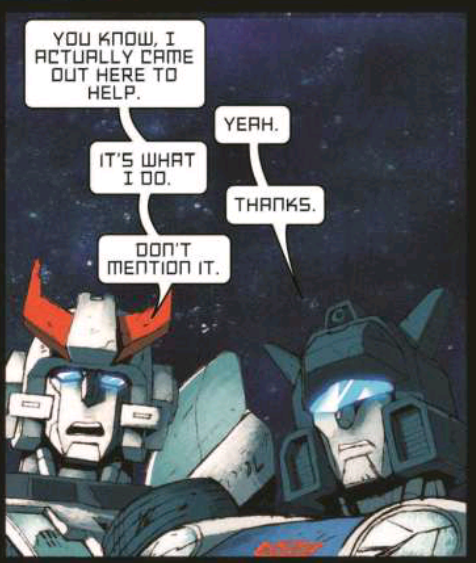
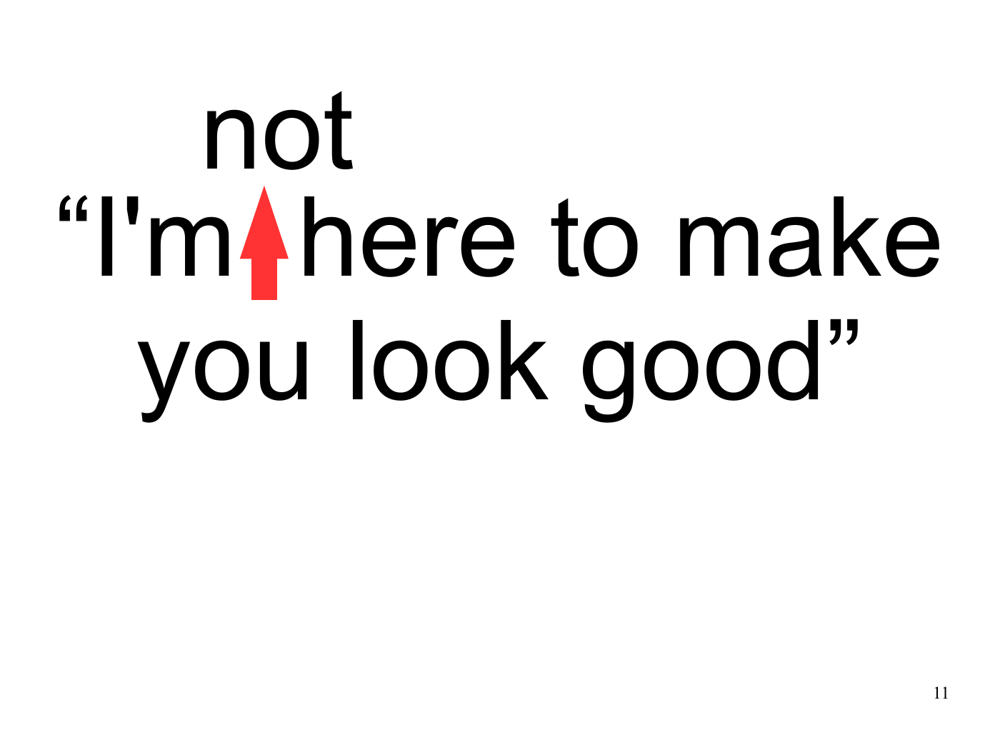
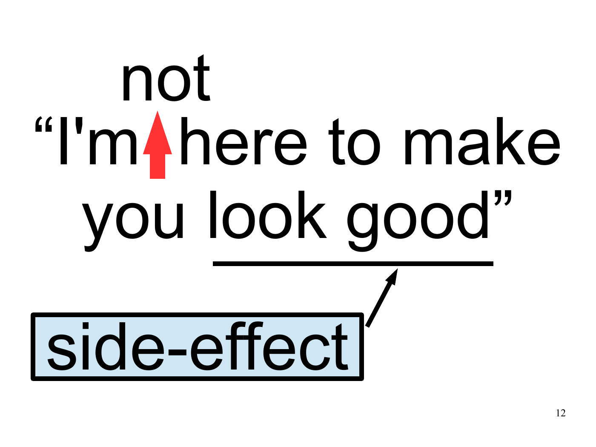
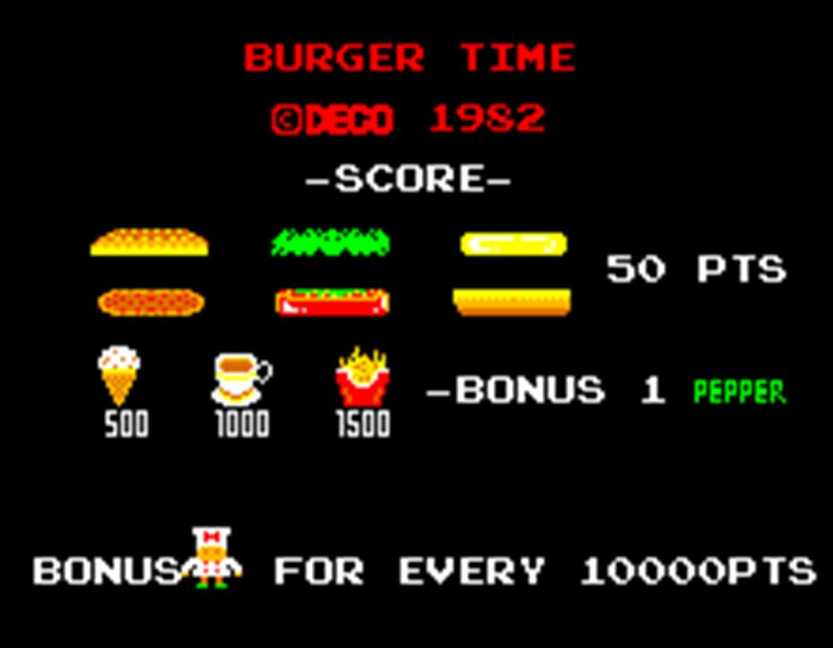
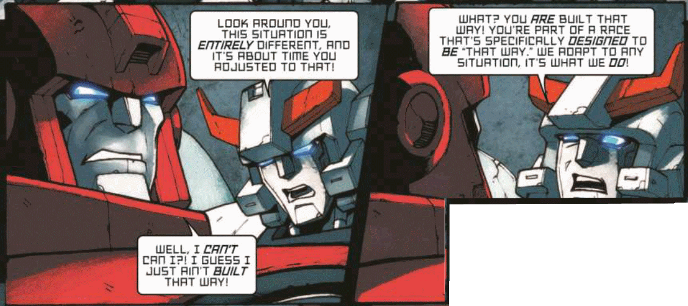
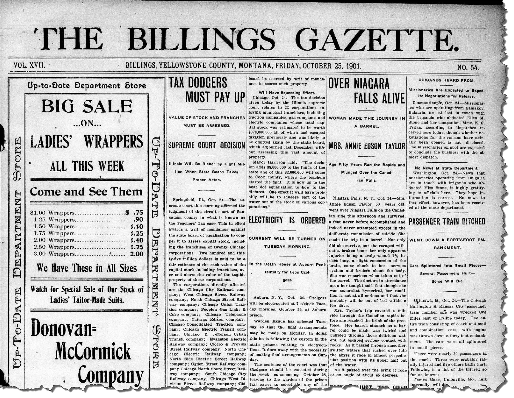
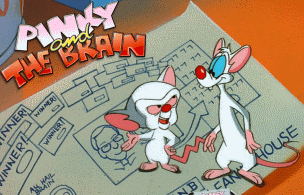
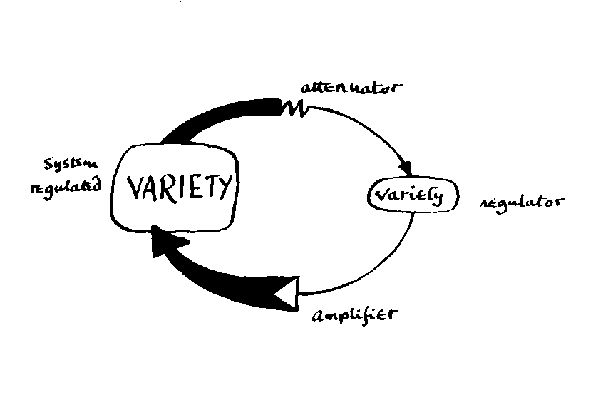
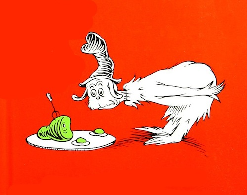
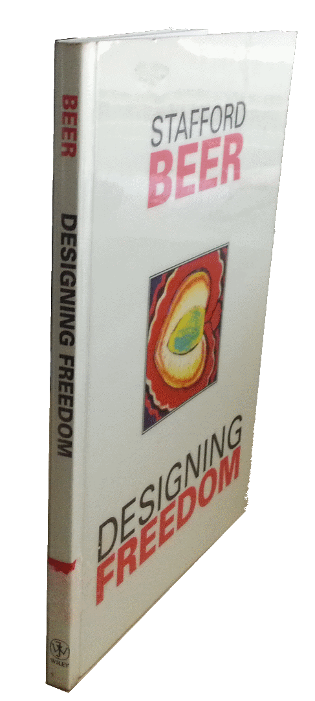

<!-- footer: @EvilTester -->

<!-- Slide 1 -->

# Helping Testers Add Value to Agile Projects

Alan Richardson

EvilTester.com

@eviltester

SeleniumSimplified.com

JavaForTesters.com

CompendiumDev.co.uk

---

<!-- Slide 2 -->

# Warren Zevon (1947 - 2003)

“Ain't that pretty at all”, The Envoy, 1982

---

<!-- Slide 3 -->

# We can get Jaded & Disillusioned

Well, I've seen all there is to see

And I've heard all they have to say

I've done everything I wanted to do . . .

I've done that too

Warren Zevon, “Ain't that pretty at all”, 1982

“

”

---

<!-- Slide 4 -->

# Reality doesn't match our wants

And it ain't that pretty at all.

Ain't that pretty at all.

“

”

Warren Zevon, “Ain't that pretty at all”, 1982

---

<!-- Slide 5 -->

# We may not have strategies to cope

So I'm going to hurl myself against the wall

'Cause I'd rather feel bad than not feel anything at all

“

”

Warren Zevon, “Ain't that pretty at all”, 1982

---

<!-- Slide 6 -->

# Sometimes my job...

I've been to Paris

And it ain't that pretty at all

I've been to Rome

Guess what?

“

”

Warren Zevon, “Ain't that pretty at all”, 1982

---

<!-- Slide 7 -->

# … the real world is what it is

And sometimes it ain't that pretty at all

---

<!-- Slide 8 -->

# I help testers survive in Agile Projects

- …by working with 'reality' rather than an ideal
- ...by adding 'value'
- ...by becoming a viable part of the project

The Transformers: All Hail Megatron, Volume 1, IDW Publishing

---

<!-- Slide 9 -->

# Thank you for everything, Westley, good night now, I'll probably kill you in the morning.

The Dread Pirate Roberts, as quoted by S. Morgenstern, in “The Princess Bride”, abridged by William Goldman for text and screen page 165, 1976, Pan Books Ltd

”

“

---

<!-- Slide 10 -->

# Making You Look Good

“I'm here to make you look good”

---

<!-- Slide 11 -->

# Making You Look Good: Not the Goal

---

<!-- Slide 12 -->

# Making You Look Good: A Side Effect

---

<!-- Slide 13 -->

# Survival != Fitting In

If you do this automatically, then keep doing it, because you do it, but don't start thinking it adds value, or helps you fit in.

- Lunching
- Raconteur
- Buying Doughnuts
- <insert fluffy people stuff>
- ...etc.

---

<!-- Slide 14 -->

# Survival == Adding Value by Doing Testing Stuff

- Finding problems
- Checking Acceptance Criteria
- Testing
- Making your Test Coverage Visible
- Pairing on ATDD
- …etc.

---

<!-- Slide 15 -->

# We survive when we learn to adapt to the System Of Development

...we already know how to work with the System Under Development

The Transformers: All Hail Megatron, Volume 1, IDW Publishing

---

<!-- Slide 16 -->

# “I would sooner walk up to the mouth of a cannon, knowing it was going to blow me to pieces than make another trip over the Fall”

Annie Edson Taylor, after surviving her Niagra Falls Waterfall Barrel Drop

http://chroniclingamerica.loc.gov/lccn/sn84036008/1901-10-25/ed-1/seq-1/

---

<!-- Slide 17 -->

# I Survived Waterfall

- By removing waste
- By responding to need, not want
- By exploring more
- By taking responsibility for my testing rather than conforming to 'the process'

---

<!-- Slide 18 -->

# Creating Systems - William Blake

I must create a system. or be enslav'd by another Mans; I will not reason & compare: my business is to create

William Blake, 1820

Jerusalem: The Emanation of the Giant Albion

http://www.blakearchive.org/exist/blake/archive/object.xq?objectid=jerusalem.e.illbk.10&java=no

“

”

---

<!-- Slide 19 -->

# I remember a time before I worked on an Agile Project

- Based on reading the hype: the books, the articles, etc. I sooooo wanted out of Waterfall.
    - … the utopia
    - … the ideal
        - Building the 'beliefs' about how Agile works
        - Building 'models' of the ideal process

---

<!-- Slide 20 -->

# I remember the first time I worked on an 'Agile' Project

---

<!-- Slide 21 -->

# I remember the first time I worked on an 'Agile' Project

And it ain't that pretty at all.

Ain't that pretty at all.

”

“

---

<!-- Slide 22 -->

# I Got Stuck

---

<!-- Slide 23 -->

# Stuck on...

- Being asked to write a test strategy
- 'Poor' Stories and Acceptance Criteria
- Pairing badly on TDD
- Not knowing how to add value around the automated tests
- Knowing that no-one else knew what to do with a 'tester' on the team
    - I thought there was something 'special' about Agile
    - I thought “they'd” know

---

<!-- Slide 24 -->

# So I did what I always do...

---

<!-- Slide 25 -->

# So I did what I always do...

...try to take over the world!

“

”

Pinky and 'The Brain'

http://www.warnervideo.com/pinkyandthebrain/downloads/pinkydvd2_2_1280x1024.jpg

---

<!-- Slide 26 -->

# So I did what I always do...

...think about it as a system...

---

<!-- Slide 27 -->

# I think, I work with systems...

e.g.

- Software Systems
- People Systems
    - Individuals, Teams, Departments, etc.
- Tools & Support Systems
- Processes

Input, Output, Process, Relationships, Feedback, Fitness for Survival, etc.

---

<!-- Slide 28 -->

# What I did

- My Java knowledge wasn't good enough to add value when pairing with devs, so I improved my Java knowledge
- My TDD knowledge wasn't very good, so I built some code using TDD
- I didn't understand the technology we were using, so I researched the technology

I made myself comfortable pairing, working on, and reading the code base

---

<!-- Slide 29 -->

# What I did

- I looked close
    - at the existing TDD code to look for gaps. Then manually tested gap or added more JUnit code
- I looked far
    - What does the system do? How do we know it does?
    - What do the requirements want? Do they get it?
    - What do we think we had 'Done'? Had we?
    - How does this thing connect? Together. With Others.
    - Added automation with wider scope

---

<!-- Slide 30 -->

# What I did

- Made my 'thinking' visible in the wiki
- Made my 'testing' visible by adding work and notes in the tracking system
- Looked for new tools to help me 'see' the System working

No-one else knew what testing was supposed to look like, or do, so I made it visible.

---

<!-- Slide 31 -->

# What I did

- Considered 'risks' that the stories didn't cover
    - Performance
    - Multiple Users
    - Extreme Data
- Then targeted those 'risks' with 'testing'

---

<!-- Slide 32 -->

# So I did what I always did...

- map 'test process' around existing processes
- I improved my specific skills for the project
- I filled in gaps
    - asked questions about requirements
    - automation coverage

...I decided what to do.

---

<!-- Slide 33 -->

# I got hung up on 'Agile'. And I got stuck.

When I viewed it as a System, I got free.

---

<!-- Slide 34 -->

# I decided what to do

- Ignoring the expectations I had from 'Agile'
- I worked with what was currently happening

- 'Beliefs', 'Ideals', 'Research', 'Discussion' all help decide what to do next, and how to improve, but not what to do 'now'
- To work with 'now' I modelled the process as a 'system', with 'relationships', expectations, aims etc.

---

<!-- Slide 35 -->

# With Experience I learned...

- “Every Agile project is different, we know this, we don't do things 'by the book' on Agile projects.
- We learn, we interact, we change.
- We write the book we go along.
- Throughout all of this, testing needs to remain viable, and it needs to add value.
- Remaining viable in this kind of environment can be hard.”

---

<!-- Slide 36 -->

# With Experience I learned...

That, while I value on the items on the right, I value the items on the left more.

| Valued more | Also valued |
| --- | --- |
| Systems Thinking | Agile Books |
| Cybernetics | Agile Blogs |
| General Semantics | Agile Webinars & Lectures |
| Hypnosis | Agile Articles |
| Brief Therapy | Lean Software Books, Blogs, etc. |
| Chinese Strategy Philosophy |  |

---

<!-- Slide 37 -->

# With Experience I learned...

That, while I value on the items on the right, I value the items on the left more.

| Valued more | Also valued |
| --- | --- |
| Systems Thinking | Agile Books |
| Cybernetics | Agile Blogs |
| General Semantics | Agile Webinars & Lectures |
| Hypnosis | Agile Articles |
| Brief Therapy | Lean Software Books, Blogs, etc. |
| Chinese Strategy Philosophy |  |

Loot, Pillage,

Raid and Steal

from other

disciplines

---

<!-- Slide 38 -->

# I still have “beliefs” about Agile

- Flexible
- More Open to Suggestion
- More Free to Experiment
- Etc.

---

<!-- Slide 39 -->

# But do not call me a QA

I do not like that name QA,

I do not like it, not at all, QA we do not say.

“Tester!”, I do say,

“It describes me bester, and how I play”

So its far bester, to say tester,

And do not call me a QA

http://seuss.wikia.com/wiki/File:GREEN-EGGS.jpg

QA

---

<!-- Slide 40 -->

# “I've Helped Testers Survive on Agile Projects”

- New Testers (inexperienced)
- Experienced Testers New To Agile
- Experienced Agile Testers
- Mostly by: dealing with their beliefs and expectations, adapting their techniques

---

<!-- Slide 41 -->

# Experiment and Learn

To the creative mind there is no right or wrong. Every action is an experiment, and every experiment yields its fruit in knowledge.

The Illuminatus Trilogy

Robert Shea & Robert Anton Wilson

“

”

---

<!-- Slide 42 -->

# I try to foster an attitude of...

- Ownership for the tester's 'testing'
- Exploration beyond Acceptance Criteria
- Thinking about systems of 'behaviour', 'needs and wants'
- Improvement of self and test process
- Improvement of team and project process
- Speaking from individual experience
- Survival – assume that if you're not adding value, you're gone

---

<!-- Slide 43 -->

# only variety can absorb variety

- Stafford Beer restating Ross Ashby's Law of Requisite Variety
    - “Designing Freedom” published by John Wiley & Sons, 1974, on page 30

“

”

---

<!-- Slide 44 -->

# “only variety can absorb variety”

- Team's absorb behaviour and respond
    - “Designing Freedom” by Stafford Beer, published by John Wiley & Sons, 1974, diagram from page 31

---

<!-- Slide 45 -->

# The real world...

- is messy, and may not map to the books

“And it ain't that pretty at all”

---

<!-- Slide 46 -->

# Helping Testers Survive, and Add Value to Agile Projects

Alan Richardson

EvilTester.com

@eviltester

SeleniumSimplified.com

JavaForTesters.com

CompendiumDev.co.uk
