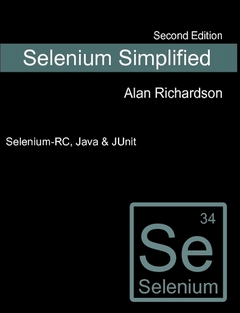
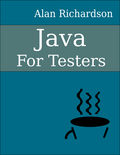
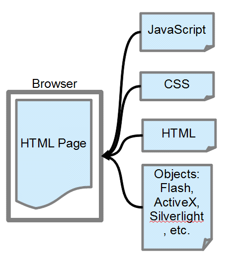
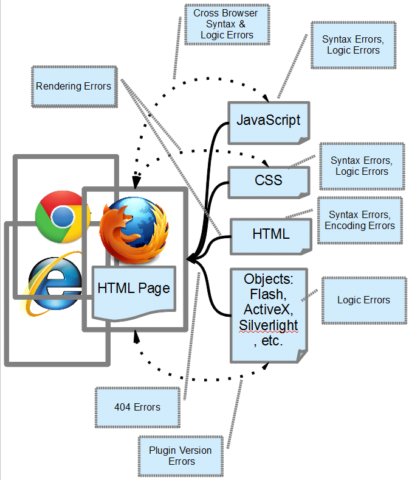
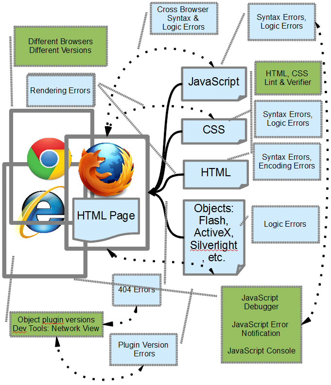

<!-- footer: @EvilTester -->

<!-- Slide 1 -->

# Technical Testing in An Agile Environment

Agile Testing Days Tutorial

Alan Richardson

www.eviltester.com

www.SeleniumSimplified.com

www.JavaForTesters.com

www.CompendiumDev.co.uk

---

<!-- Slide 2 -->

# Talky Bit: Introduction to Workshop

---

<!-- Slide 3 -->

# Blurb 1

Let’s adopt the view that when we test on Agile projects we want to add value as often and quickly as possible.

On this tutorial we will use a mix of discussion, instruction, exercises and debriefs to explore what it means to work in an Agile Environment and how we can push our testing beyond user stories.

We will test an application together, and you will be challenged to add your unique value to the group. You will draw upon your experience as you test, share your thoughts and ideas, and learn nuances and new approaches from the group, and your own explorations.

Bring a laptop, or other electronic computing device which you think can use for testing, because you will be testing. Load it with whatever tools and resources you think you need. You can use them, and share them. We want to learn from each other and explore what it means to conduct Technical Testing in an Agile Environment.

---

<!-- Slide 4 -->

# Blurb 2

Some stuff we will cover:

- How to use Systems Thinking to test technically and understand the “System under development”
- How to use System Thinking to understand the “System of development” and adjust your test approach accordingly
- What does “Technical Testing” mean?
- How far to push the boundaries of user stories
- How to improve your technical skills
- Technical Testing does not mean Automation
- What are your existing “technical skills” – you probably have more than you think.
- Risks and Issues with technical testing, and strategies to counter them
- How to document and describe your technical testing to others

---

<!-- Slide 5 -->

# Alan Richardson

Blogs and Websites

- CompendiumDev.co.uk
- SeleniumSimplified.com
- EvilTester.com
- JavaForTesters.com
- Twitter: @eviltester

Online Training Courses

- Technical Web Testing 101
- Intro to Selenium
- Selenium 2 WebDriver API

Videos

youtube.com/user/EviltesterVideos

Books

Selenium Simplified

Java For Testers

leanpub.com/javaForTesters

Alan Richardson

uk.linkedin.com/in/eviltester

Independent Test Consultant & Custom Training

Contact Alan

http://compendiumdev.co.uk/contact

---

<!-- Slide 6 -->

# I've worked on Agile as

- Tester
- Test Manager
- Test Consultant
- Automator
- Automation Consultant
- Agile Consultant

---

<!-- Slide 7 -->

# Barriers

- Expectations & Beliefs
- Skills
- Experience

These tend to be what I focus on with projects.

---

<!-- Slide 8 -->

# Tools

- Systems Thinking & Modelling
    - Modelling, Cybernetics, Psychotherapy, ...
- Technical Knowledge
    - Programming, Databases, Protocols, ...
- Testing Knowledge
    - Techniques, Exploration, Note Taking, etc.

Not so much 'Agile' knowledge

---

<!-- Slide 9 -->

# Baseline Exercise

---

<!-- Slide 10 -->

# Exercise: Recognise the Baseline

- Just Test The Stories
    - 10 mins testing, however you want
        - “A user should be able to register on the system and login using their registration details”
        - “A user can only login with the correct credentials, an error message is shown when invalid, this should maintain privacy”
    - 10 mins debrief

http://54.162.147.189/redmine

Demo.redmine.org

Or install from bitnami.org or from redmine.org

---

<!-- Slide 11 -->

# 10 Min Debrief

- What did you do / find use?
- How did you
    - Decide what to test?
    - Make Notes?
- Any Questions?
- My notes
    - 13:00 Redmine Testing Notes
    - 13:10 Redmine Testing Notes

---

<!-- Slide 12 -->

# Expectations & Beliefs

- A series of short discussions to identify current beliefs and expectations

---

<!-- Slide 13 -->

# Expectations & Beliefs

- A series of short discussions to identify current beliefs and expectations
    - What is Agile?
    - What is Testing?
    - What is Agile Testing?
    - What is Technical Testing?
    - What is Technical Testing in Agile?
    - What are your existing “Technical Skills”

---

<!-- Slide 14 -->

# What 'is' Agile?

- Build a model, not a definition

---

<!-- Slide 15 -->

# What 'is' Testing?

- Build a model, not a definition
- What do we do?

---

<!-- Slide 16 -->

# What 'is' Agile Testing

- Build a model, not a definition
- What do we do?
- How do we do it?
- When do we do it?

---

<!-- Slide 17 -->

# Technical Testing

---

<!-- Slide 18 -->

# A description of Technical Testing

- A reminder to keep “going deeper”
- Tool Augmentation
- Technical details will:
    - inspire more testing
    - identify more risks
    - Identify different problems
- Not limit our testing to Acceptance Criteria

---

<!-- Slide 19 -->

# MORIM

- Model
    - What I think I understand. Different viewpoints.
- Observe
    - at different points to corroborate/invalidate model
- Reflect
    - find gaps, lack of depth, derive intent
- Interrogate
    - Focussed, deep dive observation with intent
- Manipulate
    - Hypothesis exploration and “how we do stuff”

---

<!-- Slide 20 -->

# It means "Tool Augmentation"

- Is not automation, it uses automation
- Tools to passively observe, maintain history of observations
- Tools to alert on specific conditions
- Tools to observe the unobserved, and interrogate the inaccessible
- Tools to help me model and reflect
- Tools to help me manipulate
- ... etc.

Never tools to control. Tools to augment.

---

<!-- Slide 21 -->

# How I describe what I do

- Not a definition
- A description of my current approaches
- I try get as deep and technical as I can
- I need to keep learning so that I can understand the technology

---

<!-- Slide 22 -->

# Go Beyond the surface structure

- Transformational Grammar
    - Surface & Deep Structure
    - Chomsky
    - Multiple surface structures
    - Single Deep structure
        - Filtered, biased, distorted → Surface Structure
- Questions operate as tools to investigate Surface to Deep mapping people

---

<!-- Slide 23 -->

# Questions operate as tools to investigate Surface to Deep Mapping

“login doesn't work”

- How specifically?
- How do you know?
- Ever? At all?
- ...etc.

We ask the system questions

---

<!-- Slide 24 -->

# How to do Technical Testing?

- Identify tools to work with System Surface Structures
- Questioning Systems at different Surface Levels
- Learning System Structure Technology
- Model System Surface Structures
- Observe System Surface Structures

---

<!-- Slide 25 -->

# Technical Testing

- How far to push the boundaries of user stories?
- If we go too far:
    - is it a bug?
    - does it add value?
    - did we estimate for that?
    - how do you justify that?

---

<!-- Slide 26 -->

# What are your existing “Technical Skills”?

- Collate and build a model of your skills

---

<!-- Slide 27 -->

# Why?

- Must, Should, Have to, Need to, etc.
    - Expectations, Conflict
- Instead:
    - Might, Could, desire to, want to, etc.
    - Work with current system not an ideal
    - Work with current system not a generalised model

---

<!-- Slide 28 -->

# Agile Story Testing

---

<!-- Slide 29 -->

# Working with stories

- What can we test from a story?
- How do we test with stories?
- What do we need on the story to test?

---

<!-- Slide 30 -->

# Discuss and plan testing for

- “A user can only log in with the correct credentials, an error message is shown when invalid, this should maintain privacy”

---

<!-- Slide 31 -->

# Discuss & Plan Testing For

- “A user should be able to register on the system and login using their registration details”

---

<!-- Slide 32 -->

# What is your test strategy/approach for Agile Testing?

- How will you estimate?
- How will you plan your testing?
- How will you track your testing?
- What results will you keep?
- Scripted? Exploratory?
- How will you report your testing?
- Use of automation?

---

<!-- Slide 33 -->

# Would you test differently from the first time you tested these stories?

---

<!-- Slide 34 -->

# Implement your approach/strategy

- “A user should be able to register on the system and login using their registration details”
- “A user can only log in with the correct credentials, an error message is shown when invalid, this should maintain privacy”

---

<!-- Slide 35 -->

# Debrief

- Did you test differently?
- What notes did you make?
- Would this work in the real world?
- Any 'technical testing' observations?

---

<!-- Slide 36 -->

# Working From Stories

- Ask questions
- What are the acceptance criteria?
    - Understood? Clear? Checkable? Examples?
- Questioned limits in the planning?
- Document testing 'in the story'
    - Whatever system used for Agile Planning – use for test documentation & tracking

---

<!-- Slide 37 -->

# Systems Thinking & Modelling

---

<!-- Slide 38 -->

# Web Context: A Browser View

---

<!-- Slide 39 -->

# Web Context: A Browser View – Technical Risks

---

<!-- Slide 40 -->

# Web Context: A Browser View – Technical Tooling Augmented

---

<!-- Slide 41 -->

# Generic Web Application

Browser ↔ Server ↔ Database

What happens where?

What could we observe where?

Where could we manipulate?

---

<!-- Slide 42 -->

# Generic Web Application

Browser ↔ Server ↔ Database

HTTP Traffic

Cookie Creation

JSON, XML

Files: img, pdf, etc.

Rendering

CSS

Cookies

JavaScript

HTTP Logs

Application Logs

Schema

Data

---

<!-- Slide 43 -->

# Redmine Web Application

Browser ↔ Server ↔ Database

What happens where?

What could we observe where?

Where could we manipulate?

---

<!-- Slide 44 -->

# Modelling Redmine

- Redmine is a 'Web Application'
- GUI in Browser
- Has a REST API
- Written in Ruby
- My SQL Database

---

<!-- Slide 45 -->

# Redmine Web Application

Browser ↔ Server ↔ Database

HTTP Traffic

Cookie Creation

JSON, XML

Files: img, pdf, csv

Rendering

CSS

Cookies

JavaScript

Apache HTTP Logs

Application Logs

Ruby

Mysql

Schema

Data

---

<!-- Slide 46 -->

# What tools do we need to augment our testing?

- What can we observe?
- What tools do we need to observe?
- What can we manipulate?
- What tools do we need to manipulate?

---

<!-- Slide 47 -->

# What tools do we need?

- What can we observe?
    - Http traffic, cookies, javascript execution, log files, data in the database, DB schema used
- What tools do we need to observe?
    - HTTP Proxy (Burpsuite, ZAP Proxy, Fiddler), Browser Developer Tools (in browser), DB Tool (mysql, mysql workbench), Text Editors, Log File Viewers (tail -f)
- What can we manipulate?
    - HTTP Traffic, DOM, Cookies, DB, Config
- What tools do we need to manipulate?
    - All of the above

---

<!-- Slide 48 -->

# What questions do we need answered?

- From a technical perspective, what questions do we need answered to allow us to observe and manipulate?

---

<!-- Slide 49 -->

# What questions do we need answered?

- How can I log on to the server?
- What are the user name and password?
- What is the hostname?
- How can I access the database?
- Where are the logs?
- Do I have permissions?
- Etc.

---

<!-- Slide 50 -->

# How does this help us with 'testing'?

---

<!-- Slide 51 -->

# How does this help us with 'testing'?

- The GUI might not show everything
- The DB might have something different from the GUI
- We might see something in the log that triggers a test idea
- We might see errors and exceptions in the logs
- etc.

---

<!-- Slide 52 -->

# Demos to answer - Generic Questions based on system

How do I use?

- HTTP Proxies
- Browser Developer Tools
- DB Access
- SSH Access
- Log File Access

---

<!-- Slide 53 -->

# Hands on Exploratory Learning Exercises

- Pick one or more of the following:

a) Observe the traffic between GUI and server

b) Login to the database, and observe within the database

c) Observe the System within the browser only

d) Observe the system on the server only - logs and/or database

- Use the system, and for each of the above: track your questions and how you answer them

- what do you learn?

- How did you do it?

- How else could you do it?

- What do you not know that you need to know?

20 mins

---

<!-- Slide 54 -->

# Debrief

- Questions?
- Observations?

---

<!-- Slide 55 -->

# Hands on Exploratory Testing Exercise

- Revisit the registration story testing using what you learned from the Exploratory Learning Exercise
- Revisit the login story testing

---

<!-- Slide 56 -->

# Debrief

- Did that help?
- Did you see anything different?
- Thoughts?
- Issues?
- Concerns?
- see my 13:15 Redmine Technical Testing Notes

---

<!-- Slide 57 -->

# How to improve your technical skills?

- How? Discussion?

---

<!-- Slide 58 -->

# How to improve your technical skills

- Practice
- Learning
- Experiment
- Model Application → Identify Technology → Learn the Technology → Tools for technology? → Observe? → Manipulate? → What do we learn then? → Model Application
- Doing

---

<!-- Slide 59 -->

# From what we just did

- What do you need to learn?
- What did you not understand?
- What was new?
- What did you see that you didn't know what it was?
- What did you not try?

Exercise: spend 10 mins building a research and confusion list

---

<!-- Slide 60 -->

# Shortcut the learning

- Let's see if we can answer some of those technical questions and confusions now
- Q&A
- Demos
- Sites
- Tools

---

<!-- Slide 61 -->

# Backlog

- Any questions we need to answer by the end of the day?
- How to understand the “System of Development”
- Risks And Issues
- More Testing

---

<!-- Slide 62 -->

# The System 'of' Development

---

<!-- Slide 63 -->

# Agile Generics

- Agile == Context
- Stories
- Iteration / Sprint
- Planning / Estimates
- Backlog
- Retrospectives
- Stand ups
- Acceptance Tests

---

<!-- Slide 64 -->

# Agile == Context

- Each project is different
- Each project is a specific instance of 'Agile'
- Each project changes depending on its team
- Team Members add Unique value & constraints
- Each project is a System
- Each team member is a System
- System is complex set of communication and relations

---

<!-- Slide 65 -->

# Stories in General

- A basis for understanding
- A basis for agreement of scope
- Question them
- I write down the
    - The questions I asked
    - answers to questions against the story
    - The 'agreements we made'
    - How I think I will test it, How I tested it, What I didn't test, what we agreed not to test, outstanding risks, etc.

---

<!-- Slide 66 -->

# Iteration / Sprint

- Things to fit in: exploration, reviews, meetings, rework, refactoring, execution, tracking, pairing, etc.
- I find myself 'nagging' to keep us inside the sprint. To avoid test pushed out to next sprint or 'late' delivery of stories.

---

<!-- Slide 67 -->

# Planning / Estimates

- Some tasks have dependencies
- Do voice concerns about low estimates
- Do make sure estimates cover testing
- Do make sure estimates cover exploration
- Do make sure estimates cover technical debt etc.

---

<!-- Slide 68 -->

# Backlog

- Add testing tasks to backlog to cover risks
- Add testing tasks to backlog to cover testing debt
- Push for technical debt that impacts testing to be played
- Push for testability in the backlog
- Push for acceptance criteria
- Consider testability in the order of story playing

---

<!-- Slide 69 -->

# Retrospectives

- Don't just pat on the back
- Raise process issues that impact
- Agree 'what to do about them'
- Treat Broken Windows
- You might have to be Mr Nag & Mrs Nasty

---

<!-- Slide 70 -->

# Stand ups

- Pay attention to change of plans
- Pay attention to what might impact your testing
- Describe in value terms – what did you find? Any new risks? What looks OK?
- Ask for reviews of your notes and work
- See if you can pair early on Unit Testing
- Report that things are bigger than you thought
- Seek help
- etc.

---

<!-- Slide 71 -->

# Acceptance Tests

- Abstraction layers
- Re-use abstraction layers for adhoc automation as well as Acceptance tests
- Seek to understand technicalities as well as domain
- Pair – don't just leave it all to test, or all to dev

---

<!-- Slide 72 -->

# Your project is a specific instance

---

<!-- Slide 73 -->

# Technical Testing Risks & Issues

- Any Concerns?

---

<!-- Slide 74 -->

# Technical Testing Risks & Issues

- How to Justify?
- How to document?
- How to avoid doing too much?
- How to get the time to learn?
- What if we just want to check the Acceptance Criteria?

---

<!-- Slide 75 -->

# Technical Testing Risks & Issues

- Take responsibility for your testing
- Is anyone really going to stop you from doing the best testing you can?
- You can learn, as you add value. Take small steps.
- You can learn, as you pair. Ask questions, take notes. Apply your 'testing super powers' to the information you get.
- Use technical testing to 'push' for more access to environments and system internals

---

<!-- Slide 76 -->

# Final Section

---

<!-- Slide 77 -->

# Some Useful Links

- Michael Bolton Webinar
    - A New Agile Testing Ecosystem
    - eurostarconferences.com/content/eurostaronline-testing-summit-2014
- Book: Domain Driven Design by Eric Evans
    - http://dddcommunity.org/
- Books: The Structure of Magic vols 1&2 by Richard Bandler and John Grinder

---

<!-- Slide 78 -->

# Topics to investigate

- Stafford Beer viable Systems model
- Cybernetics
- General Semantics
- Ross Ashby – Requisite Variety
- W. Edwards Deming

---

<!-- Slide 79 -->

# Test
