<!-- footer: Black Ops Testing -->

<!-- Slide 1 -->

# Black Ops Testing Workshop

Agile Testing Days

Tony Bruce

Steve Green

Alan Richardson

---

<!-- Slide 2 -->

# January 2015 Workshop, London

www.BlackOpsTesting.com

---

<!-- Slide 3 -->

# Introduction

- 3 * 5 minute lightning talks
- We expect you to test stuff
- We will coach & ask questions as you test
- We may periodically debrief

---

<!-- Slide 4 -->

# What you are about to test

- Redmine
    - www.redmine.org
- Project Planning App
    - GUI, Rest API, Feeds, DB, Web Server

---

<!-- Slide 5 -->

# Alan’s Bit at the start

- Model, Observe, Interrogate, Reflect, Manipulate
- Tools help me observe and manipulate
- Note Taking

---

<!-- Slide 6 -->

# A model of how Alan tests

- Model
    - What I think I understand. Different viewpoints.
- Observe
    - at different points to corroborate/invalidate model
- Reflect
    - find gaps, lack of depth, derive intent
- Interrogate
    - Focussed, deep dive observation with intent
- Manipulate
    - Hypothesis exploration and “how we do stuff”

---

<!-- Slide 7 -->

# Tools help me...

… Observe and Manipulate

---

<!-- Slide 8 -->

# Browser

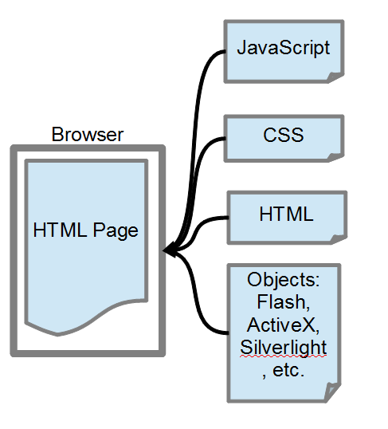

---

<!-- Slide 9 -->

# Risks

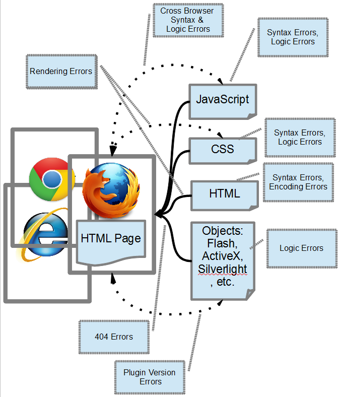

---

<!-- Slide 10 -->

# Tools

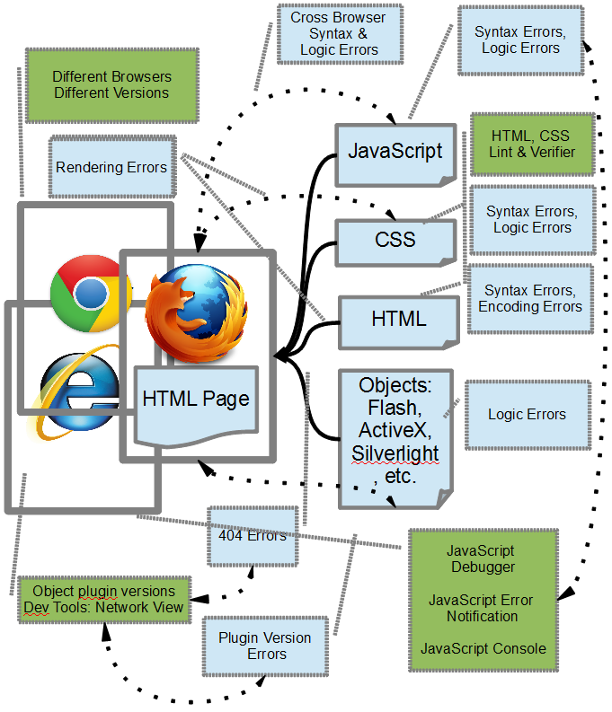

---

<!-- Slide 11 -->

# ...extend the model

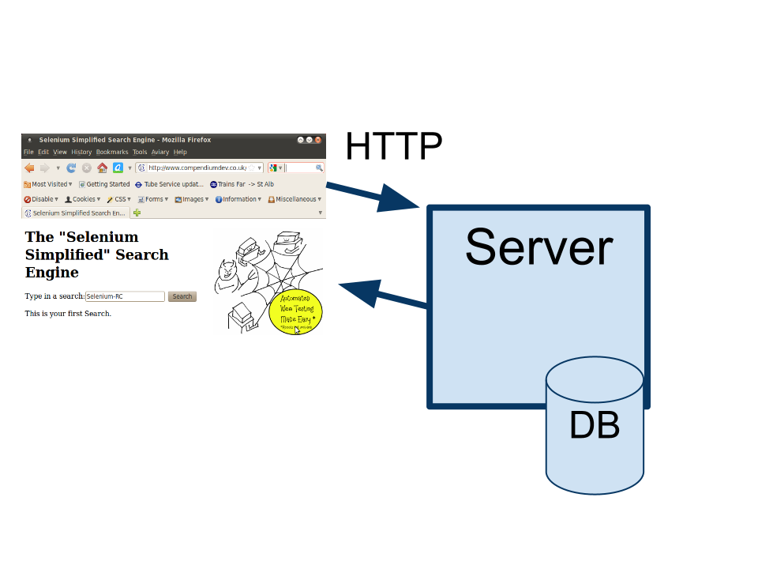

---

<!-- Slide 12 -->

# Note Taking

- Why:
    - Questions, Ideas, Risks, etc.
- What:
    - ToDos, Issues, Observations, Notes, etc.
- When:
    - Timestamps, sequential order
- Where:
    - urls, environment, users, etc.

- How:
    - commands, methods, tools used, etc.
Evidence:

- logs, screenshots, output, files, etc.

---

<!-- Slide 13 -->

# Tony’s bit

- Test ideas
- Tools
- Information & Intelligence

---

<!-- Slide 14 -->

# Explore for test ideas

Prep

- Notes
- Summary
- Important bits
    - Ideas
    - Comments
    - Questions
    - Thoughts
    - Six Honest Men

"I Keep Six Honest Serving Men ..."

I KEEP six honest serving-men

(They taught me all I knew);

Their names are What and Why and When And How and Where and Who.

…….. Rudyard Kipling

---

<!-- Slide 15 -->

# Tools

Browser

- Add-ons
- Extensions
- Developer tools

Others

- Accessibility
- Security
- Debugging

---

<!-- Slide 16 -->

# Leadership Under Pressure: Tactics from the Front Line

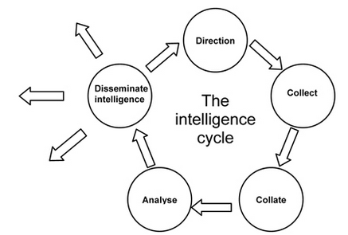

Bob Stewart

---

<!-- Slide 17 -->

# Information

---

<!-- Slide 18 -->

# Steve’s bit

What are we going to test?

- What’s new?
- What’s changed?
- What’s important?
- What are known buggy areas?
- What has not been tested previously?

---

<!-- Slide 19 -->

# What are we going to test?

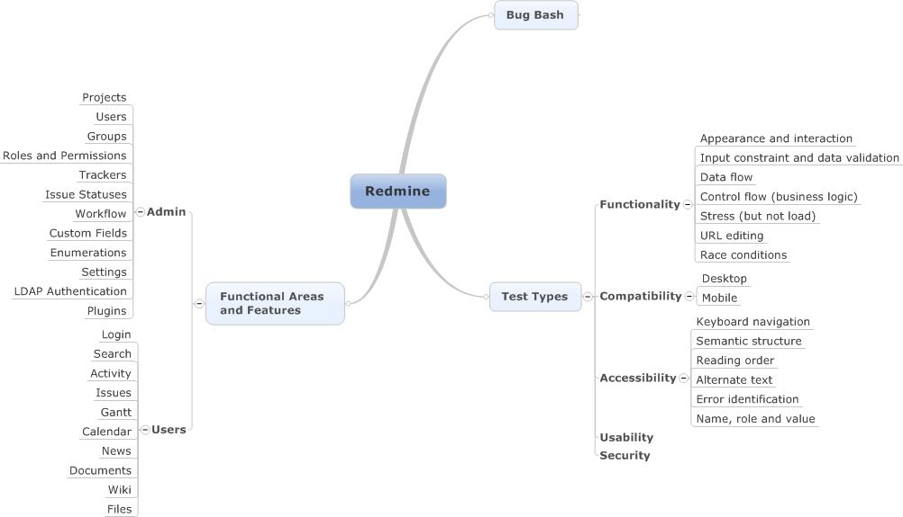

---

<!-- Slide 20 -->

# What might be difficult?

---

<!-- Slide 21 -->

# What might be difficult?

- How can we create enough data?
- How can we test time-related features?
- How do we know if the right thing happened?

---

<!-- Slide 22 -->

# Lightning Talk Debrief

Extras?

Questions?

Comments?

---

<!-- Slide 23 -->

# Collaboration Rules

- Don’t load test the app, we are all using it
    - If you accidentally bring it down through a clever test then that’s fine,
- Don’t change data you didn’t create

---

<!-- Slide 24 -->

# Where is the app?

- You can install it locally if you want
    - [http://redmine.org](http://redmine.org)
- You can get an install or VM from bitnami
    - [https://bitnami.com/stack/redmine](https://bitnami.com/stack/redmine)
- You can use the redmine demo
    - [http://demo.redmine.org/](http://demo.redmine.org/)
- You can use our server
    - ….

---

<!-- Slide 25 -->

# Where is the app?

- Links removed as only valid at the time we conducted the workshop

---

<!-- Slide 26 -->

# Testing Phase 1

- Consider what we said
- Test the app in new ways, take notes, try new tools
- Black Ops Team will mingle - do ask for help
- We will debrief prior to the break

---

<!-- Slide 27 -->

# “...no plan of operations extends with any certainty beyond the first contact with the main hostile force.” Field Marshall Helmuth Carl Bernard Graf von Moltke, 1871

---

<!-- Slide 28 -->

# Test the **** out of Redmine

---

<!-- Slide 29 -->

# Hints...

Are you monitoring the HTTP traffic?

Have you changed the DOM?

Cookies?

Internationalisation?

Logged issues?

...

---

<!-- Slide 30 -->

# Debrief

Observations

Questions

---

<!-- Slide 31 -->

# Break (30 mins)

Feel free to carry on testing if you want

---

<!-- Slide 32 -->

# Testing Phase 2

- You tell us

---

<!-- Slide 33 -->

# Interrupt 1

Structure your data to make testing easier.

- Unique values (where possible)
- Sequenced

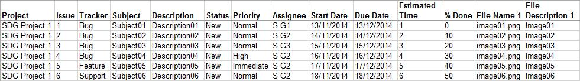

---

<!-- Slide 34 -->

# Interrupt 2

Testing maxlength and truncation.

---

<!-- Slide 35 -->

# Interrupt 2

Testing maxlength and truncation.

0005x0010x0015x0020x0025x0030x0035x0040x0045x0050x0055x0060x0065x0070x0075x0080x0085x0090x0095x0100x0105x0110x0115x0120x0125x0130x0135x0140x0145x0150x0155x0160x0165x0170x0175x0180x0185x0190x0195x0200x0205x0210x0215x0220x0225x023

---

<!-- Slide 36 -->

# Interrupt 2

Testing maxlength and truncation.

[http://bit.ly/1B7gQlx](http://bit.ly/1B7gQlx)

---

<!-- Slide 37 -->

# Interrupt 2a

- We have a broken app - can you get in?
- Links removed as only valid at the time of the workshop

---

<!-- Slide 38 -->

# Interrupt 3

Recording data flow.

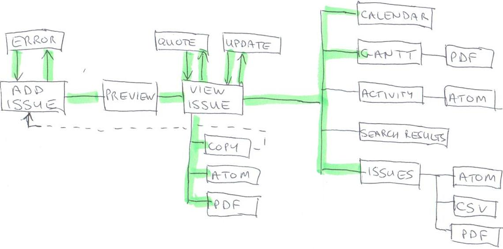

---

<!-- Slide 39 -->

# Interrupt 4

Can we break the CSV, Atom or PDF exports?

What might do that?

---

<!-- Slide 40 -->

# Debrief Phase

---

<!-- Slide 41 -->

# Bugs we found 1

- The PDF does not contain the Start Date, Estimated Time, % Done or File Description for the attachments that are included in the New Issue form.
- The PDF does not contain the Target Version and Spent Time values that are included in the View Issue form.

---

<!-- Slide 42 -->

# Bugs we found 2

The Atom feed from the View Issue page has no content when it is viewed immediately after creating an issue. It did have content after adding a quote to the issue.

---

<!-- Slide 43 -->

# Bugs we found 2

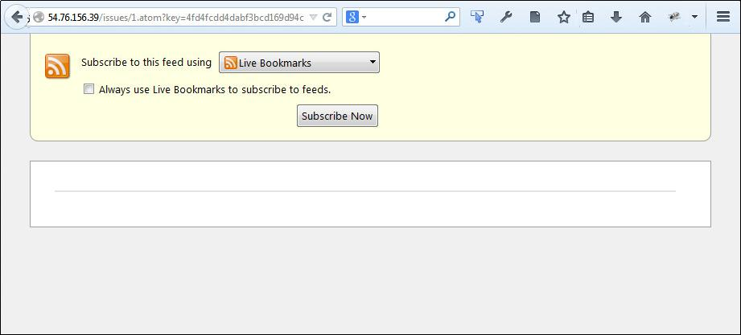

---

<!-- Slide 44 -->

# Bugs we found 3

The File Description for an image is not saved if too many characters are entered in the New Issue form. We did not investigate where the boundary is.

---

<!-- Slide 45 -->

# Bugs we found 4

The PDF that is generated from the Gantt page always shows the default zoom level regardless of the zoom level that has been selected.

The URL of the PDF link contains a ‘zoom’ parameter (which does nothing). Changing the ‘months’ parameter has the desired effect.

---

<!-- Slide 46 -->

# Bugs we found 5

Some non-Roman characters are displayed correctly on all HTML pages but they are not displayed in PDFs.

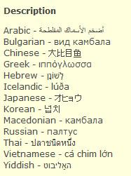

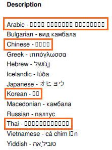

---

<!-- Slide 47 -->

# Bugs we found 6

Some non-Roman characters are not displayed correctly in CSVs.

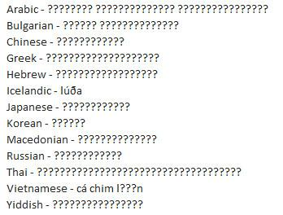

---

<!-- Slide 48 -->

# Bugs we found 7

You’re able to delete all user accounts, including admin.

There is only 1 admin (as far as I could see)

Tell us how….

---

<!-- Slide 49 -->

# Bugs we found 7 cont.

Record browser traffic while deleting a account.

Find the delete POST

---

<!-- Slide 50 -->

# Bugs we found 8

"Your account has been activated. You can now log in. "

System says I am already "logged in as eris" and I am on my account page

Minor issue about wording

---

<!-- Slide 51 -->

# Bugs we found 9

Error message about emails already in use when registering - privacy concern

“Email has already been taken”

---

<!-- Slide 52 -->

# Bugs we found 10

Maximum length of email is 60 chars but needs to accept 254

---

<!-- Slide 53 -->

# Bugs we found 11

Can use an invalid language when registering a user.

---

<!-- Slide 54 -->

# Bugs we found 12

Truncation on project identifier with no error or warning message

i.e. create project with 255 char identifier - truncated to 100

---

<!-- Slide 55 -->

# Bugs we found 13

When creating a project, the ID and name are populated via javascript but if I change the name then the identifier is not kept in sync.

---

<!-- Slide 56 -->

# Bugs we found 14

Can create an invalid enabled_modules entry by submitting a module name which does not exist when creating a project

---

<!-- Slide 57 -->

# Bugs we found 15

Change url to have csv or pdf views

System should respond differently to csv and pdf on projects when GUI request rather than an API request 406 is better for API, 404 with html or 406 with html payload might be better

---

<!-- Slide 58 -->

# Rathole 1 - Password

Alan thought there was a bug with password lengths, and storing in a varchar 40, since password can be very long.

But, a ‘hash’ is stored, not the password, this took time to discover.
