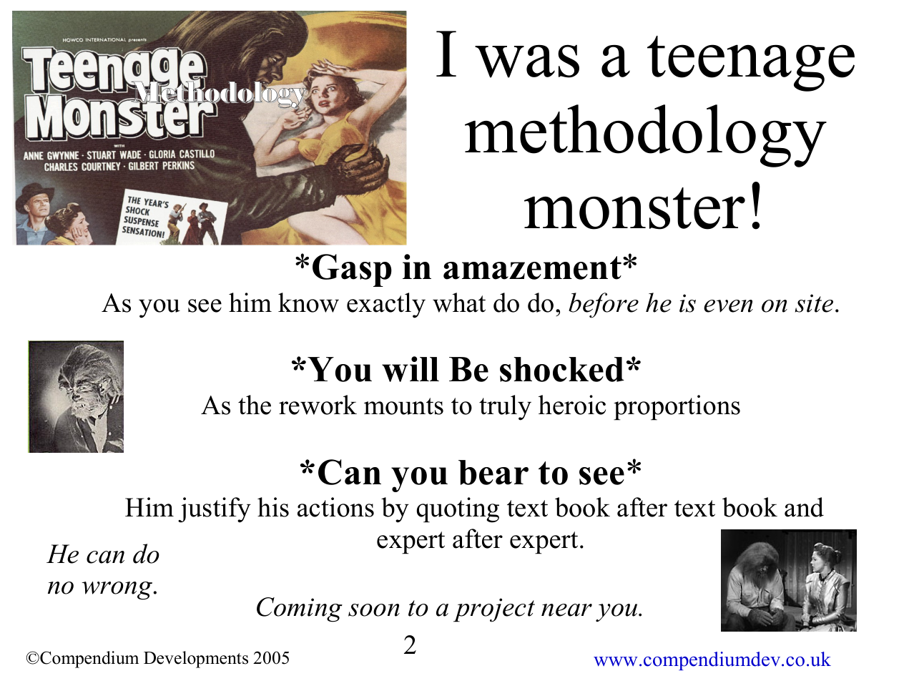
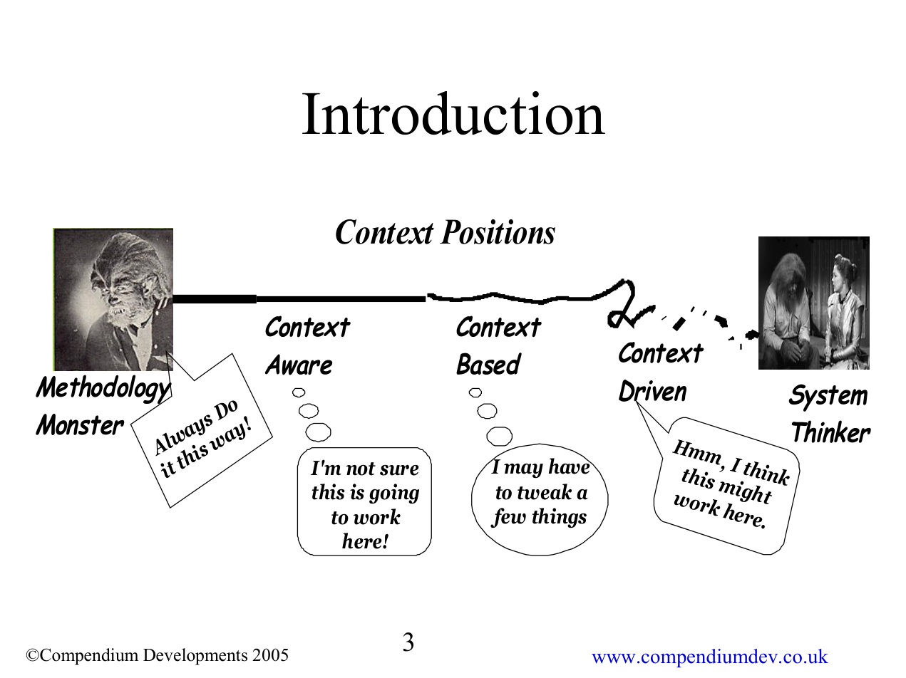
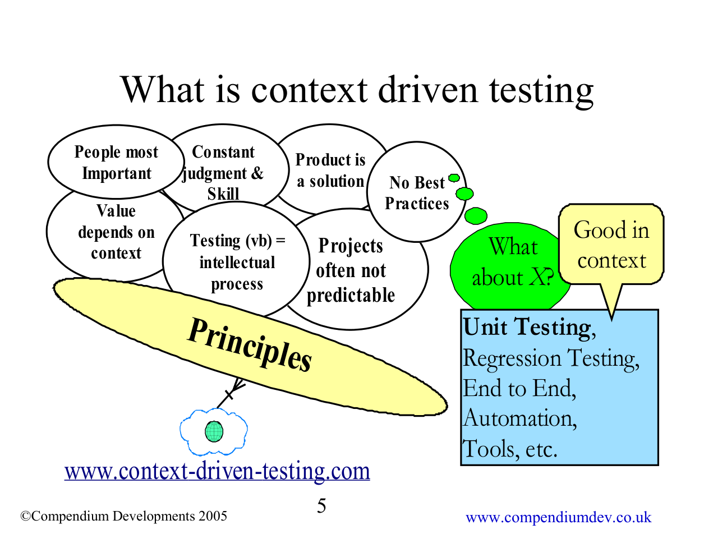
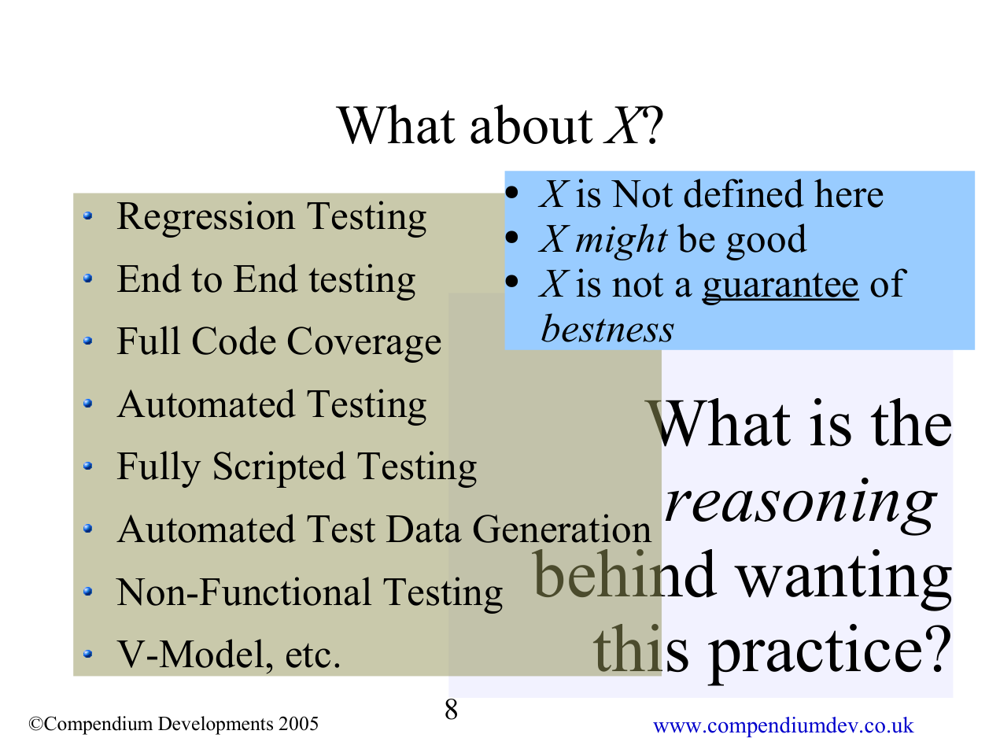
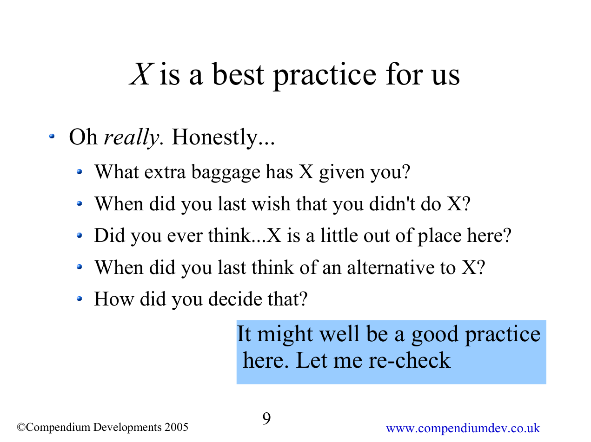
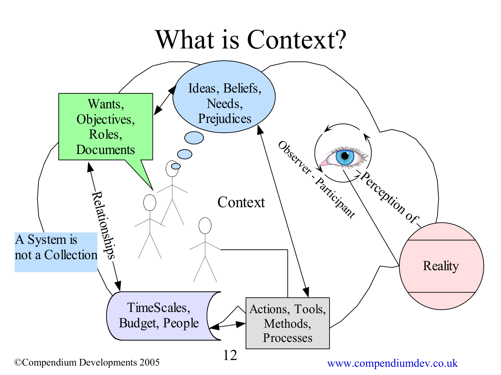
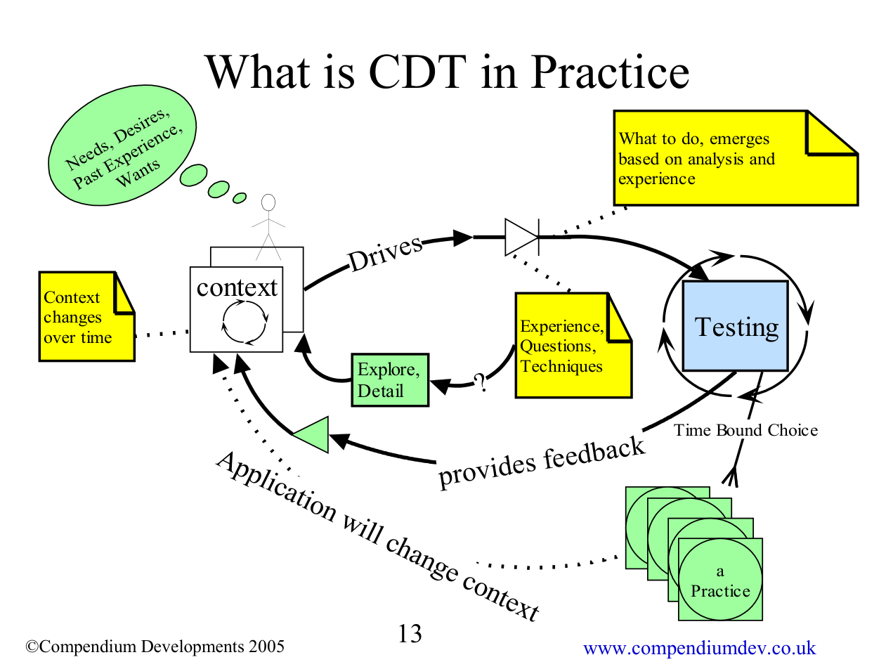
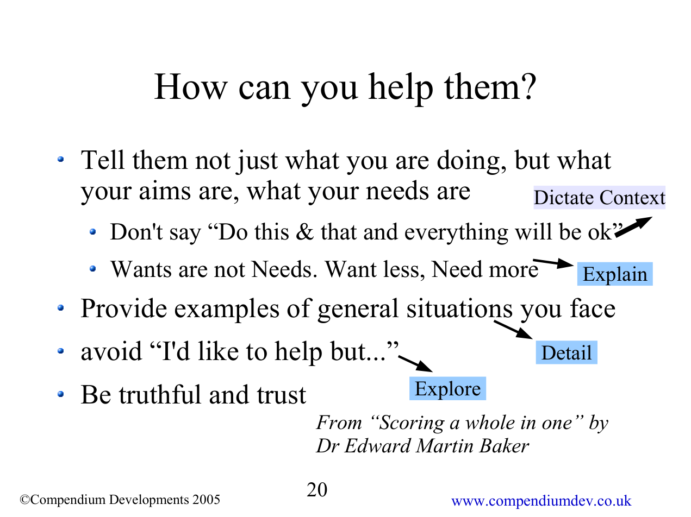

<!-- Slide 1 -->

# “It Depends...” Context Driven Testing - What does it mean to have no “best practices”?

Alan Richardson

Compendium Developments

Version 1.20050305NorthLondonBCS

A personal view

---

<!-- Slide 2 -->

# I was a teenage methodology monster!

- \*Gasp in amazement\*

- As you see him know exactly what do do, before he is even on site.

- \*You will Be shocked\*

- As the rework mounts to truly heroic proportions

- \*Can you bear to see\*

- Him justify his actions by quoting text book after text book and expert after expert.

Coming soon to a project near you.

Methodology

He can do

no wrong.

---

<!-- Slide 3 -->

# Introduction

---

<!-- Slide 4 -->

# I ceased my evil ways

*Hidden in the original slideshow.*

- became more context aware

- asked more questions – different types of questions (how? What?)

- worked more closely with people – retaining independence of thought

- became more of a consultant than a salesman/pusher

- became more effective as a tester

- Less identification: “I am a structured tester”

---

<!-- Slide 5 -->

# What is context driven testing

---

<!-- Slide 6 -->

# Context-Driven-Testing.com

*Hidden in the original slideshow.*

- The value of any practice depends on its context.

- There are good practices in context, but there are no best practices.

- People, working together, are the most important part of any project's context.

- Projects unfold over time in ways that are often not predictable.

- The product is a solution. If the problem isn't solved, the product doesn't work.

- Good software testing is a challenging intellectual process.

- Only through judgment and skill, exercised cooperatively throughout the entire project, are we able to do the right things at the right times to effectively test our products.

- From www.context-driven-testing.com [Source link](http://www.context-driven-testing.com/)

---

<!-- Slide 7 -->

# Isn't Unit Testing a best practice?

- Unit Testing =

- Any testing done by the developer

- Any testing done under the debugger

- Only testing which is automated at the code level

- &lt;insert your definition here&gt;

- That isn't well defined enough to be a best practice

---

<!-- Slide 8 -->

# What about X?

What is the reasoning

behind wanting this practice?

- Regression Testing

- End to End testing

- Full Code Coverage

- Automated Testing

- Fully Scripted Testing

- Automated Test Data Generation

- Non-Functional Testing

- V-Model, etc.

- X is Not defined here

- X might be good

- X is not a guarantee of bestness

---

<!-- Slide 9 -->

# X is a best practice for us

- Oh really. Honestly...

- What extra baggage has X given you?

- When did you last wish that you didn't do X?

- Did you ever think...X is a little out of place here?

- When did you last think of an alternative to X?

- How did you decide that?

It might well be a good practice

here. Let me re-check

---

<!-- Slide 10 -->

# When best practices went bad!

*Hidden in the original slideshow.*

- It worked for him, let's have everybody do it!

- Thou Shalt, regardless!

- Hey, how come the developers get off so lightly? (they have a job to do)

- You say you're doing this, I know you're not so...

- V-model...add lots of xrefs to enable impact analysis

Commonalities: Ignored Context

---

<!-- Slide 11 -->

# What is not context driven?

*Hidden in the original slideshow.*

- Not context aware

- I know you're not doing it 'right', but this is what I always do, so I'll work harder to make what I'm doing work.

- Not context based

- I'll introduce the V-model and 'tweak' it a little

- We can just 'amend' our methodology a bit and we will be fine

- Not an excuse for the slipshod

---

<!-- Slide 12 -->

# What is Context?

---

<!-- Slide 13 -->

# What is CDT in Practice

---

<!-- Slide 14 -->

# What is context driven?

*Hidden in the original slideshow.*

- Context Driven

- “What to do?” emerges based on analysis and experience

- Bring lots of techniques and practices and choose which to apply.

- Know that the application of techniques &amp; practices changes the context

---

<!-- Slide 15 -->

# Remind me, What is Testing?

*Hidden in the original slideshow.*

- Testing doesn't define the context

- Testing fits in the context

- Testing provides information

- Testing provides feedback

- One size fits all ≠ best practice

- Standard ≠ best practice

---

<!-- Slide 16 -->

# How is it different

*Hidden in the original slideshow.*

---

<!-- Slide 17 -->

# What can you expect from context-driven testers?

- “It depends...” on the context, but generally (I suspect they will)...

- Ask a lot of questions of you and of themselves

- Know the underlying assumptions of their techniques

- Change their minds &amp; re-plan

- Be able to justify what they are doing, in terms of the context as they perceive it

---

<!-- Slide 18 -->

# How are the Questions different?

- Testers always ask questions

- Context Driven Qs are aimed at exploring the context, not just working within it

- Questions that try to avoid assumptions

- When will the requirements document be ready?

- becomes

- Are requirements being elicited and communicated? How? Who from? How much change? etc.

---

<!-- Slide 19 -->

# How You Can Help

*Hidden in the original slideshow.*

---

<!-- Slide 20 -->

# How can you help them?

- Tell them not just what you are doing, but what your aims are, what your needs are

- Don't say “Do this &amp; that and everything will be ok”

- Wants are not Needs. Want less, Need more

- Provide examples of general situations you face

- avoid “I'd like to help but...”

- Be truthful and trust

From “Scoring a whole in one” by Dr Edward Martin Baker

Dictate Context

Explore

Detail

Explain

---

<!-- Slide 21 -->

# What is the context?

*Hidden in the original slideshow.*

- People, methods, tools, aims, objectives, dreams, ideas, prejudices, beliefs, actions, documents, roles, time scale, money, etc.

- A system of relationships between the above.

- A system is not a collection.

- Context can be hard to identify: observer-participant

- We never work with the context – we work with our perception of the context – expect change.

---

<!-- Slide 22 -->

# Identify your Context

- What did we say we were doing?

- What are we actually doing?

- Who for?

- Why? What will we gain by doing that?

- Remind me - what is our aim/objective?

- What could we do instead?

- What would happen if we did something else?

---

<!-- Slide 23 -->

# There is no such thing as Context

*Hidden in the original slideshow.*

- Work through our filters

- Question our assumptions

- What is important?

---

<!-- Slide 24 -->

# How Context Driven is your....

*Hidden in the original slideshow.*

- Testing?

- Development?

- Is there a mismatch?

- If there is, what does the mismatch lead to?

---

<!-- Slide 25 -->

# End Notes

*Hidden in the original slideshow.*

---

<!-- Slide 26 -->

# Learning More About Context

- www.context-driven-testing.com [Source link](http://www.context-driven-testing.com/)

- Yahoo group “software-testing”

- I recommend:

- General Semantics, NLP, Gerald Weinberg's books

- Systems Thinking/Theory

- Others recommend:

- Critical Thinking, Epistemology

- Honestly evaluate your own context

- (and I might too, I just haven't explored these enough yet)
