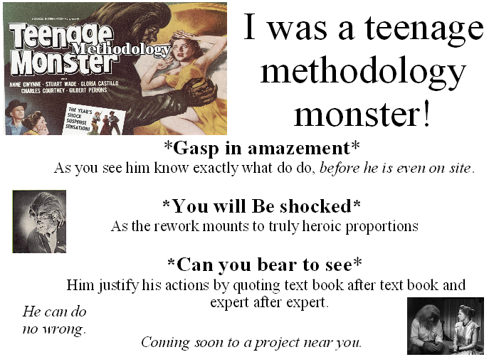
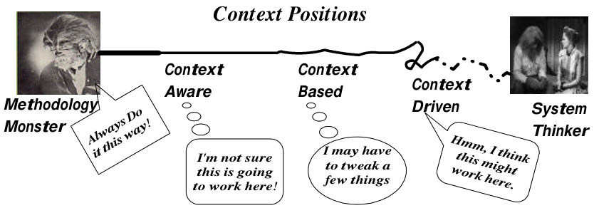
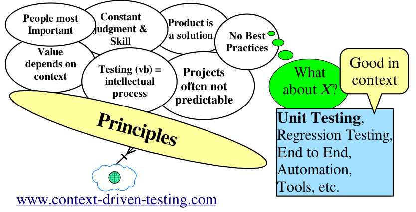
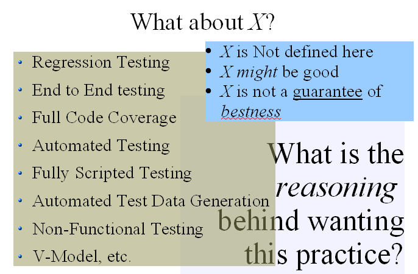
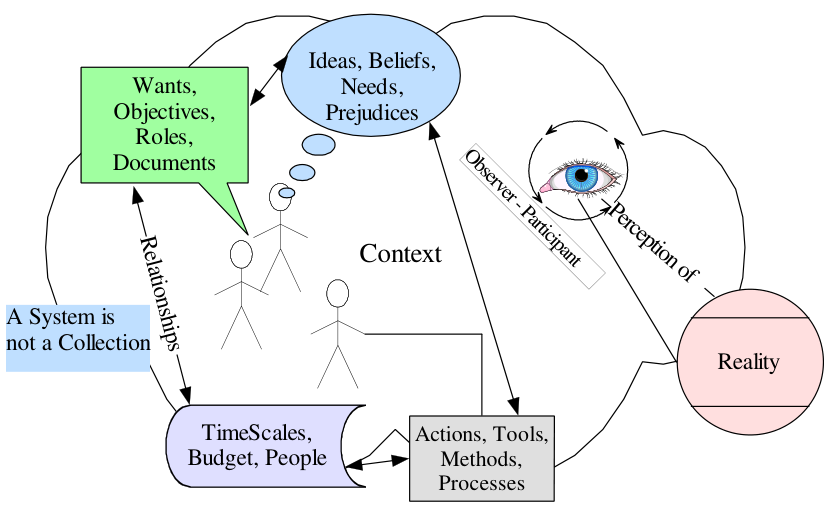
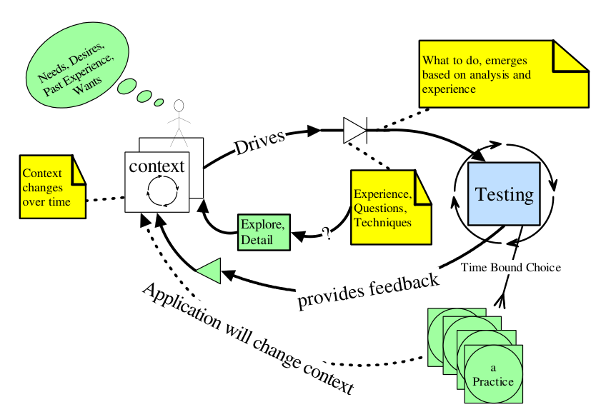
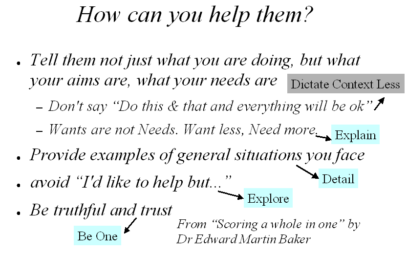

# It Depends - Draft Paper

Draft paper accompanying Context Driven Testing, A Personal View. Original wording, quotations, source credits, diagrams, and examples are retained. These are prepared materials, not a transcript.

## Introduction

"Civilisations in decline are consistently characterised by a tendency toward standardisation and uniformity. Conversely, during the growth stage of civilisation, the tendency is toward differentiation and diversity."

Arnold Toynbee, A study of history. (1934-1960)

The aim of this paper is to look at Context-Driven Testing and explore:

- What is it?
- Why is it important?
- What difference does it make?
- What can others on the project expect from a context driven test team?
- How will you know if context driven testing is being done?
- What is the context?

## “It Depends…”

Context Driven Testing – What does it mean to have no “best practices”?

A Personal View

Alan Richardson

Compendium Developments

Consultants always say “It Depends...”. And it does, it depends.

Testing is often viewed as “Structured Testing” and on many projects has a vast array of standard documents, techniques and demands on the rest of the development process.

As testers become more experienced, they see that every project is different and requires different approaches. These testers become more context aware.

What happens when they become context driven? What does that mean? How will that affect your development projects? And how will you know they are being context driven, and not just saying “It depends...”.

And how can you help?

What follows is a personal view of context driven testing. Believe me, I have no numbers to back up anything I'm saying, only experience.

### I was a teenage methodology monster

There was a time when I knew exactly how to do testing.

I could walk on to a site, and instantly know what was needed to do the testing. I knew what they weren't doing, and I could plug those gaps.

The scripts couldn't be run by absolutely anyone in exactly the same way. The tests weren't xref'd to requirements. The test conditions weren't unambiguous enough. Horror – they weren't writing conditions and xref'ing them to the cases. They were just writing scripts, not cases and scripts.

In fact I knew what was needed, before even coming on site. I was that good.

And because I was that good, I made sure that what I knew had to be done, was done, even if it cost a lot of overtime and rework. I was doing the right thing, because I was using best practices.

But I wasn't doing the best things.

“Being willing to change what you do, to follow up what you're seeing as you test, is the mark of a thoughtful tester. A tester who won't create and run follow-up tests in the face of an oddity in the program behavior is a tester who needs training, retraining, or a career change—after all, if you go to all the time and effort to run a long series of tests, and one of them shows something that might be interesting, you're throwing away the value of all that work if you don't check theinteresting behavior to see whether it's a bug and how best to report it.”

Cem Kaner, The Ongoing Revolution

### Context Positions

Over the years that I've been doing testing, I've moved away from Methodology Monsterism, and I try to be as effective as I can, and for me, that means trying to be as context driven as possible. And I say trying to be as context driven as possible because there are often arbitrary constraints imposed on the context by 'wants' which prevent 'true' context driven, but I can usually be context driven enough.

I suspect that beyond context driven there is a context influencial stage which is much more of a systems thinking approach, but I guess I'll find that out when I get there.

I am usually less able to be as Context Driven as I'd like to be on Commercial projects because there are so many arbitrary constraints added in to the context (You will use this tool, you must write this document using this template...).

For me, being context driven means that I try to be as effective as possible, and I try to allow other people to be as effective as possible by only asking them to do what is required for me to fulfil my purpose in the context. So I try not to ask them to build large requirement documents, or uniquely identify everything, just to fit in with my chosen best practice.

### I ceased my evil ways

Over time, kind of…

- became more context aware
- asked more questions – different types of questions (how? What?)
- worked more closely with people – retaining independence of thought
- became more of a consultant than a salesman/pusher
- became more effective as a tester
- Less identification: “I am a structured tester”

Identifying with “I am a structured tester” can lead to beliefs such as: therefore I need you to sign off the requirements, stabilise the documents, not change anything, deliver by this date. And may involve adopting an adversarial position.

Removing the identification with form and instead focusing on required actions can lead to a more partnership style of relationship: I will test, I will provide feedback, I will raise risks, I will add value to the process, etc.

I'm not sure I even like to identify myself as a tester, even though I do more testing at work than anything else.

Asking questions (and listening and acting on the answers) makes it more difficult to just sell something (“I'm going to use the V-Model so I'll sell that in”). It means that you are consulting towards a solution rather than pushing a practice.In Advanced Selling Strategies, Brian Tracy, writes about top salesmen approaching selling as consultancy and meeting the client's/buyer's needs. Less effective sales people, sell.

'Testing' created a rod for their own back by creating 'independent' test teams and 'independent' testing when 'independent testing' was the buzzword best practice of the week. I have found my work to be more effective when I retain independence of thought, but work as a member of the development team.

I learned to ask more, and different questions. So that I could understand more about the context, and act according to my understanding and not according to my pre-existing thoughts about testing, regardless of the context.

### What is Context Driven Testing?

Principles help focus the mind, and Context Driven Testing as presented on context-driven-testing.com is a set of principles. But in order to act on a set of principles we have things that we do, practices that we put in action, it might be tempting to think of the practices that people use in order to put context-driven-testing into action as 'best' practices: Thinking, Questioning, Trialing, Feedback, but we can see that these practices are not defined here, and everyone will be doing different types of thinking, or questioning. Which actually makes it harder to do context driven testing, as you are going to have to figure out how to do it for yourself.

If we did all the 'best' practices we knew about, we would have no time to do anything else, and it is unlikely we would produce anything. Fortunately I.T. isn't like that.

Principles from www.Context-Driven-Testing.com [Source link](http://www.Context-Driven-Testing.com/)

- The value of any practice depends on its context.
- There are good practices in context, but there are no best practices.
- People, working together, are the most important part of any project's context.
- Projects unfold over time in ways that are often not predictable.
- The product is a solution. If the problem isn't solved, the product doesn't work.
- Good software testing is a challenging intellectual process.
- Only through judgment and skill, exercised cooperatively throughout the entire project, are we able to do the right things at the right times to effectively test our products.

Context Driven Testing is not an approach, it is a set of principles that help focus and refocus the mind of testers.

Of the Context Driven principles listed on context-driven-testing.com, the most controversial appears to be “there are no best practices”

If that is true, what have we been doing and learning all these years? \[Practices and contexts within which they work well (making them good practices) and where the work less well (making them bad practices)\]

How many times have actions been justified with the notion of 'best practice'?

And if it is true, how will we know what to do?

I've seen 'testing' build trouble for themselves by xrefing every test and condition to various parts of the development documentation, even though that documentation was only going to be a snapshot of a particular point in time and not be kept current. And they did that because then 'testing' was doing the right thing by using a 'best practice' even though no-one else on the project was. Even though the context didn't support the assumptions that the practice was based on.

Sometimes xrefing is viewed as 'Maturity' and sometimes the test process is more 'mature' (standardised, policed, defined) than the development process, which I have seen cause problems that lead to extensive rework, inflexibility, and inability to respond to change.

Mature does not equal ignorance of the situation.

### Isn’t Unit Testing a best practice?

- Unit Testing =
    - Any testing done by the developer
    - Any testing done under the debugger
    - Only testing which is automated at the code level
    - &lt;insert your definition here&gt;

That isn't well defined enough to be a best practice

As a quick example. I have heard Unit Testing cited as a 'best practice'.

But 'Unit Testing' doesn't describe the practice very well. So in that case what is it that is best about it? I often recommend different approaches to Unit Testing depending on the situation.

I have seen 'Unit Testing' defined, and performed, in ways that I could easily see changes that might make it more effective at:

- finding problems in the code,
- informing the developer of code changes that introduce problems into other parts of the code
- Increasing the scope of testing quickly and easily.

Can a best practice be made better so easily?

Wouldn't a 'best practice' need to be defined well enough that it could be unambiguosly performed and understood, in order to be evaluated as 'best'?

Are your 'best' practices well defined? And context independent?

### What about X?

Again, these practices are not well defined, in fact they are not defined here at all.

Regression Testing – how much? When? By whom? What does it even mean?

I can think of situations where, certain definitions, of these practices may not be a good idea to do at all, and that must exclude them from the class of 'best' practice.

Surely a Best practice should always be the best thing to do? And if you were doing it then you are pretty much doing the best thing that you can do?

The above practices are not that. Perhaps the people who say these are best have a different definition of best. Or perhaps they have a reason for saying it based on their definition of that practice, and when we know that reason, and that definition, we will be able to start to identify their context, and then we might be able to identify a better practice for them in that context.

### X is a best practice for us

- Oh really. Honestly...
    - What extra baggage has X given you?
    - When did you last wish that you didn't do X?
    - Did you ever think...X is a little out of place here?
    - When did you last think of an alternative to X?
    - How did you decide that?
    - What are you actually doing?

\[It might very well be a good practice here. Let me check\]

Maybe it is.

Maybe it is the best practice you know how to do at the moment. Are you sure there isn't a better one.

Are you doing what you say you are doing?

### When best practices went bad!

- It worked for him, let's have everybody do it!
- Thou Shalt, regardless!
    - Hey, how come the developers get off so lightly? (they have a job to do)
- You say you're doing this, I know you're not so...
    - V-model...add lots of xrefs to enable impact analysis

Commonalities: Ignored Context

I have experienced companies setting up 'centers of exellence' which are populated by best, and standard, practices.

I have heard those companies verbally acknowledge the need for flexibility in the application of those practices. And I have seen the same companies, demand that those practices are followed, even though the practices are not necessarily best suited for some areas/tasks within their company. We don't always do what we say we're going to do, our context is what 'IS' happening, not what we say is happening.

This is best practices gone bad. And it happened because the context was ignored.

Surely Best practices should not be able to go bad? They should not be a bad fit. They should be the best.

### What is the problem with Best?

- Best suggests that you can't get any better.
- I, and other testers that I know have encountered the notion of 'best' as a way of stopping people thinking. If something is 'best' how can it be open to debate?
- One of the fundamental tasks of a tester is to Question. And that includes questioning the assumptions that our entire practise is based on. The notion of a 'Best' practise does not encourage this.

- 'Best' is a generalisation and leads to inferences of: Always best, Every time, 'anything else' is not Best.

### What is not context driven?

- Not context aware
    - I know you're not doing it 'right', but this is what I always do, so I'll work harder to make what I'm doing work.
- Not context based
    - I'll introduce the V-model and 'tweak' it a little
    - We can just 'amend' our methodology a bit and we will be fine
- Not an excuse for the slipshod

I've tweaked processes, because I knew they weren't working (but thought the process was 'right') and that is not the same as using a process that is the best fit for the situation.

Possibly from a 'fear' response to 'going out on a limb'. But possibly because I didn't have the experience to analyse a context and identify alternatives and options.

Sometimes I've tweaked things because “Bob wants...” was part of the context

“Bob wants us to...”

- Use the V-Model
- Use this particular tool
- Do end-to-end testing

And we have to deal with that as part of our approach. Tthis also means that we have to use education and communication to ask questions of Bob to identify his 'needs' and not just his 'wants'. Sometimes the context has to be helped along to be more context focussed. Until that happens, arbitrary constraints are part of the context.

Context Driven is actually harder than methodology based testing in the sense that you have to think more, and think constantly, and to assess and re-assess the situation. \[“an ad hoc approach gives the analysts and programmers an excuse not to think, while the bureaucratic approach gives managers an excuse not to think” Lynne Nix. Quoted (pg 5) of “Adaptive Software Development” by James A. Highsmith III\]

### What is Context?

- Context is a filtered reality.
“To look is one thing, To see what you look at is another, To understand what you see is a third, To learn from what you understand is still something else: To act on what you learn is all that matters.”

Source unknown, Accredited as a Taoist saying

- Context is a perception.
- It is a system of relationships between the items in the context.
- The observer is part of the context.
- Every element in the context can have an effect on the context.

Context != Reality

Context isa System

Context is about “What is”

### What is the Goal?

The goal is going to be a large determinant of the context. What are the influences on the Goal and your ability to meet that goal? - that is much of the context.

### What is in the Context?

Context Elements:

- skill of testers
- development methods
- timescales
- user availability
- risks
- communication requirements
- etc.

You never work with the real, or whole, context. You work with your perception of the context, and with a selected set of elements from the context.

### What is CDT in Practice?

From a choice of practices, how will we know which one fits?

- Try it
- Understand the Practice: Pros, Cons, Assumptions, Preconditions, Interfaces (What it takes)
- Understand the Context to understand the fit
- Understanding grows – change your mind if necessary.

What will we gain with CDT?

- Flexibility, Choice, Learning (thru constant evaluation), Flag process risks early and continuously
- Depends on the context

More focus on the 'reality' of the project/system. Not what is 'said' is done, but what is done. But it isn't the real reality, it is our perception so it is time bound and as time moves on, we re-evaluate and change to the best of our ability.

Context Driven Testing isn't easy – you might be more Context Based that Context Driven – be aware of that and ruthless in your analysis of how contextual you are being. The context will drive you with imposed contraints as well as emergent needs.

### What is context driven?

- Context Driven
    - “What to do?” emerges based on analysis and experience
- Bring lots of techniques and practices and choose which to apply.
- Know that the application of techniques &amp; practices changes the context

Highly Skilled. Understanding of skills and techniques, how they fit together, what makes the techniques work, what will negatively impact the use of the skills and techniques.

Skills outside the remit of the job i.e. Not just testing skills – analysis skills, thinking skills, planning skills, communciation skills.

Choose often at short notice, and be prepared to drop techniques at short notice.

Make courageous decisions about the degree of persistence that is applied to the deliverables and approach to deliverables. Persistence generally means maintenance, that may or may not be required.

Whatever you do, is going to affect the context. So think through what you are going to do, and check what happens when you do it, observe how the context is affected? Is it affected the way that you wanted it to? What might you do instead?

### Remind me, What is Testing?

- Testing doesn't define the context
- Testing fits in the context
- Testing provides information
- Testing provides feedback
- One size fits all != best practice
- Standard != best practice

'Testing' finds it difficult to be the quality police, since it actually takes everybody else to stop a process, or change a process. 'Testing' provides information, and sometimes it does that loudly.

Feedback is only useful when it is consumed by the process.

'Testing' often does TPI (test process improvement) because 'Testing' finds it very easy to 'improve' its own process, seeing it as external to the development process. This may not be the best fit for the context.

The approach taken to the 'Testing' sub-system will then form part of the greater system (context) and may change it in unforseen ways. If an inappropriate approach is taken then it may adversely impact the greater system.

### What can you expect from context-driven testers?

- “It depends...” on the context, but generally (I suspect they will)...
    - Ask a lot of questions of you and of themselves to explore the context and avoid assumptions
    - Know the underlying assumptions of their techniques
    - Change their minds &amp; re-plan
    - Be able to justify what they are doing, in terms of the context as they perceive it, not in calls to authority

When I was a methodology monster I relied on references to authority to justify what I was doing. No I justify what I do in terms of what is going on around me, in terms of the reasons for why I'm doing it, because I do things based on the context.

If I abstract my test descriptions up to a higher level then it is probably to minimise the impact of writing them early when the software description is changing. I may abstract up even higher if I am earlier.

I question what I'm doing, probably more than I question other people, mainly because I see them less. I'm always with me, so I a have more opportunity to question what I'm doing. What I think I'll achieve. What other ways I could do it. Whether what I'm doing is important enough to do now.

Over the years I have studied the test techniques I use and I know more about how they fit together. What the assumptions that lie behind the techniques, how to automate some of the techniques simply, how to approximate some of the techniques. Some of this I've learned the hard way when I tried to use the technique inappropriately.

I expect plans and schedules to change. I know my estimates are not perfect, and I expect other peoples' estimates not to be either. I expect change, and I will change my mind, expect that of your testers.

Attempts to avoid 'Always' 'Never' 'Only' because these are not contextual.

In response to what you just said... \[\*pause\*\] then statement.

### How are the Questions Different?

- Testers always ask questions
- Context Driven Qs are aimed at exploring the context, not just working within it
- Questions that try to avoid assumptions
    - When will the requirements document be ready?
        - becomes
            - Are requirements being elicited and communicated? How? Who from? How much change? etc.

Context Driven questions are the type of questions that you will get from a master salesman, or a counsellor. They are probing and they are sometimes done, not just to get information, but to get the questionee thinking about the answer. This is a sneaky way of getting other people to be more context dependent. I have written about questioning at length in 'NLP for testers' www.compendiumdev.co.uk/nlp

Because the context is not 'real', the questions are often aimed at beliefs – what do you think you will achieve? Why do that?, others are aimed at reasons – who wanted that? What do they want it for?

Often the questions are to get information that is'so obvious' it hasn't been documented in any project documentation, or it is 'shared' by everyone on the project and the questions are there to see how universal the understanding is.

For some reason, we have a tendency to decided how we will do something, how long it will take, and what we will need to do it (planning) at the start of the project when we know least about it. The kind of questions context driven testers ask are the kind of questions that help you gain understanding of a project to help plan it more effectively.

They will also ask traditional testing questions like: “Are you mad?” “How on earth are you going to do it in that timeframe?” &amp; “So that's not in the plan at all?”

### How Can you Help them?

- Tell them not just what you are doing, but what your aims are, what your needs are
    - Don't say “Do this &amp; that and everything will be ok”
    - Wants are not Needs. Want less, Need more
- Provide examples of general situations you face
- avoid “I'd like to help but...”
- Be truthful and trust

From “Scoring a whole in one” by Dr Edward Martin Baker

I haven't stated who you is or who them is. This slide applies equally to testers and the other members of the development team.

Don't say “we want to implement the V-model” say what you want to achieve, identify your needs, determine the context, say what your needs are, and then see what is the best fit – who knows it might even be the V-model! Although...

“I want you to use the V-model” might become (after questioning to identify the needs) “I want you to verify the requirements for contradiction and ambiguity and to help the users during UAT”. Who knows?

Sometimes it is important that “wants” are implemented as stated, these then become part of the context and something else, somewhere else in the overall system may have to change to accommodate that “want”.

Too many “want”s can make the system clumsy and unweildy and result in effects that no-one wants.

As part of a system, arbitrarily saying “I'd like to help but...” can impose blocks on communication processes and relationships. Look at the overlapping remits/skills/spheres of influence and perhaps a little effort can make a big difference.

Everyone is part of the system. If our communication misinforms then, if this impacts the system detrimentally, then it affects us detrimentally.

### Hints to being Context-Driven

- Goal oriented rather than Procedure oriented
- Create methods rather than methodologies
- Question the assumptions behind what you are doing
- Evaluate what you are doing regularly:

- is what we are doing working?
- What could we be doing instead?

### What is the Context?

- People, methods, tools, aims, objectives, dreams, ideas, prejudices, beliefs, actions, documents, roles, time scale, money, etc.
- A system of relationships between the above.
- A system is not a collection.
- Context can be hard to identify: observer-participant
- We never work with the context – we work with our perception of the context – expect change.

Identifying the context is not easy, especially since the observer is part of the context, we see it through our own filters. We can never be sure we are seeing the 'true' context. And there is so much to the context that we will never be able to identify the 'whole' context, so we have to make value judgements as to what is important in that context. So we often start with the relationships to the elements that directly affect us, and work backwards from there. Or possibly start at the roles and stakeholders we think are part of the context and identify what relationships they have.

However we do it, we are identifying a system. A system of nested systems. And that makes it complex. Systems have emergent behaviour and are not necessarily easy to control. That is one reason why a non-context driven approach finds it hard to fit well, because it is based around assumptions that may not be true, or may start off being true and change. If the approach adopted is flexible enough to change, or will not allow itself to change then the overall system will be negatively impacted. People will often fight to have their favourite system stay active, even when it adversely affects the overall system.

### Identify Your Context

- What did we say we were doing?
- What are we actually doing?
- Who for?
- Why? What will we gain by doing that?
- Remind me - what is our aim/objective?
- What could we do instead?
- What would happen if we did something else?

Some sample questions for identifying the context.

A context is a shared view so documenting effectively and efficiently to aid understanding and communication can be important.

### There is no such thing as Context

- Work through our filters
- Question our assumptions
- What is important?

Absolute and whole context is unlikely to be something that you will identify. So to be most effective try to identify what is most important, and be aware that your analysis of the context is incomplete.

Work with the incomplete status, by continuing to evaluate and re-evaluate, question and re-question, be prepared to change with the changing perception of the context.

And don't be too surprised by what happens. Learn to deal with what happens, when it does happen.

### How Context Driven is your....

- Testing?
- Development?

- Is there a mismatch?

- If there is, what does the mismatch lead to?

'Maturity' can lead to mismatches in process. I have been on too many projects where testing were more 'mature' (having a more defined and policed) process than development, which led to problems in the overall development process.

'Maturity' is sometimes measured in terms of the number of 'best practices' in use.

### Learning More About Context

- www.context-driven-testing.com
- Yahoo group “software-testing”
- I recommend:
    - General Semantics, NLP, Gerald Weinberg's books
    - Systems Thinking/Theory
- Others recommend:
    - Critical Thinking, Epistemology
    - (and I might too, I just haven't explored these enough yet)
- Honestly evaluate your own context

Working with context means continual learning. Continual exploration. 'No best practice' is a way of avoiding a time-bound approach to your projects where you make a decision with minimal information and 'come hell or high water' you stick with it.

Change your mind, and learn to enjoy doing that, because each time you change, you change for what you think is the better. And you will learn that as you go on. Change is the norm. The context is continually changing because you are, and everyone else is. And we are part of the context together. Get used to it.

Start with your own context now and honestly evaluate it.

References:

- Cem Kaner, The Ongoing Revolution, <http://www.kaner.com/pdfs/TheOngoingRevolution.pdf.>
- “Scoring a Whole in One”, Dr Edward Martin Baker, Crisp Publications, 1999
