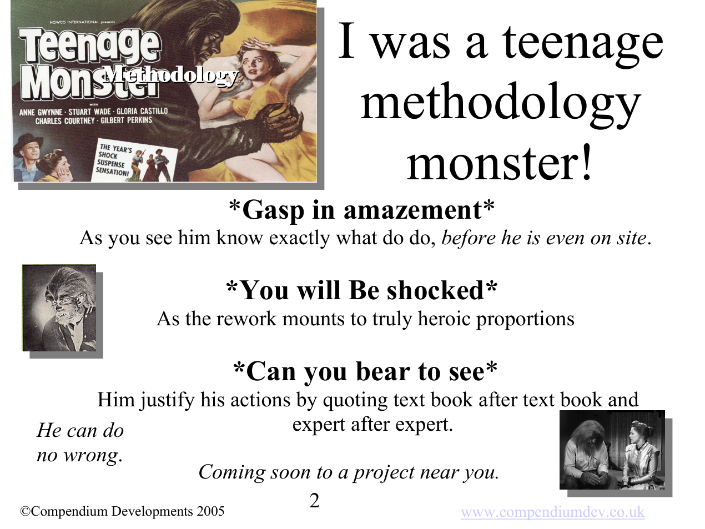
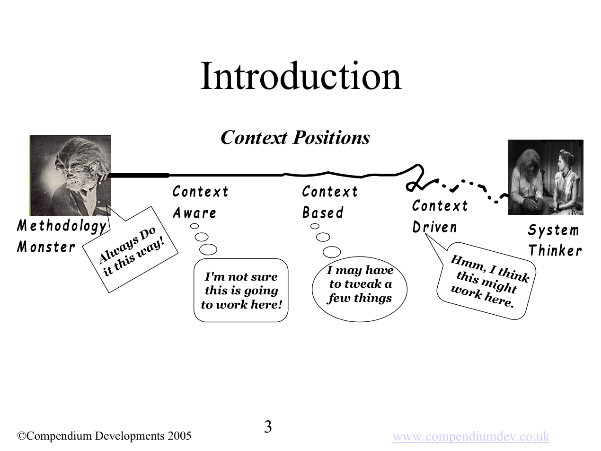
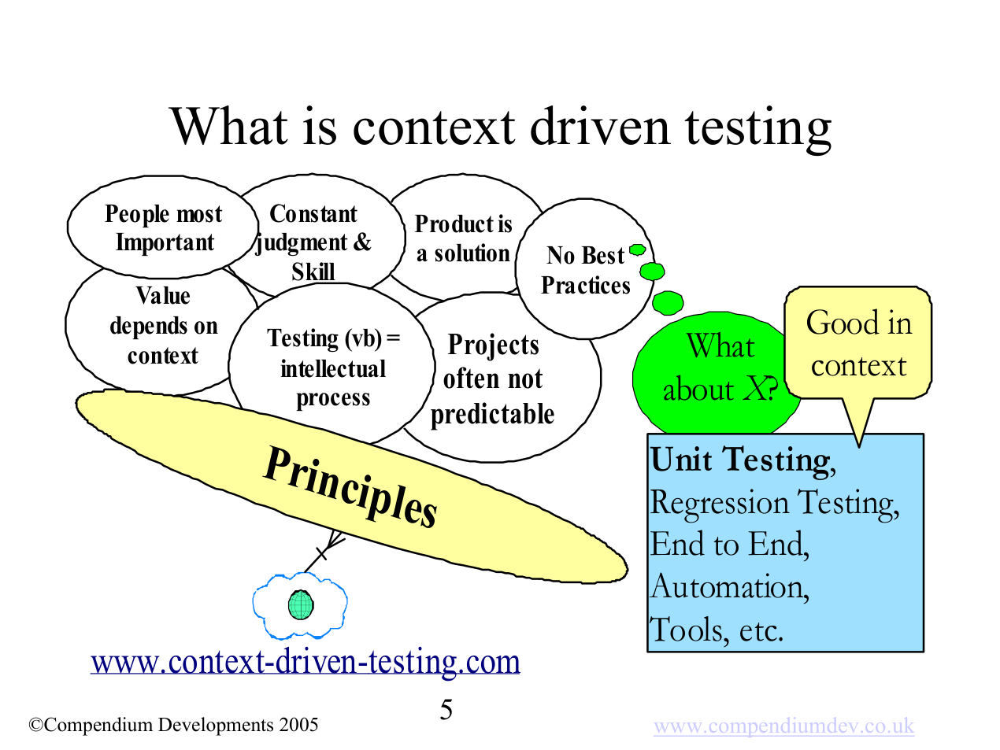
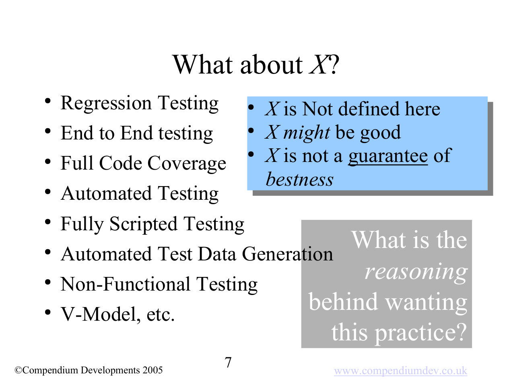
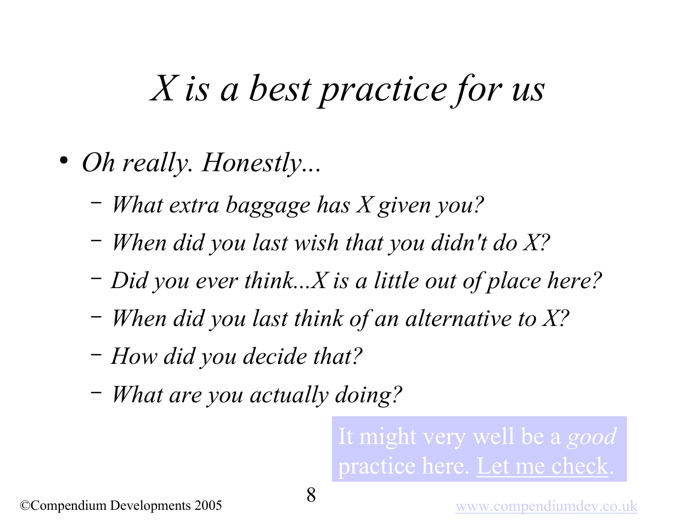
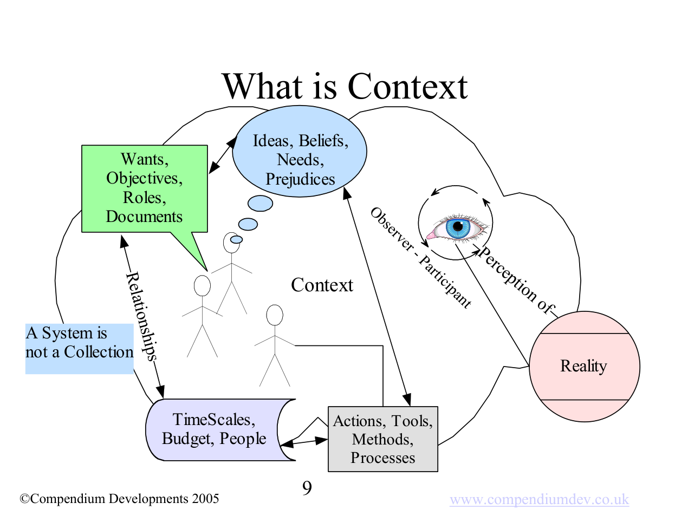
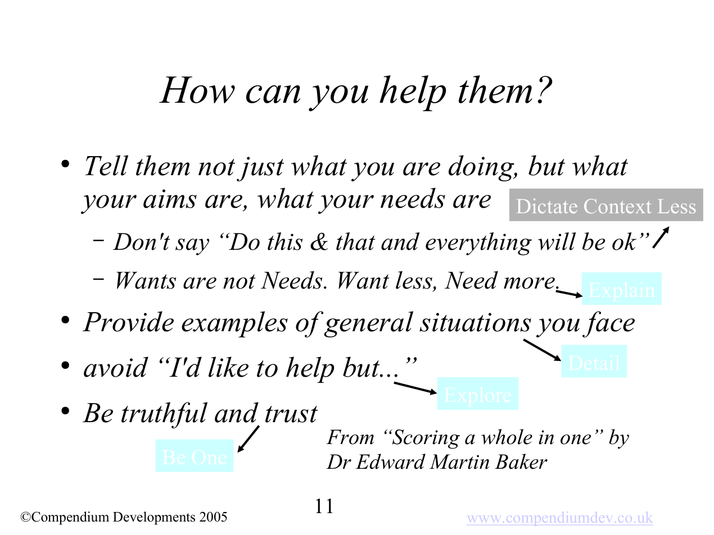
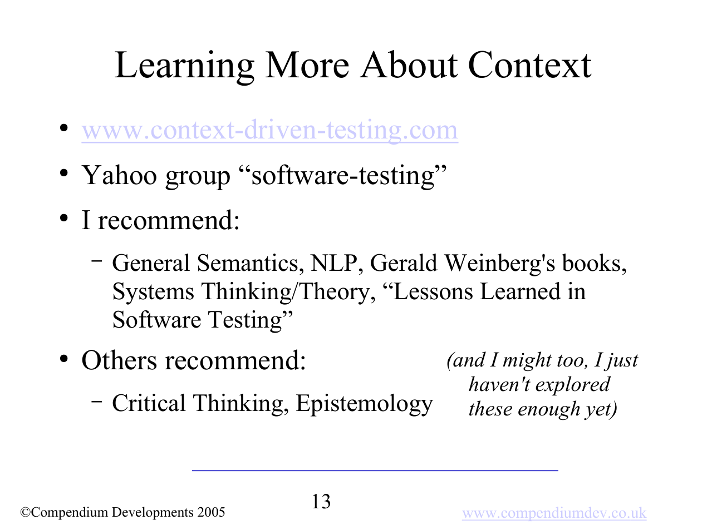

<!-- Slide 1 -->

# “It Depends...” Context Driven Testing - What does it mean to have no “best practices”?

Alan Richardson

Compendium Developments

Version 1.20050305NorthLondonBCS

A personal view

---

<!-- Slide 2 -->

# I was a teenage methodology monster!

\*Gasp in amazement\*

As you see him know exactly what do do, before he is even on site.

\*You will Be shocked\*

As the rework mounts to truly heroic proportions

\*Can you bear to see\*

Him justify his actions by quoting text book after text book and expert after expert.

Coming soon to a project near you.

Methodology

He can do

no wrong.

---

<!-- Slide 3 -->

# Introduction

---

<!-- Slide 4 -->

# I ceased my evil ways

- became more context aware
- asked more questions – different types of questions (how? what?)
- worked more closely with people – retaining independence of thought
- became more of a consultant than a salesman/pusher
- became more effective as a tester
- Less identification: “I am a structured tester”

Over time, kind of…

---

<!-- Slide 5 -->

# What is context driven testing

---

<!-- Slide 6 -->

# Isn't Unit Testing a best practice?

- Unit Testing =
    - Any testing done by the developer
    - Any testing done under the debugger
    - Only testing which is automated at the code level
    - &lt;insert your definition here&gt;

That isn't well defined enough to be a best practice

---

<!-- Slide 7 -->

# What about X?

What is the reasoning behind wanting this practice?

- Regression Testing
- End to End testing
- Full Code Coverage
- Automated Testing
- Fully Scripted Testing
- Automated Test Data Generation
- Non-Functional Testing
- V-Model, etc.

- X is Not defined here
- X might be good
- X is not a guarantee of bestness

---

<!-- Slide 8 -->

# X is a best practice for us

- Oh really. Honestly...
    - What extra baggage has X given you?
    - When did you last wish that you didn't do X?
    - Did you ever think...X is a little out of place here?
    - When did you last think of an alternative to X?
    - How did you decide that?
    - What are you actually doing?

It might very well be a good practice here. Let me check.

---

<!-- Slide 9 -->

# What is Context

---

<!-- Slide 10 -->

# What can you expect from context-driven testers?

- “It depends...” on the context, but generally (I suspect they will)...
    - Ask a lot of questions of you and of themselves to explore the context and avoid assumptions
    - Change their minds, Re-plan
    - Be able to justify what they are doing, in terms of the context as they perceive it, not in calls to authority
    - Know their techniques and practices – assumptions, presuppositions, pros &amp; cons

---

<!-- Slide 11 -->

# How can you help them?

- Tell them not just what you are doing, but what your aims are, what your needs are
    - Don't say “Do this &amp; that and everything will be ok”
    - Wants are not Needs. Want less, Need more.
- Provide examples of general situations you face
- avoid “I'd like to help but...”
- Be truthful and trust

From “Scoring a whole in one” by Dr Edward Martin Baker

Dictate Context Less

Explain

Detail

Explore

Be One

---

<!-- Slide 12 -->

# Identify your Context

- What did we say we were doing?
- What are we actually doing?
- Who for?
- Why? What will we gain by doing that?
- Remind me - what is our aim/objective?
- What could we do instead?
- What would happen if we did something else?

---

<!-- Slide 13 -->

# Learning More About Context

- www.context-driven-testing.com
- Yahoo group “software-testing”
- I recommend:
    - General Semantics, NLP, Gerald Weinberg's books, Systems Thinking/Theory, “Lessons Learned in Software Testing”
- Others recommend:
    - Critical Thinking, Epistemology

(and I might too, I just haven't explored these enough yet)
