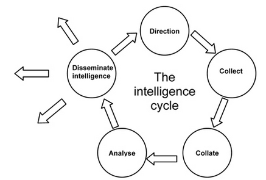
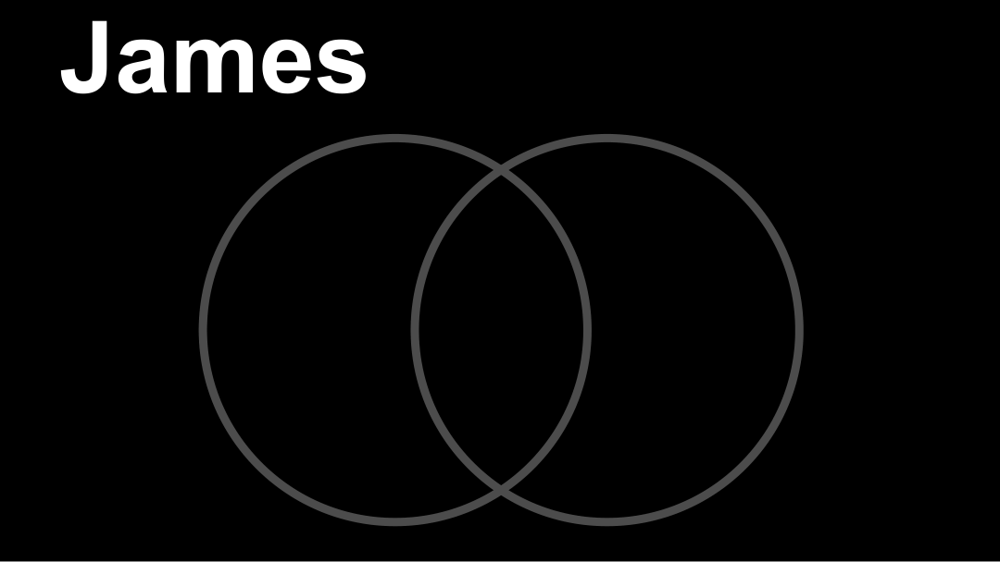
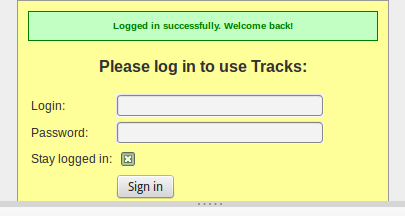

# Black Ops Testing Workshop — January 2015

23 January 2015, Skills Matter, London. James Lyndsay, Tony Bruce, Steve Green and Alan Richardson.

A reading copy of the 60-slide workshop deck. Original slide numbers are retained. Historical exercise environments and example accounts describe the 2015 workshop. The original resource shortcuts on slides 12 and 39 are replaced by local archive links.

[PDF slides](export/slides.pdf) · [Facilitation notes](speaker-notes.md) · [Workshop details and resources](readme.md)

## 1 — Black Ops Testing

www.BlackOpsTesting.com

BlackOpsTesting.com

## 2 — We are BlackOpsTesting.com

James Lyndsay - @workroomprds

Tony Bruce - @tonybruce77

Steve Green - @testpartners

Alan Richardson - @eviltester

@BlackOpsTesting

## 3 — Welcome

- Basic structure explained
- Timings &amp; Logistics

## 4 — What you are about to test

- Tracks
    - getontracks.org
    - A ‘Getting Things Done’ application
- Basically
    - A rails Web App with an API and Mobile view
    - Projects to organise ‘Actions’
    - ‘Actions’ - things you will do
    - ‘Context’ - where you will do the ‘Actions’

## 5 — Demo of Tracks

## 6 — How would you be most interested in testing tracks?

Pick a context to give you focus, get together

1. Focus on GTD
1. Focus on Rails etc.
1. Focus on web
1. anything else?

## 7 — Plans and first contact

“...no plan of operations extends with any certainty beyond the first contact with the main hostile force.”

Field Marshall Helmuth Carl Bernard Graf von Moltke, 1871

## 8 — Timing and Logistics

09:00 Start

09:30 - 10:30 Testing

10:30 - 11:00 Morning Break

11:00 - 12:00 Testing

12:00 - 13:00 Lunch

13:00 - 15:00 Testing

15:00 - 15:30 Afternoon Break

15:30 - 17:30 Testing

17:30 Finish

## 9 — Introduction

- 4 \* 5 minute max lightning talks
- We expect you to test stuff
- We will coach &amp; ask questions as you test
- We may periodically debrief
- We have ‘Challenges’

## 10 — Collaboration Rules

- Don’t load test a shared resource
    - If you accidentally bring something down through a clever test then that’s fine,
- Don’t change data you didn’t create
    - Unless it is bulk load data, in which case negotiate or take the risk
- Do steal from people around you

## 11 — Where you can test tracks

Locally

- Install from getontracks.org
- Recommended VM
    - https://bitnami.com/stack/tracks
- On our cloud test environments…
    - ...see next slide

## 12 — Where you can find it (online)

Slides:

[Archived slides](export/slides.pdf)

Notes, Links, References:

[Workshop resources](readme.md#resources)

## 13 — Lightning Talks

Each of us have max 5 minutes to tell you stuff we think is important for you to know at the start.

## 14 — A model of how Alan tests

- Model
    - What I think I understand. Different viewpoints.
- Observe
    - at different points to corroborate/invalidate model
- Reflect
    - find gaps, lack of depth, derive intent
- Interrogate
    - Focussed, deep dive observation with intent
- Manipulate
    - Hypothesis exploration and “how we do stuff”

Tools help me observe &amp; manipulate

Alan

## 15 — Note Taking

- Why:
    - Questions, Ideas, Risks, etc.
- What:
    - ToDos, Issues, Observations, Notes, etc.
- When:
    - Timestamps, sequential order
- Where:
    - urls, environment, users, etc.
- How:
    - commands, methods, tools used, etc.

Evidence:

- logs, screenshots, output, files, etc.

## 16 — Learning another way

"...learning means having at least another way of doing the same thing."

"Try something you know and learn to do it another way."

## 17 — Distinguishing differences

"... I must be able to tell differences. And the differences must be significant.

But I can distinguish smaller differences, not by increasing the stimulus, but by reducing the effort.

To do this I must improve my organization."

## 18 — Improving movement

"Now, take a minute to try for yourselves anything you want, to see what you could improve in your movement."

## 19 — Tony

- Test ideas
- Tools
- Information &amp; Intelligence

## 20 — Explore for test ideas

Prep

- Notes
- Summary
- Important bits
    - Ideas
    - Comments
    - Questions
    - Thoughts
    - Six Honest Men

"I Keep Six Honest Serving Men ..."

I KEEP six honest serving-men

(They taught me all I knew);

Their names are What and Why and When And How and Where and Who.

…….. Rudyard Kipling

## 21 — Tools

Browser

- Add-ons
- Extensions
- Developer tools

Others

- Accessibility
- Security
- Debugging

## 22 — The intelligence cycle

Leadership Under Pressure: Tactics from the Front Line - Bob Stewart

The diagram runs in a cycle: Direction → Collect → Collate → Analyse → Disseminate Intelligence → Direction.

## 23 — Investigate

## 24 — Information

## 25 — Intelligence

## 26 — Intel is info, but not all info is intel

## 27 — Steve

Context

- Time
- Resources
- Objectives
- Risk
- Approach
- Reporting
- Management

## 28 — Functional Testing and API

Functional Testing

- Input constraint and data validation
- Bypassing constraints
- Data flow

API

- Data creation

## 29 — What might be difficult?

## 30 — What might be difficult?

- How can we create enough data?
- How can we test time-related features?
- How do we know if the right thing happened?

## 31 — James

## 32 — An Artefact: A Made Thing.

It has history, builders, platforms, decisions.

Its influences may be obscure.

It does what comes naturally.

Our understanding of it is partial.

It retains the potential to surprise us.

## 33 — As if I was joining the project...

my approach?

## 34 — A System: More than its Parts

Complicated generic systems meshed together

Interfaces, isolation, scales

Tracks does things its components cannot

Gives an illusion of simplicity

## 35 — Lightning Talk Debrief

Extras?

Questions?

Comments?

## 36 — Testing

A set of generic slides to put up when ‘Testing’

## 37 — Testing

- Consider what we said
- Test the app in new ways, take notes, try new tools
- Black Ops Team will mingle
    - do ask for help
    - ask questions (we will)
    - we have different skillsets, we may delegate
- We will debrief periodically

## 38 — Familiarisation and Free For All

Debrief:

What’s interesting

What’s unexpected

What (from what you did earlier) looks productive

## 39 — Where you can find it (online)

Slides:

[Archived slides](export/slides.pdf)

Notes, Links, References:

[Workshop resources](readme.md#resources)

## 40 — Interactions

What are you interacting with?

What are you acting through?

does it route? transform?

or is it (ideally) transparent?

What constraints does your target lie within?

What opportunities does the transport offer?

## 41 — API

- REST API
- APP as API
- Tools
- How we used it
- Gotchas

## 42 — Business Context Testing

Timing

Entity Relationship

etc.

## 43 — Last Testing Section

Challenges

Where next for you? (tools, functionality)

Where next for someone who cares?

What shall we log?

Debrief

Q&amp;A

## 44 — Debrief

Observations

Observations?

Questions

Questions?

## 45 — Break Slides

A selection of slides for breaks

## 46 — Break for Lunch (60 mins)

Feel free to carry on testing if you want

## 47 — Break (30 mins)

Feel free to carry on testing if you want

## 48 — Interrupts

A section containing interrupts with information that might need to be referenced during the interrupt.

New slides may appear during the workshop.

## 49 — Hints...

Are you monitoring the HTTP traffic?

Have you changed the DOM?

Cookies?

Internationalisation?

Logged issues?

...

## 50 — Challenges

A set of ‘challenges’ if you want to ‘play’ or have some specific goals to work towards.

Any challenges are optional.

## 51 — Challenge - create long Action descriptions

Tracks limits Action description to (100 chars)

Challenge: Create an Action with a description longer than 100 chars.

e.g. http://tracks-with-data.bitnamiapp.com/tracks/todos/809/edit.m

user: mrlong password: longpasswordforme

Current Black Ops Testing Team record: 252 chars (Alan)

## 52 — Challenge - Project list view logs out

User logged out when view the project list. http://tracks-with-data.bitnamiapp.com/tracks/login Username: mrlogout password:logmeout

Challenge:

- Why?
- Can you fix it?
- Can you replicate it?
- How would you use that knowledge next?

## 53 — Challenge - input &lt;/script&gt;

Some tracks fields accept &lt;/script&gt;, which causes problems when output elsewhere.

Challenge: how can you use this information to target your testing?

We want tests, an approach, and analysis from this, ... and bugs.

## 54 — Challenge - Missing project

It is possible to create a project that can be found by searching, but it does not appear on any list of projects anywhere else. How can that happen?

## 55 — Challenge - empty application

- Can you find a count which could be of 1 out of 0?
- What might that mean?
- How many can you find?
- Can you find similar oddities?
- What would mask these?
- Can you find tests?

We want screenshots, bugs, analysis, tests.

## 56 — Challenge: User Isolation

Do users have isolated collections of projects, contexts, tasks and tags?

Does it matter?

We want more than “yes” or “no” : workflows, test data, life cycles, specific situations where this applies and where it does not. Database access will help.

Further on: What outlasts a user?

## 57 — Challenge: Project Notes

I’ve seen instruction to “add notes to projects from individual project pages”

What might project notes be?

What purpose do they serve?

Seriously, I’ve no idea. James.

## 58 — Challenge: For the Java Automators

One of our automated GUI tests is broken, can you fix it?

http://blackopstesting.com/go/trackswebdriver

You’ll need a Java JDK, IDE, &amp; Maven installed

## 59 — Challenge: Don’t have a clever name

Replicate this scenario.

Why does it happen?

## 60 — Final Call to Action

- Keep Testing on your own VM
- Use the Links document
    - download the artefacts and handouts
- Visit us online
    - http://blackopstesting.com/page/about/
    - Read our blogs, white papers, etc.
    - Connect - twitter, newsletters etc
