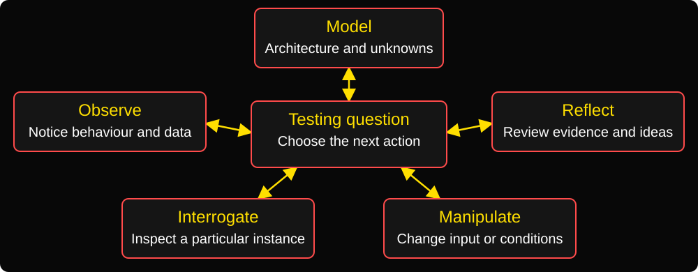

# Absolute Basics

Technical Web Testing 101 · Section 02

**AI-generated summary of Alan Richardson's recording.**

Key points and redrawn diagrams; these slides do not reproduce the complete original deck.

[Watch from 00:03:15](https://www.youtube.com/watch?v=jWwfMo5Ziz0&t=195s) · [Transcript](transcript.md)

---

## Let questions drive the investigation

- Learn the technology to understand what might fail.
- A tool can reveal a new question; a question can suggest a tool.
- Programming and automation extend the investigation.
- Judge a technique by the information it helps us obtain.

[Watch: 00:03:15](https://www.youtube.com/watch?v=jWwfMo5Ziz0&t=195s)

---

## Give a tool list a purpose

- Record tools the team actually uses and supports.
- Keep setup notes that help a new team member get started.
- Track tools worth investigating when a need arises.
- A long list of unfamiliar names adds little practical capability.

[Watch: 00:06:25](https://www.youtube.com/watch?v=jWwfMo5Ziz0&t=385s)

---

## MORIM: choose the next useful action

Model · Observe · Reflect · Interrogate · Manipulate. Repeat in any useful order.

[Watch: 00:09:20](https://www.youtube.com/watch?v=jWwfMo5Ziz0&t=560s)

---

## Model and observe

- Sketch the application, its layers and the messages between them.
- Include uncertainty: what do we assume rather than know?
- Observe traffic, logs, database state and visible behaviour.
- Compare the evidence with the model and revise it.

[Watch: 00:09:20](https://www.youtube.com/watch?v=jWwfMo5Ziz0&t=560s)

---

## Interrogate and manipulate

- Interrogate a particular message, value or event in detail.
- Keep a history so focused inspection does not lose the wider context.
- Manipulate data, requests, responses or the environment.
- Use the resulting behaviour to test an explanation.

[Watch: 00:09:20](https://www.youtube.com/watch?v=jWwfMo5Ziz0&t=560s)

---

## Reflect before choosing the next experiment

- What did the last action reveal?
- Which explanation fits the evidence? What remains uncertain?
- Which action would help answer the next question?
- Switch between MORIM activities rather than follow a fixed checklist.

[Watch: 00:09:20](https://www.youtube.com/watch?v=jWwfMo5Ziz0&t=560s)
