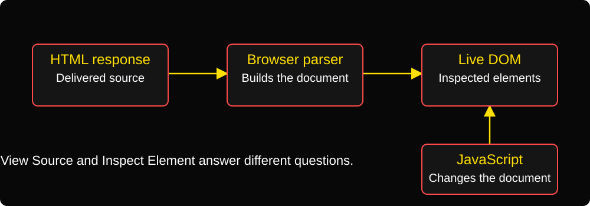

# View Page Source

Technical Web Testing 101 · Section 05

**AI-generated summary of Alan Richardson's recording.**

Key points and redrawn diagrams; these slides do not reproduce the complete original deck.

[Watch from 00:55:58](https://www.youtube.com/watch?v=jWwfMo5Ziz0&t=3358s) · [Transcript](transcript.md)

---

## Compare delivered HTML with the live DOM

View Source exposes delivered markup. Inspect Element exposes the live document.

[Watch: 00:55:58](https://www.youtube.com/watch?v=jWwfMo5Ziz0&t=3358s)

---

## Read the page as an application

- Identify the document structure, scripts, styles and event attributes.
- Separate browser-provided behaviour from application behaviour.
- Follow linked resources and investigate unfamiliar tags.
- Search comments for assumptions, disabled behaviour and unfinished work.

[Watch: 00:55:58](https://www.youtube.com/watch?v=jWwfMo5Ziz0&t=3358s)

---

## Exercise: compare source views

- Find every way to open source in each browser under test.
- Compare search, highlighting, navigation and copying.
- Inspect real page source and note unknown concepts or suspected problems.
- Find references, then complete the exercise before the retrospective.

[Watch: 01:03:46](https://www.youtube.com/watch?v=jWwfMo5Ziz0&t=3826s)

---

## Compare browsers by the task

- The recording compares readability, search and syntax error highlighting.
- One browser may help locate a problem; another may clarify the content.
- Source links may open as source, rendered pages or debugger resources.
- Record the browser and version alongside the observed capability.

[Watch: 01:09:02](https://www.youtube.com/watch?v=jWwfMo5Ziz0&t=4142s)

---

## Investigate markup warnings

- Mismatched tags and malformed attributes can create rendering risks.
- Browser repair can hide source problems in the displayed page.
- Compare delivered markup across browsers: the server may vary it.
- Consult the applicable HTML rules before deciding something needs a fix.

[Watch: 01:17:39](https://www.youtube.com/watch?v=jWwfMo5Ziz0&t=4659s)

---

## Turn source inspection into further testing

- Form a concrete hypothesis about the impact of a markup problem.
- Check related scripts, styling and browser compatibility.
- Add the new knowledge to the application model.
- Keep the original challenges and findings as exercise notes.

[Challenges](../../view-page-source-challenges.md) · [Findings](../../view-page-source-summary.md)

[Watch: 01:17:39](https://www.youtube.com/watch?v=jWwfMo5Ziz0&t=4659s)
