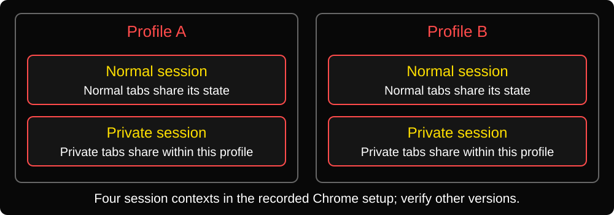

# Incognito Mode

Technical Web Testing 101 · Section 06

**AI-generated summary of Alan Richardson's recording.**

Key points and redrawn diagrams; these slides do not reproduce the complete original deck.

[Watch from 01:26:46](https://www.youtube.com/watch?v=jWwfMo5Ziz0&t=5206s) · [Transcript](transcript.md)

---

## Use separate sessions to explore shared state

- Compare the same account in two sessions.
- Combine an administrator and a normal user.
- Edit an entity after another user has loaded an older version.
- Observe how the application handles actions against changed state.

[Watch: 01:26:46](https://www.youtube.com/watch?v=jWwfMo5Ziz0&t=5206s)

---

## Exercise: test the browser model

- Write down what private mode should do before looking it up.
- Read the official documentation, then experiment.
- Compare cookies, cache, history, downloads, extensions and proxy settings.
- Separate what the documentation promises from what the experiment shows.

[Watch: 01:32:27](https://www.youtube.com/watch?v=jWwfMo5Ziz0&t=5547s)

---

## Count cookie jars, not windows

Recorded Chrome finding: private windows share state within a profile. Verify the browser/version under test.

[Watch: 01:35:32](https://www.youtube.com/watch?v=jWwfMo5Ziz0&t=5732s)

---

## Treat browser differences as findings

- The retrospective compares specific historical browser versions.
- Private sessions, tool availability and shared settings differ.
- A private window does not imply independent proxy configuration.
- Repeat the experiment when changing browser, profile or version.

[Watch: 01:35:32](https://www.youtube.com/watch?v=jWwfMo5Ziz0&t=5732s)

---

## Keep track of the users in a multi-user test

- The RestMud demo combines two Chrome profiles and normal/private sessions.
- Identify each user and track their location, inventory and shared objects.
- Change state in one session, then observe it in another.
- Use a simple model to avoid confusing one identity with another.

[Watch: 01:45:31](https://www.youtube.com/watch?v=jWwfMo5Ziz0&t=6331s)

---

## Distinguish action ordering from load

- These exercises explore multiple users acting on shared state.
- Sequential actions can expose stale data and unexpected state transitions.
- Clicking in two windows does not establish simultaneous requests.
- Use a different approach when precise concurrency or load matters.

[Challenges](../../incognito-challenges.md) · [Findings](../../incognito-summaries.md)

[Watch: 01:45:31](https://www.youtube.com/watch?v=jWwfMo5Ziz0&t=6331s)
