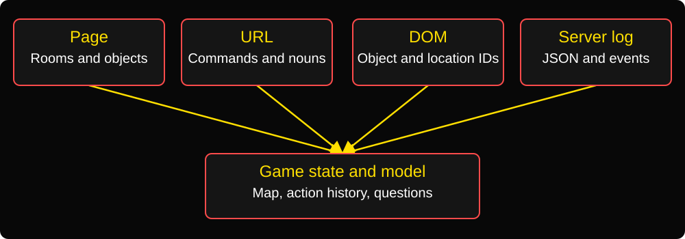

# RestMud Text Adventure Game

Technical Web Testing 101 · Section 07

**AI-generated summary of Alan Richardson's recording.**

Key points and redrawn diagrams; these slides do not reproduce the complete original deck.

[Watch from 01:50:49](https://www.youtube.com/watch?v=jWwfMo5Ziz0&t=6649s) · [Transcript](transcript.md)

---

## Explore the game as a model of a system

- RestMud provides rooms, objects, commands and puzzles.
- Learn its rules by observing, experimenting and keeping a map.
- A missing visible link does not prove an action cannot work.
- Track actions so a route or an unexpected result can be reproduced.

[Watch: 01:50:49](https://www.youtube.com/watch?v=jWwfMo5Ziz0&t=6649s)

---

## Start the local game

- Unpack the game and read its README and hints.
- The recorded release requires Java 8 or later.
- Run the supplied JAR with `java -jar <game-file>.jar`.
- Use the local address and port reported at startup; the demo uses 4567.

Keep the server console visible while playing.

[Watch: 01:58:10](https://www.youtube.com/watch?v=jWwfMo5Ziz0&t=7090s)

---

## Observe more than the rendered page

Compare what each observation point reveals about the same action.

[Watch: 02:00:08](https://www.youtube.com/watch?v=jWwfMo5Ziz0&t=7208s)

---

## Treat commands and identifiers as clues

- Read URL patterns such as go, examine, take, drop and use.
- Inspect elements for object and location identifiers.
- Compare descriptions with JSON messages in the server console.
- Experiment with a command even when the interface offers no link.

[Watch: 02:00:08](https://www.youtube.com/watch?v=jWwfMo5Ziz0&t=7208s)

---

## Exercise: play, map and investigate

- Explore the single-player game without reading solutions first.
- Keep a map, an action history and notes about unexplained behaviour.
- Look for inconsistencies as well as ways to solve puzzles.
- Revisit the same game later through a proxy and through its API.

[Watch: 02:06:00](https://www.youtube.com/watch?v=jWwfMo5Ziz0&t=7560s)
