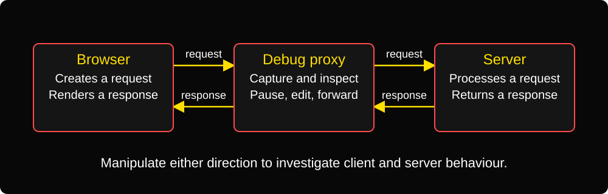
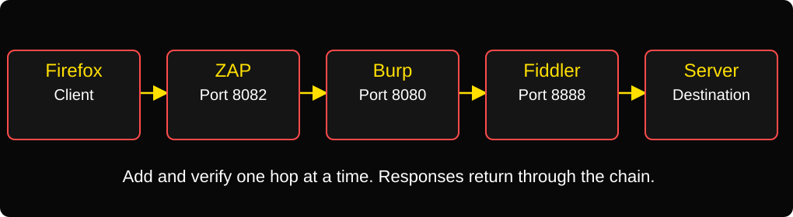

# HTTP Proxies

Technical Web Testing 101 · Section 08

**AI-generated summary of Alan Richardson's recording.**

Key points and redrawn diagrams; these slides do not reproduce the complete original deck.

[Watch from 02:09:35](https://www.youtube.com/watch?v=jWwfMo5Ziz0&t=7775s) · [Transcript](transcript.md)

---

## Put observation and control between client and server

Capture traffic, inspect messages and change a request or response before forwarding it.

[Watch: 02:10:36](https://www.youtube.com/watch?v=jWwfMo5Ziz0&t=7836s)

---

## Use traffic to learn the architecture

- Read headers, cookies, parameters and message bodies.
- Use history and site maps to discover application paths.
- Distinguish visited resources from links merely discovered by the tool.
- Follow unfamiliar HTTP details back to a reference and experiment.

[Watch: 02:10:36](https://www.youtube.com/watch?v=jWwfMo5Ziz0&t=7836s)

---

## Establish one working connection first

- Find the proxy listener address and port.
- Configure the client to use that listener.
- Start with interception off and verify that traffic appears in history.
- Check whether the browser uses its own settings or the system settings.

[Watch: 02:15:33](https://www.youtube.com/watch?v=jWwfMo5Ziz0&t=8133s)

---

## Understand HTTPS interception

- A debugging proxy can terminate TLS and establish a second connection.
- The client must trust the proxy certificate for this arrangement to work.
- Track the certificate and configuration changes made for testing.
- Restore the intended settings when the investigation finishes.

The recording shows historical browser certificate dialogs.

[Watch: 02:17:30](https://www.youtube.com/watch?v=jWwfMo5Ziz0&t=8250s)

---

## Repeat a captured request

- Send a useful message to a repeater.
- Change a path, header or value and issue it again.
- Compare the response with the original.
- Remember that a repeater response may stay in the proxy, outside the browser.

[Watch: 02:20:53](https://www.youtube.com/watch?v=jWwfMo5Ziz0&t=8453s)

---

## Intercept the browser interaction

- Pause a request before the server receives it.
- Edit, forward or drop the message.
- Intercept responses to explore how the client handles changed data or errors.
- Compare original and edited messages when explaining the result.

[Watch: 02:22:16](https://www.youtube.com/watch?v=jWwfMo5Ziz0&t=8536s)

---

## Choose manipulations that answer a question

- Change identity headers or request data.
- Substitute a resource without deploying a server change.
- Explore client behaviour with error responses or altered JSON.
- Use network simulation where the chosen proxy supports it.

[Watch: 02:10:36](https://www.youtube.com/watch?v=jWwfMo5Ziz0&t=7836s)

---

## Combine tools incrementally

Add one proxy, configure its upstream connection and confirm traffic at every step.

[Watch: 02:32:59](https://www.youtube.com/watch?v=jWwfMo5Ziz0&t=9179s)

---

## Check the influence of the tools

- A proxy changes the communication path and can introduce problems.
- Check behaviour without it when investigating an unexpected failure.
- Explore tool differences rather than expect one proxy to do everything.
- Turn the new capabilities into experiments on a practice application.

[Watch: 02:29:21](https://www.youtube.com/watch?v=jWwfMo5Ziz0&t=8961s)
