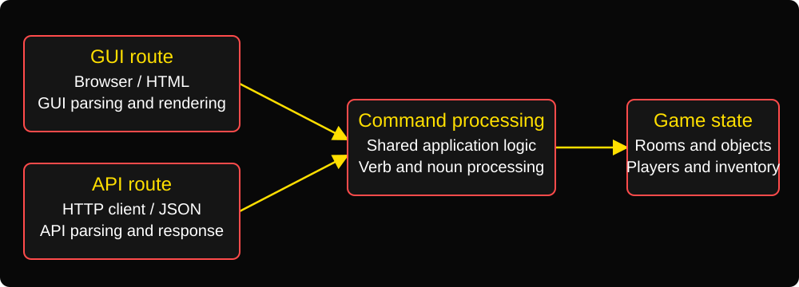

# Interactive REST API Testing

Technical Web Testing 101 · Section 09

**AI-generated summary of Alan Richardson's recording.**

Key points and redrawn diagrams; these slides do not reproduce the complete original deck.

[Watch from 02:40:18](https://www.youtube.com/watch?v=jWwfMo5Ziz0&t=9618s) · [Transcript](transcript.md)

---

## Start with an HTTP API we can explore

- Read the API documentation and make a simple request.
- Use the method and target URI to express the operation.
- Inspect headers, status and the response representation.
- Distinguish practical HTTP API usage from the fuller REST architectural constraints.

[Watch: 02:41:07](https://www.youtube.com/watch?v=jWwfMo5Ziz0&t=9667s)

---

## Break down a request

```http
GET /api/?results=10&nat=de HTTP/1.1
Host: randomuser.me
Accept: application/json
```

Method · path · query parameters · headers. The response adds a status, headers and body.

Illustrative request based on the recorded Random User exercise.

[Watch: 02:46:59](https://www.youtube.com/watch?v=jWwfMo5Ziz0&t=10019s)

---

## Exercise: explore with the browser

- Request ten people from Germany.
- Request two males from France.
- Retrieve names, email addresses and phone numbers for 25 people.
- Try a CSV response and compare it with JSON.

Use the API documentation to construct the query parameters.

[Watch: 02:46:59](https://www.youtube.com/watch?v=jWwfMo5Ziz0&t=10019s)

---

## Use a REST client for more control

- Set the method, URI, headers and request body explicitly.
- Inspect status codes, response time and raw or formatted content.
- Repeat the browser exercises with different response formats.
- Check which features and settings belong to the client version in use.

The recording uses the historical Postman Chrome application.

[Watch: 02:51:30](https://www.youtube.com/watch?v=jWwfMo5Ziz0&t=10290s)

---

## Separate the interface from the application logic



Shared processing offers an alternative testing entry point. GUI-specific parsing and rendering still need investigation.

[Watch: 03:02:06](https://www.youtube.com/watch?v=jWwfMo5Ziz0&t=10926s)

---

## Play RestMud through the API

- Compare a normal HTML route with the documented API route.
- Issue a GET to inspect the JSON representation of the game state.
- Try a POST with the documented verb and noun-phrase payload.
- Check the target path as well as the body when a request behaves unexpectedly.

RestMud deliberately accepts some operations more loosely than other APIs.

[Watch: 03:02:06](https://www.youtube.com/watch?v=jWwfMo5Ziz0&t=10926s)

---

## Build a collection of reusable requests

- Save a working look, move or examine request.
- Reuse it unchanged or treat it as a template for another action.
- Name requests so the intended operation remains obvious.
- Keep a history and compare the actual traffic through a proxy.

[Watch: 03:12:22](https://www.youtube.com/watch?v=jWwfMo5Ziz0&t=11542s)

---

## Check session and proxy assumptions

- The recorded Chrome Postman app shares browser cookies and proxy settings.
- An existing login can invalidate an apparent unauthenticated test.
- Use a proxy to compare client displays with transmitted messages.
- Recheck these assumptions in another client or version.

[Watch: 02:59:35](https://www.youtube.com/watch?v=jWwfMo5Ziz0&t=10775s)

---

## Read methods and status codes in context

| Operation in the course examples | Typical method |
|---|---|
| Create | POST |
| Read | GET |
| Update | PUT |
| Delete | DELETE |

2xx success · 3xx redirection · 4xx client error · 5xx server error.

Consult the API contract; the method and status alone do not prove correct behaviour.

[Watch: 03:16:23](https://www.youtube.com/watch?v=jWwfMo5Ziz0&t=11783s)

---

## Investigate authentication and richer APIs

- Check whether access uses an Authorization header, cookie or token.
- Basic authentication encodes a username/password pair with Base64.
- Inspect the header actually sent, rather than only the client form.
- Move from simple demos to applications with permissions and state changes.

[Original slides](../../rest-testing-slides.md) cover the detailed reference tables.

[Watch: 03:16:23](https://www.youtube.com/watch?v=jWwfMo5Ziz0&t=11783s)
