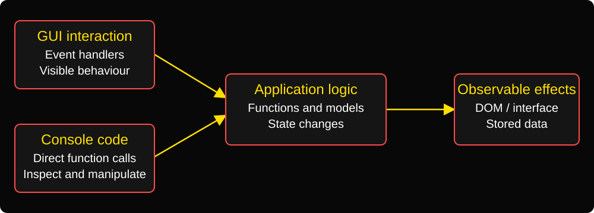

# Testing JavaScript from the Browser Console

Technical Web Testing 101 · Section 10

**AI-generated summary of Alan Richardson's recording.**

Key points and redrawn diagrams; these slides do not reproduce the complete original deck.

[Watch from 03:23:38](https://www.youtube.com/watch?v=jWwfMo5Ziz0&t=12218s) · [Transcript](transcript.md)

---

## Find an entry point below the GUI



Use the GUI to understand behaviour, then inspect the code that performs the work.

[Watch: 03:23:38](https://www.youtube.com/watch?v=jWwfMo5Ziz0&t=12218s)

---

## Trace an action from the element to the code

- Inspect the Sloganizer button and its event handler.
- Follow the handler to its source definition.
- Use event listeners when the handler does not appear inline.
- Try autocomplete and console history while exploring.

[Watch: 03:25:26](https://www.youtube.com/watch?v=jWwfMo5Ziz0&t=12326s)

---

## Distinguish objects from function calls

```javascript
phrases                 // inspect an object
sentences[0]            // inspect an array element
sentences.length        // inspect the array length
changeSlogan()          // invoke the GUI-level action
```

These names come from the Sloganizer version shown in the recording.

[Watch: 03:31:05](https://www.youtube.com/watch?v=jWwfMo5Ziz0&t=12665s)

---

## Repeat a focused operation and log its results

```javascript
for (var x = 0; x < 100; x++) {
  console.log(process_sentence(sentences[0]));
}
```

- Hold the template constant while varying the generated text.
- `console.log` records each result; a loop alone may show only the final value.
- Inspect the output: repetition by itself supplies no correctness judgement.

[Watch: 03:53:06](https://www.youtube.com/watch?v=jWwfMo5Ziz0&t=13986s)

---

## Manipulate data deliberately

- Inspect `phrases.start` or `phrases["start"]`.
- Replace an array value and observe how a function uses it.
- Call a lower-level text function with carefully chosen strings.
- Reload Sloganizer to discard temporary changes to its in-memory data.

Choose input values and expected effects before running a large loop.

[Watch: 03:48:31](https://www.youtube.com/watch?v=jWwfMo5Ziz0&t=13711s)

---

## Read the framework model in TodoMVC

- Exercise create, edit, complete, filter and delete through the GUI.
- Locate models, collections, views and the application object.
- Search for the code behind a GUI action instead of guessing a method name.
- Compare model state, rendered items and local storage.

The demonstration uses a Backbone implementation of TodoMVC.

[Watch: 03:59:23](https://www.youtube.com/watch?v=jWwfMo5Ziz0&t=14363s)

---

## Discover CRUD operations from application code

```javascript
app.todos.create({
  title: "demo",
  order: app.todos.nextOrder(),
  completed: false
});
app.todos.models[0].get("title");
app.todos.models[0].save({title: "renamed"});
app.todos.models[0].toggle();
app.todos.models[0].destroy();
```

Each line illustrates a separate operation in the recorded app. Inspect the selected model before changing it.

[Watch: 04:06:32](https://www.youtube.com/watch?v=jWwfMo5Ziz0&t=14792s)

---

## Use console automation to support GUI testing

- Create 100 to-dos with distinct titles.
- Mark all, half, or every second item as completed.
- Return to the GUI and test Clear completed or filtering.
- Amend many titles to prepare data that would take too long to enter manually.

[Watch: 04:15:12](https://www.youtube.com/watch?v=jWwfMo5Ziz0&t=15312s)

---

## Account for collections changing during a loop

- Deleting an item can shift later indexes and shorten the collection.
- Iterating forward over a live array can skip items.
- Work backwards, or take a stable snapshot before deleting.
- A guarded `while` checks for an item before acting; `do...while` acts first.

[Watch: 04:15:12](https://www.youtube.com/watch?v=jWwfMo5Ziz0&t=15312s)

---

## Limit unintended changes from helper code

- A variable created at the top level can collide with application state.
- The demonstration wraps temporary variables in a function scope.
- Local scope reduces variable leakage; model changes still affect the app.
- Understand persistence before assuming a page reload restores the data.

[Watch: 04:15:12](https://www.youtube.com/watch?v=jWwfMo5Ziz0&t=15312s)

---

## Run a controllable background action

```javascript
var sloganBot = setInterval(function () {
  changeSlogan();
}, 1000);

// Stop it when the investigation finishes.
clearInterval(sloganBot);
```

Keep the timer handle. Interact with the GUI while the repeated action runs.

[Watch: 04:35:09](https://www.youtube.com/watch?v=jWwfMo5Ziz0&t=16509s)

---

## Use timers to create new testing conditions

- Add data or change a model while investigating through the interface.
- Run different periodic actions and inspect their interaction.
- Keep control over which actions run and how they stop.
- Timer callbacks share the JavaScript event loop; they do not create independent threads.

[Watch: 04:35:09](https://www.youtube.com/watch?v=jWwfMo5Ziz0&t=16509s)

---

## Save useful code as snippets

- Put repeatable helper code in the Sources snippets tool.
- Save the snippet before relying on it later.
- Keep an external text copy organised by application.
- Check another person's snippet against the application and testing goal before using it.

[Watch: 04:40:27](https://www.youtube.com/watch?v=jWwfMo5Ziz0&t=16827s)

---

## Treat snippet import/export as a versioned workaround

- The demo uses a separate DevTools context to access internal snippet APIs.
- Earlier helper scripts stopped working after DevTools changes.
- Test export and restore before deleting the only copy.
- Keep readable source files independently of browser storage.

[Watch: 04:45:32](https://www.youtube.com/watch?v=jWwfMo5Ziz0&t=17132s)

---

## Continue with small, practical investigations

- Use language and console references to answer specific questions.
- Compare utility functions with application-level entry points.
- Practise on JavaScript games or coding puzzles.
- Ask developers for accessible functions and models that improve testability.

[Watch: 04:52:12](https://www.youtube.com/watch?v=jWwfMo5Ziz0&t=17532s)
