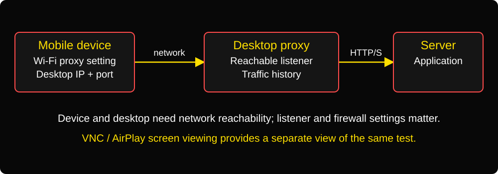

# Mobile Web Testing

Technical Web Testing 101 · Section 11

**AI-generated summary of Alan Richardson's recording.**

Key points and redrawn diagrams; these slides do not reproduce the complete original deck.

[Watch from 04:58:19](https://www.youtube.com/watch?v=jWwfMo5Ziz0&t=17899s) · [Transcript](transcript.md)

---

## Route device traffic through a desktop proxy

Use the desktop's reachable network address, not the phone's loopback address.

[Watch: 04:58:19](https://www.youtube.com/watch?v=jWwfMo5Ziz0&t=17899s)

---

## Check the connection one setting at a time

- Put the device and proxy host on a network that permits communication.
- Find the host's correct network-interface address and proxy port.
- Allow the proxy listener to accept the device connection.
- Configure the device's Wi-Fi proxy and confirm a known browser request in history.

[Watch: 04:58:19](https://www.youtube.com/watch?v=jWwfMo5Ziz0&t=17899s)

---

## Separate browser traffic from native-app traffic

- The demonstrations configure Android and iOS Wi-Fi proxy settings.
- Browser requests provide a useful first connection check.
- A native application may ignore those settings.
- An empty proxy history alone does not prove that the application sent nothing.

[Watch: 05:03:42](https://www.youtube.com/watch?v=jWwfMo5Ziz0&t=18222s)

---

## Use device viewing to improve observation

- The Android demo runs a VNC server on the phone.
- A desktop viewer supports data entry, screenshots and recording.
- The example uses USB for viewing alongside Wi-Fi proxy traffic.
- Keep screen control and network observation as distinct parts of the setup.

[Watch: 05:10:49](https://www.youtube.com/watch?v=jWwfMo5Ziz0&t=18649s)

---

## Use emulation for a first investigation

- Change the desktop browser's device metrics, user agent and input settings.
- Reload and inspect the effect on routing and page behaviour.
- Investigate an apparent failure on the physical device as well.
- A device-shaped viewport does not reproduce all device behaviour.

[Watch: 05:15:38](https://www.youtube.com/watch?v=jWwfMo5Ziz0&t=18938s)

---

## Separate an emulation problem from a site rule

- The recorded BBC menu fails with one emulated touch setting.
- The physical phone behaves differently: the emulator contributes to the result.
- The weather page's missing mobile redirect also occurs on the phone.
- Vary the entry page and inspect the request before assigning a cause.

[Watch: 05:15:38](https://www.youtube.com/watch?v=jWwfMo5Ziz0&t=18938s)

---

## Capture iOS sessions from the desktop

- The recording compares AirPlay receivers for displaying an iOS screen.
- Mirror the device, then use desktop capture tools to record testing.
- Compare responsiveness and configuration in the actual environment.
- Tool names, prices and menu paths in these demos describe their recording period.

[Watch: 05:20:02](https://www.youtube.com/watch?v=jWwfMo5Ziz0&t=19202s)
