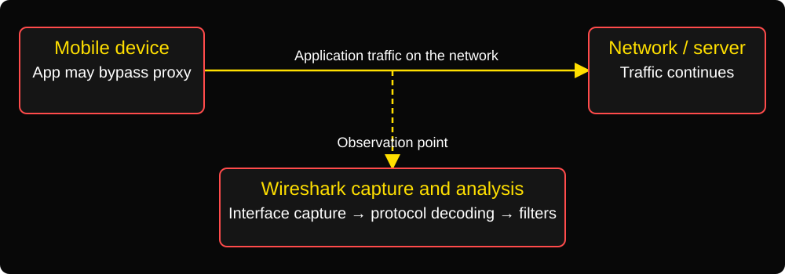

# Mobile Testing with Wireshark on Mac

Technical Web Testing 101 · Section 12

**AI-generated summary of Alan Richardson's recording.**

Key points and redrawn diagrams; these slides do not reproduce the complete original deck.

[Watch from 05:23:24](https://www.youtube.com/watch?v=jWwfMo5Ziz0&t=19404s) · [Transcript](transcript.md)

---

## Choose another observation point

- A mobile application can send traffic without using the configured HTTP proxy.
- Packet capture provides a different way to observe communication.
- Wireshark can decode supported protocols from captured packets.
- Start with the information needed, then choose an approach that can expose it.

[Watch: 05:23:24](https://www.youtube.com/watch?v=jWwfMo5Ziz0&t=19404s)

---

## Distinguish capture from proxy routing



The observation point determines which traffic and protocol details remain visible.

[Watch: 05:26:32](https://www.youtube.com/watch?v=jWwfMo5Ziz0&t=19592s)

---

## Establish the capture conditions

- Select the interface carrying the target traffic.
- The recorded Mac experiment uses monitor and promiscuous modes.
- Wi-Fi capture depends on the adapter, driver, channel and configuration.
- Match the setup to the experiment rather than copy historical menu paths blindly.

[Watch: 05:30:13](https://www.youtube.com/watch?v=jWwfMo5Ziz0&t=19813s)

---

## Keep encryption layers separate

- The demo configures keys to decode its own encrypted 802.11 network traffic.
- Reconnecting the device helps capture the required negotiation in that setup.
- Decoding the Wi-Fi layer does not automatically decrypt HTTPS/TLS.
- Captured packets can still reveal useful connection information without readable HTTP bodies.

[Watch: 05:26:32](https://www.youtube.com/watch?v=jWwfMo5Ziz0&t=19592s)

---

## Filter a known request, then explore the application

```text
http && ip.addr == 192.168.1.143
http.request.method == "GET"
```

- These display-filter examples narrow already captured traffic.
- Confirm a browser request before moving to the native-app experiment.
- Correlate device actions with newly captured messages.

[Watch: 05:30:13](https://www.youtube.com/watch?v=jWwfMo5Ziz0&t=19813s)

---

## Let the goal determine the tool

- A missing view of traffic calls for another observation approach.
- Understand enough of the networking layers to choose that approach.
- Record the conditions under which a capture succeeds or fails.
- Use the original notes alongside the historical demonstration.

[Wireshark notes](../../wireshark-notes.md)

[Watch: 05:38:50](https://www.youtube.com/watch?v=jWwfMo5Ziz0&t=20330s)
