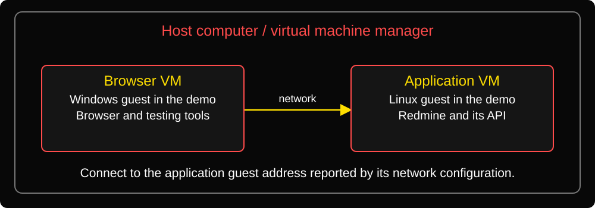

# Virtual Machines

Technical Web Testing 101 · Section 13

**AI-generated summary of Alan Richardson's recording.**

Key points and redrawn diagrams; these slides do not reproduce the complete original deck.

[Watch from 05:40:45](https://www.youtube.com/watch?v=jWwfMo5Ziz0&t=20445s) · [Transcript](transcript.md)

---

## Run separate environments on one host

The recording combines a Windows browser VM with a Linux application VM.

[Watch: 05:40:45](https://www.youtube.com/watch?v=jWwfMo5Ziz0&t=20445s)

---

## Import and start a prepared appliance

- Download the VM image and extract all required parts.
- Import the appliance into the virtual machine manager.
- Review memory, storage and network settings.
- Start the guest and read its access instructions and reported address.

[Watch: 05:40:45](https://www.youtube.com/watch?v=jWwfMo5Ziz0&t=20445s)

---

## Use VMs for a specific testing purpose

- Compare browser and operating-system combinations.
- Run an application such as Redmine without installing its stack on the host.
- Connect the browser guest to the application guest over the configured network.
- Run supporting automation away from the main desktop environment.

[Watch: 05:40:45](https://www.youtube.com/watch?v=jWwfMo5Ziz0&t=20445s)

---

## Recognise the limits of the recorded setup

- The demo shows VirtualBox, TurnKey appliances and historical modern.ie images.
- Those downloads, browser versions and licensing details describe that period.
- Guest networking and available resources affect the experiment.
- A VM gives a useful environment, but does not reproduce every physical-device condition.

[Watch: 05:40:45](https://www.youtube.com/watch?v=jWwfMo5Ziz0&t=20445s)
