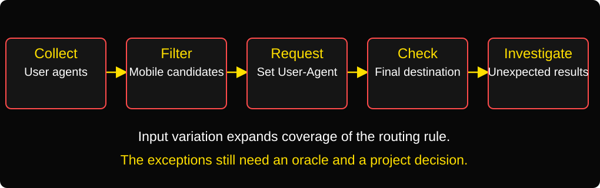

# Case Studies

Technical Web Testing 101 · Section 14

**AI-generated summary of Alan Richardson's recording.**

Key points and redrawn diagrams; these slides do not reproduce the complete original deck.

[Watch from 05:47:54](https://www.youtube.com/watch?v=jWwfMo5Ziz0&t=20874s) · [Transcript](transcript.md)

---

## Identify what the check actually varies

- The case study checks a desktop-site to mobile-site redirect rule.
- The rule uses the request's User-Agent header.
- Varying that header tests routing without obtaining every represented device.
- Device rendering and interaction still require their own investigation.

[Watch: 05:47:54](https://www.youtube.com/watch?v=jWwfMo5Ziz0&t=20874s)

---

## Turn a data variation into a small automated check

Keep the check focused: input header, resulting destination, unexpected cases.

[Watch: 05:47:54](https://www.youtube.com/watch?v=jWwfMo5Ziz0&t=20874s)

---

## Use an external list to challenge project assumptions

- The recorded script collects candidate user-agent strings.
- A filter selects likely mobile cases for the experiment.
- The example narrows 10,830 candidates to 166 strings.
- Three unexpected results in the demonstrated run become investigation leads.

These figures describe that historical run, not present-day site behaviour.

[Watch: 05:47:54](https://www.youtube.com/watch?v=jWwfMo5Ziz0&t=20874s)

---

## Interpret failures before reporting a defect

- Check whether each candidate really represents the intended device class.
- Compare the observed destination with the project's agreed rule.
- Use comparison sites as additional evidence, not an unquestioned specification.
- Present the exceptions and their implications for a project decision.

[Watch: 05:47:54](https://www.youtube.com/watch?v=jWwfMo5Ziz0&t=20874s)

---

## Keep the implementation proportionate

- The demo uses WebDriver with PhantomJS for a quick solution.
- A simpler HTTP client could check an HTTP redirect in another implementation.
- Saved data and richer reports might help if the check needs frequent reuse.
- Invest according to the information needed and the likely repetition.

PhantomJS and the shown script belong to the historical demonstration.

[Watch: 05:47:54](https://www.youtube.com/watch?v=jWwfMo5Ziz0&t=20874s)
