# Technical Web Testing 101

*Complete course transcript - edited reading edition*

Alan Richardson

Edited from the automatic English captions of Alan Richardson's full course recording. Clear recognition errors, spelling, punctuation and false starts have been corrected, and paragraphs have been reflowed for reading. Bulleted summaries and redrawn diagrams contain AI-generated material. The demonstrations describe the tools and versions used when the course was recorded.

[Watch the full course](https://www.youtube.com/watch?v=jWwfMo5Ziz0) · [Course information](https://www.eviltester.com/page/onlinetraining/techwebtesting101/) · [PDF edition](exports/transcripts.pdf)

Copyright © Alan Richardson. Free to use for personal study.

## Contents

- [1. Introduction](#section-01)

- [2. Absolute Basics](#section-02)

- [3. Applications to Use for Testing](#section-03)

- [4. Modern Browsers](#section-04)

- [5. View Page Source](#section-05)

- [6. Incognito Mode](#section-06)

- [7. RestMud Text Adventure Game](#section-07)

- [8. HTTP Proxies](#section-08)

- [9. Interactive REST API Testing](#section-09)

- [10. Testing JavaScript from the Browser Console](#section-10)

- [11. Mobile Web Testing](#section-11)

- [12. Mobile Testing with Wireshark on Mac](#section-12)

- [13. Virtual Machines](#section-13)

- [14. Case Studies](#section-14)

- [15. Final Section](#section-15)

## 1. Introduction

**Section summary**

- Understand the application architecture and the technology beneath the interface.
- Use tools to extend observation, manipulation and learning.
- Practise the techniques and keep developing a model of the system.

### 1.1 Introduction

[Watch this chapter in the video](https://www.youtube.com/watch?v=jWwfMo5Ziz0&t=0s)

**Chapter summary**

- Learn the architecture and programming concepts needed to investigate the system.
- Use the course as a starting point for active practice and continued learning.

**Transcript**

Hi, welcome to technical testing 101, the introductory lecture. Over the years, I've had to test content-based web applications, heavily JavaScript web apps, server-based web apps. I've had to test desktop apps. And a few things keep appearing when I do that. I try and learn as much about the system as I can. I try to learn the basics of the programming language if I don't know them. If I already know the language, I keep extending my knowledge to keep up to date with the developers.

I learn the architecture and try to gain access to all those parts of the architecture because every little bit helps. We build on each piece of information and each layer we learn about. Peeling away a layer exposes a new set of things to learn and understand. Each area and each layer has risks, and that's what we're trying to work with as testers. The more technical we get, the further we can move down the application stack and test those risks. And when I look at my bookcase now, I have very few books on testing.

Not because that's not important, but once we've got the basic testing skills, the books tend to cover the same stuff. So I don't really need books that cover the same topic and the fundamental basics of testing don't change, but the technology does. Every project uses technology differently, uses different technology, uses newer versions. And all of that stuff is what I need to learn and understand to get a feel for the risks and how it's hanging together to see what the flaws might be when it's put together.

It's the technical skill set on the project that changes. So for me, technical includes tools, programming, automation and general computer knowledge. It also includes modelling; reflecting on what we've learned and how we can use it to identify risks; observing the system at every level; inspecting those observations in more detail; figuring out what they mean; and manipulating the system to make testing happen. And there's an attitude that I associate with technical testing about constant learning and exploring about using the tools to save time becoming more productive and to do things we couldn't otherwise do using tools to augment our testing and not control it.

And if you want information on the attitude and basic motivation, then I suggest you watch the webinar the evil testers guide to technical testing either on YouTube or the final section of this course. And if you want more information on the various tools that we use to augment the testing, then that's mainly what this course is going to cover. So look through the curriculum and see what we've actually covered. Thanks for signing up. If you have any suggestions on topics to cover, fill in the Google form - the link will appear on screen and in the course description - or contact me.

I can't promise to cover all your suggestions, but if they relate to Technical Web Testing 101 and I can add value, I will try. As you work through the course, if you're enjoying it and getting value from it, please leave a rating of up to five stars and explain why. That helps other people find the course and motivates me to add more information. Thank you very much for signing up.

## 2. Absolute Basics

**Section summary**

- Let testing questions guide the choice of tools and techniques.
- Maintain tool lists with a clear purpose.
- Use Model, Observe, Reflect, Interrogate and Manipulate in any useful order.
- Reflect on evidence before choosing the next experiment.

### 2.1 Absolute Basics

[Watch this chapter in the video](https://www.youtube.com/watch?v=jWwfMo5Ziz0&t=195s)

**Chapter summary**

- Tools, techniques and automation grow from investigation of the technology.
- A useful question can lead to a tool; a tool can expose a new question.

**Transcript**

So let's look at the absolute basics for technical web testing. Essentially, we know what it's not, right? Technical testing is not the tools. It's not the techniques. It's not automation. It's not programming. They are a side effect, right? They stem from us learning as much as we possibly can about computing, about our application, about how to work with the tools we're using, about how to work with the system, about looking at the infrastructure, about looking at the architecture. We're trying to build a very, very detailed picture of the context that we're working in.

When we do that, we don't ignore any technical information whatsoever. We don't focus exclusively on the business stuff. We understand this from an interaction point of view, the absolute details of the messages that are going through as much as we possibly can, as much information as we can, and we explore around this. So, the tools help us do that because the tools let us investigate things we couldn't otherwise do. any techniques that we have help us around that investigation, peeling away the layers on the onion to go ever more deeper.

Automation helps us by monitoring things in the background that we wouldn't necessarily do. But the point is these are side effects. They stem from the attitude of technical testing, the learning process, the investigation, the exploration. Sometimes it's hard to know where we enter this loop. What comes first: the tool or the learning? When you go through this course, you're going to learn about tools, proxies and specific proxies such as Burp Suite. That tool comes first because I'm teaching you about Burp Suite.

Essentially, though, we're learning the technique of observing HTTP traffic; the tool lets us do that. Sometimes you start with a tool because someone says, 'You should try Burp. It's really good.' It's really good. And as you use that tool, the functionality in that tool informs the techniques that you can use, informs the level of observation that you can do informs the level of inspection that you can do. But sometimes it's the learning that comes first. It's your understanding the architecture that says, you know, we know that we are sending messages into this shared message bus.

How can we observe those? And you go look for a tool to do that and it's the technique the notion that you understand some of the technicalities you know that you need to observe it or interact with it or manipulate it in some way so you go looking for the tool so this is a circular loop there's no easy point at which you come into it but it's important to know that it doesn't matter where you come in the tool when you've got it you look at the functionality that then teaches you new things and you learn new things.

When you learn something about it, you go look for tools to help you. So, it doesn't really matter which comes first.

### 2.2 Should you maintain a Tool List?

[Watch this chapter in the video](https://www.youtube.com/watch?v=jWwfMo5Ziz0&t=385s)

**Chapter summary**

- Keep lists for onboarding, supported tools or future research.
- A generic catalogue of unfamiliar tools contributes little practical capability.

**Transcript**

One of the questions I get asked a lot is, "Do I maintain a tool list?" I used to. If you go on the compendiumdev.co.uk site, you may even find the tool list. I think I've taken it off, but it might still be there. I know a bunch of other people use tool lists, but I don't maintain one anymore because when I did maintain it, it was in the days before we had like ubiquitous search engines where the search engines were fantastic, where we didn't have all the filters that we could add in the search engines.

If we learn how to use Google properly, we can find most of these tools really quickly because we know what technique we're trying to do. We know what technology we're trying to interact with. So we know what we know how to phrase the queries to get the tools we want. This was all in the days before we had RSS where I had an application that I wrote which read web pages checked for a checksum calculated a checksum from the text and looked for changes so that I could pull a whole bunch of websites.

I had hundreds of sites that I would pull and spider and look for changes in the checksum all because we didn't have RSS. Now we do. I've got a huge RSS list. That's how I find new tools and techniques. People mention them in Twitter. We read a lot of blogs by virtue of having RSS. I don't need to maintain a tool list anymore. What I need to maintain is my technical knowledge to help me find tools and search for them effectively.

That doesn't mean you shouldn't maintain a tool list because quite possibly you maintain a list of the tools that you use. Some of the stuff that you're seeing in this course are tools that I use. Having a list of tools can help new starters because they know what to install. They know what other people on the team have experience and expertise with. You've got tools that you know work in your environment. There are some proxy tools that you know do not work in your environment or you cannot install because you don't have the permissions.

So you don't recommend those. You might maintain a list of tools that you want to research. And the whole point about these lists is these are very focused lists. These each of these lists has a name. One of the aims for the tools you currently use is this is my current tool set. This list you can use to go and install quickly and get running. But it's not a generic list. It's not a just a list of tools because we want a list of tools.

I don't maintain a generic list and I don't advise you to maintain a generic list. It doesn't help you. Essentially, it looks like you know what you're doing. It looks like you've surveyed the tool environment when you haven't. You've just built a list. And a lot of the tool lists I see, people don't know how to use them. They've never used them. They're tools that they might want to research, but they're not categorized in that way. It's just a list of tools, and it looks really cool.

Don't do that. Maintain lists with a purpose.

### 2.3 The MORIM model

[Watch this chapter in the video](https://www.youtube.com/watch?v=jWwfMo5Ziz0&t=560s)

**Chapter summary**

- Model, Observe, Reflect, Interrogate and Manipulate form a flexible set of actions.
- Use evidence and reflection to choose the next experiment rather than follow a fixed sequence.

**Transcript**

So having said that technical testing is not about tools or techniques. However, this is my model. This is my guiding model. And I caution you to be very careful. This is my model. This is my mnemonic. This is my way of remembering these things. Never use another man's mnemonic model without fully integrating it in your own psyche, in your own way of approaching these things. And so this is a loop where I want to model what's going on. That's fundamentally what I think technical testing is all about.

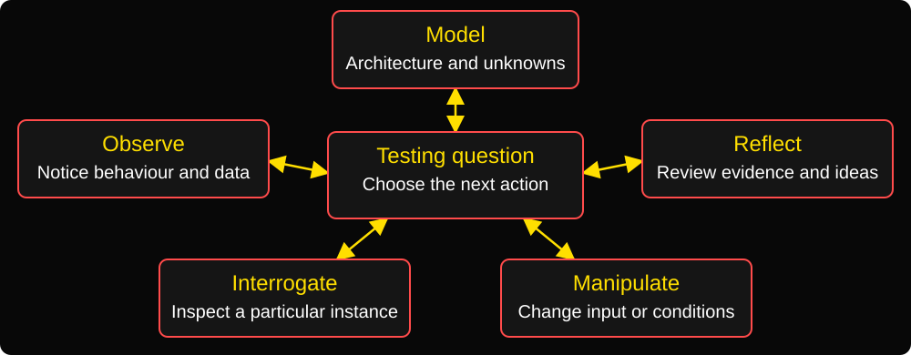

*Figure 1. MORIM: choose and repeat the next useful action without a fixed sequence.*

The modeling process. All of this is a modeling process. I want to be able to observe the traffic. I want to be able to think about things. I want to reflect on what I'm doing. I want to interrogate in more detail. I want to manipulate. This is the fundamental basis about how I approach technical testing. Everything I'm working with is a model. In my approach to web testing, I have a model of HTTP. So I have a listing of the various status codes in my head.

I know which ones are good, which ones are bad, that kind of thing. I know roughly how the headers work. I have a model of the application that I'm testing. I know roughly how it works, but I know that it's layered. And I know that it's multiple models interfacing with each other. And I know that because it's a model, I have to explore it when I test. And I will ask questions of it. And when my model is vague, that's what leads me to ask more questions.

That's what leads me to investigate more techniques or more tools or the technology in more detail or understand the architecture in more detail. It's that modeling process that helps me see multiple layers in the application so that I know I have to go continually deeper or I know that there's a possibility of going deeper, but I may not have time at the moment to do that. But it's the model process that helps me do that. And when I'm testing, I want to be able to observe what's going on.

I want to be able to observe the HTTP traffic. While I'm testing, I want to be able to observe the changes in the database. I want to be able to observe the status on the application. I want to have the logs scrolling up and down on the screen. I want to know what is happening. I want to model the architecture. And then I want to go find out how to observe the different layers, the different flows, the different interactions. And I need to question myself.

Do I understand what I'm seeing? Do I know how to interpret these observations? And I need to reflect. I need to have the ability to expand the model based on what I've learned. I need to analyze my observations. I need to think what does that mean? How does that fit together? Is my model correct or not? What risks are there? Because a lot of the reasons that we're trying to learn this at a technical level is to find risks that other people haven't found, right?

There's plenty of people in the project that can find business risks. There's plenty of people in the project that can find project management risks. What we need to be able to find are the technical risks of trying to hook these things together. And some of those risks are going to be generic. We know what some of the risks are when we use databases. But some of the risks are going to be specific. We need to know what the risks are about using that particular version of that particular database.

We need to understand that. What are the risks of that particular programming library? What are the risks of using that particular programming library when configured through annotations as opposed to XML? All these things we need to understand to work out how to target them with our testing. And when I observe what's going on, at some point I'm going to need to interrogate it in more detail. I'm going to need to deep dive into that observed data because at that point I'm focusing on that observed instance.

I'm no longer observing all the other stuff that's going on at the same time. I'm interrogating deeply and I'm very focused on that particular element at that point in time. So that's the other aspect to observation because at that point we focus and we become blind to other observations that are going on and that's why we need to track things in a history. That's why we need to observe things automatically and be able to zoom in later on. But fundamentally it's not testing unless we can manipulate it.

So for every part of the model, every layer in that model, every element that I can observe, I want to be able to manipulate it. I want to be able to edit the data in the database. I want to be able to edit the data that's passed through in the communication. I want to be able to change the state of the application. I want to change the environment context that it's working in the speed that the messages are passed in, the memory constraints on the machine, the speed of the network.

I want to change everything in order to trigger the conditions that I need for my testing. So, I need to be able to manipulate this thing. So, this is a very high level model. It's a very simple model. Try to keep things as simple as I possibly can. And there's no order to this, right? We repeat all these steps. We do them in different orders. Tools, techniques, form follows function, function leads to technique. We do these in different orders because we're continually learning.

We're continually asking questions at different times. But the point is when we reflect, we deliberately decide what to do next. We make absolute decisions and we know why we're making those decisions and we can explain it from a technical point of view. What risk we're trying to target, what question we're trying to ask next. We do it. The most important thing is that we actually do this stuff. And as we do it, we because we're observing, we can take advantage of what's going on.

We can spot things that other people aren't. We can see that when we issued that request, suddenly the system got a little bit slower. We can try and investigate that in more detail because we were observing it because we understand it from a technology point of view. So that's the essence of what we're trying to get across with this concept of technical testing and I model it in terms of this MORIM loop. So model, observe, reflect, interrogate and manipulate. Do those things and you'll be doing technical testing.

## 3. Applications to Use for Testing

**Section summary**

- Choose an application provided for testing or one under the tester's control.
- Learn a tool by exploring real application behaviour.
- Use the practice-application lists linked from the video description.

### 3.1 Some free online applications to test against

[Watch this chapter in the video](https://www.youtube.com/watch?v=jWwfMo5Ziz0&t=945s)

**Chapter summary**

- Practise on a local application or an environment deliberately provided for testing.
- Use the application to learn both the technology and the capabilities of the tool.

**Transcript**

So, I'm going to suggest that when you do experiment with this and test with this that you either use an application that you own and control on a server that you own and control or you use one of the applications that's available for hackers to practice their skills against because there are a bunch of apps out there that say, "Come along, hack me. I'm here. I'm free. You can do it. You won't get in any trouble and you can use the tool and learn the functionality and capability and do pretty much whatever you want.

Bear in mind that when we're testing using these tools, it's very different from security testing because we're trying to explore the functionality and these gives us a lot more information in what we're doing. Sometimes the nuances between security testing and functionality testing with proxies is a bit vague, but it's pretty much up to you to decide the difference. I tend to not consider myself a security tester because I don't cover the same ground that they do and I don't look for the same exploits.

But what I do do is I explore the functionality in more detail. I use this to give me as much information about the server as I can and I use it to help me guide what functionality I've covered and what I haven't and to do things in the application that would be a pain to do from the front end. So use your imagination as you come through this. a lot of the attacks that you see in the Whittaker books or various other testing books, these applications will help you do that.

### 3.2 Self Study Applications to test against

[Watch this chapter in the video](https://www.youtube.com/watch?v=jWwfMo5Ziz0&t=1038s)

**Chapter summary**

- Compare normal application behaviour with captured traffic.
- Follow up the demonstration through hands-on work and suitable tutorials.

**Transcript**

So, I'm going to leave you with some recommendations for self-study because this is important that you go away and do this yourself because this is a very quick overview of what a proxy server can do for you. So, there are applications to test against. I particularly like this one. The Gruyere AppSpot application is designed for hacking. If I go off for this, you can see that there are instructions on what to do with the application here and I can start a new instance of it which will be unique to me.

Then if I go off to testing this particular app, I have access to this. I can look at the traffic. I can change it without worrying about it and it's designed to have vulnerabilities that will be exposed and I can change through the proxy servers. hack.me is another site that has web applications up there ready for you to test and you can do all of this without worrying about any kind of legality any kind of issues. So there's a whole bunch of things here to experiment with.

There's a whole bunch of other apps here to experiment with. Suggest you go and have a look at those and see how you get on. You're free to experiment and do whatever you want with those applications. There are a couple of a lot of videos on YouTube to have a look at. Now I did a couple of videos a long time ago on using Burp Suite. Zap the OWASP proxy is very good now and there are a lot of tutorial videos on that or security testing.

I suggest you go and watch those. These are very good off on YouTube.

## 4. Modern Browsers

**Section summary**

- Use developer tools to inspect requests, responses, elements, console output and cookies.
- Compare the visible interface with the messages and state beneath it.
- Form hypotheses, change inputs and retain evidence of the results.
- Treat the recorded browser interfaces and extensions as historical examples.

### 4.1 Intro to modern browsers

[Watch this chapter in the video](https://www.youtube.com/watch?v=jWwfMo5Ziz0&t=1138s)

**Chapter summary**

- Modern browser developer tools expose traffic and the live DOM.
- Explore how far built-in functionality supports the investigation.

**Transcript**

The modern browsers have some of this functionality built in. Because we can observe the traffic using the developer tools or with Firefox we can use Firebug. We can fiddle, tamper or change the page using the DOM. Most of the browsers allow us to manipulate the DOM now which they didn't do before. So we can get around some of the observe and manipulate functionality without ever using a proxy anymore. A proxy allows us to go further and much more regularly do this type of work.

But if you can't install a proxy for whatever reason, you can do some of this using a modern browser. And it's up to you to learn this in much detail and explore it. So let's just have a quick look.

### 4.2 Overview of Firebug in Firefox

[Watch this chapter in the video](https://www.youtube.com/watch?v=jWwfMo5Ziz0&t=1191s)

**Chapter summary**

- The historical Firebug demo captures requests and responses and retains network history.
- Editing the DOM can change the action performed by the interface.

**Transcript**

So we have Firefox here. If I inspect the element, this is the built-in browser tools in Firefox. I don't think they're as good as other browsers, but that's the way that this works. However, if I use if I use Firebug, then in the network tab, if I enable this, I do a refresh. Of course, tamper is on here. So, intercept off. You can see that for the making that request to that page the different requests that were made. You can see the timeline that they were made in.

You can see the headers that were sent. You can see the request that I sent through and you can see the response that came back. I don't have the ability to change it but I have the ability to observe it. So if I want to change this before I go, then I use the inbuilt functionality in here so that I can inspect the elements and then just change them. So that link will go off to dot slash which is the main one.

I could change that if I wanted to. I could change that to in index. That's done. So now when I click on about it will go off to index.php. I've changed the DOM which is changing what's going on. So instead of changing the request I've changed it on the page then it's initiated a request to index.php not found. So I can simulate a lot of the functionality that we get from a proxy in the browser.

Now it's not the same but it allows me to observe and manipulate some of the features for modern web testing. So get used to the features that are in a modern browser as well because they can help you simulate or help you come close to the same degree of observation ability that you get without having to use a proxy server.

### 4.3 Firefox WebConsole

[Watch this chapter in the video](https://www.youtube.com/watch?v=jWwfMo5Ziz0&t=1327s)

**Chapter summary**

- Explore native browser tools as well as familiar extensions.
- Use the console and network views to investigate messages and errors.

**Transcript**

Now I'm conscious that I'm sometimes a little bit harsh on the in-built Firefox tools. I'm so used to just using Firebug, using the network tab in there, sticking persist on, seeing all the traffic that goes across the actual network, getting nice views, colour-coded, all that stuff. So seeing the headers, the response, all all pretty much nice and easy, nice and simple. But I shouldn't rule out the inbuilt tools completely. If I have a look here and do the developer toolbar, the web console is very important.

Normally I just use the inspect part. That's what I showed you before. The web console is very important because we've got the net tab. Now I can tell it to log. I can tell it to log the request and response bodies. So if I do a refresh up here now, we'll see the messages coming through.

Now I can click on those see the actual request header. The response header and the response body. If I hadn't put the log request and response bodies in here, I just have the headers. But that might be what you want. That might be all you need. And this persists across the different sessions because we're dealing with a log and this might be the level that you need it at. And you can see the CSS messages, the error messages coming through.

Let's see if we get any here. If not, I'm pretty much guarantee that if I go to the main site, I'll get some. There we go. So, there's some error messages because everything is very select. I can look at JavaScript. I can see the JavaScript errors and warnings. This is out the box with Firefox. We can see the traffic coming through. So, if you get to the point where you got Firefox, you can't install Firebug. Start with the inbuilt tools. It's really important to learn these inbuilt tools.

I am still learning these tools. I am still investigating these. I know that there's a lot of power in here that I haven't fully tapped yet. It's part of the reason why I'm building this course up to help me explore these things in more detail. That's why I encourage you to do. All the modern browsers now have developer tools. Investigate them. Learn them. Look on the Firefox site. Learn how their developers tools work. Look on YouTube. Watch the videos for these things.

Pull all that information together and see how to apply that functionality and you're testing because you get it for free. You're going to be told to test on certain browsers. You're going to be installing these browsers in your machine that is there for free on your machine and you should learn how to use it.

### 4.4 Google Chrome Incognito Mode

[Watch this chapter in the video](https://www.youtube.com/watch?v=jWwfMo5Ziz0&t=1494s)

**Chapter summary**

- A private browsing context can help investigate fresh sessions and multiple users.
- Verify state sharing: the later incognito exercise revisits the early assumption about separate windows.

**Transcript**

So let's have a look at incognito mode. So incognito mode is over here. We can find it. New incognito window or Ctrl+Shift+N. Let me do a Ctrl+Shift+N here. Now it's saying you've gone incognito. We won't track any histories blah blah blah blah. Now what's interesting or what's useful about incognito mode for testers is that it doesn't know what we've been doing. So if I am same over here on my selenium.com blog, you can see that in Chrome I'm actually logged in.

Over here in my incognito window, I'm not. So I can see what things are like when I'm not logged in compared to when I am. That's typically how I use it. If I'll be testing something over here, I'll be logged in. I'll open up an incognito window and then I'm suddenly a new user browsing the website. I could do this in different browsers, but sometimes it's handy to stay with the same browser. Other things that we can do with incognito, we have access to our history.

What we can't do in incognito mode is add to it. So, nothing that I do in an incognito window will add to the history, but I have access to the history that's already there. extensions. You can use extensions in incognito mode, but what you have to do is deliberately allow it in incognito mode. So, you can see here I haven't enabled these particular extensions in incognito, but I have enabled the user agent switcher. When I set that up, there it is in incognito mode, but you can see I have other extensions over here in the non-incognito mode browser.

Things that it's useful for in terms of if I look at the developer tools in resources cookies, I've only got the cookies for the sites that I visited in here. I don't have them for anything else. If I start a completely new incognito window, get developer tools up, Ctrl+Shift+I, resources, cookies, there's no cookies.

Now I can have multiple tabs up here and they won't share the cookies. So if I go off to let's pick wire.com you can see now we have some cookies in there. Let me get another Ctrl+Shift+N another incognito window up and no cookies for the wired because that's over in one incognito window but not in the other. So, it's very useful in the sense that we've got multiple windows that don't really relate to each other. They can share a previous history, which is handy if you're testing a particular site and want to navigate back to where you've been, but nothing is shared within these itself.

So it can be a handy tool in testing for setting up a completely new session or multiple users or logging in even with the same user using the same browser at the same time because the cookies in the sessions are not shared between those particular browsers.

### 4.5 Chrome Editing Cookies

[Watch this chapter in the video](https://www.youtube.com/watch?v=jWwfMo5Ziz0&t=1700s)

**Chapter summary**

- Inspect cookie names, domains, values and expiry data.
- Compare the editing operations supported by the chosen tools.

**Transcript**

The use of cookies for technical testing is absolutely important on the web. I mean websites do so much functionality through cookies. We need the ability to manipulate them. Now you can see here I've got a page compendiumdev.co.uk/selenium/search.php. And this creates two very simple cookies on this page in Chrome out the box. If I want to test this page and I want to manually mess about with the cookies because that's what testers do. We change the cookies. They get fed back into the application when we post requests or the JavaScript accesses them and does stuff.

All I can do in Chrome up here in the developer tools, remember Ctrl+Shift+I brings up developer tools. In resources, we access the cookies. We've got elements here, resources. We can see the cookies that are down here. They're for each domain that we've been to in this session or what we're working with here. And what I can do in Chrome out the box is I can refresh that cookie, see if it's changed or delete it. That's it. That's my that's my scope.

I can't edit this cookie. You can see here I've got a cookie cookie called Selenium simplified search number of visits. It's saying my first search. I think if I do another search do search here cookies goes up to two. We now have a new cookie. Can see the last search. But I can't manually do anything with that cookie out the box with Chrome. So what we have to do is head over to the Chrome web store. You can see here I've done a search for cookies and in apps I use this cookies application and in extensions I use this edit this cookie.

Now both of these have slightly different functionality. They overlap but I you I have to use both of these cookies to get the kind of functionality that you get from Firefox when you install Firebug. So, for the cookies app, because it's an app, I have to right-click and it's this edit cookies. The cookies app only appears in the right-click menu with edit cookies. The edit this cookies, which is an extension, appears in the right-click menu and up here on the extensions toolbar.

So, let's have a look at both these tools. So, the edit cookies because it's an app gives me a new tab here. And you can see that I've got all of the sites and the cookies that I've been working with. And then I have to filter them to get to the right one. CompendiumDev. Great. So, there's my Selenium cookies. And you can see here the value. So, now I can edit this stuff. I can edit the domain. The cookie then would not be relevant on that particular domain.

If I want to test it, I can change the name. I can change the value, the path for it when it expires. I can change most of the values in here. So, that's really good. What's hard about this particular one is how do I add a new cookie? Sometimes I want to add a new cookie in. So, here I've got the add cookie button, but I have to change the name in order to do that. So in order to create a cookie for a domain, I have to have a cookie there already or pick a cookie somewhere else and then amend the domain to match this one.

So what this extension is a bit of a pain for is adding new cookies and we have to filter the domain to find the cookie we want. What's great is we have access to all the cookies in here and we can change it. So this is a really useful thing as part of my tool set. But sometimes if I'm testing a particular application, I want to go straight to the cookies for that particular site and you can see them here. So I've done the edit cookies from the toolbar or I could do edit cookies here and then it's showing me the cookies for this site.

I've got two number of visits. So one of those the domain is slightly different. I wonder if that was when I hit add cookies in cookies over here that that thing was created. Okay, not going to worry about that. In fact, all of these have the same domain. So, I'm going to assume that was a problem with me creating it. So, I'm just going to delete this cookie. I don't think it's relevant.

Let's check that the application still functions. Does everything's working. There's the domains. So, I can now see the cookies for that domain. What this one is good at is adding a new cookie. If I add a new cookie here, it comes in for the domain for the expiration date that we're working with. What this add-on is a real pain for, if I go back to the list of cookies, is editing it because I can't edit the name of the cookie. Here's the name up here.

I can't edit the name. I can't edit the domain that the cookies on. So, this is really good for working with the cookies on the actual site and the domain. Creating new cookies is really easy here because it's predefined for the particular domain that you're working with. But amending the name is a pain. Changing the value, the path, all the other attributes is okay. So I have to use both of these plugins. The cookies plugin from apps, the hot cleaner.com cookies plugin and an extension is the edit this cookie in order to get kind of out of the box functionality that we would get from Firebug.

But I need as a manual tester the ability to change and delete and add new cookies to see how they impact on this site. Because here we've got cookies number of visits. Change that. Make it 100. Submit cookie changes in here. If I do refresh contain that's okay. You can see 101 cookies reported down the bottom. You've been here 100 times before. So I can test that functionality now by amending the cookie in here. The same with I can change the last search for.

So as just quick overview, out of the box, Chrome's pretty limited. I need to use two extensions cookies and edit this cookie.

### 4.6 An exploratory technical web testing session using Chrome

[Watch this chapter in the video](https://www.youtube.com/watch?v=jWwfMo5Ziz0&t=2106s)

**Chapter summary**

- Observe normal Gruyere requests, inspect hidden data and form hypotheses.
- Change inputs and cookie state, then inspect the resulting server and browser behaviour.

**Transcript**

So, I just want to give you a quick demo of the power of the built-in tools for modern browsers. Now, I'm going to use Chrome to do this because I like the built-in Chrome tools, and I'm going to use the Gruyere application to demonstrate this. The Gruyere application is one of the applications that is set up live. It's online and it's there for you to experiment and hack with essentially.

Now, we're not really going to hack it. We're just going to use that as a basis for functional testing. And as we do that, we're going to see vulnerabilities and the kind of things that testers would do. So this is really an exploratory test session where I'm going to use the tools to augment my testing. So that you've got all the instructions for Gruyere on here if you want at the google-gruyere.appspot.com. So you basically create your own instance of Gruyere or start your own instance of Gruyere.

It creates one for you. So I'm going to use my session. Now I'm not even going to get into what the functionality of this app is. I'm just going to focus on the most basic stuff. So I can see that there are some user accounts in here. And by the way, because this is exploratory testing, normally I'd make a lot of notes. Instead, I'm just going to talk about what I can see and we'll try and remember it. This is the kind of thing I'll do if I'm mentoring testers or teaching them.

I'll pair with them and we'll go through things in this kind of fashion. So this is essentially a pairing session with just you and me. So we've got a couple of users here. I can see there's a Cheddar Mac user. they have a user ID down here. You can see I assume that's the user ID. I can't move the mouse down to show you, but that's the cheddar cheese one. And homepage for Brie is Brie. So I'm assuming that's the user ID.

So the first thing we're going to do, I can't really I can go home. I can't really do anything. This is my home. So I'm going to sign up as a new user. So let's before I do anything here, let's investigate what this form is. So the inbuilt functionality lets me inspect elements. So now I can see the stuff on the page. So I've got a DOM browser in here and I can see a form.

Now this is interesting because the form is a get and normally you'd expect a form particular signup form to be a post. So that's pretty much a bug. That's going to work in our favor in terms of doing security testing. So that's a vulnerability but it's also a bug. You'd flag that as a functional bug because you're expecting a post to be the thing that's going to change the values in there. So I can inspect the DOM, I can see the various values that are going to be sent through in terms of a UI and a is author.

Now what I'm interested in because this is a hidden field. If I change that and I could I could change that in here. Now, presumably there's an admin functionality. I could change this in the DOM. Do is admin and it might set me up as admin. Let's just start with the normal functionality now though and say is author true. I don't know what this LP checked is, but presume I could change this. The good thing about the inbuilt tools is I can change anything in the DOM.

I could even go in here and use someone else's Gruyere instance, Gruyere instance, but I'm not going to do that. So, the inspect functionality is very useful. I can change things in the DOM. So, without even submitting requests, I don't have to breakpoint requests in order to change them. I can submit them in change them in the actual DOM itself and then submit them normally through the browser. Because remember this is the kind of stuff that we would previously have had to use a proxy to do.

We'd have to breakpoint it, then change the message, then send it through. But because the modern browsers now allow us to inspect the DOM and amend it, it's a lot easier to do certain types of functionality. So let's just create a user by start. Let's make sure the network stuff is on though because I haven't got that switched on. So what I need to do is set this up to capture. So I'm going to preserve the log upon navigation. I think that's an important thing to do.

Let's refresh this page. So now you can see network traffic is being captured. So I'm going to sign up as Bob with the password Bob because that's how secure we are and create this account. Now if I hadn't noticed if I hadn't inspected the form, then I would see in here the request being made. Again, this is the kind of thing that you'd have to use a proxy to do in the past. But now we've got the network tab built in.

All the browsers have this kind of functionality. You've already seen it there for Firefox. Opera does a very similar thing. And I can see that this is a get method. If I hadn't inspected the form here, I can see from the network traffic that it's a get. Even if I wasn't using network traffic, I can see up here in the URL that it's a get because this is clearly the kind of URL that you build for a get rather than a post because the all the parameters are in here in the URL.

So I can see the actual parameters in here with the action new the user ID and the password and just seeing this stuff. I've seen it in the form when I inspected it. I can see it here in the request. I can see it up here. I'm starting to think about the risks because remember technical testing isn't just the tools. It's our understanding of the technology.

Now, we know with HTTP that we've got get, post, delete, whole bunch of other requests that we could submit. We're using a get here, which is not what you normally use, but gets really easy for us to manipulate and change with the browser. I can just type in a new get here and submit that request. If it's a post, it's kind of hard for me to recreate in a browser. I could probably do it by amending the form, but with a get, it's easy.

I can just repeat that request. And there you go. I've repeated the request. It tells me user already exists. Again, this is the kind of thing that you would normally do in a proxy where you would replay the request because it's a get. I can do it straight here in the browser. But looking at this, I'm thinking now with a technical, not even a technical, with a testing perspective, if I change, if I manipulate these parameters, something different might happen. So the action might be delete, action might be amend.

There's a whole bunch of actions that I could probably put in here and change it. And I would use that as part of my testing because I'm observing what's going on. I can inspect it and go down into real detail and see the actual parameters and information that's going through. And I've got two different ways of observing the traffic. I can see it here in the URL and I can see it here in the network. And I can inspect using the elements tab.

I can interrogate and go real down into detail in this request. So there's a few testing possibilities in here. But what I want to also check is now that I've logged in or signed up, have I got any cookies? So, I'm going to look in the resources here at cookies. There we go. So, I've got a cookie in here. So, this is interesting because I've got the presumably that's a session number. I've got my I assume that's the user ID and not the name.

And then I've got my user type or something else. It tells me I'm an author. And we saw that is author is set up here to true. And we saw in the form that is author was a hidden field. So I don't know whether doing something as simple as changing the cookie will change my state.

Now out of the box with the resources and the cookies, all I can do is refresh and delete. So I know that there's a technique I want to use which is amending the cookie, but the tool that I've got doesn't support that out the box. Fortunately, we can add extensions to Chrome. So, I've got one installed already up here, a cookie editing tool. But if I didn't, I would know that there's a technique I want for editing cookies. I will go and find a tool to help me do that.

Now, if I can't do a plugin in the browser, I will drop down to a proxy, which will let me amend the request and change the cookie on the fly. Fact is, I can now build it into the browser. So, I can do it here. But remember in the past we were looking at what comes first, the tool or technique. Well, here I've already got the tool, so I know I can do it. I found this tool because I know there's a technique I want to use.

There's an approach I want to take. So I find a tool to do it. So by learning about the technology, the fact that browsers and web applications use cookies. So that technology information that technical information the notion that I understand cookies leads me to then evaluate the use of the cookie in the application then leads me to how can I observe that which I can do through the browser.

Now here how can I interrogate this information and how can I manipulate it? Well, I have to do a plug-in order to manipulate it. So let's manipulate it. So this is it here. author. I'm going to change that to admin. See what happens. I'll submit the cookie change. Let's get rid of that.

Let's do a refresh here. Yep, that's a change. So, let me do a refresh on the browser. And so, it's saying user already exists because we got that. So, that's kind of a mistake. Let me do the home. But I'm no longer logged in as that user. So, maybe this isn't a state cookie. Maybe it's some sort of key. I don't know. I'm testing, so I'm learning. I'm experimenting and seeing what's going on.

So, let me change this back from admin to author. That's what it was. Now, normally, I'd be making a lot of notes on this and I wouldn't have to remember what it was before, but because I'm talking about it rather than writing it down, I have to remember. So, let's refresh again. And we are logged in again. So, maybe that's the whole thing about getting an account back. Maybe that's part of the key. I don't know. I already know that if I repeat this request with the new that the user already exists.

So what we're going to try and do is see if we can amend that. So, I'm going to try and amend that and say Bob and say is I'm guess try and do is admin true and invalid request. So, I'm not sure exactly what was invalid there, but it's not taking that forward. Let me change that to author. Put it back to author. See if that helps. no. So, I think it doesn't like the amend. So I guess the thing to do then is to just have a quick look around and see what other functionality we've got.

So we got the profile there. If I scroll down. So there's the get to retrieve the that's not the get to retrieve the profile. There he is. Edit profile. So presumably it's doing the edit profile from the cookie because I haven't passed anything in the URL. So that's interesting. It might be that there's a vulnerability there about being able to view other people's profile if we just change the cookie information. So we could try that. We could actually try that because we already know that there's a person called Bri.

So, let's see if that works. We I'm assuming they're an author as I am. I'll change this to Brie. Submit the cookies. Then let's resubmit this page. And it's saying user ID not logged in. So presumably that session ID I'm assuming now that that's a session ID is quite important and is associated with the actual person.

So let me change that back to Bob head profile. So you can see that I'm able to experiment and change the messages that are going back forwards just in the browser here. So let's have a look at this form. So I'm going to inspect this form before I submit it. And again, this is a form that's going to do some updates, but it's a get, which makes our life as testers easier, but that's bad for the application in the security. And you can see that it's got an update.

So, I've used amend previously, but this is actually an update. So, what I'm going to do is amend this so that instead of being new, it says update. And I'll keep everything else the same. Maintain as an author and see what happens. So it's saying incorrect password. Now I know that's the correct password. But if we have a look at the form, let's have a look here. I suspect what it really means is not incorrect password, but simply the fact that we've only supplied one password.

When I do an update, which is what this form does, there's two password fields. One of which is PW and that's what we added in the other one. So that so PW is the new password and we need to an old password presumably for an update. So I'm getting this information from just inspecting the form here just interrogating what's going on. So I can see the old PW. So what I'm going to do is amend this URL. So I'm no longer passing in the password.

So I'm basically saying update where the user ID is Bob and the is author is true. Let's see what happens. So it's done. It hasn't complained. So presumably it's done an update but hasn't actually updated anything because we didn't change anything. So let's do that again with an update and the user ID of Bob.

Let's take out the password. Now this would be a little bit easier in a proxy because I would be sending a request and now at this point the request would be in front of me and I could just amend it in a form. But we're doing it in the browser. I'm going to change this to is admin.

Remember, there's two ways I can do this. I'm going to do it with the URL here, but I could have done it by changing the DOM in the form in the first place that had for signing up because I'm trying this in an update. So, let's change this to is admin. See what happens. And it's accepted the request, but nothing seems to have changed.

So, let's see. Well, there might be a couple of reasons for that. So, in resources, we've still got our cookie here set to author. So, I'm going to I'm going to change that and see if changing that to admin makes a difference. Let's see what happens. Refresh. Yep, that didn't work in terms of the home.

So, let's change that back to author. Now, clearly I haven't understood the technicality behind this. I'm just I'm messing about. I don't really know how this system works. So, let's make sure that we're still Yeah, we're still logged in. So, I'm going to sign out then sign back in again as Bob. Log in. See what happens. Ah, so look at the cookie. So we got a different session which you'd expect. We've got Bob and we've got admin. So that missing field was admin and author.

So maybe there's it shows you the different roles that you can have and we now have this admin functionality for manage the server. So we have the benefit that there are a lot of bugs in here because it's designed for security testing. But normally you'd be using a proxy server to do all this. The fact is the modern browsers are getting more and more powerful and allowing us to do the kind of testing we would normally do in a proxy itself in the browser.

So I encourage you to explore the functionality that the web developer functionality that you get from your browser. So here all the functionality that I used was resources looking at the cookie using the URL which you can do in any browser looking at the network traffic to see the requests that's very useful and I remember I set it on to preserve log upon navigation so it wasn't cleared between each page load and I was inspecting the DOM and I didn't actually do any changes in the DOM but I could have done I could make changes in the DOM to actually impact the application.

So hopefully that gives you some idea now of the power of the modern browsers for helping us test for augmenting our testing. But it's not the knowledge of the tool that helped me. It was the knowledge of the tool. It was the knowledge of the HTTP technology. The fact that there's posts and gets that led me to think in certain ways. The knowledge about just testing in general for knowing that I want to change the URLs that are passing in that's a common way of testing to force bugs through.

I know that I want to manipulate the data that's going through and back and forwards. I know that I want to observe. I know that the technology behind the cookies leads me to finding more tools that will help me. All these things work together. It's hard to know exactly where to start in that mishmash of where to learn. So just essentially learn everything that you possibly could. So if you haven't if if say you're coming to this new you do an inspect, you don't even know what body tag is.

You're going to look it up. You're going to start learning HTML because you're observing things that are going on because you're interrogating the page that's in there. You're going to use network. Then you're going to see the headers. If you don't know what the difference between a get header is, a get request, then you're going to look it up. This is going to start teaching you or you're going to use this to teach yourself and investigate because it's very important that we continue to learn and look things up.

Now, I could have saved myself a whole bunch of time by going to speak to the developer and ask them what's going on or read the instructions for this application, but I'm exploring and learning and manipulating, interrogating the thing that's going on, observing the traffic, observing the URLs, observing whatever is in place, thinking about it, reflecting on what's happening, then making decisions about what to do next.

Now, if I was doing this properly, I'd be making a lot of notes to support me. But I am recording this so I can look back at my recording and see what was happening because that's one way of observing what's going on with my test sessions. I can record them. And now the good thing about Chrome, I'm just going to quickly show you this. In the network tab, I can select a bunch of requests and I can output them as a HAR file, an HTTP archive file.

If you don't know what that is, now is a good time to look it up. It's the kind of thing that you associate with proxies, an HTTP archive file, but the Chrome browser supports that. So, I'm not going to go into any more depth in this tool, but I did want to show you it in action in the context of testing. So, you can see what a technical exploratory test session looks like just with the browser, pretty much just with out of the box functionality on the browser.

And you can see that I almost didn't need the cookie amendment because I was able to do a lot with the URL. So, I hope that helps put things into context a little bit.

## 5. View Page Source

**Section summary**

- Compare delivered HTML with the live DOM.
- Learn the structure, scripts, styles and event attributes used by the application.
- Compare source-view features across browsers.
- Investigate markup warnings and browser-specific responses before judging their impact.

### 5.1 View Page Source Introduction

[Watch this chapter in the video](https://www.youtube.com/watch?v=jWwfMo5Ziz0&t=3358s)

**Chapter summary**

- View Source exposes delivered markup; Inspect Element exposes the live document.
- Read scripts, styles, comments and event attributes to identify questions and risks.

**Transcript**

Using the browser to view the page source. It seems simple. View the source. So, what can you as a tester do with that? When you type in a URL, the browser issues a get request to the web server and then it loads that response into the browser. The eventual page source that is returned is what you see in the view page source. Right? When you do view page source, you're seeing the response that comes back. This is the first place in a browser that you can access the raw source.

And this is the building blocks of that web page. And the reason this is important for testing is that this source is different from the rendered source that you'll see in the DOM view. This is essentially the raw source that you'll see if you capture the traffic in a proxy or view in a network view. It doesn't have any code created by JavaScript. There's no extra DOM elements that have been added after issuing some Ajax request. This is it. This is it raw at its most basic.

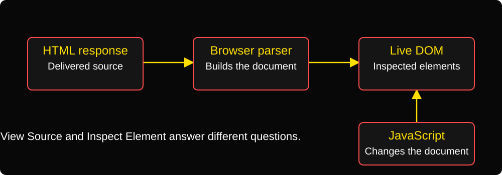

*Figure 2. Delivered HTML, browser parsing and changes to the live DOM.*

This is the essence of the web page. You found the source, right? And if you're testing websites, one of the basic skills you need to develop is learning to read HTML. HTML is the basic building block of the web and you need to understand it. So, how much HTML do you need to know? Well, I'd start by asking what is the HTML being used on the project that you're testing now? Right? That's the basic amount of HTML you need to know to understand the site and the system that you are currently testing.

If you don't understand the system at this basic level, how are you going to look at the GUI and make a risk assessment of where to spend your time when you're testing? By looking at the page view, you will see what HTML tags are in use. You'll see that the page is split into a head and a body section. You need to learn the difference between those two sections. What goes in where? Why do they exist? When you look in the head, you might see JavaScript.

You might see some meta tags. You might see some link tags. Do you know what they all do? Do you know how they impact the functionality of the system? Do you know what risks they potentially add that you have to test for? When you look at the body, you see the normal HTML tags that are used for rendering the page. Some of those tags don't just have a rendering component. They also have a functionality component and that will differ between browser versions.

For example, input types like file and date and tags like audio and video. You have to be careful when you test these because you don't want to test the browser. You want to test your system or your code on that browser, not the browser implemented functionality. You need to learn HTML so that you don't confuse browser functionality with application functionality and waste time testing the browser instead of your application. I've been confused by the HTML 5 date tags and started to test the drop- down date components thinking it's a JavaScript ajaxy component when it's the inbuilt browser functionality.

We don't want to do that when we're testing. But if the tag has a JavaScript event listener on it, then you do want to test the interaction. You might see that in the source, any of the onevent attributes will show you that an interaction there needs testing. But since that is not the only way to set up an event listener, you might not see that in the page view, but it's the first place you'll start to look, and they're the simplest event listeners to try and test.

It's also important that you learn the functionality of the page view and how to access it in the different browsers. And in some environments, you're not allowed to install tools. If you're testing web applications, guarantee that you will be allowed to install a browser. So the browser becomes one of your most important test tools and you need to learn the functionality. So the page view is one of the most important function, one of the easiest functions to start working with. In Firefox, the page view will highlight some syntax errors.

Other browsers don't do this. So Firefox might give your testing an edge for this really basic functional check. And you might spot really simple errors easily. When the page is interpreted by the renderer, the renderer knows how to fix simple syntax errors or it thinks it knows how to fix simple syntax errors. But sometimes when it does that it might interpret them incorrectly or inconsistently or the CSS might not be applied effectively because the rendering is changed slightly. So you can spot the error early in the page then it might prevent an emergent behavior problem later and it's a much simpler fix if it's just an HTML syntax error.

You'll also see that some page source views are clickable, so you can use them to explore the source. Some of the links are to CSS files and JavaScript files that are included, so you can go off and read those and learn more about how the page works. Sometimes there'll be links to other web pages and some of the browser views open those pages in source view, so you start to surf the web in source view and learn more about what's going on.

You can also search the source view using control F or command F on the Mac depending on the browser. And some searches I use are to search for HTML comments. The less than exclamation mark dash dash like looking for what are the HTML comments in this page because sometimes comments reveal information that should not be revealed, right? You're giving away information to hackers or viewers or code that you've commented out that really shouldn't be there and might, if it was enabled, cause problems.

Or there might be hints that perhaps the developers or coders are not as confident about some of the functionality as you might expect. They might have incorporated a library that they don't understand. These are technical risks that you can test for. And when I'm viewing CSS, I can search for comments slash asterisk to find the comments in the CSS file. And in the JavaScript, I'd look for slash-asterisk and double slash, the two different JavaScript comment forms. The page view generally has syntax highlighting.

This can help you differentiate between the content and the code. I often find it easier to scan the page view for spelling errors than the rendered view simply because it's in a single font. There's less to distract me and I find that that helps me focus on the content of the copy in the page more easily and I can ignore the code parts. This is a really powerful but underused feature of the browsers probably because we've all become so used to the web development tools and testers and developers forget that the page view exists and it has changed over the years and become more powerful.

Right? Page view is worth adding to your arsenal. You will find and spot things that no one else will because no one else values it. And these challenges that you're going to do going to help you drive that home and see the value.

### 5.2 Exercise: View Page Source Challenges

[Watch this chapter in the video](https://www.youtube.com/watch?v=jWwfMo5Ziz0&t=3826s)

**Chapter summary**

- Compare ways to open source and the features available in each browser.
- Record unfamiliar concepts, suspected problems and references worth following up.

**Transcript**

So challenges is pretty simple. There is a PDF that expands on these challenges. So have a look at that. Essentially for each browser I want you to identify how to access and use the view page source functionality. Try each way of doing it and just see which ones you prefer and what value each one adds. I mean first of all you have to figure out how are you even going to access the view page source. So try right-clicking. There's a Ctrl+U command on a lot of the browsers.

Command alt and u on some of the browsers. On a Mac, you can prefix a URL with the view hyphen source colon instead of http slash. That will view the source. See what other ways you can figure out and see how they change between the different versions of the browser. So have a look on Chrome, have a look on Firefox, have a look on IE, have a look on Edge, have a look on Safari on the Mac if you've got it.

When you got all the different browsers running, what are the differences between the different page view source in the browsers? Some of them you can click through in the URL, some of them you can't. Write down the differences that you spot so that you know what each of the browsers is good for. And remember, the functionality changes with the different browser versions. So, keep going back. If you're using the page view regularly in your testing, then when a new browser comes along and it's changed, you'll see the difference.

But know how might those differences ch change your testing? What browser are you going to use for what functions? Because if you can answer that question, if you can see, I can see a difference in Firefox. How does that difference help me in my testing? You will be well on your way to gaining an edge over other testers and developers because too many people use the features for what the instruction manual or the tutorial tells them to do instead of identifying alternative ways of using that functionality and increasing their requisite variety and how they deal with applications.

Next, I want you to view some real page source, right? The projects that you work on or just projects on the web. Because when you start looking at real code, you need to start identifying gaps in your knowledge. You'll see tags that you don't know. You'll see HTML constructs that you don't understand. So, you need to note down what they are so that you can spend some follow-up time plugging those gaps. But also, we want to see whether we can find any problems on those page.

See if the brows the page view shows us a problem and then helps us spot problems faster. So look at the page, find identify HTML concepts in the source that you don't understand and look them up. Look at the linked CSS. Do you understand it? How much of the page functionality is actually CSS styles? Right? Does it have any hover markup? Because if it does, that's the CSS doing the work, not JavaScript. There may not be any real functionality to test.

It may be rendering functionality that you're looking at. Look at the JavaScript. Is it readable? Do you understand it? Are there any comments in the page? Try and find them. Use control F, command F. Have a look for comments. Look with the less than exclamation mark hyphen hyphen. Look for HTML comments. Look at some of your favorite pages. Look at the page source. How different is the HTML that they're using compared to your system? Does do the system seem more complicated than they need to be given that the functionality they've got?

Maybe you can dig deeper and find out why they're so complicated. Maybe what seems complicated at the start isn't really and is actually very simple and is actually very nice and neat. And maybe your system could be doing it that way. Maybe they're using a lot more CSS than you are. Maybe they've delegated what looks like functionality off to the CSS rendering engine where you're doing it with JavaScript which might have more risk when you start doing cross browser testing. When you've identified gaps, what I want you to do is start looking for references, reference sites that can help you plug those gaps.

So, do a search, try and figure out what the different HTML tags mean, and just build a small list. Now, remember, in the summary section that comes after this, I've put down some links that I found. I've noted down some observations I've made on websites during the testing when I was doing this investigation. But do yours first. come up with your own list because you'll come up with reference material that will fit the current level of knowledge that you have because you'll be looking around trying to find a site that helps you understand what this tag is and that site will make sense to you at this point in time.

Some of the references I've got may be more advanced and maybe something that you come back to when you know a bit more. So, it's up to you how long you spend on this and can easily spend an hour, a couple of hours doing this. You saw even in just the demo that I did at the start that there were issues on my website shown by the Firefox browser. There's so much information in here to look at when you start drilling into the view page source on real production websites.

### 5.3 View Page Source Challenge Slide Retrospective

[Watch this chapter in the video](https://www.youtube.com/watch?v=jWwfMo5Ziz0&t=4142s)

**Chapter summary**

- Compare readability, search, navigation and syntax-error highlighting.
- Record browser versions and consult HTML references before judging a warning.

**Transcript**

So, we start with a mandatory warning. Do not proceed any further unless you have completed the view page source challenge. If you do carry on, then you're putting your own learning at risk because really you want to do the exercises before you watch my summaries because these are just my interpretation, my summaries, and it's not even everything that I did.

So let's have a quick look. So this is straight out of my notes as I was doing my exercise. I made notes in Evernote and I've just copy and pasted some of the results in here. So this is me looking at how do I start the view page source. So all of them have a right-click approach. Edge only has a right click. Most of them let you do control. On the Mac it's slightly different. It's either Command+U or command and Alt+U for Chrome.

And mo all of most of them have the view source prefix. So you can type in view- source colon and type in the URL instead of http slash and you will visit that page in view source mode. It's like doing a curl on the source. You're viewing it in the browser. Really handy. So remember a few of those. But if you can drill in control or command or command Alt+U into your fingers, then you'll start using page source all the time.

So all the browsers have very similar functionality, right? They all have color coding for the syntax. They all have line numbers. They all support find. All the basic functionality is in there. There are differences between it particularly in clickableness. They operate slightly different there. Some of them do inspect and they act differently.

So let's have a quick look. So I1 the view is so basic. There's no clickable links. However, viewing it, reading it, I thought it was a lot easier. Just the syntax view was readable. I could see the copy, the text of the web page differently from the code. That was a really useful color. Maybe it's just my monitor. Maybe it's the color scheme I've got. But I was the one that I preferred to actually view code, view the source, looking for copy issues on.

Chrome was great at finding stuff. The same as Safari. It's got a great way of highlighting the finding aspects. Chrome's got a handy inspect function so that when you inspect the source, it shows you the DOM view. So you can actually see the difference between the source and the rendering view. In Firefox, the inspect is interesting because it inspects the source code view of the source code. So it's you're seeing all the span elements that Firefox has used to render it, which is interesting.

Chrome, unfortunately, does not open the links in source view. It opens them as a rendered view. So you can't surf the web in source view. It looks like you can because you do when you do the CSS and JavaScript, it opens those up in a new page. But if you click on a browser that renders as HTML, then you get the HTML rendered view. Edge, I was using the virtual machine from modern.ie because I hadn't upgraded my Windows machine to Windows 10.

Find I like the find and edge. So Chrome and Edge are both equal in terms of their finding. Edge again does not have clickable links but you can controlclick to open the link as a source view in the debugger. So everything is done in the debugger in Edge which isn't quite as as nice as opening up a new page but is useful and it drags you down into the web developer tool. It's it claims it's opening images but it didn't.

Now Edge is still early days so I guarantee and we know Edge is going to change over time. So keep looking at the debug view the page view in Edge. It's going to get better. Firefox kind of won out. It shows syntax errors as a massive boon when you're looking at it. You want instant defects. Firefox is going to pick them up.

Now, syntax errors aren't necessarily a big problem, and it's it's sometimes hard to justify fixing them. However, it can lead to rendering issues. It can lead to problems that are really hard to diagnose. It can stop mismatching in CSS. Just get rid of everything. Make sure the HTML is clean. Put it through a linter as part of the development process if you want to, but is a this is just a final check. Open it in Firefox, see if there's any syntax errors coming through.

Firefox is great for surfing the web in source view because you click on links and they open in source view. And remember, controlclick opens it in a new window. The find is quite nice, but it doesn't show it in the scrolling bar, so it's not quite as good as Chrome. The inspect view again shows the source code view of the source code. So I mean it's it's really just nonsense that part. But the syntax highlighting absolutely brilliant completely amazing. Safari Safari is pretty much the same as Chrome.

It's quite nice to use. If you're on the Mac it's it's a good thing. The you can click through. There's nothing really special about it in comparison to anything else but it's probably going to be your default on the Mac. And it does have the source view. It's embedded in the kind of resources tab. Not quite as easy to navigate through because of that, but it's still useful, but I still prefer to use any of the other browsers really except IE, which is really just for readability.

So, I'm going to conclude with some Firefox is great for syntax errors. Use it for that. Brilliant. Navigating through the source, so you're learning what you're doing. Absolutely brilliant. Chrome and Edge are pretty much equal for finding stuff. And for me, IE was good for reading copy, but I could probably drop IE out the page source view and use Firefox and Chrome for reading copy and I'd probably fine. So, I would probably use Firefox and Chrome most for the page view.

Now, we've got the references. What references did you find? Again, this is straight out of my notes. It's copy and pasted. You can see I tend to write my notes in Markdown. The Mozilla Developer Network, it's a great site. It's really up to date, lots of detail, but it's I mean it's so authoritative and important for web developers that it's sometimes hard to read when you start. Therefore, beginners, we tend to look at w3schools.com. W3 schools used to get a lot of flack.

Professional web developers don't like it. But in terms of showing you the basics, really good, really clean, and it's got examples. I used some of the examples in the early slide. You. It shows you the tags. It has a little snippet of HTML. You run the snippet, you see the impact. It's very useful. The developers.whatwg.org. again, it's for professional developers. But it's community built. Sometimes it's useful, sometimes it's not. Same as web platform.org. It's community-driven. It has gaps. Where it has coverage, it's really good, but where it has gaps, it's no use to you.

So, that's what Stack Overflow, I guess. I haven't put that down here, but Stack Overflow comes up when I do searches. So, I guess I should really have added that in here. Now, I found lots of errors. I'm going to show some of them in the live view in the next video, but I found syntax errors everywhere on my sites. I really need to do more of this this type of testing on my sites, but I found them on other sites.

I found them on commercial sites that I rely on for my business. So, I'm flagging that to those sites. And I learned stuff. I learned that meta tags in the body were not illegal in HTML 5. I'm so used to older HTML with working growing up coding in HTML 3, HTML 4. I didn't realize HTML 5 had changed some of the rules about where we can place tags, which potentially me as a tester makes me start thinking, well, there's risks in the future that if people are using older browsers, then we're going to start using tags in places those browsers don't expect because even though Internet Explorer and Microsoft have gone right, we're not supporting 8 910 anymore.

People are still going to use them. So, we're still going to have to look at those sites in here. And if we start using HTML 5 with tags all over the place, who knows what's going to happen. So, there's still risks and issues in there. Personally, I'd probably be tempted to stick all the meta tags in the head and keep them there, even though that's allowed in HTML 5. So, that's a just quick look through some of the thoughts. It'll be really interesting to see what you found.

So, hopefully you'll start leaving comments in the forums and tracking what you're doing. But again don't look in the forum, don't look at other people's comments until you have done the exercise on your own.

### 5.4 View Page Source Challenge Live Retrospective

[Watch this chapter in the video](https://www.youtube.com/watch?v=jWwfMo5Ziz0&t=4659s)

**Chapter summary**

- Inspect real examples of mismatched tags and browser-specific markup.
- Investigate potential consequences rather than infer impact from a warning alone.

**Transcript**

So I'm just going to give you a quick look at kind of things I found when I was doing this on live sites. Let's jump through some of the browsers here. So in IE I IE is okay. The view source I mean it's so basic. This looks like a notepad that's an RTF. You can't click on any links. There's I mean there's really nothing you can do here. I can select all I can find. But I mean that dialogue I mean it's it's not nice to work around.

I'm moving this all over the place. adequate. I wouldn't use but what I like about IE11 is the readability I can read this the copy stands out against everything else. So much more readable than the other browsers. I like that about it. Let me close down IE here because that's that's what I like about IE.

Let's have a quick look at Edge. Now Edge, I'm using Edge here on a virtual machine. I'm using one of the virtual machines from modern.ie, IE which is the Microsoft site where they have free virtual machines for all the different operating systems and all different browsers. So you can test for cross browser compatibility.

Now in Edge when you do the inspect or do the view source it comes up in the debugger which is not nice but is useful. Now this is a one of the teaching platforms I use where my courses are hosted. Now what I found interesting here is I'm viewing the source. Now, this is the first time I saw this when I was viewing the source because I viewed the source of the training platform in a couple of different browsers. And this only showed up in Edge, which means that the server that the training platform is on must be detecting the browser and giving different code out for the different browsers.

I didn't know that. By looking at the source, I can see this obviously because I mean there's things here that are not in the other browsers, but also I'm looking at this thinking meta tags. Wait a minute. meta tags are supposed to be in the head section. They're not supposed to be in the body. So I had I this doesn't look right. So I had to go and look this up. So I went off did my usual do a quick search.

Meta tags in body stack overflow is the first thing that comes back which is great. And I'm looking through this and I did I learned something new. I did not realize because I didn't realize that in HTML 5 you're allowed to put meta tags in the body. Now what you're supposed to do is put the right doctype in the document. So you're learning a bit more about HTML. If I look at the doctype at the top here, I can see this is doctype HTML which is essentially doctype HTML 5.

This is the new format for doing it. And it's basically saying I'm an HTML 5 page, so I'm allowed to do what I want. And I want to put meta tags in here because this is responsive. It's responding to the browser. And it's only doing this in IE. And IE is an HTML 5 compatible browser or an Edge. Sorry. Edge is an HTML 5 compatible browser. This I mean it's it's valid. It seems reasonable. Makes me a little bit nervous. If I was testing this, I'd be thinking, how do I know that this only happens under Edge?

What happens if these meta tags come through in a different browser and they they break the rendering or something. So, that would be something that I would be probably testing for. I'd probably try and automate that, putting through different headers from different browsers, making sure this came through. But that would be a risk that might be important enough to check, might not. But that was interesting and I learned something. I didn't realize that. Let me close this down. Oh, the other thing that I was going to show in Edge, what I find really interesting is Edge is there's only two options.

I can inspect element, which we're not covering at this point, and I can view source. And then in the view source, the find if I find HTML comments, this is pretty much like the way Chrome does it. It shows you in the in the bar here, I can click on these and jump through. I like that from the find, right? So I can view all the comments that it's it's identified and I can scroll through and I can see them highlighted.

So Edge and Chrome I like the find. Now back to Firefox or on to Firefox. Firefox probably has the best page view for quick testing in terms of highlighting errors. This is my This is my code. I've made a mistake here. I've started an H3 tag and I've added an H2 tag. What an idiot. But that's me and I found these errors in here.

Now, what I also realized is what what's this? I've there's no doctype. I've just started the document with HTML. I've created a slightly invalid HTML page here. What's interesting is the errors are shown in red, but so are these. These aren't errors. It's just highlighting to me that the HTML entities are sitting here and makes them easier to view. What else have we got in here? Again, another doctype. It's in almost standards mode. Okay, so I have a little bit of learning to do.

I'm not the best HTML developer in the world as we can see here. So, but this is highlighting it to me fairly fast. It's quite interesting. I can see I didn't put in a space between these attributes. Now, none of these things are major, but they lead to potential cross browser compatibility risks. Certainly on older browsers, they might not handle this. And some versions of newer browsers might just bark on this. They might just have a little bit of code that says, "I don't know how to handle this." And they render incorrectly just for that incremental version of that browser.

We want our HTML to be as good as we can. Now you could feed all your HTML through linters and things like that, but just checking in the page source is a useful thing to do. Another page. So this is on the one of the teaching hosts. And this was interesting because this is a this is the same page that we looked at in Edge, but it's different HTML. And I'm getting different warnings here. And I can see that it's telling me that the head isn't closed.

That's odd. It starts up here and ends there. What I see that's interesting here is we have a closing link tag which is showing an error. Now, this might be showing an error because link tags really don't need a closing link tag. So, it may be that the browser has determined this doesn't need one. So, it would normally accept a slash in here. So, it's not expecting to see a closing link tag. Maybe that's what's going on here because you can see the other link tags don't have an end.

Maybe the head is complaining about that. Maybe the head is complaining that this meta tag doesn't have an end token in the same way all the others do and it doesn't have a closing tag. Who knows? But again, these are potential risks. If it's the meta tag that's complaining about potentially these script, the JavaScript files may not be executed. They might be associated as content within the meta tag and then not execute as JavaScript, which might mean that the tracking on this website doesn't work cross browser.

It's a risk. We don't know the impact. We don't know the impact on future browsers. We don't know the impact on all the browsers. The easiest way to mitigate this risk is to fix it to make sure it passes any syntax checks. There I scrolling through here. I can see some errors. We've got a comma in here that we don't need. So, the attributes aren't split up properly. And here we've got a div footer mismatch.

Now, that's relatively it's not that easy to see. It'd be nice if the source code let me close it, but that's what the DOM view lets me do. But it looks like it's right. If I scroll up here, that looks like it's lined up there. Then this, or is this lined up here, and then we've got this one coming through, and this one up the top, and then this one at the bottom. It looks like there might be nothing for this div tag.

So, it looks like it's picked up that we've got a floating div tag, an extra one here. That's a potential problem that might cause rendering issues. And what's this one? Where's this one? So, we might have potential rendering issues in here. That's really what this is showing us. So, I find this to be an interesting exercise. I'm still going through other pages. I found more stuff than this on other sites. This is a great way to learn HTML. It's a great way to improve your HTML.

This is how we started learning HTML in the olden days. We'd go to a site we liked. We'd view the source. We'd copy and paste their HTML and ours because we didn't have CSS to worry about at that point. It was all just stylus. But now, if you do care about the CSS as well, then use the inspect element. You can see how the CSS works. But get in the habit of using the view source. It's a very powerful and underused tool.

## 6. Incognito Mode

**Section summary**

- Write down assumptions about private browsing, then test them.
- Measure which windows, tabs and profiles share session state.
- Use separate sessions to investigate multiple users and stale data.
- Distinguish action ordering from precise concurrency or load testing.

### 6.1 Incognito Mode - A Technical Web Testing Browser Challenge

[Watch this chapter in the video](https://www.youtube.com/watch?v=jWwfMo5Ziz0&t=5206s)

**Chapter summary**

- Use separate sessions to investigate shared state, multiple accounts and stale views.
- Private browsing provides a useful testing context whose details still need investigation.

**Transcript**

Incognito mode or private browsing mode. one thing we might forget like when we're testing websites and applications on our own is multi-user interaction. The impact that one user can have on another. Because as testers, we often test on our own. We're doing it individually. So it makes perfect sense that most of our scenarios are going to be based on a single user interacting with the system because that's what we are when we're testing. We have to remind ourselves in those circumstances to go beyond a single user, right?

If we forget, we need a reminder. Incognito mode and private browsing mode is the browser's way of reminding us that we can go beyond a single user on the same machine at the same time in the same browser or in the same browser type. Right? On Windows, it's always been fairly easy to do this, right? You test in one browser, you flip up another browser, and instantly you got two different sessions on the same machine. On Mac, for some reason, there's a strange tendency to centralize and they centralize the cookie jar.

So, you find yourself in the situation where your tools are using a shared cookie jar. You log in on one tool in the browser and then you're logged in on another tool in the same user in the same session. Now, I find that extremely weird, but I when I identify those circumstances on the Mac, I learn how to do that. On Windows, it's it's slightly different because you tend not to have the shared cookie jar, but you share a lot of the internet connection stuff.

So, we have to be aware of what we are splitting up between the different browsers. Is it the session? Is it the entire browser context? Is it the use of the proxy? What is it? Incognito mode and the private browser modes make it explicit in the browser that you want different sessions. So, what we're going to do is try and explore that. I mean the way I think about this is that these modes create a temporary kind of secret session that does not share the history, doesn't share the cookies, doesn't share the cache of any other user session.

We've just created a separate session from scratch to work with. We've created a temporary session, one that will be deleted and erased when we close the incognito browser tabs. So it doesn't remember anything about what we're doing. And I've used incognito mode to create temporary session without a logged in user so that I can log in as the same user is in the other browser and check concurrent session handling for the same user. Right? When the user does one thing over here, is it reflected over here?

Can the same user log in twice into the same application at the same time? Quick way of checking those things. Also used it to login as different users and check multi-user conditions. Right? What happens if one user edits this item in the application before we click submit on the edits in the other browser? Log in as the admin on one browser and as a user in incognito and check the interaction. I do all this in incognito mode because it's in the same browser type.

Right? One thing that's very often important for us as testers is making sure that we're checking the functionality on the same browsers. So, if I have to do the admin in Firefox while the main user is in IE, I'm going to have to switch those rules around and do similar testing in a different place, if I can use the admin and the user at the same time in the same browser, that knocks out that browser for me. And this isn't big multi-user testing, right?

This isn't load and performance testing. This is just event-based testing where the same event happens on the same entity in the application from different interfacing entities, different users. And we can trigger the events out of sequence, right? Because the user thinks the entity is in a certain state, but another user has moved into a different state. So, we're triggering an event out of sequence. And we make sure that the entity can reject or handle these events in the different states that it's found itself in.

Now, when a browser supports incognito mode, I essentially have the ability to test as two users on the same browser type and version at the same time. So, I use it for multi-user testing, but I also use it just as a temporary way to clear cookies and start a fresh, right? Just very quickly, new session, bam, as a as a quick way to check the functionality with a clean slate. When things go wrong and I'm not sure if this is a cookie problem, is a caching problem, what is this?

I might jump into incognito mode and just quickly check that. Now, we have the benefit that this functionality is available in all the major browsers. The actual feature set exposed is slightly different for each. So we have to explore that feature set to make sure and we know how it works on each of the browsers because it's slightly different on it's subtly different on some of these browsers but in general I mean in Chrome calls this mode incognito mode and you can access it from the tools menu or just right clicking on a link and open it in incognito mode.

Firefox calls it private mode. You can access it from the tools menu or right clicking on a link. There's a theme here which IE and Edge then ignore because in IE and Edge it's called in private browsing and you access it from the tools menu. You don't you can't click on links and open them in private mode. Safari calls it private mode and you can access from the menu and also from links. When you do the exploration around this, Safari is worth investigating because it does it in a slightly different way from the other the other browsers.

And we need to get in the habit of using the incognito mode. This is a really simple feature, but it opens up a lot of flexibility to you as a tester very quickly and easily. So, if you haven't been using incognito mode, this is a good time to investigate it and see what it can do for you.

### 6.2 Exercise: Incognito Mode Challenges

[Watch this chapter in the video](https://www.youtube.com/watch?v=jWwfMo5Ziz0&t=5547s)

**Chapter summary**

- Write down beliefs, find documentation and compare them with experiments.
- Explore history, cookies, cache, downloads, extensions, developer tools and proxy settings.

**Transcript**

Your incognito mode challenges. So, first of all, what do you believe the incognito mode should do? Right? Start with your beliefs and assumptions around this functionality. Write down what you believe incognito mode should do. do you think you should get a unique history? Do you think you should have unique cookies, unique bookmarks? Should each tab or browser be a completely unique session? Right? What do you think should happen next? Find the official documentation. Right? Find the official documentation for each of the browsers you use.

You might discover functionality when you explore this which is outside the official documentation. I mean you also need to know where to go back and look in the future because the browser is going to change. So have they added any new features in this incognito mode because if you start relying on your testing you need to fairly know that it is giving you new cookies or it is giving you a clean cache or whatever it is that it does. You need to know that so you can check back to the official documentation in the future once you know where it is.

I want you to identify all the ways that you can start incognito mode for each browser. It's different in the different browsers. You need to know how to start it up. Look for the shortcut keys. Look for where you can right-click. Which menu is it from? Find the different ways of entering incognito mode for the different browsers that you use. Also figure out what does incognito or private mode actually do in each browser. So check your beliefs about what incognito mode does, right?

Does it actually maintain a unique history? If you think it does, your beliefs that you've written down will give you a checklist of what to look for in incognito mode. Identify what is shared and what is unique to the session because the things that you believe might happen might not actually be covered by the functionality.

Now, having done that exploration, I want you then to reflect on the incognito mode features. Is there anything missing from the incognito mode? How can you fill that gap? Right? We will have other challenges and other sections later on that will identify ways of filling some of those gaps. But you should work out what does it not do that you would want to be able to do in the future. For the things that are missing, you can also look at is that a limitation or is that a benefit to you when you use this functionality given that this is a quick win functionality.

Does that help you? And also think about how do the different variances in incognito mode between browsers help your testing. What is one browser good for that another browser isn't. Now having done the exploration I then want you to test an application using the incognito and private mode. Right? This will drill into you what you do and you will get to see whether your testing approach is different as a result of using this feature. Right? Focus on this feature when you test and see how you test differently.

And check the attachments of this video. There hopefully is a PDF of these challenges listed out.

### 6.3 Incognito Mode Challenges Slide Retrospective

[Watch this chapter in the video](https://www.youtube.com/watch?v=jWwfMo5Ziz0&t=5732s)

**Chapter summary**

- Compare private-mode behaviour across the recorded browser versions.
- Count independent session contexts rather than assume every private window has separate cookies.

**Transcript**

Remember, if you have not done this exercise and you go ahead now, you will learn information that could be useful for you. You might shortcut your learning. You also cut down on the ability to learn this from scratch, which is going to be important for features we don't cover in this course. It's going to be important when the browser changes and you need to learn. We need to get in the habit of exploring this ourselves, then taking lessons and experience from other people.

So, let's start. I find this interesting because I have used the incognito mode for years, but I'd never really analyzed it or thought about it in detail. When I was thinking through what should incognito mode do I was thinking well really it should handle downloads. I don't want them tracked. I don't necessarily want to see the downloads from the previous runs in the non-private downloads. I don't want that. Essentially all of this is I don't want bleed over right from non-private to private.

The cookies should be completely separate. And plugins should probably be completely separate so I can choose what to install, what not to install. Some of these might bleed over into non-privacy if I and if I'm not aware of it and that might impact my testing cache should be separate so that when I go into incognito mode I know that it's downloading the page for the first time and not bringing it from the cache. I'm clearly I'll be able to check that through a proxy but I assume that the incognito mode would do that.

Ideally, I would like multiple private sessions so that each tab was a new private session with a different cookie jar so that I'm I know that I can create multiple private sessions when I want. Essentially, I would probably hope that the proxy settings could bleed into the incognito mode. History, I'd expect it to track the history in incognito mode, but lose it at the end of the session and I wouldn't be able to see the history in the other tabs and that I should be able to access the development tools.

Now, clearly not all of that you will know from your experience happens, right? History is useful if we can access the history of the non-private tabs because we might want to go back to test environments that we've used before. That would be a useful thing if it doesn't do it. It's useful to track the history within a private session because then I know where I've been and I've got some logging automatically through the history. But if it doesn't track the history, then I know that in my testing logs and in my notes, I have to maintain a history because I don't have the automated way of doing it.

So I find it interesting that my beliefs about it didn't actually match the reality of what these incognito modes do. So I looked at and again this isn't well formatted simply because it's taken directly out of my notes, right? I type these into a text file. I use markdown as the way that I write it. So it doesn't necessarily look as good when I copy and paste it in here, but it means that there's a PDF attached to this lecture which has this information in it.

So we I learned the shortcuts. I was surprised that some of the browsers did not have shortcuts. I learned that some of the browsers did not have the ability to click on links. Safari was an interesting one. Safari, interestingly, comes out probably, I don't know if it comes out the best or not, but it certainly comes out as the most extreme, right? With each private tab, each private browser being completely isolated from the rest. That was an interesting thing to identify, but I've been experimenting more with the shortcut keys.

It's interesting that we only really have two to learn, like the Ctrl+Shift+N, Ctrl+Shift+P, or the command shift N when we're on the Mac. So, that's interesting. That's there's some consistency there. I did find the official documentation. Clearly the links are not well format here, but they'll be in your PDF file. If you find any other ones, then add them in the forum associated with this lecture. But it's good to know where to go back to. And it's interesting that to read the minimal amount of information that you see on the help file.

It doesn't really stress that incognito mode is a great mode for testing because the documentation isn't aimed at testers. So I looked at these browsers, Chrome version 48, Firefox 43, IE1111, MS Edge, Safari 9. MS Edge I did through the virtual machine. IE1111 I did on a Windows 8 machine. So in Chrome, the cookies were separate. That's good. The extensions, Chrome's probably got the best extension handling. So I was able to use LastPass in both incognito and non-incognito. But I have to enable LastPass for incognito mode.

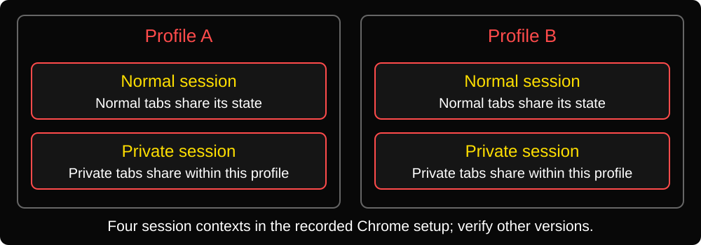

*Figure 3. The recorded Chrome exercise: normal and private session contexts within two profiles.*

It doesn't happen automatically. There's only a single incognito session. So I've got my main session. I go into incognito mode and every incognito tab at that point is the same except when we use the user profiles. When we use the set up different user profiles in Chrome, each of those user profiles is a main session and each of those user profiles can have an incognito session. So I could in theory if I had two user profiles I could essentially have four sessions going at the same time.

That might be very useful. The hard part with incognito sessions obviously when you got multiple ones going is telling them apart right that becomes worse with Safari where everything is a completely unique session. But if we can handle that switching between different tabs and we know what they're doing, multiple incognito sessions could probably be very useful. Perhaps you have them in different monitors, different, virtual screens within your system. I don't know how you choose to handle it. I think the sensory overload for multiple incognito sessions is probably too much for me to handle at the moment.

It's not something I've used, but it's good to know that I can do in Chrome, and it's good to know that I can do in Safari. So, Chrome just doesn't maintain a history when it's in incognito mode. The proxy sessions are the same. So, we know that proxy sessions are something that really live at the browser level and not at the session level. The dev team tools all seem separate. That's useful. What I found interesting is when I was exploring this, we started to see that the search bar or the omnibar in Chrome has all these different extensions.

Chrome extensions, Chrome downloads, Chrome history. So, I really need to start maintaining a list of this so that I know the functionality that the omnibar gives me as opposed to just the working through the menus and knowing that I just use it for searches. It also was interesting that the downloads is shared for everything and that although the history is not maintained when I do jump to history from incognito I jump to the history in the main tab. So if I'm testing an incognito mode and I have been visiting a test environment in the history list it's there for me to use and I can copy and paste it into the incognito mode.

Firefox again cookies are not shared. I mean universally cookies are not shared. We get a clean session with the cookies. The extensions in Firefox were enabled in both. I couldn't see a way of switching that off. Again, there's only one incognito session. So, or like one private session. So, if I create a new private tab, it's the same cookies as the previous one. So, in Firefox, I have main user private tab. So, the downloads are separate. So, we have a private downloads tab and they're not shown in the main downloads.

That was interesting that it maintains that separation even though that's done at the browser level and indeed downloads Firefox has got a really good download manager which we'll cover in a different section. History is not tracked for private. It's not that it tracks it and loses it, it's just not tracked. And again the main history is available to both so we can access previous environments. Proxies again live at the browser and dev tools seem separate. So I've essentially Firefox for me is main session private session.

It's just a quick win. Clear. Clear the session. Start a fresh. I.e. again. Clear the session. Start a fresh. We've not got any cookies. We see that the autofill is available in the non-private but not in the private because we don't save the passwords. There's no add-ons in private that I could find in IE111. And again, it was a single in private session. So, I've got the normal user session and I've got a private session and all the different private tabs and private browsers are exactly the same.

Again, it was interesting that the download lists are separate. I thought that was interesting. And the history is not tracked for private, but I've I do have access to the main history. And again, the proxy settings are at a browser level. Edge was much the same as IE, but Edge doesn't have any add-ons. And the downloads were shared this time. That was a that was a difference. The downloads were shared. Safari was interesting. Safari was the one browser where a private session is private, right?

And you can have multiple private sessions and multiple private browsers. You could like really go to town with this. I do not know how I would maintain the cognitive load of knowing what is happening in each private sessions. But I guess if you're testing an application which lists on screen which user you're using then having multiple private tabs could be really really useful and Safari might be a good browser for that. Firefox I edge I've written here seem to be most limited.

Essentially it's the most basic. You're basically creating a clean session. cookies not shared. Wham, quick, you're in incognito mode. You test something, you come out. That's useful. I was surprised to see that combining users with the incognito in Chrome gives me more scope for having more incognito windows. That's something I probably will use in the future. And the extension mechanism, switching them on and off, I thought was useful. Safari, I don't know how I'm going to use that many incognito tabs, but it's really useful to know that it is there.

But the basic thing is incognito mode is a really simple feature to use, right? is really simple to access. We should use it more. It gives me the ability when I'm testing to quickly check whether a problem is related to the cookies or whether it's related to new sessions without having to start in a different browser because the problem might not be replicable in a different browser. I want to replicate it in the same browser.

### 6.4 Incognito Mode Challenges Live Example

[Watch this chapter in the video](https://www.youtube.com/watch?v=jWwfMo5Ziz0&t=6331s)

**Chapter summary**

- Combine profiles and normal/private contexts to investigate several RestMud users.
- Track identities and shared objects; distinguish sequential actions from closely timed concurrent requests.

**Transcript**

And this gives me a clean way of doing that. So now I'm just going to do a little bit of testing with the incognito mode in Chrome. So here I've got a small application running locally on my machine. It's a multi-user application. There's three registered users here. So I'm just going to log in as one of them.

Let's log in as Bob. All right. So Bob can see that Alan the Mighty is also here. So, let's log in as Alan. And so, I'm gone into incognito mode with the little incognito mode symbol there. So, Alan can see that Bob is here. Bob can see that Alan is here. Now, let's introduce a user that isn't currently present. So, normally because I've got a real browser and an incognito browser, if I get up another incognito browser, let's see what happens if I look as Alan.

So, I can see that the incognito browser is sharing the same cookies. So, I can't log into another person here. Let me create a new browser here. If I log in as or if I take Bob's URL here, if I'm sharing the same cookies, then Bob will be logged in. So yeah, so at the moment I can only do a maximum of two users.

However, if I start using the Chrome personas and if I switch person here, going to go to demo user and Bob is not found. So we're not So this is two main windows and we're not sharing the cookies between these. That's good. This means this is a completely new user. So what I'm going to do is I'm going to log in here as the whiz. So the whiz is a kind of admin user for this game. So I do not want Chrome to save the password here.

So it's in main mode. So that's interesting. The first time we've gone to that. So it's asking me. So now if I look again with Bob, we can see that Alan is here and so is the whiz. Now, if I This is like a magic trick. Look, nothing in my hands. And then I open my hands and look, we've got another browser. So, I'm going to go into incognito mode here.

Now, we saw the incognito mode was sharing the cookies from here. If I try Alan in here, which is an incognito one, Alan's not in here. So, this incognito one is completely isolated from this incognito one. And essentially is incognito mode of this browser here. So, I can have four players online here at the same time. In the same browser. So, here we go.

Let's see. Can Bob see Eris has arrived? Yes, he can. So, what we can now do is everyone's in the same room. There's a pendant sitting there. So, I'm going to get Bob to take this pendant. So, Bob's taking it. He's going to have a look. Yeah, there's no pendant there. Is it in his inventory? Yes, it is. So, what I'm going to do then is I'm going to ask Eris to take it and Eris can't take it. So, we've we're doing a basic multi multiple user test here where we're checking the state of the pendant entity which was in a taken state by Bob.

The errors thought it was still there. So, we're just checking that that state was maintained and wasn't maintained in each user session. So, I can move around to the different rooms. Bob's going to move. Eris can't see Bob because Bob's in the East Room now and we're just moving around like this. So now I've got essentially different sessions. So I could check for more states and do the same basic thing.

Now the hard thing when you're doing multi-user testing like this, I mean it's going to be moving between windows, remembering who is where is going to be hard. But fortunately in the URLs for all of this, I've got the player ID so I know exactly who I am in each of these windows. That's quite handy. Essentially, I'm testing this whole game in Chrome at the moment. Normally, or previously to learning about incognito mode and the combination with the user profile, I would have had to bring in multiple browsers here to do this on the same machine.

But I could in theory just keep adding new user profiles and new incognito mode and I'd be able to test as many users as I can. But it's not really a multi-user test in the sense that they're not kind of simultaneous users. So, if I say take this here and take this here, I'm not doing it fast enough to do anything. We already took the pendant, so that wasn't a particularly good check.

Let's try the gold ring. Take take. So, it's not quite fast enough to in system terms. That was like miles apart in system terms. But, I was really going to test this properly. I probably want to do it with a performance test tool, hitting the requests super fast to see whether hitting them in really close combination helps. But having them as half a second apart in system terms is way too long. But that's a quick demo of the incognito mode style of testing that I was doing.

## 7. RestMud Text Adventure Game

**Section summary**

- Use RestMud to practise exploration, mapping and technical observation.
- Read URLs, element identifiers and server logs as well as page text.
- Keep a map and an action history.
- Revisit the game later through a proxy and its API.

### 7.1 RestMud Text Adventure Game for Technical Testing

[Watch this chapter in the video](https://www.youtube.com/watch?v=jWwfMo5Ziz0&t=6649s)

**Chapter summary**

- Text adventures provide practice in exploration, modelling, mapping and recording actions.
- RestMud extends that practice with URLs, element inspection and server logs.

**Transcript**

Okay. So this is RestMud. RestMud is a text adventure game that I've written for people to play as just as a game, but also to practice their technical web testing. So, in this video, I'm going to give you an overview of RestMud, what it is, and why we should play it and some idea of how to play it to improve your technical testing. So, RestMud is essentially a web server. I've got it running on my local machine. When you download it, you have it running on a local machine.

When it starts up, gives you a whole bunch of information. And it's running on port 4567 on local host. So I go off to localhost 4567 and I can see the initial RestMud screen. So if I click help, I'll see some instructions. It tells me basically there are things. I pick them up. I try and hoard them. There are some puzzles. I can do stuff. And you can see here some of the commands that we can use. I can take things.

I can drop things. Hoard things. And it s uses an item ID which hopefully is fairly obvious within the game but I could find it with inspect element and I can go in different directions like east, west, south, north. So let's start by looking. So if I do player user look, I look and I'm in the start room here. So I can see there's a whole bunch of directions I can go in. There's a teleporter button here. I could examine it.

So let's and there's some doors and they're closed. So essentially, I'm walking about and I'm doing things. So if I go north, so I go north, I look, I'm in the north room and I can see that there are no visible exits and there's nothing here and that nothing has happened. So I'm essentially in a room and there's no exit. So what am I going to do? This is a puzzle. It's it's the kind of worst puzzle in the world. What I'm going to do is I'm just going to go back the way I came.

But to do that, I'm going to have to amend the URL. So, I'm just going to go south and we're back in the room. So, this kind of suggests to me that I probably need to build a map. I need to start drawing a map so I know where I'm going. And that's what this game is about. It's about forcing us to think. It's about forcing us to explore, map, change URLs, inspect elements, things like that. So, I could go east.

Let's go east. And I can see that I can go south or go back west again. So, let's go south. And I can't go that way at the moment. So perhaps there's something I need to do. Perhaps there's a puzzle I need to solve. Perhaps this is a red herring. Perhaps I can never go south. And that's what this is. It's a text adventure. I'll show you how to play it properly in more detail in a later lecture. But I essentially grew up playing text adventures.

My favorite one when I was younger was called Mountains of Ket. I played it on the ZX Spectrum. cost me total of £5.50 when I was younger to buy this game and I have it running over here. And what was different about Mountains of Ket was it had statistics. It had like an RPG. There was luck, there were points, there was health, but it was also a text adventure. So, I could look I could see that there are different things here.

We're on a road. I can go east into the village. Let's go east. This is exciting. I'm in a crossroads. Let's go north. Oh, let's take the lamp. And these are the kind of normal commands that we have to issue. Take drop use. We can't we have to we can't just take that. We have to buy it.

So, let's buy lamp. The man says, "Okay, that's two coins. So what do we pay the man? What about man inventory? Okay, so when I said buy lamp, it bought the lamp. I just didn't understand that the message it was telling me. Okay, that's two coins that he had taken the two coins and we had paid all that kind of thing. So, one of the things we're doing when we're playing these adventure games is learning the world that we inhabit when we play the game.

We're building a model of the world that we're in. As we explore and play this game, which is very much what we do when we're exploring applications, we build a model of the application. We figure out what that application does, what its model of the world is. And I grew up playing these games. Essentially, I grew up, I think, learning how to test by playing text adventures. So, one of the other big text adventures that's out there is called Zork. So, here's Zork.

You can play Zork online. In fact, if you go off to things like textadventures.co.uk, there's a whole bunch of adventure games. If you type play text adventure online, you'll find a whole bunch of places where you can play different online text adventure games. This one here, I'm using a ZX Spectrum emulator called QAOP. And I downloaded the TAP file for this from the worldofspectrum.org. There's hundreds of old text adventure games. Zork is one of the classic games from Infocom. I still have a lot of the Infocom games boxed up there so that I can play them.

So in Zork and where are we? We're west of the house. There's a small mailbox here. Well, let's open the mailbox. There's a leaflet. Let's read the leaflet. Then we've got some instructions. That's quite useful. So, let's What else was here? There's a mat here. Let's examine the mat. It says, "Welcome to Zork because that's what it says on the mat." Well, let's try and lift the mat. That doesn't seem to do anything. We know that we're in front of a house.

So, there's a boarded front door. Well, let's open door. The door cannot be opened. Okay, let's just go east. See if that helps us into the house. That door is locked. There's no key. So presumably I have to find a key, figure out how to get in the house, solve some puzzles, wander about. If you want to practice with just a normal text adventure game, Zork is a classic, and there's lots of hints and tips on how to play this game.

I really like the infocom games. So I easily recommend this. And if you get into text adventure games, there's a whole bunch of things you can play. But essentially, what we have to do is experiment. We have to examine our surroundings. We have to look. We have to examine things that are in there. We need to interact, build a map, track what we do, write down the actions that we do. So, we have to keep a history of the verbs and commands we do because at some point we're going to die and at some point we're going to have to retrace our steps to get back to where we were to start testing or playing this game again.

Adventure games are a great tool for learning basic exploration techniques, basic testing techniques. And I've written RestMud to build on that and extend it further for technical testing and web testing.

### 7.2 Install and Start Playing RestMud

[Watch this chapter in the video](https://www.youtube.com/watch?v=jWwfMo5Ziz0&t=7090s)

**Chapter summary**

- Read the game README, check the Java requirement and start the JAR.
- Use the local address and port reported by the running game.

**Transcript**

So the next thing is to try and play a RestMud game. So, I've released a couple of games for RestMud. You'll find each game in a separate lecture, and that will have instructions of where to download the game. So, for the first game, this is the game that's free on the main website. I'll just download it to download the zip file. It's a Java app. So, what I'll do is I'll unzip that zip file into a folder. Then you see there's a read me which has some basic instructions for the game.

There might be some hints and tips in there. There's instructions on how to run it. But essentially what we've got is a JAR file. And to run this you'll need to have installed the Java runtime edition, the Java SE. Chances are you have this installed. So and it does need Java 1.8. So, if I get a command line up, if I type Java minus version, if you have Java 1.8 or 1.9, you'll be fine. You'll be able to play this game.

If you have Java 1.7, you'll need to upgrade your version of Java to 1.8 by going on to java.com and downloading Java for your platform. When I have it downloaded in a folder, I know I've got the right version of Java. I can do java -jar and then the name of the JAR file. In this case, it's RestMud single user basic test game version one because catchy names and titles are important. It will show me some messages telling me that it's added a user and it's on port 4567.

If you have anything else on 4567, you'll see an error message. Then once I'm on 4567, I'll just go off to localhost 4567 and then we can start playing.

### 7.3 How to Play RestMud

[Watch this chapter in the video](https://www.youtube.com/watch?v=jWwfMo5Ziz0&t=7208s)

**Chapter summary**

- Inspect command URLs, object identifiers, descriptions and JSON log messages.
- Build a map and action history while experimenting with the game.

**Transcript**

And the game is on. So, in this video, I'm just going to show you playing one of my example games again, just to give you a little bit more idea of how to play this. I don't want to give away any hints on the games itself and the solutions to the game. So, I'm using an example game.

Remember the basic hints for how to play RestMud are change the URLs, observe the URLs, watch for common verbs in that URL pattern like go, examine, take, drop. You'll see the object ids in the URL when we try and take something. The object ID will be listed in that URL. We can inspect elements. Watch the log, this thing at the bottom of the screen here. Watch that as we play the game because you'll see more information in there. There's clues in the descriptions.

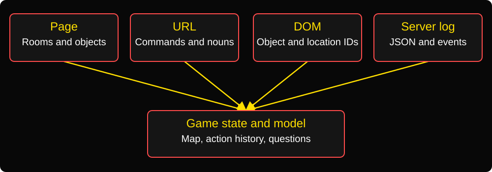

*Figure 4. RestMud observation points: page, URL, DOM identifiers and server logs.*

There's clues in the messages. There's clues in the log files. So, if I start the game. So, there we go. The game is running on localhost 4567. I've gone to the top URL to start. I'll do help. I'll do look to see where we are. And this is the examples I used in some of the previous videos. So, we know that if I go north, I'm in a room with no exits. So I can control what I can do through the URL.

This is like the command line parser or this is like the parser in text adventure game. It's a verb noun parser. I say go south. Let's examine this teleport button. Examine the corridor button. How did I know it's called corridor button? If I inspect, we'll see that this says corridor button. So, I didn't actually need to click the link. I can see that in the description here, it's saying corridor button for the visible objects ID. There are clues in here. So, there's a door to the south.

So if I open the door, and remember I could have done open south in the URL, but clicking on that takes me to that URL anyway. So now that that door is open, I should be able to go south. So we can open doors and gates, and we very often have to use things. So if I go back to the start room now, I'll go west.

Now, if I try and go south, it says I can't go south because the teleporter is not active. So presumably this button will activate the teleporter in the south and let me go south. So if I examine this button says you examine it, use the button to switch on the teleporter. Okay, let's use the button. So I'm just going to type in use teleporter button. The teleporter is now active. Push the button. Teleporter is scary. Do you want to through it?

Yes, let's go through it. So let's go south. There we go. And we've teleported back into the start room. And you can see down here in the log, there's all the descriptions of what's happening. And this is all in JSON message format here. This will all be produced out to the command line. And you'll see all this. And this is the output from the API. We'll cover the API later on, but there's a lot of useful information in here if you learn to read the logs.

And the logs are just output standard out. So they'll appear in the command line when you run the application. So we know that if there are things and I inspect them, they've got ids that we can use. Look here, I can see that in this location, the location has an ID. That could be useful. That's certainly useful if I start building maps because I don't need to write down the start test room or whatever else room. I can just write down the location ID and show north, south, east, west, things like that.

And you'll sometimes see different information in the descriptions. So it's worth doing inspect element. And as we do technical web testing, it's worth inspecting the elements, looking in the source, looking at the logs, changing the URLs, experimenting. This is what this game is designed to help you do. But I do recommend you keep a map because some of the games have mazes and it will get you in the habit of drawing diagrams of the systems that you're testing. Make notes down there.

Keep this is all to build up the good habits that you need when you're doing exploratory testing, particularly exploratory technical testing. Keep a history of the type of command you do. Now, in theory, I don't really need to keep a history because I could use the browser history and that will keep this. And then I'm starting to use the features of the browser to help me do my testing.

Remember, this is one of the things we need to do. Learn the features in our tools and use them in ways that help our testing that we might not otherwise figure out how to do these things. And remember, I can actually go to these links from the history that might be quite useful when we're playing RestMud. Anyway, the aim is to experiment. The aim is to play the game. The aim is to have fun. And there are some actual bugs in the games.

So you can actually test the game as well as play the game. So see how you get on. We haven't covered the API yet. The aim is just use the browser. If you want to hook it into proxies, if you want to try the API, if you want to do extra investigation in here, feel free. If you want to look at the free Java course I've got, try and decompile the game. Feel have a go like try experiment. Test this in as many different ways as you can.

It's on your machine. It's running as a local server. You cannot break anything in any bad way. There's no permissions involved here. Pull this thing apart and test it to the best of your ability.

### 7.4 Exercise: RestMud Single Player Game- Basic Adventure

[Watch this chapter in the video](https://www.youtube.com/watch?v=jWwfMo5Ziz0&t=7560s)

**Chapter summary**

- Explore the single-player game without reading solutions first.
- Use clues and logs to investigate puzzles and inconsistencies in the engine.

**Transcript**

See how you get on, but make sure have fun because it's supposed to be a game. So, this is the first single player RestMud game that I released. You can find it on the CompendiumDev website, compendiumdev.co.uk/page/restmud. There's a little description about adventure games. There's a slide and the download instructions. So, you saw me do this already. Essentially, just download the zip file, unzip it in the downloads folder or wherever you want to put it because it's just a folder. I do recommend you read the readme.

It has some hints. Hit start. I get the command line up. And this will work on Mac as well or Linux. As long as you got the right version of Java. So remember, I'm using 1.8. You can use anything above. So 1.8 and above, it should work fine. java -jar rest single user blahy blahy blah.jar. And I had it running in another window. And that's the error message you'll see if you have you already have RestMud running in another window. And if that happens, close down anything that's on port 4567 and try again.

Then it tells me the game has started. It's listening on 4567. If I just go the top, we'll see that there's a total possible score in this particular game of 1170. Now, what I always want to do is have this window open and visible at the same time because I want to see the log messages that are coming through because that will give me some information. So, if I do help, I look. So, I am in the test game. There's a sign on the wall.

Let me have a quick look here. So, I'm looking. That's just a normal message ID location one. We've got the objects, visible object, a hint. Well, that sounds good. So, let's examine the hint. I think you can go south near the strong room. Okay. So, somewhere there's a strong room. Where will I go? Let me go south. There's the room in the south. There's another sign on the wall. This is room four. I'll tell you some more. You can go east when you think you can't go east no more.

Then you can read the sign some more. Okay, so that sounds fairly cryptic. There's probably a clue in there. Let's explore a little bit more. I'm going to go back north. Let me go north again. A dark room. Okay, so presumably there's ways of making rooms less dark. But I can't see in here, so I'm going to have to go south out of here. Okay. I don't want to give too much away of the game and the puzzles that were in here, but this is one of the first games released.

It's an early version of the RestMud engine. So, there are more bugs in the than the actual game engine than I expected there to be. There's a couple relatively serious ones I know about that give the player extra abilities that they shouldn't have. And always keep an eye on the console logs to give you a little bit extra information about what is going on. So you know where to get this. This is just on the main website. This publicly available one.

Feel free to discuss this one as much as you want and have fun playing the game.

## 8. HTTP Proxies

**Section summary**

- Place a debug proxy between the client and server.
- Capture, inspect, repeat and alter requests and responses.
- Configure and verify each connection before adding more tools.
- Combine proxies for complementary features and check their influence on results.

### 8.1 HTTP Proxies

[Watch this chapter in the video](https://www.youtube.com/watch?v=jWwfMo5Ziz0&t=7775s)

**Chapter summary**

- The proxy introduction focuses on practical capabilities and reasons to use them.
- Follow up the overview by installing tools and exploring a practice application.

**Transcript**

Hi and welcome to an overview of technical web testing with HTTP proxies. My name is Alan Richardson. I blog at eviltester.com. That's my main technical software testing website. I blog at seleniumsimplified.com and I use that for my automation using WebDriver and Java. And compendiumdev.co.uk is my general website where I talk about testing, the books I've written and whatever else.

Now, in this particular tutorial, I'm going to give you an overview of using web proxies. I'm not going to go into a lot of detail, but I'm going to try and cover enough that for the self starters amongst you, you can go off, you can look at the links, you can download the tools, you can play with them.

What I want to do is give you some of the reasons why you should use this stuff and some of the capabilities of these tools so that when you're exploring them, you know what to map back to.

### 8.2 What is an HTTP Proxy?

[Watch this chapter in the video](https://www.youtube.com/watch?v=jWwfMo5Ziz0&t=7836s)

**Chapter summary**

- Requests and responses pass through the proxy for capture, inspection and manipulation.
- Use the additional visibility to learn HTTP and the application architecture.

**Transcript**

So, what is an HTTP proxy? Well, it's a piece of software that sits between your browser and the web server, and you route all your requests through the proxy. So when you make a request on the browser, it goes off through the proxy and hits the server, which means that the proxy is able to capture all the requests that are made, which means that you are able to view all the requests that go through the proxy. Same thing when the server sends a response back to the browser, it's captured in the proxy, so you're able to view it.

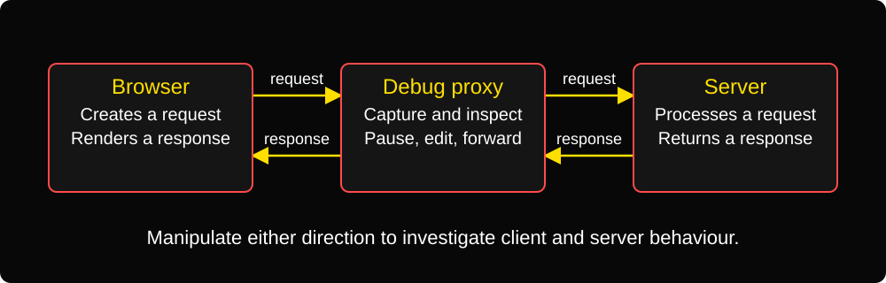

*Figure 5. Requests and responses pass through an HTTP debug proxy.*

But more than that, you're able to manipulate it. You're able to change it in different ways before it either gets to the server or before it comes back to the browser. which lets you test in a really detailed way. You also get to view all the messages that are going back and forward. So, if you're not completely up to date with how HTTP requests work, what they look like, what's special about them, this is a great way of learning what's going on in the application.

HTTPS can be done through a man-in-the-middle approach where your proxy server sends the certificate back to your browser. Now, when the browser validates that, it says this is not the correct certificate. So, you have to add it as an exception in your browser, but it allows you to test HTTPS as well. So, even though you can't normally see it, because you're using a proxy with the man in the middle, you can see and amend your HTTPS requests.

Now, I think you do this because you need to learn as much as possible about the application and the technology that you're using. You need to learn about HTTP. All the headers, what they do. JSON, how it works, how it's formatted, how you can use it. The architecture of your application is a really important thing to learn. And most of the proxies will give you a site map. They'll show you the way that your application is built up. Being able to observe and manipulate web traffic, the HTTP traffic is absolutely essential for what you do when you're testing.

Some of the proxies will allow you to simulate network speeds. So if you want to check your application going through a lower bandwidth network, you can do that. You can simulate different browsers from a single browser by changing the HTTP headers that are sent through. I mean each browser identifies itself to the server through the header. This tells it which browser it is. Therefore, you can change essentially in quotes the browser you're using by sending through a different header. Uses for this are pretty much up to you and your imagination.

I've used it to test new CSS and JavaScript without releasing those to the server by allowing the proxy to pull them in from my local drive. And so I can use the application with the new CSS and JavaScript whilst running against the old application on the server. I can test the JavaScript on my client side and see how it handles 401, 404 and 500 error conditions by having the proxy send back those requests by amending the response in some way. So I don't have to fiddle with the server to see how the front-end JavaScript is going to handle extreme circumstances.

When you start to learn the functionality of the proxy, it's going to open up a new world of testing for you. And you're going to use that to guide what else you can do and how and change your test approach based on the functionality of the tools that you have available to you.

Now, now I use this pretty much all the time when I'm not using a proxy. I sometimes don't feel like I'm testing. I feel like I'm testing blind or I'm testing naked because I don't have the right functionality that I need to get access to that application. I mean sometimes you have to be careful that the proxy itself doesn't add additional noise into your testing. So if you do find a defect and you're going through a proxy, make sure you confirm it without the proxy being on if you can.

You may find issues with streaming depending on which version of the proxies you're using, depending on what technology you're using. You may have issues with long polling with the websockets, but some proxies handle this, some don't. Older versions of proxies don't handle it. Newer versions do. There are a lot of proxies out there. So, you just have to learn what the capabilities of each one is, how it impacts your testing, and whether it imposes any risk on the testing that you're doing because a proxy is invasive.

So, just double check your results. But for me, the value that I get out of using a proxy is massive and it completely trumps the risk that's introduced into my testing by doing it. So I pretty much always as much as humanly possible use a proxy. When I don't, I rely on the features in modern browsers because they're coming closer to proxies, but they don't go far enough.

### 8.3 Configure Firefox to Use Burp Suite Proxy

[Watch this chapter in the video](https://www.youtube.com/watch?v=jWwfMo5Ziz0&t=8133s)

**Chapter summary**

- Find the proxy listener and configure the browser to use its address and port.
- Start with interception off and confirm traffic in the history.

**Transcript**

They don't cover the same ground as what a proxy can do. So you have to be able to configure your browser to use the proxy. So I'm just going to drop down into demo mode so we can have a look. So I've gone off and I've downloaded Burp Suite from the Burp Suite site. I'm going to use Burp Suite in all these demos. There's a whole bunch of proxies you can use, but I'm just going to use Burp Suite to make this fast.

Burp Suite runs under Java, so as long as you got Java installed, you can do it. I've downloaded the JAR file. I'm just going to do java -jar burpsuite_free_v1.5.jar because Burp Suite comes in two formats the free version and the paid for version. I'm using the free version because that's usually good enough for testing.

Now I'm going to go through this quickly. I'm not going to do this in depth. I expect you to explore and follow this up. If I look on the proxy tab you can see intercept is on which means that any request going through this will be intercepted. So I'm going to turn that off to start with. In options, you can see I have two listeners set up because I've been experimenting with this. So, I'm going to remove this one. And now I've basically got a listener on port 8080 on my host machine 127.0.0.1.

So, I'm just going to set Firefox up to point to that proxy. If I go into options, options, advanced, network, configure how Firefox connects to the internet, manual proxy configuration, and you can see it's the same as mentioned here. 127.0.0.1, port 8080. Now, this is pretty much the same scenario you're going to use for any of the proxies. You're going to look to see what port the proxy has bound to. Then, you're going to go in your browser and you're going to change the configuration to point to the proxy.

I'm saying to use it for all protocols and then when I do let's let's just do a quick search.

### 8.4 Basics of Burp Suite

[Watch this chapter in the video](https://www.youtube.com/watch?v=jWwfMo5Ziz0&t=8250s)

**Chapter summary**

- Read requests, responses, headers and parameters in useful views.
- Use history and site maps to distinguish visited resources from discovered links.

**Transcript**

So I'm going to show you here in proxy history nothing has been captured. I'll go into Google and I will search for Burp Suite. Let's do that. Connection is untrusted. Why is that? Because it's going through an HTTPS request. So the proxy is sending back a certificate to the browser that the browser knows is not coming from Google. So I'm going to say that's fine. Add that as an exception.

Now when you do this, you have to learn how to delete the exceptions later on if you really want to. But because we're putting the request through, we know that it's coming through from our proxy. And you can see here in the proxy history that these are the requests that were made when I did a search for Burp Suite. And I can go in here and I can see the request that was made and I can see the response that came back.

Now if when you're reading this you don't know what it means then it's a great way to learn because if you go I have no idea what this host in the request is just go off Google it do a search. If you have no idea what the accept language is for or what this accept header is for, this is the time to go away and learn. If you don't know what this cookie thing is doing, go away and learn. Look these things up and you will learn more about technically how the HTTP traffic is working because then when you start to test, you can change this.

You can change the user agent and pretend to be a different browser if you know that that's what this is doing. You can amend the cookies before they send back. Now in the response you can see we've got a handy set of features here. I can view it in different ways. I tend to view things in raw. But if I really want to just explore the headers, I can view that in a nicely formatted part. Renders quite usefully because it tries to render the page for me.

It doesn't always have access to the CSS, but it shows me this as much as it can. I can see a nicely formatted view of the HTML. I can search for things. If I really have to, I can use hex. Never done that, but that's interesting. Request is good because I can see the parameters that were put through. I can see that some were put through in the form. I can see that some were put through in the URL. It's a way of splitting down this request into a more visible way of reading it.

So, this history shows me all the requests. I can see a whole bunch of information about them in a nice format. What status came back, what status code. Of course, all of that is here in the response when I know how to read it. So this is a fantastic way of viewing what is going on as we test the application.

Now what else is really useful is that in the target you can see a whole bunch of sites mentioned here because what happens is with Burp is it's doing passive scanning of the requests that are coming through and it's basically said all these ones in bold are things that you've been at. Now I also found all this other stuff listed in passing.

Now, you haven't visited this, but you might want to. So, if I'm doing functional testing, this is a really good way for me to see what kind of coverage I've done in this particular session because any requests that I've made is here in black and white. Anything in gray is something that I could have covered but haven't covered yet.

### 8.5 Repeating a Request in Burp Suite

[Watch this chapter in the video](https://www.youtube.com/watch?v=jWwfMo5Ziz0&t=8453s)

**Chapter summary**

- Send a captured message to a repeater and vary one part of the request.
- Inspect the response in the tool, recognising that it may not return to the browser.

**Transcript**

So, I get a really good feel for what I've done and what I haven't done. So if I go off to the Burp site, you can see here down at PortSwigger, it's got Burp. It's got the response. Now I can do a repeater on that. I can send it to repeater. And you can see here repeater has been highlighted in orange. This request is in there. I can say go do that again.

Now, if I want to, I can say, let's do a search for Burp index.html. I have no idea if it's there or not. So, I'm going to hit go, see what happens. And we get back a index page. And you can see that the CSS hasn't been pulled in properly, but I've got the basic content of that page. And I did that not by issuing a request through the browser, but by changing the raw headers in here in the request by changing the raw request that was put through.

That's what the repeater allows you to do. It allows you to amend the request and put it through and see. Now, obviously that response didn't come back to my browser. And obviously that has not been shown in my history, but that's because repeater is a self-contained piece of functionality over here.

### 8.6 Intercepting and manipulating requests

[Watch this chapter in the video](https://www.youtube.com/watch?v=jWwfMo5Ziz0&t=8536s)

**Chapter summary**

- Pause, edit, forward or drop requests.
- Intercept responses to explore client behaviour with changed data or errors.

**Transcript**

So I've just reinstated the defaults here. So if in so I have intercept on. So I've gone off to success stories and you can see now that the proxy and intercept has been highlighted. That's because in the options I'm saying I want you to intercept whenever I receive any extension that isn't an image or a CSS or a JavaScript or whatever is in here. And that's what this is. This is a request. So in intercept now you can see that I've done a request for or I'm about to do a request for get Burp Suite success-stories.html.

Now I can amend this as much as I want. Then click forward where I can say do not send this request. So I'm going to forward this through. And you see that the response came back into my browser because this is the main request going through and it's shown in the history. So if I look in the history here, you can see that the request has been modified. Here's the original request that was going to get sent through. Here's what I edited to be.

And here's the response. And I can actually see the proper response because it came through into my browser. Or I can render it here. Now, there's a whole bunch of functionality that you can do with Burp. But the basic functionality I want you to be aware of here is that these proxies allow us to observe the traffic that is being sent through, observe the requests, we can see the headers, we can see everything that's going on. We can see everywhere that the system has been and we can manipulate it.

We can change the request before it goes to the server. We can change the request from the server before it actually hits the browser if I want to. Over here in options, I can intercept server responses. So I can do the same thing here for responses. If I want to simulate different conditions, if I want to change the JSON that's coming back, I can do intercept a request which is going to the server or response which is coming back. I have all these different options because I want to be able to manipulate the traffic in either direction.

There's a whole bunch of options around here that depending on your proxy, you'll be able to do different things. You can automatically change things in the responses when they come through. So, you can always pretend to be a particular browser or not. You can enable hidden and disabled fields so that they're sitting there in the browser so you can amend them.

Now most modern browsers allowed you to do that anyway by updating the DOM, but in the past that was really hard to do. So explore the proxy when you download the proxy. Explore it and see what functionality is available to you so that you can then start doing more and better testing.

### 8.7 Generic Configure Browser to use a proxy

[Watch this chapter in the video](https://www.youtube.com/watch?v=jWwfMo5Ziz0&t=8727s)

**Chapter summary**

- Check whether proxy configuration belongs to the browser or the operating system.
- Track certificate changes and learn how to restore the intended settings.

**Transcript**

So you do have to configure the browser to point to the proxy. Now the good thing is that with Firefox and Opera, your proxy settings are completely independent of the system settings. You saw there in the demo that I used Firefox. That didn't impact my IE settings or my Chrome settings because those were the Firefox settings. Opera is the same. If I use Chrome and change the browser to use the proxy then it will impact IE and all the applications on my system.

Now that might be what you want. So you just have to be aware what the prox what the browser itself is doing. Chrome and IE uses system settings. Firefox and Opera can maintain settings independent of the system settings. Now each of the different browsers has a different way of doing it. You saw how I did Firefox. In Chrome you go into settings, search for proxy then just change it. thing to be aware of is that the incognito mode and the normal mode share the same proxy settings because they're both going through the system settings.

Firefox, you saw how to do it. If you had already configured IE or Chrome before you did Firefox use the proxy, then in Firefox just set it to use the system proxy instead of no proxy and you'll pick up the configuration that Chrome and I are using. Opera is much the same. Go into settings, preferences in advanced network, then change the proxy servers. Good thing about Opera is that using F2, you can toggle the proxy on or off once you've set it up.

IE again you use the tool bar, you pick config options, then connections, then LAN settings, then use the proxy server. All these things are different depending on different browsers, but they all have the same effect of routing traffic through your proxy. Now, you saw there that I was asked to add an exception into the browser because the proxy was sending back a man-in-the-middle certificate. So, you just have to add add that into your browser as an exception.

Now, the important thing to do is to learn how to remove them afterwards because you're adding this in for testing and you may not want that there all the time. So, I put the options up here as to how you go through to remove them, but it's basically going through the encryption or the manage certification. functionality within the browser. It's browser specific. You learn how to do it for each browser. It may well change across the different versions of the browsers.

So, I've put the details on this slide here on the screen to show you the basics of what to do because remember I'm trying to go through in this particular course is an overview fairly quickly for what you what functionality you can do.

### 8.8 Self Study Recommended Books

[Watch this chapter in the video](https://www.youtube.com/watch?v=jWwfMo5Ziz0&t=8889s)

**Chapter summary**

- The recorded reading suggestions explain HTTP details and proxy capabilities.
- Use reference material to deepen an investigation beyond the introductory demo.

**Transcript**

There are books that are available. I thoroughly recommend The Web Application Hacker's Handbook. Let me show you this. This is the same guys that wrote the Burp Suite tool. And this is a massive book and it covers the HTTP traffic, the requests, what the different messages mean, how to use it. This is a really really good book for helping you understand what you can do.

Now, security testing is different from application testing, but we're using the same tools. We need to learn how to do them. The technical details are all contained in that book. It's an incredibly useful book to have a look at. Now, Eric Lawrence, who wrote the Fiddler Proxy, has written a book on how to use Fiddler. It's also is a very, very good book. Covers Fiddler in detail. How to script, how to set break points. Fiddler has a slightly different approach than Burp Suite is sometimes it's a lot easier to use than Burp Suite for beginners.

### 8.9 Self Study Recommended Proxies to Try

[Watch this chapter in the video](https://www.youtube.com/watch?v=jWwfMo5Ziz0&t=8961s)

**Chapter summary**

- Compare Burp Suite, Fiddler and ZAP through practical experiments.
- Choose capabilities that help observe and manipulate the application under test.

**Transcript**

So, if you're interested in these tools, follow these links, buy one of these books, have a look. Now proxy proxies that I use I use Burp Suite which is over there on portswigger.net I use fiddler which you can get from fiddler2.com and I use Zed Attack Proxy which is available on Google code and this is an OWASP ZAP proxy.

Now they all have slightly different pros and cons, slightly different functionality. So most of the stuff that we do as testers, we don't need much more than the bare minimum to manipulate and observe traffic and all these tools do that in one way or another. Burp Suite has the ability to sequence attacks through and the Zed Attack Proxy goes much much further in terms of the functionality that's available for free. But explore all these tools and just see how you get on and learn as much as possible about all the different ways of exploring the web application and changing the traffic on it to make your functional testing more effective and to go in more detail into the application.

So the Zed Attack Proxy has a Twitter account which is worth monitoring. And that's pretty much it. I want you to go away, follow the links, download the tools, feed them through your applications, configure your browser, explore this and experiment with it. Remember, you can come back. I've gone through this very quickly, but you can look at the instructions at your leisure. You can download the slides and have a look through this. Follow the links, have a look through, but start using it.

Honestly, when you start doing this, if you're not doing it already, when you get used to it, you will feel out of control when you don't have the degree of information that these proxy servers can provide you in your testing. And if you don't get to that point, then you're not reading the request. You haven't understood the HTTP. You haven't changed the request before it went through to the server and seen the value that that can add in terms of bypassing the front-end JavaScript in terms of testing the validation that the server side and the front end side in terms of testing your JavaScript in isolation of the server.

All these things are possible when we start using proxies and I think they're an absolutely essential tool for introducing into our functional testing.

### 8.10 Next actions

[Watch this chapter in the video](https://www.youtube.com/watch?v=jWwfMo5Ziz0&t=9103s)

**Chapter summary**

- Configure a tool, inspect real requests and practise changing traffic.
- Turn the new visibility into specific functional-testing experiments.

**Transcript**

And that's pretty much it. I want you to go away, follow the links, download the tools, feed them through your applications, configure your browser, explore this, and experiment with it. Remember, you can come back. I've gone through this very quickly, but you can look at the instructions at your leisure. You can download the slides and have a look through this. follow the links, have a look through, but start using it. honestly, when you start doing this, if you're not doing it already, when you get used to it, you will feel out of control when you don't have the degree of information that these proxy servers can provide you in your testing.

And if you don't get to that point, then you're not reading the request. You haven't understood the HTTP. You haven't changed the request before it went through to the server and seen the value that that can add in terms of bypassing the front-end JavaScript in terms of testing the validation that the server side and the front end side in terms of testing your JavaScript in isolation of the server. All these things are possible when we start using proxies and I think they're an absolutely essential tool for introducing into our functional testing.

### 8.11 How To Chain HTTP Debug Proxies

[Watch this chapter in the video](https://www.youtube.com/watch?v=jWwfMo5Ziz0&t=9179s)

**Chapter summary**

- Chain the browser through ZAP, Burp and Fiddler for complementary features.
- Add one hop at a time and verify traffic before continuing.

**Transcript**

Okay, I'm going to give you a quick example of how to chain proxies. And the reason I do this is there is no single tool that will rule them all. There is no single tool that I rely on more than any other. I like to use tools in combination because then I can use whatever is most unique about that tool and harness the benefits of using it with the other functionality for the other tools. So I like to have screen capture tools, lots of different text editors, different diff tools because they'll all have pros and cons for each other.

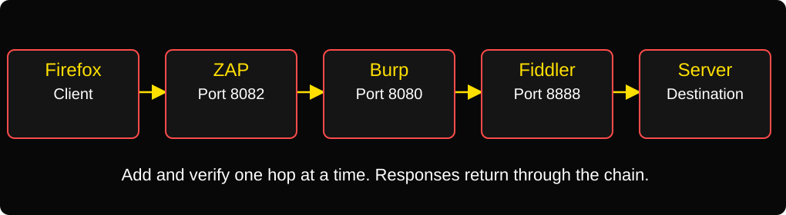

*Figure 6. The recorded proxy chain: Firefox, ZAP, Burp, Fiddler and the destination server.*

Some of them have features that I use at different times. It's the same with proxy servers. So I use Fiddler, I use Burp, I use Wasp Zap, and they each have features that I really like. So, Fiddler has autoresponders. Burp has a really good site map on the side. The Zap has really good way of creating multiple break points. So, I like to use them in combination. So, I'm going to show you how to set this up. So, the first thing I start with is a browser.

All right, just a browser. I'm happily browsing around with nothing going through the proxy. And I'm using Firefox because remember Firefox maintains its proxy settings independent of the operating system. So if I start up Fiddler now, Fiddler is hooked into the normal Windows system. And if I just do a quick refresh here, Ctrl+F5, that refreshed. Nothing went through Fiddler. So my browser is not hooked into Fiddler. So, if I go into the options in here, network settings, configure it to point at Fiddler.

And there we go. We've got traffic coming through Fiddler now. Now, when I'm chaining proxies, I do this step by step. I get each thing working before I move on to the next step. Because I see too many people just trying to set up all their proxies at exactly the same time. They're not sure which proxy has overridden which port. They're no idea why things are not working. We do it step by step and we check each step of the way that things are working.

So, let me bring Firefox down a little bit here. So, we got Fiddler with going through now. So, next thing I'm going to do is bring Burp Suite into the mix. So if I get a command line up, we go java -jar Burp Suite. And there's burp. So burp has settings from my previous run.

So let me just refresh the settings here. I'm going to restore them to default. So burp is now on. Yeah. So, it's now saying so check the alerts in Burp. The alerts tab is really, really useful. Use the alerts tab because it will tell you whether it can't start up the port or the proxy you're in like that. So, my proxy main proxy is sitting here on 8080 on the local host.

Now, what I want to do in Burp is over here in options in the connections. I want to set the upstream proxy server. And you can see that it's left over from the previous one. localhost:8888. So, let me just edit this. This is the setting that I want because Fiddler is running on local host. It's bound to port 8888. And I want to for any destination host that I'm going to, I want to feed them through in proxies. So, I can set up different upstream proxies for different servers for different applications, different things I'm testing here.

I'm basically just saying any request I make, feed it through into Fiddler. So, there's no alert saying anything's wrong. So, what I'll do is I will go into Firefox. Let me clear the Fiddler traffic just in case. In Burp, I'll make sure the intercept is off so that nothing bad is happening. Then I'll go into Firefox options, change the settings for how it connects, and I'm just changing the port to what we had for Burp, which was 8080. And hopefully if we've done it right.

So traffic went through. Traffic is appearing in Burp and it should be appearing in Fiddler at the same time. Great. So I've now chained my browser through Burp through into Fiddler which means I now get the benefit of the site map for Burp and I can set up any autoresponders in Fiddler. So the next thing we're going to do is set up Zap. So I've downloaded Zap. Just going to start it from the explorer like that. Can listen for 880. That's fine.

That's because Burp is bound to that. So what we'll do is we go to tools options local proxy for Zap and tell it to bind to a different port. So, let's have it bind to port 8082. Hasn't complained, so we'll assume it's doing that. Then we'll go into tools, options, and in the connection option, we're going to set it up to point through into port 8080, which is Burp. We're going use an outgoing proxy server on the local host on port 8080.

So now in theory if I point Firefox at port 8082. Remember the port is what that application is listening on and we're telling it to send requests in. So I'm saying zap is listening port 8082. So I want you to send all your requests through into 882. Let's see if this works. Oops. I need one that goes to a different page. There we go. And Zap is now starting to have traffic going through. There should still be traffic coming through in Burp.

Let's just double check that. Yep, there is all the there's all the traffic coming through from that request into Burp. And it should be coming through Fiddler as well. Let me just do a another refresh just to double check that. There we go. Now I have my browser going through Zap, which is going through Burp, which is reading through Fiddler, which is going to the outside world. So I've got all these tools working in combination so I can harness the benefits of each and every single one of them.

I encourage you to do this to experiment with different tools to see what pros and cons you have. You can see the difference in the tool and what they're good for at different times. That will help you get used to them. But the basic principle here is we want to use multiple tools. We want to use multiple tools in combination. And the tools themselves if they're good enough will support us in that respect.

## 9. Interactive REST API Testing

**Section summary**

- Read the API contract and explore requests interactively.
- Inspect methods, URIs, headers, bodies and status codes.
- Reuse successful requests through collections and templates.
- Compare GUI and API access to shared application logic.
- Check authentication, session state and the traffic actually transmitted.

### 9.1 An Introduction to Interactive REST API Testing

[Watch this chapter in the video](https://www.youtube.com/watch?v=jWwfMo5Ziz0&t=9618s)

**Chapter summary**

- Begin with hands-on HTTP API exploration.
- Use a browser, a REST client and RestMud to develop practical experience.

**Transcript**

So in this section, we're going to have a quick look at how you would test a RESTful API. Basically, an API that we access through HTTP calls. Now, we're not going to go into the theory of this a lot, but we are going to focus on the practicalities. So, we're going to show you how to use some publicly accessible APIs. We're going to show you how to access the API from the browser. We're going to look at some tools to help us access the APIs to track the request to make collections of it to make it easier for us to work with it.

And we're going to play the RestMud game. And you're just going to get a good hands-on feel for how we work with and test REST APIs interactively.

### 9.2 What is REST?

[Watch this chapter in the video](https://www.youtube.com/watch?v=jWwfMo5Ziz0&t=9667s)

**Chapter summary**

- Separate the method, target URI, query parameters and representation.
- Compare GUI and API access to the application, and use documentation to guide experiments.

**Transcript**

Okay. Okay, so let's start looking at how we test a REST API. REST means representational state transfer which is a fancy name and it's a proper name. There's a proper whole set of theory and rules behind this. But typically what we're talking about when we talk about rest is an application programming interface and API which we access using HTTP calls and where the verbs of the HTTP HTTP call dictate the action that we're going to do when we make the call and we specify the URI as the thing to act on.

Essentially a URL identifies a resource with a URI. It's what we type into a browser. The HTTP verb is get, post, put. When we're surfing the web and we type a URL in the browser, we're issuing a get request. Now, there are other rules for REST. It's stateless. It's cacheable. You will read the REST theory in the references itself. I'm not really going to go into that in more detail. What we're going to concentrate on this course are the practicalities of accessing an API that people have called a REST API.

Regardless of whether it's a REST API or not. It's not something we necessarily argue about in the real world. Well, people do, but we are not going to argue about it. We're just going to use it. Essentially, it's an API that we access via HTTP with URLs where we either send or receive JSON or XML and that's pretty much it. But there's no GUI. That's the main thing about the rest. There's no GUI for it because it's an application programming interface.

So, here's a diagram of it. This is RestMud. We've got the GUI which makes calls to the web server and the web app. And it also has a rest API which means we can issue post and get calls to the game and we'll receive JSON requests back. We'll see the JSON responses, the kind of things you saw on the command line. We're accessing the same functionality in the application but we're accessing it not through the GUI, we're accessing it through an API.

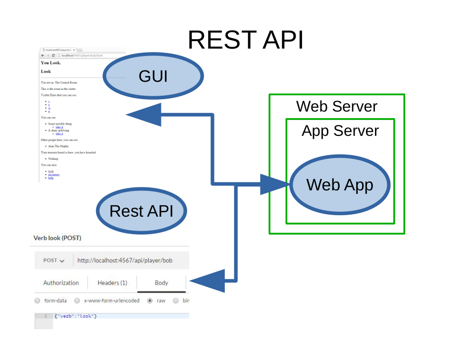

*Figure 7. Original course illustration: GUI and API access to a web application.*

So let's have a quick look at an example. So, the example we're going to use is the randomuser.me application. This is a free application on the web. Here it is. Here's their nice front-end page. And essentially, it just generates random user data. It has an API. So, we can read about it and see how to use it. It's telling us here what we do is we issue get requests. This is a very simple API. We just issue get requests. Because we're issuing get requests, that means we can put them in through the browser.

We don't need any extra tools, which is why it's a good one to start on. So this request here basically says, get this URI, the API at randomuser.me, and generate something with nationality, Great Britain, and gender female. So let's make this call. And there's the response, and it's in JSON. JSON is the JavaScript Object Notation. And what that means is this is valid JavaScript, but it's also a message format that's used in java.net. Pretty much every language under the sun will have a JSON library and allow us to access this as part of an API.

So let's have a look at that URL in more detail. So URL means Uniform Resource Locator. URI means Uniform Resource Identifier. There's not necessarily a lot of difference. They're the same in my head, but there are formal definitions of it, and you can have a look at it in Wikipedia. So, to break this down, we have get, which is the HTTP verb. We have HTTP colon, which is the scheme or protocol name. So, if you were going to use FTP, then you would put that in as a different scheme name, HTTPS, different scheme name.

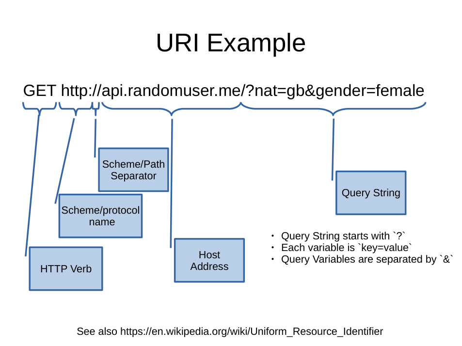

*Figure 8. Original course illustration: method, scheme, host and query string in a request.*

The slash is important for HTTP. There are other schemes where that's not important. So, that's just a constant in HTTP. Then we have the host address api.randomuser.me what we are trying to access. We don't really have a path in here which is the endpoint that we're trying to access. But we do have a query string. So we're doing host the root path which is just the slash then the query string. And the query string starts with a question mark. Then it has a bunch of key value pairs.

And the key value pairs are separated by ampersand. You'll see this when you surf the web. Normally, we know how to mess with URLs. API call is simply building these up, particularly for this API, which is just gets. So, here is an example of making that call with the JavaScript, which you saw me do live. And if you want more information on JSON, go off to JSON.org or have a look for it on Wikipedia. It's essentially just JavaScript. It might take a little bit of time to learn how to read this, but there's tools out there for making this pretty-printed so you can read it more easily.

And later on, we'll use a REST client which will pretty print these things for us and make it a lot easier to access it. So, I'm going to leave it up to you to do external reading. So, look up the URI, look up HTTP. The HTTP reference has a lot of good information on the status codes you will see and the headers and whatever else. And for REST studying, I recommend the REST API tutorial.com. That's quite good. The Microsoft API guidelines are new.

They go into it in quite a bit of detail. You can read the original dissertation for REST, which is a bit academic, but it's worth having a look at because if anyone's going to have an argument about REST, whether our API is RESTful or not, they're going to be arguing about the things in this paper. In practice, we're dealing with something that we can hit using HTTP and change the verbs to do things.

### 9.3 Exercise and answers: Explore a REST API using a Browser

[Watch this chapter in the video](https://www.youtube.com/watch?v=jWwfMo5Ziz0&t=10019s)

**Chapter summary**

- Vary Random User requests by count, nationality, gender and selected fields.
- Compare JSON with a CSV response and the browser's handling of it.

**Transcript**

Okay, it's time to get hands on. So, what we're going to do is we're going to use the random user publicly accessible open- source API. And we're going to use that to start with simply because it's well documented. You can access it via get request. So you can do all this in your browser and it's an easy way to get started. So what I want you to do is head off to randomuser.me. This is randomuser.me. Have a look at their documentation.

Read it. See what you understand. See what you don't. Possibly try out some of the examples that they've got there. Make sure you get a feel for how it works. And then I want you to deliberately get 10 random people from Germany, get two random males from France, get the name, email, and phone number for 25 people, and then try and get the results as a CSV list. So you can feel free to just experiment, but this is the set of examples that we're going to discuss in the answers.

And the reason I put get beforehand is that that's the verb that you're using when you use it through a browser. You're getting the request through the API and that's what the browser issues. In order to issue things like post, put, delete that we'll discuss later, we have to use the tool. But when the API specifies is a get, we can do that through the browser. And that's how we're going to start exploring the REST API. So hopefully that made sense.

Hopefully you explored the API as well and that the documentation made sense. In order to get 10 random people, all I do is hit the end point. Everything that we're accessing is on the root path. Then I give it a query string. And in the query string, I start with a question mark and I say I want 10 results. So results equals 10.

Key value pair results equals 10 and that's why we use the ampersand because it's query string so we can read it as a query string and this other thing where nat equals de we go so I've got 10 people in there now if I really wanted to I could try and pretty-print this so I'm just going to go off to Google you could use Bing I'm just going to pick the first pretty-printer. There's a whole bunch of them online.

Let's just pick the first one. See what happens. Going to take the JSON that's in here. Paste it in and pretty print it. So, that's not the best pretty-printer, but it's a lot easier to read at this point. Let's see if there's any better ones than that. Now, there's a lot of pretty printers out there on the world because JSON, remember, is JavaScript. Therefore, anyone can write a JavaScript front end that will reformat the JSON for us. So, this one is a little bit better because we can open and close the parts in here.

You're probably never going to use one of these online JSON formatters, but it's important to know that they're there. Normally, you probably do most of your JSON testing or your REST testing through one of the REST clients, and they'll do this for you. The rest of the answers are pretty much the same. In order to get two random males. Results equals two and nationality equals France and gender equals male.

Remember, I found all this stuff in the documentation. The documentation explains how to restrict the results coming back. So here's the nationalities. So including and excluding fields. Here it is. We just pass in the fields we want as a CSV separated list. So all of this is key value key value. Then when we issued the CSV call, so I issue the call for CSV and our browser is smart enough to know this is a file and it's coming back and downloading it.

When you do this in a REST client, chances are you'll see the CSV response in the client itself. But when we're doing it through the get on the browser, it will download the file for us.

### 9.4 REST Clients and Postman Client

[Watch this chapter in the video](https://www.youtube.com/watch?v=jWwfMo5Ziz0&t=10290s)

**Chapter summary**

- A REST client offers control over methods, headers and bodies.
- Inspect status, timing and formatted response content; the demo uses the historical Postman Chrome app.

**Transcript**

So the reason I've showing you this is it's also a useful handy thing for us if we want to generate test data in the future. So accessing a REST API is possible through the browser as long as we just want to issue get requests. There are plugins for every browser that will allow us to do the full range of verbs and they're called REST clients. So REST clients are essentially a GUI that allow us to interact with the REST API and there are loads of them, right?

They allow us to issue REST API calls using the combination of different API verbs. Some of them let us put in data from files. Some of them let us iterate over that data to issue a lot of API calls. Some of them let us build up collections of the calls to make it easier to access. And there's loads. The one that we're going to look at is the one that I use most often, which is Postman. The reason I use Postman is it's built on Chrome, so it runs on Windows, Linux, and Mac.

So, different crossplatforms. It's free. There are parts you can pay for, but the paid parts are very, very small. I think I paid $9 for the ability to iterate over text files and send in multiple requests, but by default it's free and you can set up shared collections. So when you've used an API a few times, you can build up a collection, a set of requests and you can share them and it will automatically sync between different machines. The way that we get Postman is going off to get Postman.com.

Since it's a Chrome plugin, you're better off using Chrome to do this. Get the Chrome app. I've already installed it, so it's just going to say launch. But if you haven't, you go through the install process at this point. So, having installed Postman, let's get it started. So, if I get the Chrome browser up and I go to Chrome apps and click Postman, Postman will start up.

Now, I'm logged in, right? I have an account on Postman. So, I'm logged in. It synced to the server and brought in all my collections of stuff, all the requests I've made in the past. That's an incredibly useful feature and it's one of the main reasons why I pick Postman. Now, you can use Postman without an account. I don't know if it saves it locally or not. I haven't used it without an account. I just set up an account because it's free and the synchronization benefits of doing that were just massively important.

So, here's the Postman GUI explained in a slide. So you can see we've got the request that we're issuing up at the top. We can choose the verb can be get, put, post, delete, whatever else. We put in the URI and the path that we want to work with and the query string all in that URI section. We click the send button to send a request and we'll see the results come back in the results part. So here's one of the requests we did earlier from the previous exercise.

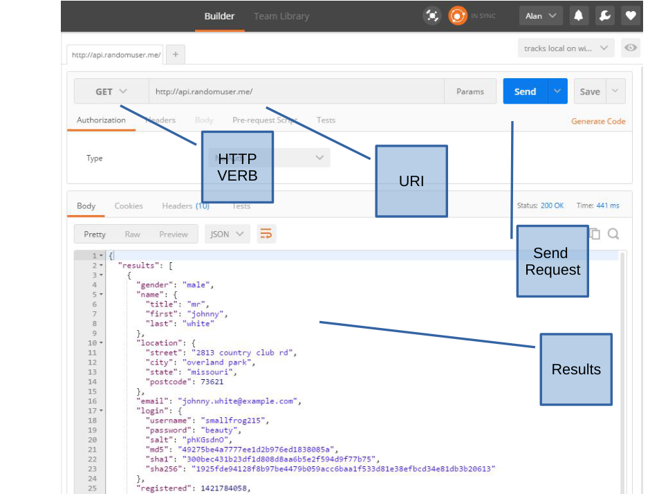

*Figure 9. Original Postman illustration: HTTP method, URI, Send and response content.*

Random user me nationality Great Britain gender female. So this should return a single person who is female from Great Britain. And there we go. I can see the results in here. It's pretty-printed as JSON, which makes it a lot easier. I can see how long the request took. I can see it responded with a 200 code, which is okay. Later on, the response codes are going to be important for us. I can see what headers were sent back. So this is a lot of useful information at a very high level to start working with REST APIs.

If I wanted to, I could control the verb that was put in. Let's post this. I don't think the API supports post. There we go. It's not allowing us to do a post on this endpoint. So it's saying 404 not found. There's a whole bunch of the verbs, but we're at this point going to be focusing on get. Since it's random user, every time I issue this, I get a different set of details. That's the whole point of the random user.

And if you want to get the same one each time, remember to read the documentation for random user.

### 9.5 Exercise and answers: Postman Client

[Watch this chapter in the video](https://www.youtube.com/watch?v=jWwfMo5Ziz0&t=10538s)

**Chapter summary**

- Repeat the browser exercises in Postman.
- Compare XML, JSON, YAML and CSV responses and the available formatting.

**Transcript**

And you'll see how to set up a seed value. So, exercises to help you get used to Postman. What I want you to do is use Postman, which means you're going to have to install Chrome if you haven't already. Get Chrome working. Go off to get Postman.com. Install the Chrome app. Go off to Chrome apps. Start Postman. And then repeat the previous exercises that we did. So the four queries that we set up using get. Then what I want you to do is experiment with the results in different formats.

XML, YAML, CSV. You'll find the information on how to do that on the documentation for the random user API and see how you get on using the API in a REST client. It should be a lot easier. Okay. So let's have a look at the answers in Postman. Now feel free to try different REST clients and perform the same exercises that will allow you to compare the different REST clients. To be honest, my absolute default is generally Postman. But periodically if I'm working in IntelliJ, I'll use the REST client that's in IntelliJ.

It's very basic. But sometimes I just want something quick to fire off. But let's have a look at Postman. So if I didn't already have Postman running after installing it, I go into Chrome, go up to Chrome apps and then start up Postman. So let's have a look at these exercises. So hopefully you find it fairly easy. We're doing the same exercises as before. I've got the get request verb there. I put the host, the path that I want, which is just at the root, the query string with question mark results 10de and send it.

And the benefit here is we've got the pretty-printed response that we can use. And it's important that we've got a pretty-printer in there. It's a lot easier to read and it's easier for it to format. So let's try the XML, JSON, and CSV responses. Let's make sure that's a query string. The API supports different formats.

Let's start with CSV and send that through. Now, CSV is normally going to come back as a file for us. But because we're doing it in a client, we get to see it in here. If we really wanted to, we could copy and paste this out. It's very simple, nice and easy. There's not a lot of formatting we can do on that because it's just CSV. None of the other formats are going to work for us. So, we're either going to use HTML or text.

That's fair enough. The other one that it supports is YAML, which is that Python text type format. Don't particularly like YAML very much. There's no YAML formatter in here. So, again, we're left with one of the text formats, HTML or text. So where it gets really good is when we say for it in JSON which is the default and then we can close these parts and we've got proper view of the data or we could say XML and again we've got the closing we've got the syntax highlighting and it's detected that it's XML for us.

We can tell it is something else, but XML and HTML should work fine for XML. So I can view as text and that will get rid of the formatting. But what the Postman client is good at is detecting the syntax that you're working with pretty-printing it. And if it's a long response, you got the chance to close these things down and read them.

### 9.6 Postman Lessons Learned

[Watch this chapter in the video](https://www.youtube.com/watch?v=jWwfMo5Ziz0&t=10775s)

**Chapter summary**

- The recorded client shares Chrome cookies and proxy settings.
- Check actual transmitted traffic so an existing login does not confuse an authentication test.

**Transcript**

So all in all, that's quite useful. So, I just want to cover a quick Postman lessons learned just in case these bite you in the future as well. I've used Postman quite a lot and I use it for exploratory testing. So, I've got the browser up, I've got Postman up, I'm going through the app as well as the API.

Now because Postman is running in Chrome, it shares this stuff that's in Chrome. So if you've logged into the application under Chrome and you access the API on the same kind of host, so API do random data, it would be the same cookies as random data.com and it can get in a bit of a well, it will share the cookies and if you're not expecting that, you can have the wrong things happen. I was logged into an application. I was testing the API because it was sharing the cookies and I was testing permissions.

I thought there was a problem with the API not honoring the permissions because I wasn't logged in through the API, but I was logged into the application and I got confused. Benefits are when you set up Chrome to use a proxy, Postman will also use that proxy. And that's tends to be how I use Postman. I tend to always use Postman through the proxy because Postman shows us what it thinks it sent as its response, what it thought it used as the URL, but I use a proxy just to double check and to see exactly what request is being sent through and to see exactly what response is coming back, not the nice tidy response that Postman sometimes gives me.

It just gives you that extra level of observability. And also sometimes it's easier to manipulate the request once it's gone through in the proxy and I can resend and change it that way. I can also use Postman to set up the request I want to send through and then I could fuzz it in the proxy. We're going to look at collections and templates later on. Because it's Chrome, it shares cookies and it shares the proxy settings. Use that to your advantage and use a proxy easily with Postman.

But just be aware that if you're logged in the application, you might also be logged into the API and sharing cookies between those two. None of these things are bad. Postman is a very good tool and it's free and it's the main REST tool I use for interacting with the REST APIs.

### 9.7 Example- Playing RestMud without a GUI

[Watch this chapter in the video](https://www.youtube.com/watch?v=jWwfMo5Ziz0&t=10926s)

**Chapter summary**

- Use documented RestMud API routes and GET/POST requests.
- Build a collection of look, move and examine requests as reusable templates.

**Transcript**

Okay, so now I'm going to show you Postman in action using it to play the RestMud text adventure game. Now remember the RestMud text adventure game. You can download it from the CompendiumDev site. We just download the zip file, unzip it in a folder, and we've got the jar file. And we'll do java -jar to start that.

Now, in the readme documentation for RestMud, if I scroll down, I can see that it says there's an API. So, I can do get requests on the API and I can post requests into the API. Now, with REST, we've got a whole bunch of verbs, get, post, put, delete. But what we're going to focus on at the moment are just get and post. Get retrieves information. Post tends to change information. The RestMud doesn't really make that distinction, but it will allow you to explore with the multiple verbs in Postman, and that's why we're using it here.

So if I start up RestMud, I go in the Chrome browser local host 4567 and there is RestMud. Remember one of the gotchas that I mentioned, one of the lessons learned is that Postman will share session state with RestMud. For what we're going to do here. That isn't a problem. So, let me get Postman up. Okay, I'll move that over this side. Not that interested in collections at the moment, but we will be very soon. Okay, so in the GUI, we know that we can issue requests like look, I can do exactly the same request in Postman.

Let me take the whole thing here because Postman is essentially issuing a get request just like the browser does. And off we go. And we'll see the information in HTML format here because that's what we've issued. We've issued a HTML request. We'll get exactly the same information back. What we really want to do is the API call so we can start accessing the JSON. If I wanted to, I could just carry on playing the game with gets in here using the normal get interface that the browser uses.

But we want to drop down to the API and that means using the API path. So here essentially is how RestMud works. The interesting thing about RestMud is we've got the GUI, we've got the rest API. There's a slight difference when the request is put into the application about how it's parsed, but both of the responses, both the processing of those requests is done by exactly the same part of the application, exactly the same verb processing code. Which means that if I do a lot of testing through the REST API, I am pretty much covering the functionality of the application.

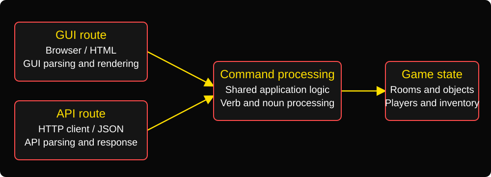

*Figure 10. RestMud routes share command processing and game state.*

Since the REST API is easier to automate than the GUI, that is where I would probably want to expend effort if I wanted to automate this application to support my testing. It would then mean that when I tested the GUI, I would be concentrating on the rendering, the interface between the GUI and the verbs, but not necessarily all the different combinations of data. I can do all the different combinations through the REST API for functionality. I might want to do combinations through the GUI, not to see necessarily how the backend application responds, but just to make sure that the parsing of that request is okay.

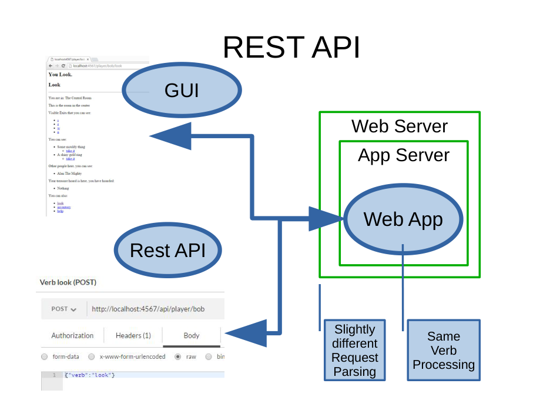

*Figure 11. Original architecture slide distinguishing request parsing from shared verb processing.*

So, here's the documentation from the readme.pdf. So let's use this in our testing. So it's basically API player user verb. Let's see what we've got in Postman. What we want is API slash player user verb. So that should be an API call. Let's see. And there we go. So we've issuing a get request to the API to look. And now we're seeing the JSON comeback. And this is the same JSON that you've been seeing in the console, but now we're interacting with it.

So now I can choose to do things in here. So I could choose to go north. go/north. Now you can see that with the RestMud API, we're not really doing query strings. Everything is in a path, which is much more in keeping with a typical REST interface. And basically it's normally the paths that deal with endpoints then query strings for them.

Now you could argue this is incorrect and the path should be user/go and the query string should be north. But that's not how it's currently been implemented. So if I go north because it says we can go north in the direction. There it says success. You go north. And we can see that there are no destinations listed in here in the output. But we've experienced that when we played the game anyway. So I can go south.

Now the documentation also has the post form and we can see that in order to issue a post request I have to take turn it into a JSON payload. So let's use this as the basic template. So to turn it into a post request I'm going to use the post verb. You can see now that Body is enabled. When I do get body is not enabled because you're not supposed to send through a body when it's a get request. When I do post body will be enabled.

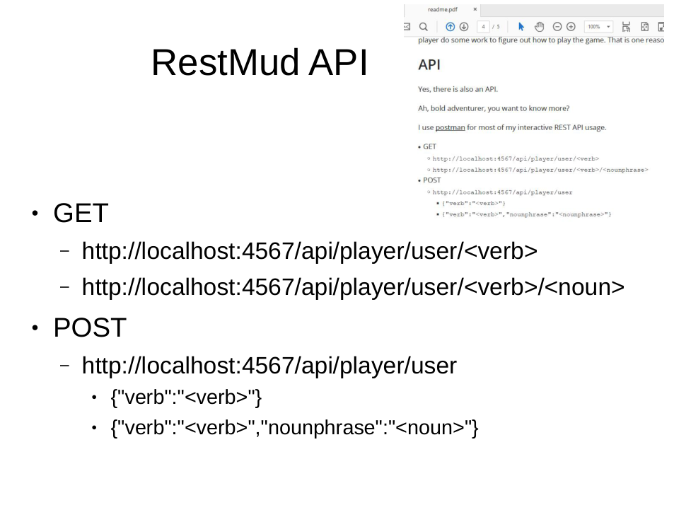

*Figure 12. Original RestMud API slide showing GET routes and POST payloads.*

So then I can paste in the thing that I want and the verb was go and the noun phrase was N for north. Now if I send that, let's see what happens. It says player doesn't know how to go south. Why is that? Because we didn't change the end point. The point about the posts is that it's supposed to be API player/ user API player user then this.

So let's send that. There we go. Let's change this back to pretty print on JSON. Now normally with REST APIs you have to set the application type to represent the body text that you're sending through. RestMud doesn't enforce that at the moment. So I didn't need to do that, but it's good habit to get into to say I'm sending you JSON. Here is the JSON. So I guess the other thing that we should look at here are collections. I'm going to create a new collection for this.

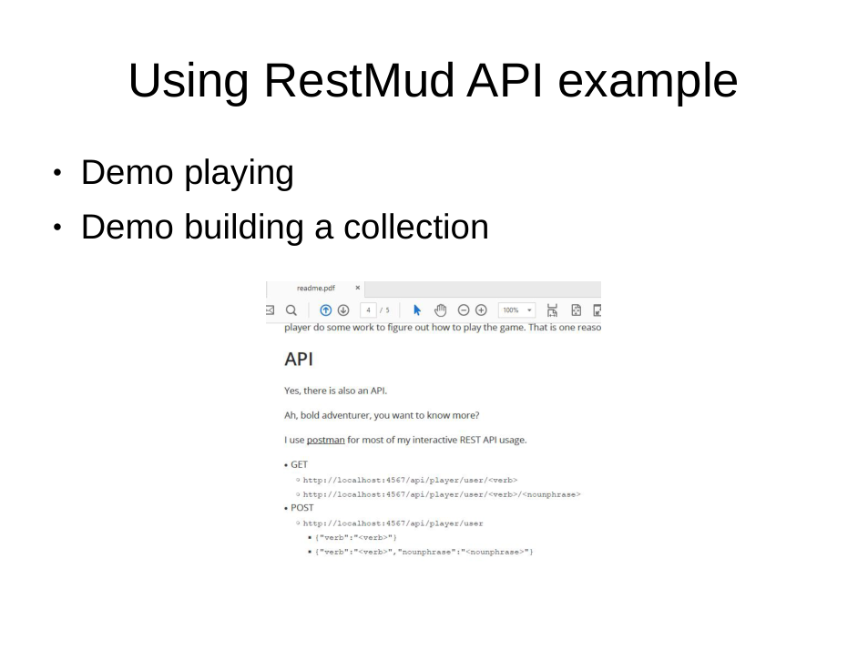

*Figure 13. Original slide introducing RestMud API practice and reusable requests.*

So what I'm going to do is I'm going to save this. If I do save as post go because it's a post and it's making a go request. Now I could say go north, but I'm just going to say go at this point. I'm going to create a new collection. I call it Postman video and save that. So now I've got the Postman video collection. So I'm going to add another one.

So let's see. Let's if I say go south send. There's a sign on the wall hint. So I'm going to say examine hint. Right. And what I'm going to do, examine a hint. Let's send that. You examine the sign wall. I think you go sight in a strong room. What I'm going to do is I'm going to save this and I'm going to do a save as. Otherwise, it will overwrite my existing post. Go. In fact, what I should have done before, so I'm going to say post examine save it to existing collection.

Now, I made a mistake earlier on. So, I'm going to do is I'm going to click on this one. I'm going to say save as, but I'm going to change the name to post go because I forgot to do that last time. Save to existing collection. We've got this old one here. So, let's just delete that. So you can see in my collection now I've got postexamine and post go. What I should really have I guess is a look. But I'm going to make the look a get user/look.

Send that. So now I can look. Let's save this. So I want to save that into the post and video collection. Save. So now you can see I'm building up a collection of requests. So here I can I've just looked I can see that I can go south. So what I'm going to do is I'm going to click on the post go change this to be south and send that. Then we get this. So now what I could do if I really wanted to is save this as a go south, go east, go west.

And I could have go south, go east, go west out here. And it'd be a lot easier to go navigate around. I can look at anytime I want now by just clicking on the look point. And this is the whole point about the collections. Once we've made a request, we save it into a collection and it's acting as a template request. At that point, I can reissue the request exactly or click on it to bring the request up and then amend what is in there and then resend it through.

Postman has a whole bunch of other facilities like environment variables, but we're not going to go into those. You can explore those later as you need them. But get in the habit of creating a collection to allow you to reuse the requests you've got. And if you want to see what you've done, you can go into history and it will show you roughly the kind of request that you've been sending.

### 9.8 Exercise: Play RestMud without a GUI

[Watch this chapter in the video](https://www.youtube.com/watch?v=jWwfMo5Ziz0&t=11542s)

**Chapter summary**

- Play the game through its API and inspect the JSON responses.
- Save useful requests and vary their parameters as the investigation develops.

**Transcript**

So as an exercise, you should have Postman already installed. Now I want you to run your copy of RestMud and use Postman with it. If you haven't got RestMud remember you can just head off to compendiumdev.co.uk/page/restmud. That'll take you here. You can download the zip file. Unzip it. java -jar to start the archive. And then you can access localhost 4567 to play the game. And we want you to experiment with the API and see how you can play the game using that.

And also build up a collection as you play it to make playing the game easier. Use a combination of get, try using the posts, use the pretty print view to understand what you're doing, and over time build a collection to help you.

### 9.9 Postman through a proxy - example using RestMud

[Watch this chapter in the video](https://www.youtube.com/watch?v=jWwfMo5Ziz0&t=11605s)

**Chapter summary**

- Route the client through a proxy and verify a known request.
- Compare the client display with the actual messages and try repeat/edit capabilities.

**Transcript**

So, I'm going to play RestMud again using Postman, but I'm going to go through a proxy this time so we see the difference. So, I'm just going to use the OWASP ZAP proxy. Let's see where the proxy is running. So, the proxy's on localhost 8,000. Let me get Chrome up. So, here's Chrome.

Now, I tend to use FoxyProxy to switch between the proxy settings. So, I'm using FoxyProxy standard. Let's have a quick look at the options there. And I already have Zap set up here on port 8000. If it wasn't here, I could just add new proxy. Localhost 8000, give it a name, a color, and then I'll be good to go. But I've set up Zap on localhost 8000, and it is red.

So, let me choose Zap as my proxy. Let's just double check that it's working. And there we go. That's the request going through. So now if I get Postman up, I've got my collection. I've got a look here. So if I look through here, there we go. There's the request in the proxy get localhost API that was issued by there. So now we can have a proper look at what requests are being sent through. This gives us a little bit more information about what we're doing.

Also means that I can if I wanted to start fuzzing those requests, I could resend them and edit them. And sometimes with some requests in some of the applications you're going to test, this can be an easier way than going back into Postman. So I go, I've just asked for the score that we've got.

Now you can see the difference here. The JSON is not pretty-printed when we come in to the proxy. But I've got more information. Whereas if I was to issue this through Postman, everything is pretty-printed now that I've done a score. I'm just going to save as get score into my collection. It's handy just to build up the collections over time. So there was nothing complicated there about setting Postman up to run through the proxy.

### 9.10 A Little More REST Theory

[Watch this chapter in the video](https://www.youtube.com/watch?v=jWwfMo5Ziz0&t=11783s)

**Chapter summary**

- Read methods and status codes in the context of the API contract.
- Inspect authentication headers, cookies or tokens and confirm what the client sends.

**Transcript**

It was exactly the same as just setting up Chrome to go through the proxy. So just a little bit more theory before we go ahead. You've seen us use get requests. That's what the browser issues that retrieves data. You've seen me use post requests. A post request lets me put some information in the body of the request and send it through. That's because we're often using a post request to create entities using a REST API to insert data in the application.

Very often we'll use a put request to amend data. So if we have already got an entity in there, we'll issue a put request on an endpoint to amend it. And the same if we've got an endpoint, we can issue a delete request to delete that. And you see different APIs implement this in different way. So it's worth reading the documentation for the APIs that you're using. Experiment with a bunch of different APIs because they interpret this in different ways. Expect things to be different in practice when you use it.

But this is in general post to create, get to retrieve, put to update, delete to delete. Now when you issue HTTP requests we get return codes and that lets us know what has happened. So the 100 series the 1xx series is usually informational messages. 2xx are successful. So like 200 messages being okay. 3x is a redirection which means you probably have information in that response telling you where to go to retrieve the information that you need. 4x series is a client error.

It means that you've made a mistake. The 5XX series means that something's gone wrong on the server when processing your request. And you'll see the list of status codes explained on Wikipedia if you want more information. Now, in practice, there's a few status codes you're going to see quite a lot. So, you're going to see 200, which means okay, everything was good. 201 means in response to your request, something was created. So very often after put issuing a post 204 means we dealt with your request successfully but we're not really telling you anything.

So that might be after a put or a delete with the 400 telling you if you've done something wrong. 400 basically means something you did something wrong. I can't even tell you what it was. 401 means you're unauthorized. Chances are you might have to use a Basic Authentication header or you haven't got a cookie installed to let you authenticate on the system. 403 means forbidden means that we know that you're authorized to access this system, but you're not access authorized to access this part of the system.

And 404 means you tried to access something that we just couldn't find. And the 500 errors are when you've sent a request and the server can't handle it. So a 500 basically means you've blown up the server. It doesn't know what to do. 501 means the action wasn't implemented. You tried to get me to do something, but that's not implemented. I know I should. Sometimes with an API, that means it was in the documentation, but they haven't implemented that. You might see that during development. 504 usually means that something is timed out.

And if you see a status code you don't know in Postman, if you hover over the status codes, it will usually tell you what it means. which is quite useful. Now, we already mentioned authorization. The most typical way of using authorization is through an authorization header and very often a Basic Auth header. Sometimes APIs are as simple as this. Sometimes it's a cookie. You log in, you get a cookie, you use that in your requests. Sometimes it's a token that you have to put in a custom header.

But again, the API documentation will tell you what you have to do. If it is Basic Auth, it's basically a authorization header. It has the word basic and it has the username and password encoded. The value after Basic contains username:password, Base64 encoded. So let's give you an example of that. So if I go in here, this is just normal get request.

Now, RestMud doesn't require Basic Authorization, but it won't complain either. So, if I go into the authorization tab here, set up for Basic Auth. Type in the username. Put in a password. Just double check. Yep. Username, password, and then I do update request. You see it just added a header. So in the header I've got Basic, followed by the encoded value which is what we had in the slides. So now if I send that request through because I've got the proxy running click on this request we can see that the request has the authorization header exactly as we specified.

So if I needed to be authenticated on the application and there are versions of RestMud where you have to do this just not publicly available then this would allow me to log in to the application. This is the simplest way of logging in but again the API documentation that you use will tell you what you have to set up.

### 9.11 Sample REST APIs to practice on

[Watch this chapter in the video](https://www.youtube.com/watch?v=jWwfMo5Ziz0&t=12113s)

**Chapter summary**

- Move beyond permissive demonstrations to applications with richer state and permissions.
- The recording suggests Redmine and Tracks as further practice systems.

**Transcript**

This was just a little theory section to be aware of some of the options. So both the examples we've given you early on are nice and easy. RestMud doesn't really care very much whether it's a get or a post. It doesn't enforce a lot of things. You don't have a lot of headers to work with. So it's very easy to just get up to speed. Use rest with Postman and make things happen. The random data API is just a get interface.

So again, it's very easy to get started with. What you want to do is start testing some real apps. So the apps I'm going to recommend to you are both open- source. Tracks and Redmine. Redmine is a project management system. You can find all the information on Redmine.org. I recommend you run it from one of the pre-built virtual machines either from TurnKey Linux or from Bitnami. Either of those should work in VirtualBox or VMware. What I tend to do is I'll download the TurnKey and I'll download Bitnami and whichever one of the VMs works first is the one that I will use because essentially I'm just downloading something to test it and disposable with.

The Redmine API is quite fun to get your head around. It's fairly well documented. And the Tracks is a essentially a to-do list using the getting things done methodology. And again, you can get pre-built virtual machines from Bitnami or TurnKey Linux. So, if you want systems to get started with that offer you the complexity of a real API with authentication with real errors, redirects, the Tracks and Redmine are worth having a look at.

## 10. Testing JavaScript from the Browser Console

**Section summary**

- Trace interface actions to application functions and model objects.
- Use console code to inspect state, prepare data and repeat operations.
- Account for changing collections and the scope of helper variables.
- Keep timer handles so repeated actions can be stopped.
- Save useful snippets outside the browser as well as within it.

### 10.1 Testing JavaScript from the Browser Dev Tools Console

[Watch this chapter in the video](https://www.youtube.com/watch?v=jWwfMo5Ziz0&t=12218s)

**Chapter summary**

- Use the console to automate repeated actions and manipulate application state.
- Learn the code beneath the interface so those actions support an informed investigation.

**Transcript**

Okay, this is such a fun section. We are going to learn how to use JavaScript console to automate and manipulate the application we're testing. Right? You gain so much power when you can write a few lines of code in the console and make a massive impact on your application. As you do so, you're going to learn how your application works. And I hope you never underestimate how important it is to know the technology behind your application and know it better and better so you can work at much lower level.

Right? We're going to learn simple JavaScript. We're going to learn how to use the Chrome developer consoles. We're going to learn how to automate a lot with a little. We're going to learn how to understand your JavaScript application. We essentially were going to open up an entire new world of opportunities for you with your testing. And what you're seeing on screen now is not the normal functionality of the application. I've automated this. It doesn't normally generate a slogan every 10 seconds.

I've automated this in the dev console using the techniques that you're going to find in this section. Right? You're going to be able to do things that the application can't do. And probably should never be able to do possibly. But we have to learn how to control this so that we don't impact the application in a bad way. But we can give ourselves more opportunities when we test by learning what we do in this section.

### 10.2 The Evil Tester Sloganizer Application Overview

[Watch this chapter in the video](https://www.youtube.com/watch?v=jWwfMo5Ziz0&t=12326s)

**Chapter summary**

- Trace the Sloganizer button to its event handler and JavaScript source.
- Use autocomplete, history and the console to call the underlying function.

**Transcript**

This would be so much fun. I hope you enjoy it. So this is an application called the Evil Tester Sloganizer and we're going to use this in order to learn how to manipulate and interact with JavaScript applications without using the GUI. We're going to use the dev tools and the consoles to work with JavaScript apps. And this is a JavaScript app. It's pretty simple. We have a button. We click it, it randomly generates a new slogan and it does all this through JavaScript.

So how does it work? Well, let's have a look at this button because in terms of the GUI, this is the most important part. So let's inspect this. I'm just going to dock the console at the side here. So what we basically have is we have a button and we can see here there's an on click event which triggers the change slogan JavaScript function.

Now that's pretty simple. This is a pretty simple app. Sometimes when you look at web elements it's not going to be obvious what JavaScript it executes. So very often we have to with more complicated apps go over here and look at the event listeners and see which event listeners have code. Sometimes it's not going to be on the element we think it is. So we might have to jump up the HTML until we get to the point where the event listener is.

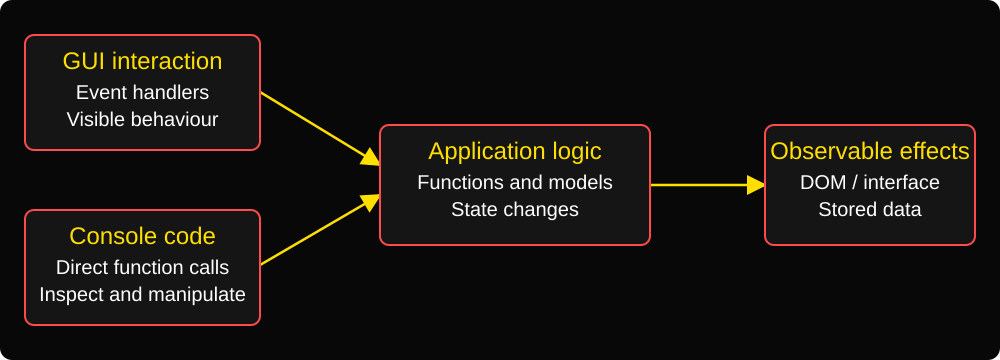

*Figure 14. GUI events and console calls provide entry points into application logic.*

But in this case it's actually on this event and it's actually in this code. Now in the event listeners part you can see that we've got a link and if we click this we will see the code in the sources view. Now I've just clicked on that and we haven't seen it. Why is this? Well sometimes I find that we have to refresh the URL in order for the parts in here to work. This is quite annoying when we're using the console, but sometimes that happens.

The JavaScript console you can see down here. The JavaScript console has a tab of its own, but it's also available in any other tab. And the way we gain access to it in any other tab is by hitting the escape button. That'll make it appear and go away in any of these tabs. And it's very handy to be able to work with JavaScript anywhere here. So this code basically says run the changeSlogan function. What is the changeSlogan function? Well, we don't know yet.

We haven't looked at it, but it's JavaScript. So I can come down to the JavaScript console and I can type change slogan. You can see that we've got the autocompletion here. So it's highlighted change slogan. I can hit tab. I just put in the brackets here that say call the function and it will call it and it changed the slogan. If I miss out the brackets, the console says that's a function. I already know it's a function. I want to execute it.

So, I put the brackets in. Now, when I use the up and down keys in the console, it's going back through the history of commands I've typed. You saw when we did the autocompletion, we've got the command that it's matched in the DOM. This is the one that it knows about. And these ones are ones that we have used. So these are ones that might have inaccurate values if we've been experimenting. This is the one that it knows about with the console.

We can clear it like that. And we can clear the console history. And now it's only going to show us the stuff that we can autocomplete. So all of that is basically saying I can execute the Evil Tester Sloganizer just by implementing the JavaScript. What I'm finding interesting here is that the button has disappeared. Not sure why that happened. I wasn't paying enough attention. Maybe I deleted something. But essentially we can interact with JavaScript applications from the console.

### 10.3 Exercise: The Evil Tester Sloganizer Application Overview

[Watch this chapter in the video](https://www.youtube.com/watch?v=jWwfMo5Ziz0&t=12589s)

**Chapter summary**

- Inspect the button, listeners and source in the recorded Sloganizer version.
- Try the same action from the console before moving to more complex examples.

**Transcript**

This is very useful. This opens up an entire new approach when we want to automate applications. So, as an exercise, I just want you to head off to this application eviltester.com/apps/sloganizer/version1/sloganizer.html. Because this is a live app, Sloganizer might change over time, but this version one link will always point to this version one. With this code that you're seeing in this video, I want you to inspect the button so they get used to using the inspect. Have a look at the event listers, explore, have a look at the source itself, and just see what you can make of this.

And also try using the console to trigger the changeSlogan function. And after you've done all that, come back, we'll learn some more stuff.

### 10.4 JavaScript Functions and Objects

[Watch this chapter in the video](https://www.youtube.com/watch?v=jWwfMo5Ziz0&t=12665s)

**Chapter summary**

- Inspect objects, arrays, properties and function definitions.
- Distinguish reading an object from invoking a function with arguments.

**Transcript**

And the plan here is not to teach you an awful lot of JavaScript. The plan here is to help you get familiar with JavaScript, to understand how you can interact with it from the console, and to know just enough JavaScript to be dangerous. So that's what we're going to work on now. We're going to look at the source.

Now this is the source code for the page. It's all pretty simple. Then at the bottom here in the script tag, you can see the actual JavaScript source code. Now this might look complicated, but it isn't really. It's actually pretty simple when we understand it. Basically, what we have here are some objects. Here's one of the objects, phrases. Here's another object, sentences. And we've got a bunch of functions. So objects are things that we act on, data, stuff that's stored, stuff that functions use to make stuff happen.

So we call functions to make things happen. When we click on the I want a slogan button, it calls the change slogan function which generates a random sentence, then makes some changes in the page and that's it. Stuff happens when we call JavaScript functions. So let's have a quick look at objects first. We've got two main objects in this. We've got phrases and sentences. You can see here phrases is an object which has all these name value properties. So we've got a property called start which has a value which is an array.

Now these things will make sense in a couple of minutes. And sentences is an array and it's an array of strings. And these strings are templates that the functions process in order to randomly generate things. So let's have a look at the console and see what the console tells us about these things. So if I type in phrases, you can see it was autocompleting there. Phrases is one of the objects that we saw in the source. Phrases is an object that we can access in the console.

This is interactive. I can open this up. I can see all the names and the name value property pairs listed in here. I can expand these and I'll see the array with the values in it. So this is the I am value. There's I am. It's an array. It's an array with two items. Two items. First one is I'm which is a string. And the second one is I am, which is I am. And you can see that arrays in JavaScript are zero indexed.

So zero is the first item in the array. We'll look at how to access those in a little bit more detail later. So the functions are pretty simple. Functions start with function. That's how we know it's a function. Then we have the name of the function. And we can see that this function randomNumberUpTo takes a single argument. And then in the body of the function, it does some stuff with the math library and returns a value that it calculates. Because this is a function and it's at the highest level in the code, we can access it from the console.

So I can type random and then it starts to autocomplete the functions it knows about. We've got randomNumberUpTo and random sentence. We want to choose randomNumberUpTo. I can click on this or just hit tab. And I want to call this, but remember it takes an argument. So I'm going to say randomNumberUpTo four. So it's generated zero. I'm going to call it again. And I'm bringing the code back by hitting the up arrow to go back through the history. It's randomly generated one.

Randomly generated one. Random generated two. So I'm testing now this function called randomNumberUpTo by continuing to use it.

### 10.5 Exercise: JavaScript Functions and Objects

[Watch this chapter in the video](https://www.youtube.com/watch?v=jWwfMo5Ziz0&t=12945s)

**Chapter summary**

- Read the source and identify which names and parameters can be used in the console.
- Investigate unfamiliar JavaScript concepts through small experiments.

**Transcript**

So we can interact with and test the JavaScript at a lower level than the GUI. So, what I want you to do now is look at the source for the Sloganizer and see how much of it you understand. Just scan through this, have a look, see what makes sense, see what doesn't. If you want, you can start doing Google searches to investigate this.

Remember, this is an object, this is an array, this is a function. Look those things up in JavaScript. See what you learn. You can type the names of the objects into the console. Just start exploring. Do the things we're doing here. Type the objects in. Use the autocomplete. See what it tells you.

Now remember, when it's an object, we don't need the brackets. When it's a function, we need the brackets. Have a look through the code and run some of the functions. See if you can figure out what arguments to pass in to these functions to make them run. Some of these are very simple functions. Some of them are a bit more complicated and use other functions in the codebase. So, you might want to start with the more primitive functions and see how they work.

Make sure you use the autocomplete. Make sure you use the history to reuse functions that you've already typed in. And just generally have a play with the code. Have a play with some of the functions and get used to exploring and using the console. Remember, if you want to, you can do all this in the console tab directly, but since you're working with the source, you probably want to be in the source tabs and have the console open at the bottom of the source.

And remember pressing escape will show and hide the console.

### 10.6 JavaScript Loops and Console Output

[Watch this chapter in the video](https://www.youtube.com/watch?v=jWwfMo5Ziz0&t=13047s)

**Chapter summary**

- Use loops and console output to repeat an operation and inspect every result.
- Explore array indexing and object properties, including deliberate data changes.

**Transcript**

So we use the console to interact with the application. That basically means we can call functions and we can change variables. Now, the hardest part about interacting with the application is knowing which functions to call. We have it fairly easy in this app. It's all pretty obvious. Every function that you see listed because it's at the top of the source. It's basically just attached to the window. We can just call it. We have utility functions like randomNumberUpTo and getRandomValueFromArray. These just work with normal JavaScript objects.

They don't really they could be in any app essentially. They're just utility apps. Then we have application functions like getSentence, expand_text. This is kind of the core of the entire application. We've got utility function, capitalizeFirstLetter, remove spaces. We've got process_sentence. This is an application function. Any of the application functions are entry points into the application and help us work with what we would consider testing. The utility functions are things we might want to test to make sure that there's nothing important going wrong in the background.

The utility functions are harder to test in the application. The application functions are the ones that act as input points that help us essentially bypass the GUI. So let's take for an example the randomNumberUpTo. If I wanted to make sure that the randomNumberUpTo function actually worked, I can call it from the console. You've seen this already. Random number up to 10. So, it's any number from 0 to 9. And I can keep going. Every time I run this, it's random. But I don't want to have to keep hitting up all the time.

I want to use the console for more important stuff than that. So, we're going to learn a little bit of JavaScript to help us do that. And two really important functions or JavaScript concepts that you're going to use a lot are for loops and console.log. Console.log lets us write things to the console. So, I've just written console.log hello world and it's printed hello world at the console. And the reason we've got undefined here is that the console.log function when we called it didn't return a value so it just said undefined.

Now I can do console.log and print variables or objects. So the console.log has printed the object. So it's essentially the same as typing phrases. Hello world is a string essentially the same as typing it from console.log. A for loop allows us to run some code multiple times. So if I run this, this basically says for create a variable called x set it to one whilst x is less than 100 then do console.log hello then increment x and the console.log statement basically says print out hello followed by the variable x.

So if I run this, I should see hello 1, hello 2, hello 3, hello 4, etc. coming through down here. All these things have been printed out by that single statement. Now, when you're typing these statements in, it's worth being aware that if you try and enter this at the console like this, start typing it in one line at a time, you will get a syntax error because JavaScript is trying to process this as it comes through. So you have to either type it in essentially one long line like this or type it into an editor and paste in.

There's some tools I like to use when I'm doing this. I mean I'll use a text editor. I'll type in the JavaScript there. Some things you might want to consider using JS Beautifier which allows us to type code in. Then if I hit beautify, it will format it nicely for me. JS Compress. So I might take the pretty output here which is very readable and I work with and I stick in my notebook and I track when I'm writing my code.

I put in JS compress and then I've got something that I can easily paste into the console. And you can see that JS Compress actually removed the braces because they're not required in this case. What you'll find is that if you learn a little bit of JavaScript and you pay attention to what the tools do for you and tell you, you will learn a little bit more about the formatting that JavaScript uses. Because sometimes you'll see me use semicolons when I'm typing it into the console.

Sometimes I won't. Essentially, if it's a single statement like this, I don't need a semicolon at the end. I can add a semicolon and it won't make much difference. I tend to add semicolons a lot, but you can see here in my code I haven't added a semicolon in here. Normally I would. So that I that's a mistake that I've added, but JavaScript doesn't really care and doesn't really mind. So when you see semicolon, sometimes semicolon's not. Sometimes they're important, sometimes they're not.

You JavaScript will tell you when they are important. So instead of just writing console.log, log. I could actually call the function that we want to test. So I could say randomNumberUpTo let's say I say three in here. And this will call the randomNumberUpTo three 99 times. Oh, so it did, but we've only got one output. So, it's only returned the last thing that we called. And that's because what we really want to do is stick in a console.log and each time we go through the loop log out the result of calling the randomNumberUpTo three function, which it has done.

Now, you see all these three two things at the side. That's basically saying the number two was written to the console twice, but I'm only going to show you it once to not clutter up the console. This is handy when JavaScript starts kicking out errors and you'll see a single error here with the number increasing as the error report comes through rather than your console just getting swamped with errors. So this is a feature, not a bug, not a problem.

So let's have a look at some of these objects. So the sentences object is an array. If I do type of sentences, then it's just going to come back with object. But I know it's an array because it's got the square brackets. And because it's an array, arrays in JavaScript have specific ways of interacting with them. So I can access the first sentence in this array by saying sentences indexed at zero. I could get the next one sentences indexed at one.

I could get the length of sentences by saying sentences.length. Now you see that sentences is a JavaScript object. So it has a whole bunch of functions associated with it. You can look those up in the JavaScript references to see what they do. You will probably use some of them. The more that you get into automating and coding from the console, the more you get into coding JavaScript, the more you use this. But for our purposes, to start with, all we really probably need to know is how to index an array, how to access things in the array.

Now, if I try and access something outside the array, it's given me undefined. That's because there's nothing in the array at that point. Because sentences has a maximum length of 21 because their array indexed at zero. The last one in the array is actually 20 or sentences.length minus one. There we go. Now, because this is an object, I can actually amend it.

So, let's see. Sentences zero is currently this sentence. I could say sentences 0 equals Bob. There we go. Bob. So now if I see what sentences zero actually contains. So I've changed the data that's in the running application. This is when we start manipulating the application. We can change the data that's in there. I can change the values in the array. I can change the values that are in object properties. I can change things and then when I start using functions, they will use the values that we've put in these objects.

So we have another object in here called phrases. It's an object. It's a bunch of properties. Each of those properties contains an array. So I could say, let's get phrases up in the code so you can see this. Start is the first one here. So I can say just like an array we can access the values that are in there. I can do this through the names of the name value pairs. So I can say phrases.start and that will give me the array that's associated with star.

I can also use a dot notation. So I can say phrases.start and we get the same thing. And if I wanted I could change that. I could change the array that's in there for the start. But now you know how to access objects that are in an array, access fields, access the named properties in objects. Some objects will have functions. You access them in the same way. If there was a start function, I would access it like this. We haven't got a start function.

This would cause an error. But if there was a function in the object, that would be able to call it. In fact, any functions that are in objects, you can see it here. This is the phrases object under proto proto. This is the prototype. So there's actually a get on the object. I could use that if I wanted if I knew what that did. So next we're going to take all that knowledge and actually use it to interact with the Sloganizer.

So if you want to feel free to play around with the arrays, the array indexing, the phrases, but we're going to do all that in context in just a minute.

### 10.7 Example of Interacting with Evil Tester Sloganizer

[Watch this chapter in the video](https://www.youtube.com/watch?v=jWwfMo5Ziz0&t=13711s)

**Chapter summary**

- Call lower-level functions to focus on a particular sentence template.
- Reload the application when temporary changes to its in-memory data need to be discarded.

**Transcript**

We now have enough JavaScript knowledge to be dangerous when we interact with this Sloganizer. So if we have a look here at the code for random_sentence, we can see that this is a small function. It creates a variable. That's what the var is. V sentence means create a variable called sentence which is going to store the result of calling the getSentence function and the getSentence function basically selects a random_sentence from the sentences array. Then we're going to call the process_sentence function which you can see above with the sentence that we just randomly generated and we're going to return that value.

We could do that independently. We could do that from the console. So instead of calling getSentence to generate a random_sentence, we could choose one of the sentences from the array and call process_sentence directly. Or we could even make up our own sentence and call process_sentence. So if I do process_sentence and use autocomplete to our advantage, I'm going to say from the sentences array.

Now if I did this, if I didn't close my statement sentences zero, I have a tendency when I'm writing code to automatically close the brackets as I go through so that I don't have any syntax errors at the end, but then I lose the ability to do autocomplete. I'm used to working in an IDE rather than the console. So code I've just written process_sentence call process_sentence function with the first item in the sentences array which is Bob because we changed that in one of the previous videos.

Remember we said sentences equals Bob. Now if you do this if you discover that your interaction you've changed the app all you have to do is reload the app. That stuff that I put in the console is still there. So now process_sentence sentences zero is running the process_sentence function with the template that is in sentences zero. So it's basically instantiated this with the random values. This allows us to start focusing in on particular sentence templates. If I do just changeSlogan, it's going to use any of the sentences.

And I don't know if there's a bug in one of the sentences or not, but I can specifically test one of the templates by using process_sentence on each of the sentence templates.

### 10.8 Exercise: Interact with Evil Tester Sloganizer

[Watch this chapter in the video](https://www.youtube.com/watch?v=jWwfMo5Ziz0&t=13883s)

**Chapter summary**

- Generate template variations and investigate text-cleanup functions.
- Choose concrete strings and inspect results rather than only repeat the GUI action.

**Transcript**

So, as an exercise for you, build on this. Use a for loop to generate 100 variations of sentence zero by calling process_sentence from within a for loop. Do what we just saw here. Amend the value of sentence zero to be Bob and try running that through your for loop. refresh the page to make sure you get rid of your changes. Call the removeSpacesAtStart function with a string. Make sure it works to your satisfaction. Call the removeSpacesBeforePunctuation function with a sentence.

Now, you'll have to create a sentence that has punctuation and spaces in it and make sure it works. Just experiment with the functions that are in here. And to really make sure that this application works, call random_sentence from within a loop and generate 1,000 random sentences. Let's see how you do.

### 10.9 Answers: Interact with Evil Tester Sloganizer

[Watch this chapter in the video](https://www.youtube.com/watch?v=jWwfMo5Ziz0&t=13986s)

**Chapter summary**

- Build and verify a single operation before wrapping it in a loop.
- Inspect outputs and restore modified test data before interpreting later results.

**Transcript**

Since this is one of the later exercises, we're going to show you the answers for this. So, I'm just going to clear this out here. And I'm going to clear out my history. So, now it's it's clean. So, how do we use a for loop to generate 100 variations of sentence zero? Well, what I want to do is process_sentence for sentences zero. And what I tend to do is I tend to do each of the parts of the statement individually to make sure they work.

So, that generated a sentence. So, now that I know that that works, I'm going to wrap it in a loop. So for var x where x is less than 100, let's set var x to be zero. Then increment x. So create a variable started at zero. Whilst X is less than 100, call the process_sentence on the first sentence template, then increment X. So this should give me 100 sentences. Oh, it doesn't because we didn't console.log it. There we go. So now I've created 100 variations of that sentence, which is a useful thing for me to test.

I haven't unit tested this application. So the only way that I'm really going to test this is by creating lots of variations and hope that it doesn't actually break. So sentence zero equals Bob. Then run the sentence, run the loop again. And we've got 100 instances of Bob which has been capitalized because that's part of the process_sentence code. Process sentence up here says expand the text, generate the random stuff, remove spaces, remove spaces, remove spaces, then capitalize the first letter, then return it.

So let's have a look at this. Remove spaces at start. So hopefully you pass in a string. I'm going to pass in hello. And it's removed the spaces at the start. Let's try it with more spaces. Hello. And less spaces. Hello. So let's removeSpacesBeforePunctuation. So hello dot this works question mark. Let's see what it might work if we don't call remove spaces start and we instead call removeSpacesBeforePunctuation.

Now I'm just going to harness the power of autocomplete by copy and pasting. Hello. This works before punctuation. Now I can see in here that only a very small subset of punctuation is handled. Full stops, commas, exclamation mark, and question marks. So that's all I'm going to put in the test. If I do remove spaces, this works. I'll call that punctuation mark. There's no Why does that work? So, it didn't actually work. It's just cut down some spaces. Didn't expect that to do anything.

Might be a bug there. Who knows? Let's try a different set of punctuation or symbols. Cool. So, I suspect that something's trimming out some spaces that I wasn't expecting. So, there might be a bug in there, but it's a useful bug, so I don't mind. Now, I've already got hopefully a for loop in my buffer. There we go. So one of the actions here is to create a for loop of a thousand and then generate with random_sentence. So if I say this is the problem with editing in the console if you hit up and down it will go away.

That's one of the reasons why I tend to do most of this in an editor and copy paste in. So let's see there we go. So this is random_sentence is pretty much at the top level of this change slogan calls random_sentence then amends the DOM random_sentence then is the first high-level function which does the same as the application but works under the GUI. So I have essentially called this a thousand times.

Now, we can see quite usefully that Bob is still in there as a sentence. So, I haven't actually tested the app. So, let me refresh that to get rid of Bob. And then we should see no Bob's in there, which hopefully means no repeated sentences because it's supposed to be random. And the whole aim is when someone clicks a button, they see a different random_sentence. So, that's okay. I'm not going to read through all those, but if I was testing this, I probably would have to just to make sure it's good enough.

### 10.10 TodoMVC JavaScript Application Overview

[Watch this chapter in the video](https://www.youtube.com/watch?v=jWwfMo5Ziz0&t=14363s)

**Chapter summary**

- Exercise TodoMVC through the GUI, then locate its models, collections and views.
- Use application objects to discover useful entry points beneath interface events.

**Transcript**

So hopefully that's similar to how you did the exercises. So we're going to look at a slightly more complicated application now. Now in theory, this isn't a complicated application. What makes it complicated is that we're using a JavaScript framework and that makes the code harder to understand. So the JavaScript framework is Backbone. I don't really know Backbone. If I was testing this as a proper application, I would go off to Backbone. I would understand the documentation. I would speak to the development team that we're working with to understand how this application works.

But I'm not working on a project. I've picked an example application. This is from the TodoMVC site. TodoMVC is a very simple application which is implemented in a lot of different frameworks, a lot of different JavaScript frameworks so that people can see how easy it is to use the framework. What I like to use it for is to see how hard it is to test these different frameworks. So what we're looking at here is the TodoMVC application written in Backbone. TodoMVC application is very simple.

What we can do is we can create an app create a to-do. I can delete to-dos. I can toggle to-dos as completed or not. I can filter them and I can delete those that I have completed. So it's a very simple application. Everything is stored in local storage. So if I go away, come back, everything will be here. I can also amend them.

Let's say so to do one do two. So what we're going to do is we're going to look at this application and figure out how could we use the console to support us if we were testing this. So we've used the app. We understand its basic functionality. The next thing we're going to do is look at the code because I don't know this application. And I don't understand it. So, we're going to look at the code just by getting the development tools up.

F12 or right-click do inspect to get the information up. And what I'm interested in are the sources. This is a JavaScript app. It's using a whole bunch of node modules which are common to a whole bunch of different applications. So, I'm not really concerned about this. I think the application code is going to be in here in the JavaScript part of the Backbone examples.

Now, it's an MVC application. So, I can see we've got views. These are essentially what is displayed on the screen. We've got models. These are essentially the domain objects. So, I can see there's a to-do object. That's quite important. We've got collections of stuff. Now, these are usually filled with instantiated model objects, which is quite useful to understand. And we've got the router which probably controls what we click on, what happens where.

Now, because it's a Backbone application, it's a little bit harder to understand. If I look at the to-do in here and look at the event listeners, we can see there are no event listeners on here. Remember previously, if I go up the chain, I can see that the event listeners are a little bit higher up. So, I've got a click event listener on the to-do there or on the on the list. But sometimes it might be a little bit understand hard to understand what is triggered from where.

There's certainly no onvent do X here. So, this is all added after the fact. So, I start by using the application to see where its features are and looking in the code to see if there's any clues for what's going on. Now, just picking one of these files at random, which is the todo.js which is in the models. So this is what a to-do is represented by and it's a function which is essentially a class in JavaScript and I can see that there's a global variable called app that might give me some good insights into this application.

So at the console I'm going to type app and I can see that there's an object instantiated and it's got a thing called to-dos. And to-dos is an object with the actual to-dos in it. The two to-dos that I created are in here. So I think this to-dos is the collection. Yep. app.todos is this to-dos collection. And we've got the global app. So that's good. We've learned a little bit about the application and we know that we can access it.

Now, if you're looking through application code trying to figure out how it works, one of the things to look for are where new is used, the keyword new instantiates a new instance of this class or in JavaScript this function which is a set of properties which essentially represents a class with methods and fields. So, this app.todos is instantiated with something. So this to-dos would have these methods on it. So presumably todos has a completed function on it. We can see completed here.

We know that to-dos is an instantiation of this function. So I should be able to type app.todos.completed() and it's a function and it's an empty array because none of these are completed. If I complete one manually, then type this again, we can see that there's one child in there. So, we're starting to understand how this application works. And as you get used to this, you will start to understand how JavaScript applications fit together, how we instantiate new functions or objects and store them into variables so that we can access them later.

But for our purpose here, app is a useful start point. To-dos is the collection. So we'll be accessing that quite a lot when we want to create new to-dos, delete them, things like that. So if I was testing this application, I would want to know how to create to-dos, how to select them on the GUI to toggle them between completed and not completed, to delete them, and how to amend them. That would be my basic things. How can I create them, read them, access them, delete them, and amend them.

If I can do that, then I can create a lot of data. It'd be nice. I can test this app and I can create a couple of to-dos, but I'm never going to sit here and create a thousand to-dos and see how the application handles it. I'm never going to sit here and click through and complete 75 to-dos to see if clear completed will work with that many. I'm never going to do those kind of test functions at the GUI because it's going to take too long or if I do do it, it's going to take take me a day just to do a single task.

### 10.11 TodoMVC Application CRUD

[Watch this chapter in the video](https://www.youtube.com/watch?v=jWwfMo5Ziz0&t=14792s)

**Chapter summary**

- Discover create, read, update, toggle and delete operations from the application source.
- Reuse those operations to prepare and change test data.

**Transcript**

I want to be more efficient. So, I want to use the console to help me. And that's what we're going to learn how to do in the next couple of videos. So, knowing the high-level objects means that we can start working with this. We are now going to try and figure out how to create new to-dos. How to select them on the GUI so that we switch them from completed to not completed. Going to figure out how to delete them and to figure out how to amend them.

That will give us the basic building blocks to support our testing. So, I don't really know how a new to-do is created. So if I just right-click on the files here and do a search for create, let's see what we get. So there's a good there's a match here in app view. Let's have a look at this. This is basically saying so on the GUI if we create if we hit the enter key in here which is saying this if we hit the enter key then we're going to do app todos.create create and pass in a set of new attributes.

So if I want to create a new to-do, I have to call this this I don't know. So this new attributes is here. And this is basically saying the new attributes function will return a essentially an object or a properties set which has a title, an order and completed is set to false. So I could do that from the command line. I can type app.todos.create and I can create the object with a title. Whoops. Let me call it to-do 3. And I can use the app.todos next order.

Just put that in here. And I can set completed to false. Essentially what I'm doing is I'm just reusing the code that's in the application to help me test it because I want when I'm doing this at the console I want to replicate as much as possible what the GUI is doing. This is what we've seen from the code. So hopefully if I do this we get a syntax error and that's because I missed out the order property name. There we go.

We created a new to-do. So, I would now copy this, paste it into my notes so that I knew how to create a to-do whenever I wanted to at the console. Now, clearly, it's a lot easier for me if I just want to create a single to-do up here. But, if I want to create a thousand of them, all I have to do is wrap this in a for loop, and then I should be able to create a thousand to-dos. And guess what?

That's going to be one of the exercises. So if I want to make it completed, click on this. I think because that's happening on a single to-do, it's probably going to be contained in this model. Let's have a look at model here. So model I can see has a toggle function that sets it to completed. And this toggle function is on the to-do class. We already have access to the to-dos.

So let's have a look. So if I do app.todos and that's in the models, models is an array. So if I say models zero let's see which one that is undefined. If I do get, so we can see that this models is the to-do one. And you've just seen a new function here, the get function. We saw that earlier on one of the prototype methods. And that basically lets me get the property with that name. So we've done that here to get the name of the to-do.

So I know which one I'm expecting to see toggled when I call this toggle function. And that's right. That's what we expected. So if I do that again, then it goes back. So I can switch between completed and not completed by calling this toggle function. Now, if I had managed to create a thousand to-dos from the console and then I created another loop to set half of them to completed, then testing this clear completed function would have a little bit more weight to it.

So, I can use the console to set data up and put it into the right state to make my testing more meaningful. So, how do we delete them? That's what we want to figure out. Now, now I remember in the app view there was a clear completed function. Now, this JavaScript here is a little bit strange. We haven't seen this before, but I think what this basically saying is for the array that is returned when we call the completed function on each of the items in that array, call the destroy method.

And that would suggest that each one of these to-dos has a destroy method. Great. So, we've deleted that first item using the destroy method. The destroy method isn't obvious here, but it must be coming probably from this Backbone model function. I don't know. Doesn't really matter to us. What we're doing is we're trying because I don't know Backbone so I don't really know how this hangs together but what I'm doing is I'm looking at the JavaScript that I've got access to and seeing how I can use the information here to support what I have to do.

So I can now destroy them. I can create a to-do. I can toggle them from completed to not completed and I can delete them. Now essentially when I'm doing that destroy I'm simulating clicking this button. The next thing I have to figure out how to do is amend them. So how do we amend them? So the clue for this is here. So in the to-do which is the model level or domain level, the toggle command is actually saving with a new set of properties.

So I suspect if I do save with a new title, which is the name that we're putting in, then I think this will work. So if I do app.todos then save. So then I want to put the object in here. So I will just put title. I'll give it a completely new title. I'll call it Bob because that's what we do. And there it is. So I've amended that to do to be to have a new title. And if I want to amend the title, what I'm going to have to do is instead of putting in a string literal, I'm going to use the existing one.

So I'll say app.todos.models[0]. Get the first one. Dot get title. You saw me do this earlier on. So I'm getting the title, the current title for the to-do. And then I'm going to add concatenate onto it a string. I'll just add X. So this is going to be should end up as being Bob X. There we go. So now we know how to amend the titles of to-dos. We know how to give it an entirely new title if we want to completely amend it or to change the title to add new things on the back.

So that's pretty good. We know how to amend the to-dos. We know how to delete a to-do. We know how to toggle it from completed and not completed. We know how to read the properties of the to-do. And we know how to create a to-do. So, we've got the CRUD workflow, the create, read, update, delete workflow sorted.

### 10.12 TodoMVC Application Exercises + answers

[Watch this chapter in the video](https://www.youtube.com/watch?v=jWwfMo5Ziz0&t=15312s)

**Chapter summary**

- Create and manipulate larger sets of to-dos, then continue testing in the GUI.
- Account for shrinking collections, loop conditions and the scope of helper variables.

**Transcript**

The only thing we have to do now is start wrapping it in loops to create loads of those. And that's what you're going to do in the exercises. So for the exercises, what I want you to do is use the information we've already had and start putting it into the practice that we would use when we're normally testing this. So, if I want to test this to-do app against 100 to-dos, I will need to wrap this to-do creation in a for loop.

That's what I want you to do. I want you to create a 100 to-dos in the application. Then you can experiment with them and use the GUI to test and work with them. So, another thing I want you to do is create a whole bunch of to-dos, 100 to-dos, whatever, and toggle them all so that they're completed. And then use the GUI to clear completed so that you understand that you can do things in the console to support your testing then continue your testing in the GUI and use the console as a support tool.

So create 100 or so to-dos then mark them all as completed toggle them then use the GUI functionality. Then what I want you to do is instead of toggling them all I just want you toggle half of them. So create 100 to-dos, then toggle half of them. Then what I want you to do is instead of toggling just a contiguous half, the first half, I want you to toggle every second one. So every second to-do would be marked as completed. Then I want you to move on to deleting them.

So I want you to loop around the to-dos that are there and delete them all. Then what I want you to do is create another set and delete half of them. But not just any half. What I want you to do is complete half of them and then delete all the completed ones. So create a whole bunch, complete half of them, then delete the completed ones. Then you're simulating the clear completed for half of the items. Next, I want you to create 100 of them.

Then amend their names so that they've all got to-do after the name or asterisk to-do asterisk after the name so that you can amend on mass a whole series of to-dos and if you can do that then you're pretty much set up to be testing this application properly. Now we may not have covered all the JavaScript you need in order to do this because we've only seen four loops. I suspect you might want to investigate while loops and do...while loops and you might want to have a look at how a for loop actually works.

So find some documentation online that explains JavaScript loops and iterations, while loops and for loops because remember we're only giving you enough JavaScript to make you dangerous, but you have to do the research to learn how to use this. See how you got on with the exercises. I'll show you and explain the answers in the next lecture. Okay. So, I hope you did well on those exercises. I hope you did some investigation. I've thrown you in at the deep end because that's how things are going to work.

But I'm going to explain the answers and show you how I did them so that you can check what you did against how I approached it. So we already know how to create items. So what I want to do is I just want to wrap this in a for loop. So the same for loop you've seen before. This will create or this will loop around 100 times.

Now, I'm going to give each to-do a unique name. So, I'm going to concat a string on the back. Now, I could do this with just a normal plus sign. So, I could do Let's stick the loop index on. And the rest of it is fine. I want them to start as completed. And that should be good enough. Let me close the loop.

Let's see. So, there we go. We've just created 100 to-dos in there with a simple for loop. So in JavaScript, we've got this concat command or I could have just used plus to concatenate strings. Let me go make this a little bit different. So hopefully at the bottom now there's another 100. There we go. With that minus sign in front. So that's just different ways of concatenating strings in JavaScript, but the principle is we're looping around a whole bunch of times, then issuing the create command.

So hopefully that one was fairly simple because we've pretty much done that before. So now we're going to toggle them, which basically just means I need to loop around the array. So for x equals zero x is less than remember it's on app.todos.models and then it's an array. So we're going to use the length of that array. We're just iterating over an array in JavaScript. And what we're going to do is we're going to for that to-do we're going to toggle it.

So, I'm just iterating over the to-dos models array. And for every item in that array, we're going to toggle it. There we go. Look at that. 200 to-dos toggled in a second. That would be an hour's work. If I was just doing this interactively with the mouse, so I'm going to untoggle them because the next exercise we had to do was to toggle half of them. To do this, you need a little bit extra JavaScript, but all we're going to do is work out the length of the array and then divide it by two.

So, you had to hopefully look up a little bit of JavaScript arithmetic to work out how to divide numbers. And hopefully at the top of the screen now, there we go. Half of them have been marked as completed. So now rather than doing half of them, we're going to do every second one. So to toggle every second one, what I'm going to do is I'm going to add an if. I'm basically going to say if x modulus 2, so if it's an even number, then we'll toggle it.

So you might want to look up the modulus function in JavaScript in arithmetic. And hopefully I haven't made a syntax error there. In fact, I know what I've done. I need to say x modulus 2 equals zero. JavaScript has strange equals when I'm not certain whether it's going to match or not. I use three equal signs because JavaScript has two for kind of vague equals and three for must match exactly. And I tend to use the must match exactly. Otherwise, you sometimes get errors creeping in.

So, let's see. There we go. every second to do as chosen by the modulus function. So if that was set to modulus one, it would pick oh in fact the result the actual exercise was to do every second one. So I really should have done there we go every second one using the modulus function. So if you didn't figure out the modulus function, the other way of doing this is we could have created a variable. So I could have said create a variable called toggle this one and I'll make it a boolean.

Then we're going to loop over the array. And then if we're supposed to toggle this one, then toggle it. And we make sure that that I so I want to say toggle this one equals not toggle this one. There we go. Syntax error. And there we go. This was within your knowledge scope I think before you started. But it's left a side effect. This toggle this one variable because we created at the top level has now is now part of the app.

It's essentially part of the top level scope. So we have to be careful when we are automating in this way that we understand what variables we're creating or not creating and find ways around this. And I'm going to show you in a couple of minutes a way of avoiding this. But be aware that if we create variables in our commands then they're at the top level. They're essentially part of the application running scope. There's a danger doing this that we might overwrite application variables or application objects.

So we have to be careful. So how do we delete them? Well, the first thought that we might have is that we're just going to iterate over the array and for every item in the array, we're going to destroy it. But that doesn't work. It destroyed some but not all of them. And the reason for that is the length of the array is changing all the time. So we didn't hit all of them.

Now we could make this work by working backwards through the array. So hopefully you looked up for loops to see how they work. And essentially what we're basically saying is instead of starting at zero, I'll start at the last item in the array. And I will do this until or while x is greater than or equal to zero. And instead of incrementing x, I'm going to decrement x. So, it's going to start at 100, then it's going to delete the one at number 100, then it's going to delete the one at number 99.

And this should work. So, there we go. We just have to be aware that when we're deleting things and removing things from arrays that the size is going to change, therefore, the conditions in our loops are going to change. So, you are asked to delete the completed items. So, let me just create a whole bunch of them. Again, let's set some of them up to completed.

Now, the good thing about doing this at the command line is again, because we've already automated this, I've just created 100 to-dos and I've just completed 50 of them. So, how are we going to delete the ones that are completed? Well, the first attempt might have been, let's put this in here so you can see it. We might have wanted to iterate over the completed array.

Remember we saw the completed function returns an array. So in theory we could just iterate over that. Problem is that because this is done dynamically every time we call the completed function we get an entirely new array. And because we're deleting things from it the array is going to go down. And let's see what happens. So we deleted a couple but not them all because again it's dynamic in the background. So we need to sort that out. So we could do what we did before and store I could call this store that in a variable and then just iterate over that array and that would work but that would create the variable as a side effect.

So let's learn how to do this without having a side effect. So here we go. This is calling the completed function to store the array of completed items in a variable. Now if I just ran this in the console, it would work. But we would be left with this completed items in the list array by wrapping it in a new function. This means that the variable is only in scope for this function. Because the function is not being stored anywhere, it will go away.

Therefore, we're not leaving a side effect. We're essentially just going to do the stuff that's in here, but nothing that we create in here is going to be tracked. So, let me add this in here. So there's no completed items in the list. And that's because we grabbed the array first, stored it in a variable, then just iterated over that array for the length that it was there. And each of the items in the array, we just delete. Nice and simple.

And because we've wrapped it in a new function, there are no side effects. doesn't exist because we created it in the scope of the function, not in the scope of the application. Now, the other way I could have done that is with a different type of loop. Let me complete some of them. So, instead of doing a for loop, I could have done a while loop. So, hopefully you investigated this. Basically, this says while the array that's returned from the completed function has a length that is greater than zero, then get that array again and delete the first item in that array.

So even though the array is changing in size all the time, doesn't matter because we're going to continually get a new version of it back. This is overkill in terms of the memory and creating and deleting arrays all the time. But for our purposes, this doesn't really matter. So this should delete all the completed items. So do research the while loop. The other alternative to a for loop and a while loop is the do...while loop.

So let's give an example of that. I'm just going to complete these. So, this basically says, it's kind of the reverse of the while loop. It says, do delete the first item in the array and keep doing this while there are items in the array to delete. So, I've completed some on the GUI, so this should work.

Now, the difference between the two loops is a do loop will always do the thing in the loop, then check the condition. But the while loop will check the condition first. Then only if the condition passes will it do it. So if not nothing is completed here. If I try the do while again, we'll get an error. Right? Because we've said delete the first completed item. But there is no first completed item. If I use the while loop, it will pass because it would say while there is a completed item, then delete it, but there is no completed item.

So it doesn't attempt to do the action. So, it's worth being aware of for loops, working backwards with the for loops, do...while loops, and the difference between do...while loops. And there's plenty of information on JavaScript online for you to have a look at to understand that. And now we're going to amend them all.

Now, amending is pretty simple. We're just going to iterate through the length of the array and then use the command that we saw earlier on to we're going to save a new object or an object with the existing items title. We're going to get we're going to read the title. Then we're going to concatenate to-do on the back of it. And we're just going to do this over a loop. There we go. So, you've already seen examples of how to do this code.

Hopefully, if you didn't manage to do it with the exercises, hopefully you can follow these answers and figure out how to do it by looking at the code that's on screen here.

### 10.13 TodoMVC Application Summary

[Watch this chapter in the video](https://www.youtube.com/watch?v=jWwfMo5Ziz0&t=16305s)

**Chapter summary**

- Console code can support bulk setup and focused investigation.
- Understanding the framework and exposing testable functions makes that work easier.

**Transcript**

So, quick summary. So even though that was a very simple application right the TodoMVC app is designed to be simple the complexity comes from the frameworks that we're using in JavaScript but when we start to understand them it becomes a little bit easier I'm hoping that having seen us create 100 to-dos in a matter of milliseconds being able to complete them in different orders being able to toggle them being able to delete items being able to work at it really fast in bulk.

Hopefully, you can see the benefit of working from the console in combination with testing it from the GUI. We don't need to learn any automated tools to help us when we're working in this way because we're working with the tools that we have which is the browser and the dev console and the JavaScript console. We do have to learn JavaScript. We do have to learn how to understand the JavaScript in the application so that we don't create things that are not valid for the application.

It's very easy for us to cheat. It's very easy for us to do things incorrectly. But that just means we have to understand the code. Now, if you start doing this on your projects, hopefully you'll be able to justify to the JavaScript developers why you might want certain functions to be slightly easier to access. Why you might want to know what the variables are stored in and just generally get more information about how the application works and to make it slightly more testable.

Now, the hope is that if they're doing unit testing on the JavaScript, they've written JavaScript that is more testable anyway, but frameworks make this stuff harder and they'll probably continue to make this harder. But anything that the browser can do, we can do if we understand how pretty much. It's harder when we start triggering events and keyboard events, things like that is a little bit harder. We might be able to use jQuery to do that, but sometimes the console doesn't have permissions to access the keyboard events in the actual code.

So we might need the app to be a bit more testable so that we don't hook all our events onto the GUI but that the GUI events call functions underneath. So Backbone is a really good example of this because it's a model view controller application. We don't have to trigger keyboard events to do the same thing that the keyboard would do because the keyboard is calling the view to do some work which is then passing information back to the model to do some work but the GUI itself is basically is just a router for events which passes them on to the code to do the work.

So all the work that we need to do is actually in the code. And the more that we write apps where we're not hooking code directly into the GUI, we can trigger it from underneath the GUI and test it better.

### 10.14 Advanced Technique - setInterval and clearInterval

[Watch this chapter in the video](https://www.youtube.com/watch?v=jWwfMo5Ziz0&t=16509s)

**Chapter summary**

- Keep the handle returned by setInterval and stop the action with clearInterval.
- Investigate GUI behaviour while periodic actions run; callbacks share the JavaScript event loop.

**Transcript**

So continue to research JavaScript, learn how to do this a bit more. We're going to give you some resources to practice on in later lectures. So we have another way of creating loops with our work for automating these applications. And this moves us into the realm of autonomous bots, right? Things that are just going to sit there and do their work without us having to interact with them in any way. So we've got a for loop. For loop will iterate until the for loop is done.

You could have an infinite while loop, but it'll hog up your console. What we're going to do here is we're going to create something that will run in the background and we'll be able to stop it or start it whenever we want. So, I'm essentially going to create a what's like a thread. We're going to use the setInterval command in JavaScript to create something that runs in the background. So, we're going to use the setInterval command. What I'm essentially going to do is I'm going to have something that runs every second.

Let's do every second, every thousand milliseconds. And with setInterval, what we do is we create a function in here. And then we can put whatever code we want in here, and it will run that code every second. So, I'm just going to have it changeSlogan, which is going to call the changeSlogan function, which is going to change the slogan on the GUI. If I hit return now, this will work, but I have no way of stopping it. It's just going to keep working until I refresh the browser or close the browser.

So, what I'm going to do is I'm going to put this into a variable, and I'm going to call it slogan bot because I think of these as little bots that run independently. Now if I run this it will create something that runs every second and when it runs it executes the code in this function.

So let's give this a shot. So every second now the slogan should change. Now this is the kind of function I use when I'm hacking JavaScript games. If I want it to shoot the game regularly I'll do this. If I wanted it to see if something has appeared and act on it, I can do this. So I could have independent little bots that run with their own routines and memory space and whatever else. And it just gives a lot more flexible.

And I can have multiple of these running at the same time. And the code in your function can be as complicated as you want. If you want to set up new functions that the bot's going to use, you can add them as variables into the main application space. It can access any global variables. This is just code that you're creating that's going to run.

Now, I don't have to assign it to slogan bot, but the fact that I have assigned it to slogan bot means that I can stop the thread from running whenever I want. So if I do clearInterval for slogan bot, it should stop. So that gives me the ability to start doing something automatically and stop it whenever I want. The great thing here is because this is running in the background, I can actually still interact with the application. I can still do things and the system can work.

So I might be simulating, I don't know, multi-user stuff. I might be simulating things happening in the background. I can be doing things at the same time in the GUI. This is very useful. If my bot was changing things in the model of the application, then they get reflected on the front end. That might be useful. So when you start experimenting with this, the options for using this just grow with your imagination.

So let's demonstrate the multiple timer callbacks running. So let's get this one running. And I'm going to have another one bar fixed slogan bot equals setInterval function. And what I'm going to do here is I'm going to change the text in the slogan manually. So I'll do that with just take this code up here and we'll say hello world. So now when I run this I will have two bots. So I'll have the slogan bot and the fix slogan bot and they will be competing for access to this front end.

So hello world should appear every 3 seconds and the other bot will fight for access to them. So there we go. I've got two bots running. So let me just close the slogan bot and let me shut down the hello world button. There we go. So this is just two commands setInterval and clearInterval but they give you massive amounts of power. The recommendation I'm going to give you is every time you use setInterval do assign it to a variable so that you can shut it down at will because it's important when we test we have control.

It might be fun to create a bot in the TodoMVC that creates a to-do every 500 milliseconds or every second and try and interact with the GUI when it does that.

### 10.15 Overview of Chrome Source Snippets

[Watch this chapter in the video](https://www.youtube.com/watch?v=jWwfMo5Ziz0&t=16827s)

**Chapter summary**

- Store reusable code in DevTools snippets and save changes explicitly.
- Keep an independent text copy organised by application.

**Transcript**

See what happens. Here you go. Have a little bit of fun. This set of functions has opened up more opportunities when I'm testing from the JavaScript console than any other command. So, we know how to use the console to enter JavaScript and make that work with the code that's in our application. One thing that Chrome has in its source view is it has a snippets tool. So if I go up to sources, we can see this snippets tab. And what that allows me to do is have sets of snippets, small pieces of code that I can run from here against the application, which means I don't have to keep typing in the console.

I don't have to keep track of it elsewhere. I could just put it in the snippets store. Now, I tend to also keep it in a text editor, so I've got a big list of them. But the snippets tool is handy. So, I'm just going to create a new snippet here, which I'll call Sloganizer. Create 100 slogans. Put the code in here. Change the loop. So, the good thing about this is we can pretty print the code. That's useful. It's a lot easier to see what's going on.

Now we have to remember to save it. See this asterisk over here? That means I haven't saved this. So I'm just going to do Ctrl+S. That will save the Sloganizer. And the reason it's important to save it is that later on if we come to import export it, we need it saved in order to have it there. So if I'm going to clear this here, then what I can do in the snippets view is I can just right-click and run. And that's the same as typing in that code into the console, but it's a little bit easier to manage.

So, you've learned the hard way with the console. That's important. Learn how to use the console. It's important to rely on external sources of saving, but this is a handy feature. It's not fully fleshed out in the sense that all you can do is create them. They are saved in your profile. You can't export them, although we're going to cover that in another lecture. For our purposes, since we're creating small hacks to test applications, this is a useful way of making them easy to access and without having to go into the console all the time.

### 10.16 Source of Other People's Snippets

[Watch this chapter in the video](https://www.youtube.com/watch?v=jWwfMo5Ziz0&t=16965s)

**Chapter summary**

- Inspect shared snippets for useful capabilities.
- Follow changes to a source repository and keep copies of code that supports the investigation.

**Transcript**

And because snippets are useful, other people have created them and they share them. If you find any sources of snippets, if you let me know, that would be great. I'll add them in the course. But these are the ones that I found so far. Now, this one is fairly well documented. We can have a look through. If we actually want the code, if we go over to GitHub, then we can actually start skipping through the snippets, seeing which ones are useful, and start using them.

Or just follow the documentation on the front site and that will take us through to the actual code. Now if we want to use the code what we do is we go into raw copy paste it get a dev tools up and then in the console if I just copy and paste that code in it will run and work.

Let's find one that's a bit more visual. So, here's another source. This guy used to have an import export snippet, which is very useful, but that stopped working when the dev tools changed their API, but he's got other useful stuff in here. So, as an example, let's pick the local storage size snippet. This is quite useful. So, again, I'll get the dev tools up. I run the code. And there we go. There's the local storage.

Now, obviously, we could use the sources and the snippets to store these snippets. Some of these snippets have their own snippet management tool that let you download them. But I tend to just copy paste. It's a little bit easier. Then I'm not cluttering up my browser with anything else. And if they've got a snippet that's useful, I'll copy it in directly.

Now, if you've noticed, these are on GitHub. And if you are interested in keeping up to date with the GitHub repo, the way that I do this is given a particular repo, what I do is I stick commits/master atom at the end and then that gives me an RSS feed for that GitHub repo and then I just monitor that in my RSS reader which is NewsBlur. But you can subscribe to GitHub repos, star them, watch them. But I tend to do this anonymously just through the RSS feed.

### 10.17 How to import and export Chrome Snippets

[Watch this chapter in the video](https://www.youtube.com/watch?v=jWwfMo5Ziz0&t=17132s)

**Chapter summary**

- The recorded import/export technique uses an additional DevTools context.
- Treat internal-API helpers as version-dependent and test restoration before deleting snippets.

**Transcript**

So if you do find any sources for other people having lots of snippets online, do let me know and I'll try and add them into the course. So having a lot of snippets is great. It's nice and easy. It's nice and simple. We can run them. We've got the code formatting. What a great way to manage the little chunks of code we're going to use to test. But when we're testing lots of applications, how do we import and export these snippets so that we have not got a very cluttered snippets view?

This doesn't let us organize them into folders. It's just a big list. This can become unmanageable. This can become unmanageable. So we need a way of importing exporting. So the current way I do this is by using some code that someone else has written that they have released as a gist. So, what I'm going to do is I'm going to take this code, going to take the raw for this code, copy and paste it, and put it into my console.

Now, watch what happens. Now, it's working here, but it's given us a fair amount of errors here. So if I try and export, fact there's no snippets listed. This hasn't worked, right? And the reason it hasn't worked is that we don't run the code from our normal dev tools console. What we have to do is we have to create a dev tools console for our dev tools console.

So let me explain. So we know that Chrome when we do function F12 will show a dev tools and delete a dev tools. Yes. So we've not got dev tools up. I do function F12, I get a dev tools up and it goes away. Or I can do Ctrl+Shift+I. Now if I do another Ctrl+Shift+I after I've done a Ctrl+Shift+I, then I've got a dev tools console for my dev tools console. So with the dev tools up if I do Ctrl+Shift+I get a dev tools console that is working in the context of the other dev tools console.

Now that gives us access to other APIs and that gives us access to the APIs that this gist needs. So now if I copy the code from this gist and you'll find a link to the gist in the lecture description. If I post this into my secondary dev tools, the dev tools I open from the browser window dev tools, then we can see that the snippets that I've created are listed in here. That's good. What that allows us to do then is export the snippets.

So I will export as a single JSON all the snippets. Just open that in Notepad. There we go. It's not particularly nicely formatted because I've opened it in Notepad, but you can see that it's a JSON file. All the snippets are listed and it's got the code for those snippets. That's good. Now, I've got an external backup of this. So, what I could do is I could have a snippets file for each application if I really wanted to. So if I was working on a particular application, I could clear down the snippets that I don't want, then export just the ones I do.

So I'm going to create a snippets file just for the Evil Tester Sloganizer. So if I go up to snippets, I'm going to delete all these TodoMVC ones. refresh the snippets view and I'm just going to export this. I'm going to rename this. So, I'm just going to take this file that we've loaded. There it is. There's the snippets that we've created for the Evil Tester Sloganizer. I'm just going to rename that to evil tester. Evil testers Sloganizer snippets. Then I'm going to delete all the snippets on Chrome.

Yes, I will do. Now, this is where it gets slightly dangerous, right? Because the import and export is not supported. It's not officially supported. It's not part of the Chrome tool set. So, if I start deleting them and the import or export fails with this plugin, I might be stuck, which is why I also keep my snippets in a text file. But I keep them in the text file anyway because that's typically how I'm developing and how I'm working. But having it in the snippets file is easier because it lets me restore.

So, having deleted them, I'm just going to save and restart. Let's restart Chrome just to double check there's nothing there. And if I get the dev tools up again in snippets, there are no snippets. So what we're going to do then is we're going to import the snippets we just created. So I need to go off to that gist. I'll get the raw text. I'll copy that. In my dev tools, I'm going to create another dev tools with Ctrl+Shift+I. And in here, going to paste that gist.

Then I'm going to import by dragging and dropping the Evo test Sloganizer snippets. Then I'm going to save those into Chrome. Then if we close the Chrome down again and do Ctrl+Shift+I to get the snippets up. There are the snippets and I can run them against the Sloganizer. Now that's a little bit painful workflow simply because the Chrome snippets doesn't support an import and export. So, we're having to use external things, but it does work at the moment. The Chrome tools have changed their API in the past, which has stopped these kind of gists working, which is why we want to keep the stuff in a text file.

Anyway, however, if you do export it into a JSON file, you've got the code there, and it's pretty easy to work from JSON using a JSON formatter. So, you could use the export as your external source anyway. So hopefully that will help you be more efficient when you're testing applications.

### 10.18 Essential JavaScript References

[Watch this chapter in the video](https://www.youtube.com/watch?v=jWwfMo5Ziz0&t=17532s)

**Chapter summary**

- Use console documentation, language references and practical examples.
- Research the concepts needed for the application rather than wait to learn the whole language.

**Transcript**

Just start creating snippets for them. Organize them into text files. You can switch back and forth between applications by using the import and export function. And I'm just going to give you a quick tour of links that will help you online. Now all the examples we've been using here are in the Chrome browser. The similar functionality exists in Firefox and IE and whatever else because all the developer tools have consoles and they're designed for JavaScript developers and whatever. So any of the browsers can do pretty much this.

I'm going to point you at the Chrome documentation because we've been using Chrome and you should really follow this up because the console can do an awful lot more and there's a whole bunch of commands that the console has that we haven't touched upon here. So, do the research, learn the console in a bit more detail. To learn JavaScript, there's a couple of free books that are out there. And if you like the books, then certainly with this one, you can buy a paperback copy.

Eloquent JavaScript is very good. It's quite a nice little book. JavaScript for cats is a very simple website. You can read through this. Goes through the basics in high level but at good level of detail. For references, the W3 schools JavaScript reference. It keeps coming up when you search for things. So, it's very good. The Mozilla Developer Network very often doesn't come up when you search, but is an excellent reference and has some good tutorials. And if you want even more, have a look on this GitHub repo for essential JavaScript links.

And there's a whole bunch of things down here, tools, books, websites, whatever. And most of the time what you're actually going to benefit from is just learning how to use the console, learning the basics of JavaScript and working with your application and doing web searches when you need to find more information.

### 10.19 Overview of blogs and YouTube video to watch

[Watch this chapter in the video](https://www.youtube.com/watch?v=jWwfMo5Ziz0&t=17669s)

**Chapter summary**

- Game investigations offer further practice in reading and manipulating JavaScript.
- Combine those examples with the testing techniques already covered.

**Transcript**

But if you want to just soak things up, there's a lot of good information here. And all these links are in the description for this lecture. Some blog post you should read and a video you have to watch. So in September 2016 on my blog I wrote a couple of posts about hacking through JavaScript games. So they are worth having a look at. The links again will be in the lecture description. Although I'll zoom in on them here and you can see.

Now, this is about me essentially hacking some JavaScript games because that's a fun thing to do. And I started blogging about it because I found this video by Philip on YouTube that he spoke at the JS Unconf in 2016. And the video of his talk is here. And he walks you through the steps for investigating JavaScript games, some of the code that you will use, and some fun games to practice on. I do recommend you watch this one because it's on YouTube.

It was that conference talk. It's only half an hour long. So, it gives you an overview. Gives you enough information to put things into practice, particularly if you combine it with the application testing techniques that we've covered already in this JavaScript section. Have a look at the games he recommends. Follow the techniques he does.

### 10.20 Fun Free Coding Game to Practice JavaScript on

[Watch this chapter in the video](https://www.youtube.com/watch?v=jWwfMo5Ziz0&t=17759s)

**Chapter summary**

- Coding puzzles and bots provide another way to practise JavaScript.
- Iterate on code and use results to identify the next improvement.

**Transcript**

See if you can find some other JavaScript games to hack about with. It's good practice. If you are interested in taking this forward for yourself, this is a very good approach. I'm going to recommend this game to you. Even though I've only just started playing with this, this is very good. It's an online game. It's free if you go off to codingame.com. So CodinGame. Essentially what we're going to do in this game is there are different puzzles and different multiplayer games.

And what we do is we write bots or we have to write code in order to compete. So, you're presented with games like this, puzzles like this, where you have to write some code, then you play your code against the boss and see how it does. Now, I've only just reached a new level where I've just been given a boost. So, presumably the boss already has that functionality, so the boss should beat me because I haven't changed my bot yet in order to have that extra functionality.

But, this is quite fun. When you've got a bot, you submit it to the play in the league and then it will play against a whole bunch of other people. And then if you can get up the ranks, then you get promoted into new things and you'll earn achievements and you have to learn code and it will keep all your versions of your code. So you can see how well you did, what worked, what didn't, and there's puzzles to work on.

So this is a really good fun way of learning new languages. I'm using this to deal with JavaScript, but it can handle Java, Python. What else? I think Ruby's in here, C, C++. So, there's a whole bunch of things you can do in here. Pick the language you're interested in. I do recommend this because it is fun to play. And you can see I lost against the boss as expected because I haven't used the boost functionality yet, which is something I'll probably try and do tonight.

But have a look at codingame.com, sign up, work through some of the achievements. You should have the basic skills now from from this course to deal with the first few challenges and bots without any hassle. So, I recommend this. It's quite fun and it's free and it's pretty well put together.

## 11. Mobile Web Testing

**Section summary**

- Route mobile traffic to a reachable desktop proxy listener.
- Verify a browser request before investigating native-application traffic.
- Keep screen viewing and network observation as separate capabilities.
- Check apparent emulation failures on a physical device.

### 11.1 Viewing mobile phone device traffic using a computer proxy - Fiddler

[Watch this chapter in the video](https://www.youtube.com/watch?v=jWwfMo5Ziz0&t=17899s)

**Chapter summary**

- Configure the device with the desktop's reachable address and proxy port.
- Allow remote connections and confirm a browser request in proxy history.

**Transcript**

Hi, this is Alan Richardson from eviltester.com. I'm going to show you how to connect a mobile device through a debug proxy on your laptop or desktop. Now, this is really useful to start seeing the web traffic that's coming through on your mobile device that you normally don't have visibility into. So here you can see there's some traffic coming through Fiddler.

Now I've connected to my phone via VNC here. So this is actually my phone and this is all the traffic coming through on my mobile device here. So I'm just going to show you how to set this up so that you can do this too. Now it's not really that hard. All we have to do is a couple of things which is figure out the right IP address for our desktop. Change the proxy settings on our phone. Make sure that our proxy on the desktop or laptop actually allows external connections from another machine and make sure that our mobile device and our laptop or desktop are actually on the same wireless network.

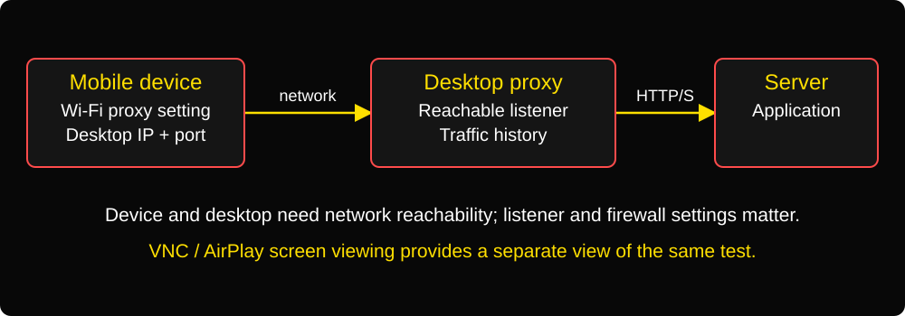

*Figure 15. A mobile device routes web traffic to a reachable desktop proxy listener.*

So I normally have my phone connect to Wi-Fi, which is what's going on here. And then my laptop or desktop are connected into the same network either through Wi-Fi or wired. It doesn't really make any difference. So the steps that I do are I'm going to use Fiddler as the example. It's nice and simple. So Fiddler's running other things I do is I go into tools Fiddler options and I check in the connections that allow remote computers to connect is actually selected.

If it isn't, Fiddler will block the connection request and you won't be able to debug through. So this one's really important. The other thing I have to make a note of is the port that Fiddler is running on. Next thing I'll do is I'll go into a command window and I'll run the ipconfig command.

Now you can see that I have a lot of IP addresses coming up here mainly because I've got the wired connection as a wireless connection. Got a whole bunch of virtual machine connections. So sometimes the hard part is working out which IP address you need to connect to. Now the way I basically do it is pretty much trial and error until you get used to it. So the first time I tried to connect, I used this one because Ethernet local adapter connection didn't work.

So I drop down here and this is actually the real one, the Ethernet adapter. This is the IP address I would connect to. So having found those bits of information, the IP address we're on, the port that our debug proxy is working on, then we go off to our mobile phone. So, if I go into this an Android phone, you can see that fairly simply enough. Go into settings off to Wi-Fi. Pick the wireless network you're connected to. On Android, you do a long press there.

Modify the network config. Make sure the proxy settings are set to manual. In fact, first thing to do is make sure you tick the show advanced options. Otherwise, you won't see any of the proxy stuff. So, show advanced options to see the proxy information, proxy settings to manual. Then, in the HTTP proxy, put in the IP address that your machine is on. So, here you can see 192.168.1.131. That's what I put in there. Then the port for my debug proxy, 8888 goes in there.

Save that. Now, the browsers on this phone should be connecting through into Fiddler. So, if I get the default browser up, there's my main web page. Let me clear out the traffic here from Fiddler. That's the control X to clear out the traffic. Then, let's have a quick look at one of the pages on my site. And you can see the request starting to go through now.

Now because it's a debug proxy, I can look in the request and I can see that my phone the user agent in the default, AppleWebKit. It's got the mobile Safari stuff. So it's trying to be a mobile browser. That's the built-in one. If I head off to Chrome, what I found is that by default Chrome and Firefox and the inbuilt browser work pretty seamlessly. Dolphin had a couple of issues getting started, but wasn't that hard. There's Chrome. Just thought I'd show you all the apps that are installed in my Android.

So, here's Chrome. And if I visit the seleniumsimplified.com site there again, we can see the traffic starting to come through. So, that's pretty much it. You may have some issues if you try and use another application. If it's a native app, then it may not connect through in the same proxy settings. It might, you might get lucky, it might not. In the past, we've had to hack about a little bit and I vaguely remember having to use some ADB port redirects in order to get that working.

But I haven't done that for so long.

### 11.2 Viewing mobile phone traffic using a computer proxy - Burp Suite

[Watch this chapter in the video](https://www.youtube.com/watch?v=jWwfMo5Ziz0&t=18222s)

**Chapter summary**

- Configure the Burp listener to accept the device connection.
- Check address, port and interception settings before interpreting missing traffic.

**Transcript**

I'm not going to demo that here. But it's not hard at all to get your normal in-built browsers just going through a debug proxy on your browser. Okay, now a quick look at using Burp Suite with our mobile device. So, you can see I've still got the mobile device attached via VNC. If you haven't watched the Fiddler video, you should watch that first because it covers the basic setups for the mobile device I'm using. So for Burp, remember I go in to the normal command line window, do an ipconfig to work out what my IP address is.

I'm going to start a Burp. Okay, this is Burp running. Now in Burp, all our proxy options are under proxy options. First thing we're going to do though in Burp is remember to switch intercept off. Otherwise, we'll start blocking our traffic before we do anything. Now, with Burp, one of the things I find very useful is because I've been using proxies because I probably messed around with them is resetting the proxy defaults before I do anything because periodically I'll find that I've been chaining proxies.

Is there something in the redirect? Just by setting it to the defaults, we remove a whole bunch of problems. So you can see here that my Burp Suite is running on an interface 127.0.0.1:8080. Now what I really want to do edit it is not do loop back only but to run on all interfaces. So if I say okay now it's going to say are you sure because other people in network can do it and go yes that's pretty much exactly what I want to do.

So I will unblock Java from it. Now if I go back to my phone now you can see that we're running on 8080. So in the port proxy settings I want that to be on the IP address I'm running on which is 13 1. Here we go. 192.168.1.131 port 8080. Save that. Now if I send a request through that request has gone through and there we go in the history I can start seeing all the messages coming through. And got the headers and the user agent that's coming from the phone.

So there's no real complexity in there. Burp Suite is running exactly the same way as it did before. But now we have our requests coming through.

### 11.3 Viewing iOS traffic using a computer proxy

[Watch this chapter in the video](https://www.youtube.com/watch?v=jWwfMo5Ziz0&t=18390s)

**Chapter summary**

- Configure the iOS Wi-Fi proxy and verify traffic from Safari.
- Ensure the device can reach the proxy host on the chosen network.

**Transcript**

Hi, I'm going to very quickly show you how to set up a proxy on an iPad. So here in the real world is my iPad. I'm mirroring the screen on the computer, the recording for you. So, if I go off to Safari now, start browsing the web, there's no traffic coming through Fiddler, right? There is some stuff coming through Fiddler, but that's just irrelevant nonsense, not from the iPad. So, if I jump back out here to settings, I'll go into Safari, clear the cache to make it easier.

Right now I go back up to my Wi-Fi. I choose the little information icon next to the Wi-Fi. And you can see down here on the bottom there's the HTTP proxies. I set that onto manual. Now because I'm on Windows, I will go into a normal command line and get an ipconfig again to see what my IP address is. And I'll type that in the server port. So I'm on 192.168.1.39. Then Fiddler is running on port 8888. There's no authentication. Let me come out that back to Safari.

Let me get this window out the way. Now, if I go off to Apple now, we should see all the Apple traffic coming through from the actual iPad. So, there's nothing complicated there. All these settings are pretty much the same as ever. All we do is choose the right proxy. The hard part is really finding out the IP address.

Now, sometimes when I'm testing iOS, I find that the iOS doesn't really want to connect to the Wi-Fi that I'm using. Oddly enough, I don't know why. However, in those circumstances, I create a local hotspot on my laptop using something like connectify.me, connect the iPad through that, then they're on the same network. It's easy to get the IP addresses and then I just proxy all the requests through again. So, nice and simple. The iPad can connect through to Windows machines or any other machines that are running proxies, letting you debug the traffic.

And we can see here in the inspectors the headers all the user agents are doing the iPad ones.

### 11.4 Android Mobile VMLite VNC Server Demo

[Watch this chapter in the video](https://www.youtube.com/watch?v=jWwfMo5Ziz0&t=18546s)

**Chapter summary**

- Device mirroring makes phone activity visible during a desktop recording.
- A VNC viewer can also provide a convenient interaction channel.

**Transcript**

So I just want to introduce you to a tool that I use called VMLite. Now you can see here here's my phone. This is my phone. I'm using a highly sophisticated camera setup here. This is my webcam, taking off the computer monitor and I'm pointing at my phone and trying to capture my monitor at the same time. So, you can see here my monitor that we've got a little window here with VNC viewer on it. And here is my phone down here.

And when I start doing things on my phone, the same thing is reflected up on the monitor screen. let me zoom into there. You can see it's zooming up on the screen hopefully. even if all you can see is blurry stuff, you can see that there's blurry stuff happening on my phone and very similar blurry stuff happening up on my computer screen. The other thing I can do, of course, is because it's VNC, I can control my phone from the desktop computer that I'm connected to.

So, on the monitor, I will start clicking things. I'm going to click on What should I click on? Now, I don't expect games are going to work very well, but if I put on Gravitron, hopefully we'll at least see. Yep. So, there it all moved over there. It went in a landscape mode. Stuff is happening. There's refresh rate issues going to happen on VNC. But basically, you can see that whatever I've done on the computer has happened on the phone.

### 11.5 Android Mobile VMLite VNC Server Overview

[Watch this chapter in the video](https://www.youtube.com/watch?v=jWwfMo5Ziz0&t=18649s)

**Chapter summary**

- The recorded VMLite setup separates device viewing from Wi-Fi proxy traffic.
- Compare desktop and browser-based viewers for responsiveness and control.

**Transcript**

What's mirrored on the phone has happened on the computer. I find this very useful for mobile testing because I can do a lot of data entry through the actual computer. Okay. So, no more webcam, no more shaky cam evil dead type footage. So, I'm going to show you VMLite. VMLite. There's the website vmlite.com. It's an Android app and it has a desktop client. What I really like about it is it works on non-rooted devices, which is very important to me when I'm testing on client site and typically the devices are not rooted or rootable.

What we get then, so I've got my phone connected via USB cable here. Now I can basically start and stop a VNC server on the phone from the desktop computer. That's how we bypass the root requirements on Android. So we have a very small app. All it does is start and stop the VNC server. You can see some IDs. You can also connect over USB. At the moment I am connected over USB for the VNC. The VNC connection doesn't have to be done over USB.

We can do it over the Wi-Fi network and put in the normal IP address for the port. But I'm doing it over USB because if I'm feeding my phone through proxies to do testing, then the VNC over the Wi-Fi typically won't work. The ports will get clogged, something will go wrong. So, by feeding it through the USB, it means that I can access the view of the phone a lot easier and still have traffic coming through a proxy. So, you saw in previous lectures how we connect phones through proxies.

In order to do that with this, I also do a USB connection. Now, I still have access to all the normal VNC functionality over the normal local host connection. And this here where I'm viewing my computer is the TightVNC viewer. So, TightVNC is free. It's open source. It's a server for your desktop as well as a client. So, I have a theoretically I could connect my phone to my desktop and control my desktop over VNC using a VNC client on the phone or the tablet, but I'm using it in reverse here.

So, I've actually got a server. VMLite is a VNC server that runs on the phone. So, I can connect to it from my desktop. So, I'm using the VNC viewer here. Now, the viewer, the standalone viewers on your desktop tend to be a lot faster response when you're working with the phone. However, you can see here that I can connect to the following address while the Android devices connect with USB. I can do the same thing over Wi-Fi. It's just that it has the IP address of the phone in here.

So, if I do that, I'll get Chrome up again so you show you. So, I'm going off to localhost 5801, which is actually on my phone itself. And you can see here I've now got I've connected to the server on my phone. I can start a VNC viewer in HTML 5. Let's try that. So I haven't installed in the mic. This is the normal browser, but within the browser itself, I am connecting to my phone and controlling it and seeing all the different things that are coming through.

That's really really handy. It's a little bit slower than the VNC client, but very useful out of the box. Now, you can see there's also a Java applet VNC viewer. We'll see how we got on with this. It's not guaranteed to work brilliantly, because the applet permissions and things keep changing. So, permission run this time. Great.

Now, I've got a tight VNC over here. I haven't got any authentication in this server, so I can skip the password and just do okay. There we go. So now I've got a nice big window. Let's see if we can resize this. Okay. I can't see an obvious option with the Java one to resize. There probably is but it's not going to be particularly good for this particular demo. But the basic point is I can also connect over a Java applet.

Trust me I am doing things even in the applet. The HTML 5 one is a good compromise. I quite like using that. I use that a lot sometimes when I'm having to connect. But I primarily prefer the clients. I have much more control, much more configurability. And we can change the resizing. I use this for screen capture. I use this for data entry. I use this to help me work with the device without getting repetitive strain injury. If you can find a VNC client or a VNC server for your device, and I'm using VMLite on Android, I highly recommend it.

### 11.6 How to emulate mobile devices using Chrome browser

[Watch this chapter in the video](https://www.youtube.com/watch?v=jWwfMo5Ziz0&t=18938s)

**Chapter summary**

- Use browser emulation for an initial mobile investigation.
- Check suspected failures on a physical device and vary the entry page and input settings.

**Transcript**

And in this video, I will show you how to use the inbuilt Chrome browser functionality to emulate a mobile browser and conduct basic mobile testing using your desktop browser. We're going to use the emulation feature in Chrome. So, we have to start by using the overrides in the Chrome developer tool setting. Let's find that. So, the way I get to that is by right-clicking, doing an inspect element, and then the developer tools appear over here. I'll click settings. So, in overrides, I have to make sure that show emulation view and console drawer is selected.

Now, all the emulation functionality used to exist in here, but it doesn't. So, this video is going to show you how to find it. So, we've got emulation clicked. Great. So, now where is the console drawer? Well, if I close the settings now, in any of these tabs, in any of the developer tool windows, I can click escape and then I'll see the console drawer and then I can use the emulation tab.

Now, this is all getting a little bit small, so we'll zoom in on the screen. So, I'm going to select a device. I'm going to use the Samsung Galaxy Note 2 simply because I have a physical device of that on my desk. So, if any issues happen, I can try the same functionality on my device. So, I'm going to choose the device. I'm going to click emulate. And you can see the screen refreshes to a smaller size. This is a scaled version.

I can change that using the screen settings down here if I want to. Now, I've chosen the BBC site mainly because it has mobile detection and they try and support mobile as well as they can. I'm on the homepage of the BBC for a reason and I'll show you why in a minute. So, even though I selected device, we don't have the mobile site yet. So, I'll refresh the screen. I'll just hit Ctrl+F5. And then you can see we've been redirected to the mobile site because Chrome is now sending the correct headers for the note 2.

And now the issues. So let's try and use the site. So I'm going to click on more, which is a dropdown. I should see a drop down or sport or any of these redirections. They're not currently working. Now I don't know if that's Chrome or whether it's the BBC site, but if I change the sensors and choose not to emulate the touch screen so that mouse events are being sent, then I can start using the functionality again.

Now this all works fine when I do it on my Note 2. So presumably it's some sort of Chrome compatibility emulation issue. It doesn't really matter what the root of the problem is here for us. It just shows the problem of testing through emulation. When we find suspected issues, we have to replicate them on either a better emulator or using an actual physical device. But the Chrome emulation is so convenient on the desktop that for a first run check on the site and certainly checking how your server responds to mobile headers, this is a great first step.

Now you can stop the emulation by clicking the reset button. So I go back to the device, click reset, the screen refreshes. We're still on the mobile site. But if I do a refresh now F5, we're back on the main BBC side. And as a bonus, if you've watched the video this long, I'm going to show you what I thought was an emulator bug, but seems to be a BBC functionality by design or possibly a bug. Who knows? I was going to do this demo on the weather page because this is the UK and all we talk about is the weather and I wouldn't have to worry about any contentious news showing up.

But when I start on the weather page and set up emulation and do a refresh, I'm not redirected to the mobile site. Now, I recreated this on my phone and when I visit www.bbc.co.uk/weather, I see the desktop site. There is no redirection to the mobile site. So, what I thought originated from a Chrome bug turned out to stem from the BBC. They only redirect you when you're on the main homepage. Is that an issue or a feature? I don't know. You decide.

But Chrome emulation is a very easy way to run a first check on the site if you know how to access the functionality for the emulation, which you do now.

### 11.7 How to view iOS Device Screens on a Windows PC

[Watch this chapter in the video](https://www.youtube.com/watch?v=jWwfMo5Ziz0&t=19202s)

**Chapter summary**

- Use an AirPlay receiver to show an iOS screen on the desktop.
- Combine device interaction with desktop recording tools to capture a test session.

**Transcript**

So, I've got two tools I'm going to show you here. both of them use AirPlay to let me share my iOS device screen on my desktop, which is really good for testing because I can do testing on the iOS device. I can project the screen onto my desktop computer and use the normal screen recording tools that I use on my computer. So here I'm using Camtasia to record my desktop screen. So I'm going to show you AirServer from AirServer.com and this is Reflector from airsquirrels.com.

Both of these tools are incredibly cheap. They're about $12.99 and $14.99 at the moment. And both of them do much the same thing. They act as AirPlay servers. So I'm going to switch on AirPlay. Mirror the device. And there we go. So here is AirServer running and it's showing you my iOS device there. So the way that the AirPlay stuff works remember is if if I just do a swipe up from the bottom of the screen, we've got our basic settings.

Then we can do the AirPlay off where you can see the Office Dell XPS there. That would normally say AirPlay if I haven't connected. Then I can use my iOS device as normal and we'll see the basic actions that I'm doing on the iOS device reflected on the actual desktop screen so I can record as I'm doing my testing.

Now it's hard to know which of these tools is the best here. This might not be the best demo. I'm pointing out these tools so that you can go away and have a look at them. So AirServer has quite a lot of options in it. Now I haven't used any of these settings. They seem to work fine. I'm just running this AirServer in demo mode here. AirServer comes with a 7-day demo. So if I shut down AirServer then move over to reflector.

So reflector comes with a demo where when you try it you essentially get 10 minutes of sharing time. So, if I go back to my iOS device, switch on AirPlay and mirroring, we should see that appear. There we go. Let me just resize this. Both of them, you can resize the window when they come through. And again, let's get rid of this.

Now, I found that reflector didn't require as much prerequisites, so I just I didn't need to install iTunes or anything else, but AirServer required iTunes. Once you've got those installed, it's fine. I think it's really going to come down to whichever one works best on your machine as to which one you use. But in terms of being able to see your device on your main screen and be able to capture it out the box, it comes with AirPlay. Therefore, we should try and harness that for our testing.

It's designed for Apple TVs, but both AirServer and Reflector act as AirPlay servers. So, we can project our devices onto that and we can basically do our testing. mess around in the actual device screen, record the testing that we're doing. I suggest you have a look at both tools, see which one works best in your particular environment, and then you can start recording your test sessions when you do them on device.

## 12. Mobile Testing with Wireshark on Mac

**Section summary**

- Choose another observation point when an application bypasses proxy settings.
- Establish the conditions needed for useful packet capture.
- Distinguish Wi-Fi decryption from HTTPS/TLS decryption.
- Use filters and known requests to correlate device actions with captured traffic.

### 12.1 An introduction to Wireshark

[Watch this chapter in the video](https://www.youtube.com/watch?v=jWwfMo5Ziz0&t=19404s)

**Chapter summary**

- Packet-level observation offers another view when an application bypasses the proxy.
- Use the captured traffic to understand what the application communicates.

**Transcript**

So, I'm just going to give you a quick introduction to Wireshark. Why am I going to talk about Wireshark in the context of mobile? Well, Wireshark is a network traffic observation tool, right? That's what it does. It sits down at your packet level, monitoring your network card, pulling the packets out, restructuring them, and showing them in different ways.

Now, sometimes when you're testing a mobile application, we've already seen that we can change the proxy on our device so the HTTP traffic can be sent through to our our HTTP proxy. Sometimes when you're testing a mobile application, although you've set the proxy, the application ignores that. The application doesn't use the proxy settings you set, but you're still testing that application over Wi-Fi. So, you can still observe the traffic that's being sent because you can hook into the Wi-Fi traffic and pull out the packets from that machine.

That's what Wireshark is going to do. This is a free tool. It's it can be really complicated to get your head around, but we're going to use it in its most basic form. Certainly, I don't know how to use it as a great tool, but I'm experimenting with this. This is something that I work with. This is something that I use when I'm test mobile. This is something that I have running when I'm in airport lounges. So, I can see the kind of thing that people look at when they're on their mobile phone in the airport lounges on their own.

And some of the traffic is quite scary and disturbing. It's also something that I can look at in hotel rooms. So, if I'm in hotel and I'm on hotel Wi-Fi, I can see what traffic people have. And that's quite interesting because people use their phone. They connect it to Wi-Fi. And some of these phone applications are not very secure.

### 12.2 Installing Wireshark

[Watch this chapter in the video](https://www.youtube.com/watch?v=jWwfMo5Ziz0&t=19526s)

**Chapter summary**

- Install the tool for the operating system and diagnose setup problems.
- The Mac prerequisites shown in the recording describe its historical environment.

**Transcript**

They give away quite a lot of information about the person. So, we know that we can monitor phone applications using this. So, that's what we're going to look at in here. It's basically just a tool for monitoring network traffic. So the first thing we have to do is download it. It works on Windows and Mac and Linux. You can see here the Windows install is nice and easy. You can download it from a Mac if you go in here. I found that with Mac I had to install an X Windows server first.

I had to install X Quartz. So I had to install X Quartz because Mac OS no longer comes with Windows X by standard. Then I download the Wireshark and then I install it. I had some additional issues with it, but they they're all online. If you get issues trying to run Wireshark, basically type in Wireshark operating system the error message you're getting and you'll have some help for you.

### 12.3 Decrypting 802.11 Traffic

[Watch this chapter in the video](https://www.youtube.com/watch?v=jWwfMo5Ziz0&t=19592s)

**Chapter summary**

- Understand the networking layers and the conditions required to decode captured traffic.
- Wi-Fi decryption and application-layer TLS decryption address different encryption layers.

**Transcript**

Hopefully, it'll work out the box and you'll have no problems. I haven't tried it on Linux, but I imagine the instructions on the Wireshark website are absolutely fine for Linux. Other things I had to do because I'm running at home, when I'm in the hotel or when I'm in the airport, once my machine is connected to the network, it runs fine. When I'm at home, I've got encryption running over the top and all I can see is the 802.11 traffic. So again, on the Wireshark documentation, it shows you what you have to do in the preferences to configure 802.11 to be decrypted on your machine.

Now, in the next lecture, you're going to see me connect my Android device to my Mac using VNC, and that's just to record the video. And then I'm going to monitor some of the traffic and you're going to see that I had to fiddle with the 802.11 preferences a little bit. Wireshark can be a bit tricky to get running out the box. It the thing is it is an enormously powerful tool and lets us do things that we can't normally do because what you're going to see me do is see the traffic for my Android device without the Android device being set up with a proxy and without it being connected to my machine.

Because the point is we know that applications are sending out traffic. We want to be able to monitor that traffic and we will use whatever tools and options we have at our disposal. So we want to observe traffic. We know that we can observe traffic through a proxy. But we also know that because that traffic is going over a network card, we can tap into those network cards and pull the packets out and observe it that way. Get in the habit philosophically of thinking there's something I want to do.

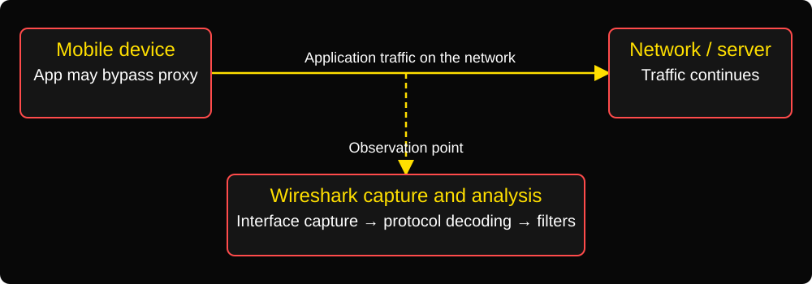

*Figure 16. Packet capture observes communication at a different point from an HTTP proxy.*

Observe traffic. I can't do it this one way. I'm going to find another way of doing it. You're not hunting out tools. You're hunting out approaches to let you achieve some outcome. And so long as you understand the technology, you understand a little bit more about networking. Remember what we're dealing with here are the OSI model. We're dealing with OSI layers. Normally what happens is we work at the application layer or the presentation layer because we're testing an actual application. What we want to start doing is moving down a layer.

So here in the transport layer, we're using TCP IP. We move up the layers to then start getting the HTTP traffic which is the application layer. Normally we're testing at the level that's using the HTTP traffic, but we can monitor at these different levels and let tools pull it back together for us. So if you want to do additional studying, this is something that we covered at university but didn't have a lot of use for in the real world. But this is the technology that underpins the networking that we use, the applications that we use.

If you're testing games, you might find that your developers are having to go right down and create their own TCP IP layers in order to make things faster. If you're working with performance test tools, you might find that they've written their own drivers that work at that level to make things faster. So we have to start understanding this in order to increase the technicalities that we have and the way of approaching the testing that we have. Don't need to understand it much but it's another area to research if you're interested in and this is where Wireshark starts coming into play.

### 12.4 An Android Wireshark Testing Session

[Watch this chapter in the video](https://www.youtube.com/watch?v=jWwfMo5Ziz0&t=19813s)

**Chapter summary**

- Select the interface, establish a useful capture and filter by the target device.
- Correlate a known browser request before investigating native-application messages.

**Transcript**

Okay, you can see I have moved on to the Mac for this. Wireshark works on both Mac and Windows. It's just at the moment my Windows configuration isn't working for Wireshark. And that's partly because Wireshark works at a lower level in the stack. So, it hooks into your network protocols in order to do all this work. On the Mac, Wireshark is working fine for me. Hopefully, you've got it installed at this point.

Now, Wireshark can seem intimidating when it starts. You can see all the different options and things here. We're going to make this simple. We're not going really going to explore the options in here. Now, you can see that I have my Android device running. I've connected over using VNC just so we can see what's going on. Let me just check that this still works. There we go. So, this is moving about on the VNC. I'm controlling my Android tablet. So for Wireshark, I'm going to do this.

This is the main wizard interface that you see at the front. We can do all our capture from here. I can click on the Wi-Fi network and I can click capture options here to start up this configuration or I could go up here to capture and do options. I'm going to do this because this is the way that I would normally do it when it's running.

Now, you can see we have a whole bunch of options in here. And this is the Wi-Fi card that I'm going to look at. This is running under X Windows. So the window movement is a little bit different. You can see there's my networks I have connected in this machine. Now what I want to do is make sure that promiscuous mode is enabled and that monitor mode is enabled. I need both of those if I'm going to capture traffic that is not on my machine and is going across the network.

So what I have to do is double click on this connection. Make sure promiscuous is captured and monitor mode is on. If I do okay now that's good. I can now start a capture. Then we'll just start seeing lots and lots of traffic coming through. Now most of this is shown as 802.11. So, I need to just double check something because when I'm working at home with my security on my network. I need to check the protocols and check the IEEE 802.11.

Now, I have enabled decryption on here and I've put my decryption key in here. So, I've hopefully edited the video so that you don't see that information. Now, if I can apply the preferences that I've just changed here. So, I don't have to come out of this dialogue. Let me minimize this. Now, in order for me to see the traffic that's coming through from the machine that I'm looking for, I probably need to Let's have a look.

So let me see if we've got any HTTP traffic coming through. So this is a display filter. What this is doing is filtering the information, all the capture packets that have been through. And you can see that I don't have any HTTP requests coming through in my current capture here. What I need to do is go back to my Android device and I need to reconnect it to the Wi-Fi. So, I'm going to disconnect it from the Wi-Fi for the moment.

Then reconnect it. And this is so that Wireshark can connect can start collecting the encryption requests. So, I'm not going to lie to you. At this point I started experiencing difficulties. It wasn't showing me the HTTP traffic. You can see that the protocol is still 802.11. So what I do is I start experimenting with the IEEE 802.11 preferences until I can actually start seeing some of the HTTP traffic. I've filtered it. I start moving back and forth between the ignore protection bits.

I keep applying it until at some point I actually see the traffic coming through. Okay. So, sometimes I have to fiddle about with the settings in order to get this working. But that's why you keep this window up in order to try the different options until we hit apply until it comes through. And you can see now that I have got the network traffic coming from my 143 device. You can see the in fact you can see all the traffic going across here.

So you can see my Sonos system in there. You can see it posting. You can see it doing a whole bunch of other things. So let's restrict the IP address to just my device and just have some HTTP traffic. So now it's filtering all the things that it has recorded. There we go.

Now you can see it's picking up the devices the names of the URLs because we told it to in the capture settings. What I might want to do is just do HTTP requests. So I could if I wanted just do the HTTP request dot method which equals let's just go for get So now we're seeing just the get. So we can double check that this is working. If I go back to the device, let me close this now that it's working.

Pick one of these and we should see the get request get made. There it is. The get request. All the traffic's going through. So why is this useful? This is useful if we're having to test something that we're not sure about. So in this instance, you can see the browser sending traffic through.

So let's assume for a second that we're not testing a browser app because we know that we can route browser traffic through a proxy. I'm just doing this to make sure that the VNC is working and that Wireshark is picking up traffic. Now that we know that, if I go on to an application on the Android, I'm just going to pick a Pac-Man game here. We're not doing this in order to hack the game or anything like that. We're just doing it because we're going to see what traffic this game sends out.

So, I'm going to move this over here. I'm going to change it. So, we're not just doing gets anymore. Although, you can see I think yes, we've just had some Pac-Man dash go through there. Go right down the bottom. This is all the HTTP. So, you can see some P- stuff. This is the pass the Pac-Man dash that we started. If I start this game, we can see it's posting some other things. So, I'm actually seeing the traffic from the game.

Now, I haven't set up a proxy. The Android tablet knows really nothing about my Mac. This is us pulling information off of the Wi-Fi network. Close down the ads. There you can see more Pac-Man traffic. If I start the game, let's see what happens. So you can see again the logging is going through. So I'm getting traffic from testing this Android application which is ignoring the proxy and we're seeing the traffic through and this is really how you use it.

Now you can see a whole bunch of other stuff happening as well. But the main thing here is we can use this to get traffic that we know nothing about. And you've seen the kind of filters that we'd use in here. So this is really useful for mobile application testing. It's also useful if you are in a hotel and want to see other people's traffic or an airport lounge and want to experiment with seeing what kind of traffic your device actually gives out.

It's quite a revealing and scary thing when you see the kind of information that your applications are doing.

### 12.5 The philosophy of Wireshark

[Watch this chapter in the video](https://www.youtube.com/watch?v=jWwfMo5Ziz0&t=20330s)

**Chapter summary**

- Start with the observation goal, then choose another approach if the first one cannot expose it.
- A little more networking knowledge can open another layer of testing.

**Transcript**

But it has practical uses and not just hacking. We can use this to observe the traffic for untestable applications because the point is we know that applications are sending out traffic. We want to be able to monitor that traffic and we will use whatever tools and options we have at our disposal. So we want to observe traffic. We know that we can observe traffic through a proxy, but we also know that because that traffic is going over a network card, we can tap into those network cards and pull the packets out and observe it that way.

Get in the habit philosophically of thinking there's something I want to do. Observe traffic. I can't do it this one way. I'm going to find another way of doing it. You're not hunting out tools, you're hunting out approaches to let you achieve some outcome. And as long as you understand the technology, you understand a little bit more about networking. The OSI model, we're dealing with OSI layers. Normally, we're testing at the level that's using the HTTP traffic, but we can monitor at these different levels and let tools pull it back together for us.

So if you want to do additional studying, this is something that we covered at university but didn't have a lot of use for in the real world. But this is the technology that underpins the networking that we use, the applications that we use. If you're testing games, you might find that your developers are having to go right down and create their own TCP IP layers in order to make things faster. If you're working with performance test tools, you might find that they've written their own drivers that work at that level to make things faster.

So we have to start understanding this in order to increase the technicalities that we have and the way of approaching the testing that we have. Don't need to understand it much but it's another area to research if you're interested in and this is where Wireshark starts coming into play.

## 13. Virtual Machines

**Section summary**

- Use virtual machines for alternative browser environments and practice applications.
- Import a prepared appliance and review its resource and network configuration.
- Connect browser and application guests through their configured network addresses.

### 13.1 Introducing VirtualBox modern.ie Turnkey Virtual Machines for Web Testing

[Watch this chapter in the video](https://www.youtube.com/watch?v=jWwfMo5Ziz0&t=20445s)

**Chapter summary**

- Import prepared browser and application appliances into a virtual-machine manager.
- Connect the guests through the configured network and investigate the limits of the environment.

**Transcript**

Welcome. I'm just going to give you a quick introduction to VirtualBox. And I'm going to do that because my Windows machine has prompted me that there's a new version of VirtualBox and I should really install it. So, I'm going to do that, but I'm going to give you a quick overview of VirtualBox at the same time because it's pretty easy to install and work with. So, this is VirtualBox and it's running. This is the old version. You can see that I have a couple of virtual machines in here.

First one I got from TurnKey. TurnKey is a website with a lot of pre-built applications. You can see here we've got Drupal, Joomla, LAMP. If you're doing any kind of I've been using the VirtualBox here for Redmine, which is a very simple project management, time tracking type application, which using an older version is relatively buggy. It's got an API, so it's quite fun for experimenting and practicing my testing against. So to download VirtualBox, we head over to the virtualbox.org org site where we can download the pre-built binaries for Windows or Linux and Mac.

So, I've got it running on my Mac. I've got it running on my Windows machines. One really useful thing that I find about VirtualBox and that I use most in the virtual machines is over here on the Microsoft site, they've got modern.ie. So, modern IE is a Microsoft site which has virtual machines for all different operating systems with different versions of Internet Explorer to allow you to do compatibility testing. So, you can get IE6 on XP, IE7 on Vista, IE9 on Windows 7, and other IE versions on Windows 7 and Windows 8.

And these are free to download. They run for about three months without activation, which usually gives enough time to practise testing different applications. You can head off to modern.ie and get new versions. I'm going to install it now; I've already downloaded it. Installation gives us a small dialog. Typically, I select all the options and click Next with the defaults. I'm saying yes to these installs.

Let's start it and have a look. So here are the operating system. Whoops. So it's prompting me to add the extension packs. The extension packs are useful. They give you better integration between your VirtualBox and the host operating system that you're working with. So yes, I want to install that. So what I'm going to do very quickly is download the IE6 machine and I'll get that running in VirtualBox.

Now I need to download both parts here, part one and part two. First part.exe, the second part is the second half of the archive. So when it downloads, I'll just run the.exe. It will unarchive it and create a VirtualBox for me. Okay, that's downloaded now. So I have downloaded Modern IE, the two downloads that you saw. I've put it in an IE6 folder just to make it a little bit more obvious what we've got here. If I double click on the part one part which is an application, it will extract everything for me.

And you can see here that what we've got is an open virtualization format archive. Okay, how do we use that? Well, if I jump over to my VirtualBox manager, let's try import appliance. And now it's going to create this virtual appliance for us. So you can see I can adjust the RAM settings to whatever I want. The image is going to be created in the standard VirtualBox folder. I could move that if I wanted to. I'm just going to leave it there just now.

So now I should be able to just start this machine. Now you can see I'm running XP. We've got all the different information that we need about this virtual machine on the desktop here. You do kind of have to remember the username and password if you want, but they're standard across all the different machines. I just got the normal. Here's your new machine starting up. So in theory I should come into start Internet Explorer. Yes. And there we have the joy of IE6 which no one likes and no one likes testing on.

But because we never install it in any of our machines anymore, if a client is saying to you, "This must be IE6 compatible." This is how you do it. You go off and get the IE6 virtual machine from from modern IE. Now, clearly there are differences between testing things on a virtual device and a real device. But a lot of the testing that I do is on a virtual machine because I can have multiple machines running at the same time. I can run automated tests on a virtual machine and not bother my main machine.

I do a lot of work on virtual machines. So, I'm putting this over for you so that you can start experiment with virtual machines if you haven't already if you want to actually try with applications to test. Go off to TurnKey download some. I'm going to quickly show you the Redmine on turn key. So, you can see here the start is telling me that if I go off to 192.168.1.141.

Let's try that. 192.168.1.141. So there's the Redmine application. It's actually running in the VirtualBox on my machine in theory 92.168.1.141. So I can also access it from a virtual machine. So my virtual machine here that's running IE6 on Windows XP can connect to this TurnKey virtual machine which is running Linux all in the same box and lets me test different applications from different browsers. It's an absolute boon for technical testing, experiment technical testing, doing automation across different browsers, setting up your own grid, whatever.

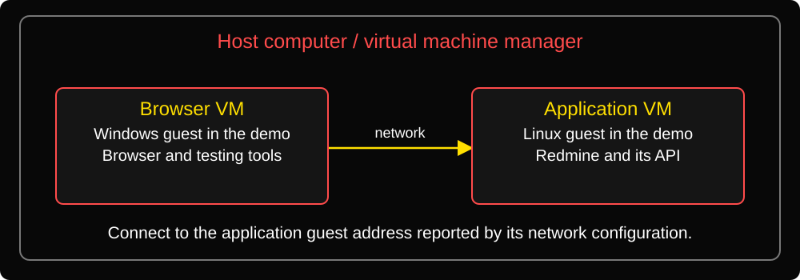

*Figure 17. A browser guest and an application guest communicate over their configured network.*

Get used to using virtual machines. Start with VirtualBox because it's free. You got a whole bunch of applications and enjoy yourself.

## 14. Case Studies

**Section summary**

- Identify the input that varies in a repeated check.
- Use candidate user-agent strings to expand coverage of a routing rule.
- Investigate unexpected destinations against the project's actual requirements.
- Keep the automation proportionate to the information needed.

### 14.1 Testing redirection from www to mobile site

[Watch this chapter in the video](https://www.youtube.com/watch?v=jWwfMo5Ziz0&t=20874s)

**Chapter summary**

- Use a varied set of user-agent strings to check a mobile-routing rule.
- Investigate unexpected destinations against real requirements and keep the automation proportionate.

**Transcript**

So, here's your scenario. You've got a main site and a mobile site, and you've just implemented some redirection rules so that when the user on a mobile phone hits your main site, they bounce off to your mobile site. So, how are you going to test that? So, here's the kind of thing I'm talking about. I'm using the BBC as an example here. This is the main site. If I hit this with a mobile device, I'll bounce off to m.bbc.co.uk and we'll get a slightly different experience and slightly different formatting.

Now, this is done by the use of the user agent in the HTTP headers and you can get a list of all the user agents off on things like useragentstring.com. There's a lot of information about out there on user agents. So, the basic thing you're thinking, how could I test this? How can I test going to the bbc.co.uk and getting redirected to this? Well, I could get a bunch of devices. We could decide on a set of devices and say, "We support this device list.

Let's test on these devices and these devices only." And that would that would work, but you'd be limiting the amount of testing you could do. And you probably missed a lot of conditions. So what I'm thinking is it's a technical test in that there's just a user agent. I don't actually need any devices. If I hit a request on with just a user agent, I can do that. So, what I really need to do is find a way of spoofing the user agent when I go in.

Now, I can do that with Chrome pretty easy now. And that's how I did this in here. In Chrome, if I just go into the inspect element and over here in the tools, I can hit the override. I can override the user agent. So, I can be on iOS 4. Here, I'm going to change the device metric so it looks like iOS 4. And hopefully now if I go on to bbc.co.uk here, it will redirect me off to the mobile site.

So there's a list of user agents in here. I could just use them, but then I'd be limited to the user agents that are in the Chrome by default, but I can add my own. It's not a problem. I can add my own user agent in there. But again, it's going to take a long time to do that manually. And I'm thinking whenever I'm faced with a problem that has a just a data sc a data set variation and in this case that's all it is.

We've got a lot of user agents that we could use. Let me show you some of these. So the user agents string.com has a whole bunch of lists of user agents. Look at this. Look at all these user agents. And these are from different browsers, different browsers over time, different versions. What I could do is just get a whole bunch of these, iterate over them, go off to the BBC site and check that I'm actually redirected to this. So that's what I do this.

So it's this fairly simple automation problem. Now, I wrote this for a client a couple of months ago, long time ago. And I'm reusing it again on another client site. So, I've pulled this script out. I'm going to release it on GitHub. Somewhere in this video, there'll be a link to the GitHub code. But, let me just quickly show you what it does because it's very simple. And I'm not pointing this out as really good automation code. I'm just pointing this out as sometimes we want to do the simplest thing we can as fast as we can.

We don't come out with an elegant solution. We just come out with something very simple. And here I could use Java HTTP libraries. I've chosen instead to use PhantomJS and the GhostDriver on web driver. Why? Simply because it makes it easy. That's that's why I'm doing it. It's easy to incorporate into my project like that. All I have to do is incorporate is bring in Selenium and bring in the PhantomJS driver. All I have to do is download the PhantomJS from the PhantomJS website.

So I get the executable so that I can actually use this. My test is very simple. What I do is I make a couple of checks to make sure the driver is present, the executable. And what I do is I go off to the user agent string.com. I go off to a couple of pages on there and just pull off the user agent list I'm looking at. So you can see here I'm going to a couple of those pages. One of the ones we one that we saw and I look for anything with ul li a selector.

If I go back to the page, you'll see what I'm doing. So I'm going off to one of these pages and I'm basically looking for a ul li a selector which has the user agent string in there. And I'm just pulling all of these off the page. So, I'm scraping this stuff off. There's probably better ways of doing it, but when I came to do this, I was looking for very simple way of doing it. That was the simplest way that I could see of doing it.

Then I look through the list of anchors that I'm looking for. And if it's got Blackberry or if it's got Android there or if it's got BlackBerry with this semicolon, a whole bunch of conditions I check for, then I'm taking it as a mobile device and it should be redirected. Now, I have no idea how the BBC tested this or any of the other sites testing this. I know how my client tested this and when I ran this against their site, we they missed out 110 different devices.

I was able to double check against the BBC and the BBC only missed out I think it was one three devices. One one or three devices, can't remember exactly, but we'll see in a minute when I rerun this. Now, the test is very simple. Having got a list of user agents, all I'm going to do is choose which site I'm going to redirect from. Then, iterate through those agents, hit the main site, and check that I've been redirected and keep a list of those that failed.

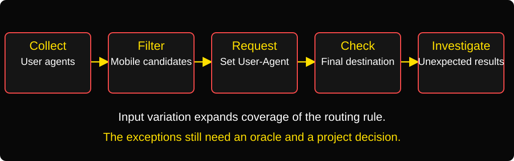

*Figure 18. The redirect experiment: collect, filter, request, check and investigate.*

That's pretty much it. You can look at the code in detail. This isn't really about the code. This is more about the approach. It'll be on the GitHub site. Now, if I run this, which I've just done, there's the main TFL site. And why am I choosing these as live sites? Because these are paid for out of my taxes. So, I am allowed to do whatever I want to their websites. So, there's TfL. TFL has got a mobile redirect. I went in there as a iOS phone and it redirects.

Now, what's interesting then is having run my script against this, I've got a list of three user agents that failed to redirect. That's not that bad. When I pulled off the list of user agents out of the user agents on the site on the user agent string site I found 10,830 possible user agents I could have used the filter that I put in place we brought that down to a list of 166 out of the 166 six user agents that I tested this site against.

It failed on three. So, what I can do now is I can look up these user agents, double check whether they are actually mobile devices and see if it's anything that we actually care about. So, what I'm doing here is I'm scraping a list of oracles because I don't know what the real user agents are. I know what we've decided on a project, but I can go out and find real things in the real world and use those.

Now, I don't know whether this is a problem or not. We then pass this up to someone on the project to make a decision about that. This is all about using real world oracles and real world information to validate this stuff to check the decisions that are being made on your project. Now, I know that this is way better than the project I was working on because when I run that against our project, we had 110 115 failed things. We didn't do as good a job as TFL or BBC.

If I run this against the BBC, I think we get one thing failed. Now, I could make this a lot faster by not using the web driver, by not using GhostDriver. Then what I'd have to do is parse the XML and find a different way of scraping this stuff off because web driver has the ability to find the elements in the page. This seemed like an easy way of doing it. I could write all the user agents I found, the candidate user agents out to a file.

I haven't done that yet because I'd have to spend some time writing some code to write to a file and read to a file. That's not a long time. But since this test only takes about 15 minutes to run, it didn't seem worthwhile given the amount of times that I've run it. If you choose to do this, you might choose to write these files and read them to make it a little bit faster on your project. I could in the output report instead of just outputting the user agent, I could build an HTML report that actually links back to the user agent on here.

If I've scraped this off, I could link back to that user agent which has some description that would make it easier for me to check whether the thing failed. There's a whole bunch of things I could do to extend this automated test. But what I've done here is write something quickly that scrapes a bunch of user agents that fires up against the website that does a very simple check that we've been redirected because I'm checking that the new URL has m dot instead of the wwww dot.

Kept this as simple as possible to do some testing really quickly that if I was doing this manually to test 160 different user agents, I'd have to need 160 different devices or manually do it through Chrome. And there's no point in doing that. But there's also no point in saying that we always do it manually or we always use the real device or we always have to do it through a browser. If we boost our technical skills to even have just a little bit of automation in there, a little bit of scripting.

You can do this in pretty much any scripting language. I haven't even written an app for this. This is just a test in JUnit that does this stuff. Kept it really simple. It adds a lot of value and it didn't take a long time to write, but it allows us to check against real world oracles. And also you come out with a list and you say, "We failed on 115 different user agents and the project is likely to say that doesn't sound important to us.

Why would we care?" If you run the same test against the BBC and it fails on one or the TFL and it fails on three, then you have a comparative oracle to say, "Look, in the real world, other people are doing way better than this. You might want to care about this." So that's pretty much all I was going to show you here. It's very simple use of GhostDriver. GhostDriver is a headless browser, so you don't see it when it's running.

I'm using real world oracles. I'm doing very simple checks and I haven't spent a long time making this do everything that it possibly could. So, have a look through the code if you're interested. Otherwise, keep in mind if you're doing simple manual checks and if the data set is all that's varying, you can probably automate it very quickly.

## 15. Final Section

**Section summary**

- Keep investigating the next layer of the application.
- Learn from colleagues and test that knowledge through experiments.
- Choose a practical next step and record what the investigation reveals.

### 15.1 End Notes

[Watch this chapter in the video](https://www.youtube.com/watch?v=jWwfMo5Ziz0&t=21597s)

**Chapter summary**

- Take responsibility for continued technical learning and experimentation.
- Use questions, colleagues and evidence to refine the testing approach.

**Transcript**

Well, you made it to the end or at least the end as it is now because remember this is a living course and it will expand and I will add to it based on your suggestions because the technical landscape that we work in keeps changing and advancing. So that's what we have to do. And technical testing is about learning, experimenting, and taking responsibility. And that means you have the responsibility for looking for the right tools for your environment. You have the responsibility for keeping up to date with the technologies that you use.

And it's your responsibility to keep experimenting with new tools and approaches and learning from them as you do it. people ask me how I learn stuff. And this is it. by doing, by experimenting, by constantly peeling away the next layer, figuring out how to observe more, by inspecting beneath the surface and asking questions. So, make sure you exhaust the knowledge and experience of the people that you work with. Take as much of it as you can. Ask as many questions. Internalize what they give you into your own models and experiment with it.

Some people tell me they don't like the term technical testing because for them it has connotations of a focus on the technical details or the tools or the automation or whatever. And I hope that this course tries to explain that it's more than that. But do you know what I tell them? Nothing. Because I don't really care what they call it so long as they do it. Because we individually own our testing process. We take responsibility for it. We describe it such that we can advance it and communicate it.

So just make sure that you keep learning, keep pushing the boundaries, keep redefining what and how you do what you do because that's really what this course is all about, continually learning and experimenting. So I hope it helped do that for you.

### 15.2 Where Next?

[Watch this chapter in the video](https://www.youtube.com/watch?v=jWwfMo5Ziz0&t=21730s)

**Chapter summary**

- Follow relevant material beyond the course recording.
- Return to practical work and keep extending the techniques that support testing.

**Transcript**

And where do you go next? Well, I have quite a few websites where I post information about new courses, new books, new articles, new webinars. And you won't see that information on this course or via announcements on this course. So, browse these sites, sign up for the email lists, or subscribe to the RSS feeds to stay up to date. compendiumdev.co.uk is my main hub site. I tend to link to all my other sites and products and news from this site. My other sites are more specialized.

Java for testers.com is my site to help testers learn to program in Java with the associated libraries. I have a book. I write blog articles and post videos using my YouTube channel. Seleniumsimplified.com is my Selenium WebDriver site. I link to my Selenium WebDriver books and training and post articles and new information on Selenium WebDriver. Some of these articles can cover pretty advanced topics. eviltester.com is my main opinion site and technical and exploratory testing site. There's also a blog where I post the information.

I'm part of the Black Ops testing group. We run free webinars as well as face to-face training. We have a mailing list that you can sign up for and you can learn about all the things we do via that. My YouTube channel, YouTube.com/eviltester, has a lot of free videos that I post and release, and you can subscribe to this channel to be kept up to date, as well as the RSS feeds and on my blogs. I use Twitter @ eviltester where I drip feed links and news articles.

Now over time I will add other sites and other social media channels but I'm sure I'll link to them from one or more of the sites here. So if you subscribe to those you will stay up to date. So do investigate these links. I guarantee that there will be free and useful information there. And I encourage you to stay up to date with these sites. Sign up to the RSS feeds, the mailing lists, subscribe to the YouTube channel, subscribe to the Twitter feed to get new deals, free webinars, up-to-date information that I release outside this course.

So, follow this up and here is to your continued learning. Best of luck.
