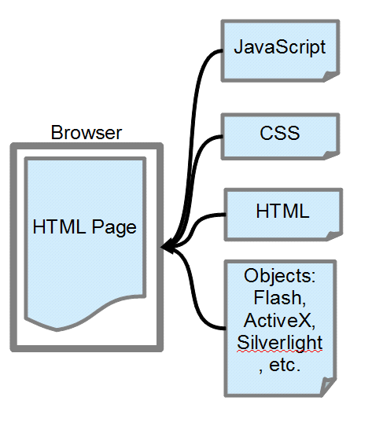
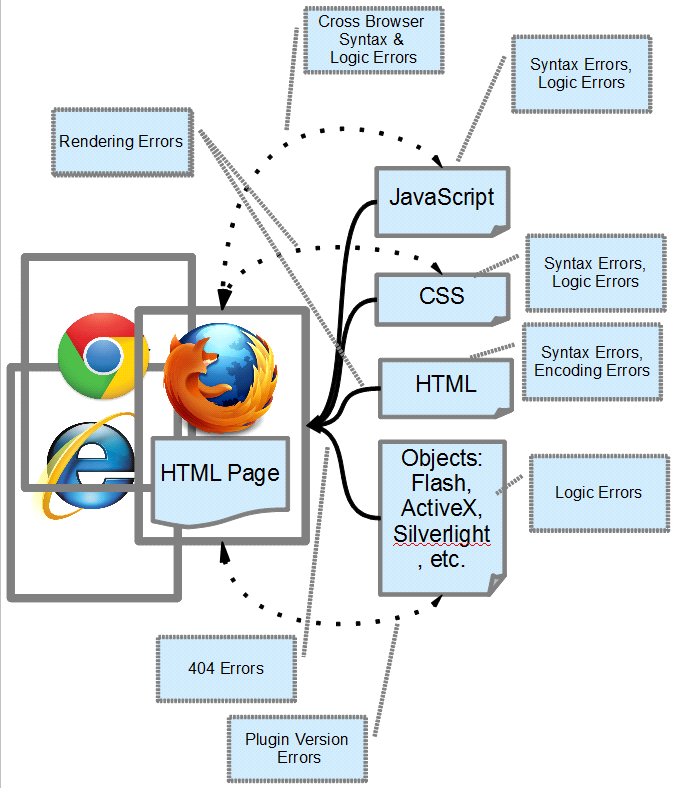
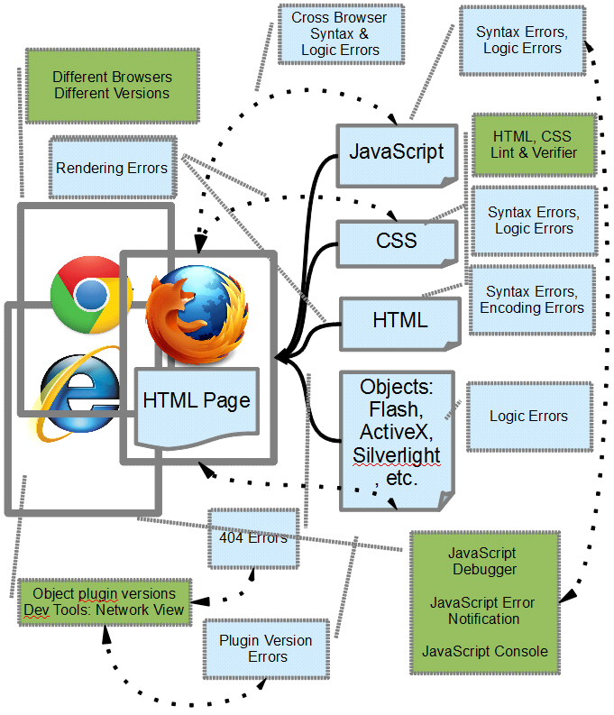

<!-- footer: @EvilTester -->
<!-- page_number: true -->

# Agile Technical Exploratory Testing Workshop

Epic Conference 2020

## Alan Richardson

- @EvilTester
- EvilTester.com
- compendiumdev.co.uk
- digitalonlinetactics.com

---

## Blurb: Agile Technical Exploratory Testing Workshop

Have you have ever worried about not going deep enough with your testing because you are working from Stories and Acceptance Criteria? Do you want to learn, and practice, testing and exploring web applications from technology perspective? This workshop will help. Working with applications, browser based games and APIs - specifically designed for testing - we will learn how to incorporate and justify technical exploratory testing into our Agile processes, and we'll get hands on with tooling to help e.g. HTTP proxies, Dev Tools, API GUIs. We will also look at how to take notes and document our testing within the context of Agile project management. Bring a laptop and prepare to get hands on.

---

## Blurb: Agile Technical Exploratory Testing Workshop

Key Areas we will cover:

- Exploratory Testing in Agile
- Going beyond Acceptance Criteria
- Understanding and Exploring Technical Risk
- Tooling to help work with Web Applications: HTTP Proxies, Dev Tools, JavaScript, HTML Validation
- Improving our note taking and communication of exploratory testing

---

## Logistics

- Tuesday, April 21, 2020 - 8:30am to 4:30pm
- Approximately 13, 30 minute sessions

<!--

There is usually 1 hour for lunch
There is usually a morning and an afternoon break

Assume

- 08:30 - 10:30 (2)
- break 10:30 - 11:00
- 11:00 - 12:30 (1.5)
- break 12:30 - 13:30
- 13:30 - 15:00 (1.5)
- break 15:00 - 15:15
- 15:15 - 16:30 (1.5)

2 + 1.5 + 1.5 + 1.5

== 6.5

== 13 - 30 min sessions

plan for 13 30 min sessions, and have enough extra 'exercises' for another 4 15 min sessions - also allows homework

Published Blurb

Have you ever worried you’re not going deep enough with your testing because you are working from stories and acceptance criteria? Do you want to learn and practice testing and exploring web applications from a technology perspective? This workshop will help. By working with applications, browser-based games, and APIs that are specifically designed for testing, we will learn how to incorporate technical exploratory testing into our agile processes. You'll get hands-on experience with tooling to help work with web applications, such as HTTP proxies, dev tools, and API GUIs. Learn how to take notes and document your testing within the context of agile project management, understand technical risk, and go beyond the acceptance criteria. Bring a laptop and prepare to get hands-on with exploratory testing in agile.

Agile:

- we will learn how to incorporate technical exploratory testing into our agile processes.
- understand technical risk, and go beyond the acceptance criteria.

Exploratory Testing:

- Learn how to take notes and document your testing
- within the context of agile project management,

Technical Testing:

Bring a laptop and prepare to get hands-on with exploratory testing in agile. Working with applications, browser-based games, and APIs that are specifically designed for testing.
HTTP proxies, dev tools, and API GUIs

-->

---

# Agile is a Context

In theory Agile is no different from any other context, the same skills, tools, approaches and mind set apply

But when people learn: exploratory testing, technical testing, in isolation, they often don't know how to apply it in an Agile Context.

## We will weave, Agile, Exploratory and Technical together

---

# Agile is not a Religion

- Do not quote scripture - AgileManifesto.org
- Approach your work with agility
- Discover what "Testing" means in your projects
- "Nothing is True. Everything is permitted." _Hassan-i Sabbah_

---

# I've worked on Agile as

- Tester
- Test Manager
- Test Consultant
- Automator
- Automation Consultant
- Agile Consultant

---

# Barriers To Effective Agile Adoption

- Expectations & Beliefs
- Skills
- Experience
- Surface Structure Adherence to Terminology

---

# Tools

-   Systems Thinking & Modelling
-   Modelling, Cybernetics, Psychotherapy, ...
-   Technical Knowledge
-   Programming, Databases, Protocols, ...
-   Testing Knowledge
-   Techniques, Exploration, Note Taking, etc.

---

# What about you?

- Roles?
- Technical? Y/N
- Initial Questions?
- Aims?

---

## System Under Test

- The Pulper https://eviltester.com/thepulper
- CRUD Based Web App with REST API
- Install and run locally
- Online at https://thepulper.herokuapp.com/
- Multiple versions in same app - choose version from Admin drop down or menu
- Demo

---

# Exercise: Recognise your Context Free Baseline

- Use the application  https://thepulper.herokuapp.com
    - download and install if necessary or desired
        - https://eviltester.com/thepulper
- Use the application, make notes, what do you notice? What do you learn?
- Think about future strategy - what might you do? what tools will you need?
- What information do you need to support you?

---

# Baseline Debrief

- What did you learn / do / find / use?
- How did you make Notes?
- What do you need?
- Future strategy / approach thoughts?
- Any Questions/Comments?

---

Expectations & Beliefs
======================

-   A series of short discussions to identify current beliefs and expectations

-   What is Agile?
-   What is Testing?
-   What is Agile Testing?

---

What 'is' Agile?
================

-   Build a model, not a definition

---

What 'is' Testing?
==================

-   Build a model, not a definition
-   What do we do?

---

What 'is' Agile Testing
=======================

-   Build a model, not a definition
-   What do we do?
-   How do we do it?
-   When do we do it?

---

# What is the Tester's Role in Agile?

---

What is your test strategy/approach for Agile Testing?
======================================================

-   How do/will you estimate?
-   How do/will you plan your testing?
-   How do/will you track your testing?
-   What results do/will you keep?
-   Scripted? Exploratory?
-   How do/will you report your testing?
-   Would you automate?

---

Technical and Exploratory Testing in Agile
===================================

-   How far to push the boundaries of user stories?
-   If we go too far:
    -   is it a bug?
    -   does it add value?
    -   did we estimate for that?
    -   how do you justify that?

---

## Table Discussion

In more detail, on the table.

- Share your expectations and beliefs about Agile.
- How do they differ from reality?

An easy way to identify

- (reality) "these are the things we are trying to improve on our Agile process"
- (beliefs) "... and here is why"

---

# Debrief

- Comments / Thoughts?

---

# Agile Story Testing

---

Working with stories
====================

-   What can we test from a story?
-   How do we test with stories?
-   What do we need on the story to test?

---

Group Exercise: Discuss and plan testing for
============================================

- in v009 of The Pulper

### Story - v00901AuthAmend

> As a User I want to be able to amend a User without the screen flickering after updating the name of the Author so that I don't see the screen flicker after updating the user.

### Story - v00901AuthDelete

> As a User I want to be able to delete a User from the amend screen, without being taken back to the main list of users when I delete - instead I want a user friendly message that the Author has been deleted - so that I don't forget who I just deleted.

---

## Debrief

- Thoughts?
- Would you test differently from the baseline testing exercise?
    - Why? How?

---

## Implement the Group Strategy

-  Test, the following stories, in v009 of The Pulper

### Story - v00901AuthAmend

> As a User I want to be able to amend a User without the screen flickering after updating the name of the Author so that I don't see the screen flicker after updating the user.

### Story - v00901AuthDelete

> As a User I want to be able to delete a User from the amend screen, without being taken back to the main list of users when I delete - instead I want a user friendly message that the Author has been deleted - so that I don't forget who I just deleted.

---

Debrief
=======

-   Did you test differently?
-   What notes did you make?
-   Would this work in the real world?
-   Any 'technical testing' observations?

---

## Observations: Working From Stories

-   Ask questions
    -   What are the acceptance criteria?
    -   Understood? Clear? Checkable? Examples?
    -   Questioned limits in the planning?
-   Document testing 'in the story'
-   Whatever system used for Agile Planning
    - use for test documentation & tracking
-   Other Observations?

---

## What are acceptance Criteria?

---

## Acceptance Criteria

- Minimum requirements
- Define Minimum Value Proposition
- Examples that must be met

---

## What are Acceptance Criteria for?

--

## They might be used to...

- Constrain the development scope
- Basis for automated execution coverage
- Define definition of done
- Support Estimation
- Delineate Mandatory from Optional features

---

## What are the Risk of Acceptance Criteria?

---

## Acceptance Criteria Risks

- states something as mandatory that could be optional or delivered later
- not questioned by team, just accepted
- unreasonable in scope
- not complete, missing criteria
- team focus on criteria and don't explore impact or errors of ommission
- ambiguous and don't lead to shared understanding

---

## Discuss - limits, risks with the acceptance criteria?

In v009 of The Pulper

### Story - v00901AuthAmend

> As a User I want to be able to amend a User without the screen flickering after updating the name of the Author so that I don't see the screen flicker after updating the user

Acceptance Criteria:

- author name is validated on update
- clicking update, stay on same screen
- any error messages shown on screen
- success message shown on screen "Author Amended Successfully"

---

## Discuss - what would going beyond acceptance criteria mean here?

### Story - v00901AuthAmend - In v009 of The Pulper

> As a User I want to be able to amend a User without the screen flickering after updating the name of the Author so that I don't see the screen flicker after updating the user

Acceptance Criteria:

- author name is validated on update
- clicking update, stay on same screen
- any error messages shown on screen
- success message shown on screen "Author Amended Successfully"

---

## It might mean...

- Are we sure that is what the user wants? Or is this a justification to add some Ajax processing?
- What is the impact on automated execution?
- How is this implemented? Cross browser risks?
- Ambiguity - What validation?
- Does the rest of the front end for amendment stay the same?
- Acceptance criteria around format of messages and responses?
- Is this using the API or form submission? Test at API level too?
- etc.

---

## Go Beyond The Acceptance Criteria

- Based on what has been discussed...
- Based on what you think...
- Test the story "Beyond the acceptance criteria"

---

# Debrief & Observations

---

# What is Exploratory Testing?

---

## What is exploratory testing?

- Rapid/Lean test design
- Risk Driven:
    - Risk: a ‘bad’ thing that might happen
        - e.g. Coding error, missing requirement, common errors
        - Thinking: what would this lead to? How would I know it had happened?
    - Risk: undesirable consequences
        - E.g. System crashes,
    - Risk: A chance that we are prepared to take
        - We will take the risk of ‘not testing’ function X
- Fast Feedback
    - Into the development process
    - To guide the test process and identify new tests

---

## What is exploratory testing?

- Model Based
    - we explore to understand
    - we explore our understanding
    - compare a model of the thing, with the thing
- Technique & Heuristic based
    - compare in different ways
- Experience Based
    - Techniques and Heuristics offset experience
- Tool Supported

---

# Why document exploratory Testing?

- Do we document it?
- Why would we?

> "we have come to value:...
> Working software over comprehensive documentation"
> https://agilemanifesto.org/

---

# Why document Exploratory Testing?

- So that you / other people can:
    - understand and communicate coverage
    - learn from what you have done
    - suggest new ‘things’ to explore
- Evidence
- Support review / reflection / debriefs

---

# What do we document?

---

# What do we document?

- What you think you’re going to do (enough detail to review) - goals, aims, objectives, charter
- What you did (enough detail to act as persistent communication)
- How you did it
- Assumptions
- What data you used
- What you observed
- What questions you have
- What issues you think you found
- What times you tested (timestamp logs)
- What ideas you have
- etc. whatever you find useful

---

# How do we document exploratory testing?

---

# How do we document exploratory testing?

- Whatever works for you and your team

Some people like:

- mindmaps
- specialised tools
- pen and paper

I like:

- linear text notes with timestamps

## Experiment

---

# How do we Track Exploratory Testing in Agile?

---

# How do we Track Exploratory Testing in Agile?

I use the same tools as development tracking.

- description fields in stories for test ideas
- tasks to track testing sessions
- copy and paste notes or attach testing logs
- version control / document control binary logs (screenshots etc.)

I avoid customising tooling.

I avoid "Test Tracking Tools" because this encourages silo'd Testing.

---

# What Tools do we use to support our exploratory testing?

---

# What Tools do we use to support our exploratory testing?

- Technology focused tools
    - to observe, interrogate and manipulate the application
- Note taking tools
    - e.g. evernote, mindmaps, text files, specialised tools, etc.
- Evidence Gathering tools
    - e.g. screenshots, memory dumps, traffic capture, video capture, etc.
- Modelling Tools
    - e.g. diagrammers, mindmaps, spreadsheets, etc.
- Data Creation Tools
    - e.g. counterstrings, bug magnet, spreadsheets,e tc.
- Tactical Automation Tools
    - e.g. fuzzers, data-driven form fillers, etc.

---

## Exercise: Concentrate on Note Taking

-   Perform some more testing. But this time concentrate on your note taking.
-   e.g. take notes in a text document, or mind map

---

## Debrief on note taking

-   Did you add timestamps?
-   Did you have screenshots?
-   How did you organise your notes?
-   Do they work on their own, or do you need to edit them ?
-   If this was an agile project, and you had to record your notes against the story, how would you do that?
-   Could any tools we've used help with note taking or evidence gathering?
- Will your notes support a debrief with someone else?
- Will your notes survive the passage of time? i.e. will you be able to read them tomorrow, 1 week, 1 month, 1 year, etc.

---

## What is Technical Testing?

---

A description of Technical Testing
==================================

-   A reminder to keep "going deeper"
-   Tool Augmentation
-   Technical details will:

-   inspire more testing
-   identify more risks
-   Identify different problems

-   Not limit our testing to Acceptance Criteria

---

How I describe what I do
========================

-   Not a definition
-   A description of my current approaches
-   I try get as deep and technical as I can
-   I need to keep learning so that I can understand the technology

---

MORIM
=====

-   Model
    -   What I think I understand. Different viewpoints.
-   Observe
    -   at different points to corroborate/invalidate model
-   Reflect
    -   find gaps, lack of depth, derive intent
-   Interrogate
    -   Focussed, deep dive observation with intent
-   Manipulate
    -   Hypothesis exploration and "how we do stuff"

---

It means "Tool Augmentation"
============================

-   Is not automation, I automate when appropriate
-   Tools to passively observe, maintain history of observations
-   Tools to alert on specific conditions
-   Tools to observe the unobserved, and interrogate the inaccessible
-   Tools to help me model and reflect
-   Tools to help me manipulate
-   ... etc.

---

Never tools to control. Tools to augment.
-----------------------------------------

---

Go Beyond the surface structure
===============================

-   Transformational Grammar

-   Surface & Deep Structure
-   Chomsky
-   Multiple surface structures
-   Single Deep structure

-   Filtered, biased, distorted → Surface Structure

-   Questions operate as tools to investigate Surface to Deep mapping people

---

Questions operate as tools to investigate Surface to Deep Mapping
=================================================================

"login doesn't work"
--------------------

-   How specifically?
-   How do you know?
-   Ever? At all?
-   ...etc.

We ask the system questions
---------------------------

---

## Why would we do 'Technical Testing'?

---

Why Technical?
==============

-   Work with current system, not with an ideal
-   Work with current system, not a generalised model

---

# How would we do 'technical testing'?

---

How to do Technical Testing?
============================

-   Identify tools to work with System Surface Structures
-   Questioning Systems at different Surface Levels
-   Learning System Structure Technology
-   Model System Surface Structures
-   Observe System Surface Structures

---

## Exercise: What are your existing "Technical Skills"?

-   Collate and build a model of your skills
-   For bonus points, identify some skills you want to develop:
    - now
    - short term
    - medium term
    - long term

---

# Debrief - what is your baseline?

- Anyone prepared to share?

---

Your concerns
=============

-   Do you spot any risks and issues with 'technical testing'?

---

What Risks and Issues might the tools add?
==========================================

-   Proxy Tools?
-   Dev Tools?
-   SDK?
-   etc.?

---

Technical Testing Risks & Issues
================================

-   How to Justify?
-   How to document?
-   How to avoid doing too much?
-   How to get the time to learn?
-   What if we just want to check the Acceptance Criteria?

---

Adopting Technical Testing Risks & Issues
================================

-   Take responsibility for your testing
-   Is anyone really going to stop you from doing the best testing you can?
-   You can learn, as you add value. Take small steps.
-   You can learn, as you pair. Ask questions, take notes. Apply your 'testing super powers' to the information you get.
-   Use technical testing to 'push' for more access to environments and system internals

---

# Let's Build a Model

-   What happens where?
-   What risks exist?
-   What could we observe where?
-   Where could we manipulate?
-   What tools could you use?

_whiteboard?_

---

## Generic Web Application

Browser <- HTTP Messages -> Server <- calls -> Database / Other Systems

---

## To Build a model

-   What happens where?
-   What risks exist?
-   What could we observe where?
-   Where could we manipulate?
-   What tools could you use?

---

## Technology Considerations

- HTTP Traffic,  Cookie Creation, Messaging: JSON, XML, form-encoded, Files: img, pdf, etc.
- Rendering, CSS, Cookies, JavaScript
- HTTP Logs, Application Logs, DB Schema
- Data

---

What tools do we need to augment our testing?
=============================================

-   What can we observe?
-   What tools do we need to observe?
-   What can we manipulate?
-   What tools do we need to manipulate?

---

What tools do we need?
======================

- What can we observe?
    - Http traffic, cookies, javascript execution, log files, data in the database, DB schema used
- What tools do we need to observe?
    - HTTP Proxy (Burpsuite, ZAP Proxy, Fiddler), Browser Developer Tools (in browser), DB Tool (mysql, mysql workbench), Text Editors, Log File Viewers (tail -f)
- What can we manipulate?
    - HTTP Traffic, DOM, Cookies, DB, Config
- What tools do we need to manipulate?
    - All of the above

---

How could this help us with 'testing'?
=====================================

---

How can this help us with 'testing'?
=====================================

-   The GUI might not show everything
-   The DB might have something different from the GUI
-   We might see something in the log that triggers a test idea
-   We might see errors and exceptions in the logs
-   We want to remove all limits to our test ability
-   etc.

---

## What questions do we need answered?

-   From a technical perspective, what questions do we need answered to allow us to observe, manipulate and test this particular system from a technical perspective?

---

## What questions do we need answered?

- What authentication is there?
- Is there an API?
- Does the GUI use the API?
- How can I access the database?
- Where are the logs?
- What extra permissions can I get?
- What technology is used? JavaScript, Cookies? Local Storage?
- Is there any API documentation?
- Is there any automated coverage I can build on?
- What tools are the dev team using?
- etc.

---

# The Pulper

- Java Application (server side)
- Spark Embedded Web Server
- Heroku deployed - https://thepulper.herokuapp.com
- local .jar available - https://eviltester.com/thepulper

---

# The Pulper

- there is no database
- there are no JavaScrip
- no login - session cookies used to define user session
- later versions use cookies and local storage
- later versions use JavaScript to make requests to server for Create
- later versions use the API via JavaScript for Create, Update, Delete

---

## Explore the Model against the System

- what level do you know how to work at?
- what tools do you know about for that level?
- what risks can you identify for this system from the model?

_we are building a model of our thoughts and capabilities which will guide us through the next sections_

---

# Debrief

- Thoughts?
- Observations?

---

# Working at a GUI Level

---

# Web Context: A Browser View

---

# Exercise: Browser Web Context Risks

-   What risks exist at browser level?
    -   Identify
    -   Discuss

-   What tools could help?

---

## Web Context: A Browser View -- Technical Risks

---

## Browser Technical Risks

- Syntax Errors - JavaScript, HTML, CSS
- Logic Errors - JavaScript, CSS (animation etc.)
- Cross Browser Compatibility - JavaScript, HTML, CSS (versions, implementation)
- Storage issues - cookies, local storage, etc.
- Performance issues - rendering, loading
- Responsiveness and Layout
- URI errors - broken links, missing images
- Caching errors between versions e.g. JS, CSS not updated

---

## Web Context: A Browser View -- Technical Tooling Augmented

---

## Browser Context Tooling

- Different Browsers
- Browser Dev Tools - responsive, performance, console for error logs, Network tab, Storage manipulation (cookies, local storage)
- Validators - HTML, CSS, JavaScript
- Browser Plugins for validation, link checking etc.

---

## Demo of Browser Based Tools

-   Dev Tools - Chrome
-   DOM Manipulation
-   Resources - cookie manipulation, local storage
-   Mobile Simulation and Responsive Layout testing
-   Traffic Viewing - Network Tab

---

## Consider external tooling

- Total Validator
- other tools to consider: Xeno, Screaming Frog, Scrutiny - pretty much any SEO type tool
- with the pulper you may need to exclude paths to prevent version changes
    - /thepulper.herokuapp.com/apps/pulp/gui/admin/version/
- if a new session is created on each URL then scanner might overload app
- multiple people scanning will probably overload app - use a local instance if you scan site

---

## Exercise: exploration using only Browser Based Tools

-   Using only browser based tools, explore system
-   Use parts of the dev tools you haven't used before
-   If you have used them before, use them to test the system from a more technical perspective
-   Take enough notes to allow you to debrief with the group

---

## Debrief

- What did you explore?
- What features of the tool did you use to help?
- What risks / issues did you find?
- How did they help?
- How else could you do that?
- What did you want to do but couldn't figure out how to do?
- Could anything be done at build time to help?

-   Proxy

-   Easy

-   Fiddler - <http://www.telerik.com/fiddler> (windows .net)
-   Charles - <http://www.charlesproxy.com/>

-   Advanced

-   BurpSuite - <https://portswigger.net/burp/>
-   Owasp ZAP - <https://github.com/zaproxy/zaproxy>

-   FoxyProxy - <https://getfoxyproxy.org/>

HTTPS issues - proxy certificates
Avoid by running app locally and using http

Browser Dev tools for network traffic amendment

---

## The Pulper API

- Pulper has a REST API
- it is not versioned
- requires a custom header X-API-AUTH (see admin screen)
- API is used by the GUI from version 7
- API can be tested directly

---

## API Documentation

- https://eviltester.com/thepulper
- for API documentation link
- for Insomnia Workspace
- for Postman Collection

#   API Tooling

- PostMan -- <https://www.getpostman.com/>
- Insomnia

---

## Explore the API and API tooling

- documentation etc. https://eviltester.com/thepulper
- use the X-API-AUTH header from your admin screen
- experiment with API

Or carry on with other technical levels.

---

# Agile Specific Issues

Are there any Agile Specific issues / risks / concerns with this

- architecture?
- technology?
- set of levels of testing? GUI, HTTP, API?

---

## Possible Issues

- Automating at multiple app levels
- People avoid GUI automation
- API testing doesn't help when APP uses form submissions and non-API calls
- too much to test if not automated
- do stories mention API or do they focus on the User impact?
- do stories mention the technical implementation? and technical risks?

---

# A System 'of' Development

---

Agile Generics
==============

-   Agile == Context
-   Stories
-   Iteration / Sprint
-   Planning / Estimates
-   Backlog
-   Retrospectives
-   Stand ups
-   Acceptance Tests

---

Agile == Context
================

-   Each project is different
-   Each project is a specific instance of 'Agile'
-   Each project changes depending on its team
-   Team Members add Unique value & constraints
-   Each project is a System
-   Each team member is a System
-   System is complex set of communication and relations

---

Stories in General
==================

-   A basis for understanding
-   A basis for agreement of scope
-   Question them
-   I write down the
    -   The questions I asked
    -   answers to questions against the story
    -   The 'agreements we made'
    -   How I think I will test it, How I tested it, What I didn't test, what we agreed not to test, outstanding risks, etc.

---

Iteration / Sprint
==================

-   Things to fit in: exploration, reviews, meetings, rework, refactoring, execution, tracking, pairing, etc.
-   I find myself 'nagging' to keep us inside the sprint. To avoid test pushed out to next sprint or 'late' delivery of stories.

---

Planning / Estimates
====================

-   Some tasks have dependencies
-   Do voice concerns about low estimates
-   Do make sure estimates cover testing
-   Do make sure estimates cover exploration
-   Do make sure estimates cover technical debt etc.

---

Backlog
=======

-   Add testing tasks to backlog to cover risks
-   Add testing tasks to backlog to cover testing debt
-   Push for technical debt that impacts testing to be played
-   Push for testability in the backlog
-   Push for acceptance criteria
-   Consider testability in the order of story playing

---

Retrospectives
==============

-   Don't just pat on the back
-   Raise process issues that impact
-   Agree 'what to do about them'
-   Treat Broken Windows
-   You might have to be Mr Nag & Mrs Nasty

---

Stand ups
=========

-   Pay attention to change of plans
-   Pay attention to what might impact your testing
-   Describe in value terms -- what did you find? Any new risks? What looks OK?
-   Ask for reviews of your notes and work
-   See if you can pair early on Unit Testing
-   Report that things are bigger than you thought
-   Seek help
-   etc.

---

Acceptance Tests
================

-   Abstraction layers
-   Re-use abstraction layers for adhoc automation as well as Acceptance tests
-   Seek to understand technicalities as well as domain
-   Pair -- don't just leave it all to test, or all to dev

---

# Exercise : Model your system of development

- create  a model of 'your' System of Development
- are there any issues with the reality of your System?
    - Are they hinted at in the Model?

We will discuss this in groups when done to see: approach, common issues, common fixes, etc.

---

## Debrief as groups

- share your models with your neighbours
- similarities?
- differences?

We will debrief as a room in a moment.

---

## What models did you create?

- how did you model?
- what did you model?
- did you learn anything about your processes?
- is there anything you would want to change?
- was modelling hard?
- did you focus on things you can influence or the whole System?

<!--

Section 08: Hands On Testing
============================

Hands on Exploratory Learning Exercises
=======================================

-   Pick an area of the system to test
-   Choose a technical approach:

a) Browser & Dev Tools only
---------------------------

b) Add Proxy tools into the mix and work at the Message level too
-----------------------------------------------------------------

c) Work from the API and conduct testing there
----------------------------------------------

d) On your own install you could look at the DB or the Server
-------------------------------------------------------------

-   Test the system, and for each of the above: track your questions and how you answer them

- what do you learn?
--------------------

- How did you do it?
--------------------

- How else could you do it?
---------------------------

- What do you not know that you need to know?
---------------------------------------------

20 mins then debrief
--------------------

Debrief
=======

-   Questions?
-   Observations?

-->

<!--

Section 09: Hands On Testing
============================

A Redmine Testing Session Review
================================

-   See 13:15 Redmine Test Session Notes
-   Discussion for ideas and observations

Hands on Exploratory Testing Exercise
=====================================

Choose between:
---------------

-   Free form testing
-   Revisit the registration story testing using what you learned from the Exploratory Learning Exercise
-   Revisit the login story testing and go deeper

Make enough notes to support a debrief
--------------------------------------

Debrief
=======

-   Did that help?
-   Did you see anything different?
-   Thoughts?
-   Issues?
-   Concerns?
-   see my 13:15 Redmine Technical Testing Notes

-->

---

## Final Thoughts

- Model your process and System of Development, not just the System Under Test
- Identify technical knowledge gaps
- Test and observe in those gaps
- Then Interrogate and Manipulate in those gaps
- Find tools to support your testing
- Agile Stories help keep us on track and avoid technical ratholes

---

## Some Recommended Computing Books

- Book: Domain Driven Design by Eric Evans
    - http://dddcommunity.org/
- Book: The Web Application Hackers Handbook
    -   by Dafydd Stuttard (Author), Marcus Pinto (Author)
- Automating and Testing a REST API
    - Alan Richardson

---

## Tools

- PostMan - https://www.getpostman.com/
- Insomnia - https://Insomnia.rest
- BurpSuite - https://portswigger.net/burp/
- Fiddler - http://www.telerik.com/fiddler
- Owasp ZAP - https://github.com/zaproxy/zaproxy
- Charles - http://www.charlesproxy.com/
- FoxyProxy - <ttps://getfoxyproxy.org/

---

##  Topics to investigate

-   Stafford Beer viable Systems model
    - http://www.scio.org.uk/node/12
    - https://www.youtube.com/watch?v=JJ6orMfmorg
-   General Semantics
-   W. Edwards Deming
-  NLP: The Structure of Magic vols 1&2 by Richard Bandler and John Grinder
    -   See also http://www.compendiumdev.co.uk/nlp
-   Cybernetics
    -   http://pespmc1.vub.ac.be/
    -   http://www.cybsoc.org/
-   Ross Ashby -- Requisite Variety
    -  https://archive.org/details/introductiontocy00ashb
    -  https://archive.org/details/designforbrain00ashb
-   Norbert Wiener
    -   https://archive.org/details/NorbertWienerHumanUseOfHumanBeings

---

## End

- Q&A
- Keep Pushing your Testing

---

# Appendixes and Extras

---

## How to Improve your technical skills

-   Practice
-   Learning
-   Experiment
-   Model Application → Identify Technology → Learn the Technology → Tools for technology? → Observe? → Manipulate? → What do we learn then? → Model Application
-   Doing

---

## Exercise: From what we have covered...

Think about and write down:

- What do you need to learn?
- What did you not understand?
- What was new?
- What did you not try?
- spend 10 mins building a research and confusion list
- Prioritise your list
    - what interests you?
    - what would be useful for work?

<!--

presentations here:

/Users/alanrichardson/Documents/docs-git/documents/Documents/Compendium Developments/testing/agileTesting

Collate everything into:

/Users/alanrichardson/Documents/docs-git/documents/Documents/Compendium Developments/books/agileTestingManuscript

And use above as 'supporting' information

-->
