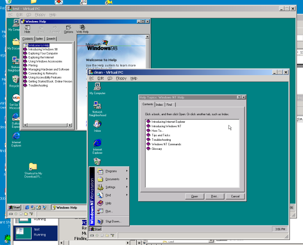
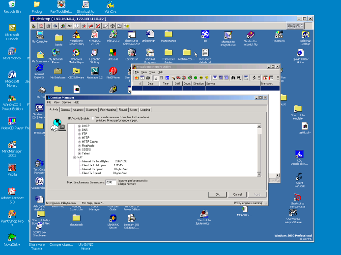
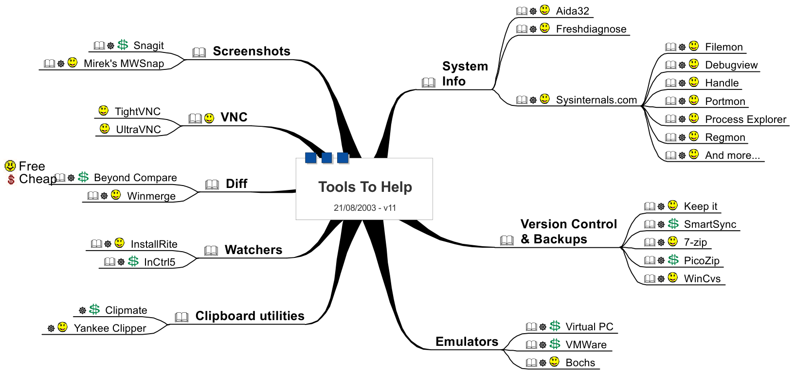
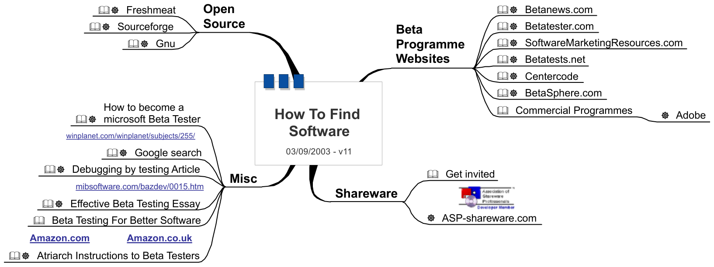

# Be a Better Tester, Be a Beta Tester

Original EuroSTAR 2003 paper. Wording, quotations, source credits, appendices and illustrations are retained. The automatic page-number contents list and editing metadata are omitted; the PDF retains the original pagination.

Be a Better Tester,

Be a Beta Tester

Alan Richardson

I’m a professional tester. That’s what I do to earn a living. And in my spare time I keep testing, I download software and I test it. I get a lot of benefit from doing this and I enjoy doing it, and in this paper I’m going to explain why I do it, why I enjoy it, why it is fulfilling &amp; exciting, and what benefits I get from it.

I’m also going to look at the practicalities of beta testing. What tools you can use, what you have to do to look after your test environment, how to find software to beta test, in fact everything you need to get started as a beta tester.

And before you run off thinking, “yeah, but I’m never going to do that, there is no point me reading this.” I’m going to tell you right now, that everything that I cover here can have an impact on your normal testing regime and can be used to improve your daily testing situation.

I’ll let you into a secret right now, I was saving this until later, but…hey, you deserve to know… I beta test because it helps me in my testing career. That’s the main benefit, everything else is a bonus, and there are lots of bonuses, believe me, and I’ll cover them later in this paper, but fundamentally I beta test because it helps make me a better tester.

Alan Richardson

Compendium Developments

alan@compendiumdev.co.uk [Source link](mailto:alan@compendiumdev.co.uk)

<http://www.compendiumdev.co.uk> [Source link](http://www.compendiumdev.co.uk/)

Many thanks to my Beta Testers:

- James Lyndsay \[www.workroom-productions.com\] [Source link](http://www.workroom-productions.com/)

- Robert Sabourin \[www.amibug.com\] [Source link](http://www.amibug.com/)

Any remaining defects are the fault of the author. Never blame the tester for defects in the system.

## Introduction

“…the best way of learning is not through the computation of information. Learning is discovering, uncovering what is there in us. When we discover, we are uncovering our own ability, our own eyes, in order to find our potential, to see what is going on to discover how we can enlarge our lives, to find the means at our disposal that will let us cope with a difficult situation. And all this, I maintain, is taking place in the here and now.”

Bruce Lee \[6\]

As professional testers we are expected to buckle down and test software under whatever circumstances are prevalent in the project. There are an enormous amount of skills required to test software effectively and this paper looks at one novel approach for gaining those skills. Through the practise of beta testing.

Various testing books and articles are available that discuss Test Process Improvement. Test Process Improvement can start by improving yourself. Be the best tester you can be.

### On Practising and Learning

“Merely repeating a performance many times does not give the high degree of skill that we see in the expert telegrapher or typist. Ordinarily, we practise much less assiduously, are much less zealous, and have no such perfect measure of the success of our work. For “Practise to make perfect”, it must be strongly motivated, and it must be sharply checked up by some index or measure of success or failure.”

R.S Woodworth \[4\]

When we are involved in a particular skill, day in and day out, it is easy to view practise as unnecessary. But a lot of the time we are doing the same old thing and the learning experiences may be fewer than we realise. We may well be reinforcing habits. The choices we make for testing should be justified, not habitual responses to the notion of, or need for, testing.

The work situation may not always be the best place to learn. Learning requires the ability to get it wrong. And if you think about beta testing then I give you permission to be wrong, permission to experiment and permission to try new things. Give yourself permission to learn.

#### Are you in a rut?

“…when our performance and attitude become jaded and weary, self-effacing and apologetic, there are two options. One is to eventually stop performing, bored with the whole thing… But the other option is to completely re-discover the art, and change ones idea of what magic is and what ones role as a magician might be.”

Derren Brown \[1\]

Are you having to test according to a methodology rather than adapting your methods to the software under test? Are you running old tests because you have been told to achieve coverage of the test pack rather than the weak spots of the software under test?

Under these, or similar, circumstances it is easy to think that it is hard to enjoy your job or do your job properly. Well, beta testing is a way of trying out new things in a safe environment and you can use the process to help foster a new attitude, which you can then apply in your daily job.

| How do you know you are in a rut? | What makes the rut possible? | Ways of getting out of the rut: |
| --- | --- | --- |
| - You use one or two techniques - And you use them all the time - You rework loads of scripts and tests - You get stressed - You don’t enjoy testing - Testing is boring | - Methodology &amp; Process Restrictions - Inflexible tools - Politics - Timescales - Development Process - You don’t know any better! | - Do something different - Do it quicker - Do something crazy - Attend a testing conference - Read the rest of this paper… |

If any of the rut signals above apply to you then I want to tell you that “Testing is the best job in the development process”. It really is, I tell people this all the time. They look at me like I’m crazy, sometimes they’re other testers, but testing is, it is!

Testing allows you to do: Planning, Designing, Managing, Communicating, Programming/Scripting, Understanding every aspect of the software, Environmental, Telling it like it is – honesty, Telling people they’ve done wrong, Telling people they’ve done great, Saying “No”.

Phew, that’s a lot of good stuff. No other role has such variety, such influence and such skills required of it. I’d rather be a tester than any other role on the development process. Remember that. Work your way out of the rut so that you can see/feel that again.

Now, Testing has so many techniques that can be of use and it is worthwhile knowing what they do and when to use them. Practise them so that when you come to test in the real world you know what to do, and how to do it, and you can do it quickly and effectively. Do you rely on one or two techniques? That’s a rut signal, its time to change.

### Why should you beta test?

“…point out that special mental exertion may result in personal advantage in the following ways:

1. Increased Income

2. Increased social consideration

3. Pleasurable occupation in higher degree

4. Increased capacity for being of use in the world”

Percy C. Buck \[2\]

This is just a short advertising list of features. If this was a mail shot then I’d follow it with And even more!… but I wouldn’t do that to you, this is a serious paper.

You should beta test to…

- Try out new software

- Try out new technology platforms that you don’t normally get to test on: Web, Linux, Windows, DOS, Embedded Systems, Handhelds

- Try different types of tools: test tools, assisting tools (screen capture tools)

- Try different types of testing: performance testing, GUI automation, API automation

- Learn new programming languages - scripting and compiled e.g. Perl, Ruby, Python, VB.

- Try different test techniques and approaches: cause effect graphing, orthogonal array testing, session based testing

- Build choices in the way that you approach testing.

- Test software you don’t know the internals of, and that’s challenging.

- Expand your knowledge and learn by going outside your comfort zone.

- Yes, all that and even more…

I remember when I was a young tester, getting frustrated with my testing environment, thinking “there must be a better way than this” but not knowing what it might be. So I read many testing books to get the techniques, but after reading them I often couldn’t see how to apply that technique to my environment as the book context was different from my work context. I hadn’t managed to grasp the subtleties of the technique to use it effectively quickly. I really needed to practise, and I did. And the more I practised and reflected on what I was learning, the more effective I was able to be.

And I know that I have to keep learning, and keep practising, because every project I work on has new challenges that I have to be able to embrace.

When you practise testing by beta testing, you are getting more experience that you can apply to your normal testing job; that will make you more successful and will give you more choices in your approach.

#### Objections

- I get paid to test

- I test ALL day

- I’ve got better things to do with my time

- I’d rather just buy the software – let the developer test it!

- Time is money

- I don’t need to practise

Yeah, I know. Trust me, I hear these objections all the time when I talk about beta testing. And that’s all great, if it is all true. Sometimes it is important to just relax, sometimes it is better to just buy software. And if you are already the best you can be, and have nothing more to learn then stop reading now as you really don’t need this.

I truly believe that everyone can benefit from continuing to learn. I beta test because I want to. I want to be a better tester. I want to use software that works (on the cheap!). And I want to experience the joy of testing rather than the mundane political rigmarole that can occur on a day-to-day basis.

For me, Beta Testing software is exciting, challenging and a great learning experience. It is also incredibly enjoyable.

##### Calculating the value of being a beta tester

Many testers I speak to don't get involved in beta testing because they quantify it monetarily as a negative value. They calculate the value as: -1 \* ((Hourly Rate) \* (Hours spent testing)) and for them it is only worth it if they get a free copy of the software and only then when the software is more than they would have charged themselves out at.

I don’t value it in those terms. I look at it in terms of the experience I’m gaining, the free and focussed training that I’m getting, and the positive feedback I get from the developers.

I get from the testing what I put in to it. I make the most of it and I get a lot back. You can too.

### Expand your experience

Are you experienced?

- Different companies?

- Different methodologies?

- Different Techniques?

- Different Hardware Platforms?

- Different Software Development Languages?

- Different Tools Sets?

Would you like to be? I would.

The environments in which we work can limit the experience we gain. If we worked in a different industry sector or a different hardware platform or a different company, our experiences would be different. We can gain new experiences outside our work environment by beta testing software that provides scope to experience new things. We can choose the types of experiences we want to gain.

Experience is not necessarily gained by length of time or number of jobs. I meet experienced testers who have been testing for 10 years, and yet in some ways they are very inexperienced because they have experienced only one way of doing things. By the same token, working on 10 different projects for 10 different employers may not make you as experienced as you could be if you have only been involved on similar projects or doing similar types of testing.

We are all inexperienced in the things we haven’t tried. And when you are inexperienced you might not be doing the best thing for the next project, you might give habitual responses, and possibly nobody will know any better, or you might have to learn the experience from scratch on that project which will make you less efficient and more prone to failure.

Beta Testing can help break habitual approaches to testing and broaden the experience of the tester by increasing their learning opportunities.

### How am I defining Beta Testing?

Definitions in testing are a common source of argumentative fodder, but they help frame a discussion so that we at least know what the other person means. And be warned, I am going to redefine beta testing in this paper, to suit my own nefarious purpose.

To that end, the definition of beta testing put out by standard BS 7925-1 is

“Operational Testing at a site not otherwise involved with the software developers.”

A fairly standard definition that doesn’t quite make the point that I want to make in this paper. Yes, beta testing is testing on a different site, probably by potential users and probably in a less structured way. And yes, Beta Testing is operating &amp; trialing the system in the way that a user would, but as a definition it lacks something. It lacks Attitude, and I want you to bring some Attitude into your testing. I want you to enjoy it, and I want you to get better at it so that you are the best tester you can be and possibly the best tester in the entire world (insert maniacal laugh here). For the moment, I want you to view beta testing in a similar fashion to me…

“Downloading Stuff off the internet and Testing the \*\*\*\* out of it.”

I’m talking about bugs. Ultimately, whatever spin we put on testing, one of the main reasons anyone sponsors testing is to find bugs. I could define it less colloquially and more accurately in terms of defect/fault/error/failure. But I’m generalising because we are talking bugs, and most of the people around you, that are not testers, are talking bugs.

Test software so that the stakeholders, and people we report to, get value from the testing. They already know that when you load in a file and save it, that the file gets saved to disk. What they don’t know is that when you save the file to a disk that doesn’t have room for the whole file, the system crashes and blue screens the system. They look to you for those testing skills and experiences. They rely on you to be good.

What Kind of Attitude?

- Experimentation

- Professionalism

- Tenacious

- Playfulness

- Observing

- Thoughtful

- Desire to learn

- Wonder

Some of the methods for testing in this way are described in “How to Break Software” by James Whittaker. And there are plenty of good ideas in there for learning how to change your approach to testing.

One of the biggest and easiest ways of changing your testing approach is by adopting a different attitude.

### What should you beta test?

When beta testing, compared with testing for a living, we get to choose the software we will test. By picking software we are interested in we maximise our interest and motivation.

Software that:

- You find Useful

- Interests You

- You want to use &amp; own

- You want to Test

You will be testing software you don’t know the internals of, and have no way of knowing the internals of. Nobody is going to show you extra design documents or requirement lists or program specifications. You will have to work with the documentation provided.

Expand your knowledge and learn by going outside your comfort zone.

Before I started beta testing, I had only ever tested large applications, and I had only tested those in a structured way. That was a very safe comfort zone for me and it was easy to hide behind methodologies or techniques and say that I was ‘testing’. But really, I wasn’t sure if the skills I had could be applied to smaller applications. I wasn’t sure I was going to find defects. I might embarrass myself if I, ‘a professional tester’, couldn’t find defects in these smaller commercial applications. I wasn’t sure that exploratory testing was going to work, or if I had what it took to make it work. So I stretched my comfort zone to find out.

“Sometimes I test it whether they want it tested or not!”

Then I wasn’t sure I had what it took to test system level applications and graphic applications, but I decided to find out. (What did I know about graphics? (Not a lot as it turned out, but more than enough to find bugs)),

And there are swathes of software types that I haven’t even started on yet, but I will. If I want to learn how to test a specific type of application then I’ll find something to Beta Test that allows me to.

## Exploring The Beta Testing Context

For the purposes of this particular text I am going to generalise software development into two types, industrial and commercial. A huge, sweeping generalisation I know, but the grouping is there to allow me to highlight some major differences. And remember this is purely my experience and prejudices (adopted purely for the purposes of this paper).

Industrial

- The product is just something that will be used internally

- The core business of the company is not the product, the product is an aid

Commercial

- The success of the product is the success of the company

- The product is the company

- The product has to be good enough to compete with other similar products

| Industrial | Beta Testing (Commercial) |
| --- | --- |
| - Methodology - Industry Standard Tools - Meetings - Politics - Test Plans - Subjective Success Measurement | - Agile - Effective Tools - Communication - Focus - Learning - Success = Sales |

There are many more differences than this and the important thing for us, is not necessarily to list the differences but to recognise that those differences provide us with a different environment to work in, change the subjective experience associated with testing, and open up new learning opportunities.

### Context Attributes

The context in which you will find yourself practising is going have attributes that will be different from your normal working environment. Some of these are constraints: time and resources, but others are expansive and full of choices: tools, planning.

Time is going to be short, you are going to be doing this in your spare time, which means either evening or weekends. Spare time is a valuable commodity so you want to make your time as focussed as possible.

Planning is going to be quick but enormously important. You will not be writing copious documents describing what, and how, you are going to be doing, but you do have to plan in order to get the most out of your short sessions.

Resources are going to be you and whatever computers and operating systems you have to hand. This means that you don’t have to book them in advance but it also means that you will have to look after them. You will not be requesting more people or more equipment. You will be utilising whatever you have.

Tools, you have access to whatever tools you can find. Many of these will be free on the Internet, some of them will be incredibly expensive software products that you are either using a demo of or are beta testing. The danger is that the vast choice that you have here can overwhelm you, but too much choice is better than no choice at all.

No Rework, you are going to be short of time, you are going to be testing fast and effectively. You will not be writing test plans that require review and rework, you will not be writing test scripts that require review and rework. (Unless of course, you want to). Instead of rework, you will be constantly refining your approach as you do it, and as you learn more about what you are doing.

Beta testing gives you choice.

### The Development Factor

When you start Beta Testing, some of the things that have been taken for granted on a development project are not going to be there. This is an enormously liberating feeling.

- The developer will be immensely interested in your work

- You will receive a lot of very valuable positive feedback, which you may not be used to

- There are no politics

- There are no methodology police

- There are no rules

When I’m working on testing projects a lot of the other tester’s will be moaning about the project or the managers or the methodologies or the development staff. And on a bad day I’ve been known to do that myself. I have made the glib statement, half in jest and half ruefully that “If they don’t hate you then you’re not doing your job properly”. It usually gets a laugh (OK, sometimes it gets a laugh) but it obviously isn’t true, its subjective, everyone on the project is working for the project but we all get caught up in our own politics, plans and expectations.

I usually encourage people to beta test with the opposite of the above statement “If they don’t love you then you’re not doing your job properly.” I have found that your efforts, as well as being enormously beneficial to you, when planned correctly, are of enormous benefit to the developers.

From speaking to Shareware developers about their beta test programmes, if 1000 people help out in a beta test, about 5 of them will be of any value. The good beta testers are worth their weight in gold and the developers really appreciate those 5 people and will lavish praise and freebies upon them.

“Bugs are not good or bad!

But some bugs are Important”

Robert Sabourin \[13\]

Developers will want you to test their product, and find any bugs that you can. They know that their software has bugs, they are under no illusions that it doesn’t. They also know that they will be releasing that software and they would prefer to release it with as few bugs as possible. But the longer the software is unreleased, the longer they are not making any money from it. And they will release it, bugs included. So they really want you to find as many big bugs as you can and feed them back to them as clearly and concisely as possible.

Your contribution will be measured in terms of the feedback that you provide. To the developer, it doesn’t matter how long you spend testing it or what you learn from it. All they are concerned with is what they will learn from your work. They are interested in improvement.

Communication with the developer should be simple, clear and direct. They don’t know your test plans or environments, all they know is what you communicate to them.

Keep it simple:

- Show them what you did by including screenshots, or screen recordings, in your defect reports

- Send them the test data you used.

- Tell them what you did

I usually have a word processor document that I use to track my testing. I embed screenshots in it with a small amount of textual description. And when I’m done testing, I zip it up and email it off. Simple.

Have I mentioned that you can get free software by doing beta testing? You’re certainly not going to get paid, and the only way that the developer can reward you is by giving you a discount or a free copy. This shouldn’t be the only reason for getting involved. In fact it is almost embarrassing that you are doing this for your benefit and learn so much by doing it that you would actually get rewarded for doing it.

They will really appreciate you.

### Beta Programmes Explored

“…testing cross-platform stuff (Flash, Java, browser-facing) introduces new questions.”

James Lyndsay

I’ve already mentioned that I primarily test shareware programs and in the context of this section they would be small beta programmes. What I haven’t mentioned yet, but is probably obvious, is that all of my experiences of Beta Testing are from the MS Windows platform and primarily desktop based applications. Beta Test programmes exist on all platforms, and if there is something you want to test on then I guarantee that there will be something out there that you can test and something new to learn.

There are similarities between the various types of beta programmes.

- You get to plan your beta testing to use the techniques that you want to practise.

- You have the freedom to do what you want

- You can make a difference to the quality of the product

- You get to learn an enormous amount, they all have tremendous scope for learning

But the important thing to look at when choosing the type of programme that you want to get involved in are the differences.

#### Large and Small beta programmes

By large programmes, I mean those run by Adobe or Microsoft. By small I mean those run by independent software houses which may have only one developer – this software is often sold as Shareware.

You will very likely get lost in a large beta programme. Defect reporting is probably going to be fairly formal – filling in a form on a web site, and you will be allocated a defect ID. You will get very little personal feedback from the developers, but they may follow up on your defect reports and ask for more information.

You will, however, get access to some very expensive software for very low cost.

When you help the smaller developers do beta testing you will get a lot of personal feedback and usually quite quickly. You really get to see your contributions making a difference to the product. That can be an enormously satisfying experience.

#### Open Source vs. the large &amp; small

Open source software isn’t, strictly speaking, in a beta state. There are ‘stable’ and ‘development’ releases and the development releases are what would be classed as Beta.

Open source software covers a lot of ground, sometimes it is cutting edge, and sometimes enormously derivative so you have a wide choice of software types. There is open source software for every technology platform so if there is a particular technology that you want to test or experience you will find it in the open source realm.

There are many tools in the open source world that are suitable for use during testing so it may be worthwhile getting involved in the open source community for those particular tools.

Because open source software has so many developers, it is often hosted on sites that allow developers to collaborate so there are usually fairly formal methods for reporting defects, either in a database system like Bugzilla or on forums that are provided.

You are unlikely to get personal responses from developers to your defect reports but if you really get involved then you are likely to get responses from the community in general.

Helping out with the beta testing of open source software is a great way to evaluate software that you might find useful in your work place and you might end up saving your company a small fortune in license fees.

#### Beta Programmes Summarised

This is just a small table summarising the previous section and I’m doing this so that you can examine your own motives for testing and what you want out of it. Then compare the attributes of your motivation with this table. See which type of programme best fits your motivation and then choose a piece of software from that realm and get testing.

| Attribute | Large Beta | Small Beta | Open Source |
| --- | --- | --- | --- |
| Feedback | Impersonal | Personal | Impersonal |
| Free Software | Sometimes | Generally | Always |
| Cutting Edge | Often | Sometimes | Sometimes |
| Alternative Technologies | Sometimes | Sometimes | Often |
| Cool &amp; Unusual | Rarely | Sometimes | Often |

## How to Beta test

The previous section was all about the context. Now we are going to look at what we actually do within that context.

I’m going to present notes on:

- Finding software to Beta Test

- Tools you can use to help you when beta testing and to help build a safe test environment

- Ways of practising testing

- A worked example of a Beta Testing approach

- Notes on Knowing What to Test

### Finding Software To Beta Test

“Downloading stuff off the Internet and testing the \*\*\*\* out of it” pretty much tells you how I beta test and how I find the software. I trawl the Internet hunting for software that I can practise and experiment on.

This particular section describes the high level approaches that I take. The various websites mentioned are detailed in Appendix B.

There are a number of web sites that list current beta test programmes, these handle big commercial beta tests and smaller shareware programmes:

- www.Betanews.com [Source link](http://www.Betanews.com/)

- www.Betatester.com [Source link](http://www.Betatester.com/)

- www.SoftwareMarketingResource.com [Source link](http://www.SoftwareMarketingResource.com/)

- www.Betattests.net [Source link](http://www.Betattests.net/)

#### Open Source

I generally find the open source software that I use from one of three places:

- www.Freshmeat.net [Source link](http://www.Freshmeat.net/)

- www.Sourceforge.com [Source link](http://www.Sourceforge.com/)

- www.Gnu.org [Source link](http://www.Gnu.org/)

#### Commercial

Commercial software companies list their software on the beta testing programme news websites listed above.

The other approach is to find a company that you respect and whose software you like to use and either:

- Email them and ask if they have a beta test programme, outlining the fact that you admire their software and are a professional tester

- Check their web sites for a beta testing section, Adobe have one, other companies do to.

#### Shareware

My favoured approach is to look for the kind of programs that I want to test. There are so many software download sites that it would be unproductive to list them all so I’ll list a single site that lists many of them: the ASP other Shareware Sites List \[www.asp-shareware.com/info/searchsites.asp\] [Source link](http://www.asp-shareware.com/info/searchsites.asp)

The ASP (www.asp-shareware.org) is a fantastic resource in its own right if you join it. It is primarily there for shareware authors, hence the name Association of Shareware Professionals, but as the majority of the people in the organisation are developing software, many of them are looking for people to help test their software. And they are inordinately generous about giving away free and discounted software to fellow members.

I have personally helped beta test many pieces of software for ASP members and if this is something that you want to do. I recommend joining.

### It’s Not In Beta

If you do download software that is not ‘officially’ in beta test then one way to approach the situation is to:

- Test it as though it were,

- Report any defects to any listed contacts via email,

- When you report any defects mention that:

    - you are a professional tester,

    - you would like to help test any future versions of the product,

- If you want to keep testing it then ask if they have a free evaluation license that will allow you to evaluate the product longer so that you can subject it to more detailed testing

Earlier I mentioned that you can get free registrations for software by beta testing it. If this is your motivation then make sure your defect contributions and feedback are worth it before asking for a free license.

### Tools To Use

This section will list a few tools that I find useful when beta testing software. More information on the tools mentioned is provided in Appendix A. As always, there are many more tools in the various categories than I have provided, I have just listed the ones that I use regularly.

But, this section isn’t just about tools for you to use for beta testing. Each of these tools can be part of a normal industrial test process. Part of the reason for beta testing is to evaluate these tools and see how useful they can be for your day job.

For some reason, it is easy to get hung up on the idea that the main tools we have to use are the big test tools for test management and test execution. But any tool that we use in the course of our testing is a test tool: notepad, windows explorer, Microsoft project can all be test tools. And each of these has alternatives that we might want to seek out and see if they help us do a better job. Where I can help it, I never use notepad anymore, and once you identify alternatives it is easy to keep looking for better ways to improve your process.

But this particular section is not going to have alternative text editors or file managers, I am instead going to point you towards types of tools that you might not even know exist. But as an exercise to the reader – have a look for an alternative text editor, try it out, maybe it will serve you better than notepad – I’ll bet your programmer’s know and use alternatives.

#### Install Monitoring Tools

Constructing an install routine for a commercial application is a common source of errors. Anyone who has installed a program and then noticed that other programs installed on their system suddenly no longer work will know that from experience.

There are a number of common things that can go wrong with an install:

- Overwriting a dll with an older version or a version that is incompatible with the operating system.

- Allowing the user to install to a chosen folder but hard-coding paths in the application

There are some articles on Stickyminds that help reinforce the need for installation testing and give pointers on what to check:

- A good simple list on what might go wrong, by James Bach \[www.stickyminds.com/s.asp?F=S1844\_TEM\_2\]. [Source link](http://www.stickyminds.com/s.asp?F=S1844_TEM_2)

- An article on installation and uninstallation testing by Chris Agruss \[www.stickyminds.com/s.asp?F=S5001\_MAGAZINE\_2\]. [Source link](http://www.stickyminds.com/s.asp?F=S5001_MAGAZINE_2)

- And a cautionary tale on the need for installation testing by Lincoln Spector \[www.stickyminds.com/s.asp?F=S2635\_COL\_2\] [Source link](http://www.stickyminds.com/s.asp?F=S2635_COL_2)

It is useful to know what a system does during the install to help diagnose any symptoms or predict if anything might go wrong. For example: installing dlls in to the local folder which are actually shared by other systems and changing the registry entry to point to the new location, but when the system is uninstalled the dll which is still in the system folder is no longer registered with the system. This can be difficult to detect during normal testing as an uninstall test rarely extends to checking every other installed application, and a lot of testing it done on clean systems.

An install watcher like InstallRite \[www.epsilonsquared.com\] can monitor the system for changes and help restore it back to normal after the install is complete. And most important of all it provides valuable reports for the developers of the system. [Source link](http://www.epsilonsquared.com/)

#### System Tools

There are a vast number of system tools that are useful during testing. These can help provide insights into the black box before you.

Various tools from the wonderful www.sysinternals.com website are enormously useful to help provide more information to developers in the event of defects. All of the tools listed below are from sysinternals.com. [Source link](http://www.sysinternals.com/)

FileMonitor can provide a detailed list of files which are being accessed at the time of a system failure. Developers can use this information to identify dll conflicts or misuse of dll functions in their applications.

ProcessMon gives an insight into what processes are running.

Experiment with these tools and see what extra information they allow you to pass on to your developer. The black box system before you need not be so hard to see into.

#### Screenshots &amp; Video Recording

This is the most useful type of tool that I use and I use it on all the beta testing that I do.

Screenshots are a natural way to want to report visible bugs. If a picture is worth a thousand words then a screenshot can actually be an entire defect report. Which is great when you are working to a limited timeframe, as we are when beta testing.

Very few companies that I have worked for have had screenshot programs installed which means doing a ctrl+PrtScrn, pasting it into a picture editor, usually paint, cutting out the relevant section, then saving it or pasting it in to somewhere else. All of that takes time when what I want to do is get on with the testing.

Screenshot programs allow me to take a screenshot of just the bit I want (no further editing, unless I want to highlight the area of the defect). Then I jump back into testing again. The tools also have facility to annotate your screenshots very easily.

Screenshot programs can even take a screenshot every second (or time of your choosing) and store it to the drive. They can also build movie files so you can show the actual sequence of moves to replicate a defect. All highly useful.

I use SnagIt \[www.techsmith.com\] on a regular basis, but there are free alternatives such as MWSnap, which I also use \[www.mirekw.com/winfreeware/mwsnap.html\]. [Source link](http://www.techsmith.com/) [Source link](http://www.mirekw.com/winfreeware/mwsnap.html)

For movies I use CamTasia \[www.techsmith.com\], but again there are free alternatives available in the form of CamStudio \[www.ehelp.com/camstudio/product/screenrecording\]. [Source link](http://www.techsmith.com/) [Source link](http://www.ehelp.com/camstudio/product/screenrecording)

#### Clipboard

The clipboard in windows is an excellent resource, but out of the box it stores only one item. There are extensions provided to the clipboard by Microsoft Office and you can view the clipboard with the Microsoft Clipboard Viewer program. Again all of this takes too much time.

By installing a clipboard extender you can have an almost unlimited amount of items in your clipboard that you can view directly. This is enormously useful for a number of ways:

- You can see how the system under test is storing the data on the clipboard

- You can store test data in the clipboard to save retyping

- You can track your testing by copying information you type in to the clipboard for later reviewing.

I prefer to use Clipmate \[www.thornsoft.com\], but I have been known to use the freeware Yankee Clipper III \[www.yankee-clipper.net\]. [Source link](http://www.thornsoft.com/) [Source link](http://www.yankee-clipper.net/)

#### How to Build a Test Lab (Environment tools)

The environment that you are testing in is very important. Not just to the testing at hand, but also to you. This may be the first time that you have had such an investment in the environment.

“If you are in the same city as a company and volunteer to beta test the software, and are serious – they may offer you some hardware.”

Robert Sabourin

Remember:

- It is your computer

- You use it for other things

- You paid for it

- If anything goes wrong with it, you fix it

Compare that with a normal industrial test environment:

- Someone else paid for it

- Someone else backs it up

- Someone else repairs it

- Someone else might even maintain it

Be aware of the dangers of beta testing software – yes it has a lot of benefits but…

- The software is in beta

- It has bugs, and they might be big bugs

- You might get the blue screen of death

- Some bugs can trash your disk

Most of the serious bugs don’t make it in to the release versions of software but are often present in the beta versions. This doesn’t mean that all software that you beta test has environment-trashing bugs in it, most don’t, but some will. Be prepared.

##### Backups &amp; Version Control

A backup regime is essential. If as a tester you are not yet paranoid then doing beta testing is a great way to increase that paranoia.

Paranoia is the tester’s friend

- Make backups of all your essential files.

- Make disk image backups of your operating system partitions so you can restore them easily

- Make sure your backups are stored on different disks

File backups can be done with archivers. Most people will be familiar with Winzip \[www.winzip.com\]. There are numerous archive programs available, it doesn’t really matter which one you use, but these tools are enormously useful for archiving files and all our test data is typically going to be stored in files. [Source link](http://www.winzip.com/)

We can restore our environments back to a known state if we archive that environment’s data files and then unarchive them back.

For version control we want a slightly more sophisticated archiver that allows you to store multiple versions and restore back to a specific version. CVS \[www.cvshome.org\] is a free version control system which can be little hard to set up, but for simple version control tasks, Keep-IT \[www.keep-it.com\] is a good little tool. It allows you to track the versions of a small number of files and is particularly handy for snapshots. [Source link](http://www.cvshome.org/) [Source link](http://www.keep-it.com/)

##### The Environment itself

When you get really serious about this then you might want to have a dedicated machine for Beta Testing. If this has a sensible backup/restore regime with multiple hard drives or partitions then it can be fast and painless to restore the machine to known setups.

I have numerous backup regimes that I follow, but I actually do much of my beta testing on fairly isolated environments by using a PC Emulator.

PC Emulators

Emulators are fantastic beasts. Not only do they allow you to run multiple operating systems on the same machine at the same time, they also isolate you from problems and let you control your environment quickly and easily: clean operating system installs, amount of memory and hard disk space.

Most emulators will run from virtual hard drives so your main machine is immune from any install or system problems that may occur when you are beta testing. Your running test log where you are recording all the testing that you are doing, will not crash when/if the software you are testing blue screens your machine. It’s like having an Uninterruptible Power Supply for the operating system.

Here I am running 2 virtual PCs, one using NT4 and one using Windows 98 on a machine running Windows XP. That’s three machines and 3 operating systems at the same time. Client Server testing has never been so convenient.

I highly recommend a PC emulator to help control a beta test environment. It is an essential tool.

I use Connectix (now Microsoft) Virtual PC \[www.microsoft.com/windowsxp/virtualpc\], but the other main competitor is VMWare \[www.vmware.com\], and there is the freeware BOCHs Emulator \[bochs.sourceforge.net\]. Or, if you run Linux you could get WINE \[www.winehq.com\] up and running but although it might let you run the software it isn’t as accurate an environment. [Source link](http://www.microsoft.com/windowsxp/virtualpc) [Source link](http://www.vmware.com/) [Source link](http://bochs.sourceforge.net/) [Source link](http://www.winehq.com/)

The other excellent feature with a PC emulator is the use of UNDO files so that you can make changes to the virtual PC, like installing software, but with version control over the undo file you can restore that virtual hard drive back to previous states in seconds.

Removable Hard Drives

With one machine, installing a hard drive caddy is an incredibly convenient way of using multiple hard drives, each of which could have multiple operating systems installed on it and allows you to have your main work hard drive out of the way while you use a more disposable removable one for beta testing.

Multiple Machines

If you are fortunate enough to have multiple machines linked together then VNC \[www.uk.research.att.com/vnc\] is a great free tool for remotely controlling another machine on the network. [Source link](http://www.uk.research.att.com/vnc)

Here I am controlling my desktop from the comfort of a laptop hooked up on the same network.

VNC is another excellent aid for maintaining your test environment.

#### Finding new tools

“Feed a man a fish and he’ll probably ask for more, teach a man to fish and you can tell him to go do it himself!”

Altruistic Al

- Ask everyone you meet what cool software they use

- Ask the developers on your projects what software they use, I guarantee that some of it will make your life easier

- Look a the software you use everyday and then check the download sites or your favourite search engine (I use google) for a replacement: “&lt;toolname&gt; replacement” “&lt;toolname&gt; alternative”

- Sign up at some of the download sites for their announcement emails and they will send you lists of new tools that you can try. I recommend the www.SharewareJunction.com newsletter ‘All Aboard!’ [Source link](http://www.SharewareJunction.com/)

- Sign up with other mailing lists that tell you about software and hints and tips:

    - Langalist www.langa.com [Source link](http://www.langa.com/)

    - Open Testware Reviews www.tejasconsulting.com/open-testware [Source link](http://www.tejasconsulting.com/open-testware)

- The tools lists on www.testingfaqs.org [Source link](http://www.testingfaqs.org/)

- Check out www.stickyminds.com for previous columns on this topic by James Bach \[7\] and Danny Faught \[8\] [Source link](http://www.stickyminds.com/)

- Visit the Compendium Developments’ Alternative Tools List www.compendiumdev.co.uk/alttools [Source link](http://www.compendiumdev.co.uk/alttools)

Look everywhere you find software. And you will find more tools than you can handle and while you may not need them all now, one day, one of them will be just the thing you need, and if you know about it then you will save yourself so much time and effort that you will be glad you do this.

### How to Practise Testing when Beta Testing

“Professor William James in his \[Talks to Teachers on Psychology\]…offers five pieces of advice, out of his great experience, to those who wish to acquire any new habit:

1\) Start with a flourish of trumpets

2\) Miss no chance of putting your resolve into practice

3\) Create opportunities

4\) Never make an exception

5\) Don’t talk too much, do it”

Percy C. Buck \[2\]

“But proficiency is always much more rapidly acquired if physical effort is accompanied by intelligent aim, and it is preserved longer….”

John Warriner \[3\]

““Practice makes perfect” is a saying I dislike particularly. Practise makes perfunctory might be more accurate. Practice is a nominalization. What and how is the student practising? The saying also has the judge missing (who is deciding the perfection?) and the verb is unspecified (makes what or who perfect?). There is also an implied cause and effect (makes), and the subject has been deleted (who is practising?).”

Joseph O’Connor \[5\]

“Half an hour of playing with awareness is worth six hours of playing without”

Joseph O’Connor \[5\]

We need to make sure that we get the most out of our beta testing. And that involves:

- thinking about what we are going to do before we do it

- concentrating on what we are doing as we are doing it,

- doing it as often as we can to get the benefits.

#### Session based testing

“When working at Technique, whether muscular or mental, there always comes a point where we have done enough. If we continue, from conscientiousness or compulsion, we shall get no further benefit from our work. Psychologists would say that we have reached ‘Saturation-point’”.

Percy C. Buck \[2\]

Because the context of beta testing is small chunks of time that are well focussed. One of the first things I recommend that you practise is Session Based testing.

Session Based testing is just that. Breaking your testing into small sessions, each with a defined area of study and exploring that area for that session. There are a couple of management approaches that have been used and these have been documented by Jonathan Bach \[9\] and James Lyndsay andNiel vanEeden \[10\].

When I first started doing beta testing I tried out the Session Based approach. I experimented with the Bach Perl scripts and spreadsheets and got a fairly decent feel for how it all worked and am confident that I can now recognise contexts where I can use this kind of testing in the real world when I encounter them. I would not have been able to do this with assurance had I not practised it on my own.

#### How to practise techniques

“Maxim 1: Any fool can do the thing that interests him”

Percy C. Buck \[2\]

I simply do not have the space here to list every technique that you can practise and every way that you can practise it. So my aim here is to give you some pointers on how to approach your practise sessions.

One thing to aim for is to practise to learn. I find that when I sit down to practise guitar, sometimes I’ll end up just playing some tunes, which is fine, I enjoy doing that, but that isn’t practising. At the end I won’t really have learned anything and I won’t really have stretched myself.

If I sit down and learn how to play “Air on a G String” and then try to play it transposed an octave, or with a reggae rhythm, then I’m going to be learning. When I set a goal for the practise and make it something that I haven’t tried before, when I make it a learning experience, then I’m stepping outside of my comfort zone into the learning zone where all the best practise sessions reside.

There are specific things that I have done to practise some of these techniques and as I document them here you can read it and go “I can do better than that”, and I hope you do. Now… a list of possible practise session aims:

- Practising a New Technique

- Improve a technique

- Learn to use a tool

- Try a new System type

- Try an approach

- Practise Planning

- Scenarios that we want to try on the system under test

Let’s look at one of those in a bit more detail.

##### Practising a New Technique

“The best antithesis to a habit is the response of a person to a novel situation, where neither nature not previous experience gives him a ready response. The new response is exploratory and tentative, while habit is fixed and definite. The new response is variable, the habit regular. The new response is slow and uncertain, the habit fairly quick and accurate. The new response is attended by effort and strained attention, the habit is easy and often only half-conscious. The new response is apt to be unsatisfying to the one who makes it, while the habit is comfortable and a source of satisfaction.”

R.S Woodworth \[4\]

Here are my initial steps for a new technique I’m going to practise:

- Choose the software I’m going to test

- Read about the technique

- Review the technique with the software in front of me

- Apply the technique

- Document the testing

- Review my experience

I make sure to do the lot in under an hour, to whatever level possible in that hour. I find an hour to be a good practise session length when learning a new technique. And I stick to it. I may not have fully grasped the technique but I will have discovered some of the things that are easy about it, some of the things that are hard, some of the things that I want to learn more about it, and then I can roll that learning over to another practise session

The first thing I do is choose the software I’m going to test. I choose it not on the basis of the technique that I’m going to practise, but on the interest and motivation that it will generate in me, and the experience I want to have.

Next I read about the technique. And not in so much detail that I spend several hours looking through every book that I have on it and doing all the exercises listed – have you ever noticed how in books and on training courses the exercises that you do magically manage to fit the technique that you are being taught? A miracle really, but when we apply it in the real world we have to know when to use it, when not to, and when we can use it to surprise ourselves.

So read about the technique really quickly. It should be within your ability to pick up the basics of any testing technique in about 5-20 minutes by skimming the material and thinking it through. And if it is taking longer than that, or you haven’t quite grasped it and don’t want to start until you have, just move on to the next step anyway.

Reviewing the technique while looking over the software is a quick way to plan out its use. Where do I immediately think the technique can be applied? Where do I think it will be of no use at all? (Sometimes I try it there just to be sure). This helps provide a context for the technique in terms of the software in front of me, not an academic exercise, but the actual software. And as I’m reviewing it I’m making notes as to where I think it will fit – this will become my more detailed session plan.

Then I start doing it. And I make sure I apply the technique to the best of my ability. I am allowed to go back to the technique notes to clarify a point – but not for long, this is a doing exercise.

As you go through this, Document the Testing to the most appropriate level as you do it. I use a number of techniques for this, a pen and paper and I have open a word processor document to make notes and paste in screenshots of things that I think are unusual or just plain wrong. I usually have the word processor document open on the same machine just to make it easier for screen capture purposes, and since I am running the application in an emulator my test notes are not at risk of the software under test crashing the operating system. In the past I’ve tried outliners, spreadsheets, and mind map software - Try out different methods for yourself and see what works best for you.

A great tip:

“…as you learn, prepare a ppt \[presentation\] to teach someone about what you learned about the software.”

Robert Sabourin

Review the experience when you get to the end of the session. Update the notes you made when documenting the testing and send them off to the developer but reflect on what you learned about the way your approached the testing. What worked? What didn’t? What would have worked better? What techniques that you already know do you think would be more appropriate? All of this helps you get better and is a useful start point for working out the aims of the next beta test session.

##### Alternative Practise Strategies

Obviously the strategy presented above is just one of many that you could adopt.

You might want to pick the software on the basis of the techniques that you want to practise. I tend not to do this because I want to be forced to adapt my thinking to the software, but if I wanted to really learn a technique in depth then I would pick software that allowed me to do that. Also if you are having trouble learning a technique then make it easy on yourself and pick software that will allow you to use the technique easily.

Pick ‘n’ Mix the steps above and add in a few of your own to get a practise strategy the represents the way that you want to practise.

#### Your Constraints are Challenges

There are going to be constraints on what you can effectively test. You may find it difficult to test multi user systems on your own, but perhaps you could if you practise automation or invite a friend along and try pair testing.

You may find it difficult to test middleware or highly configurable data driven software, but you might find ways to do it if you get really creative.

You will be Beta Testing from different types of documentation than you are used to. That is going to challenge your ability to plan in advance what you are doing.

The domain that you will be testing within may not be one that you are familiar with. How will that affect your ability to plan, will you be forced to be more creative about your approaches?

You don’t have to test everything. Learn to recognise the limits of your execution context and to identify what you would need to remove those limitations.

### An Example Approach to beta testing

The very first time I install and beta test a tool I usually do it in a virtual environment. I actually use the aforementioned Virtual PC. In this way the software never actually runs on my main machine and I am less vulnerable to extreme system behaviour.

I always install on to Windows NT 4.5 first. If there are any install problems they are usually fairly easy to observe as Windows NT is helpfully prone to blue screening if a rogue piece of software does something untoward during the install.

And remember, this is an example. I do it differently too.

#### Session 1

- Installation Testing

- Uninstallation Testing

- Software Overview

Installation Testing

I have a fairly simple checklist for testing the installation of beta software. I expand and alter this over time, and sometimes I don’t use this at all. Try it, and then build your own checklist. Different software, and operating systems are likely to require a different process.

- If I’m not doing it on a virtual environment then I backup

- I run Aida32 \[www.aida32.hu\] to get a report on the environment that I can send to the developer [Source link](http://www.aida32.hu/)

- I run an install watcher to check the install program changes

- Once installed I generate a report of the changes, check it for things that look dodgy

- Reboot the machine

- If the machine reboots successfully then I try and run the software

- If the software runs then the install probably worked ok

- Send the reports off to the developer

The above adds extra time to the install process but it is time well worth spending for the sake of ensuring that the software doesn’t trash your environment. Remember: Paranoia is the testers friend.

Uninstallation Testing

Very similar to the install. We need to make sure that the uninstall took away what it was supposed to but didn’t touch anything that it should have left alone.

Software Overview (learning)

I usually give the software a quick run through in whatever time I have left. I do this quickly to get a feel for the options open to me and also to find any quick obvious errors. I don’t do any technique practising at this point, I just learn the software.

#### Session 2 and beyond

This is the outline for the information presented in “Practising a New Technique”:

- Objective for the session

    - Pick a technique, any technique

    - Pick a feature, any feature

- Plan the session

- Do &amp; Document

- Report…session ends…

### Knowing what to test (some notes)

It is never easy knowing what to test. Sometimes we use the documentation provided, other times we ask around and identify requirements, sometimes we figure it out by using the software. Sometimes we don’t get any documentation and no-one tells us anything.

The great thing about shareware developers is that they know exactly what they have changed because they intend to promote those changes as features. The changes are the marketing selling points.

Shareware developers, and developers in general, are pretty good at making the software work, like most software you find many of the big bugs by doing extreme things to it. Check out “How to break software” for some generic strategies.

“Habitual Introspection is pathological; occasional introspection, as practiced by psychologist or poet, can be a useful technique but is very difficult.”

Fritz Perls \[14\]

But as you test and think about the software, thinking about the techniques that you can apply to that software, provide feedback to yourself:

“Habitual Introspection is pathological; occasional introspection, as practiced by psychologist or poet, can be a useful technique but is very difficult.”

Fritz Perls \[14\]

- How do you know how to test?

- Why did you do that?

- What made you think that would make a difference?

- What are you curious about?

- What are you suspicious about?

- What questions should I be asking myself to learn more about what I should be doing?

And more generally:

- Ask the developer, they know…

    - what they’ve done

    - what they’re nervous about

- What would you do with the tool as a user?

- Observation: follow your hunches, feel the tester inside you, listen to your subconscious test oracle

- It probably basically works…go extreme

Stuck for ideas? Try:

- James Bach’s Testing Heuristics \[www.satisfice.com/tools/satisfice-tsm-4p.pdf\]

- How to Break Software \[11\]

- Lessons Learned in Software Testing \[12\]

- CSST Technologies GUI Errors checklist \[www.csst-technologies.com/guichk.htm\]

Or if you want some quick wins, these are things that I have found easy useful and quick:

- Testing of related areas to the change may have been minimal, depends on experience of the developer

- Do, change, cancel, do, cancel, change, ok, change, cancel, change, do (Cyclic tests)

- Saving &amp; Loading – file handling is often problematic

## End Notes

“ Improvement in sight-reading means reducing your rehearsal-interval”

Percy C. Buck \[2\]

Phew, I’ve gone through that pretty quickly. And I haven’t gone into too much detail because this is a doing exercise. You will learn by doing this. I’ve tried to point out that it is possible to do this, hopefully brought the benefits to your attention, shown some approaches and listed some tools to make it easier and safer, but fundamentally you have to do the work to achieve the learning. As this is the final section it is traditional to summarise the main points. It is probably obvious to you what parallels to draw, but I’m going to point out the obvious ones that I see anyway.

Planning – to get the best out of what you do, think about it before you do it

Tools – use the right and best tools for the software and situation at hand

Attitude – be playful, tenacious, thorough, professional, and joyful

Time – Value your time and use it wisely

Learn – do something different, try new things out, expand your experience.

Here’s a thought. Do it, for the next 30 days…

- Check out the listed tools,

- Find some tools of your own to use,

- Test some software,

- Communicate with the developer,

- Vary, repeat, and add some ingredients of you own

Remember, what we have been discussing in this paper is a reflection of the larger test projects that you will find yourself in when you work. Everything we have discussed here: every tool, every approach, every attitude, every learning that you achieve, can all be applied to larger projects. Do it and see the difference.

Take every opportunity to improve your skills. How often do you notice a defect in some software that you are using? How often do you report it? How often do you figure out how to replicate it? Do it and keep practising.

And I’ll leave the final words to the little bearded man in the frock coat…

“I reiterate to you, Dear Reader, that you should not think of yourself as a mere hired entertainer even when you are. You must play that part to the booker, and fit in appropriately with the venue, but you are actually there to give a fresh bunch of people an unforgettable time… Don’t do the tired routines, borne from an arbitrary series of choices you made ten years ago about what to perform. Lose … anything that you feel that you couldn’t hold a room’s attention with, and start choosing material that suits the impact that you would most like to make. Have the courage to think from this starting point, and to leave ninety-percent of your repertoire behind you. Then go out to perform fresh and eager to improve even more, and from the moment you arrive, invent and walk your own prestige. Carry it around with you with the quiet nature of the man confident in his authority.”

“It’s a whole new job”

Derren Brown \[1\]

## Bibliography

\[1\] Absolute Magic, Derren Brown, 2001, 1st Edition, Self-Published

\[2\] Psychology for musicians, Percy C. Buck, 1944

\[3\] The Art of Teaching Applied to Music, John Warriner, 6th Edition, 1911

\[4\] Psychology: A study of mental life, R.S. Woodworth, 1927, 7th edition, Methuen &amp; Co. Ltd.

\[5\] Not Pulling Strings, Joseph O’Connor, 1989, Metamorphous Press

\[6\] Artist of Life, Bruce Lee, 2001, Tuttle Publishing

\[7\] Boost your testing super powers, James Bach, \[www.stickyminds.com/s.asp?F=S3033\_COL\_2\] [Source link](http://www.stickyminds.com/s.asp?F=S3033_COL_2)

\[8\] TestWare for Free, Danny Faught, \[www.stickyminds.com/s.asp?F=S6454\_COL\_2\] [Source link](http://www.stickyminds.com/s.asp?F=S6454_COL_2)

\[9\] Session Based Testing, Jonathan Bach

\[10\] Adventures in session based testing, James Lyndsay, Niel vanEeden \[www.workroom-productions.com/papers/AISBT.pdf\] [Source link](http://www.workroom-productions.com/papers/AISBT.pdf)

\[11\] How to Break Software, James A. Whittaker, 2003, Pearson Education

\[12\] Lessons Learned in Software Testing, Cem Kaner, James Bach, Bret Pettichord, 2002, Wiley

\[13\] I am a Bug, Robert Sabourin, 1999

\[14\] Gestalt Therapy: Excitement and Growth in the Human Personality, Frederick Perls, Ralph F. Hefferline, Paul Goodman, 1951, Dell Publishing

## Appendix A - Tool Pointers

### System Info

These tools aid the reporting and monitoring of the current environment.

Aida32

<http://www.aida32.hu/>

A diagnostics, reporting tool. Very simple, and very thorough. Produces good and easy to understand reports.

### Freshdiagnose

<http://www.freshdevices.com/freshdiag.html>

A diagnostics, reporting tool. The reports are slightly less user friendly.

### Sysinternals.com

<http://www.sysinternals.com/>

SysInternals is a great site for utilities. These are mainly aimed at the developer but are of enormous use for the tester that wants to increase the level of detail that they are able to report to the developer.

#### Filemon

<http://www.sysinternals.com/ntw2k/source/filemon.shtml>

SysInternals is a great site for utilities. These are mainly aimed at the developer but are of enormous use for the tester that wants to increase the level of detail that they are able to report to the developer.

#### Debugview

<http://www.sysinternals.com/ntw2k/freeware/debugview.shtml>

DebugView lets you monitor debug output. Which can be very revealing.

#### Handle

<http://www.sysinternals.com/ntw2k/freeware/handle.shtml>

Handle displays information about open handles for any process in the system: the files open, or object types and names of all the handles of a program.

#### Portmon

<http://www.sysinternals.com/ntw2k/freeware/portmon.shtml>

Portmon monitors and displays all serial and parallel port activity on a system.

#### Process Explorer

<http://www.sysinternals.com/ntw2k/freeware/procexp.shtml>

Process Explorer shows you information about which handles and DLLs processes have opened or loaded.

#### Regmon

<http://www.sysinternals.com/ntw2k/source/regmon.shtml>

Regmon is a Registry monitoring utility for applications are accessing the Registry, which keys they are accessing, and the Registry data that they are reading and writing.

#### And more...

<http://www.sysinternals.com/ntw2k/utilities.shtml>

There are plenty more utilities available on the site that you may just find a use for.

### Version Control &amp; Backups

Version control and backup is essential.

### Keep it

<http://www.keep-it.com/download.asp>

Difference backup of various files - cheap version control and very handy for test data files.

### SmartSync

<http://www.smsync.com/>

SmartSync is a handy little utility that copies files from one directory to another, it can make incremental backups so that you can restore to various points in time. One particularly handy feature is that it can copy files as soon as they have been changed.

### 7-zip

<http://www.7-zip.org/>

A free alternative to WinZip.

### PicoZip

<http://www.picozip.com/>

This is the archiver that I use because I like the ability to create backup sets which are easy to control.

### WinCvs

<http://www.wincvs.org/>

CVS is a Version Control System which can be complicated to setup but if you really want to get control over the versioning of files on your system then this is a cheap place to start.

Perforce

<http://www.perforce.com> [Source link](http://www.perforce.com/)

It isn’t free unless you have less than 2 users, but this is a very easy to use Version Control System.

### Emulators

### Virtual PC

<http://www.microsoft.com/windowsxp/virtualpc>

Now bought by Microsoft, this is the PC emulator that I use. VMWare is a close competitor and you should try both on the evaluation license to see which one you prefer.

### VMWare

<http://www.vmware.com/>

Another excellent commercial PC Emulator.

### Bochs

<http://bochs.sourceforge.net/>

Another excellent free PC Emulator.

### Clipboard utilities

Incredibly useful tools which I use during every beta test. Either to store test data in the clipboard for reuse, to track notes about the testing, or just to view the clipboard contents.

### Clipmate

<http://www.thornsoft.com/>

### Yankee Clipper

<http://www.yankee-clipper.net/>

### Watchers

These tools are incredibly useful during the install of a system to take a snapshot before install and compare it with a snapshot after.

### InstallRite

<http://www.epsilonsquared.com/>

This tool is completely free and very simple to use.

### InCtrl5

<http://www.pcmag.com/article2/0,4149,25126,00.asp>

This is a non-free install watcher which is used by PC Magazine when testing software.

### Diff

Data file compares are a common requirement when testing.

### Beyond Compare

<http://www.scootersoftware.com/>

This is may favourite compare tool which can be extended with plugs ins.

### Winmerge

<http://winmerge.sourceforge.net/>

This is a free equivalent which is often used in conjunction with CVS to compare different versions of files.

### VNC

<http://www.uk.research.att.com/vnc/>

My favourite remote machine controller which I use when testing software on a different machine on the network. It comes in a number of free variants which add extra security or optimised display refreshing.

### TightVNC

<http://www.tightvnc.com/>

### UltraVNC

<http://ultravnc.sourceforge.net/>

### Screenshots

This is the single most useful tool category in here. Which is surprising given the simplicity of the tool and the fact that windows already has most of the functionality you need to do this, but these tools save me time when recording screenshots and allow me to focus in on the areas that are important and that is one of the key elements of a successful defect report.

### SnagIt

<http://www.techsmith.com/>

This is my favourite screenshot program with more options than are actually required but I have it running constantly.

### Mirek's MWSnap

<http://www.mirekw.com/winfreeware/mwsnap.html>

This is my favourite screenshot program with more options than are actually required but I have it running constantly.

CamTasia

<http://www.techsmith.com> [Source link](http://www.techsmith.com/)

CamTasia will record your screen actions as a movie and save it to a flash file for easy, space saving, viewing.

CamStudio

<http://www.ehelp.com/camstudio/product/screenrecording>

A free competitor to CamTasia

There are so many tools in this category that I really can’t list them all, but the most obvious competitors to the above that I find worthy of mention are from <http://www.hyperionics.com/.>

### Fault Injection

### Holodeck

<http://howtobreaksoftware.com/> <http://www.sisecure.com/holodeck>

A ‘lite’ version of holodeck is provided on the “How to Break Software” CD. And it has now gone commercial. I haven’t used it during beta testing, but felt remiss in not adding it in here as it allows you to control the environment that the system under test is running by simulating environmental faults (‘disk full’, ‘out of memory’, etc.)

## Appendix B – How to Find Software

Betanews.com

www.betanews.com/ [Source link](http://www.betanews.com/)

The Betanews website lists loads of beta test programmes to get involved in.

Betatester.com

betatester.tin.it/en/ [Source link](http://betatester.tin.it/en/)

Another site listing new programs ready for beta testing.

SoftwareMarketingResources.com

www.softwaremarketingresource.com/betatesting.html [Source link](http://www.softwaremarketingresource.com/betatesting.html)

This page, on the excellent shareware marketing resources site has a list of beta testing sites

Betatests.net

www.betatests.net/ [Source link](http://www.betatests.net/)

If you want to test games then this is the place to visit

Centercode

www.centercode.com/mkt/ [Source link](http://www.centercode.com/mkt/)

This company offers to manage beta testing for software developers and will put you in touch with companies looking for beta testers. They have a hosted beta community programme.

BetaSphere.com

www.betasphere.com/evaluator-center/index.html [Source link](http://www.betasphere.com/evaluator-center/index.html%20)

BetaSphere will put you in touch with companies looking for beta testers.

Association of Shareware Professionals

www.asp-shareware.org [Source link](http://www.asp-shareware.org/)

The ASP is an organisation for Shareware developers. If you join then you will have access to their member newsgroups and there are often calls for beta testers. You could also try posting a message on their public newsgroup (Details available on their website) and see if anyone responds. If you do join then there are a large number of free licenses available which are given away by member, too members. I recommend this if you want to really help smaller developers produce quality products.

Adobe

www.adobe.com/products/tryadobe/betatesting.html [Source link](http://www.adobe.com/products/tryadobe/betatesting.html)

Adobe, like many large companies, has a web page dedicated to their beta test programmes. Check out the web sites of companies you respect.

Google search

www.google.com/search?q=betatest&amp;sourceid=opera&amp;num=0&amp;ie=utf-8&amp;oe=utf-8 [Source link](http://www.google.com/search?q=betatest&sourceid=opera&num=0&ie=utf-8&oe=utf-8)

This always pops up interesting stuff

Miscellaneous resources

How to become a Microsoft Beta Tester

www.winplanet.com/winplanet/subjects/255/ [Source link](http://www.winplanet.com/winplanet/subjects/255/)

This is an article on how to become a Microsoft beta tester.

Effective Beta Testing Essay

www.developsense.com/EffectiveBetaTesting.html [Source link](http://www.developsense.com/EffectiveBetaTesting.html)

essay on beta testing which might be useful

Beta Testing For Better Software

www.amazon.co.uk/exec/obidos/ASIN/0471250376/compendiumdev-21 [Source link](http://www.amazon.co.uk/exec/obidos/ASIN/0471250376/compendiumdev-21)

www.amazon.com/exec/obidos/ASIN/0471250376/compendiumdev-20 [Source link](http://www.amazon.com/exec/obidos/ASIN/0471250376/compendiumdev-20)

A book on beta testing to help companies conduct their beta testing programmes better.

Atriarch Instructions to Beta Testers

www.atbeta.com/beta\_faq.php [Source link](http://www.atbeta.com/beta_faq.php)

What one company wants from their beta testers.

Open Source

Freshmeat

www.freshmeat.net [Source link](http://www.freshmeat.net/)

Loads of new software listed every day for you to help test.

Sourceforge

www.sourceforge.com [Source link](http://www.sourceforge.com/)

Open source software ready to beta test.

Gnu

www.gnu.org [Source link](http://www.gnu.org/)

GNU software homepage

## Appendix C - Techniques to Try

This is a short list of pointers to techniques that you could try out. Some have a bit more text than others, some have hints on how to practise them, but they are just suggestions. Build your own list and work through it. Put it into a mind map and explore the areas that are there to explore.

Model based testing

Check out Harry Robinson’s web site \[www.model-based-testing.org\] for articles on how to do this, particularly \[www.geocities.com/harry\_robinson\_testing/shoestring.htm\] [Source link](http://www.model-based-testing.org/) [Source link](http://www.geocities.com/harry_robinson_testing/shoestring.htm)

Session based testing

If you want to try session based testing then head over to James Bach’s site \[www.satisfice.com\] and browse, download his Perl scripts then head over to James Lyndsay’s site \[www.workroom-productions.com\] check out his paper and download his Session Based Testing Timer. [Source link](http://www.satisfice.com/) [Source link](http://www.workroom-productions.com/)

Tool Usage

There are test tools out there that you can download and try out. Many are listed on the testing tools faqs page \[testingfaqs.org\] [Source link](http://testingfaqs.org/)

- T-Plan is a test management tool with a downloadable demo www.t-plan.co.uk [Source link](http://www.t-plan.co.uk/)

- Mercury Interactive have demos too \[www.mercuryinteractive.com/products/downloads.html\] [Source link](http://www.mercuryinteractive.com/products/downloads.html)

Test Planning

Practise test planning. Spend an hour practising test planning, with a pen and paper. You don’t have to write a document, just write the plan. Separate the content from the presentation and figure out what is the most important information you need in order to plan.

Validate the plan by looking at the existing/known/fixed defects lists. How many would your test plan find? What would you have to put in the plan in order to find them?

Pair Testing

Get a friend. Get testing together. Get more of you and you can test distributed systems, group ware, multi user systems. You don’t have to go it alone. What mechanisms will you use to collaborate? How will you co-ordinate it? What relevance does this have for outsourced testing or development?

API based testing

The Microsoft Office products have a simple Object model that allows them to be automated. You can use that to test these products using scripting languages, or VB, or any language that you know. They even have programming languages built in. Try it and see if that is an acceptable way to automate tests. What pitfalls do you find?

Other tools have API interfaces. Investigate them and try it out.

Build a list of Techniques

Pick up a Testing book and Check out the techniques.

Check out these ‘Testing Standards’ and try the techniques. \[www.testingstandards.co.uk\] [Source link](http://www.testingstandards.co.uk/)

Try a Free Training Course

Visit Testing Education \[www.testingeducation.com\] and check out the training notes on offer. [Source link](http://www.testingeducation.com/)

And as a starter for 10 for your own list…

Graph based testing, Cause effect graphing, Performance testing. Stress Testing, Load Testing, Automated Testing, Domain analysis, Boundary value analysis, Equivalence partitioning, How to break software

The End

For Now…
