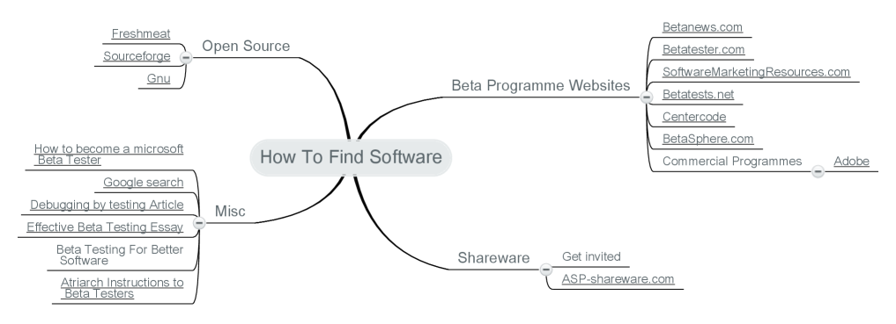

# How to Find Beta Programmes

Original annotated mind-map export. Names, descriptions and addresses reflect the 2003 source.

## How To Find Software

## Beta Programme Websites

### Betanews.com

See document: <http://www.betanews.com/>

The Betanews website lists loads of beta test programmes to get involved in.

### Betatester.com

See document: <http://betatester.tin.it/en/>

Another site listing new programs ready for beta testing.

### SoftwareMarketingResources.com

See document: <http://www.softwaremarketingresource.com/betatesting.html>

This page, on the excellent shareware marketing resources site has a list of beta testing sites

### Betatests.net

See document: <http://www.betatests.net/>

If you want to test games then this is the place to visit

### Centercode

See document: <http://www.centercode.com/mkt/>

This company offers to manage beta testing for software developers and will put you in touch with companies looking for beta testers. They have a hosted beta community programme.

### BetaSphere.com

See document: <http://www.betasphere.com/evaluator-center/index.html> [Source link](http://www.betasphere.com/evaluator-center/index.html%20)

BetaSphere will put you in touch with companies looking for beta testers.

### Commercial Programmes

Check websites of companies you respect

#### Adobe

See document: <http://www.adobe.com/products/tryadobe/betatesting.html>

## Shareware

### Get invited

download the software

try it

report defects professionally

mention that you would be happy to help test future releases

### ASP-shareware.com

See document: <http://www.asp-shareware.org/>

## Misc

### How to become a microsoft Beta Tester

See document: <http://www.winplanet.com/winplanet/subjects/255/>

download the software

try it

report defects professionally

mention that you would be happy to help test future releases

### Google search

See document: <http://www.google.com/search?q=betatest&sourceid=opera&num=0&ie=utf-8&oe=utf-8> [Source link](http://www.google.com/search?q=betatest&sourceid=opera&num=0&ie=utf-8&oe=utf-8)

This always pops up interesting stuff

### Debugging by testing Article

See document: <http://www.mibsoftware.com/bazdev/0015.htm>

The analysis by Forrest Cavalier is silent on how open source testing is better than closed source testing. He mentions a number of "reduction factors" which apply to bazaar (open source) testing, but these same factors (and more) also apply to cathedral (closed source) testing.

### Effective Beta Testing Essay

See document: <http://www.developsense.com/EffectiveBetaTesting.html>

essay on beta testing might

be useful

### Beta Testing For Better Software

A book on beta testing to help companies conduct their beta testing programmes better.

### Atriarch Instructions to Beta Testers

See document: <http://www.atbeta.com/beta_faq.php>

What one company wants from their beta testers.

## Open Source

### Freshmeat

See document: <http://www.freshmeat.net/>

Loads of new software listed every day for you to help test.

### Sourceforge

See document: <http://www.sourceforge.com/>

Open source software ready to beta test.

### Gnu

See document: <http://www.gnu.org/>

GNU software homepage
