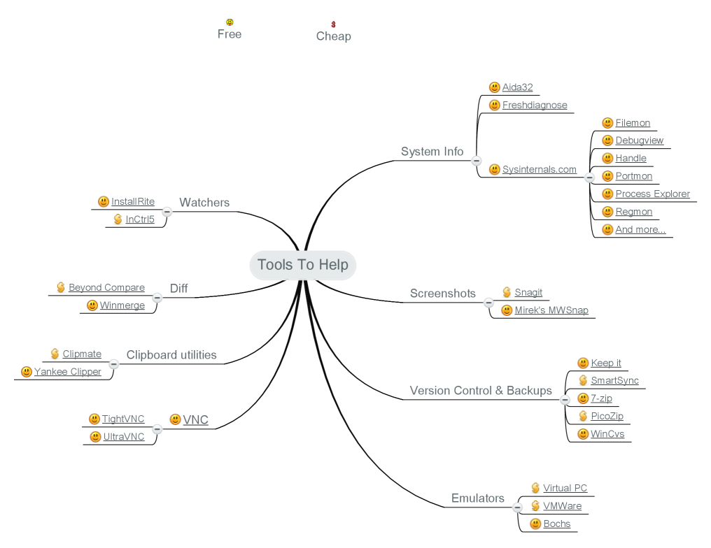

# Tools to Help

Original annotated mind-map export. Names, descriptions and addresses reflect the 2003 source.

## Tools To Help

### System Info

These tools aid the reporting and monitoring of the current environment.

### Aida32

See document: <http://www.aida32.hu/>

A diagnostics, reporting tool. Very simple, and very thorough. Produces good and easy to understand reports.

### Freshdiagnose

See document: <http://www.freshdevices.com/freshdiag.html>

A diagnostics, reporting tool. The reports are slightly less user friendly.

### Sysinternals.com

See document: <http://www.sysinternals.com/>

SysInternals is a great site for utilities. These are mainly aimed at the developer but are of enormous use for the tester that wants to increase the level of detail that they are able to report to the developer.

#### Filemon

See document: <http://www.sysinternals.com/ntw2k/source/filemon.shtml>

SysInternals is a great site for utilities. These are mainly aimed at the developer but are of enormous use for the tester that wants to increase the level of detail that they are able to report to the developer.

#### Debugview

See document: <http://www.sysinternals.com/ntw2k/freeware/debugview.shtml>

DebugView lets you monitor debug output. Which can be very revealing.

#### Handle

See document: <http://www.sysinternals.com/ntw2k/freeware/handle.shtml>

Handle displays information about open handles for any process in the system: the files open, or object types and names of all the handles of a program.

#### Portmon

See document: <http://www.sysinternals.com/ntw2k/freeware/portmon.shtml>

Portmon monitors and displays all serial and parallel port activity on a system.

#### Process Explorer

See document: <http://www.sysinternals.com/ntw2k/freeware/procexp.shtml>

Process Explorer shows you information about which handles and DLLs processes have opened or loaded.

#### Regmon

See document: <http://www.sysinternals.com/ntw2k/source/regmon.shtml>

Regmon is a Registry monitoring utility for applications are accessing theRegistry, which keys they are accessing, and the Registry data that they are reading and writing.

#### And more...

See document: <http://www.sysinternals.com/ntw2k/utilities.shtml>

There are plenty more utilities available on the site that you may just find a use for.

### Version Control &amp; Backups

Version control and backup is essential.

### Keep it

See document: <http://www.keep-it.com/download.asp>

Difference backup of various files - cheap version control and very handy for test data files.

### SmartSync

See document: <http://www.smsync.com/>

SmartSync is a handy little utility that copies files from one directory to another, it can make incremental backups so that you can restore to various points in time. One particularly handy feature is that it can copy files as soon as they have been changed.

### 7-zip

See document: <http://www.7-zip.org/>

A free alternative to winzip.

### PicoZip

See document: <http://www.picozip.com/>

This is the archiver that I use because I like the ability to create backup sets which are easy to control.

### WinCvs

See document: <http://www.wincvs.org/>

CVS is a version control system which can be complicated to setup but if you really want to get control over the versioning of files on your system then this is a cheap place to start.

### Emulators

### Virtual PC

See document: <http://www.microsoft.com/windowsxp/virtualpc>

Now bought by Microsoft, this is the PC emulator that I use. VMWare is a close competitor and you should try both on the evaluation license to see which one you prefer.

### VMWare

See document: <http://www.vmware.com/>

Another excellent commercial PC Emulator.

### Bochs

See document: <http://bochs.sourceforge.net/>

Another excellent commercial PC Emulator.

### Clipboard utilities

Incredibly useful tools which I use during every beta test. Either to store test data in the clipboard for reuse, to track notes about the testing, or just to view the clipboard contents.

### Clipmate

See document: <http://www.thornsoft.com/>

### Yankee Clipper

See document: <http://www.yankee-clipper.net/>

### Watchers

These tools are incredibly useful during the install of a system to take a snapshot before install and compare it with a snapshot after.

### InstallRite

See document: <http://www.epsilonsquared.com/>

This tool is completely free and very simple to use.

### InCtrl5

See document: <http://www.pcmag.com/article2/0,4149,25126,00.asp>

This is a non-free install watcher which is used by PC Magazine when testing software.

### Diff

Data file compares are a common requirement when testing.

### Beyond Compare

See document: <http://www.scootersoftware.com/>

This is may favourite compare tool which can be extended with plugs ins.

### Winmerge

See document: <http://winmerge.sourceforge.net/>

This is a free equivalent which is often used in conjunction with CVS to compare different versions of files.

### VNC

See document: <http://www.uk.research.att.com/vnc/>

My favourite remote machine controller which I use when testing software on a different machine on the network. It comes in a number of free variants which add extra security or optimised display refreshing.

### TightVNC

See document: <http://www.tightvnc.com/>

### UltraVNC

See document: <http://ultravnc.sourceforge.net/>

### Screenshots

This is the single most useful tool category in here. Which is surprising given the simplicity of the tool and the fact that windows already has most of the functionality you need to do this, but these tools save me time when recording screenshots and allow me to focus in on the areas that are important and that is one of the key elements of a successful defect report.

### Snagit

See document: <http://www.techsmith.com/>

This is my favourite screenshot program with more options than are actually required but I have it running constantly.

### Mirek's MWSnap

See document: <http://www.mirekw.com/winfreeware/mwsnap.html>

This is my favourite screenshot program with more options than are actually required but I have it running constantly.
