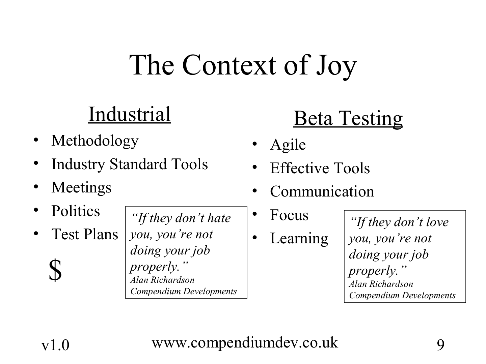
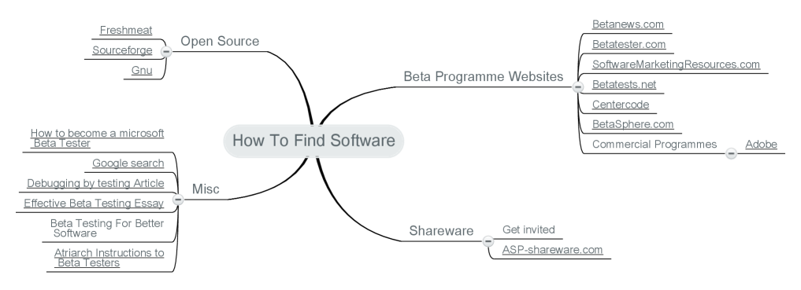
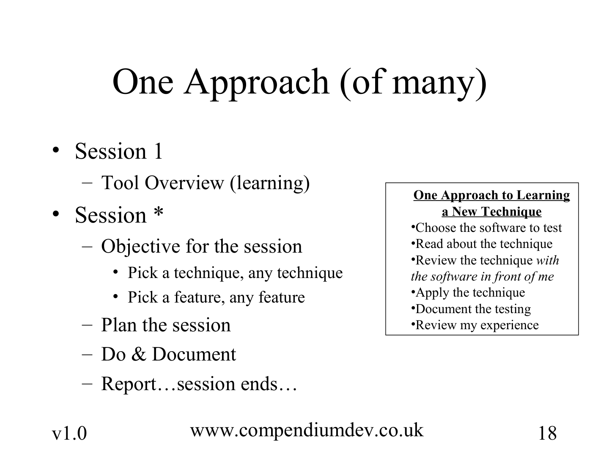
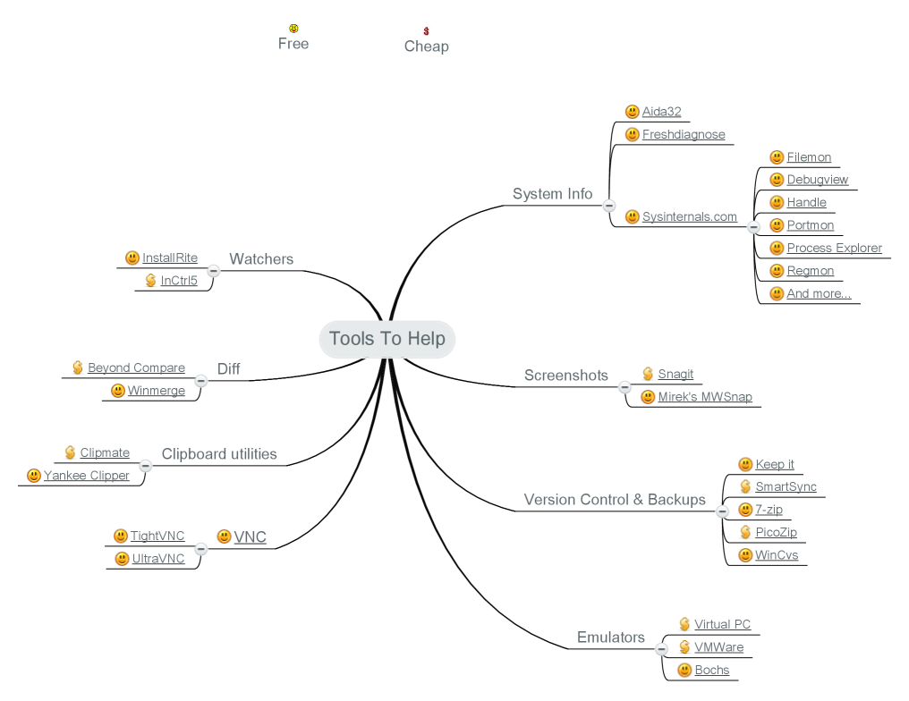

<!-- Slide 1 -->

# Be A Better Tester, Be A Beta Tester

Alan Richardson

UK

At the end of a testing day, how many testers go home and practise testing? Everyone I know that excels in a particular field; musician, sportsman, programmer, writer, hypnotist, whatever... practises.

I’m a professional tester (I get paid to test) and I beta test in my spare time. Find out how &amp; why

<http://www.compendiumdev.co.uk> mailto: alan@compendiumdev.co.uk

Animated gifs from www.feebleminds-gifs.com

---

<!-- Slide 2 -->

# The Ad

You will learn:

- How to find, and get involved in, beta test programmes
- Why we should spend our free time testing
- What developers want from their beta testers
- The responsibilities of a beta tester
- Cheap &amp; free tools to help you beta test
- How to make the best use of your beta testing time
- How to setup and control beta test environments
- Effective techniques for adding value to the beta test programme quickly and making sure you learn as much as possible as quickly as possible

And More :

- Have Fun. Now you can enjoy testing. Laugh as you test. Smile when you test.
- When we finish you will know how and why to become better testers through beta testing.
- And who knows? Perhaps continuing to improve your testing skills might help you increase your success in your day job. Hmmm…

- Try out techniques that they don't get to use in their day job.
- Try new tools
- Break software

- Help improve software
- Get free software
- and more...

Beta testing is a great way to practise testing, and by beta testing, testers can:

---

<!-- Slide 3 -->

# What is Beta Testing?

“Operational Testing at a site not otherwise involved with the software developers.”

BS 7925-1

---

<!-- Slide 4 -->

# What Do I mean?

“Downloading Stuff off the internet and Testing the \*\*\*\* out of it.”

The Big Blue Bumper Book of Beta Testing

\*\*\*\* = Bugs

---

<!-- Slide 5 -->

# What Stuff?

- Big/Small
- Commercial/OpenSource/Shareware
- Software that:

- You find Useful
- Interests You
- You want to use &amp; own
- You want to Test

“Sometimes I test it whether they want it tested or not!”

Alan Richardson

Compendium Developments

---

<!-- Slide 6 -->

# But…

- I get paid to test
- I test ALL day
- I’ve got better things to do with my time
- I’d rather just buy the software – let the developer test it!
- Time is money
- I don’t need to practise

OK…but…

---

<!-- Slide 7 -->

# Why?

Because I want to!

- I want…

- to be a better tester
- to use software that works (on the cheap!)
- to bring back the Joy

“Beta Testing Software is exciting, challenging and a great learning experience”

The Big Blue Bumper Book of Beta Testing

---

<!-- Slide 8 -->

# Motivation for Change

“…when our performance and attitude become jaded and weary, self-effacing and apologetic, there are two options. One is to eventually stop performing, bored with the whole thing. Which means one less jaded magician in the world, which is a good thing for the rest of humanity. But the other option is to completely re-discover the art, and change ones idea of what magic is and what ones role as a magician might be. This way, we get to experience why being a magician is the best job in the world. We can go out to perform, curious as to what the evening might bring, and what we might learn for ourselves.”

Absolute Magic, Derren Brown, 2001, 1st edition

---

<!-- Slide 9 -->

# The Context of Joy

Industrial

- Methodology
- Industry Standard Tools
- Meetings
- Politics
- Test Plans

$

Beta Testing

- Agile
- Effective Tools
- Communication
- Focus
- Learning

“If they don’t hate you, you’re not doing your job properly.”

Alan Richardson

Compendium Developments

“If they don’t love you, you’re not doing your job properly.”

Alan Richardson

Compendium Developments

---

<!-- Slide 10 -->

# What developers want from their beta testers

- Be useful
- Find Bugs, and find them fast
- Find big bugs, Find visible bugs
- Find THE bug
- Bugs bugs bugs bugs bugs
- Feedback, Comments &amp; Recommendations

“No special

instructions

from my end,

just thrash it!”

Owen Ransen

www.ransen.com

---

<!-- Slide 11 -->

# Where &amp; When

The Execution Context Explored

- Spare Time
- Short Bursts (sessions)
- Planning time – minimal but essential
- Little rework

---

<!-- Slide 12 -->

# How?

- Getting Software
- Developer Communication
- Knowing what to test
- Best use of time
- Your responsibilities
- Tools
- Environments

---

<!-- Slide 13 -->

# How to find software to beta test?

[Read the annotated guide to finding beta programmes](../supporting/finding-beta-programmes.md).

---

<!-- Slide 14 -->

# How to communicate with developers

- Simple, Clear, Direct
- Relevant scenario information

- they don’t know what test you were trying to do unless you tell them

- Screenshots &amp; Movies
- Files, test data

---

<!-- Slide 15 -->

# How do you know what to test?

- Ask the developer, they know…

- what they’ve done
- what they’re nervous about

- What would you do with the tool?
- It probably basically works…go eXtreme
- Observation, follow hunches

---

<!-- Slide 16 -->

# Common Shareware Defects

Quick wins

- Regression Testing

- Testing of related areas may be minimal, depends on experience of the developer

- Do, change, cancel, do, cancel,change, ok, change, cancel, change, do (Cyclic tests)
- Saving &amp; Loading

---

<!-- Slide 17 -->

# How to make the best use of your beta testing time

- How to practise testing
- Sessions
- Planned
- Focussed

---

<!-- Slide 18 -->

# One Approach (of many)

- Session 1

- Tool Overview (learning)

- Session \*

- Objective for the session
    - Pick a technique, any technique
    - Pick a feature, any feature
- Plan the session
- Do &amp; Document
- Report…session ends…

One Approach to Learning a New Technique

- Choose the software to test
- Read about the technique
- Review the technique with the software in front of me
- Apply the technique
- Document the testing
- Review my experience

---

<!-- Slide 19 -->

# Responsibilities of a beta tester

- Be better than the other beta testers

- You’re a professional

- Provide relevant information
- Do something different

"Thank you, you have earned your registration code to the full release version"

---

<!-- Slide 20 -->

# Cheap &amp; free tools

[Read the annotated tools guide](../supporting/tools-to-help.md).

---

<!-- Slide 21 -->

# How to setup and control beta test environments

- Feel Responsible
- Backups are essential
- Virtual PCs are great
- Multiple Operating Systems
- Removable hard drives (caddies)

Your life, Your hands, Your control

“Paranoia is the

tester’s friend”

Alan Richardson

Compendium Developments

---

<!-- Slide 22 -->

# Ship It

- Attitude
- Enjoy It
- Do it, for the next 30 days…

- Check out the tools, use them, test some software, communicate with the developer, vary and repeat

“It’s a whole new job”

Absolute Magic, Derren Brown

---

<!-- Slide 23 -->

# Do It

Get Better at it,

Get Beta Testing

For more information and resources, visit…

www.compendiumdev.co.uk/eurostar2003
