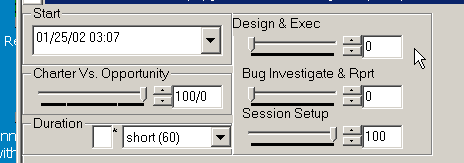
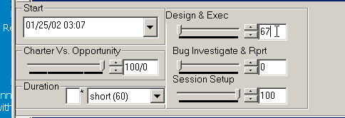
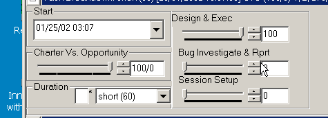

# Sample Defect Report Created in Seconds

Original example of communicating a defect with a short description and screenshots.

Go from 0, 0, 100

Enter 67 in top value

Hoping to have 67, 0, 33 as the result

Actually get 100, 0, 0 as the result.

