# Alternative Testing Tools in Action

Original 2004 supporting material. Wording, quotations, draft placeholders, source links and illustrations are retained. Tool names, prices and availability describe the original period.

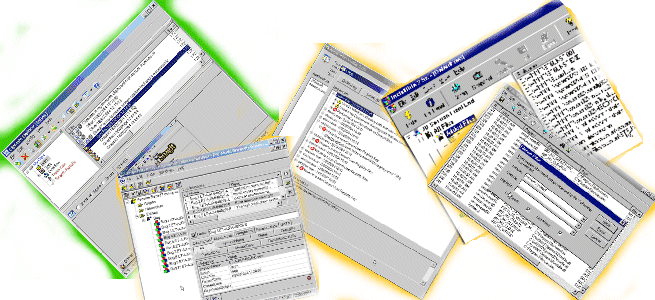

Alternative Testing Tools in Action

Alan Richardson, Compendium Developments, www.compendiumdev.co.uk [Source link](http://www.compendiumdev.co.uk/)

V1.1

A test tool is ANY tool that can aid the tester during the testing process.

There are hundreds of tools out there that are currently outside the mainstream definition of a 'test tool', many are inexpensive and some are completely free. This paper will describe some alternative tools in action on actual test execution sessions, and the thought processes I went through to identify them. I recommend that you conduct such an activity for yourself. Identify the alternative tools that you take for granted, identify keywords for them and the tool classes they fit in to. Then find some alternatives and improve your personal test process.

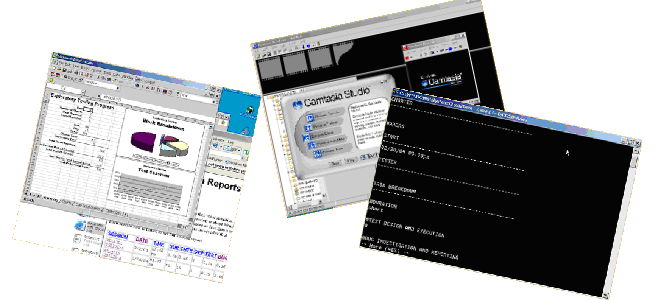

‘Then I stopped the machine, and saw about me again the old familiar laboratory, my tools, my appliances just as I had left them.”

H.G. Wells,

The Time Machine.

## The Practical Part – The sessions &amp; the tools

This section represents notes on the test sessions that were recorded to demonstrate the tools in action. Any tool mentioned by name here, will have an entry in the tools appendix later on, with a listing of its url to allow you to download it..

The sessions and parts are all viewable as swf files during the presentation or on the web site www.compendiumdev.co.uk/toolsinaction [Source link](http://www.compendiumdev.co.uk/toolsinaction)

The sessions act as a microcosm, a reflection of a larger testing process.

1. Install the JBSessions Application – sessions 01 – 03

2. Exploratory System Testing 04 - 07

3. Test Management and Integration Testing – sessions 08 – 10

None of the tools used here were chosen to pad out the paper. All of the tools are tools which are normally part of my personal test process with the exception of the Microsoft Compatability Toolkit, R and the KeyLogger. All exceptions have been on my list of possible tools for some time, but this paper represents my first use of them as this was the first project that seemed appropriate to try them on.

The Microsoft Compatability Toolkit is now a very definite part of my test process as it provides a great deal of insight into the application under test. R is a tool that I see enormous possibilities for and am currently learning it in more depth. Keyloggers look like a technology that I will watch and will use on applicable future projects.

As my personal test process involves identifying new tools to help me with my testing when the need arises, I make no applogies for using some of these tools for the first time. That is all part of identifying Alternative Test Tools and using them in your test process.

## Notes on the Application under test

The application I chose to test for the purposes of this paper is one that I wrote several years ago. A Visual Basic front end for James and Jonathan Bachs’ Session Based Testing Perl scripts. It was originally written to experiment with some Visual Basic code and some GUI techniques.

I don’t actually remember much about the development of it or the details of the code. It has not been used extensively and it has no supporting documentation. As the developer I vaguely remember thinking it was ready for release even though I hadn’t tested it. I did build a setup install routine for it and I have some old test data files in the development directory. The application should run under Windows 9X, NT4.X, 2K, XP

The application was built to be useful in session based testing, to explore and experiment with a number of GUI techniques, and to give me more practise in writing Visual Basic code.

From the above description we can begin thinking about our situation. There are likely to be some fairly basic defects present, because of the need to practise and the lack of unit/developer testing. Documenation will not be available to guide or test derivation or act as an oracle, but we can use the Back Session Based Testing scripts to validate our files and check basic consistency. We are likely to find errors in the system and the integration.

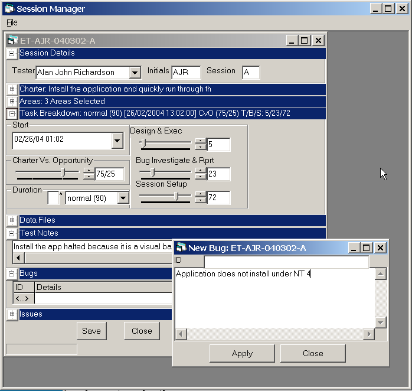

Objections to this choice as an objective method of exploring test tool identification strategies might be:

- “You know where the defects are so it doesn’t act as a good testing demo”

    - I don’t know where the defects are, I wrote it &gt; 2 years ago, and although I have a setup routine, I’m not even sure I finished it.

    - The demo isn’t about my testing skill it is about the tools that you use to test, and the thought processes involved in choosing them

- “You will pick tools that are appropriate to the AUT, not just useful tools”

    - The tools we use should be based on the needs of testing the AUT so that is an appropriate thing to do

    - And I will explain the reasons for choosing those tools

- “You will only be looking at a subset of tools rather than giving me a large list of tools.”

    - Yes, that is true. There are plenty of long lists of tools available on the internet. I would rather look at a few tools in detail and show them working on a real testing session to give you an idea of their capabilities. You might be surprised at just how many tools I do cover in this paper.

## Approaching the testing and identifying the tools

The context I will be working with:

- Operating System I’m using,

- Architecture of the system,

- Process I am using

- TimeScales I am testing against

- Environments I have available

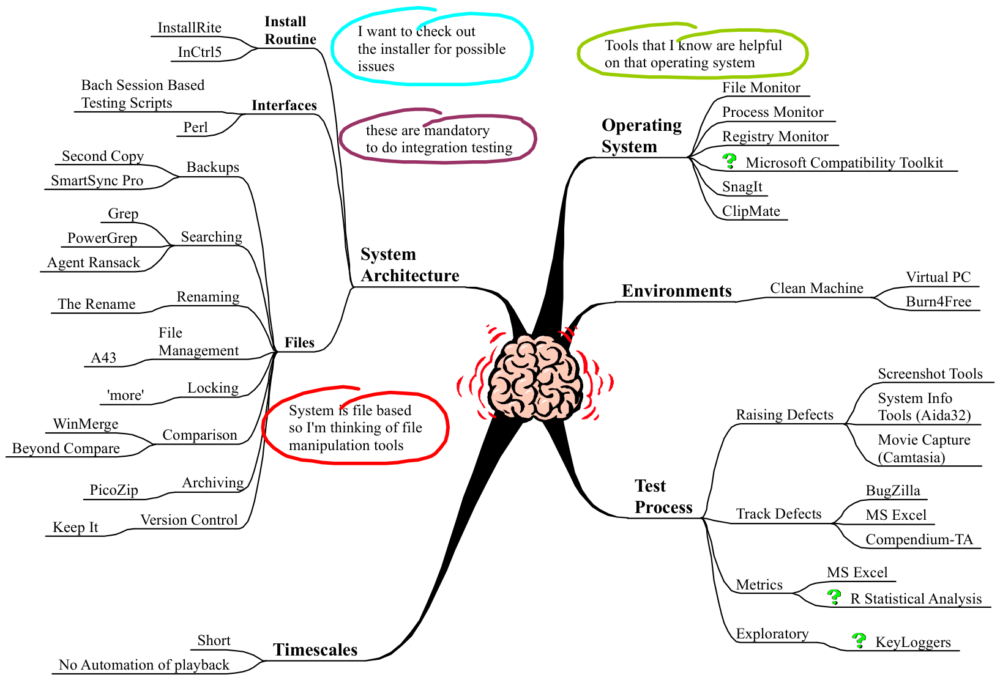

I’ve marked the tools I want to investigate with a ‘?’ \[?\]

#### TimeScales &amp; Environments

I am not going to be testing for very long, a couple of days maximum, and I won’t be leaving a legacy of tests for others to execute, and I will probably be testing in an exploratory fashion so I won’t be using any traditional automation tools.

I’m going to install on a clean machine if it looks like the setup routine might damage my main setup in which case I’ll use a PC emulator and monitor the install routine.

### Install the application

It took longer than I expected to install the application, but as testers we are used to the initial environment setup not going according to plan. A result of this is that I have become aware of a number of tools that can help me through the process of installing applications and making sure that nothing untoward is done to my main operating environment.

#### Session 01 – Cancel Install App Session

“You should not have a favourite weapon. To become over-familiar with one weapon is as much a fault as not knowing it sufficiently well. You should not copy others, but use weapons which you can handle properly. It is bad for commanders and troops to have likes and dislikes. These are things you must learn thoroughly.”

Miyamoto Musashi,

A book of Five Rings

(the ground book)

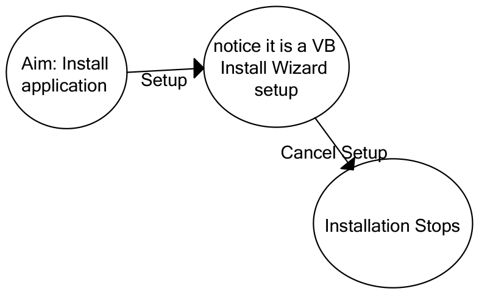

The first thing to do is to install the application from the existing setup.exe. When the setup started, it was obvious that it had been built using the VB Setup Wizard. In inexperienced hands this can generate very damaging setups. So I will not install it on my main environment until I have determined that the install can do no damage. I need a way of isolating the install from my main environment just in case there is a problem. PC Emulators are great for this so we will use Virtual PC. www.microsoft.com/windowsxp/virtualpc [Source link](http://www.microsoft.com/windowsxp/virtualpc)

Welcome to DLL Hell

Visual Basic programs require a number of dlls to be installed in order to function correctly. The VB Install wizard has been known to gather those DLLs from the developer’s system directory and install them on to the user’s system without checking the version numbers of the existing files and can overwrite more recent versions of the file. Causing instability and crashes in the user’s PC.

Virtual PC allows us to create a PC within a PC so I can effectively run multiple Operating Systems on the same computer, each with their own isolated hard drives (virtual). Other PC Emulators exist, the freeware Bochs (bochs.sourceforge.net), which can be a little hard to setup, and VM Ware (www.vmware.com), a commercial tool that has the ability to create snapshots of a running operating system at any time. [Source link](http://bochs.sourceforge.net/) [Source link](http://www.vmware.com/)

The instant lesson from this session is that our primary test tools (Brain and senses) have to be engaged from the very instance that we approach testing.

#### Session 02 – Install App Session

“The expectations of life depend upon diligence; the mechanic that would perfect his work must first sharpen his tools.”

Confucius

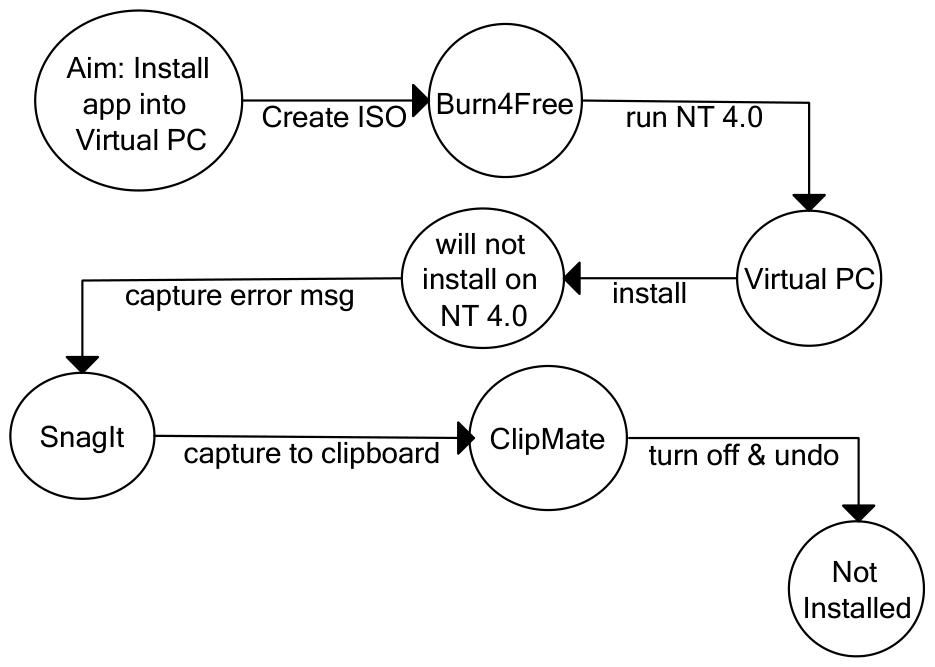

When installing applications on to Virtual PC, I build virtual CDs to install from as this allows an easy mechanism to get files into the emulated environment without compromising my main environment by sharing directories or allowing the Virtual PC access to the network. I allow the Virtual PC to do this once I am certain that no damage can occur.

I create an iso file (CD image) using Burn4Free (www.burn4free.com). I then attempt to install the application under NT 4.0. I tend to use NT4.x when testing install routines as this operating system series gives the most obvious response to incorrect system files with a blue screen of death. [Source link](http://www.burn4free.com/)

When installing on NT 4.0 the setup routine reports an error, it is incompatible with NT 4.0. This might be reason alone for finding a new install generation package. But it provides us with our first bug. So SnagIt (www.techsmith.com) is used to take a snapshot of the error message and this is sent directly into the clipboard which is being cached by ClipMate (www.thornsoft.com). [Source link](http://www.techsmith.com/) [Source link](http://www.thornsoft.com/)

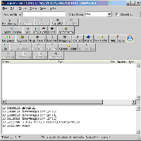

Burn4Free

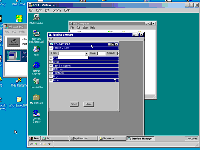

Virtual PC

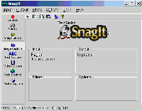

SnagIt

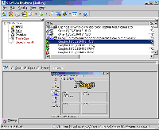

ClipMate

Burn4Free is a free tool for the manipulation of CD images, I use it because it is a quick and easy way to create iso images which can be mounted in Virtual PC as CD roms and are a great way to get software on to the Virtual PC.

SnagIt is the snapshot creator I use, it is a commercial product, but is cheap and does the job better than any other tool that I have used. The functionality it provides is far beyond the simple capturing of a screen and is well worth evaluating. In this section we have just used the simple “Capture a Region” functionality. I have SnagIt running all the time on my machine, just in case I need to record a picture of a defect.

ClipMate is a clipboard manager, and is another tool that I have running all the time. All the entries that go to the clipboard are captured by clipmate (although it can be configured to ignore certain tools) and stored in a database. Clipmate allows you to view the items and edit them before repasting. Every entry is given a timestamp so I can see exactly when the information was added.

I have SnagIt and ClipMate setup to work together, so that SnagIt saves all its screencaptures directly to the clipboard, where I can then come back to them at a later date when writing the defect report. This saves me having to store the pictures in files, and fiddle about with defect trackers at the same time as observing the faults and basically makes my life easier.

Session 03 – Install App into NT 4.4

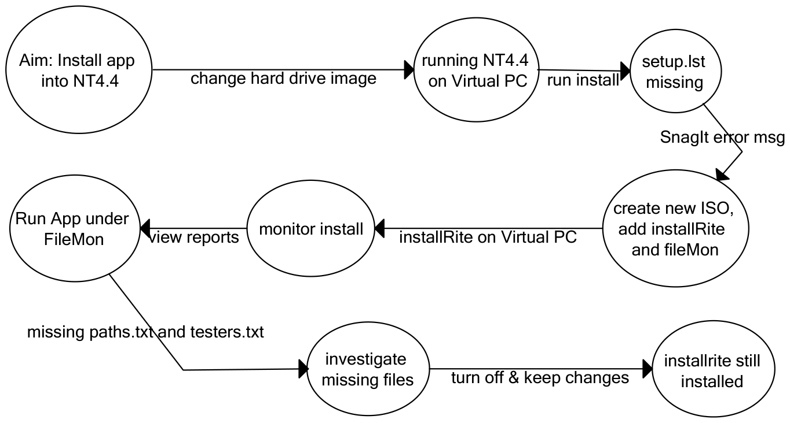

Swapping over to a new operating system in Virtual PC is as simple as pointing the system at a new virtual hard drive (VHD) where the operating system is installed. The use VHDs makes backing up these environments very simple, but Virtual PC provides us with a facility to have any changes we make to the VHD stored to an undo file, which means that we can keep our VHD in a clean state even though we have installed applications to it. The undo file can be merged into the VHD, deleted or kept separate.

With NT4.4 running in Virtual PC, the install proceeds but I discover that a file “setup.lst” is missing from the CD image. I take a snapshot of the error message in case I need to raise a defect later and then go and investigate the error. It turns out that it was a tester error when creating the iso file as I just didn’t realise the significance of the file. This could be another point in favour of using a different setup tool so I make a note down to add that information to the defect report.

As I have to create a new CD image, I will add on 2 diagnostic tools which can help me monitor the install and initial run of the tool. These are InstallRite (www.epsilonsquared.com) and FileMon (www.sysinternals.com). [Source link](http://www.epsilonsquared.com/) [Source link](http://www.sysinternals.com/)

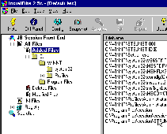

InstallRite

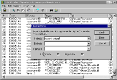

FileMon

InstallRite is an install monitoring utility which takes a snapshot of the state of your machine before you install, runs the install and then takes a second snapshot and reports on the differences. InstallRite happily copes with setup routines which cause a machine reboot, which is the case with our install routine as it is replacing some system files. This can be dangerous so we will examine the install report carefully and add the details to our defect report. To investigate some of the files reported by install rite I use the “dll help database” from Microsoft. Do a Google search to get the up to date link as it has a tendency to move.

With the application installed. I will run FileMon and then run the application. FileMon hooks into the OS and reports any file system events. In our case it reveals that the application is looking for two files that it could not find “paths.txt” and “testers.txt”. This gives us more information about the application and we can approach the developer with very specifc questions.

How to look like a technical wizard when speaking to developers and raising defects

Many of the tools in this paper come under a general category of Monitoring tools. In the paper we monitor file system usage, registry access, install programs. But there are tools available to monitor system messages passed to dialogs and forms, debug messages, memory accessing, processes, file dependencies. All of these tools can provide you with a great deal of technical information that can help you communicate effectively with developers and gain insight into the AUT. Without having to add diagnostic code into the system. All you have to do is learn how to use the tools and read the reports.

Using FileMon as an example, I was able to tell a developer exactly which dll was being accessed when the AUT crashed. This aided his debugging, made it easier to recreate the fault, and made me appear technically brilliant.

#### What we learned about the AUT in session One (Parts 1-3):

1. The installer is the default Visual Basic Package Wizard. And that is a common source of “DLL Hell” errors. So we should initally test it in a controlled environment.

2. Our installer does not work on NT 4.0, this may or may not be a problem, but it may mean that the installer is also incompatible with other operating systems that we haven’t tested on and we should probably find a new installer.

3. The installer may be overwriting system files that it has no business updating, we should raise this as a potential issue with the developers, but it will probably resolve itself when we change the install generator. I initially test against NT in Virtual PC, as NT often blue screens when you mess up the install routine.

4. There is no file called “paths.txt” and there is no file called “testers.txt”. This may be why the testers drop down is empty and the save function defaults to “program files” directory. We should probably ship default files with the application or have them automatically generated – check with the developer.

All of the above is enough to enable us to go back to the developers and ask for more information about the system. To push for a new build of the software that is easy for us to install and to get the developer to do some testing of their own on the install routine. The developer needs to take more control over the install process because I guarantee that somewhere down the line it is going to cause trouble if they don’t

#### Section Two – Now some proper testing (sessions)

While we wait for the developer to build us a proper setup, we have been given a “paths.txt” file and a “testers.txt” file by the developer and we can run the application .exe without an install routine (because we have all the relevant dlls and libraries already installed on our machine).

“My tools are but common ones,

Simple shepherds all—

My tools are no sight to see:

A little hempen string, and a post whereon to swing,

Are implements enough for me!”

Thomas Hardy,

Wessex Poems and Other Verses. 1898.

We will do a little bit of system testing until the install routine is ready.

I know that the application creates files that are for use with the Bach Session Based Testing Scripts, so I will be conducting some integration testing, but I’m first going to run the application in a System Testing mode, creating and saving files and examining the content of those files.

### Session 04 – Investigate Startup Routine

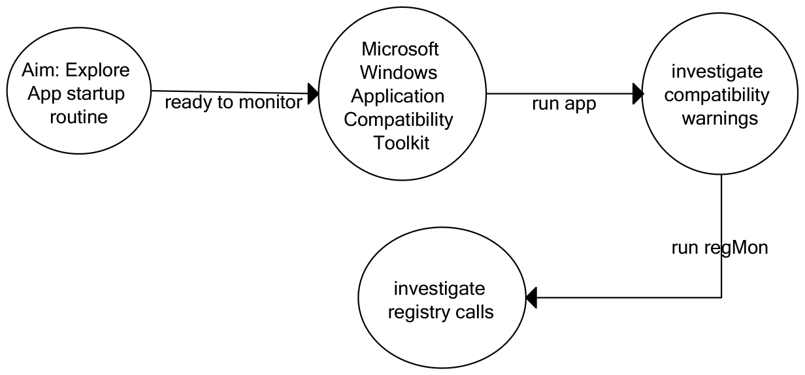

Because I don’t know much about how the application does what it does, I’m going to use a monitor tool that will give me visiblity into the behind the scenes operation of the system. The Microsoft Windows Application Compatibility Toolkit (www.microsoft.com/windows/appcompatibility/toolkit.mspx), specifically the Application Verifier tool, this may alert me to actions the system is doing that aren’t particularly healthy. [Source link](http://www.microsoft.com/windows/appcompatibility/toolkit.mspx)

The Application Verifier tool, reported a few items during the system startup, but the only one that looked potentially risky is a non-standard write to the registry. I will investigate by using the registry monitor from www.sysinternals.com. [Source link](http://www.sysinternals.com/)

In this case the warning turns out to be a false alarm, as it was VB that was accessing the registry, not VB code that we added to the application, but it was worth following up on as these monitor tools can identify potential problems that we can invesigate and target with our testing. I’ll leave the compatibility toolkit running as I test the application and periodically review the logs.

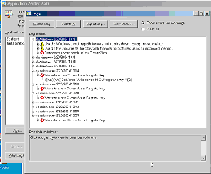

Application Verifier

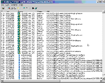

Registry Monitor

Application Verifier runs in the background and monitors running processes use of the Windows API. It can report on non-standard usage or usage that might cause compatibility problems on operating system.

Registry Monitor monitors changes and accessing made to the windows Registry, this can help identify missing, or misuse of, registry entries by the application. The output can be filtered so that you only see the results for the application under test.

#### Session 05 – File Locking

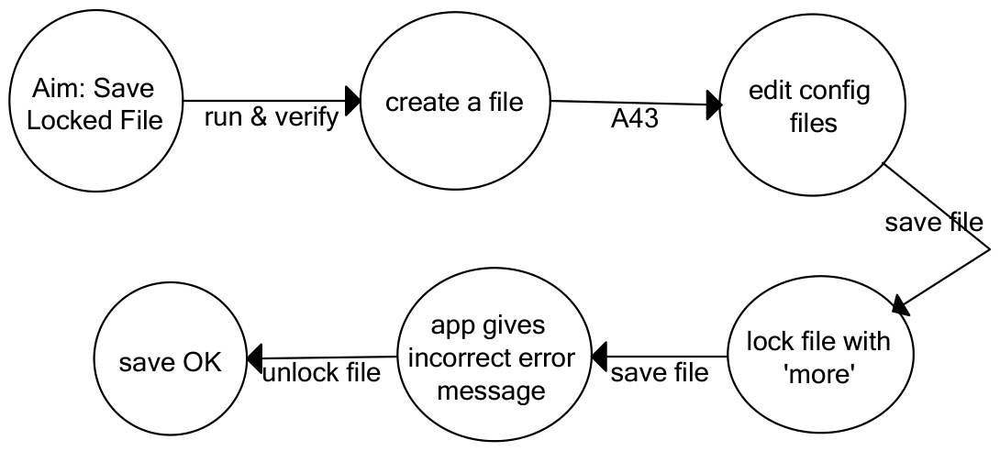

Because I know that the application uses text files, I’m going to see how it copes with locked files during a write. And for that I’ll use ‘more’, the old dos application. This has the side-effect that viewed files are locked from writing by other processes.

I’m simply going to create a new file, save it, lock the file with ‘more’, change some details and try and save it again. To aid me in this I’m going to run the application through A43 (www.shawneelink.net/~bgmiller) which is a 2 Pane Explorer substitute with a built in text editor and easy access to the dos prompt. [Source link](http://www.shawneelink.net/~bgmiller)

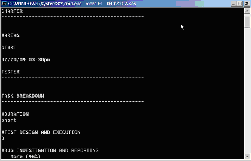

more

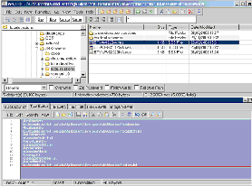

A43

ActiveWords case study (A side note on time saving)

I use a little tool called ActiveWords: a very flexibly user-definable command driven macro system. To use it you type your commands in any document or press control+space and then type a command in to the command line. ActiveWords can be a hard tool to explain or justify why it is useful. After all, anyone can open an Internet site by going to the start menu, clicking on explorer and typing in the address. The use of ActiveWords is a timesaving of about 10 or 20 seconds. Everytime you use ActiveWords it calculates how long the task would have taken to do manually compared with how long it took for ActiveWords to do it and stores the results.

Over an extended period of time, the metrics documenting the timesavings associated with these alternative tools can be surprising.

At my first fun of the application, I discover that the developer’s paths.txt details don’t match up with mine so I have to edit them, but that doesn’t take much time since I have a text editor built into my file explorer, and it allows me to copy the full path name of a file which makes it easy to amend the details. Environment teething problems are a common occurrence in software testing and I like to have simple tools available that can help me do what I need to resolve the errors quickly.

To run ‘more’, I call up the dos prompt from the tools menu in A43, I can also copy in the name of the test file to the dos prompt so that the process is very fast.

The application reports an error when writing to the locked file, which is misleading as it states that data ‘might’ not have been completely written to the file, when in fact no data was written to the file, so I’ll report that to the developer. But at least we didn’t get a crash.

When I view the Application Verifier logs it reported a possible incorrect use of ‘My Documents’ because we saved a file into this sub directory path but didn’t use an API call to get the information. So Application Verifier warned us about a possible hardcoded path.

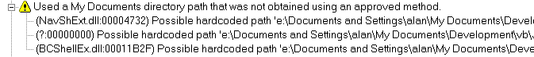

In this case that wasn’t a problem, but it is useful to know that Application Verifier can tell us about these events as they are a common source of errors.

The point of this session is not the test, but that test tools come from the most unlikely sources. We are using a side effect of the ‘more’ command as a test tool for locking files. James Bach mentions the side effect of placing a radio next to a computer, to hear the computer processing, as a test tool in ‘Boost your Testing Superpowers’ (www.satisfice.com/articles/boost.htm). [Source link](http://www.satisfice.com/articles/boost.htm)

As testers we are used to looking for side effects, they are often a source of bugs, in this case we are looking for side-effects that might turn any normal piece of software into a test tool. Our normal testing thought processes can help us identify test tools.

Although it could be argued that A43 isn’t a test tool at all, the fact that it saved me time, because I was able to edit the files, call up dos and run the ‘more’ command so easily, means that it made my testing more efficient, and as far as I’m concerned that makes it a useful test tool.

There are alternatives to using A43 as there are many extensions to explorer that allow ‘dos prompt here’ in the context menu and ‘copy name’ ‘copy path’ functionality, these are often operating system specific and require an install. A43 runs on multiple operating systems and does not require an install so I can easily take it to client sites.

A Simple Persistent Test Log For Exploratory Testers

Use a clipboard manager as a test log. Here is what I do (with SnagIt and ClipMate):

- Type some text describing something I’m about to do or thinking about,

- I don’t have to open a text editor, this can be done anwhere I can type,

- Highlight the text and cut it into the clipboard, leaving your typing area clean of your thoughts,

- This instantly persists it in your clipboard database with a handy timestamp,

- Then go about your testing,

- Occasionally take a screenshot that you send to the clipboard.

A robust and pretty crashproof exploratory test log. I’ve lost too many test logs in the past due to machine crash es not to like this method. Of course you are still vulnerable to hard drive trashing crashes, so if you experience those often, I recommend the use of a ULTT and digital camera.

Part Three – Exploring

I’m going to explore the system for a while and see what occurs to me, so I’m going to have a keyLogger running in the background, this will capture all the keys that I press and take a screenshot every 6 seconds.

I’m also going to have SnagIt, ClipMate, and Application Verifier running in the background just in case.

### Session 06 – Explore Area of Greatest Complexity

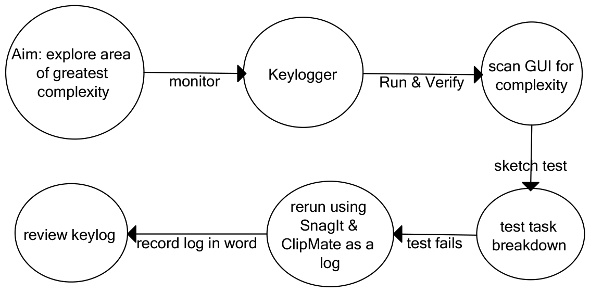

I run the application and scan the GUI looking for areas of complexity. The name drop down looks like it might influence the initials, which might also influence the filename so I’ll test that later. The Issues, and Bugs lists have some with two ways of creating each entity, so that will have to be tested.

As I observe the operation of the system I see that when I open a dialog area and close it, the system fills in summary details of the areas contents in the title, these details should probably be prefilled in. I’ll make a note in my ULTT (ultimate lo-tech test tool – that’s called a spiral bound notebook to non-testers, but we know better) test log about the issue and use the snapshots taken by the keylogger to raise a defect showing those two states later.

But by far the most complex area is the Task Breakdown section. We have a whole bunch of sliders and integer fields, and some of the integer fields have connections to each other so that when one changes the others change to make the totals always add up to 100. This looks like a bug minefield, and I’ll focus on this first.

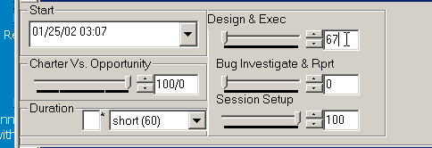

I make a few notes using my ULTT to model the relationships between the integer fields and design a quick test, and sure enough there is a defect. In the above screenshot when the enter key is pressed the expected values are 67, 0, 33 but the actual result is 100, 0, 0.

I get ready to repeat the test so that I can raise it as a defect, and this is where a combination of alternative tools really helps me out. I already have my notes in my ULTT so I can repeat the test at a later date.

But I may as well repeat the test and log all the details into the clipboard manager and use this as an exploratory test log and later paste the details into a defect report. I type in my test details into the edit pane in A43, copy those into the clipboard, and take a screenshot of each of the three steps of the test into the clipboard as well. These can then be pasted into a defect report later on.

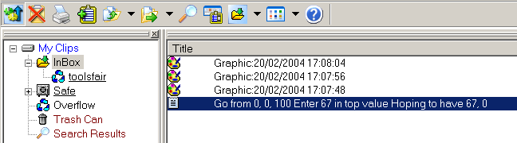

I’m going to document the defect reports in a word processor as this is an internal project and the use of the clipboard utility makes it easy to get the information out of the clipboard with a PowerPaste function, which basically means that I select the test description text details, set it to Powerpaste Up then ctrl+V 4 times in my word processor and my defect report is automatically populated from my test log. [Source link](http://spectorsoft.com/) [Source link](http://www.webattack.com/get/abckeylog.html)

Some thoughts on keyloggers

Key Loggers are an interesting technology. Recording keypresses and screenshots of everything that you do. This can make them a useful source of reflection when we have finished testing, and act as a secondary test log. If we forget to take a snapshot of an error dialog, or note down the test data we used, we can retrieve it at the end of the test session when we come to raise our defects. We can also double check our manual test log against the automated one. Loggers should not be the only way that you track your sessions as they don’t document your aims and motivations.

You might want to start with these three: spector $99 (spectorsoft.com) , abckeylogger Free (webattack.com/get/abckeylog.html ), PAL $35 (palsol.com) [Source link](http://spectorsoft.com/) [Source link](http://www.webattack.com/get/abckeylog.html)

Session 07 – Simple environment management &amp; File Compare Testing

Because I’m going to be doing exploratory testing I’m not sure exactly what changes I’m going to make so I want to be able to restore the local environment back to any previous setup. I will make deliberate backups of the relevant parts of the directory and I’ll have the directories automatically incrementally backup whenever anything changes. I can use SmartSync Pro to do both of these tasks.

One the environment is safe, I am going to check that file saving is consistent, so I’ll save a file to a different name and compare it with its original.

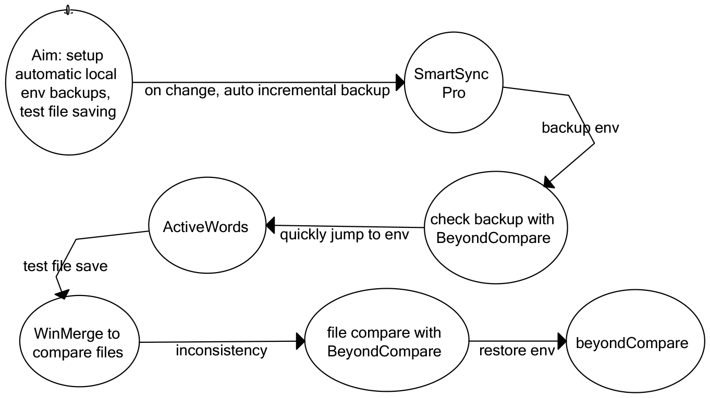

I use ActiveWords as one way of navigating around my system and executing programs. Much of the time I find it faster to type a command than to reach for the mouse, and click on a shortcut or use windows explorer. Consequently I’m going to setup a couple of ActiveWords to move me around the different directories involved in testing this tool.

As a tester I am particularly paranoid about software errors damaging data so backups are particularly important to my test process. For this set of testing I am going to setup SmartSync Pro to backup my test environments. This will be done in two ways. A Manual backup that will directly copy the environment and an automated backup that will create an incremental backup anytime that a file in the test environment changes.

After I have setup the manual backup I will compare the directory structures with Beyond Compare, this is a diff utility that I use for comparing files and directories. I also use WinMerge as a second opinion on file compares.

I test my automated setup by editing a file in my test environment, it is backed up automatically and I restore the environment from the direct copy using Beyond Compare. This gives me a visual check of all the items that have changed.

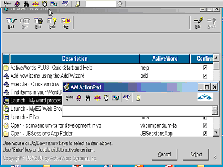

ActiveWords

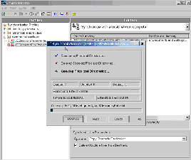

SmartSync

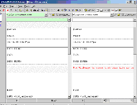

Beyond Compare

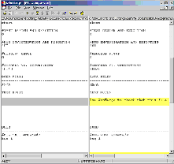

WinMerge

Environment maintenance has been an essential part of every testing project that I have been on and before testing starts I like to become familiar with the environment and tools available to help me backup/restore, integrity check and monitor my environment.

### Session 08 - Install Session Based Testing Scripts

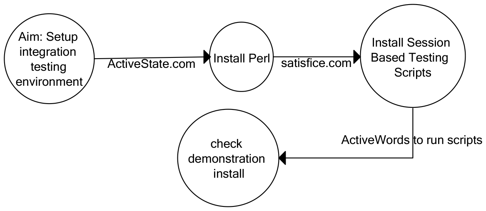

Because the AUT is an editor for the session files that feed into the Perl Session Based Testing Scripts, by James and Jonathan Bach, I need to have both Perl and the scripts installed and working.

Perl is a programming language that can be tricky to master, although simple file based operations can be remarkable simple to carry out with a good reference manual in front of you. Perl is a wonderful tool for testers if it is available and you find the time to learn the basic operations. And an Installation of Perl gives us access to other test tools.

Session based testing is usually presented as a way of managing exploratory testing. Although it can be incorporated into a less exploratory testing approach quite easily as sessions are simply a way of chunking your testing time and tasks into easily managed and reported sessions. Session based testing is a useful management technique to become familiar with as it makes the distinction between testing time (time on charter) and time spent off charter (investigating defects and resolving environment problems). This can provide an extra level of insight into your test process as there are times with it seems that although we work hard we make little progress into our desired coverage scope. If much of your effort is actually off charter then this might be highlighted using session based test management.

The Session Based scripts provide a set of metrics and charts for helping to think through your elapsed testing effort.

I find the techniques of session based testing to be of considerable value to my personal test process and development efforts.

A robust and professional Perl is freely available from www.ActiveState.com, the quality of this version of perl is such that I have no qualms installing this on client machines when permitted. [Source link](http://www.ActiveState.com/)

Once both Perl and the scripts are installed, I setup the main submit script to be run with ActiveWords and run the scripts on the sample files to make sure the install is correct.

### Session 09 – Initial Integration Testing

The intial integration testing is going to be done by simply running some of our generated files through the Session Based Testing scripts to inform us of any obvious errors in the tool.

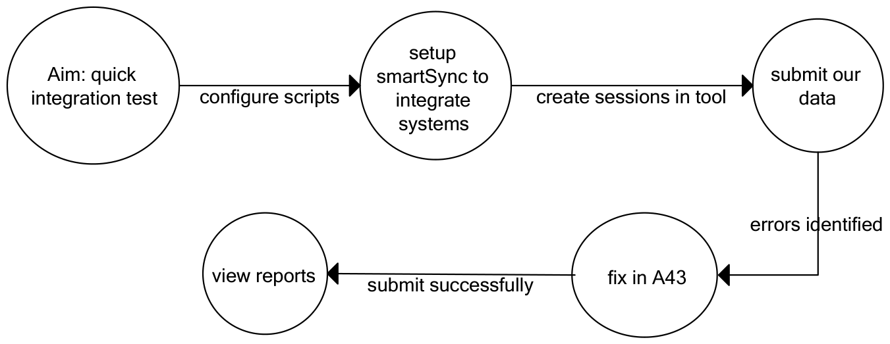

SmartSync is going to be used to move our generated session files across to the Scripts directory. This is just a simple way of automating some of the manual admistrative tasks involved in using the Perl scripts.

A few simple test sessions are going to be written to cover the testing we have alread done. These will be passed through the Session Based Testing scripts to see the results.

I have already setup an ActiveWord to syntax check and approve the session based scripts. So this aspect of the using the scripts is already automated for us.

The simplest of integration testing – just using the two pieces of software together has identified a number of errors in our Application under test.

- Dates inconsistent in file and with name

- Data files have full path

I fix the session files using the text editor built into A43, making notes on the defects to raise them with the developer, and when they do submit, I can view the metrics on my current sessions to date.

### Session 10 – Manage Defects and Metric Reporting

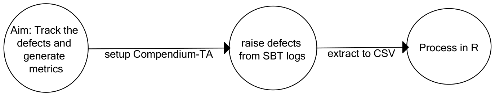

The sessions for the Session Based testing scripts allow me to document the bugs and issues that I identify but the actual tracking and management of these entities is outside of the scope of the scripts so I need to add some form of defect management process to my testing.

I could do this in MS Excel or, now that Perl is installed, could setup Bugzilla for the task. But for inhouse and presonal test projects, I track defects and test designs in Compendium-TA (www.compendiumdev.co.uk/compendium-ta). By creating a user-defined entity called Defect I can comfortably track the defects and later cross-reference them with any new system requirements and test designs. [Source link](http://www.compendiumdev.co.uk/compendium-ta)

For statistical analysis of the defects I will export the defects into a csv file and process them using R and the R frontend SciViews.

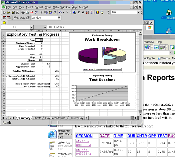

Session Based Testing Scripts

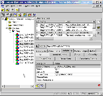

Compendium-TA

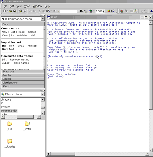

R &amp; SciViews

R is a free cross platform statistical analysis environment and language that allows me to do very quick and easy exploration of the raw defect information. I can also build larger scripts that will export all the exploration out as a report.

For example, once I have exported my defects from Compendium-TA into CSV

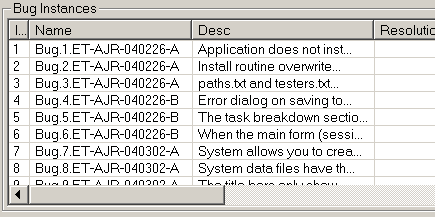

=&gt;

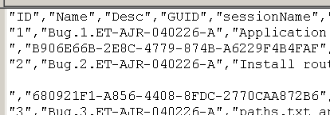

I can load that into R:

&gt; Dataset &lt;- read.table("C:/sessions/compendium-ta/bugsextract.csv", header=TRUE, sep=",", na.strings="NA", strip.white=TRUE)

&gt; attach(Dataset)

And begin to explore the information:

&gt; names(Dataset)

\[1\] "ID" "Name" "Desc"

\[4\] "GUID" "sessionName" "Status"

\[7\] "Criticality" "RaisedDate" "ClosedDate"

\[10\] "ResolutionDetails"

&gt; table(Status,Criticality)

Criticality

Status High Medium

Open 6 2

I can easily view the information graphically:

&gt; plot(Criticality ~ RaisedDate)

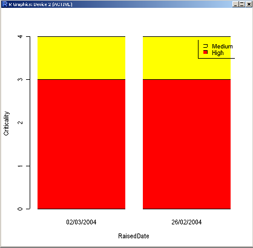

A few simple commands in R can replicate a lot of effort that I would normally do in Excel.

R can also be used for data generation.

I have used MS Excel on every single test project I have ever worked on to:

- track testing,

- report on test progress,

- track defects,

- calculate metrics,

- generate or document test data,

- augment big name commercial test tools

And I have built a lot of very complicated spreadsheets, most with Visual Basic macros.

The few disadvantages that I have found using Excel are that:

- I sometimes have problems taking spreadsheets from client site to client site because of the variety of different versions of Excel that I encounter

- while some people find it very easy to navigate, others prefer a word processor report or html file,

- the data and presentation layers are so tightly woven in an excel spreadsheet that making changes can become problematic.

Having done so much in Excel and knowing how much time and effort I have put in to various spreadsheets, the ease with which I replicated simple metrics and graphs in R makes R and attractive technology to continue to learn.

By starting to use R, I resolve the presentation issues by automatically generating standard sets of metrics but retaining the ability to explore the dataset dynamically for myself. I also make my data analysis more portable and less reliant on the client site technology. I also found it far simpler to learn to use R to generate graphs than I did when learning that functionality in Excel initially.

I will undoubtedly still use Excel for metrics reporting and analysis. But I will continue to learn R as an alternative for those projects where it is a better fit.

Future Sessions - Getting Advanced and other out of scope stuff

This is where the test sessions for the paper stop.

Over the course of a couple of hours or testing and environment setup. I have used over 20 tools, some for the first time (where they made a valuable contribution), and others that I was more familiar with. And although not much ‘testing’ has been done. All the activities carried out have been testing activities, and all the tools used have aided those activities. Some of the defects identified would not have been found so quickly into the test process had it not been for the use of some of those tools.
