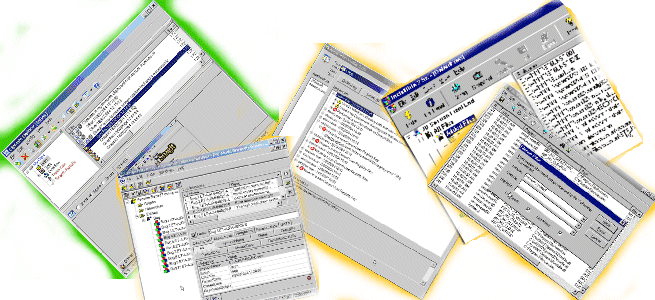
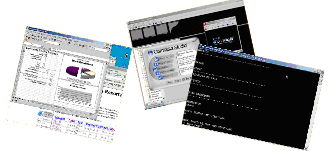

# Alternative Testing Tools in Retrospect

Original 2004 supporting material. Wording, quotations, draft placeholders, source links and illustrations are retained. Tool names, prices and availability describe the original period.

Alternative Testing Tools in Retrospect

Alan Richardson, Compendium Developments, www.compendiumdev.co.uk [Source link](http://www.compendiumdev.co.uk/)

A test tool is ANY tool that can aid the tester during the testing process.

There are hundreds of tools out there that are currently outside the mainstream definition of a 'test tool', many are inexpensive and some are completely free.

This paper will act as a reflective footnote to the wonderful world and thought processes of Alternative Test Tools.

“I'm going to assume that you want to sharpen tools as cheaply and quickly as possible…”

Leonard Lee,

The Complete Guide to Sharpening

## Retrospection and Summary

### What I got from this whole process

I learned a little more about each of the tools I use.

I learned a bit more about why I do this and what I do.

I learned about a few tools I had been meaning to try out for a long time – Compatability toolkit, keyloggers.

I thought more about the use of tools in testing and the nature of tools.

I was surprised when I finished, just how many tools I had actually used. Obviously we can test without any tools, but tools, particularly alternative tools allow us to be more effective, more repeatable, introduce automation in simple pragmatic ways.

I was also surprised that it took me so long to get to Part 5. This is where I thought that I would be starting. Before I started on the process I thought that I would be using diagrammers, model based testing, automation, data generation – all sorts of cool advanced stuff. In the end, I think what I got was even cooler, I use a whole bunch of tools that I take for granted and this was a really useful exercise for me to identify the most basic tools of my trade.

I wanted to experiment with different communication tools for presenting information in the paper. I believe that reducing the number of words in a defect report and putting in more pictures is a better way to make communication easier. I wanted to try a similar thing in this paper so I have tried to format it with fewer words, which, given my propensity to write vast tracts of text, was an editing challenge. I also wanted to support referencing and speed reading so I have summaries and diagrams as often as possible. And I’ve tried to make the diagrams distinguishable instantly – so if you want to come back later and find the tools written in Perl then just find the camel, and if you want to know how to find tools then look for the binoculars. I’ve picked out important keypoints in bold where they exist in the middle of paragraphs. Lots of asides, with relevant information, but which would take too much editing and writing to find linking paragraphs to ease them into the flow of the main text. And quotes, just to make things interesting and give you a little bit more to think about.

These are all techniques I have used in my client and project documentation as I will use any tool that I believe can make my communication more effective.

### Exercises for the reader:

1. Pick an application, any application, and start thinking about what tests you would do on it and what tools that you know about that could help. Make a list, like I did in &lt;reference early section here&gt;

2. If you haven’t used any of the tools that I’ve mentioned then download a few of the cheaper ones or the ones that catch your attention and try them out.

3. Try exploratory testing using SnagIt and ClipMate as a testing log.

### Summary Notes on the tools

“The sword-stick and the brandy-flask, though in themselves only the tools of morbid conspirators, became the expressions of his own more healthy romance. The sword-stick became almost the sword of chivalry, and the brandy the wine of the stirrup-cup.”

G.K. Chesterton,

The Man Who Was Thursday

High level overview of the tools and what they are for:

- Getting more insight

- Communicating more effectively

- Tracking what I’m doing

Some test tool categories: screenshots, key loggers, install monitors, backup utils,

database managers, scripting languages, process monitors, window

message viewers, debugging web proxies, statistic viewers, reporting tools,

data generators, macro utilities, comparison tools, filters, etc. \[list to be expanded\]

### Statistics

One page of statistics and graphs analysis

Tools mentioned as used in this paper X

Tools mentioned in this paper

Total Tool Count 14

Projected Tool Count 18

Costs of tools used

With the 2 most expensive replaced by alternatives
