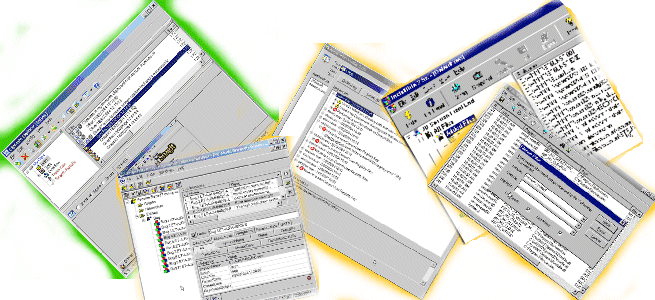
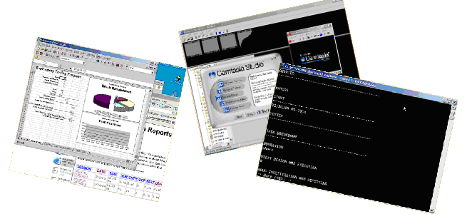
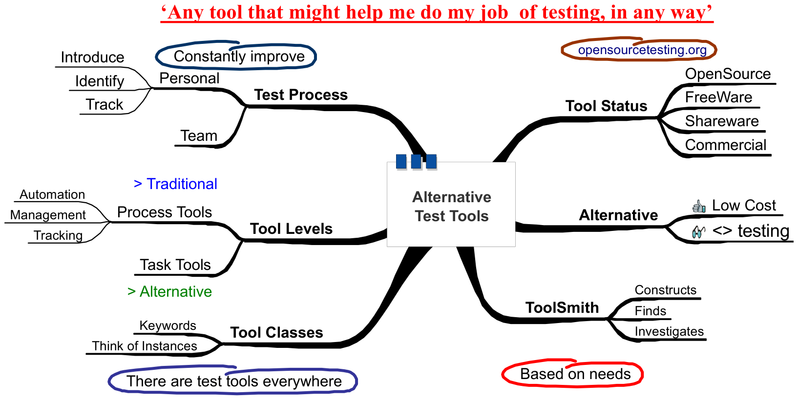
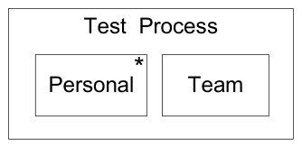
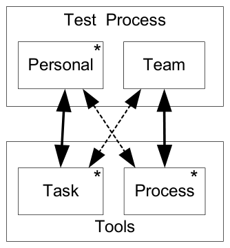
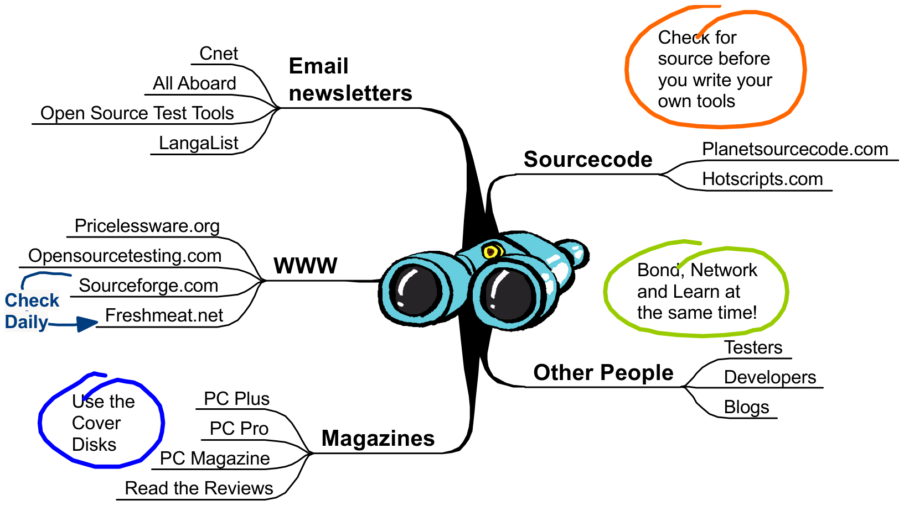
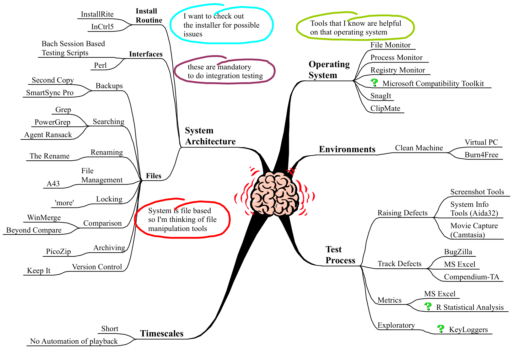
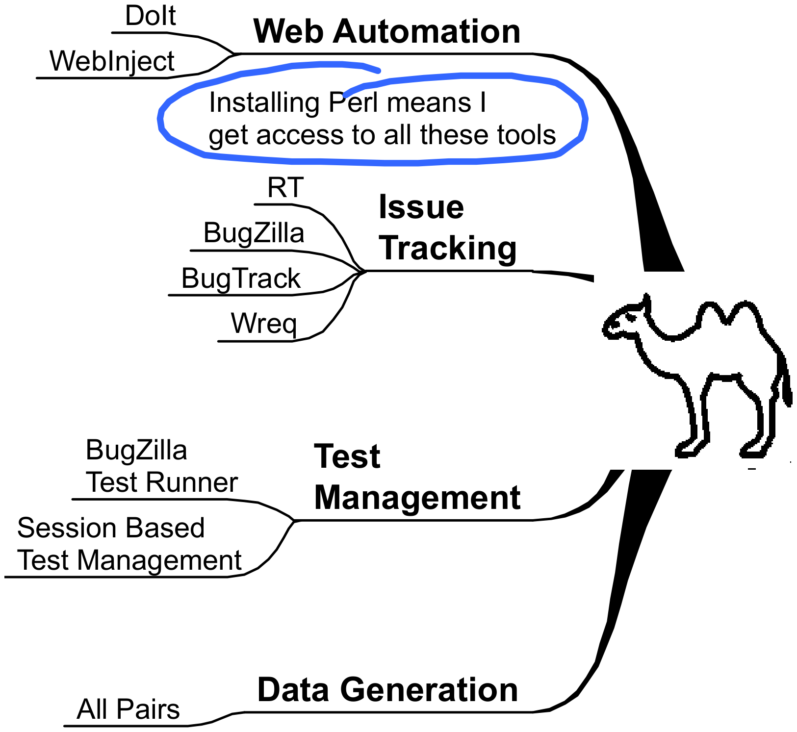
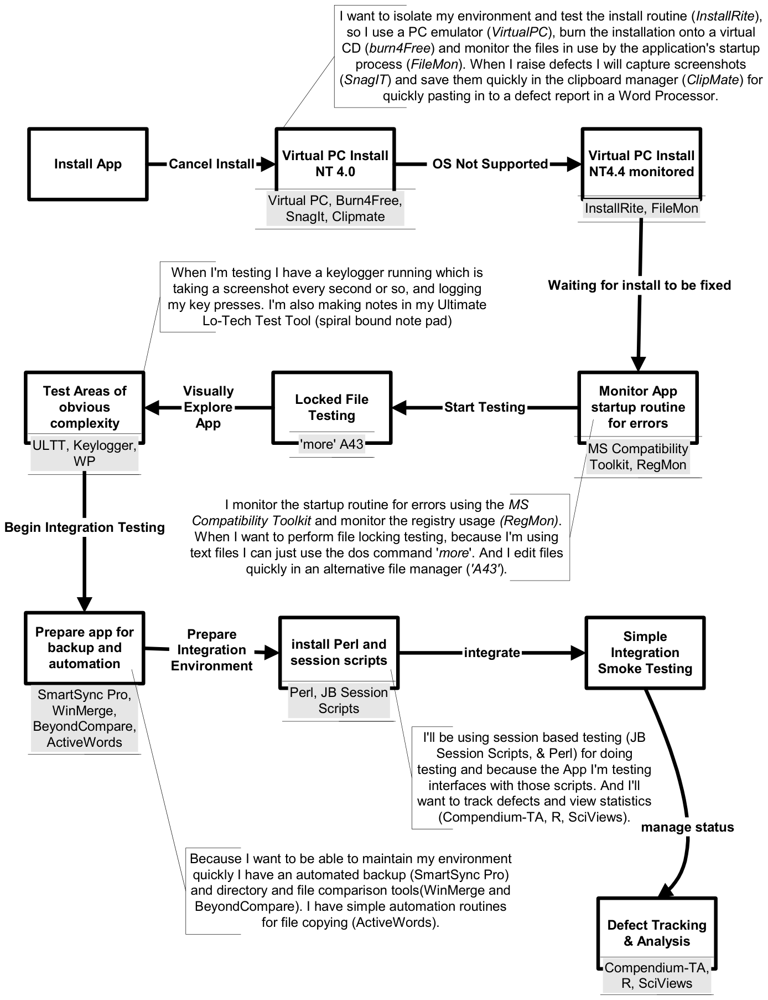

# Alternative Testing Tools in Theory

Original 2004 supporting material. Wording, quotations, draft placeholders, source links and illustrations are retained. Tool names, prices and availability describe the original period.

Alternative Testing Tools in Theory

Alan Richardson, Compendium Developments, www.compendiumdev.co.uk [Source link](http://www.compendiumdev.co.uk/)

V1.1d

A test tool is ANY tool that can aid the tester during the testing process.

There are hundreds of tools out there that are currently outside the mainstream definition of a 'test tool', many are inexpensive and some are completely free.

This paper will describe alternative tools; what makes them different, the implications of their use, also strategies for finding, and introducing, alternative test tools into your test process.

“Desperate alternative! what fiend could dare

To prompt the thought?”

William Wordsworth,

The River Duddon, (XXII. Tradition)

A Test tool is any tool that can help you, in any way, to do better and more efficient testing.

## Introduction

“There is a time and place for use of weapons”

Miyamoto Musashi,

A book of Five Rings

(the ground book)

This paper discusses tools. Specifically, tools that I use when conducting software testing and which, based on my experience of industrial software testing processes, are outside the mainstream classifications of a test tool.

This paper describes the use of tools to augment your testing, not to replace or conduct your testing for you.

This paper explores the notion that tools can help make you a more efficient and effective tester. And tools do not have to be expensive, in fact most of the tools in this paper are either free, or are, in software terms, inexpensive. The most expensive tool mentioned is $299, and even this has free alternatives available.

This is not a paper about testing approaches or about test processes based around tools, but about the use of tools to support a test process.

I will be describing the use of over 20 different and very specific tools. As you read the paper, or when you finish, I want you to investigate further, but before you do, I need to point out that when you do, treat the tools mentioned as examples of tool types. Each of the tools mentioned has alternatives and it may be the alternative tools that are the best fit for you and your process.

One of the lessons I have learned during the writing of this paper is that it is not just the tools themselves, that make the difference, but the use of tools in combination with each other. As an example, we will shortly detail the use of a clipboard cache and a screenshot tool, together, as an exploratory testing log.

I have structured this paper into 4 sections, some of the sections have been summarised here and pulled out into supporting papers as there was just too much information to fit in this ‘theory’ paper:

- A general introduction to alternatives tools: what they are, how to find them and ways to determine which tools to use

- Descriptions of the tools in use over a number of testing sessions. I have tried to document the reasoning that led to choosing those tools and document some experiences of using those tools. (Summarised here)

- A reflection on the lessons learned from the test sessions

- An appendix of lists; of tools with costs and urls where the tools can be downloaded, and rss feeds to get information about potential tools.

So, read on, investigate the tools mentioned here and look around for alternatives in the same tool category. And if you find at least one tool here that can help you in your test process and save you more time than it takes you to browse this paper then both your time, and my time, will have been well spent.

## Alternative Test Tools

### There are test tools everywhere

Reviewing my experiences of industrial software testing processes, one major difference between the testers and the developers that stands out, the developers’ predilection for finding new tools and keeping up to date with the tools available to them.

Developers seem to be looking for new IDEs, new text editors, new virtual desktops, and any new tools to help them. I speak to developers a lot to ask “what tools might help me?” This provides a lot of pointers and I learn a lot, I get to pass on information about tools that I think might help them, and this all helps build rapport between the testers and the developers.

That’s not to say that ‘All’ testers are blind to new tools. There are testers out there that find tools everywhere because they view software differently. They view all tools as potential test tools. If you are not one of those testers yet then I hope that, by the time you finish with this paper, you will want to be one. Or at the very least, have one of them on your team. And if you already are one of those testers then I hope you’ll let me know about the tools that you use so that I have more options about how I test.

I like to have more options about the tools I use during testing.

On the cover disk of a recent computer magazine that I bought, I excitedly found a whole bunch of test tools: a key logger and screenshot program, an uninstall tool that can give me a log of changes made by the install routine, a tool to let me control multiple machines in the test environment, a tool to monitor http and system messages. All of them free since the commercial software was being given away on the cover disk with licenses. And there were demonstration versions of the most up to date versions that will allow me to trial the tools on my test process without having to spend a lot of time hunting down the latest software.

Some won’t have immediate uses, but you can think of ways that they might possibly be useful in the future. And some will immediately save you time, or help you do things that you couldn’t otherwise do.

Free and Cheap tools have a lower barrier to entry and are much easier to justify adding to your test process on a purely cost or experimentation basis.

“You're gonna look around in your mind, girl,

you're gonna find that I'm gone. You didn't realize…

Oh, you're gonna miss me, child, yeah”

Roky Erickson &amp; The 13th Floor Elevators, You’re Gonna Miss Me

Test Tools are not just the common big ones. Expand your definition. Change your perceptual filters so that you view any piece of software as a potential test tool.

Until I wrote this paper I didn’t realise how many tools I use and how ubiquitous they had become in my personal test process.

One of the simplest alternative test tools is a screenshot program. This can allow you to raise defect reports with far less text but which are much more effective at communicating a problem. I have yet to work on a client site where a screenshot program was installed as standard, and we have either had to ctrl+prtSc the screen and edit the picture, a time consuming process, or use the screenshot facilities of an art package (which consumes more memory and resources).

A Simple Persistent Test Log For Exploratory Testers

Use a clipboard manager as a test log. Here is what I do (with SnagIt and ClipMate):

- Type some text describing something I’m about to do or thinking about,

- I don’t have to open a text editor, this can be done anwhere I can type,

- highlight the text and cut it into the clipboard, leaving your typing area clean of your thoughts,

- this instantly persists it in your clipboard database with a handy timestamp,

- then go about your testing,

- occasionally take a screenshot that you send to the clipboard.

A robust and pretty crashproof exploratory test log. I’ve lost too many test logs in the past due to machine crash es not to like this method. Of course you are still vulnerable to hard drive trashing crashes, so if you experience those often, I recommend the use of a ULTT (Ultimate Lo-Tech Test Tool – a pen and a pad of paper) and digital camera.

For perfectly understandable security reasons, some client sites do not allow me to install software on my desktop. Other times a client site has the notion of a tools division in the company and they dictate what can be installed on machines. My experience is that developers always seem to get around these rules, and if this is the case in your organization then learn their strategies for installing what they need, or see if their tools can help you and either get their tools installed, or get them to run the tools for you. Getting other people to do your work for you is a very handy strategy; sometimes your work gets done and sometimes someone else works on your behalf to make sure you get the tools you need.

One advantage of exploring alternative test tools is that when you find a category of tool that is useful, you explore that category to identify tools which are single executables, with no dll dependencies, making them easy to add to your machine without changing the base system. Or find tools that run under a scripting language, like Perl, or a virtual machine, like Java, this way you technically only have to justify the installation of the VM or scripting language.

### Notes on the Personal Test Process

My view of the test process is that, whatever methodology we use and whatever company specific approach we have in place, every single one of us has a personal test process that we use within that higher level team process.

For the moment, and the purposes of this paper, I am working with a ‘personal/team’ model of the test process, meaning that the test process in place has:

- A team process

- As many personal test processes as there are people involved in the team process

As this is a model, it can be wrong, it doesn’t matter, so long as it is useful. And I found it a useful model to apply when thinking about Alternative test tools, specifically, how and why I use them.

Some of us have a personal test process that utilises techniques such as touch-typing, mind mapping, note taking, outlining, or speed-reading. Some people exclusively use the keyboard shortcuts in their word processor, others exclusively use the mouse and menus, and others use both. We all bring our individuality to our testing and a personal test process is the natural result.

I make a distinction between ‘personal’ and ‘team’ because when I was thinking about alternative test tools, I found that most of the alternative test tools I was using were part of a personal test process, and most of the alternative test tools I know of apply to a personal test process rather than a team process.

Possibly because:

- The personal test process is the test process where test process improvement really starts

- I continually try to improve my own testing

- Identifying tools is a part of my daily personal test process

I observe how I test, and thinking about the tools that I use, I wonder how I can improve the use of those tools.

If I find myself using a text editor in testing I’m wondering,

- Can this tool do more to help my testing?

- Are there other text editors that might help me better?

- What other text editors are there?

- Is a text editor the best tool for this?

Also, I realised when I do test management, my role involves analysing progress, defect statistics, and reporting progress. And when I find myself using Excel to as part of my personal test process to do these tasks instead of the test management tool or incident manager, I realised that these big tools supported the process of raising and tracking defects or tests, but not the tasks I needed to do for analysis and reporting those defects.

A result of this is that I have an immediate grouping of tools into:

- Process tools

- Task tools.

I now have another way to think about the tools that I use to identify needs and requirements.

### A summary of tool identification strategies

Because I constantly look for tools and I talk to a lot of people about the tools they use, I have a large list of ‘interesting’ tools that I can refer to when I want to identify tools that I think might be appropriate for a situation.

But I don’t start with a tool. I start with a need to perform some sort of task and then I identify a tool that might help.

A “brilliant” idea occurred to me, now long forgotten. I knew to execute that brilliant idea I would need a hammer and a hatchet. But those things were on the back porch. I rushed to get the tools, but in some way, by the time I reached the porch, I had completely forgotten what I was after. Following a long, fruitless mental search, I returned to the barn door and recalled my brilliant idea and what was needed to execute it. My brilliant idea was associated with the barn door where I happened to get it.

Milton H. Erickson,

Notes on Minimal Cues in Vocal Dynamics and Memory

These are the basic situations I find myself in:

1. I know a tool that fits the need instantly because it is on my list.

2. I may vaguely recall a tool that I think can be of use and I remember enough details and keywords to help me find it again.

3. I won’t know of a tool directly, but I know what I need, and I can summarise that need as keywords and I know where I can go looking for a tool.

4. In an emergency, I have programming knowledge so I can construct a tool, and I know where I can find source code to build on or shortcut the construction.

I’m going to try and arm you with enough information in this paper so that you can address the above situations for yourself.

### Finding Tools

“Where does he get those wonderful toys?”

The Joker, Batman: The Movie

It doesn’t have to be hard work to find tools.

Daily Checks

www.sourceforge.com [Source link](http://www.sourceforge.com/)

www.freshmeat.net [Source link](http://www.freshmeat.net/)

Regularly Review

www.pricelessware.org [Source link](http://www.pricelessware.org/)

www.opensourcetesting.com [Source link](http://www.opensourcetesting.com/)

PC Magazine Utilities

www.pcmag.com/category2/0,4148,23,00.asp [Source link](http://www.pcmag.com/category2/0,4148,23,00.asp)

EMail Newsletters

tejasconsulting.com/open-testware/ [Source link](http://tejasconsulting.com/open-testware/)

www.cnet.com [Source link](http://www.cnet.com/)

www.sharewarejunction.com [Source link](http://www.sharewarejunction.com/)

www.langa.com [Source link](http://www.langa.com/)

Sourcecode

www.planetsourcecode.com [Source link](http://www.planetsourcecode.com/)

www.hotscripts.com [Source link](http://www.hotscripts.com/)

There are a couple of web sites that I monitor for free tools on a daily basis (sourceforge, freshmeat), and there are some where other people have done all the hard work for me (pricelessware, opensourcetesting) which I frequent less regularly.

I get information emailed in email newsletters from Cnet, Shareware Junction, Langalist, and the Open-Testware list. Fred Langa’s (www.langa.com) and Danny Faught’s (tejasconsulting.com/open-testware) both cost money, but are tiny investments well made. [Source link](http://www.langa.com/) [Source link](http://tejasconsulting.com/open-testware/)

And there are sites with ready to run source code that I can use straight off, or customise if I need to. (www.planetsourcecode.com) [Source link](http://www.planetsourcecode.com/)

One of the best sources of information available are the people you meet: developers on your projects and other testers. I also monitor a whole bunch of peoples’ blogs. Check out the blogs list in the appendix if you want a small quick start. You’ll need a good rss aggregator – I use newsgator (www.newsgator.com) but there is plenty of competition in that market. [Source link](http://www.newsgator.com/)

The above information is just to start you off. I found these sites by keeping my ear to the ground, paying attention to the web sites that developers visit and doing searches for software that I thought “there must be a tool to do X” and then going to my favourite browser and typing in “X tool free” and if that fails “X tool download”.

And if you want a head start then you can always visit my web site where I have a list of alternative testing tools.

“Therefore a wise general strives to feed off the enemy. Each pound of food taken from the enemy is equivalent to twenty pounds you provide by yourself.”

Sun Tzu, The Art of War,

Translator: Thomas Cleary

…Warning, Secondary Gain... Looking for tools is educational. I learn about technologies that I didn’t know about by reading tool descriptions, I understand some of the architectures that are being developed, even though I’m not testing them, I learn about tool possibilities that I hadn’t even considered (monitoring http traffic, XML transformation, data generation).

Part of my personal test process is identifying new tools, partly for education and partly to help me with my testing when the need arises.

### Identifying tools

Before I start testing I think of tools I might be able to use based on the context I will be working with:

“Act after having made assessments. The one who first knows the measure of far and near wins – this is the rule of armed struggle”

Sun Tzu, The Art of War,

Translator: Thomas Cleary

- Operating System I’m using,

- Architecture of the system,

- Process I am using

- TimeScales I am testing against

- Environments I have available

I know about the application and the operating system so before I even start testing I am thinking about what tools I already know about that might help me. This does not of course mean that I’ll use them, but I pick tools based on the Application Under Test and the context I am testing in.

Questions help identify a tool

- What do I want to do?

- What’s the matter with doing it manually?

- Do I want to do it enough times that finding/creating a tool will be worth while?

- What kind of tool might work with, and augment, this tool?

Our primary test tools (Brain and senses) have to be engaged from the very instance that we approach testing.

As testers we are used to looking for side effects, they are often a source of bugs. Our normal testing thought processes can help us identify test tools by looking for side-effects that might turn any standard piece of software into a test tool.

Operating systems come with their own utilities that can act as test tools. In dos ‘fc /b’ will do a binary file compare, on Unix we can use ‘cmp’ or ‘diff’, the Dos command ‘more’ will lock text files as a side-effect. If we learn more about the environment we are testing in, we may discover some of the tools we need.

Notes on Scripting Languages

Some of the functionality of the tools I will be identifying in this paper can be done in scripting languages: Perl, Python, Ruby etc.

So why do I bother finding all these programs?

1. I work on client sites and I have never been on a client site with Perl installed on the windows desktop test machines by default.

2. I have written my own test tools in the scripting language installed by Microsoft Office (VBA). But sometimes the machines are not high powered enough to run the test suite, the AUT and MS Access at the same time without slowing down. (I also use Excel as it has less of a memory overhead.)

3. Sometimes Clients don’t like you installing software like Perl on their machines

4. When I leave the site and leave tools in the hands of the remaining staff, I prefer to leave them without any maintenance work so if I can identify a free off the shelf solution, then I’m likely to take it.

5. I’d rather spend 2 minutes getting a tester up to speed with a tool than a couple of days with a scripting language.

So I like to find tools :

- with simple GUIs and simple purpose,

- that don’t leave a lot of dlls lying around,

- which are cheap or free,

- which are simple to use and don’t have a high learning curve.

Having said all this. Some test tools are written in scripting languages: Bugzilla, JB Session based testing, All Pairs, PerlClip, Perl GUI automation. And one way to view scripting languages is as just another platform that allows you to run more applications:

Issue Tracking

RT (www.bestpractical.com/rt) [Source link](http://www.bestpractical.com/rt)

BugZilla (www.bugzilla.org) [Source link](http://www.bugzilla.org/)

BugTrack (www.agstools.com/bugtrack/ ) [Source link](http://www.agstools.com/bugtrack/)

Wreq (www.math.duke.edu/~yu/wreq/) [Source link](http://www.math.duke.edu/~yu/wreq/)

Data Generation

All Pairs (satisfice.com/testmethod.shtml) [Source link](http://satisfice.com/testmethod.shtml)

Web Automation

DoIt (doit.sourceforge.net) [Source link](http://doit.sourceforge.net/)

WebInject (www.webinject.org) [Source link](http://www.webinject.org/)

Test Management

BugZilla Test Runner (www.willowriver.net/products/testrunner.php) [Source link](http://www.willowriver.net/products/testrunner.php)

Session Based Test Management (www.satisfice.com/sbtm) [Source link](http://www.satisfice.com/sbtm)

You can build a similar list of any other scripting language quite quickly, and you can certainly expand on this one as there are a lot more free tools written in perl.

Part of the skillset of a technical tester or toolsmith seems to me to be identifying existing tools which can support testing, as well as being able to construct tools on demand.

## Alternative Test Tools In Action

This section is a summary of information that has been moved out to a separate paper which describes the testing of a Visual Basic application that I had written, which acts as a front end for session based perl scripts. Over the course of a few testing sessions on a simple application over 20 tools were used.

Although it could be argued that most of these tools are not test tools, I was able to be more productive and efficient by using the tools, and I’ll use them again, and next time I’ll still be calling them test tools.

## A Short Retrospection

### Things Change

I’m loath to say that I have favourite tools, as I’d much prefer to keep my options constantly open, and my choice of tools changes over time. I rarely use ActiveWords anymore as I have been learning Perl in more detail and now automate more tasks through Perl than through ActiveWords. But having used ActiveWords, I now know more about macro tools, and when I might want to use them, than I did and I’ve investigated a few more tools in that automated macro category.

I’ve since used Adobe Acrobat (www.adobe.com) as an alternative test tool for testing report printing, previously I used GhostScript coupled with RedMon (www.cs.wisc.edu/~ghost/ ) but Acrobat was just that little bit more stable on my test computer. [Source link](http://www.adobe.com/) [Source link](http://www.cs.wisc.edu/~ghost/)

And though I haven’t used R much since, I have used an online version of R when I wasn’t able to get it installed on a local machine (franklin.imgen.bcm.tmc.edu/R.web.servers/). [Source link](http://franklin.imgen.bcm.tmc.edu/R.web.servers/)

### Exercises for the reader:

1. Pick an application, any application, and start thinking about what tests you would do on it and what tools that you know about that could help. Make a list.

2. If you haven’t used any of the tools that I’ve mentioned then download a few of the cheaper ones or the ones that catch your attention and try them out.

3. Try exploratory testing using SnagIt and ClipMate as a testing log.

4. Identify an action that you do frequently: moving test data files, comparing directories, clearing down an environment etc. and learn enough about a scripting language to automate the task.

5. Visit any, or all, of the web sites in this paper.

6. If you don’t already make notes when you test then, next time you test try, it out. Get a pen and paper and write stuff down as you test.

7. If you do make notes then try some different note making tools – mind maps, outlines, graphs, diagrams, or just something completely different

8. Observe your testing, and make notes not just on what you do, but why you did it.

9. Find 6 impossible things to try on your software before breakfast, and then identify tools to help you do them.

### Final Words

Now, I could summarise the paper and wrap things up nicely, but really all that is left is to start looking at your testing and your tools differently. And so for the final words, I’ll quote a professional…

MacGyver: I'm going to need a nail. Lisa Woodman: What for? MacGyver: Well, if I can weld a good spark plug it'll replace the electrode. Lisa Woodman: How are you going to weld it MacGyver: With wire, a battery, and jumper cables. Lisa Woodman: How do you come up with this stuff? MacGyver: Well, the stuff's already here. I just find a different way to use it.

MacGyver The TV Series

## Appendix – Lists

### A Small Tools List

I could hardly let this paper go without some sort of tools list. The tools are described in more detail in the supporting paper ‘Alternative Testing Tools in Action’.

| Tool | Website | Cost (as recorded) |
| --- | --- | --- |
| A43 | www.shawneelink.net/~bgmiller [Source link](http://www.shawneelink.net/~bgmiller) | Free |
| ActiveWords | www.activewords.com [Source link](http://www.activewords.com/) | $19.95 |
| J &amp; J Bachs’ Session Based Scripts | www.satisfice.com/sbtm [Source link](http://www.satisfice.com/sbtm) | Free |
| Beyond Compare | www.scootersoft.com [Source link](http://www.scootersoft.com/) | $30 |
| Burn4Free | www.burn4free.com [Source link](http://www.burn4free.com/) | Free |
| Camtasia Studio 1.1 | www.techsmith.com [Source link](http://www.techsmith.com/) | $299 (There are free alternatives) |
| ClipMate | www.thornsoft.com [Source link](http://www.thornsoft.com/) | $24.95 |
| Compendium-TA | www.compendiumdev.co.uk/compendium-ta [Source link](http://www.compendiumdev.co.uk/compendium-ta) | £35 |
| Excel | www.microsoft.com [Source link](http://www.microsoft.com/) | &lt;various&gt; |
| FileMon | www.sysinternals.com [Source link](http://www.sysinternals.com/) | Free |
| InstallRite | www.epsilonsquared.com [Source link](http://www.epsilonsquared.com/) | Free |
| KeepIt | www.keep-it.com [Source link](http://www.keep-it.com/) | Free |
| WinMerge | winmerge.sourceforge.net [Source link](http://www.winmerge.sourceforge.net/) | Free |
| ULTT | Any stationary shop | $lo-cost |

| Tool | Website | Cost (as recorded) |
| --- | --- | --- |
| Microsoft Windows Application Compatibility Toolkit | www.microsoft.com/windows/appcompatibility/toolkit.mspx [Source link](http://www.microsoft.com/windows/appcompatibility/toolkit.mspx) | Free |
| More (dos) | &lt;bundled with windows&gt; | Free |
| Pal Computer Surveillance System 2.2 | www.palsol.com [Source link](http://www.palsol.com/) | I got an old version for free on a coverdisk $35 |
| Perl | www.activestate.com [Source link](http://www.activestate.com/) | Free |
| R | cran.r-project.org [Source link](http://cran.r-project.org/) | Free |
| Registry Monitor | www.sysinternals.com [Source link](http://www.sysinternals.com/) | Free |
| SciViews | www.sciviews.org [Source link](http://www.sciviews.org/) | Free |
| SmartSync Pro | www.smartsync.com [Source link](http://www.smartsync.com/) | $35 |
| SnagIt 6.3 | www.techsmith.com [Source link](http://www.techsmith.com/) | $39.95 (there are free alternatives) |
| Virtual PC | www.microsoft.com/windowsxp/virtualpc [Source link](http://www.microsoft.com/windowsxp/virtualpc) | $129 (there are free alternatives) |

### Blogs List

This is just a short list of rss feeds which have provided useful tool pointers for me. There are far more rss feeds out there, keep an eye out for the little orange xml icon on web pages and get a good aggregator.

| Blog | Feed |
| --- | --- |
| Martin Fowler's Bliki | <http://martinfowler.com/bliki/bliki.rss> |
| Joel on Software | <http://www.joelonsoftware.com/rss.xml> |
| Lockergnome’s Technology News | <http://www.lockergnome.com/lockergnome.xml> |
| xBlog: The visual thinking weblog \| XPLANE | <http://xplane.com/xblog/xml/xblog.xml> |
| XMLhack | <http://www.xmlhack.com/rss10.php> |
| The XML Cover Pages | <http://xml.coverpages.org/covernews.xml> |
| Cafe con Leche XML News and Resources | <http://www.ibiblio.org/xml/today.rss> |
| PragDave | <http://pragprog.com/pragdave/index.rss> |
| Software Documentation Weblog | <http://trieloff.net/docbook/index.rss> |
| MemoRanda | <http://homepage.mac.com/keithray/blog/index.rss> |
| Artima Articles | <http://www.artima.com/newatartima.rss> |
| Artima.com News &amp; Ideas | <http://www.artima.com/newsandideas.rss> |
| Artima Pavilion Announcements | <http://www.artima.com/releases.rss> |
| Artima Weblogs | <http://www.artima.com/weblogs/feeds/weblogs.rss> |
| Thinking About Computing | <http://mindview.net/WebLog/RSS.xml> |
| Connections | <http://www.codegeneration.net/connections/index.rdf> |
| ANTLR.org's news entries | <http://www.antlr.org/news/rss> |
| Programmers Heaven latest news | <http://www.programmersheaven.com/app/rss/Rss.aspx?Feed=News&Version=20> |
| Programmers Heaven latest files and products | <http://www.programmersheaven.com/app/rss/Rss.aspx?Feed=LF&Version=20> |
| Programmers Heaven latest articles and tutorials | <http://www.programmersheaven.com/app/rss/Rss.aspx?Feed=LA&Version=20> |
| Programmers Heaven latest links | <http://www.programmersheaven.com/app/rss/Rss.aspx?Feed=LL&Version=200> |
| vbAccelerator New and Updated Publications | <http://www.vbaccelerator.com/home/The_Site/Indexes/RSS_Feeds/WhatsNew/rss.xml> |
| Marc's Outlook on Productivity | <http://blogs.officezealot.com/marc/index.xml> |
| FreeVBCode.com Most Recent Code | <http://www.freevbcode.com/rss_newcode.asp> |
| Code Generation Network | <http://www.codegeneration.net/updates_rdf.php> |
