# Alternative Testing Tools List

Original 2004 supporting material. Wording, quotations, draft placeholders, source links and illustrations are retained. Tool names, prices and availability describe the original period.

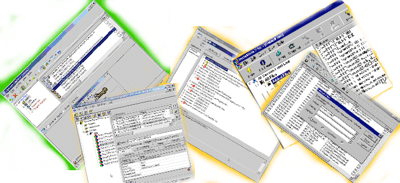

Alternative Testing Tools, The List

Alan Richardson, Compendium Developments, www.compendiumdev.co.uk [Source link](http://www.compendiumdev.co.uk/)

A test tool is ANY tool that can aid the tester during the testing process.

A supporting paper for ‘Alternative Testing Tools In Action’ wherein we describe and summarise the tools used.

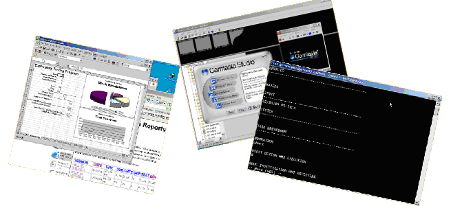

“Man is a tool-using animal.... Without tools he is nothing, with tools he is all.”

Thomas Carlyle,

Sartor Resartus, bk. 1, ch. 5 (1833-1834).

## The tools lists

“Kit. (Anglo-Saxon, kette, a cist or box \[of tools\].)

Hence that which contains the necessaries, tools, etc., of a workman.

\- A soldier’s kit. His outfit.

\- The whole kit of them. The whole lot. (See above.)

Used contemptuously.”

E. Cobham Brewer 1810–1897.

Dictionary of Phrase and Fable. 1898.

“I have seen just as many happy faces among the poor peasants toiling with their primitive tools in the devastating heat of the tropics as I have seen in air- conditioned offices in New York…”

Dale Carnegie,

How to Win Friends &amp; Influence People

### The Summary Tools List

24 Tools For Used During Testing:

| Tool | Website | Cost (as recorded) |
| --- | --- | --- |
| A43 | www.shawneelink.net/~bgmiller [Source link](http://www.shawneelink.net/~bgmiller) | Free |
| ActiveWords | www.activewords.com [Source link](http://www.activewords.com/) | $19.95 |
| J &amp; J Bachs’ Session Based Scripts | www.satisfice.com/sbtm [Source link](http://www.satisfice.com/sbtm) | Free |
| Beyond Compare | www.scootersoft.com [Source link](http://www.scootersoft.com/) | $30 |
| Burn4Free | www.burn4free.com [Source link](http://www.burn4free.com/) | Free |
| Camtasia Studio 1.1 | www.techsmith.com [Source link](http://www.techsmith.com/) | $299 (There are free alternatives) |
| ClipMate | www.thornsoft.com [Source link](http://www.thornsoft.com/) | $24.95 |
| Compendium-TA | www.compendiumdev.co.uk/compendium-ta [Source link](http://www.compendiumdev.co.uk/compendium-ta) | £35 |
| Excel | www.microsoft.com [Source link](http://www.microsoft.com/) | &lt;various&gt; |
| FileMon | www.sysinternals.com [Source link](http://www.sysinternals.com/) | Free |
| InstallRite | www.epsilonsquared.com [Source link](http://www.epsilonsquared.com/) | Free |
| KeepIt | www.keep-it.com [Source link](http://www.keep-it.com/) | Free |
| Microsoft Windows Application Compatibility Toolkit | www.microsoft.com/windows/appcompatibility/toolkit.mspx [Source link](http://www.microsoft.com/windows/appcompatibility/toolkit.mspx) | Free |
| More (dos) | &lt;bundled with windows&gt; | Free |
| Pal Computer Surveillance System 2.2 | www.palsol.com [Source link](http://www.palsol.com/) | I got an old version for free on a coverdisk $35 |
| Perl | www.activestate.com [Source link](http://www.activestate.com/) | Free |
| R | cran.r-project.org [Source link](http://cran.r-project.org/) | Free |
| Registry Monitor | www.sysinternals.com [Source link](http://www.sysinternals.com/) | Free |
| SciViews | www.sciviews.org [Source link](http://www.sciviews.org/) | Free |
| SmartSync Pro | www.smartsync.com [Source link](http://www.smartsync.com/) | $35 |
| SnagIt 6.3 | www.techsmith.com [Source link](http://www.techsmith.com/) | $39.95 (there are free alternatives) |
| ULTT | Any stationary shop | $lo-cost |
| WinMerge | winmerge.sourceforge.net [Source link](http://www.winmerge.sourceforge.net/) | Free |
| Virtual PC | www.microsoft.com/windowsxp/virtualpc [Source link](http://www.microsoft.com/windowsxp/virtualpc) | $129 (there are free alternatives) |

3 Additional Tools Used to prepare this paper:

MS Word

Keep-It

Adobe Acrobat

Additional tools used to prepare the presentation:

MS Powerpoint

&lt;tool to insert flash&gt;

Tools Mentioned in this paper but not used

Bochs bochs.sourceforge.net [Source link](http://bochs.sourceforge.net/)

VM Ware www.vmware.com [Source link](http://www.vmware.com/)

&lt;go back through the paper and list all tools here /&gt;

### The Detailed Tools List

#### A43

A43 is a freeware file explorer replacement. I like it because it has easy access to a built in text editor, I can easily call up dos prompts, and I can easily copy the filename path to the clipboard, and a whole other reasons.

It is just very convenient to have a lot of functionality wrapped up in such a small program. Particularly one that doesn’t require an install, just unzip the files into the destination directory.

www.shawneelink.net/~bgmiller [Source link](http://www.shawneelink.net/~bgmiller)

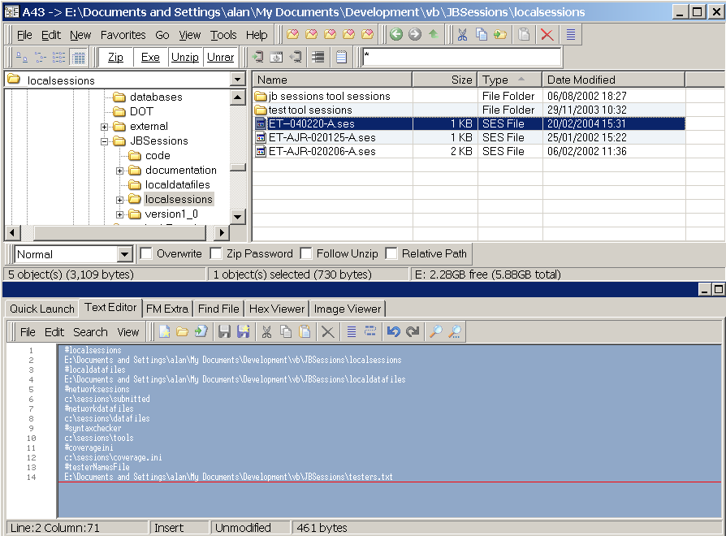

#### ActiveWords

ActiveWords is a user defined command driven tool, which can run scripts, open directories, start applications and do various other tasks.

One you start using it and define your own ActiveWords, it can be quite a time saver and if you are ever on someone else’s machine, you start to notice that it isn’t there.

www.activewords.com [Source link](http://www.activewords.com/)

Alternative:

MCL (http://www.mlin.net/MCL.shtml) Free

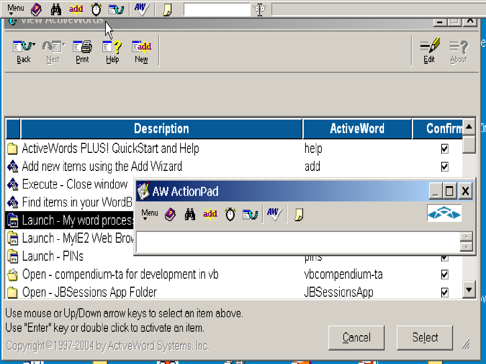

#### Bachs’ Session Based Scripts

These Perl scripts process text files which are test sessions. This is a simple and interesting way of managing testing by splitting it down into smaller chunks.

The scripts prepare a whole bunch of status reports in html and in MS Excel.

Worth a look and getting familiar with it. Your approach to testing or test management might change.

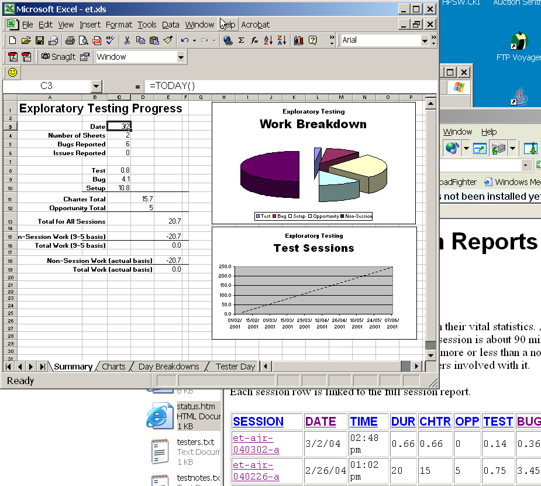

#### Beyond Compare

Beyond Compare is my favourite directory and file comparison tool.

It is very easy to initiate a comparison from the windows explorer context menus and it has plugins to compare dll versions, as hex, pictures etc.

I find this to be an essential tool when working with files.

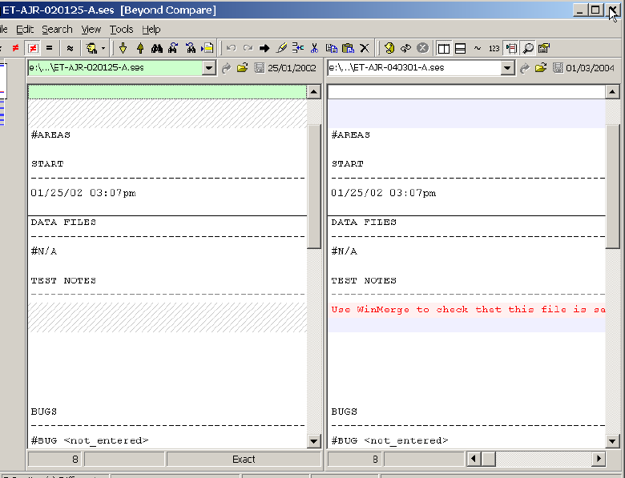

#### Burn4Free

Burn4Free is a handy CD image manipulation tool which is available at no cost.

It is a very easy tool to use for the creation of .iso images which are used to create CDs and in PC Emulation to represent CDs and Hard Drives.

www.burn4free.com [Source link](http://www.burn4free.com/)

Alternatives:

CDMage http://cdmage.cjb.net (Free) [Source link](http://cdmage.cjb.net/)

Commercial tools: Nero, Alcohol 120%, WinOnCD

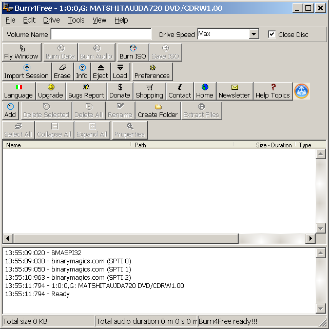

#### Camtasia Studio

Camtasia Studio is a screen movie capture and editing solution. Very handy for recording testing sessions that can be output as flash and many other formats.

This is a growing area for software providers and there are a lot of competing products.

Camtasia Studio costs $299.

Alternatives:

Wink www.debugmode.com/wink (Free) [Source link](http://www.debugmode.com/wink)

Camstudio www.ehelp.com/camstudio/product/screenrecording (Free) [Source link](http://www.ehelp.com/camstudio/product/screenrecording)

RoboDemo www.macromedia.com/software/robodemo ($599) [Source link](http://www.macromedia.com/software/robodemo)

ViewletBuilder www.quarbon.com ($199) [Source link](http://www.quarbon.com/)

Instant-demo www.instant-demo.com ($199) [Source link](http://www.instant-demo.com/)

Runaware www.runaware.com [Source link](http://www.runaware.com/)

DemoForge www.demoforge.com ($295) [Source link](http://www.demoforge.com/)

Turbo Demo www.turbodemo.com ($299) [Source link](http://www.turbodemo.com/)

HyperCam www.hyperionics.com ($30) [Source link](http://www.hyperionics.com/)

More listed at www.buildorbuy.org/screenrecorders.html [Source link](http://www.buildorbuy.org/screenrecorders.html)

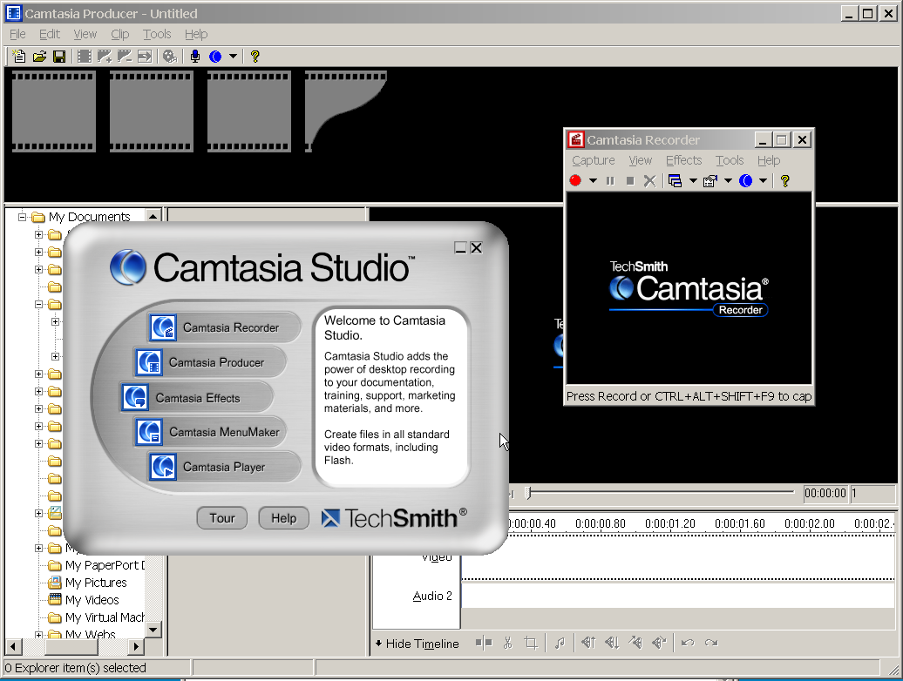

#### ClipMate

ClipMate is the clipboard capture tool that I have running constantly.

It comes complete with a screencapture tool, but it doesn’t capture the mouse pointer so I am not using this function during the testing. Although I have used it to take the screenshot of SnagIt in this document.

ClipMate will make it easy for me to re-use test data and to build my defect reports.

www.thornsoft.com [Source link](http://www.thornsoft.com/)

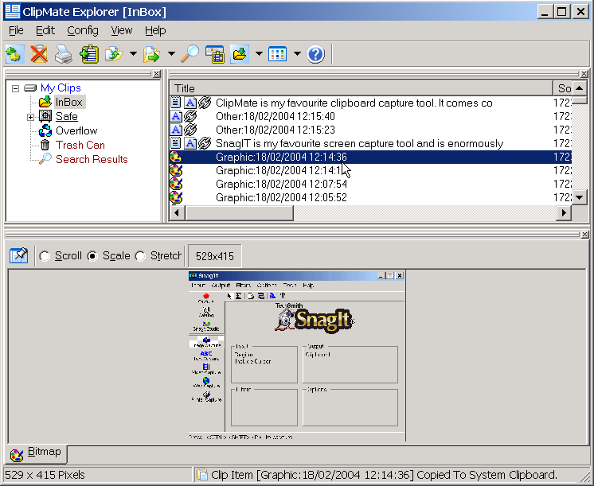

#### Compendium-TA

OK, this is the self promotion section of the paper as Compendium-TA is a tool that I wrote to help me model my testing.

I’m using it in this paper as a general purpose entity manager for defects to export them in a csv file for processing by R. I could have just used a spreadsheet, but as I intend to continue with the testing and data that I started in this paper, it made sense to use the tools that I normally use. And Compendium-TA is in daily use in my process.

Compendium-TA allows you to model graphs, hierarchies, and entities.

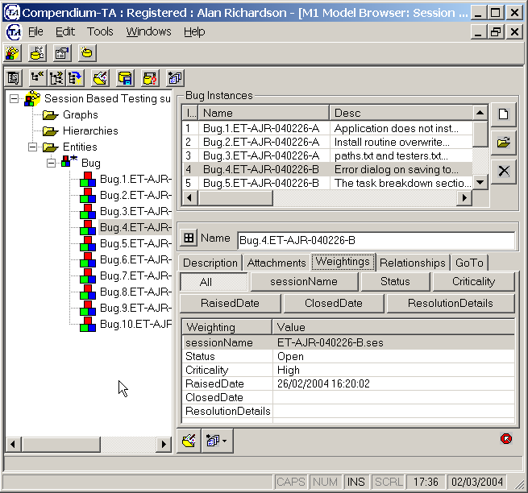

#### FileMon

FileMon from www.sysinternals.com is a free tool for monitoring the file system activities going on in Windows. [Source link](http://www.sysinternals.com/)

This is a great way of seeing what your apps are doing. I have been able to inform developers of what their product was doing at the time of a crash and/or a defect by using this tool and the companion tools from sysinternals.com.

It is well worth becoming familiar with these free tools.

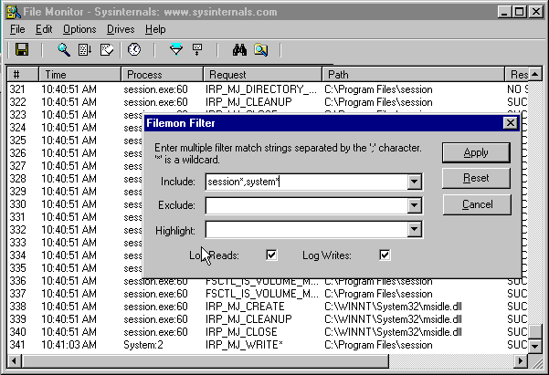

#### InstallRite

InstallRite is a Free tool that will record a before and after state of your system when installing applications.

It is very easy to use and provides detailed reports.

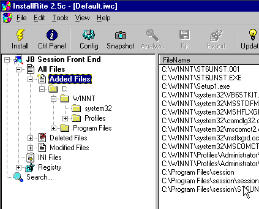

#### KeepIt

Keep-It is an excellent personal version control system.

It integrates with windows explorer and allows you to create snapshots of documents that are efficiently stored in a single archive file.

You can see from the screenshot that I am using it to version control this document and I have 5 snapshots of the document in the archive and it is only a little larger than the actual file.

Keep-It can be a lifesaver and is ideal for quick and simpel version control or where you don’t have a fully fledged version control system in place.

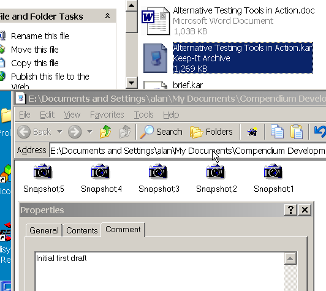

#### Microsoft Windows Application Compatibility Toolkit

Particularly the Application Verifier component, which monitors your system and provides logs of anything that might cause a compatibility problem in the system.

This can be used to follow up any alerts and see if they might be a potential source of defects.

Very handy gadget.

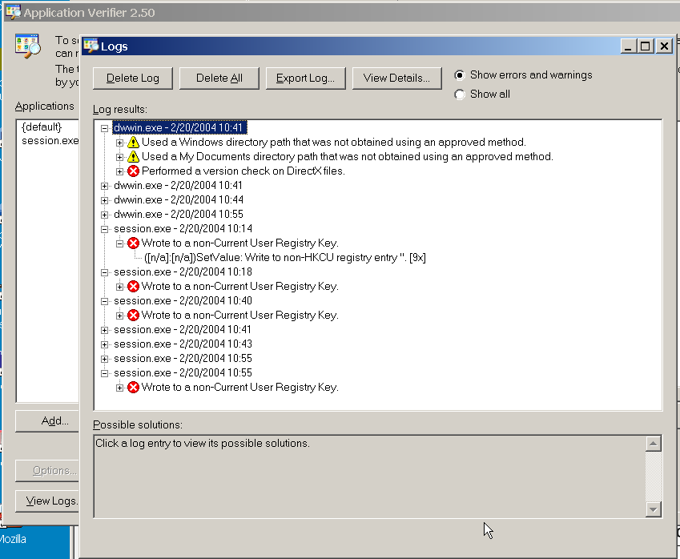

#### More

More is a very simple utility for displaying a text file a screenful at a time. It is probably redundant for most of the world, but for testers, this is a very easy method of loccking files, and that is what I use it for.

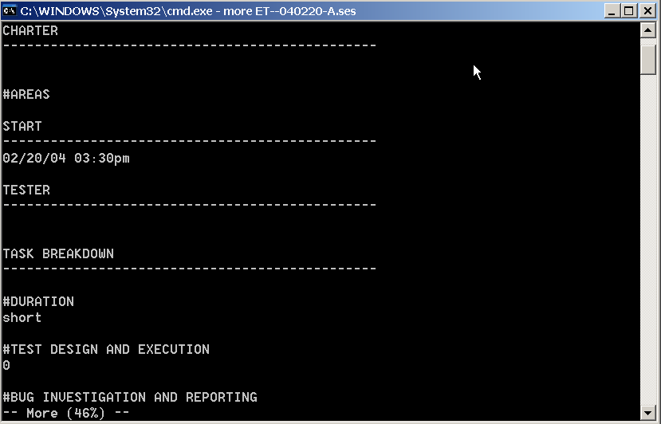

#### Perl

Perl is one of the most famous scripting languages.

The Bach Session Based Testing scripts are written in Perl and so this is required to use them.

Perl can be a very useful language to learn if you want to manipulate files or write small utilities. It can be cryptic to learn and you might prefer a scripting language like Ruby, Python,VBA or VB Script.

I n this paper I am using Perl as an environment, but I have found Perl a useful tool on its own in the past.

Perl is the scripting language behind the famous BugZilla.

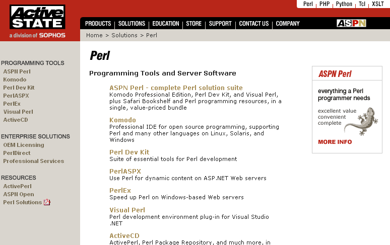

#### R

R is a statistical data modelling scripting language.

In the past I’ve used Excel a lot to generate and analyse data, but R makes interactive analysis of the data easier than Excel does. It takes a little learning, but it might change the way you report the statistics of your test project.

&lt;for a screenshot see SciView&gt;

#### Registry Monitor

This is another monitoring tool from sysinternals. By hooking into the registry system calls, it is able to monitor registry read/write events.

The tool does not require an install so it can just be unarchived into a system without affecting the environment in any way.

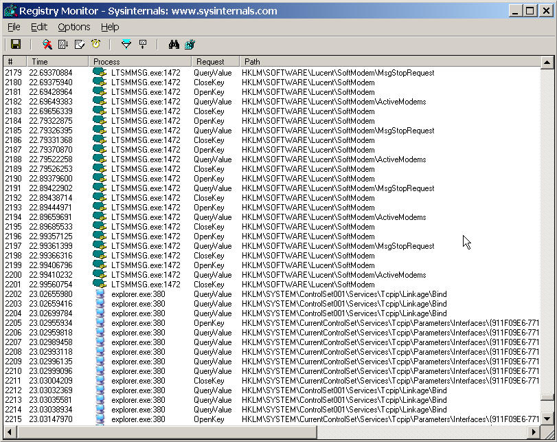

#### SciViews

SciViews is a front-end for R.

It is an incredibly useful environment for learning R, at the time of writing it is buggy, but it is still the best and easiest way to start learning R.

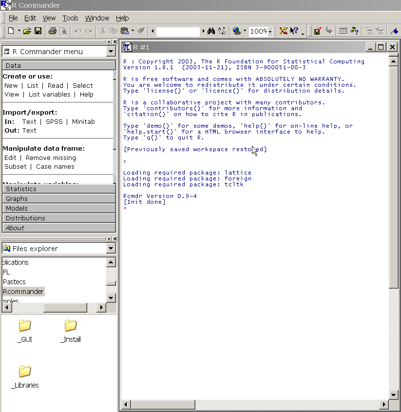

#### SmartSync Pro

SmartSync is a directory synchronisation tool.

One of the reasons I like it is that I can set it up to monitor my test environment, and anytime that anything in the environment changes, SmartSync will incrementally back the environment up. That way I can track what is happening to my environment and restore it to previous points.

SmartSync has a lot of different options and can be used to backup manually, every X minutes, when things change. And it can Sync the directories in both directions automatically.

A handy little tool.

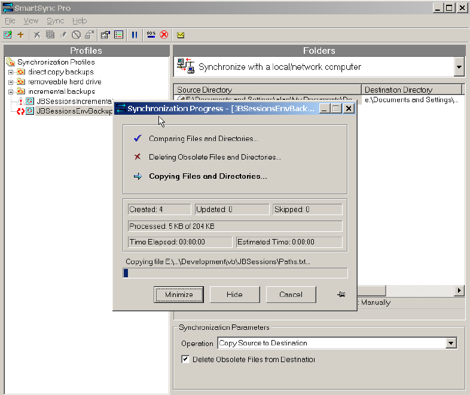

#### Snag IT

SnagIT is my most used screen capture tool and it is enormously feature packed.

Why not just use printscreen? Well, that captures a whole screen and then you have to edit it. But I want to save time and get the screencapture that I need at the time that I take it. And Printscreen doesn’t capture the mouse pointer which is a useful thing to have in the screenshot.

In this demo I have set Snag It so that it captures a region, of my choosing at the time of capture, to the clipboard. This is one of the simpler settings that I could have chosen. I have chosen not to have the captures saved to disk as I will find it easier to go into clipmate later and copy them into my defect report from there.

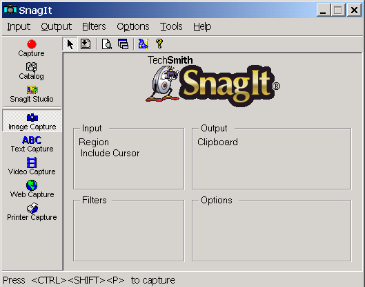

#### ULTT

I use this tool all the time, and I have one to hand wherever I go.

No tester should be without one.

Get an Ultimate Lo-tech Test Tool and be the envy of your testing neighbourhood.

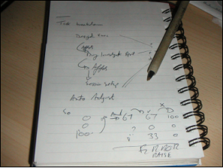

#### WinMerge

WinMerge is a free directory and file diff tool.

I use WinMerge and Beyond Compare together to verify the diff results of one with the other.

BeyondCompare can do a little more and I find it more user friendly, so I use it more often, but as WinMerge is free, I like to have the backup comparison available.

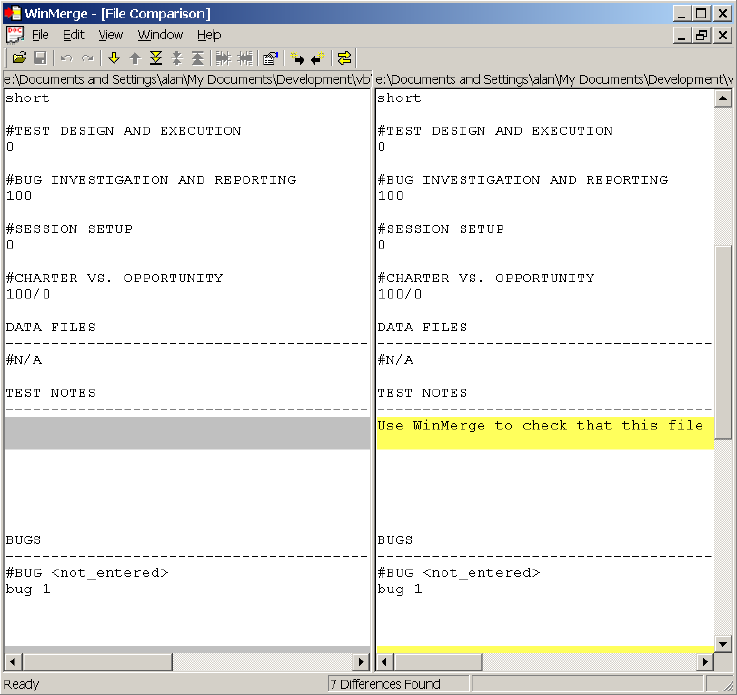

#### Virtual PC

This is the PC Emulator that I use to create fast and easy test environment with many different operating setups.

Very easy to use and very robust.

Recently bought by Microsoft and now costing $129

Alternatives:

VMWare www.vmware.com ($299) [Source link](http://www.vmware.com/)

Bochs bochs.sourceforge.net (Free) [Source link](http://www.bochs.sourceforge.net/)

Plex86 plex86.sourceforge.net (Free) [Source link](http://plex86.sourceforge.net/)

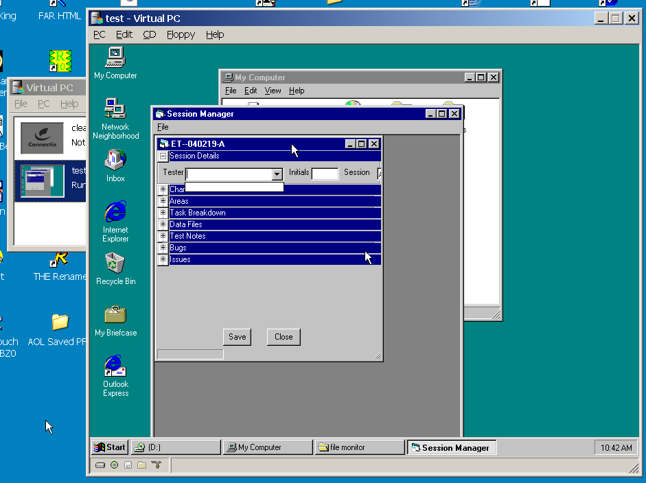
