<!-- Slide 1 -->

# Alternative Test Tools In Action

- Alan Richardson
- Compendium Developments
- www. compendiumdev.co.uk

- For more information on Alternative Test Tools visit our website:
- Download the papers,
- See the tools in action,
- Links to sources of information, blogs and tools,
- Links to the tools used
- Use our ‘big’ tools list to expand your hunt
- www.compendiumdev.co.uk/toolsinaction

---

<!-- Slide 2 -->

# ‘Any Tool That Might Help My Testing In Any Way’

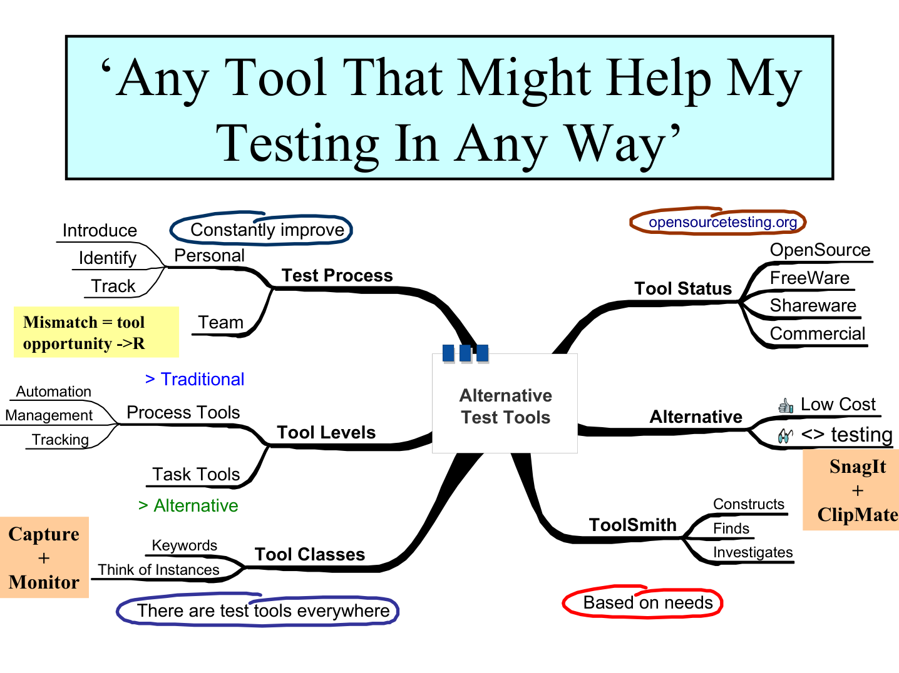

- Mismatch = tool opportunity -&gt;R

- SnagIt
- \+ ClipMate

- Capture + Monitor

## Diagram Text

Text from the embedded diagrams, in the PDF’s reading order. The image above preserves the connections and placement.

- Test Process
- Tool Levels
- ToolSmith
- Tool Classes
- Tool Status
- Alternative Alternative Test Tools
- Personal Introduce
- Identify
- Track
- Team
- Process Tools Automation
- Management
- Tracking
- Task Tools
- Constructs
- Finds
- Investigates Keywords
- Think of Instances
- OpenSource
- FreeWare
- Shareware
- Commercial
- Low Cost
- &lt;&gt; testing
- &gt; Traditional
- &gt; Alternative
- Based on needs There are test tools everywhere
- Constantly improve opensourcetesting.org
- SnagIt + ClipMate

---

<!-- Slide 3 -->

# Finding Tools

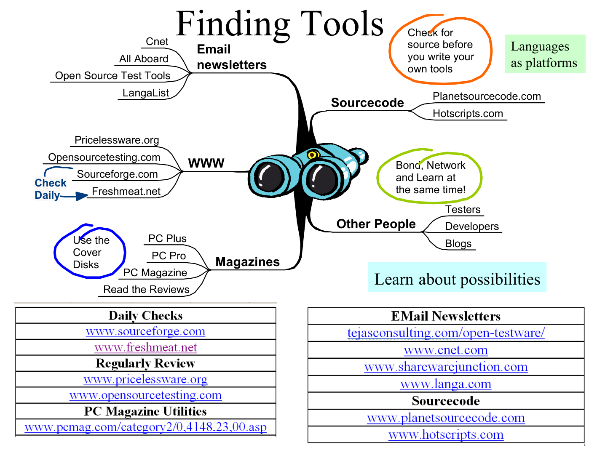

- Learn about possibilities

- Languages as platforms

## Diagram Text

Text from the embedded diagrams, in the PDF’s reading order. The image above preserves the connections and placement.

- WWW
- Magazines
- Email newsletters
- Other People
- Sourcecode
- Pricelessware.org
- Opensourcetesting.com
- Sourceforge.com
- Freshmeat.net
- PC Plus
- PC Pro
- PC Magazine
- Read the Reviews
- Cnet
- All Aboard
- Open Source Test Tools
- LangaList
- Testers
- Developers
- Blogs
- Planetsourcecode.com
- Hotscripts.com
- Bond, Network and Learn at the same time! Check
- Daily
- Use the Cover Disks
- Check for source before you write your own tools

---

<!-- Slide 4 -->

# Identifying tools for the AUT

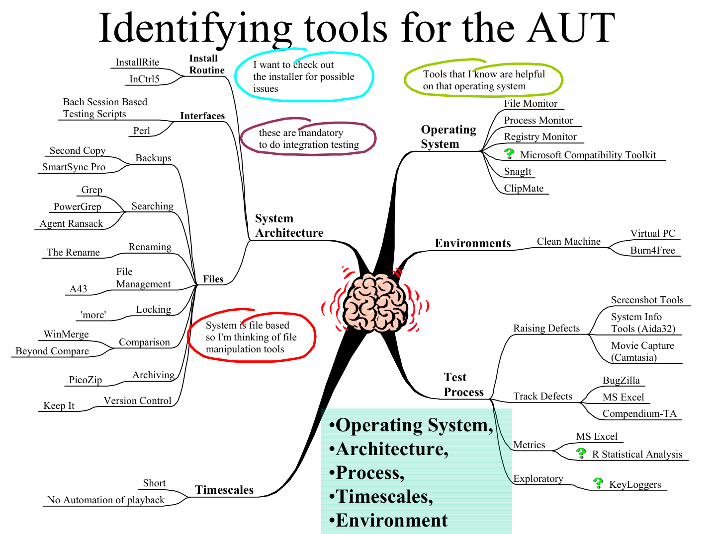

- Operating System,
- Architecture,
- Process,
- Timescales,
- Environment

## Diagram Text

Text from the embedded diagrams, in the PDF’s reading order. The image above preserves the connections and placement.

- Operating System
- System Architecture
- Test Process
- Environments
- Timescales
- File Monitor
- Process Monitor
- Registry Monitor
- Microsoft Compatibility Toolkit
- SnagIt
- ClipMate
- Install Routine InstallRite
- InCtrl5
- Interfaces Bach Session Based Testing Scripts
- Perl
- Files
- Backups Second Copy
- SmartSync Pro
- Searching
- Grep
- PowerGrep
- Agent Ransack
- Renaming The Rename
- File Management A43
- Locking 'more'
- Comparison WinMerge
- Beyond Compare
- Archiving PicoZip
- Version Control Keep It
- Raising Defects
- Screenshot Tools
- System Info Tools (Aida32)
- Movie Capture (Camtasia)
- Track Defects
- BugZilla
- MS Excel
- Compendium-TA
- Metrics MS Excel
- R Statistical Analysis
- Exploratory KeyLoggers
- Clean Machine Virtual PC
- Burn4Free
- Short
- No Automation of playback
- Tools that I know are helpful on that operating system
- System is file based so I'm thinking of file manipulation tools
- I want to check out the installer for possible issues
- these are mandatory to do integration testing
- •Operating System, •Architecture, •Process, •Timescales, •Environment

---

<!-- Slide 5 -->

# Sessions Summary

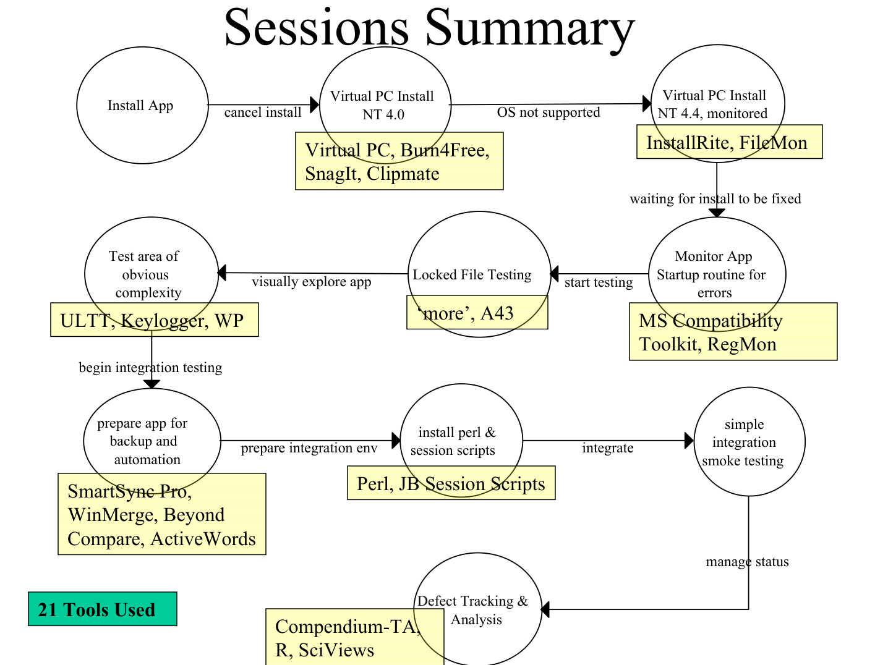

- Virtual PC, Burn4Free, SnagIt, Clipmate

- InstallRite, FileMon

- MS Compatibility Toolkit, RegMon

- ‘more’, A43

- ULTT, Keylogger, WP

- SmartSync Pro, WinMerge, Beyond Compare, ActiveWords

- Perl, JB Session Scripts

- Compendium-TA, R, SciViews

- 21 Tools Used

## Diagram Text

Text from the embedded diagrams, in the PDF’s reading order. The image above preserves the connections and placement.

- Install App Virtual PC Install NT 4.0 cancel install Virtual PC Install NT 4.4, monitored OS not supported
- Monitor App Startup routine for errors
- waiting for install to be fixed
- Locked File Testing start testing
- Test area of obvious complexity visually explore app
- prepare app for backup and automation
- begin integration testing
- install perl &amp; session scripts prepare integration env
- simple integration smoke testing integrate
- Defect Tracking &amp; Analysis
- manage status
- ‘more’, A43 ULTT, Keylogger, WP

---

<!-- Slide 6 -->

# Tool Classifications

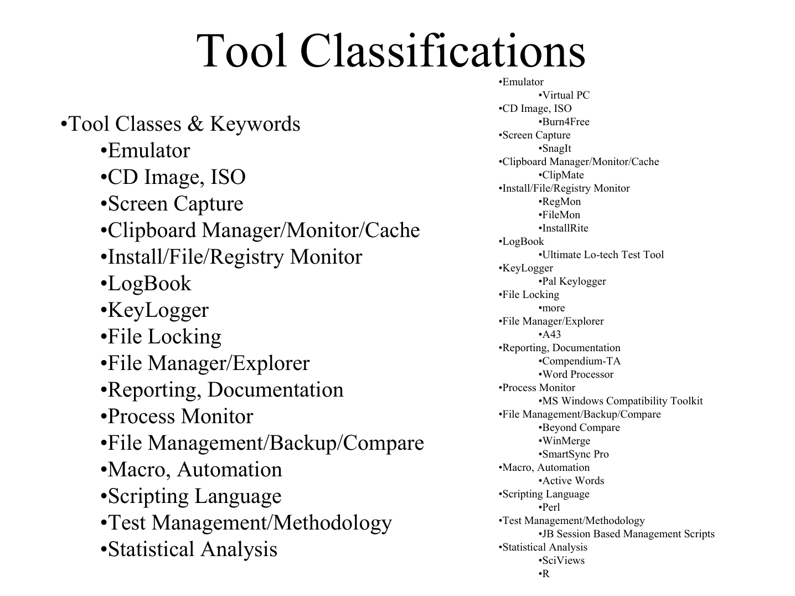

- Emulator
    - Virtual PC
- CD Image, ISO
    - Burn4Free
- Screen Capture
    - SnagIt
- Clipboard Manager/Monitor/Cache
    - ClipMate
- Install/File/Registry Monitor
    - RegMon
    - FileMon
    - InstallRite
- LogBook
    - Ultimate Lo-tech Test Tool
- KeyLogger
    - Pal Keylogger
- File Locking
    - more
- File Manager/Explorer
    - A43
- Reporting, Documentation
    - Compendium-TA
    - Word Processor
- Process Monitor
    - MS Windows Compatibility Toolkit
- File Management/Backup/Compare
    - Beyond Compare
    - WinMerge
    - SmartSync Pro
- Macro, Automation
    - Active Words
- Scripting Language
    - Perl
- Test Management/Methodology
    - JB Session Based Management Scripts
- Statistical Analysis
    - SciViews
    - R

    - Tool Classes &amp; Keywords
        - Emulator
        - CD Image, ISO
        - Screen Capture
        - Clipboard Manager/Monitor/Cache
        - Install/File/Registry Monitor
        - LogBook
        - KeyLogger
        - File Locking
        - File Manager/Explorer
        - Reporting, Documentation
        - Process Monitor
        - File Management/Backup/Compare
        - Macro, Automation
        - Scripting Language
        - Test Management/Methodology
        - Statistical Analysis

## Diagram Text

Text from the embedded diagrams, in the PDF’s reading order. The image above preserves the connections and placement.

- •Emulator •Virtual PC •CD Image, ISO •Burn4Free •Screen Capture •SnagIt •Clipboard Manager/Monitor/Cache •ClipMate •Install/File/Registry Monitor •RegMon •FileMon •InstallRite •LogBook •Ultimate Lo-tech Test Tool •KeyLogger •Pal Keylogger •File Locking •more •File Manager/Explorer •A43 •Reporting, Documentation •Compendium-TA •Word Processor •Process Monitor •MS Windows Compatibility Toolkit •File Management/Backup/Compare •Beyond Compare •WinMerge •SmartSync Pro •Macro, Automation •Active Words •Scripting Language •Perl •Test Management/Methodology •JB Session Based Management Scripts •Statistical Analysis •SciViews •R
- •Tool Classes &amp; Keywords •Emulator •CD Image, ISO •Screen Capture •Clipboard Manager/Monitor/Cache •Install/File/Registry Monitor •LogBook •KeyLogger •File Locking •File Manager/Explorer •Reporting, Documentation •Process Monitor •File Management/Backup/Compare •Macro, Automation •Scripting Language •Test Management/Methodology •Statistical Analysis

---

<!-- Slide 7 -->

# Summary

- Using Alternative Test Tools in your personal test process gives you more choice.
- Examine your own personal test process and recognise the Alternative Tools that you already use.
- find more at www.compendiumdev.co.uk/toolsinaction

- Tools Used that you did not see: Camtasia (screen capture), KeepIt (Version Control)

---

<!-- Slide 8 -->

# The sessions in detail

- The following slides document the sessions in more detail

---

<!-- Slide 9 -->

# Session 01 - Cancel Install App Session

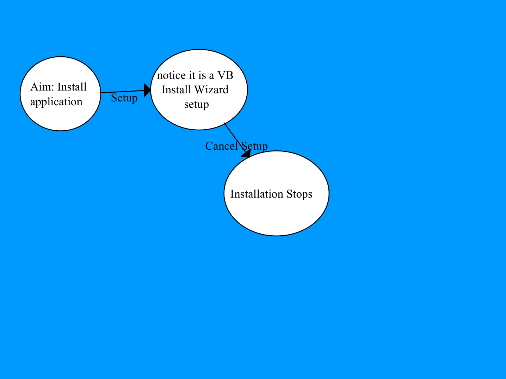

## Diagram Text

Text from the embedded diagrams, in the PDF’s reading order. The image above preserves the connections and placement.

- Aim: Install application
- notice it is a VB Install Wizard setup
- Installation Stops
- Setup
- Cancel Setup

---

<!-- Slide 10 -->

# Session 02 - Install App Session

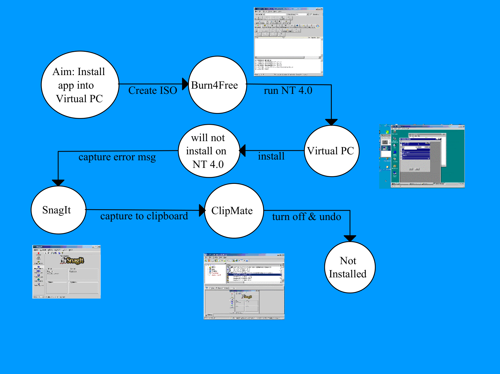

## Diagram Text

Text from the embedded diagrams, in the PDF’s reading order. The image above preserves the connections and placement.

- Aim: Install app into Virtual PC Burn4Free Create ISO
- Virtual PC
- run NT 4.0
- will not install on NT 4.0 install
- SnagIt
- capture error msg
- ClipMate capture to clipboard
- Not Installed
- turn off &amp; undo

---

<!-- Slide 11 -->

# Session 03 - Install App into NT 4.4

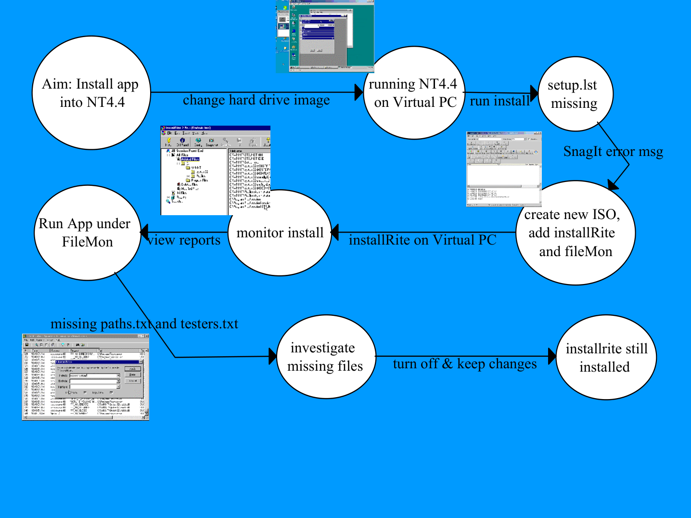

## Diagram Text

Text from the embedded diagrams, in the PDF’s reading order. The image above preserves the connections and placement.

- Aim: Install app into NT4.4 running NT4.4 on Virtual PC change hard drive image setup.lst missing run install
- create new ISO, add installRite and fileMon
- SnagIt error msg
- monitor install installRite on Virtual PC Run App under FileMon view reports
- investigate missing files
- missing paths.txt and testers.txt
- installrite still installed turn off &amp; keep changes

---

<!-- Slide 12 -->

# Session 04 - Investigate Startup Routine

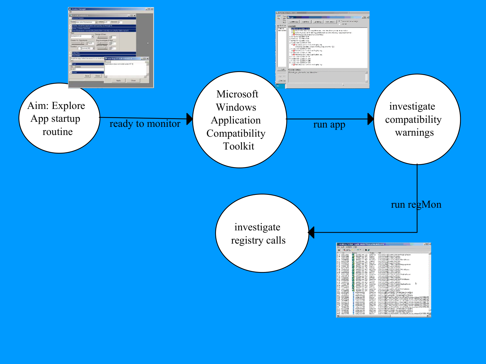

## Diagram Text

Text from the embedded diagrams, in the PDF’s reading order. The image above preserves the connections and placement.

- Aim: Explore App startup routine
- Microsoft Windows Application Compatibility Toolkit
- ready to monitor
- investigate compatibility warnings run app
- investigate registry calls
- run regMon

---

<!-- Slide 13 -->

# Session 05 - File Locking

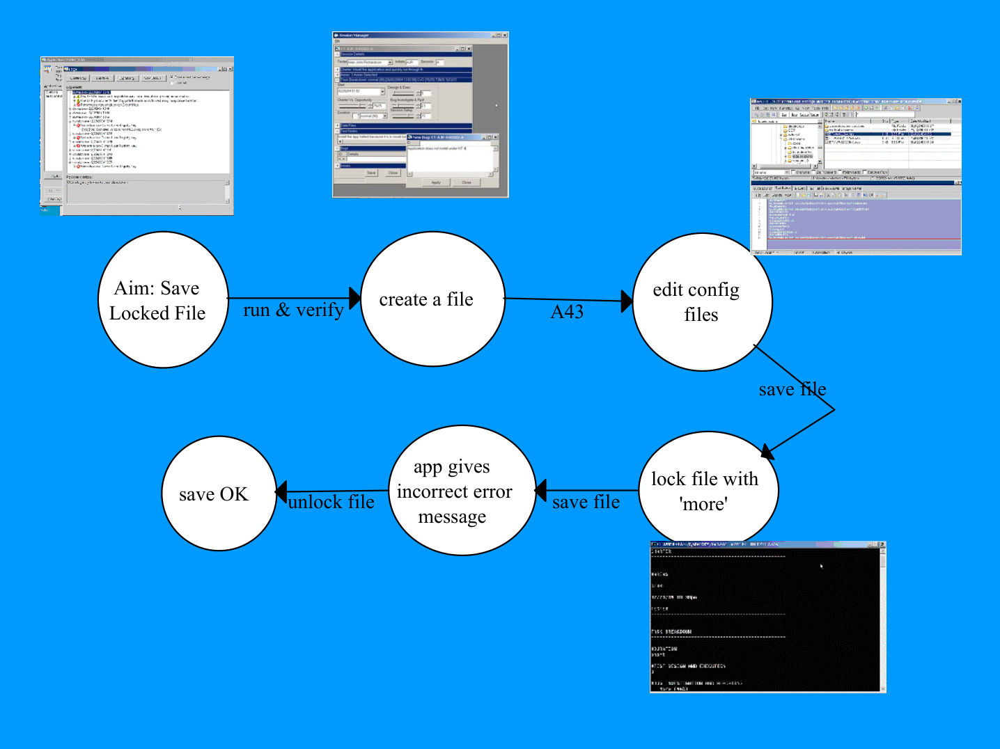

## Diagram Text

Text from the embedded diagrams, in the PDF’s reading order. The image above preserves the connections and placement.

- Aim: Save Locked File create a file run &amp; verify edit config files A43
- lock file with 'more'
- save file
- app gives incorrect error message save file save OK unlock file

---

<!-- Slide 14 -->

# Session 06 - Explore Area of Greatest Complexity

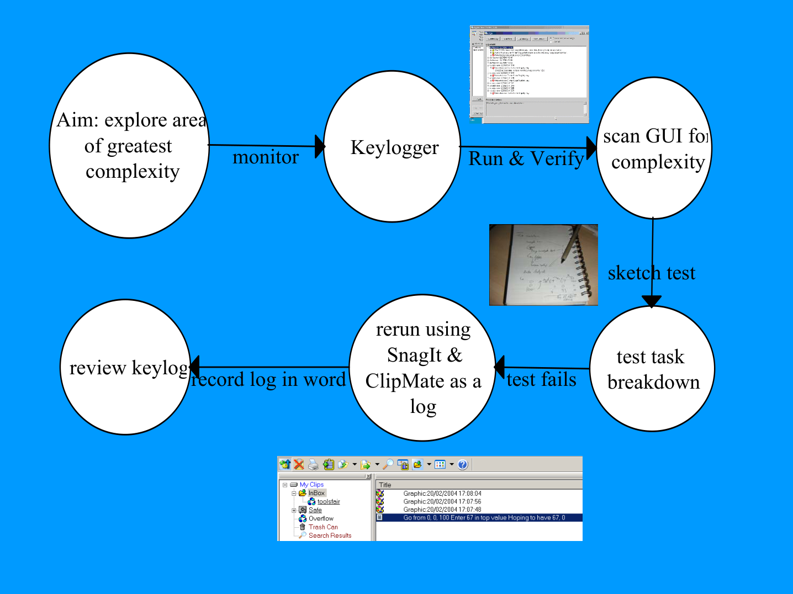

## Diagram Text

Text from the embedded diagrams, in the PDF’s reading order. The image above preserves the connections and placement.

- Aim: explore area
- of greatest complexity
- scan GUI for
- complexity Keylogger Run &amp; Verify monitor
- test task breakdown
- sketch test
- rerun using SnagIt &amp; ClipMate as a log test fails review keylogrecord log in word

---

<!-- Slide 15 -->

# Session 07 - Simple Environment Management and File Compare Testing

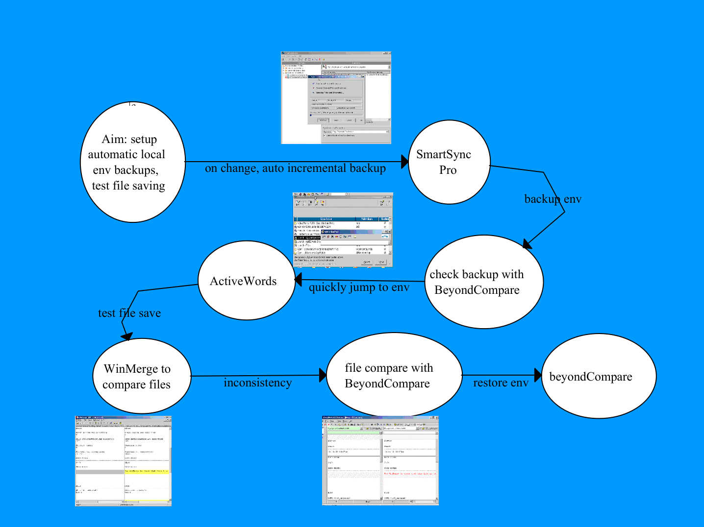

## Diagram Text

Text from the embedded diagrams, in the PDF’s reading order. The image above preserves the connections and placement.

- Aim: setup automatic local env backups, test file saving
- de
- SmartSync Pro on change, auto incremental backup
- check backup with BeyondCompare
- backup env
- ActiveWords quickly jump to env
- WinMerge to compare files
- test file save
- file compare with BeyondCompare inconsistency beyondCompare restore env

---

<!-- Slide 16 -->

# Session 08 - Set Up an Integration Testing Environment

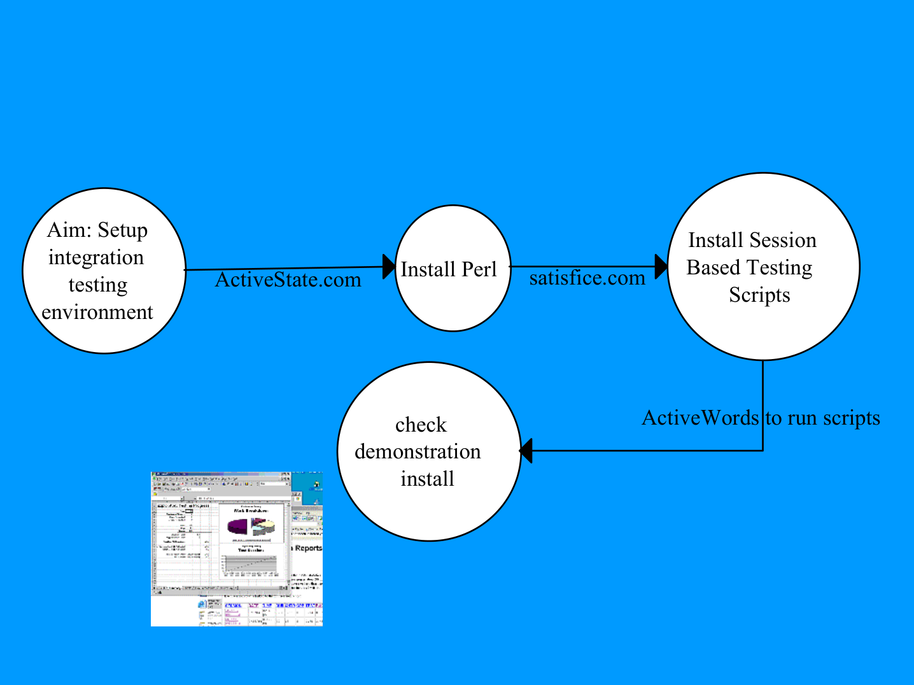

## Diagram Text

Text from the embedded diagrams, in the PDF’s reading order. The image above preserves the connections and placement.

- Aim: Setup integration testing environment
- Install Perl ActiveState.com
- Install Session Based Testing Scripts satisfice.com
- check demonstration install
- ActiveWords to run scripts

---

<!-- Slide 17 -->

# Session 09 - Integration Smoke Test

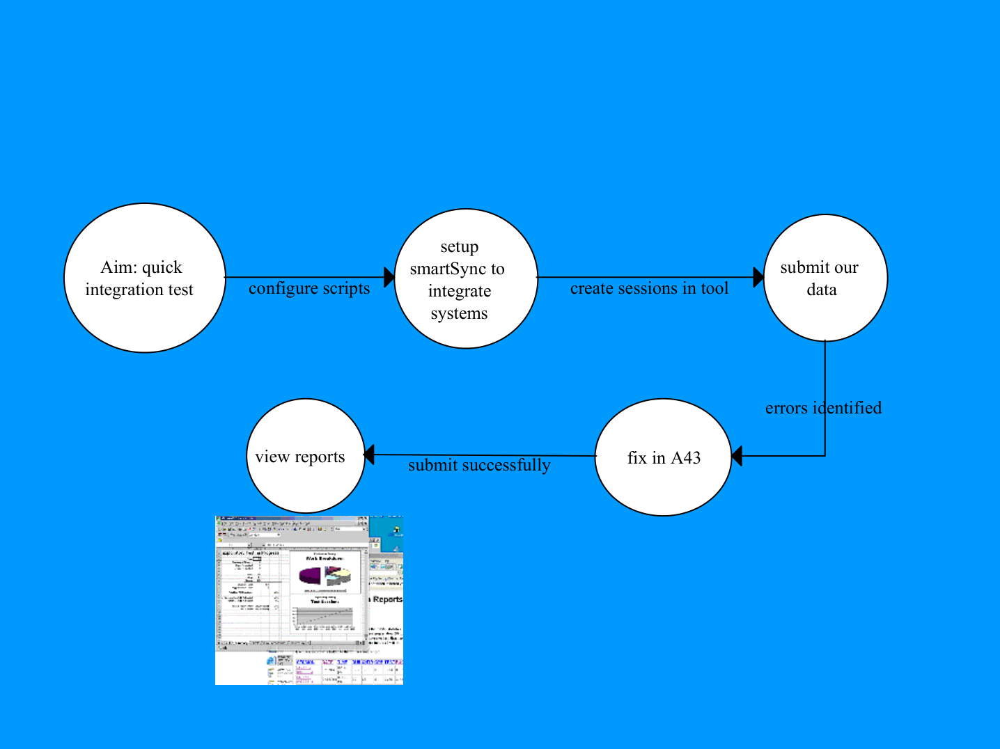

## Diagram Text

Text from the embedded diagrams, in the PDF’s reading order. The image above preserves the connections and placement.

- Aim: quick integration test
- setup smartSync to integrate systems configure scripts submit our data create sessions in tool
- fix in A43
- errors identified
- view reports submit successfully

---

<!-- Slide 18 -->

# Defect Tracking and Metrics

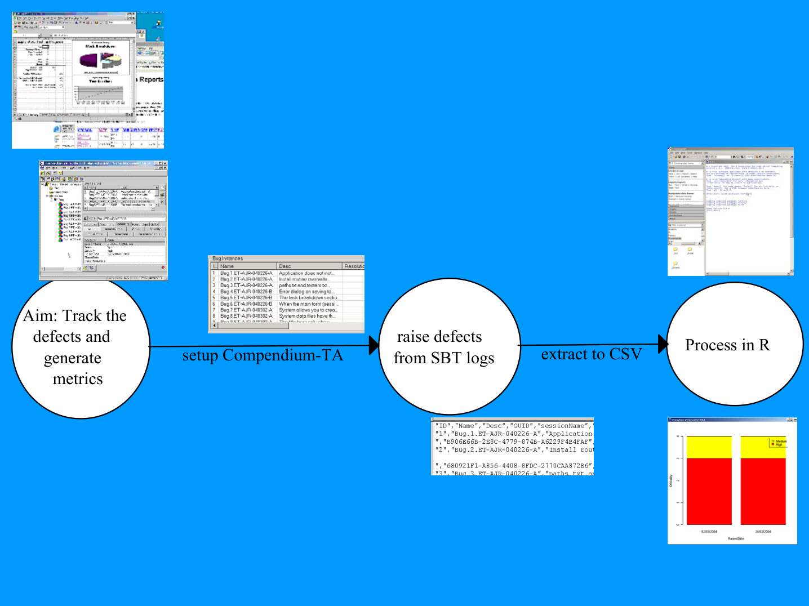

## Diagram Text

Text from the embedded diagrams, in the PDF’s reading order. The image above preserves the connections and placement.

- Aim: Track the defects and generate metrics
- raise defects from SBT logs setup Compendium-TA Process in R extract to CSV

---

<!-- Slide 19 -->

# www.compendiumdev.co.uk/toolsinaction
