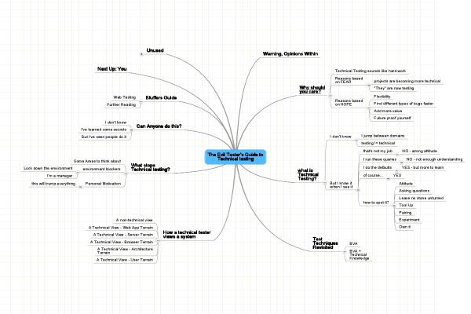

# Prepared Technical Testing Webinar Script

Prepared script retained from the source Word document, including the original section labelled "Unused". This is preparation material, not a transcript. The generated contents list and its page numbers are omitted; the source headings remain.

## The Evil Tester's Guide to Technical testing

I work in a technical industry. I need technical skills in addition to my testing skills. I work in the software industry, and I test software. The better I understand something, the better I can test it, because the deeper in can go terms of conceptualizing, identifying and exploiting risks. The greater my technical understanding, the more I can identify tools to help me test effectively. Particularly in terms of observing the application, and manipulating the system (the application, the data, and the surrounding environment). Becoming more technical, gives you more flexibility, more options, and gives you more ways that you can add value on a project. In this webinar I will encourage you to become ever more technical. I'll do this by explaining what I mean by technical, describe the steps I take to keep my technical skills up to date, and show some of the tools I use. More importantly, I'll explain the models and thought processes that I adopt to make this part of my process.

Hi,

Welcome to "The Evil Tester's Guide to Technical Testing" and you can see my details up there.

I'll post a blog post about this to eviltester.com so if you only remember one address remember eviltester.com. But we will also have something on the Eurostar blog as well, so if you only remember two addresses, remember those.

## Warning, Opinions Within

This is a fairly opinionated talk. I'm just warning you know. And its pretty black and white - I think I have used yellow on one of the slides, but otherwise, its black and white.

I'm going to try and keep this to 30 minutes so we have time for questions.

So just to set you up for :

- I'm going to describe technical testing and lay out why I think you should care.
- I'm going to look at what happens when you combine traditional test techniques with technical knowledge.
- I'm also going to look at what stops people doing technical testing, and we can infer from that what we do to make it happen.
- And explain how to go about becoming more technical and encouraging others to increase their technical skills.

## Why should you care?

Why should you care?

Simon Sinek says Start with Why (<http://www.startwithwhy.com/)>

So, Why should you care?

Because I assume you care about your testing, and doing the best testing you can.

And by the way. Throughout all of this. I assume as a basis that people have testing skills. I assume they work on them, that they know more than the basics, they've read the testing books, they read blogs, they read wikis. etc. etc. I assume they know how test.

I see testers with good testing skills, but they haven't pushed themselves to learn technical skills. And that means they have imposed limits on their ability to test, and they are not doing the best testing they can.

And that kills me. Because they can learn to do more, and I think the industry lets them down by promoting testing as a non-technical activity. So I'm doing my bit to change that. Because I want to work with people who push the limits of their ability every single day, and technical skills are one facet of that.

### Technical Testing sounds like hard work

"Alan, Technical Testing sounds like hard work and I can get away without doing this stuff."

So that statement might even be true. There are environments where you can get away without doing anything technical.

I don't even have to describe "technical testing" to people before they tell me, quite proudly sometimes, that they are not technical, and they only need their 'testing skills'.

Fine that's up to them, and if that describes you, then that's fine too.

Personally, I don't accept any limits on what I can or can not do when testing.

And I will not adopt any beliefs that will limit my testing.

I call my style of testing "Technical Testing" to continue to remind myself that I have to go above and beyond what I think of as "Traditional Testing".

So Technical Testing involes more work, because learning takes work, and continuous improvement takes work.

And so to convince you of that I'm going to use some reasons based on Fear, and some on Hope.

### Reasons based on FEAR

Why FEAR? Because people get motivated to do something when a big scarey thing comes running at them.

#### projects are becoming more technical

Projects are becoming more technical.

The technology stacks that we build on become more complicated with each passing day. And if you are not aware of that, then fine, you won't notice the changes.

But you also won't notice:

- the risks that the complexity brings to your project.
- the different risks that new technologies bring
- bugs that are buried at hard to reach areas of the technology stack

I do not want my ignorance to prevent me from finding bugs, so I work on my technical skills.

#### "They" are now testing

"They" are now testing.

Your BAs, your Devs.

Agile emphasises collaboration and multi-skilling.

They might not do the same as you, or even test as well as you.

But the people in charge might not recognise that.

Because it probably looks like they are doing the same as you and they probably use the same words as you.

So we have to up our game and do something different, or do the same things better.

### Reasons based on HOPE

And since people get motivated to do something when there is something in the future that they want, or desire, something they can run towards.

I will now give you some reasons based on Hope.

#### Flexibility

I've spoken about requisite variety before.

Because:

- We need to be flexible.
- We need to have options.
- We need to have multiple ways of approaching testing.
- We need to be able to examine the system from different perspectives.

The more Technical skills I have, and the better my technical understanding.

The better I can augment my traditional testing skills, and the better I can test.

#### Find different types of bugs faster

Not all bugs are requirement bugs.

Sometimes we have to push the boundaries to find bugs.

And if the only boundaries we know about are requirement based then there are bugs we may not find, and we certainly won't target them deliberately, we might stumble across them if we are lucky.

When we understand technical boundaries we can target different types of bugs and find them faster.

#### Add more value

We can add more value.

Because we are testers, we look at things differently and we see things that others don't see.

So the more deeply we look, and the more technically we can apply those observation skills. The more value we will add.

#### Future proof yourself

Technical Testing requires an ongoing path of learning.

We have to go beyond the 'testing' books. Because the testing books have been pretty stable for 15-20 years.

They are not a basis for future proofing.

Keeping up to date, and combining your testing knowledge with technical knowledge. That will future proof you so that you can keep adding value.

## what is Technical Testing?

So what "is" technical testing.

I don't know. I don't do definitions.

My fear is that if I tell you what technical testing "is", then you stick to that definition.

When what I want you to do, is continue to learn and become ever more technical and ever more creative in the ways that you approach your testing work.

### I don't know

So I don't know what technical testing is... but I do know

#### I jump between domains

I've worked in media, finance, pharmaceuticals, shrink wrapped software development, gaming.

And I found that when jumping between industries I didn't value 'business domain' knowledge as much as I valued my testing knowledge and my technical knowledge because they were transferable between domains.

#### testing != technical

And I split technical and testing because you can study testing and end up with no technical knowledge whatsoever.

### But I know it when I see it

So in summary, I don't know what Technical testing is... But I know it when I see it.

So let's play the "Is it technical Testing?" Game.

And I'll imagine that you are playing along at home as we run through this.

So I've dug into my testing prejudices and come up with some questions and answers.

And these are all based on real things, that real people have really said to me in the real world...really.

#### that's not my job

When asked the question "Do you look in the Database when you test?"

If you say "I don't look at the database, that's not my job."

Are you doing Technical Testing?

Tick tock, choose your answers....

No, Not Technical.

##### NO - wrong attitude

Technical Testing has an attitude of intense curiosity and a need to understand what the system is doing and how it works.

Fine, don't look at the database if you have made a decision based on a technical understanding because you know you don't need to, or you know there is nodatabase, or because you're looking at something else at the moment. Fine, If you have decided not to. That is valid.

But not... because its not your job.

I have met people who say the "its not my job" or "its not testing" or "we just check requirements", or "testers don't do that".

Blah blah blah. Wrong Attitude.

Our job requires us to add value. To learn as much as we can. We do, and learn, everything we can to give us an edge, so we can add value on projects that other people can't.

We learn to look in the database because... we will spot bugs there, that other people won't. Because we have a testing mindset.

#### I run these queries

When asked the question "Do you look in the Database when you test?"

If you say "Of course I look in the database, I run these queries that the developers gave me."

Are you doing Technical Testing?

Tick tock, choose your answers....

More Technical, but not technical enough. So, NO

##### NO - not enough understanding

Where is the understanding?

Those scripts might be our start to learning to get more technical.

- we need to understand what those scripts do.
- understand what the commands do.
- understand why we are looking in those tables.
- and understand what tables we are not looking in.

Technical testers strive to understand the system. That way we can work with it, and improvise, and look in new places, in new ways.

But this is a great place to start from. I start from this place with new technologies.

- I speak to people and ask what to do.
- I write down the steps they do
- I follow those steps
- ... until I understand what those steps mean, and then I can write my own, and take my own path.

#### I do the defaults

When asked the question "Do you look in the Database when you test?"

If you say "Yes, I use the default admin tool, I run custom queries before and after I use the app, to check results. I understand the DB schema pretty well."

Are you doing Technical Testing?

Tick tock, choose your answers....

OK, I'll give you that one. Yes. I say Yes.

##### YES - but more to learn

I'm going to say "yes", with the caveat that this is the basics.

We have more to learn.

We understand the application, and how it relates to the database.

We have a view of the system that goes beyond the 'requirements' and has moved into the environment, we're starting to understand the topology.

- I can learn the application from you.
- I can get started with the tools with your help.
- I can understand what flavour of SQL you are using.

This is the bare minimum of technical testing with a database centric application.

#### of course...

When asked...blah blah blah

If you say "Of course, and I sometimes SSH in, I never use the default tool, I prefer DBToolX. I have a script that compares the schema between releases, and yeah, I query the db to see what's going on."

Are you doing Technical Testing?

Tick tock, choose your answers....

Yes.

##### YES

Yes. You have owned this space.

You tried different tools and experimented with the features.

You know when to hit the command line and when to use the GUI.

You automated away some of the risk mitigation.

Everyone can learn something from you about how to access the database and you can add massive value on the project.

I aspire to do this with every technology.

Because this is not an end point, this is a point from which we can grow.

#### how to spot it?

How do I know that I've seen technical testing in action?

Well..

##### Attitude

I will have seen an attitude that pursues knowledge.

That builds a model of the system and looks for gaps in the model, so they can plug them.

That looks at the levels of abstractions in the model and tries to add more. They go deeper. They generalise.

An attitude of constant learning and exploration.

##### Asking questions

Asking lots of questions and not afraid to admit they don't know something.

And they make notes, so they don't ask the same question again.

Because they are learning, they are not a knowledge vampire.

##### Leave no stone unturned

If they see a stone, and haven't looked under it, they pick it up.

We use a DB? What kind? how can I connect? What's in it? Is it replicated? Is it Clustered?

Every question leads to a new one, because they identify gaps in their knowledge with each new answer and they want to plug their gaps, so they do more research, which leads to more questions.

##### Tool Up

They know they need tools. You can't look in a database without tools. You can't look at http traffic without tools.

And technical testers will assume that existing tools already exist, and they will go look for them.

They don't just ask the devs to write a new tool. Because the devs will. Devs love to write new tools. But they expect testers to have done the due diligence to find tools, because Devs will write them regardless.

And that's why, so many teams have custom forms for sending in http messages to their applications. Rather than using standard tools or standard browser plugins.

I've seen teams use gui automation tools, to automate custom forms that the devs built, which send http messages to the system.

Instead of automating the http calls directly. Because the testers weren't technical, and no-one else thought through the testing problem from a technical perspective because that is the testers job.

##### Pairing

Technical testers, sit with the people that know, and ask questions.

Because they know that ignorance is not stupidity.

But that remaining ignorant is stupid.

##### Experiment

And they take the knowledge they were given and they experiment with it.

They look up the names of tools see what else those tools can do.

They look up the definitions and the technology to see what else they cover. Because functionality can inform technique. When you learn about a feature of a tool that can inspire you to test differently.

They experiment and play.

##### Own it

And they do this until they own it. Until they have learned new things about it that they were not told.

And they make decisions about how to use it in the future.

And they look for alternatives to what they have been told.

That's part of what I'm looking for, when I look to see if people are doing technical testing.

## Test Techniques Revisited

### BVA

Boundary Value Analysis, when done well, looks for equivalence partitions across multiple data domains, analyses it from different perspectives, partition data into multiple (often overlapping) equivalence classes.

When done badly it takes a -1 0 +1 approach.

Or a first middle last approach, so if I have a set of data where each is equivalent e.g. a drop down box then we would try the first , the last and something from the middle.

Sometimes BVA is presented with a technical justifcation. Where it is justified technically because writing conditions on loops is tricky, so there might be an off by one error.

So... on the technical premise that loops are tricky. In this example of a for loop, applying BVA will add value.

A simple BVA set of tests would show that the first item can't be found because our item indexing starts at 0, but the loop starts at 1. The last one throws an out of bounds exception because with 0 based indexing, 249 is the last item.

But very often we don't use the code for our BVA, we use the requirements. But we justify the use of it, to limit the risk of reduced coverage of state space, on the basis of a technical premise. And that premise may not be valid.

### BVA + Technical Knowledge

What if the technical risk profile changes?

What if we no longer loop through based on a positional index, we use an iterator.

We don't have out of bounds exceptions.

What risks do we have?

If we don't apply technical knowledge then our testing finds no problem.

If we apply technical knowledge we make a risk based decision about how to test - we decide that BVA adds little value here, so we look deeper to understand the risk, we do not rest on our test technique laurels.

We might accidentally stumble across a defect if we use random sampling for our equivalence partition, but we won't be targetting anything of value.

If the technical state space changes, we need to use different techniques or apply them in different ways.

## How a technical tester views a system

### A non-technical view

A non-technical view of the application.

I know what is wanted from the requirements.

I'll know how it is supposed to act because of the functional spec.

I know what browsers to test against because they are in the non-functional requirements etc. etc.

I'm pretty much decomposing these documents, going for coverage, and looking for risks in the data domain and functional state space.

And this is all important - I'm not denigrating this.

But we don't stop here.

### A Technical View - Web App Terrain

I tend to think of my modelling in terms of the map (or the model) and the terrain.

So I'm conscious that I'm working with my model. But I try to get as close to the terrain as possible, and try to identify which parts of the terrain are not part of my model.

Because that is how I will identify new technology to research, and that is how I will find new tools to use.

So this is a quick sketch of how a technical tester will view the web app terrain. And this is the first level in the model.

Here the technology is the HTML, and I'm looking to see:

- which html tags have been used,
- are there comments in the source,
- which JavaScript libraries are in place.
- What validation is being done through html limits
- and what validation is done through JavaScript.
- etc. etc.

And to do this I have to understand HTML, JavaScript, How to view the source, I may want to extend that to viewing the JavaScript in the debugger and using built in browser tools.

Imagine you don't know any of this. But you know it is HTML, so you research HTML and learn about it, and you need some way of observing the HTML that is loaded in the page. So you look for tools to do that, then you want tools ot manipulate the HTML, so you look for tools that let you edit the HTML in situ in the browser.

The Model, comes first. The understanding and research helps me explore the terrain that I've modelled to enrich my model. Then I can look for tools and I can approach all this with my testing thought processes to identify new risks and new test approaches.

### A Technical View - Server Terrain

And I can't just have one level in my model, it won't be rich enough.

So I know that when I submit the form it goes off to the server.

How? If I don't know I have to research that and I learn about HTTP, and I study that and again I find tools to help me observe that traffic with proxy servers, and I use those to interrogate it and learn more about it after my observations, and I can use those tools to manipulate it so I can change the HTTP request after it leaves the browser, but before it hits the server and I suddenly have a new rich space within which I can test.

I can change the http headers, the order of the fields in the request, the values in the request. I can explore a new set of risks.

And I can do the same on the return HTTP so I can see how the javascript (if it was an Ajax call) handles 404 responses, or hard to simulate 500 errors. Right server errors are hard to simulate in a test environment, but easy to simulate if you are in control of the return messages.

Approaching it technically gives me more scope and freedom in my testing.

### A Technical View - Browser Terrain

I suddenly realise that I haven't taken the browser into account. I know that the non-functional requirements have cross browser requirements but what do they mean?

Do I have to do everything cross browser? How do I decide where to draw the lines?

Well, if I understand the technology I can make the decision that cross browser means:

- different headers on requests sent to the server

Does the server respond differently? I can test that without using the other browser if I want to, by capturing requests and replaying them with different headers, or changing the headers in a browser to send out the ones for another browser, or sending through a proxy which changes the headers for me.

I don't have to mitigate that risk by using another browser. by approaching it technically I have options, and that might expose me to more risk but it might also help me do things faster.

And it is the same with all these technologies.

There are other ways of testing JavaScript compatability than running the whole app. I could build test pages that pull in the JavaSript for each browser and test it in situ.

My default does not have to be. Get all browsers on the list and repeat all the testing. I can model it, identify risks and target risks, with technical knowledge.

### A Technical View - Architecture Terrain

Regardless of wether we have good "non-functional" requirements. And I put quotes around that phrase because I hate it, with a passion.

When I model the architecture I can see if we have load balancers in place, I can research how they work, and see if there are any risks posed by our load balancing strategy, rather than just "we need to handle a 100 concurrent users viewing the site, within 1 second" or whatever some committee somewhere wrote down in a "non-functional" specification.

And all of this I subject to questions:

- How can I observe this?
- How can I ask questions of this and iterrogate it?
- How can I manipulate it and setup the conditions I require?

Because these questions help me grow and learn new things.

### A Technical View - User Terrain

And it goes on.

I build models after models, trying to identify risks and explore the technology that is in place and apply my testing knowledge when augmented by the technology understanding that I have.

And remember:

- the model comes first,
- I map it on to the terrain to see what gaps I have,
- I research
- I identify risks
- I look for tools
- I continually revist my test ideas and thinking augmented with new technical knowledge

As a technical tester, that is how I think I view a system, and how it impacts my testing.

## What stops Technical testing?

"Alan, if someone was doing technical testing in my organisation and I wanted to stop them. What would I do?"

Well, that's an excellent question. I'm glad you asked.

Because there is a lot you can do.

### Some Areas to think about

If you want to kill technical testing dead then here are some areas to start with.

There are more, but this should give you enough to go on.

But I warn you, their personal motivation can overcome any of this.

### environment blockers

#### Lock down the environment

You can try to stop techical testing by locking down the environment.

- Put policies in place to limit internet access,
- put proxy filters in place to prevent tools accessing the internet
- stop people downloading software
- have policies that prevent installing software
- don't give testers admin access to their own machines

All of this is a good place to start.

I've worked in these kind of environments and they can kill technical testing dead.

But not for experienced technical testers.

See, experienced technical testers, are ... well, technical.

- So they know how to route internet requests through different proxies, they know how to switch off proxies.
- Ther bring in USB sticks prefilled wtih software so they don't install anything. So you have to block the USB ports.
- They use virtual machines, they boot from live linux CDs.

In this kind of environment I've written test tools in Excel VBA, because that was preinstalled and I needed tools to help me.

Technical Testers will work with the letter of your law, but bypass the spirit, because they have a job to do.

#### I'm a manager

- "I'm a manager, I don't need to be technical"

Yeah, its a nice bluff.

You have to decide... If you want technical testing then you need to be technical. Or at least technical 'enough'

You need to be technical enough that you can understand what blockers are in place and remove them.

A technical manager will be visibly working to remove the blockers, and they will gain the respect of the technical staff.

You need to be technical enough that you can understand how much can be achieved in your environment. What the potential is. Because otherwise you will not see where people are not testing, and you will not know how to encourage them to test in those areas.

If you are not technical you will not know what questions to ask to drive people to improve.

If you are not technical then you will not act as an exemplar so that people aspire to improve. You will not lead them.

And if you are not technical then you may not find it easy to recruit staff who are, because you won't know how to evaluate them.

So if you are a manager, and you want to stop technical testing. Then forget all your technical skills, don't learn any more, remain ignorant of technical topics.

### Personal Motivation

#### this will trump everything

The problem is that the technical testers have an attitude problem. I know, I've managed them. I've been one, I am one. I have an attitude problem.

Technical testers are just going to ignore all this management fluff anyway. I will use a cliche "They would rather ask forgiveness than permission", because they assume you would not have employed them if you had not wanted them to use their skills to the fullest extent.

This isn't a typo by the way. Personal motivation will trump everything.

Because your "Will trumps everything".

When you decide, and you back that decision, with all your will power and the core of your being... well, then your will will triumph.

As soon as you decide that testing skills are not enough, and you want to augment them with technical skills and nothing is going to stop you doing that.

Will trumps everything.

## Can Anyone do this?

### I don't know

If I can do it, anyone can do it

(and I've seen other people do it, and I've helped other people do it too)

I'll let you into a secret.

I'm not that technical.

I've seen technical and I'm not it.

I aspire to technical. But I'm not there yet.

### I've learned some secrets

I've learned how to simulate technical, I've learned how to bluff it.

So here are my secrets.

- Ask questions.

I never worry about looking stupid. I figure I'll look more stupid if I don't ask questions and don't know what to do.

- Catalogue the technologies.

Just make a list of everything being used, then go look the stuff up. Figure out how what the default tools for those technologies are, and then use them. See what they do.

Functionality will inform technique. The "Ooh, I didn't know I could do that" moment that suddenly opens up a new set of possibilities.

- Copy others

Pair with people and make notes. Then figure out what they did later by studying on your own.

- Model the system

Then ask yourself. how can I observe what is going on here? How can I manipulate this? What does this depend on? How can I interrogate this on the fly? Then tool for tools to help you do it.

- Experiment and keep learning

Don't worry about breaking things. Testers are supposed to break things.

### But I've seen people do it

And I know you don't have to have been interested in software since you were 12 to do this. Because I've helped people become more technical.

Just by teaching them the bluffer's secrets that I just told you.

Showing them some new approaches, and the basics of a tool, and ecouraging them to explore.

I try and lead by example and hope that their personal motivation kicks in.

## Bluffers Guide

### Web Testing

I'm going to leave this slide with you.

Just to name drop a few tools.

I suggest you.

- Research these tools
- Identify their terrain
- See how they fit your models
- See how they fit your environment
- Remember Functionality Can suggest technique so the more you learn about the capabilities of the tool, the more ideas you'll get to influence your testing.

### Further Reading

And look, more research links.

Some of it about security testing, because that is pretty technical and has good hints and a lot of technology descriptions.

And a free book about systems, becase that's what we work with, and in, and model, so I learn more about systems.

The Art of War. One of my favourite books, becuase you can generalise this or even just use it for stichomancy.

And The Book of Five Rings, another book you can randomly dive into for guidance. But it deals with the individual and their approach to learning.

And all of this for free - you can't say I don't care... about your wallet.

## Next Up: You

So thank you very much for your attention.

I will have a blog post covering this with links to the slides on eviltester.com and I think we will have a similar post on the Eurostar blog I think with links to the slides.

And I leave the rest up to you. I honestly think that the testing world will be a better place when everyone in it augments their testing knowledge with technical knowledge. And management knowledge with Technical Knowledge.

And how you do it is up to you.

So again, thank you very much, I will now imagine tumultuous applause, and do my best to answer any questions that you have.

## Unused

### What stops technical testing

#### confidence

Some people equate asking questions with looking stupid and most people don't want to look stupid.

Testers are used to asking questions, so you have to be careful stiffling this as you might impact their normal testing.

If you want to encourage technical testing, then encourage questioning, encourage knowledge sharing, encourage learning.

And there is a whole bunch of things you can do around this with training, buying books, brown bag sessions, etc. you know the drill.

Act as an exemplar, and share your questions and things you learned.

If you want to stamp on it then do the opposite. Allow no questions. Pretend you know the answer to everything, and tell people they should know how to do that already. Most managers know how to do this so just avoid all that 'good management' stuff.

And if you're not in management, then just belittle your peers, that's pretty easy.

Because boosting peoples confidence to ask questions and learn, can increase your chances of doing technical testing.

#### Fear

Create a Culture of Fear

This is massively important, because this can stomp on even the toughest of Technical Testers.

The best ways I've seen this done is by shouting. People hate confrontation. So make sure that your managers or leads can shout people down.

Punish every mistake. When someone screws up, belittle them and punish them.

If possible lock the environment down as well, make people leave mobile phones outside the main office, put security on the doors, track the time people arrive and leave - all the little micro management stuff.

Because then people will be too scared to step out of line.

Now the problem with some Technical Testers is that they might be good enough to get a job somewhere else, and they just leave when the environment becomes too unpleasant and restrictive. So you only get away with this when all of your competitors are doing it too, or you have managed to remove the confidence of your staff.

#### mental blocks

##### You can block yourself

Better than any other blocker. You can stop yourself.

Even it there is no culture of fear you can create one in your own mind "They might not like it if I do this."

Even if there is no environment blocker you can create one. "If I install this it might break something"

##### You can also unblock

You can also decide to let nothing stop you.

The worst thing they can do is sack you. And you're good enough to find another job.

You can decide to keep learning.

As soon as you decide that testing skills are not enough, and you want to augment them with technical skills and nothing is going to stop you doing that.

You will never be blocked. You might get frustrated. But you'll keep going as long as you can.

#### The Message

"The mission statement of doom!"

These are great for stopping technical testing. Particularly in conjunction with a locked down environment and management that are not technical.

Because you can say "We want innovative testing, and we want you to experiment". And at the same time lock down the environment, and have a management that don't even know what that means.

That way, when staff try to get technical and do something different then you can stamp down on them with the tacit message.

Because the tacit message is "we want you to test the software in the way that we can evaluate and if you start slipping because you are innovating, then stop it"

That way, the management can present the veneer of technical innovation, without having to worry about it.

And make sure you reward the tacit message, not the explicit message. So don't reward people for making use of tools to go deeper in the system, because chances are, they found more bugs and hence delayed the project.

Instead, reward the teams which don't find as many bugs so that the projects remain on schedule.

The reward thing is really important otherwise people might not pick up on the difference between your tacit message and your explicit message.

### What is technical testing?

#### I don't know

##### since I was wee

I've been interested in computers and software since I was wee.

That doesn't mean you have to have been doing this since you were 12 to be technical.

But for me it means, I am interested in software I always have been, so it is easy for me to want to learn more.

And I hope you are interested in making software. Because that is what we do.

##### white box/ black box

e.g. Boundary Value Analysis, Equivalence Partitioning, Path Analysis

These are standard testing techniques which some people might call technical. Some people put these into a white box/black box partition.

##### worse: test techniques mislead

In fact, our typical test techniques, white box/black box etc mislead us

If you combine BVA with a technical knowledge of the system and the programming language you will do it very differently.

And I'll cover that later.

##### white box != technical

A lot of people don't do 'white box' testing because they've allowed themselves into being suckered into thinking that it is technical.

And it isn't.

##### I want to understand

I have always wanted to understand the technology in use and the programming languages, so again it is natural for me to learn the technologies I work with.

### Test Techniqes Revisited

#### drop down bug story

-------------------------

As an example:

I worked on a system that had a problem like this. But we didn't drill deep enough. So a bug slipped through. We new BVA wouldn't add value, so given an equivalence partition where BVA adds no value, what do you do? You use random sampling.

We didn't go for full coverage of the 250, we just randomly picked it. Because the risk profile was low - the dropdown list was populated from the database, the chosen value matched against the database to check for fiddling.

Great - but then we outsourced the part of the front end that dealt with this. The registration part - this was a drop down of countries.

And we didn't re-evaluate the risk profile from a technical perspective, we did it from a functional perspective and used the same strategy.

But now the database and the drop down were populated in different ways. There was a mismatch between the items in the drop down and the database. So item 197 threw an error, and we didn't catch it. Until we went live in country 197.

We might have picked this up if we knew were going live in country 197 - but we didn't.

We might have picked this up if we did 'full coverage' of the drop down, but then where do you draw the line? And you need automation for that, but the business had made the decision not to pay for automation on this - they were outsourcing the dev to make the process cheaper.

We might have picked this up if we had examined the mechanisms for getting the data into the system, but we didn't it was outsourced, testing weren't involved, blah blah.

Point is. We didn't spot the risk. And we didn't spot the risk because we didn't look at technically how the system was implemented and what was changing.
