<!-- Slide 1 -->

# The Evil Tester's Guide to Technical Testing

Eurostar Webinar 4th December 2012

Alan Richardson

www.eviltester.com

www.compendiumdev.co.uk

www.seleniumsimplified.com

@eviltester

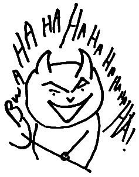

---

<!-- Slide 2 -->

# Warning: This Webinar contains Opinions.

- Why should you care?
- How to spot Technical Testing?
- What stops Technical Testing?
- Test Techniques Revisited
- How a technical tester views a system
- Can anyone do this?
- The bluffer's guide to technical testing

---

<!-- Slide 3 -->

# Why Should you care?


---

<!-- Slide 4 -->

# Why should you care?

"Technical Testing sounds like hard work and I can get away without doing this stuff."

---

<!-- Slide 5 -->

# Reasons Based on FEAR

- Projects are becoming more technical
- "They" are now testing

---

<!-- Slide 6 -->

# Reasons based on HOPE

- Flexibility
- Find different types of bugs faster
- Find bugs faster
- Add more value
- Future proof yourself

---

<!-- Slide 7 -->

# What IS Technical Testing?


---

<!-- Slide 8 -->

# I don't know...

...But I do know:

- Technical knowledge transfers between domains
- Testing != Technical

---

<!-- Slide 9 -->

# And I know it when I see it... So let's play...

The

"Is it Technical Testing?"

Game


---

<!-- Slide 10 -->

# "Do you look in the Database?" If you say...

"I don't look at the database that's not my job."


Are you doing Technical Testing?

---

<!-- Slide 11 -->

# NO - wrong attitude


---

<!-- Slide 12 -->

# "Do you look in the Database?" If you say...

"Of course I look in the database, I run these queries that the developers gave me"


Are you doing Technical Testing?

---

<!-- Slide 13 -->

# No - Not enough Understanding


---

<!-- Slide 14 -->

# "Do you look in the Database?" If you say...


"Yes, I use the default admin tool, I run custom queries before and after I use the app, to check results. I understand the DB schema pretty well."

Are you doing Technical Testing?

---

<!-- Slide 15 -->

# Yes - with more to learn


---

<!-- Slide 16 -->

# "Do you look in the Database?" If you say...


"Of course, and I sometimes ssh in, I never use the default tool, I prefer DBToolX. I have a script that compares the schema between releases, and yeah, I query the db to see what's going on."

Are you doing Technical Testing?

---

<!-- Slide 17 -->

# Yes - I aspire to this


---

<!-- Slide 18 -->

# How to spot it?

- Attitude
- Asking Questions
- Leave no stone unturned
- Tool Up
- Pairing
- Experiment
- Own It


---

<!-- Slide 19 -->

# Test Techniques Revisited


---

<!-- Slide 20 -->

# Boundary Value Analysis

- Process a drop down with 250 items
- One technical premise: loop conditions are tricky

```java
boolean foundit=false;
for(int item=1; item<=250; item++){
	if(db.isItemPresent(dropDown.get(item)){
		foundit=true;
		break;
	}
}
```

---

<!-- Slide 21 -->

# BVA and Technical Knowledge

- What if the technical premise changes?

```java
foundit = false;
for(Item item : dropDown.getItems()){
	if(chosenItem.equals(item)){
		foundit=true;
		break;
	}
}
```

---

<!-- Slide 22 -->

# How a Technical Tester Views Your Application


---

<!-- Slide 23 -->

# A Non-technical view of an app

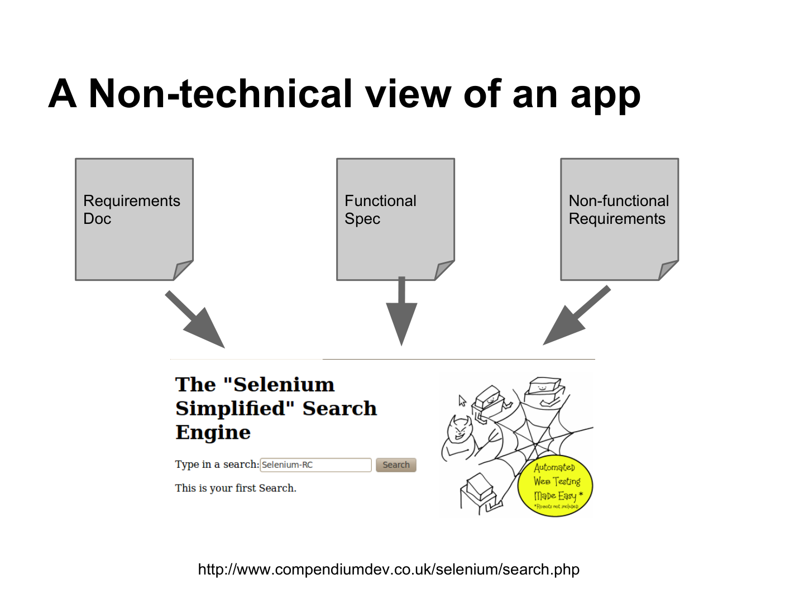

<http://www.compendiumdev.co.uk/selenium/search.php>

Requirements Doc

Functional Spec

Non-functional Requirements

---

<!-- Slide 24 -->

# A Technical View - Web App Terrain

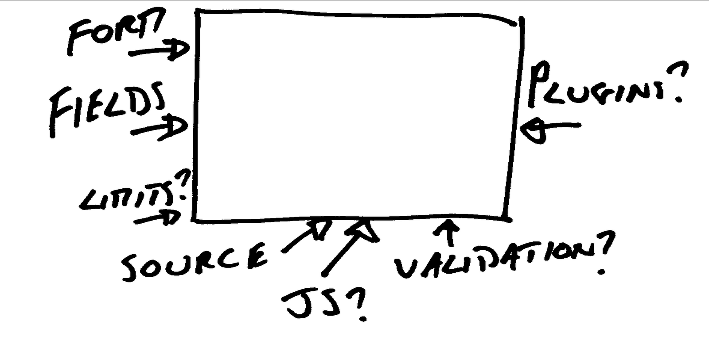

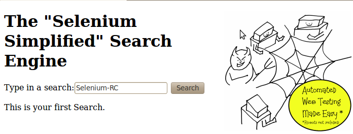

---

<!-- Slide 25 -->

# A Technical View - Server Terrain

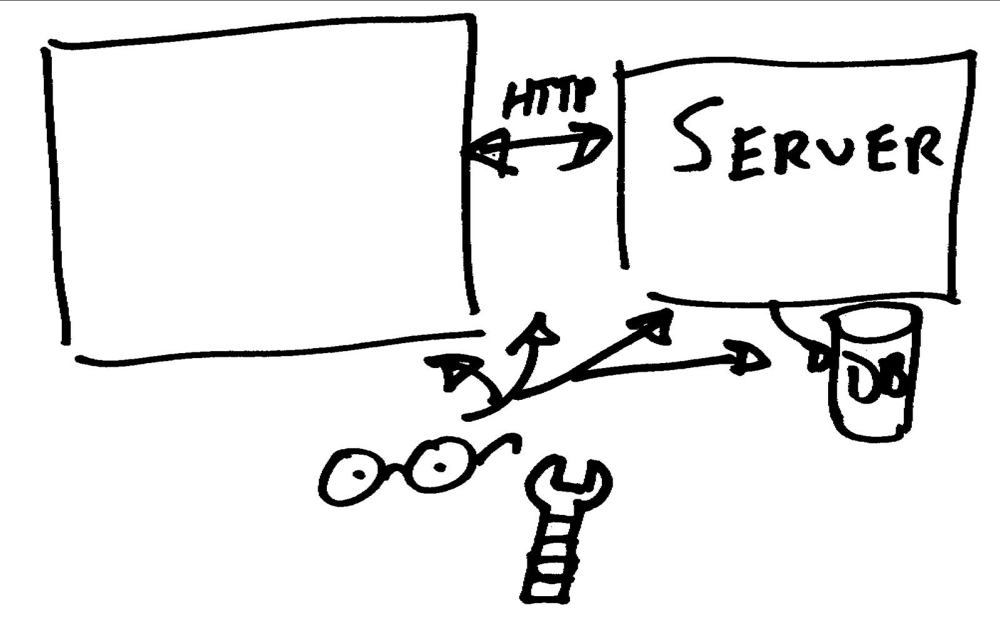


---

<!-- Slide 26 -->

# A Technical View - Browser Terrain

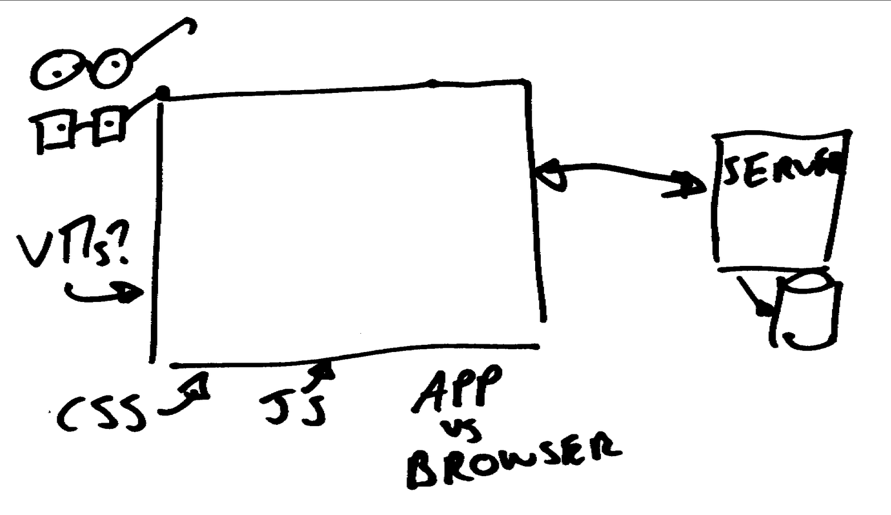

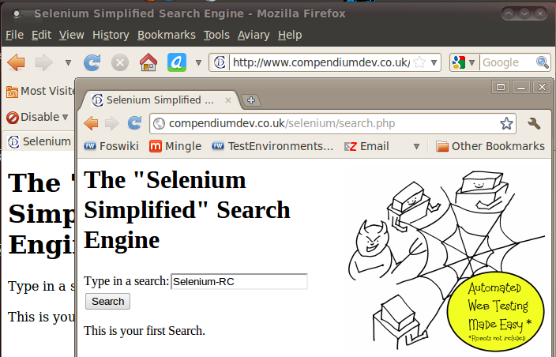

---

<!-- Slide 27 -->

# A Technical View - Architecture Terrain

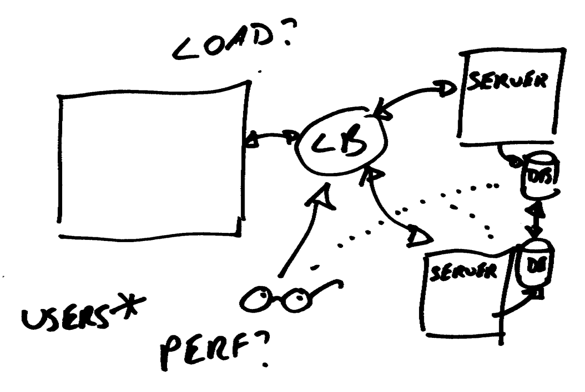


---

<!-- Slide 28 -->

# A Technical View - User Terrain

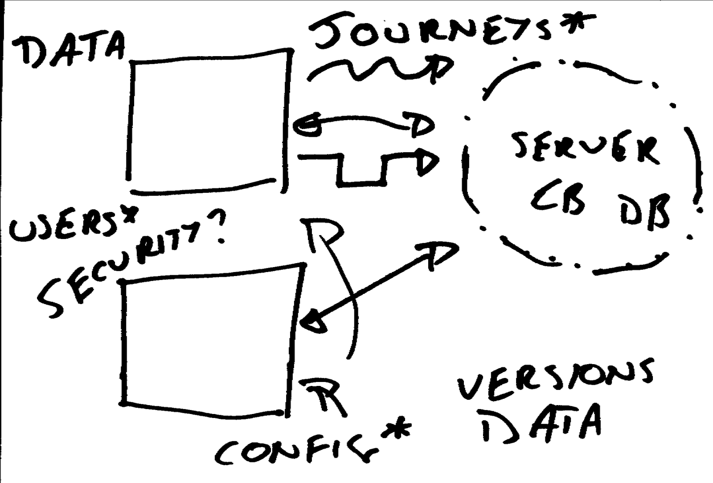


---

<!-- Slide 29 -->

# What Stops Technical Testing?


---

<!-- Slide 30 -->

# What stops technical testing?

- Environment
- The Manager
- ...
- Personal Motivation

---

<!-- Slide 31 -->

# Environment: Lock it down

You can try to stop technical testing by locking down the environment.

---

<!-- Slide 32 -->

# The Manager

"I'm a manager, I don't need to be technical."

---

<!-- Slide 33 -->

# Personal Motivation...

"Will trumps everything"

---

<!-- Slide 34 -->

# Can Anyone do this?


---

<!-- Slide 35 -->

# If I can do it, anyone can do it...

... and I've seen other people do it.

---

<!-- Slide 36 -->

# Shh... don't tell anyone... but...

...I'm not that technical

---

<!-- Slide 37 -->

# I've learned some secrets...

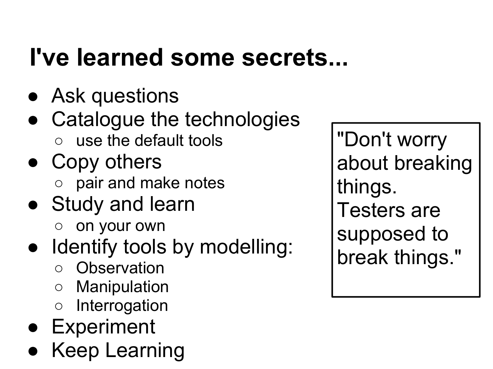

- Ask questions
- Catalogue the technologies
    - use the default tools
- Copy others
    - pair and make notes
- Study and learn
    - on your own
- Identify tools by modelling:
    - Observation
    - Manipulation
    - Interrogation
- Experiment
- Keep Learning

"Don't worry about breaking things.

Testers are supposed to break things."

---

<!-- Slide 38 -->

# ... and I've seen other people do it.

If I can do it, anyone can do it...

---

<!-- Slide 39 -->

# Bluffer's Guide to Technical Testing


---

<!-- Slide 40 -->

# A Bluffer's Guide to Technical Web Testing - starter for 13

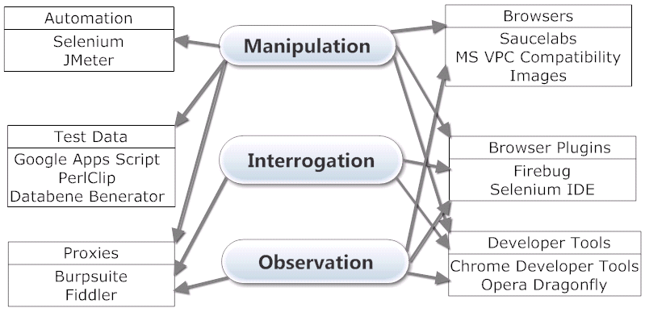

---

<!-- Slide 41 -->

# Further Reading

- The OWASP Testing Guide
    - <http://www.owasp.org/index.php/OWASP_Testing_Project>
- Putting Systems to Work by Derek Hitchins
    - <http://www.hitchins.net/SysBooks.html> (free download pdf)
- The Art of War by Sun Tzu
    - provides a generalisable model for technical testing - including map/territory, observation (use of spies) and manipulation
    - www.sonshi.com
    - <http://www.feedbooks.com/book/168/the-art-of-war>
- The Book of Five Rings by Miyamoto Musashi
    - How to practice and improve
    - <http://www.feedbooks.com/book/3953/the-book-of-five-rings>

---

<!-- Slide 42 -->

# Next up: You

Alan Richardson

@eviltester

eviltester.com

compendiumdev.co.uk

seleniumsimplified.com


