<!-- Slide 1 -->

# Thinking Visually In Software Testing

Strategise Visually vs Visual Strategy

Alan Richardson

[www.eviltester.com](http://www.eviltester.com/)

@eviltester

---

<!-- Slide 2 -->

# What's this all about?

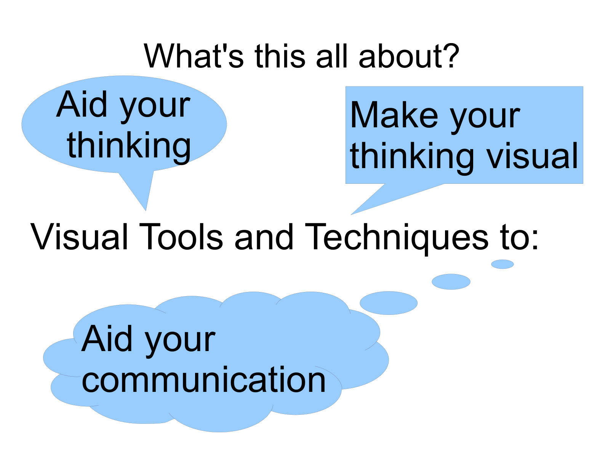

Visual Tools and Techniques to:

Aid your

thinking

Make your

thinking visual

Aid your

communication

---

<!-- Slide 3 -->

# “I would rather see your thinking, than see what you think your thinking should look like”

“I would rather see your thinking, than see what you think your thinking should look like”

---

<!-- Slide 4 -->

# An adhoc example of Thinking Visually

“Let's think visually about testing the google search box”

---

<!-- Slide 5 -->

# Google search - visual testing notes

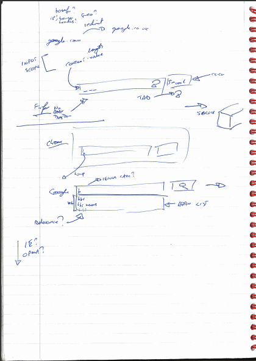

---

<!-- Slide 6 -->

# Google search - redirects

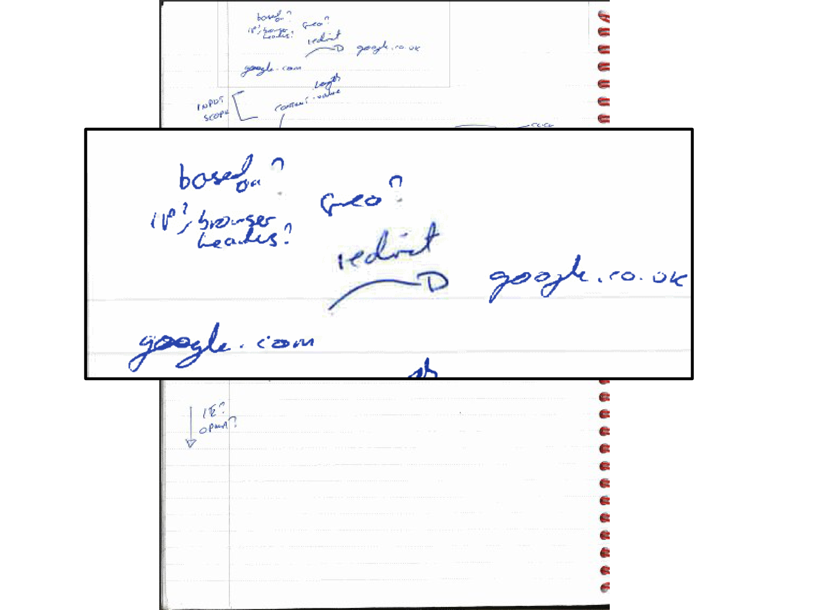

---

<!-- Slide 7 -->

# Google search - search controls

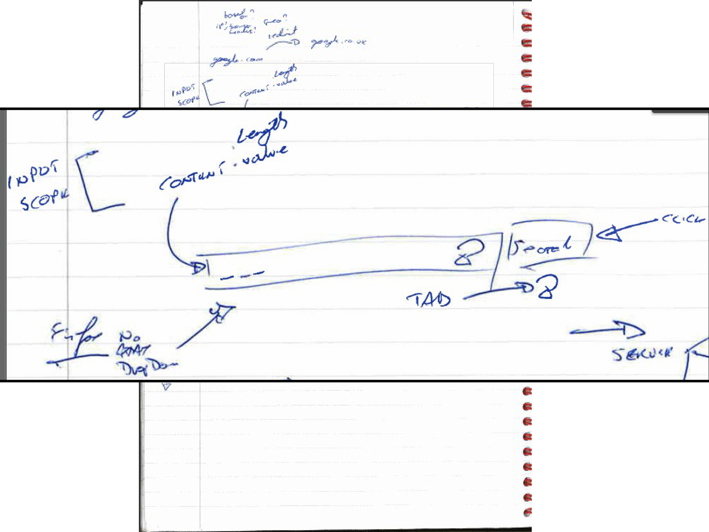

---

<!-- Slide 8 -->

# Google search - server calls

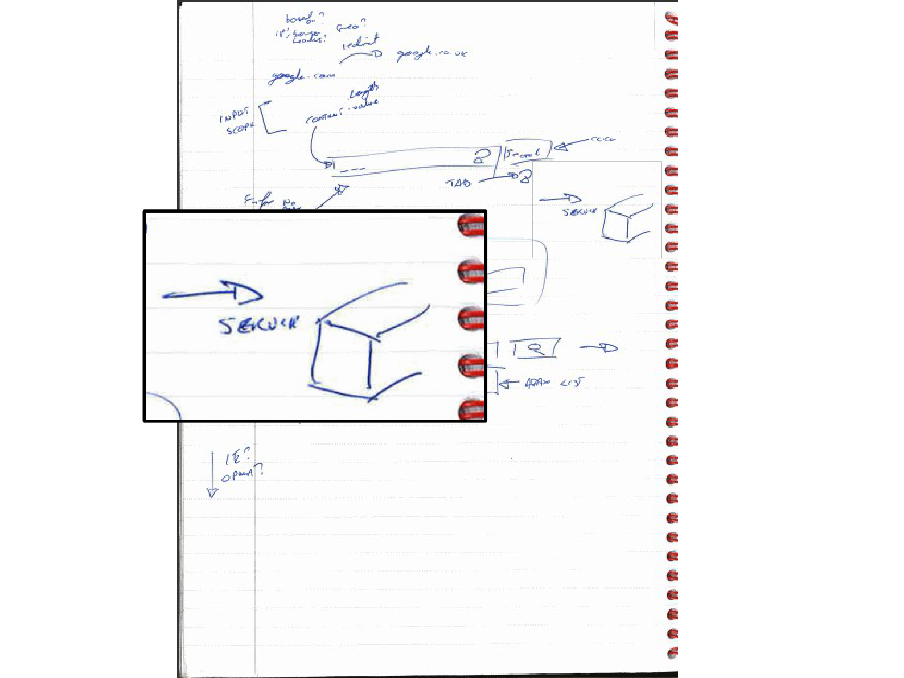

---

<!-- Slide 9 -->

# Google search - combined model

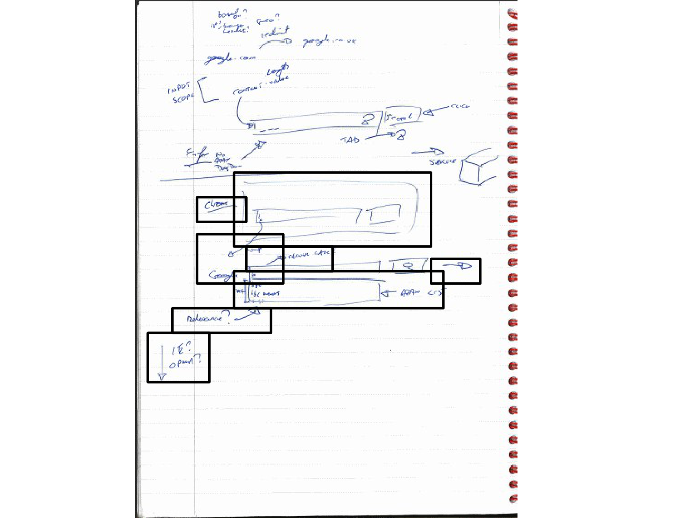

---

<!-- Slide 10 -->

# Adhoc Tooling

- Pen and Paper
- Camera
- Scanner
- Evernote
- Paint.net
- … have you examined what you already use?

---

<!-- Slide 11 -->

# “Over the years I've moved from; starting with technology and looking for the one true formal representation; to an adhoc multi-view approach”

“Over the years I've moved from; starting with technology and looking for the one true formal representation; to an adhoc multi-view approach”

---

<!-- Slide 12 -->

# What is this based on?

- I have based this on my experience
- Learning to communicate more succinctly
- Help me spot gaps in my thinking
- Systems Thinking
- Reviewing Other People's plans &amp; docs
- Writing a diagramming &amp; Outlining Tool
- Learning to read quickly

---

<!-- Slide 13 -->

# Uncle Al's Slogans

- How little can you get away with?
- 'game' the templates
- Important things first
- Summarise for the reader
- Meet the reader's needs

---

<!-- Slide 14 -->

# Document Examples

---

<!-- Slide 15 -->

# Document example - test conditions and data

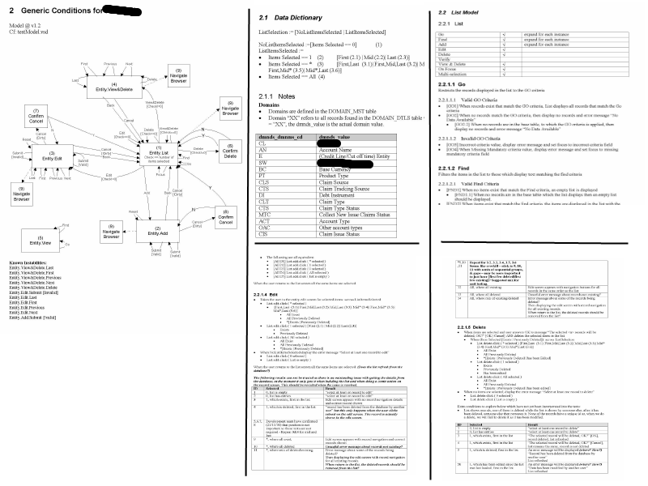

---

<!-- Slide 16 -->

# Document example - process model

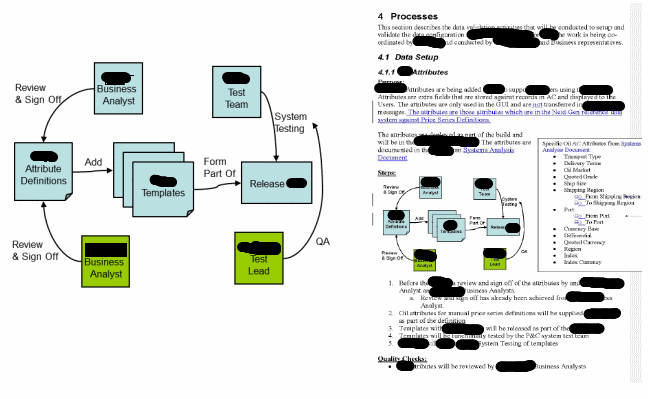

---

<!-- Slide 17 -->

# Document example - test scenario planning

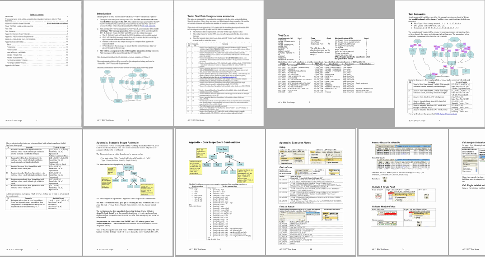

---

<!-- Slide 18 -->

# How not to think visually

---

<!-- Slide 19 -->

# I was taught how to not do this

- Doodles are bad
- You can't draw
- If it was quick it can't be good

---

<!-- Slide 20 -->

# !... I was also taught

- Not enough words
- Use more complicated words
- Formal diagramming rules
- … what were you taught?

---

<!-- Slide 21 -->

# I unlearned and focus on

- Value
- Communication
- Novelty
- How people remember
- Design
- Flexibility
- … and more

---

<!-- Slide 22 -->

# It seems as though the norm is...

*Supplementary slide: hidden in the original slideshow.*

- Express your thinking linearly
- No big picture
- Word Processor as an outline
- … have you identified your norm?

---

<!-- Slide 23 -->

# How to trap your thinking and your reader

- The big block of text
- Summarise without value
- Stupor inducing templates
- Hide what is important

---

<!-- Slide 24 -->

# How to trap your thinking and your reader

- Use lists to restrict 'what else' thinking
- Copy and Paste rather than re-interpret
- … how else?

---

<!-- Slide 25 -->

# Don't Believe me?

“Go find some examples on the web.”

- "test strategy" file:doc
- "test approach" file:doc
- "test plan" file:doc
- "test strategy" file:pdf
- "test approach" file:pdf
- "test plan" file:pdf

---

<!-- Slide 26 -->

# This doesn't seem natural to me

*Supplementary slide: hidden in the original slideshow.*

- We build big pictures
- We build big pictures quickly
- We build 'good enough' big pictures

---

<!-- Slide 27 -->

# Quick tips to shake it up a bit

- If you normally use lined paper, use blank
- If you normally use portrait, use landscape
- If you start at the top, start in the middle
- Take notes positionally, rather than in time line
- … what can you do now to change your approach?

---

<!-- Slide 28 -->

# My non-psychology based view

- Words are pictures
- Everything has a visual impact
- Documents are pictures
- Thinking is different from communicating
- Thinking is for us
- Communicating is for them
- Different Visual Models have different purpose
- … think through your insights

---

<!-- Slide 29 -->

# Lessons from rapid reading

- Most words are padding
- Outlines reveal big picture
- Images, summaries, callouts
- 1st and last paras
- Read Backwards
- Illustrations vs Diagrams
- … what aids you when you read quickly?

---

<!-- Slide 30 -->

# Obvious Thinking Tools First

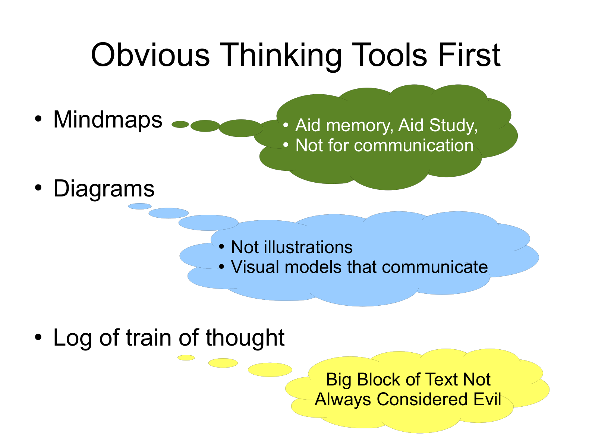

- Mindmaps
- Diagrams

- Log of train of thought

    - Aid memory, Aid Study,
    - Not for communication

    - Not illustrations
    - Visual models that communicate

Big Block of Text Not

Always Considered Evil

---

<!-- Slide 31 -->

# Loosen Up... Think Spatially

- Single Sheet Viewport to the mind
- Text Editors
- Mind Map Tools for 'big picture' outlines

---

<!-- Slide 32 -->

# Single Sheet Viewport to the Mind

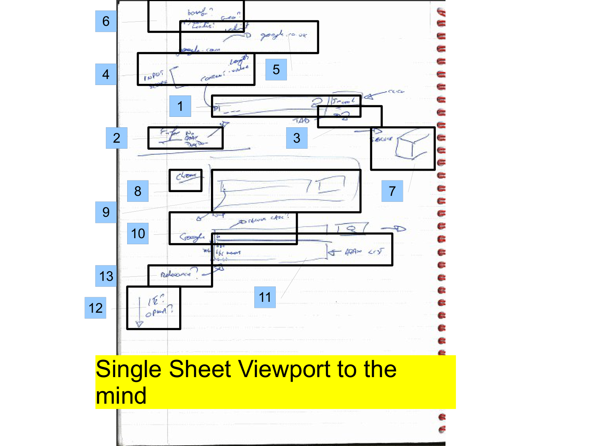

1

2

3

4

5

6

1

7

8

9

10

11

12

13

Single Sheet Viewport to the mind

---

<!-- Slide 33 -->

# Think Spatially with Text Editors

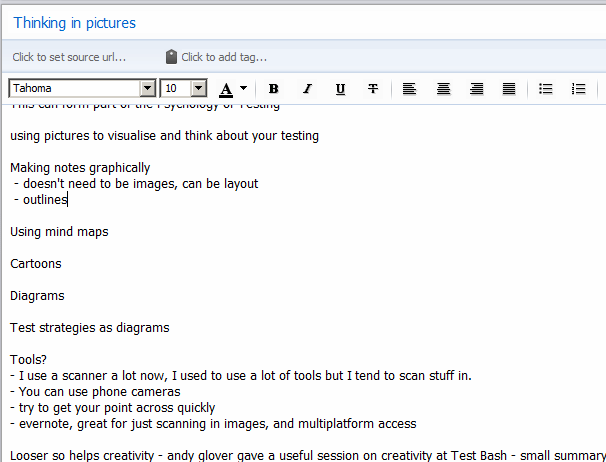

---

<!-- Slide 34 -->

# Mind Map Tools for 'big picture' outlines

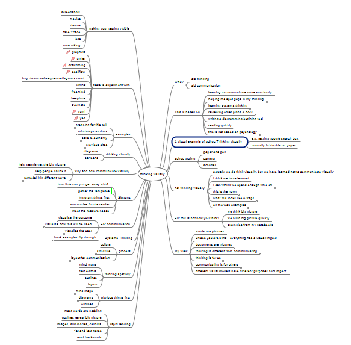

---

<!-- Slide 35 -->

# A visual thinking process

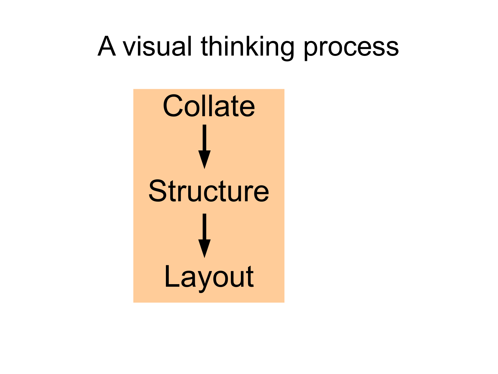

Collate

Structure

Layout

---

<!-- Slide 36 -->

# Visualise the outcome, use, and consumer

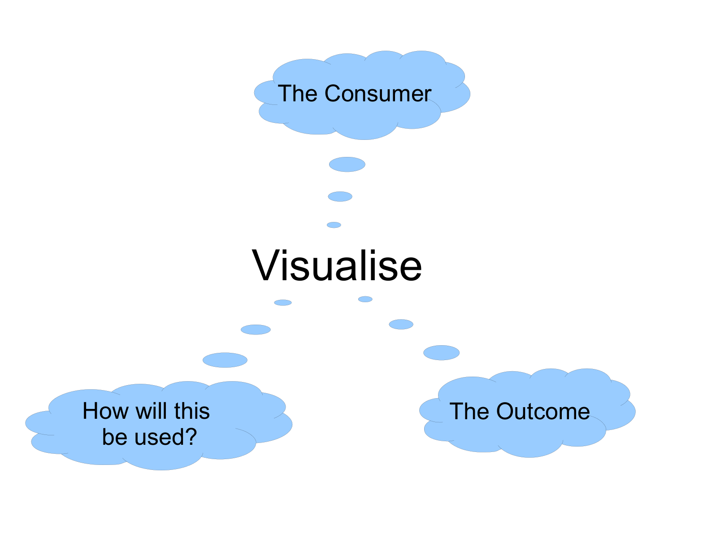

Visualise

The Outcome

How will this

be used?

The Consumer

---

<!-- Slide 37 -->

# Why and how visually?

- Big picture
    - Chunk up and down
- Remodel
    - List
    - Time
    - Attribute Relationships
        - Tables, Categories, Outlines
    - Space
    - Flows

---

<!-- Slide 38 -->

# Tools to Experiment With

- Graphviz
- Freemind
- Freeplane
- Xmind
- Evernote
- yED
- yUML

- Umlet
- Drawtiming
- Asciiflow
- Text Editors
- Presentation Tools
- Art Packages
- Screen Capture

… have you got a use, to use , and used list?

You can use prosaic tools

---

<!-- Slide 39 -->

# “Think. Make your thinking visible. Communicate your thinking. And do it your way.”

“Think. Make your thinking visible. Communicate your thinking. And do it your way.”

---

<!-- Slide 40 -->

# eviltester.com

---

<!-- Slide 41 -->

# You can use prosaic tools

*Supplementary slide: hidden in the original slideshow.*

- Text Editors
- Presentation Tools
- Art Packages
- Win+PrintScreen
- … what out the box stuff could you use differently, to think visually?

---

<!-- Slide 42 -->

# Making your testing visible

*Supplementary slide: hidden in the original slideshow.*

- Screenshots
- Movies
- Demos
- Face 2 Face
- Logs
- Note Taking

---

<!-- Slide 43 -->

# Visualise the Outcome

*Supplementary slide: hidden in the original slideshow.*

- What do you want people to say?
- What do you want them to do?
- What is important for them to know?

---

<!-- Slide 44 -->

# Visualise how this will be used

*Supplementary slide: hidden in the original slideshow.*

- Study?
- Talked through in a meeting?
- Permanent Attempt at Communication
- Temporary

---

<!-- Slide 45 -->

# Visualise the User

*Supplementary slide: hidden in the original slideshow.*

- Stakeholder needs drive content
- Persona drives style
