<!-- Slide 1 -->

# Selenium Clinic


Alan Richardson (@eviltester), Simon Stewart (@shs96c)

Selenium Clinic

www.eurostarconferences.com

@esconfs

#esconfs

---

<!-- Slide 2 -->

# What Is This?

These slides were used in the “Best Tutorial” Award winning tutorial from Eurostar 2012 hosted by Simon Stewart and Alan Richardson

Most of these slides form part of the slide deck for Alan Richardson's Online Course

So if you like what you read here – check out the full 18+ hour tutorial with 200+ slides

---

<!-- Slide 3 -->

# Selenium Conference

Do you with there was a conference dedicated to all things Selenium?

Well there is:

[http://www.seleniumconf.org/](http://www.seleniumconf.org/)

It may be happening soon. It may be near you. Check the site for more details.

---

<!-- Slide 4 -->

# Source Code

The source code developed during the tutorial and in preparation for the tutorial can be found on github:

[https://github.com/shs96c/selenium\_clinic](https://github.com/shs96c/selenium_clinic)

---

<!-- Slide 5 -->

# Tutorial Agenda

---

<!-- Slide 6 -->

# Clinic ('klinik)

1. A tutorial, often associated with a conference that is devoted to the discussion of a single tool
2. A group session, often led by bearded gentlefolk, which offers hints and tips, points out oft neglected practices, and may offer practical hands on challenges
3. A place where such instruction occurs

---

<!-- Slide 7 -->

# A Short History of Selenium

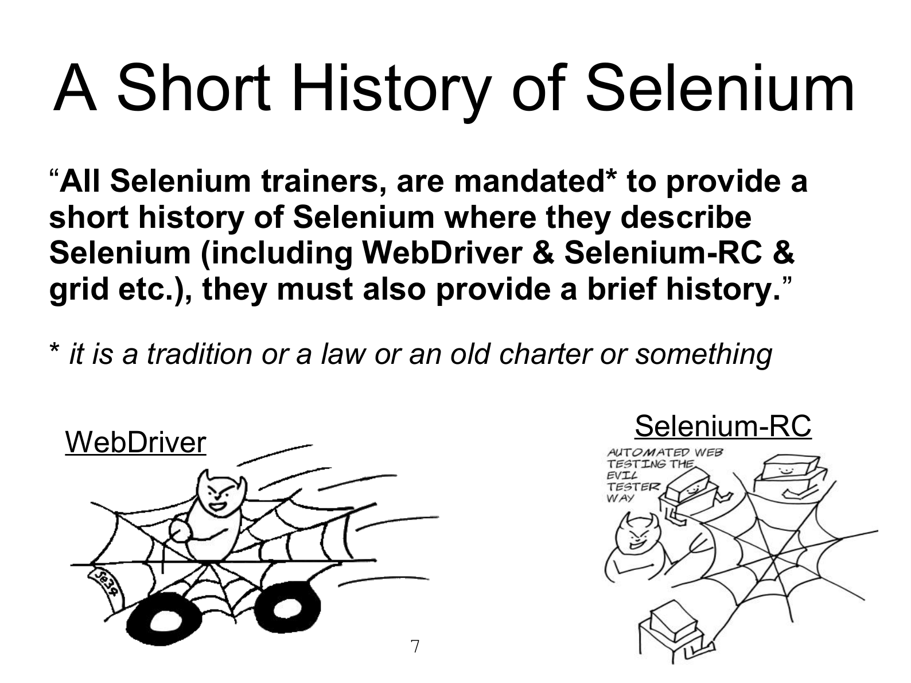

WebDriver

Selenium-RC

“All Selenium trainers, are mandated\* to provide a short history of Selenium where they describe Selenium (including WebDriver &amp; Selenium-RC &amp; grid etc.), they must also provide a brief history.”

\* it is a tradition or a law or an old charter or something

---

<!-- Slide 8 -->

# Intro &amp; Capabilities

- Hello from Alan &amp; Simon
- Current Group Capabilities

---

<!-- Slide 9 -->

# My First WebDriver Test

---

<!-- Slide 10 -->

# What makes good tests go bad?

Wherein we discuss real world test practices for making your testing bad, and conversely, what you can do to mitigate your self destructive tendencies.

---

<!-- Slide 11 -->

# By any means necessary

Wherein locators are discussed, including the use of Custom locators because you deserve to be in control

---

<!-- Slide 12 -->

# Basic WebDriver Commands

- Driver level
- WebElement level

---

<!-- Slide 13 -->

# WebDriverWait exposed

Wherein we discuss Fluently the intricacies of waiting; an oft forgotten art of Explicitly taking control of your waiting time rather than Implicitly assuming the passage of time

---

<!-- Slide 14 -->

# JavaScript

Wherein we discuss the nuances of working with the ubiquitous; synchronously, asynchronously and on taking as well as giving.

---

<!-- Slide 15 -->

# “I have to handle an alert in my application but WebDriver doesn't let me...”

Wherein we discuss the handling of alerts and learn what an alert is, what an alert is not, and what to do about it.

---

<!-- Slide 16 -->

# Refactoring and Abstracting

Wherein we discuss the modeling of test automation in the real world and consider; should we refactor to models, or build from models, and how much of a good thing is too much before a good thing goes bad and becomes a bad thing from whence it was once good.

---

<!-- Slide 17 -->

# Questions and Challenges

- Answered &amp; Discussed

- Offered

---

<!-- Slide 18 -->

# Alan Richardson

- [www.eviltester.com](http://www.eviltester.com/)
- [www.compendiumdev.co.uk](http://www.compendiumdev.co.uk/)
- [www.seleniumsimplified.com](http://www.seleniumsimplified.com/)
- @eviltester

---

<!-- Slide 19 -->

# Simon Stewart

- blog.rocketpoweredjetpants.com
- @shs96c

---

<!-- Slide 20 -->

# WebDriver Tutorial Reference Slides

WebDriver Tutorial Reference Slides

For More like this visit:

- [Http://seleniumsimplified.com](http://seleniumsimplified.com/)

The following slides are excerpts from the Online course

---

<!-- Slide 21 -->

# In Selenium 2.0 The Driver is King

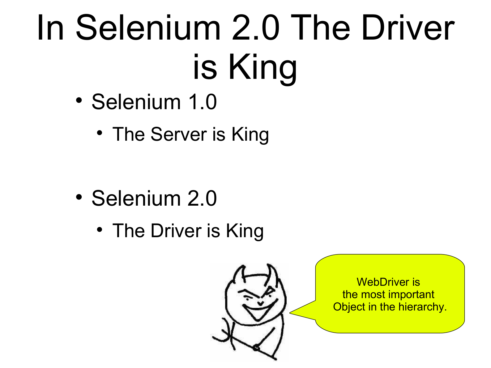

- Selenium 1.0

    - The Server is King

- Selenium 2.0

    - The Driver is King

WebDriver is

the most important

Object in the hierarchy.

---

<!-- Slide 22 -->

# First Test

```java
@Test
public void driverIsTheKing(){
    WebDriver driver = new HtmlUnitDriver();
    driver.get("http://www.compendiumdev.co.uk/selenium");
    assertTrue(driver.getTitle().startsWith(
                  "Selenium Simplified"));
    }
```

---

<!-- Slide 23 -->

# First Test Explained

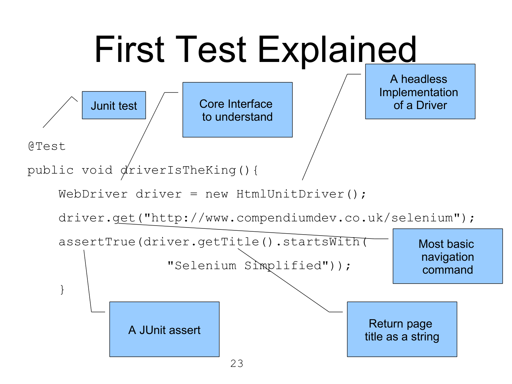

```java
@Test
public void driverIsTheKing(){
    WebDriver driver = new HtmlUnitDriver();
    driver.get("http://www.compendiumdev.co.uk/selenium");
    assertTrue(driver.getTitle().startsWith(
                  "Selenium Simplified"));
    }
```

A headless

Implementation

of a Driver

Core Interface

to understand

Most basic

navigation

command

A JUnit assert

Return page

title as a string

Junit test

---

<!-- Slide 24 -->

# Real Browser Explored

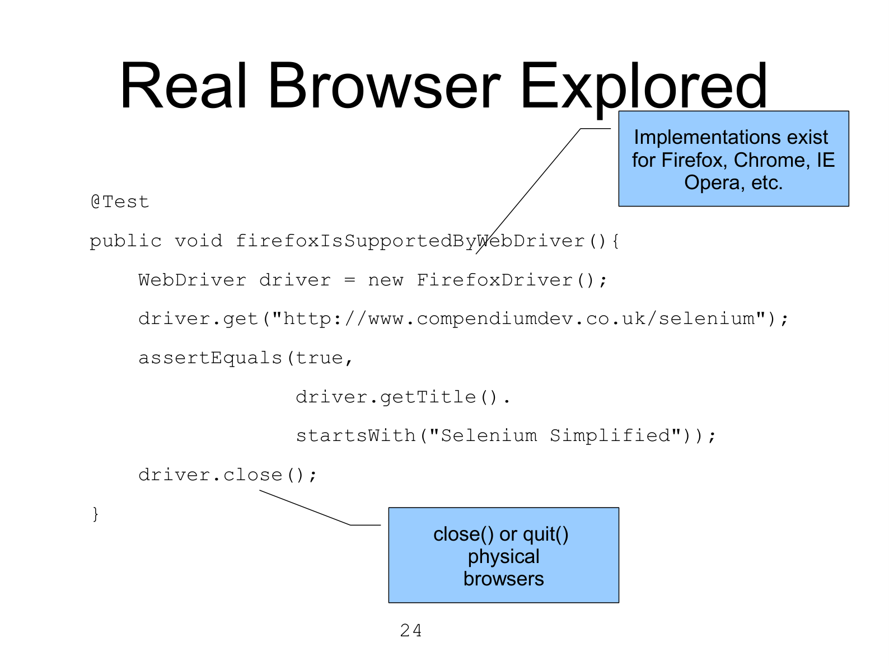

```java
    @Test
    public void firefoxIsSupportedByWebDriver(){
        WebDriver driver = new FirefoxDriver();
        driver.get("http://www.compendiumdev.co.uk/selenium");
        assertEquals(true,
                     driver.getTitle().
                     startsWith("Selenium Simplified"));
        driver.close();
    }
```

Implementations exist

for Firefox, Chrome, IE

Opera, etc.

close() or quit()

physical

browsers

---

<!-- Slide 25 -->

# What are the basics that we need to know so that we can automate the web?

What are the basics that we need to know so that we can automate the web?

---

<!-- Slide 26 -->

# Basic Knowledge Chunked

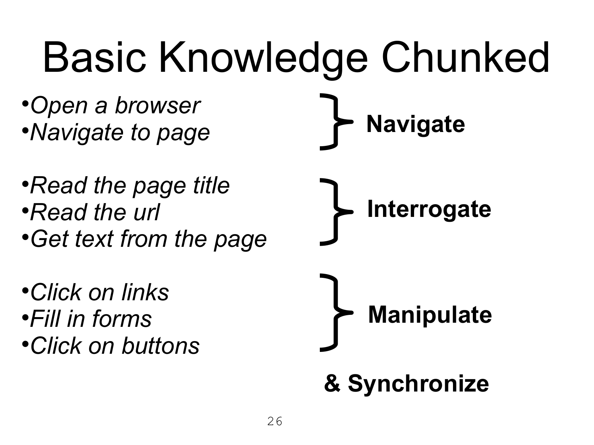

- Open a browser
- Navigate to page

- Read the page title
- Read the url
- Get text from the page

- Click on links
- Fill in forms
- Click on buttons

Navigate

Interrogate

Manipulate

&amp; Synchronize

---

<!-- Slide 27 -->

# Assertions

- assertTrue(“description”, expected, actual)

    - AssertFalse(...)

- assertEquals(“description”, expected, actual)

- Used to check results

---

<!-- Slide 28 -->

# Junit Example

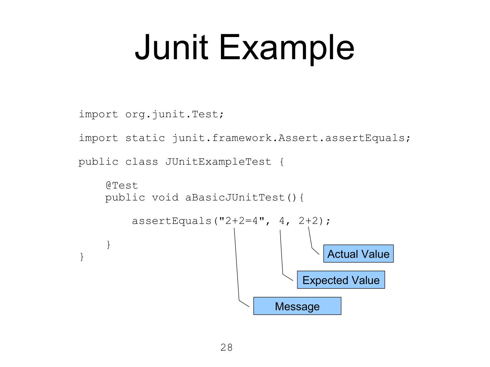

```java
import org.junit.Test;

import static junit.framework.Assert.assertEquals;

public class JUnitExampleTest {

    @Test
    public void aBasicJUnitTest(){

        assertEquals("2+2=4", 4, 2+2);

    }
}
```

Actual Value

Expected Value

Message

---

<!-- Slide 29 -->

# More JUnit

- Avoid repeating code in your @Test methods
- Before and after each @Test

    - @Before
    - @After

- Once per class

    - @BeforeClass
    - @AfterClass
    - Declare methods as static

---

<!-- Slide 30 -->

# Navigation Annotated

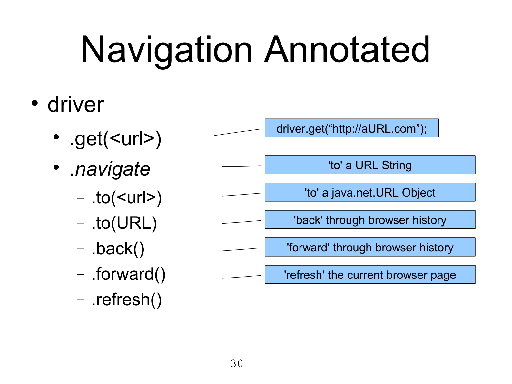

- driver

    - .get(&lt;url&gt;)
    - .navigate

        - .to(&lt;url&gt;)
        - .to(URL)
        - .back()
        - .forward()
        - .refresh()

driver.get(“<http://aURL.com”);>

'to' a URL String

'to' a java.net.URL Object

'back' through browser history

'forward' through browser history

'refresh' the current browser page

---

<!-- Slide 31 -->

# Navigation Example Test

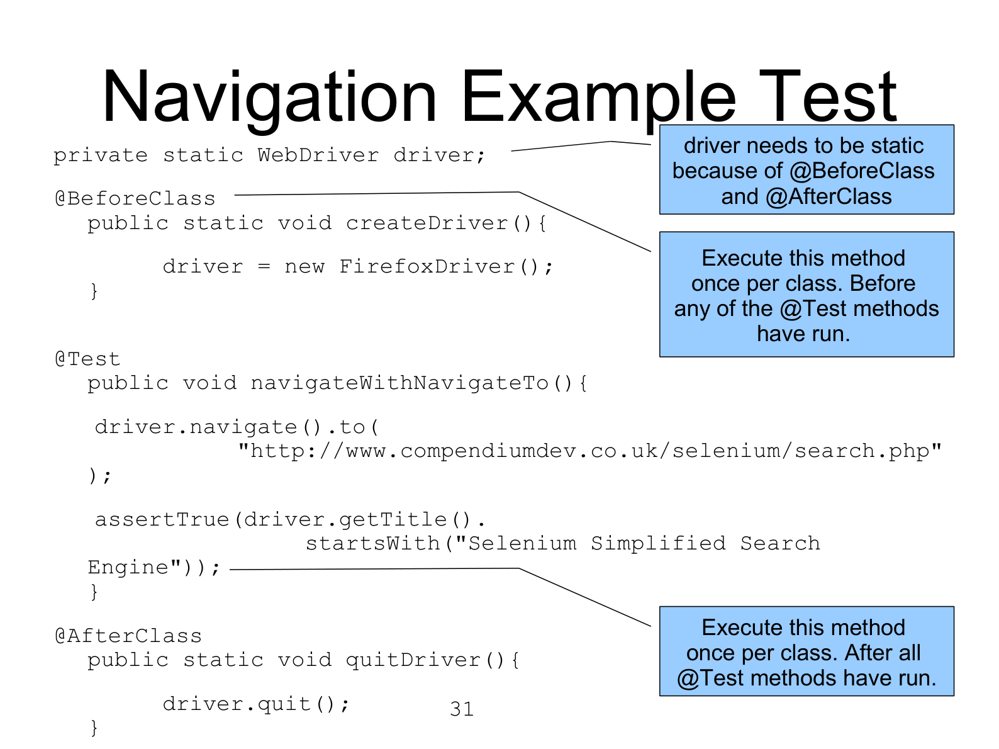

```java
private static WebDriver driver;
@BeforeClass
public static void createDriver(){
        driver = new FirefoxDriver();
}

@Test
public void navigateWithNavigateTo(){
   driver.navigate().to(
           "http://www.compendiumdev.co.uk/selenium/search.php");
   assertTrue(driver.getTitle().
                startsWith("Selenium Simplified Search Engine"));
}
@AfterClass
public static void quitDriver(){
        driver.quit();
}
```

driver needs to be static

because of @BeforeClass

and @AfterClass

Execute this method

once per class. Before

any of the @Test methods

have run.

Execute this method

once per class. After all

@Test methods have run.

---

<!-- Slide 32 -->

# DriverInterrogateTest

```java
    @Test
    public void driverLevelPageInterrogateMethods(){

        WebDriver driver;

        final String theTestPageURL =
          "http://www.compendiumdev.co.uk/selenium/basic_web_page.html";

        driver = new FirefoxDriver();
        driver.navigate().to(theTestPageURL);

        assertEquals(driver.getTitle(), "Basic Web Page Title");
        assertEquals(driver.getCurrentUrl(), theTestPageURL);

        String pageSource = driver.getPageSource();
        assertTrue(pageSource.contains("A paragraph of text"));

		 driver.close();

    }
```

---

<!-- Slide 33 -->

# Be Careful with getPageSource

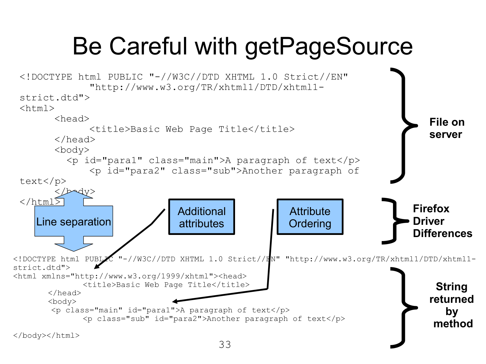

```html
<!DOCTYPE html PUBLIC "-//W3C//DTD XHTML 1.0 Strict//EN"
		"http://www.w3.org/TR/xhtml1/DTD/xhtml1-strict.dtd">
<html>
	<head>
		<title>Basic Web Page Title</title>
	</head>
	<body>
        <p id="para1" class="main">A paragraph of text</p>
		<p id="para2" class="sub">Another paragraph of text</p>
	</body>
</html>
```

```html
<!DOCTYPE html PUBLIC "-//W3C//DTD XHTML 1.0 Strict//EN" "http://www.w3.org/TR/xhtml1/DTD/xhtml1-strict.dtd">
<html xmlns="http://www.w3.org/1999/xhtml"><head>
		<title>Basic Web Page Title</title>
	</head>
	<body>
        <p class="main" id="para1">A paragraph of text</p>
		<p class="sub" id="para2">Another paragraph of text</p>

</body></html>
```

File on

server

String

returned

by

method

Line separation

Firefox

Driver

Differences

Additional

attributes

Attribute

Ordering

---

<!-- Slide 34 -->

# Dom Element Interrogation Approach

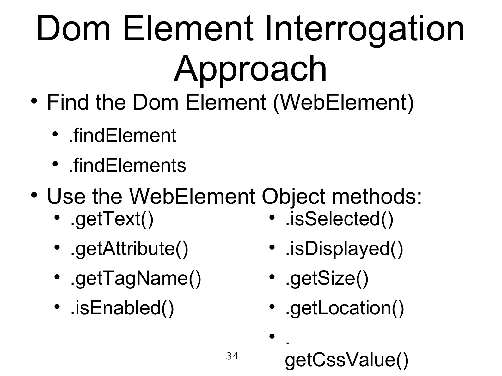

- Find the Dom Element (WebElement)

    - .findElement
    - .findElements

- Use the WebElement Object methods:

    - .getText()
    - .getAttribute()
    - .getTagName()
    - .isEnabled()

    - .isSelected()
    - .isDisplayed()
    - .getSize()
    - .getLocation()
    - .getCssValue()

---

<!-- Slide 35 -->

# Driver .findElement(By)

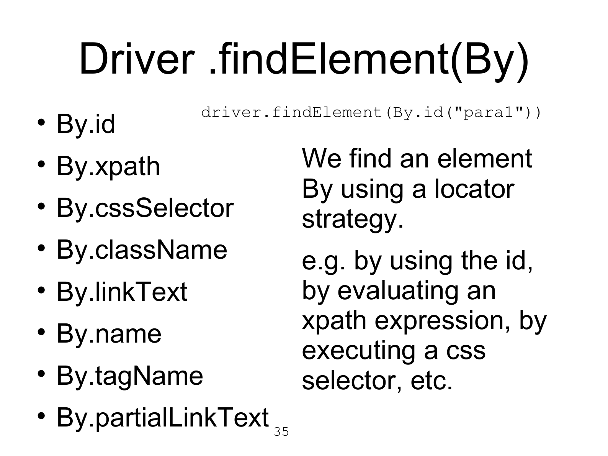

- By.id
- By.xpath
- By.cssSelector
- By.className
- By.linkText
- By.name
- By.tagName
- By.partialLinkText

We find an element By using a locator strategy.

e.g. by using the id, by evaluating an xpath expression, by executing a css selector, etc.

```java
driver.findElement(By.id("para1"))
```

---

<!-- Slide 36 -->

# ExampleFirstFindByTest

```java
public class ExampleFirstFindByTest {

    static WebDriver driver;

    @BeforeClass
    public static void createDriverAndVisitTestPage(){
        driver = new FirefoxDriver();
        driver.get("http://www.compendiumdev.co.uk/" +
                "selenium/find_by_playground.php");
    }

    @Test
    public void findByID(){
        WebElement cParagraph = driver.findElement(By.id("p3"));
        assertEquals("This is c paragraph text",
 							cParagraph.getText());
    }

    @AfterClass
    public static void closeBrowser(){
        driver.quit();
    }
}
```

---

<!-- Slide 37 -->

# .findElements

- .findElement only returns 1 WebElement
- If the By could return more elements then .findElement retursn the first in the list

- .findElements returns the full list of matching WebElements

    - e.g. driver.findElements(By.className(“normal”));

---

<!-- Slide 38 -->

# Useful Tools For CSS and XPath

- Firefox

    - Install FireBug and FirePath plugins

- Chrome

    - Developer tools are supposed to allow search using xpath or css (sometimes this breaks between releases)

---

<!-- Slide 39 -->

# WebElement Manipulation

- .click()
- .clear()

    - Clear a field

- .sendKeys(String) actually (CharSequence)

    - Sends the appropriate events to a WebElement keyup, keydown, etc.
    - Helper Keys class (org.openqa.selenium.Keys)

- .submit()

    - Submit a form

---

<!-- Slide 40 -->

# Introducing WebDriverWait

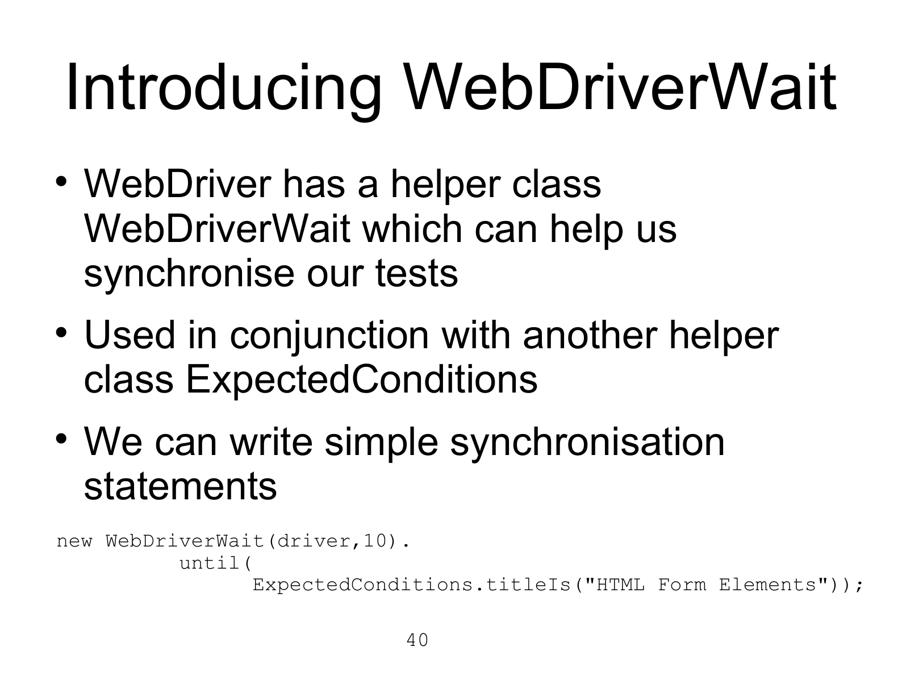

- WebDriver has a helper class WebDriverWait which can help us synchronise our tests
- Used in conjunction with another helper class ExpectedConditions
- We can write simple synchronisation statements

```java
new WebDriverWait(driver,10).
          until(
                ExpectedConditions.titleIs("HTML Form Elements"));
```

---

<!-- Slide 41 -->

# Manipulation Example Test

```java
public class ManipulateExampleTest {

    static WebDriver driver;

    @BeforeClass
    public static void createDriverAndVisitTestPage(){
        driver = new FirefoxDriver();
        driver = driver.get( "http://www.compendiumdev.co.uk" +
                				"/selenium/basic_html_form.html");
    }

    @Test
    public void simpleInteraction(){
        WebElement checkBox1 = driver.findElement(
                By.cssSelector("input[value='cb1']"));

        assertFalse("Starts not selected",
                checkBox1.isSelected());

        checkBox1.click();

        assertTrue("Click selects",
                checkBox1.isSelected());
    }


    @AfterClass
    public static void closeBrowser(){
        driver.quit();
    }
}
```

---

<!-- Slide 42 -->

# Manipulation Summary

- Filename fields use .sendKeys
- Checkbox and radio items

    - .isSelected, .click

- Can clear text or text area

- Cannot clear a checkbox, multiselect, drop down, or radiobutton
- Simple manipulation has a very simple set of methods

---

<!-- Slide 43 -->

# More on SendKeys

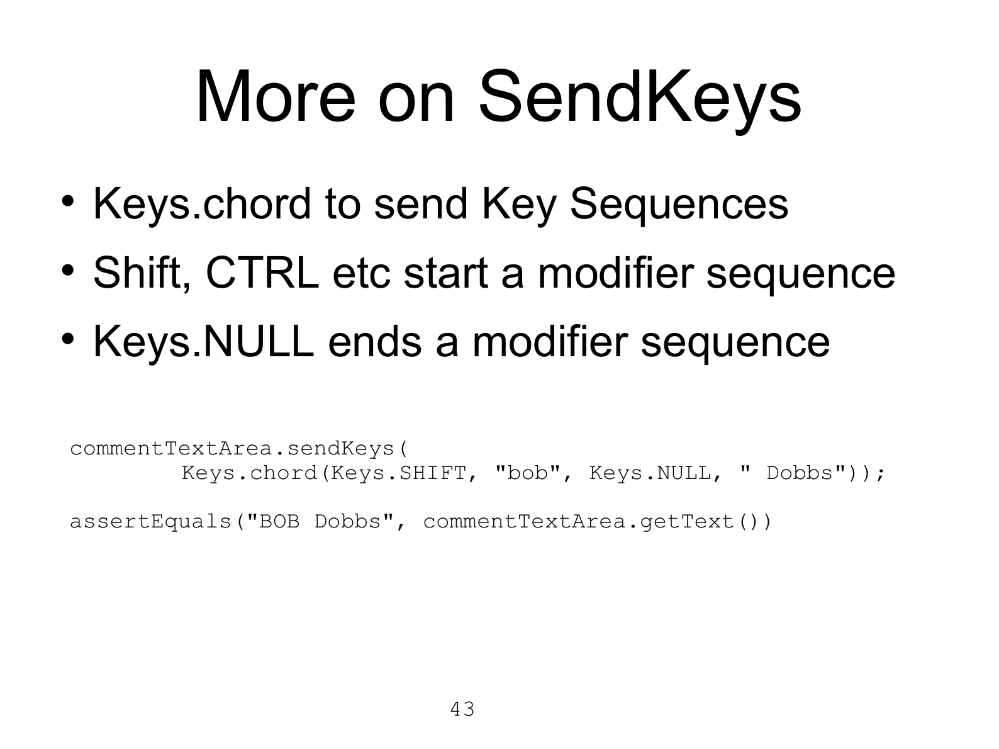

- Keys.chord to send Key Sequences
- Shift, CTRL etc start a modifier sequence
- Keys.NULL ends a modifier sequence

```java
commentTextArea.sendKeys(
	   Keys.chord(Keys.SHIFT, "bob", Keys.NULL, " Dobbs"));

assertEquals("BOB Dobbs", commentTextArea.getText())
```

---

<!-- Slide 44 -->

# User Interactions Example

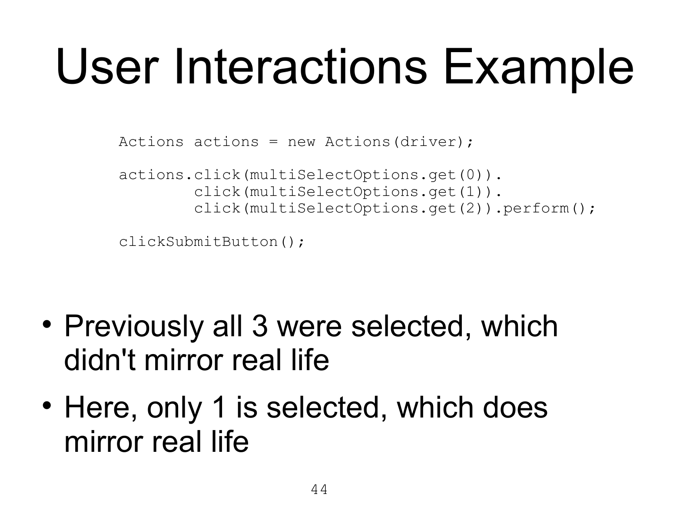

- Previously all 3 were selected, which didn't mirror real life
- Here, only 1 is selected, which does mirror real life

```java
        Actions actions = new Actions(driver);

        actions.click(multiSelectOptions.get(0)).
                click(multiSelectOptions.get(1)).
                click(multiSelectOptions.get(2)).perform();

        clickSubmitButton();
```

---

<!-- Slide 45 -->

# Use User Interactions Carefully

- Can vary between machines &amp; browsers
- If plain WebDriver works then use it
- Use User Interactions for 'complex' situations
- If you are having problems then check the forums, you might not be the only one

---

<!-- Slide 46 -->

# Alerts

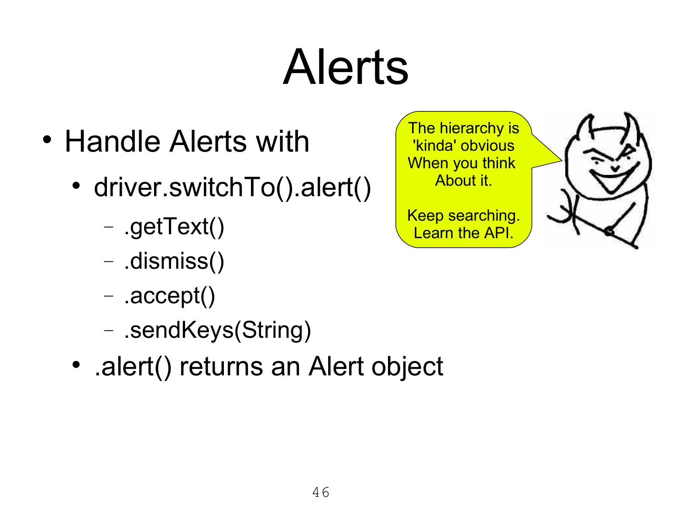

- Handle Alerts with

    - driver.switchTo().alert()

        - .getText()
        - .dismiss()
        - .accept()
        - .sendKeys(String)

    - .alert() returns an Alert object

The hierarchy is

'kinda' obvious

When you think

About it.

Keep searching.

Learn the API.

---

<!-- Slide 47 -->

# Frames Example

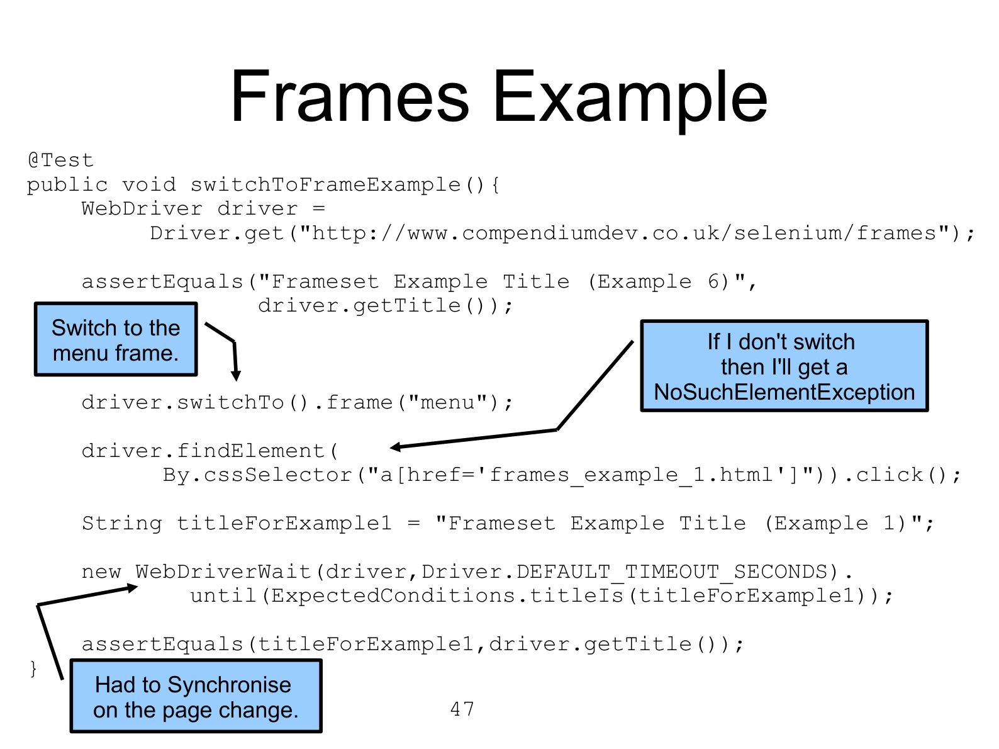

```java
@Test
public void switchToFrameExample(){
    WebDriver driver =
         Driver.get("http://www.compendiumdev.co.uk/selenium/frames");

    assertEquals("Frameset Example Title (Example 6)",
                 driver.getTitle());


    driver.switchTo().frame("menu");

    driver.findElement(
          By.cssSelector("a[href='frames_example_1.html']")).click();

    String titleForExample1 = "Frameset Example Title (Example 1)";

    new WebDriverWait(driver,Driver.DEFAULT_TIMEOUT_SECONDS).
            until(ExpectedConditions.titleIs(titleForExample1));

    assertEquals(titleForExample1,driver.getTitle());
}
```

Had to Synchronise

on the page change.

Switch to the

menu frame.

If I don't switch

then I'll get a

NoSuchElementException

---

<!-- Slide 48 -->

# Windows

- Each Browser window has a unique handle

    - e.g {b3e5c07c-fac7-492f-a86d-d2fa57608185}

- driver.getWindowHandle() returns handle for current window
- driver.getWindowHandles() returns a Set&lt;String&gt; of all window handles
- driver.switchTo.window(String handle) switches control to the chosen window

---

<!-- Slide 49 -->

# Window Example

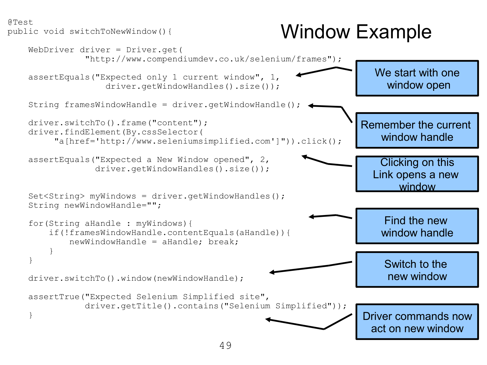

```java
@Test
public void switchToNewWindow(){

    WebDriver driver = Driver.get(
               "http://www.compendiumdev.co.uk/selenium/frames");

    assertEquals("Expected only 1 current window", 1,
                   driver.getWindowHandles().size());

    String framesWindowHandle = driver.getWindowHandle();

    driver.switchTo().frame("content");
    driver.findElement(By.cssSelector(
         "a[href='http://www.seleniumsimplified.com']")).click();

    assertEquals("Expected a New Window opened", 2,
                 driver.getWindowHandles().size());


    Set<String> myWindows = driver.getWindowHandles();
    String newWindowHandle="";

    for(String aHandle : myWindows){
        if(!framesWindowHandle.contentEquals(aHandle)){
            newWindowHandle = aHandle; break;
        }
    }

    driver.switchTo().window(newWindowHandle);

    assertTrue("Expected Selenium Simplified site",
               driver.getTitle().contains("Selenium Simplified"));
    }
```

Remember the current

window handle

We start with one

window open

Clicking on this

Link opens a new

window

Find the new

window handle

Switch to the

new window

Driver commands now

act on new window

---

<!-- Slide 50 -->

# Manage Window Example

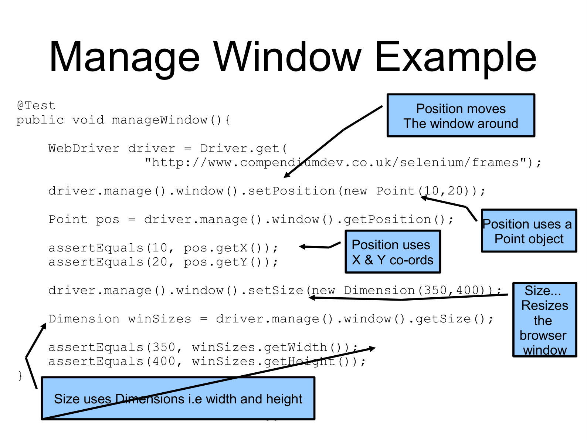

```java
    @Test
    public void manageWindow(){

        WebDriver driver = Driver.get(
                    "http://www.compendiumdev.co.uk/selenium/frames");

        driver.manage().window().setPosition(new Point(10,20));

        Point pos = driver.manage().window().getPosition();

        assertEquals(10, pos.getX());
        assertEquals(20, pos.getY());

        driver.manage().window().setSize(new Dimension(350,400));

        Dimension winSizes = driver.manage().window().getSize();

        assertEquals(350, winSizes.getWidth());
        assertEquals(400, winSizes.getHeight());
    }
```

Position moves

The window around

Position uses a

Point object

Size...

Resizes

the

browser

window

Position uses

X &amp; Y co-ords

Size uses Dimensions i.e width and height

---

<!-- Slide 51 -->

# Custom ExpectedCondition

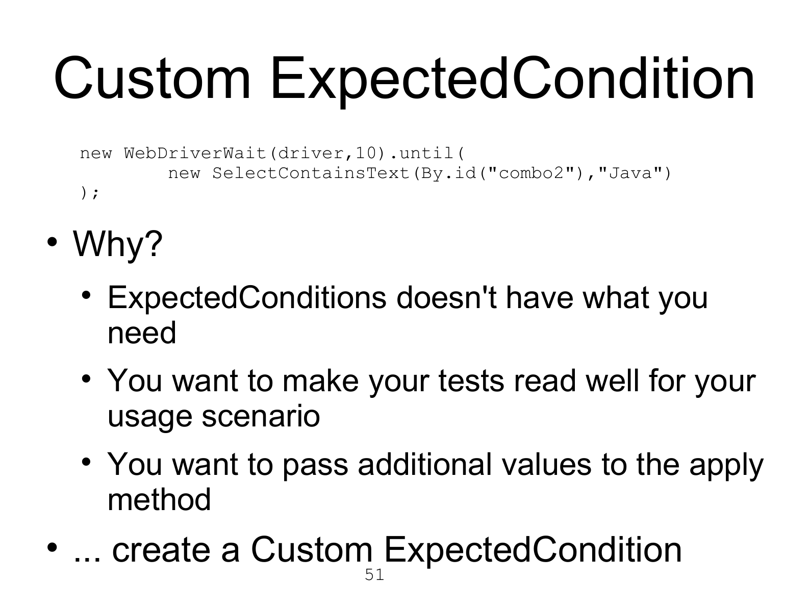

```java
new WebDriverWait(driver,10).until(
        new SelectContainsText(By.id("combo2"),"Java")
);
```

- Why?

    - ExpectedConditions doesn't have what you need
    - You want to make your tests read well for your usage scenario
    - You want to pass additional values to the apply method

- ... create a Custom ExpectedCondition

---

<!-- Slide 52 -->

# Custom ExpectedCondition Example

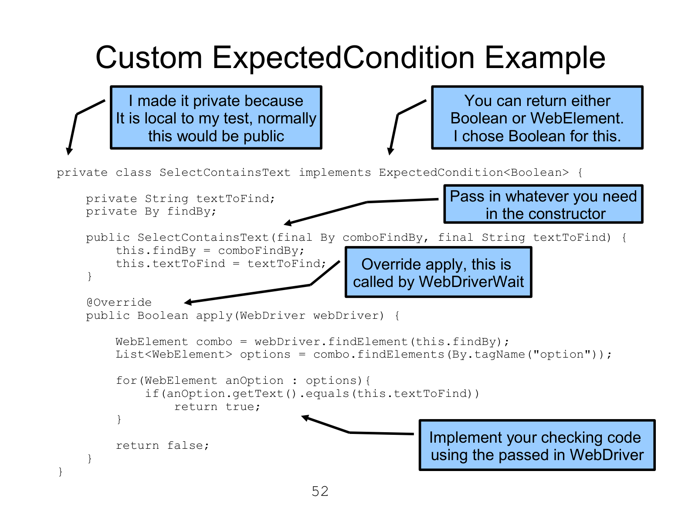

```java
    private class SelectContainsText implements ExpectedCondition<Boolean> {

        private String textToFind;
        private By findBy;

        public SelectContainsText(final By comboFindBy, final String textToFind) {
            this.findBy = comboFindBy;
            this.textToFind = textToFind;
        }

        @Override
        public Boolean apply(WebDriver webDriver) {

            WebElement combo = webDriver.findElement(this.findBy);
            List<WebElement> options = combo.findElements(By.tagName("option"));

            for(WebElement anOption : options){
                if(anOption.getText().equals(this.textToFind))
                    return true;
            }

            return false;
        }
    }
```

I made it private because

It is local to my test, normally

this would be public

You can return either

Boolean or WebElement.

I chose Boolean for this.

Pass in whatever you need

in the constructor

Override apply, this is

called by WebDriverWait

Implement your checking code

using the passed in WebDriver

---

<!-- Slide 53 -->

# Use WebDriverWait Fluently

- Additional methods

    - .pollingEvery
    - .ignoring
    - .withTimeout
    - .withMessage
    - .etc

- Allow us to customise WebDriverWait fluently

---

<!-- Slide 54 -->

# Use WebDriverWait Fluently

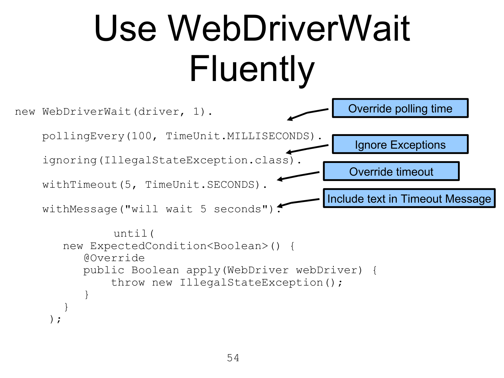

```java
            new WebDriverWait(driver, 1).

                pollingEvery(100, TimeUnit.MILLISECONDS).

                ignoring(IllegalStateException.class).

                withTimeout(5, TimeUnit.SECONDS).

                withMessage("will wait 5 seconds").

					until(
                   new ExpectedCondition<Boolean>() {
                      @Override
                      public Boolean apply(WebDriver webDriver) {
                          throw new IllegalStateException();
                      }
                   }
                 );
```

Override polling time

Ignore Exceptions

Override timeout

Include text in Timeout Message

---

<!-- Slide 55 -->

# ExpectedCondition &amp; Function

- An ExpectedCondition implements Function applying to WebDriver objects

    - Function&lt;WebDriver, T&gt;
    - The apply acts on a WebDriver but it can return any Object e.g. Boolean, WebElement

---

<!-- Slide 56 -->

# FluentWait

- WebDriverWait extends FluentWait so everything you have seen is really FluentWait
- Main difference between FluentWait and WebDriver Wait:

    - FluentWait can apply to anything

        - e.g. WebElement, not just WebDriver

---

<!-- Slide 57 -->

# Function &amp; Predicate

- FluentWait can use Predicate or Function, on any object

    - Function&lt;F, T&gt;
    - Predicate&lt;T&gt;

---

<!-- Slide 58 -->

# FluentWait Example

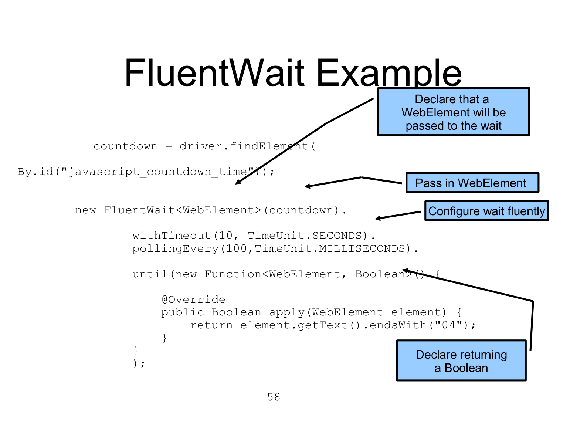

```java
		countdown = driver.findElement(
								By.id("javascript_countdown_time"));


        new FluentWait<WebElement>(countdown).

                withTimeout(10, TimeUnit.SECONDS).
                pollingEvery(100,TimeUnit.MILLISECONDS).

                until(new Function<WebElement, Boolean>() {

                    @Override
                    public Boolean apply(WebElement element) {
                        return element.getText().endsWith("04");
                    }
                }
                );
```

Declare that a WebElement will be passed to the wait

Pass in WebElement

Declare returning a Boolean

Configure wait fluently

---

<!-- Slide 59 -->

# Implicit or Explicit?

- Implicit can make initial tests faster to write

    - you don't worry about synchronisation when writing tests

- It can be harder to add synchronisation later

    - You have to identify a source of intermittency

- If you start with implicit then you can expose synchronisation problems by gradually reducing the implicit wait time

---

<!-- Slide 60 -->

# Implicit or Explicit?

- Implicit can make initial tests faster to write

    - you don't worry about synchronisation when writing tests

- It can be harder to add synchronisation later

    - You have to identify a source of intermittency

- If you start with implicit then you can expose synchronisation problems by gradually reducing the implicit wait time

---

<!-- Slide 61 -->

# Cookies

- Inspect

    - driver.manage

        - .getCookies()
        - .getCookieNamed(“name”)

- Interact

    - driver.manage

        - .addCookie(Cookie)
        - .deleteAllCookies
        - .deleteCookie(Cookie)
        - .deleteCookieNamed(“name”)

---

<!-- Slide 62 -->

# Cookies Example

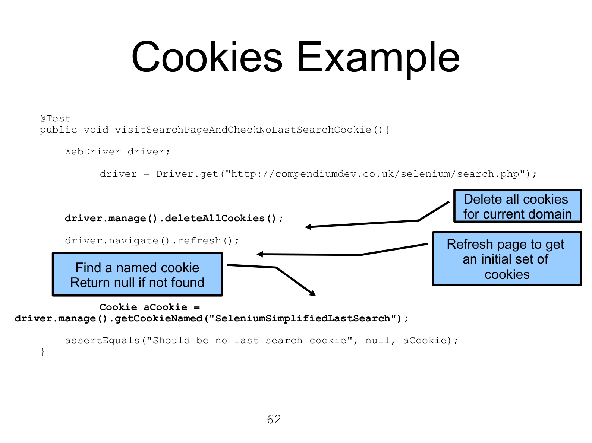

```java
    @Test
    public void visitSearchPageAndCheckNoLastSearchCookie(){

        WebDriver driver;

		driver = Driver.get("http://compendiumdev.co.uk/selenium/search.php");


        driver.manage().deleteAllCookies();

        driver.navigate().refresh();


		Cookie aCookie = driver.manage().getCookieNamed("SeleniumSimplifiedLastSearch");

        assertEquals("Should be no last search cookie", null, aCookie);
    }
```

Delete all cookies

for current domain

Refresh page to get

an initial set of

cookies

Find a named cookie

Return null if not found

---

<!-- Slide 63 -->

# Javascript Execution

- Cast WebDriver to JavascriptExecutor

    - .executeScript(script, args...)
    - .executeAsyncScript(script, args...)

- Arguments are accessed using

    - arguments\[index\] e.g. "document.title=arguments\[0\]"

- Return values are converted to Java types

    - Html Element = WebElement, decimal = Double, non-decimal = Long, boolean = Boolean, array = List&lt;Object&gt;, else String or null

---

<!-- Slide 64 -->

# (JavascriptExecutor) Example

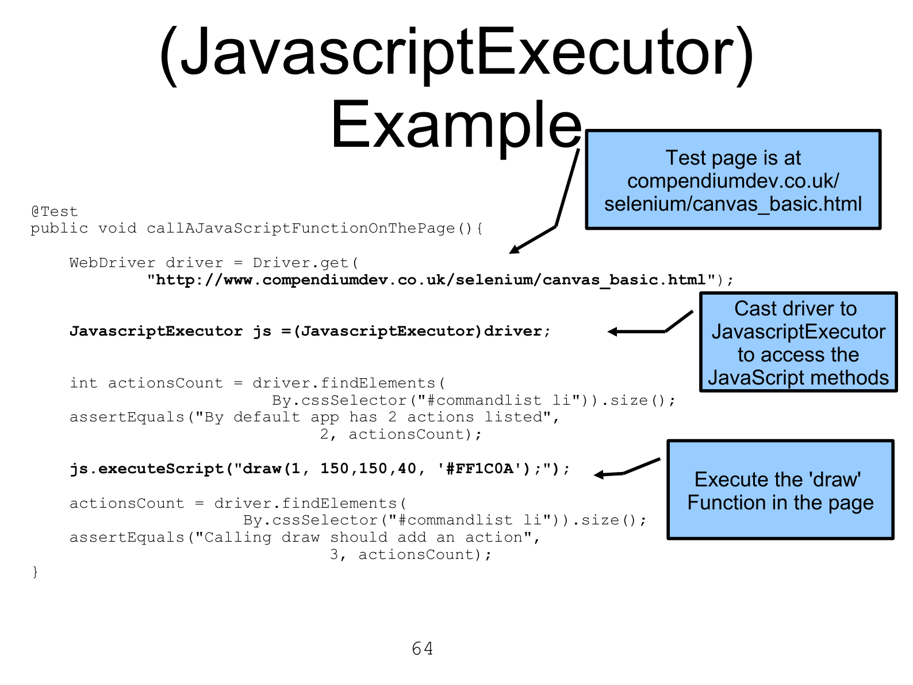

```java
    @Test
    public void callAJavaScriptFunctionOnThePage(){

        WebDriver driver = Driver.get(
                "http://www.compendiumdev.co.uk/selenium/canvas_basic.html");


        JavascriptExecutor js =(JavascriptExecutor)driver;


        int actionsCount = driver.findElements(
                             By.cssSelector("#commandlist li")).size();
        assertEquals("By default app has 2 actions listed",
					2, actionsCount);

        js.executeScript("draw(1, 150,150,40, '#FF1C0A');");

        actionsCount = driver.findElements(
                          By.cssSelector("#commandlist li")).size();
        assertEquals("Calling draw should add an action",
					 3, actionsCount);
    }
```

Cast driver to JavascriptExecutor to access the JavaScript methods

Test page is at

compendiumdev.co.uk/ selenium/canvas\_basic.html

Execute the 'draw'

Function in the page

---

<!-- Slide 65 -->

# ChromeDriver

- <http://code.google.com/p/selenium/wiki/ChromeDriver>
- Download the driver server

    - set "webdriver.chrome.driver" to the location

- Command line switches

    - <http://peter.sh/experiments/chromium-command-line-switches/>
    - Pass in as options

- ChromeDriver.log is useful debugging tool

---

<!-- Slide 66 -->

# Remote Driver

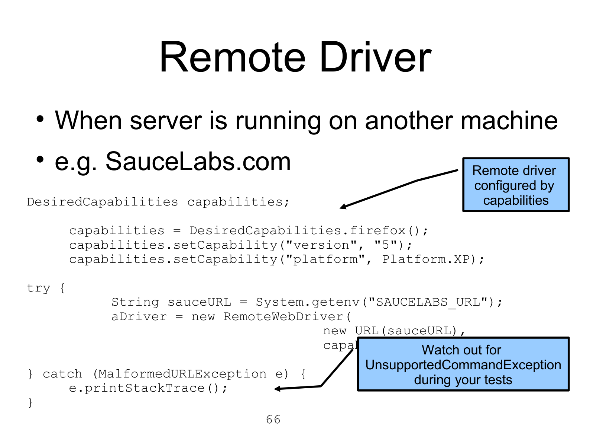

- When server is running on another machine
- e.g. SauceLabs.com

```java
DesiredCapabilities capabilities;

	capabilities = DesiredCapabilities.firefox();
	capabilities.setCapability("version", "5");
	capabilities.setCapability("platform", Platform.XP);

try {
		String sauceURL = System.getenv("SAUCELABS_URL");
		aDriver = new RemoteWebDriver(
							new URL(sauceURL),
							capabilities);

} catch (MalformedURLException e) {
	e.printStackTrace();
}
```

Remote driver configured by capabilities

Watch out for UnsupportedCommandException during your tests

---

<!-- Slide 67 -->

# Try Different Browsers

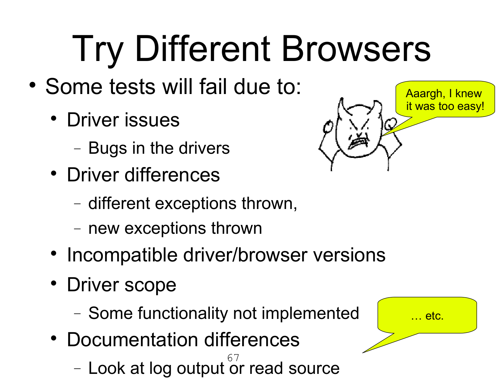

- Some tests will fail due to:

    - Driver issues

        - Bugs in the drivers

    - Driver differences

        - different exceptions thrown,
        - new exceptions thrown

    - Incompatible driver/browser versions
    - Driver scope

        - Some functionality not implemented

    - Documentation differences

        - Look at log output or read source

Aaargh, I knew

it was too easy!

… etc.

---

<!-- Slide 68 -->

# WebDriver Summary Sheet

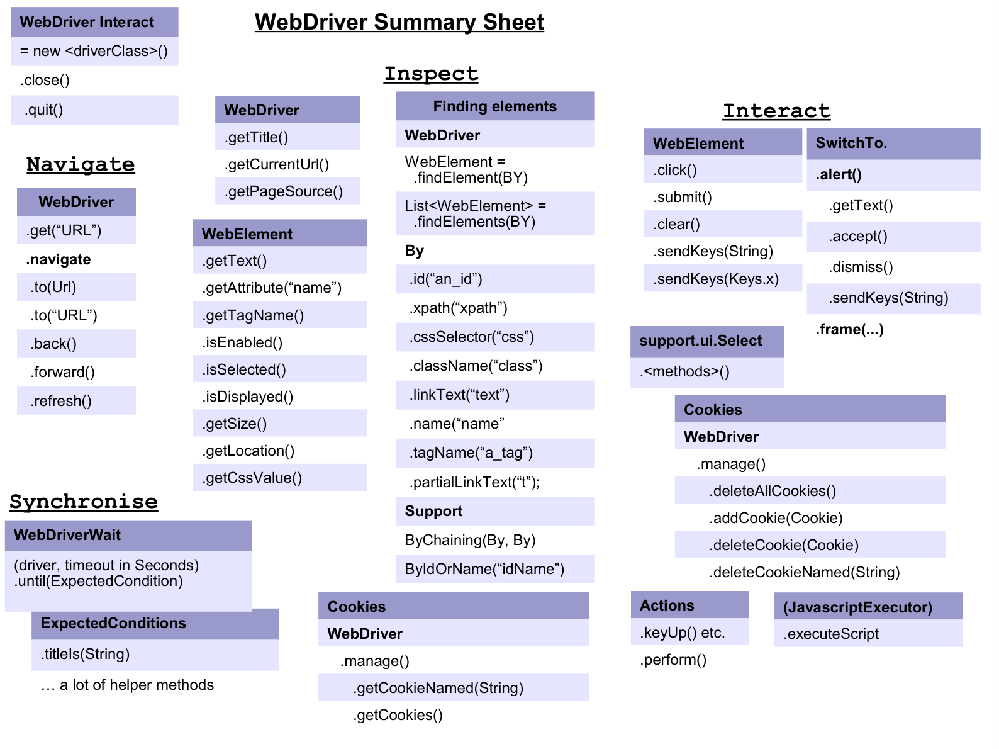

| WebElement |
| --- |
| .getText() |
| .getAttribute(“name”) |
| .getTagName() |
| .isEnabled() |
| .isSelected() |
| .isDisplayed() |
| .getSize() |
| .getLocation() |
| .getCssValue() |

| Finding elements |
| --- |
| WebDriver |
| WebElement =<br>.findElement(BY) |
| List&lt;WebElement&gt; =<br>.findElements(BY) |
| By |
| .id(“an\_id”) |
| .xpath(“xpath”) |
| .cssSelector(“css”) |
| .className(“class”) |
| .linkText(“text”) |
| .name(“name” |
| .tagName(“a\_tag”) |
| .partialLinkText(“t”); |
| Support |
| ByChaining(By, By) |
| ByIdOrName(“idName”) |

Inspect

Navigate

| WebDriver |
| --- |
| .get(“URL”) |
| .navigate |
| .to(Url) |
| .to(“URL”) |
| .back() |
| .forward() |
| .refresh() |

| WebDriver |
| --- |
| .getTitle() |
| .getCurrentUrl() |
| .getPageSource() |

| WebDriver Interact |
| --- |
| = new &lt;driverClass&gt;() |
| .close() |
| .quit() |

Interact

| WebElement |
| --- |
| .click() |
| .submit() |
| .clear() |
| .sendKeys(String) |
| .sendKeys(Keys.x) |

| support.ui.Select |
| --- |
| .&lt;methods&gt;() |

| SwitchTo. |
| --- |
| .alert() |
| .getText() |
| .accept() |
| .dismiss() |
| .sendKeys(String) |
| .frame(...) |

| ExpectedConditions |
| --- |
| .titleIs(String) |
| … a lot of helper methods |

| WebDriverWait |
| --- |
| (driver, timeout in Seconds)<br>.until(ExpectedCondition) |

| Cookies |
| --- |
| WebDriver |
| .manage() |
| .deleteAllCookies() |
| .addCookie(Cookie) |
| .deleteCookie(Cookie) |
| .deleteCookieNamed(String) |

Synchronise

| Cookies |
| --- |
| WebDriver |
| .manage() |
| .getCookieNamed(String) |
| .getCookies() |

| Actions |
| --- |
| .keyUp() etc. |
| .perform() |

| (JavascriptExecutor) |
| --- |
| .executeScript |

---

<!-- Slide 69 -->

# End Points

- You will encounter problems we haven't covered here

- You will need to download and read the Selenium 2.0 source code as you test


---

<!-- Slide 70 -->

# Basic Practice Pages

- <http://compendiumdev.co.uk/selenium/>

    - alert.html
    - basic\_ajax.html
    - basic\_web\_page.html
    - basic\_html\_form.html
    - ajaxselect.php

- Source available at <https://bitbucket.org/ajrichardson/seleniumtestpages>

    - calculate.php
    - find\_by\_playground.php
    - refresh.php
    - search.php

---

<!-- Slide 71 -->

# Advanced Practice Pages

- <http://compendiumdev.co.uk/selenium/>

    - Showcase/Showcase.html

- Source available at <https://bitbucket.org/ajrichardson/simplegwtshowcaseclone>

---

<!-- Slide 72 -->

# WebDriver Tutorial Reference Slides

WebDriver Tutorial Reference Slides

For More like this visit:

- [Http://seleniumsimplified.com](http://seleniumsimplified.com/)
- Online Course:

The reference slides are excerpts from the above online course
