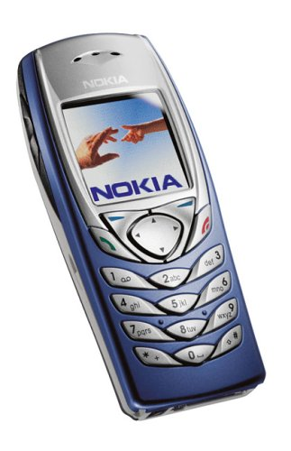
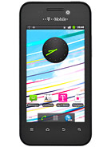
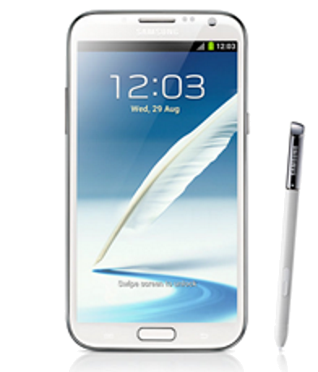
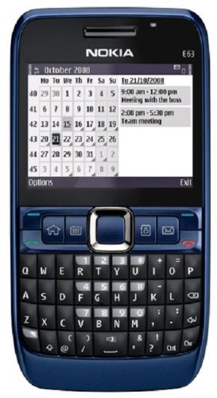
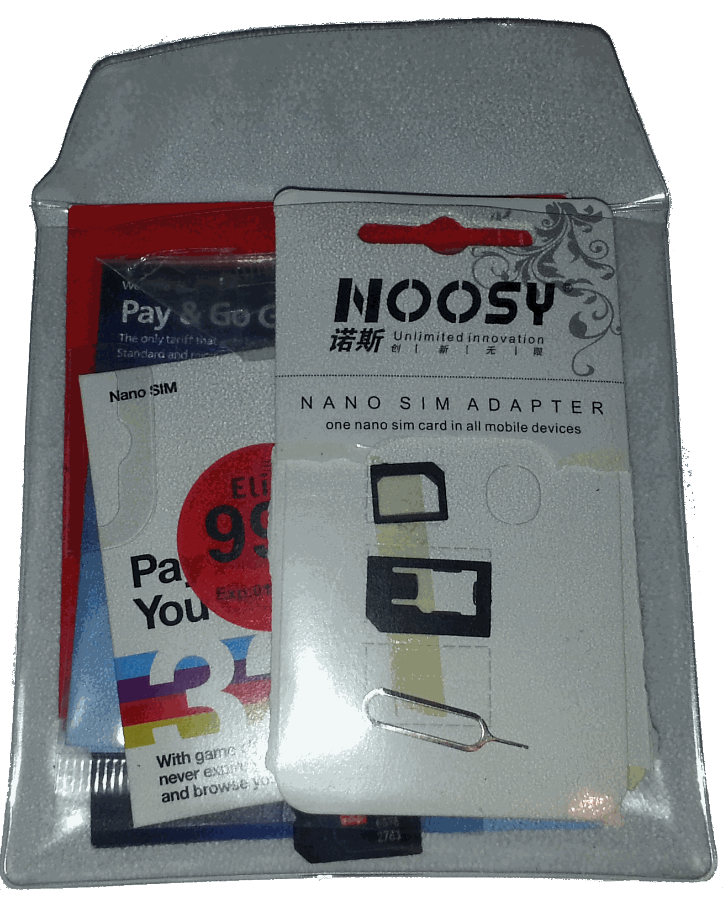
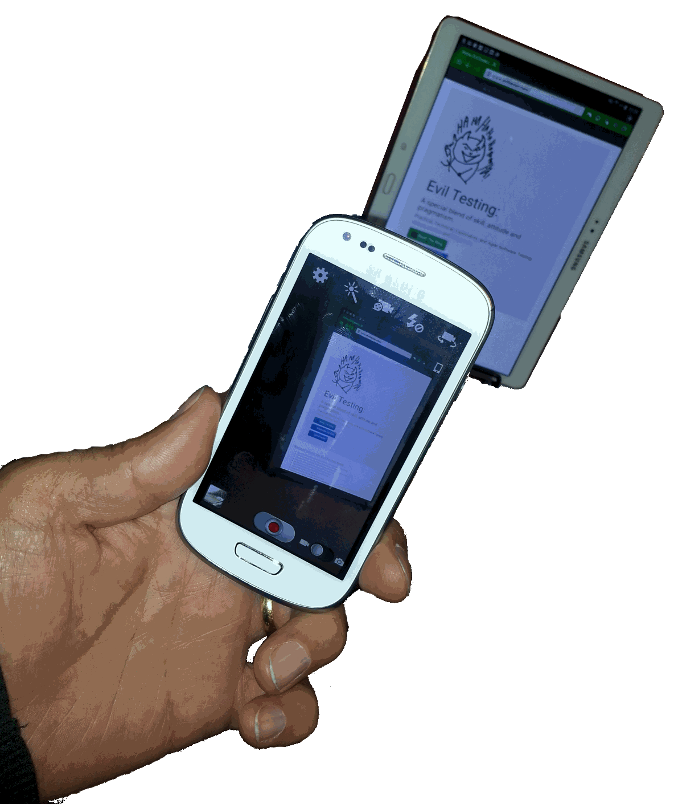

<!-- footer: @EvilTester -->

<!-- Slide 1 -->

# Technical Mobile Testing

Risk, Issues and Experiences

Alan Richardson - @eviltester

EvilTester.com

---

<!-- Slide 2 -->

# What we learned when we tested mobile

- Decisions we made
- Pain we went through
- What we did about it

---

<!-- Slide 3 -->

# What I like about testing mobile

@eviltester

---

<!-- Slide 4 -->

# What is hard about mobile testing

- Ergonomics
- Observing
- Reporting
- Manipulation

---

<!-- Slide 5 -->

# Phone Experience

@eviltester

---

<!-- Slide 6 -->

# Find workarounds

@eviltester

---

<!-- Slide 7 -->

# Pay attention to pain to improve process

- Gain some experience
- Pay attention to pain
- Resolve pain to improve process
- Status Quo != Dishwasher

---

<!-- Slide 8 -->

# Workarounds add risk

- Adopt workaround, and mitigate the risk
- Communicate the risk
- Accept risks through knowledge not fear (where possible)

@eviltester

---

<!-- Slide 9 -->

# Some risks must be accepted

Everyone should have the opportunity to aspire to Rock Godhood

@eviltester

---

<!-- Slide 10 -->

# Mobile Technical and Risk Based Testing

- Our test approaches are often built around fear mitigation

    - Lots and lots of devices
    - Because we don’t build for device compatibility
    - We caveat for a subset of devices

---

<!-- Slide 11 -->

# Native and Web

- Which is worse for compatibility?

---

<!-- Slide 12 -->

# Test Like Normal Users?

- Default Browser? Dolphin, Chrome
- LastPass Password Manager
- Auto-Completion Off
- Alternative Keyboards – hacker’s Keyboard

---

<!-- Slide 13 -->

# Automating?

- Automating mobile is hard
- Strategic choice

---

<!-- Slide 14 -->

# Automating Tactically

- Screenshots for different screen sizes
- Server based responses from mobile device headers
- Not automated on device
- Target Technical Risk Tactically

---

<!-- Slide 15 -->

# The challenge of observability

- I hate testing blind
- Web Testing more observable?
- Proxies and Sniffers

---

<!-- Slide 16 -->

# Proxy Tools found Preload caching issue

- JavaScript library for pre-load caching
- Observing traffic through proxy saw multiple loading

---

<!-- Slide 17 -->

# Wifi Hoops and Roundabouts

- Environmental Security
- Testing on wi-fi
- Laptop Hotspots
- Wireshark for native via wi-fi hotspot

---

<!-- Slide 18 -->

# Proxy Benefits

- Isolate device from server
- Feed in new JS and CSS prior to release
- Trigger error situations on device without messing with server
- Multiple scenarios configured by data fed to device by proxy

---

<!-- Slide 19 -->

# Ergonomics

paulbishopbooks.com/2013_01_27_archive.html

My hands have not evolved to use a mobile phone

---

<!-- Slide 20 -->

# Cheap Ergonomic Solutions

- Tablet stands
- Stylus
- Keyboards
- Risk?

    - Fear mitigation, use phone too
    - Even though this is built in OS functionality

---

<!-- Slide 21 -->

# Phones make themselves hard to test

- Sim card needed to connect to wi-fi
- Enter the ‘porta £1 sim card collection’ ™

---

<!-- Slide 22 -->

# Reporting

- Information is trapped on the mobile device
- Get info off mobile and on to desktop

---

<!-- Slide 23 -->

# Olden days inefficiency

Use phone to take photo of screenshot of other phone for uploading to desktop for bug reporting

---

<!-- Slide 24 -->

# Screenshots from phone to desktop

- AirPlay
- VNC
- Evernote
- Dropbox
- Email
- Each tool adds risk?

---

<!-- Slide 25 -->

# Emulators and Simulators

- When to use Emulators?
- Risk of Browser Dev Tools for mobile web?

---

<!-- Slide 26 -->

# Non-Technical Risks

- Phones go walking
- Start with secure library system
- End up with cardboard box filled with devices

---

<!-- Slide 27 -->

# Lessons Learned

- Don’t bring in your own kit
- Never lend your kit
- Buy 2nd hand/refurbished kit

---

<!-- Slide 28 -->

# The right kit is important

- Do users charge their phones when using them?
- Random chars on old android

---

<!-- Slide 29 -->

# List of how to test on each device

- Each device is different
- List the ‘shortcuts’ and lessons learned

    - How to take a screenshot
    - What tools to use

---

<!-- Slide 30 -->

# Future is getting better

- AirPlay
- Chromecast
- Miracast
- Remote debug
- Bigger phones

---

<!-- Slide 31 -->

# Risk Management

- Identify
- Mitigate
- Accept
- Communicate

---

<!-- Slide 32 -->

# Final Notes

- Testing on device is a risk
- Identify Technical Risk

    - Target to reduce platform testing scope

- If we were really serious…

---

<!-- Slide 33 -->

# Alan Richardson

Alan Richardson

@EvilTester

www.JavaForTesters.com

www.SeleniumSimplified.com

www.EvilTester.com

www.CompendiumDev.co.uk

