# Mobile Deep Dive

## Prelude

This is a talk about fear and pain.

Much of our scope of testing is driven by fear. We fear that the app won't work on all devices so we test on lots of devices, but we never address the reasons why it might not work on other devices. And those reasons are technical, compatible. I hope that by increasing our technical knowledge we can target risk more effectively.

And pain. I want us to focus on every point in the process where we feel pain, and do something about it. Using the phone for long periods of time - do something about it. It is painful to get screenshots off the device and into our defect tracker - do something about it.

Take responsibility for it.

And be aware, that every workaround we add, introduces a risk into our process that we have to manage. I give more examples of this in the talk and describe steps I have taken.

I hope this talk helps you start doing things differently when you test on mobile devices. 

## Introduction

\

Hello, my name is Alan Richardson. I'm a test consultant. You can find me at eviltester.com and on Twitter, my handle is @eviltester. This is a talk called Technical Mobile Testing. Risks and issues and experiences of mobile testing. It's really the stories of what we learned when we were testing on mobile devices.

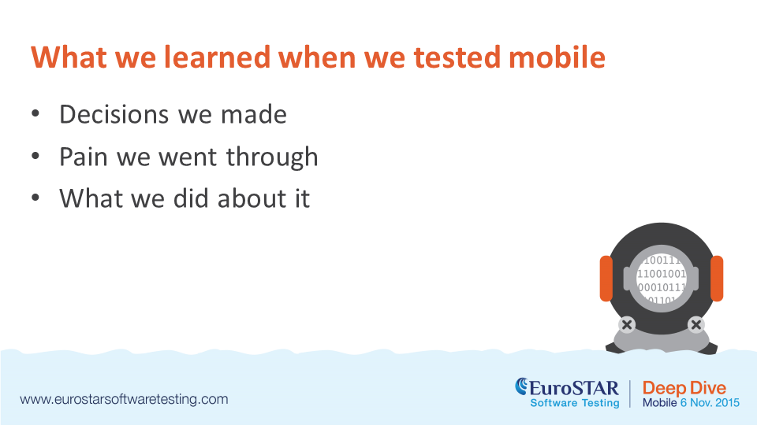\

In fact. It's not necessarily even what we learned, it's the decisions that we made, and how we justified them.

And the pain we went through.

And what we did about it. How we tried to stop that pain happening. 

I'm not really a mobile phone fan, I don't really like testing mobile phones but it's something we have to do and something we have to improve. 

If you want to improve something, you ask the people that don't like doing it because they'll have tips and tricks and workarounds and all that kind of nonsense. 

That's the aim for this talk.

## The Joys Of Mobile Testing

\

What do I like about mobile testing?

Nothing.

This is an empty slide for a reason.

I like very little about mobile testing.

And that's a risk. People tend to be good at what they like doing. I dislike testing on mobile, so I guess there is a risk that I might do it badly. In fact the risk is that I find ways to do it differently, because I look at systems in a technical way.
 But we mitigate that risk by working as a team and making joint decisions on our testing strategy.

I think mobile testing is horrible.

With embedded testing - we've taken a big app, and shrunk it down on to a tiny device. But at least you don't have to do all the manipulation on that device, you have interfaces and APIs to work through.

Not so with mobile. 

Here you go we've taken a big app and shrunk it down on to a tiny screened device. Oh yeah, and see that screen, that's your keyboard as well, oh yeah, and its your mouse. In fact, it's your everything. Try waving it about. Yeah look it does stuff. Great. There's no risk there.

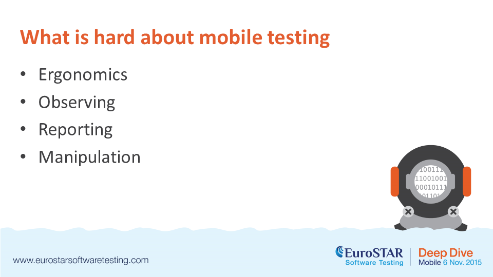\

And, oh yeah, you see those 9 keys. That's your QWERTY keyboard. Go test it.

I think the world is finally getting its own back on testers for all those years of raising bugs.

We're throwing out the rules on Ergonomics in the workplace. All those ergonomic chairs and keyboards, and monitors in the correct position.

And they give us mobile phones. That'll help. How do I adjust my seat to match my phone at eye level.

Mobile makes testing harder.

When I'm testing, I like to be able to model what I'm doing.  I like to think about what I'm doing, clearly I can do that when I'm testing on mobile. I can make notes, I can decide what I'm doing. 

I like to observe what I'm doing. Mobile phones make that really hard. It's really hard to observe what's going on on the phone. 

Phones are so locked down, you're trying to get something that runs and monitors the memory on the phone, or the network traffic, and you have to go through root access and all this horrible stuff. Observing the inner workings and communications on mobile phones is hard. But my technical testing is limited to the extent that I can observe what is going on.

Trying to get the phone to report on to the desktop and you have to go through hoops because phones are fundamentally insecure and the manufacturers want to lock them down, it's horrible. But we don't have bug trackers on the phone, and I cannot just press the 'report bug' button on the phone. I have to figure out how to take information from this tiny torture device and get it on my lovely ergonomic workstation.

But I have to test, and so I have to manipulate the software that that I'm working on. It's really hard for me to manipulate things on tiny, tiny little screens, it's hard. But also I like to manipulate the application under the surface to force it into situations it wouldn't normally find itself. That might mean adding data to the database, changing files it relies on, filling up the disk, simulating server errors. My technical testing is limited to the level that I can manipulate.

Mobile phones make all of that really hard. And the fact that I am testing on mobile is a risk to my technical testing process and the ergonomics are a risk to my health.

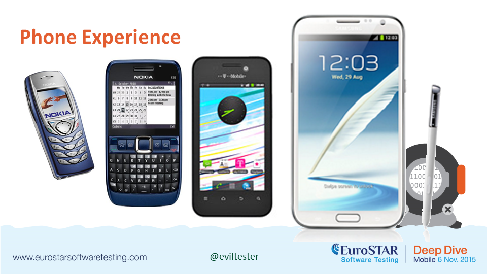\

I've never been a mobile phone fan so given that, what I'm saying probably isn't really a shock. However, what this slide does, this phone experience slide, what this shows is that I predict the future.

When we started out, I bought the smallest phones that I could afford at the time because I didn't like phones, I thought they were too big and too bulky. I got tiny little phones. I barely used it for phone calls so I was using it to text and be available to other people. And as an emergency .mp3 player via addons that I kept losing.

But trying to text on tiny little keypads, I hated that. I was sitting there thinking what I really want is a phone with a decent size screen with a keypad. That will make me happy.

Nokia was listening to what I was saying. They built this phone that had a decent size keypad, I could surf the internet on it in a rudimentary basis and I could type stuff in and that was quite useful. Then I'm thinking, look at the size of this phone. Half of it is taken up with a keyboard, this is stupid. What I really want is just a screen that I can type on, why don't we have that?

Then Steve Jobs is listening to that going, Alan I can hear you, I know your pain, I will invent this and take credit for it, thank you, here's the iPhone. I didn't want an iPhone, I couldn't afford an iPhone. I got a T-Mobile Vivacity which is a tiny little smart phone, a kind of iPhone rip off, and that was good enough to start with but then I'm thinking this is just not big enough. I'm trying to pick up emails and answer them, and this is ridiculous. Where is the stylus? I keep trying to buy a decent stylus and they're all garbage. I did finally find a good one with a solid nib on the end, but I lost it. Mobile addons are things that you lose. That's a risk right there.

Then I get this Samsung Note 2, massive phone. This is before massive phones were popular and you felt out of place. Again this is stupid. But it has a stylus that you type and draw with and that was really useful.

The only thing is with the Note. I have not evolved to the point where this is a good phone for me. I have not evolved to the point where I can sit down without bending and moving my legs. With this phone in my pocket, I cannot sit down effectively.

Phones are getting so big now, I'll tell you what the future is, the future is we need adjustable pockets in our trousers. We need Velcro inside so that we can adjust the length of our inside trouser pockets and put our phones in. It's going to get to the point where everyone is walking with a limp because their phones are so big they go down past the knee. When phones get that big, they're going to have to be bendable so that when we do take them out, we can bend them round our head so parts of it are microphone and parts of it are ear speakers.

Phones are getting bigger and it's getting more stupid. That is the future of mobile phones.

The thing is. That is what puts me in the position where I can start looking at the testing. I change the way I work because I'm not comfortable with the status quo. And that is both good, and a risk.

## How to improve mobile testing?

\

If you ask anyone who is comfortable with the Status Quo, you'll never invent anything. If you want to invent a dishwasher, if you want to learn how to improve dish washing, you would not be asking the people that like dish washing.

The people that like dish washing every day, they're quite happy, and they like washing dishes. If you ask them how to improve their dish washing process, what they're going to do is say "well maybe we could make the bubbles smell nicer because we're happy washing dishes every day".

"Maybe we could make the washing liquid yellow or blue or green then that'll be a nice change and it will feel like a fresh summer day because we're washing dishes every day." 

What else could we do? They Don't know.

They're quite happy washing dishes. They'd be happy washing dishes in a tin bucket with a hole in it that leaked water on their shoes because they just love washing dishes.

If you want to improve washing dishes. The people who you want to speak to are the people who hate washing dishes. The people who fundamentally think this is horrible.

"I have to wash dishes every day and I hate this!"

Dear people who hate washing dishes, how could we improve it?

"Dishes. Box. Wash!"

That's it, dishwasher invented. We've created something new: dishes, and a box, and a wash.

And how can we make it better? 

"Wash faster, wash more quietly, wash better!".

That's it, that's the dishwasher invented. You ask the people with experience of the pain, you don't ask people with no experience.

Try and get kids washing dishes, it doesn't happen. If you ask kids, how can we improve the dish washing process? They may came up with a magic box that we can put the dishes in and maybe it will make dinosaur noises and maybe it will blow lots of bubbles when you open the door and maybe they'll smell nice and maybe be different colours and that will be it.

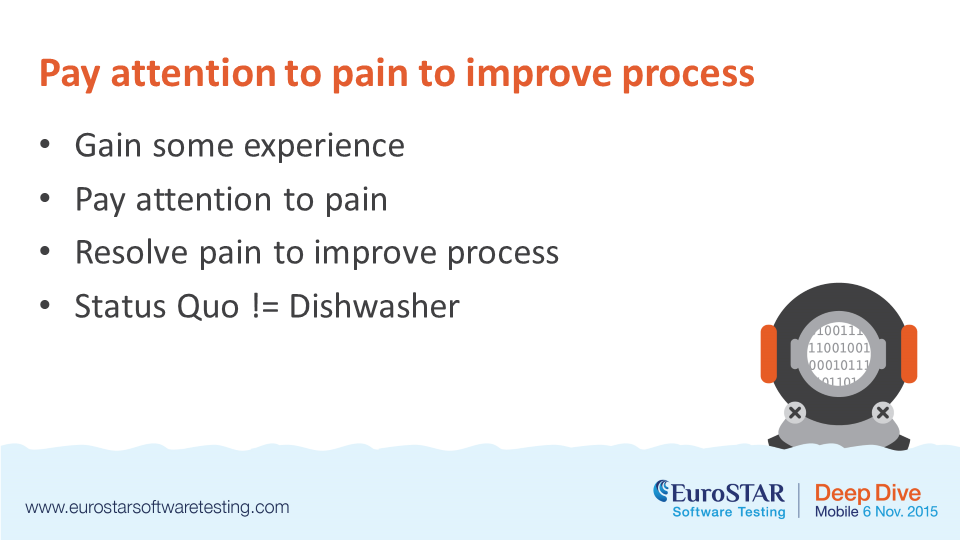\

What we want to do is get some experience, this is how you improve something, you get some experience, you experience the pain, you dislike it, you remove the pain, you move on. If you just keep enjoying the status quo, you'll never invent the dish washer.

## Mobile workarounds and risks

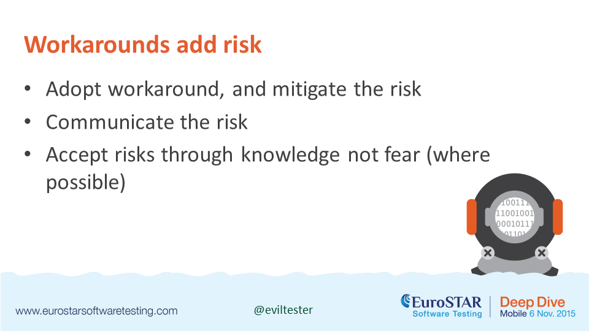\

The problem is, every work around that we add, every tool that we add; adds some kind of risk.

And we have to evaluate that. Communicate it so people understand, and so we understand.

Each shortcut adds risk. But if we don't add risk then we have a slow inefficient and painful process.

The thing is on mobile we accept a lot of risk without really understanding it. And I don't like that. I like to understand the technical nature of what I test and how I test it. That gives me more information I can use to evaluate risk.

\

Now some risks must be accepted.

I play the guitar so I've got nails and my nails get in the way when I'm trying to type on a mobile phone. 

Some risks we have to accept. I've got nails, I play guitar. 

I still have a dream of rock god status so I'm never going to cut my nails to help me test mobile. Because some ambitions will never, ever be curtailed. 

It doesn't matter who you are, every one should have the opportunity to aspire to rock Godness so I should not have to cut my nails in order to test mobile phones. 

It's very important that we accept risk and we mitigate it and we communicate it to people. I'm in a project, they say "Alan you have to cut your nail to use the phone". I say "no, because I'm going to be rock god, we will accept this risk and I will find workarounds for this".

Besides on my other hand the tops of my fingers are hard from the strings and phones don't like that either.

I'm not a natural mobile tester. So I test mobiles the technical way.

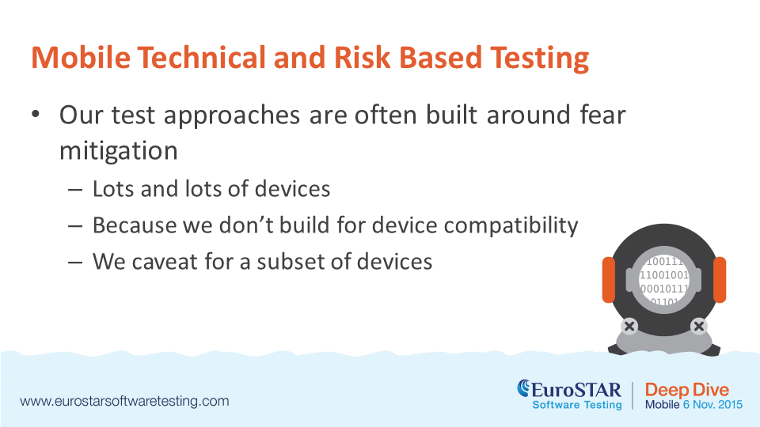\

One example of a fear based mitigation.

We test on a lot of devices. Why do we do that? We do that to mitigate the risk that our application might not work on some of them. 

But. Why might it not work? 

Because we built it without understanding the risks that devices have. 

We built it using libraries that are not compatible. We built it using up-to-date libraries, using Java 8 libraries on a tiny little old android phone where it doesn't support the Java version. 

We've done a whole bunch of things where the phone just does not accept it on older devices. 

We're using JavaScript libraries for caching the HTML and the images on the assumption that will work properly and it may not work properly on the mobile phone. And we develop in a way that makes it harder for ourselves to find that out.

The JavaScript interpreter on the old mobile device is really really slow, but we use more and ever more JavaScript. In libraries that we don't understand and haven't ever profiled.

We accept this technical development risk pretty much as a given. And we use 'testing' as a mitigation strategy.

We also try and compensate for that risk by adding lots and lots of mobile phones. There are so many mobile phones that we cannot do that. What do we do? We create a small subset of mobile phones and say that our application is supported on this set.

Whereas if we actually built it so that it could run on as many things as possible, we wouldn't really have that issue. But we don't, so we accept risk in our development process as a given thing.

\

This technical risk happens on native development and it happens on web development and hybrid apps. 

I think web development is probably worse to be honest because we'll keep wanting it to look nicer. 

We'll keep wanting different CSS styles that don't work on older mobile devices, we'll keep wanting to use newer up to date JavaScript libraries that don't work on older mobile devices.

And we'll use 'magic' technology that we don't understand and rely on that as our compatibility layer. New cross compilers and preprocessors and new libraries.

But we'll test on the old phones just in case. And that adds the risk that we don't have enough time to test effectively.

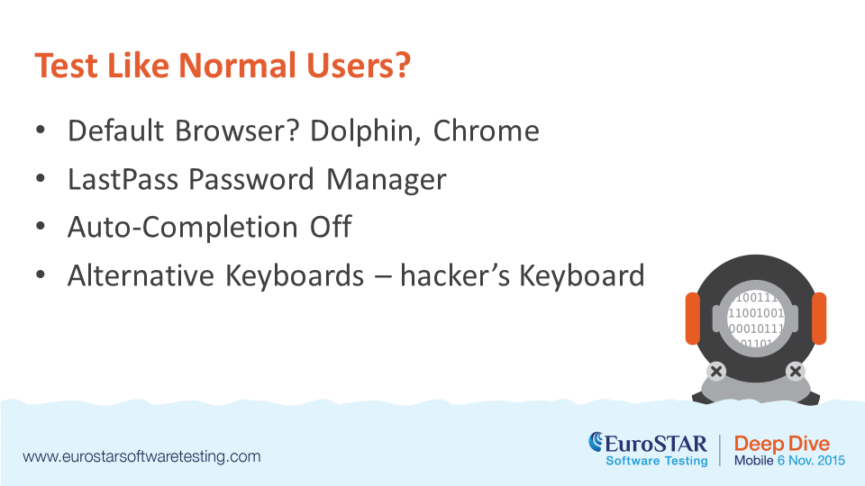\

We mandate that when we test on mobile devices, we use the built in browsers. On the assumption that most people use them.

I'm not a normal user. That's a risk to most companies and applications.

I never use the in built browsers on my mobile devices, I always use Dolphin or Chrome.

I use Dolphin because it's got Last Pass plug in because I hate remembering passwords and I hate typing in passwords on these tiny little screens. I also use Last Pass to remember all the passwords for all the users and environments that we have to test against.

And because the keyboard on these tiny little screens are horrible, I always add an extra keyboard. So I use the hackers keyboard on android so I've got a left and right button. That's quite useful for me when I'm typing in fields and make a mistake. 

I have to switch off all auto-completion on every phone because it doesn't understand a thing that I'm typing. I mitigate these risks as a user. 

As testers, we mandate that these usability horrors are accepted into our process and accept the risk that our users never customize their phones. 

We add risk into our test process. Auto-completion typing error risk. The risk that it takes me 10 times as long to type in passwords, and then have to re-do it all again. Massive risk of waste.

We as testers have to test on raw devices. Devices out of the box with nothing added into them because that will add risk and we are supposed to use the default browsers.

But we don't always recognise that the default, adds risk into our test process as well.

## A few notes on Automating Mobile

\

One of the natural things to try and do with mobile development is automate.

Automating is hard. Automating is harder on mobile devices, and its too much to cover in depth here so I'm not really going to cover automating in this topic.

Except. [Ha ha]

Except to mention that it should be a strategic choice. Not a default. A strategic choice. You have to invest in automating and understand the risks associated with that process and the time it is going to take.

And make sure that the mobile apps that you automate have the long term viability to justify the hardships ahead.

So I'll leave strategic automating for other talks to cover.

But you can automate tactically.

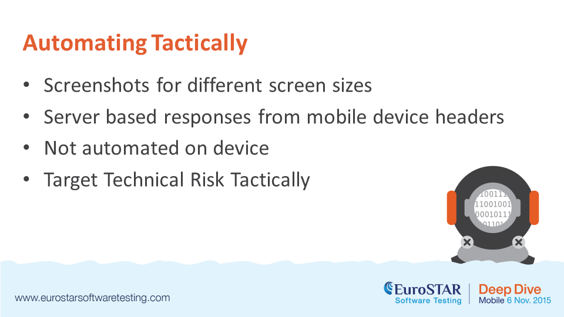\

We did use mobile and we did automate in our projects but not to automate the application. We automated to give us more insight, into different combinations of browsers and devices, faster.

We were testing a mobile app on android and iOS devices. With this app, one of the things I'm not sure about is how it's going to respond to different screen sizes, particularly screen sizes for devices that we don't have.

See, what we've done is on the server side we've added code to read the headers sent by the device and serve up different forms of CSS and HTML based on the screen size that we think is associated with the headers.

I went on one of the public websites that lists user agent strings. I think it was 

* [useragentstring.com](http://www.useragentstring.com)

And I pulled down all the headers for a whole bunch of different devices and it told me what mobile devices to categorize the header with and I used web driver with Phantom JS to send through requests for the different URLs with all the different headers that we could have and take screen shots of it and see the screen sizes that were coming back to make sure that it was okay. 

Then we found a whole bunch of missing rules in our server identification of mobile devices. Because there were more headers for IOS than we thought and so we weren't always sending back the mobile website for these devices.

When I looked at the website with different screen sizes, it was clearly obvious that there were certain things that our CSS wasn't handling. We were able to fix that, and we were able to do that without any devices. 

We automated, not to automate the app but to target a risk, to target a technical risk that we'd identified in the system that was related to mobile that we would never be able to test on the mobile devices with the scope of physical devices that we had.

The point here is when you identify risks, you can approach the testing of that risk differently.

The good thing for me was, I didn't have to use the mobile phone to do any of that. I didn't have to touch the mobile phone. I could do all that work from the desktop. 

When we did find a problem, then we could replicate on the mobile device or rather I could give it to someone else to replicate on the mobile device.

We did not have to find the problem on the mobile device. We didn't have to go through the pain of doing six weeks testing and then finding the problem on our fourth mobile device and then having to wind back to the start again.

Those were some of the risk-based and technical thought processes that we use when we were doing this testing. That's pretty much the only automating that I've done on mobile that I'm going to talk about in this talk.

The point is to recognise how you can automate to target risk from a technical perspective.

## Technical Observation of Mobile

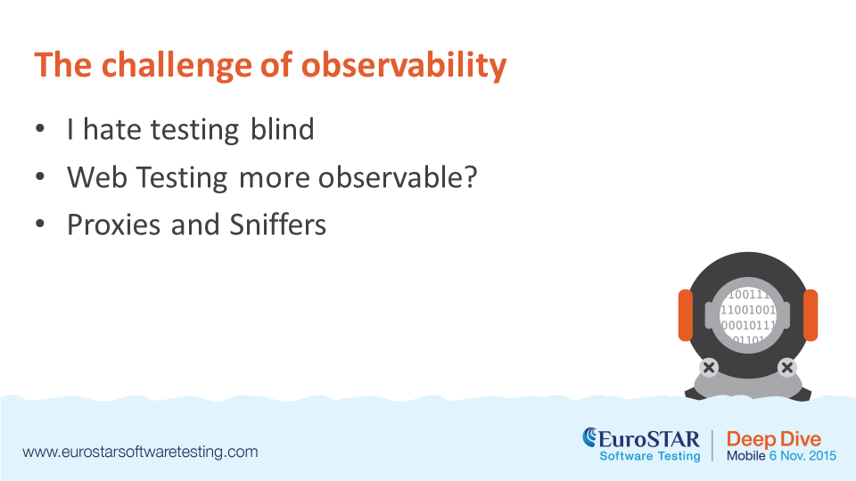\

One of the things that is a challenge for the mobile testing is observing what is going on. 

It's one of the things that makes me nervous. 

I hate testing blind. I hate not seeing into the application, not seeing what it's doing. 

It's great when I'm testing websites. I love testing websites, the amount of visibility I have into them is great.

I use HTTP debug proxy tools like Fiddler on Windows, or Charles on a Mac. Or BurpSuite and OWasp ZAP on either platform.

These tools let me see the HTTP traffic sent to and from devices through the proxy. I can pause messages, amend them, and test stuff on the server. I can change the messages and simulate server side errors and test validation on the client.

I can observe and manipulate the messages and test at a more technical level than the GUI alone allows me to do.

Sometimes I have to observe at a lower level and use a sniffer like WireShark. To piece together the HTTP traffic from the TCP/IP packets. I tend to only do that when I'm testing a mobile app that refuses to send traffic through the proxy.

Even on mobile, if I'm testing on a mobile device, I can run the software through a proxy and I can see all the traffic that it's issuing. It lets me observe the traffic. That's great, I can see into there, and that gives me a whole bunch of new options when I'm testing.

But mobile does not make observing easy.

And we have to observe.

If we don't observe then we are limited to the GUI as a way of spotting issues. How quaint is that. Most apps these days don't even have proper progress bars. They have spinning animated gifs. The software might not actually be doing anything, just putting up an animated gif for the operating system to render.

If I can't observe, I can't spot problems fast enough and at a lower level. And I can't identify technical risks that we can target with later testing.

\

We were testing an application, it was a mobile game. And it was being converted from Flash over to JavaScript and HTML5. By the original developer. And they were learning JavaScript and HTML5 at the same time. 

So no risk there.

But we mitigated that risk because we had picked 'standard' JavaScript libraries for mobile and no-one knew what risk they added. 'standard' JavaScript libraries often means 'magic'.

And in the app, because I'm feeding all the traffic through a proxy server on my desktop. I can see that the JavaScript library that we're using for caching simply wasn't working on some phones. It was making multiple requests to the server for the JavaScript that was supposed to be cached. 

If we hadn't used the caching library, it would make the request once then the browser on the device would cache it but we were using preloading and trying to cache it into the local storage and there wasn't any local storage on the device for that browser type and it didn't like those commands. It just kept going because we would send it with no cache headers because we pre-cached it.

We essentially used technology that made the app riskier and harder to test.

We would never have seen those problems if we had not increased the technical tools and skills of our testers as we were testing that allowed us to observe the application at a more technical level.

## Environmental factors can add risk

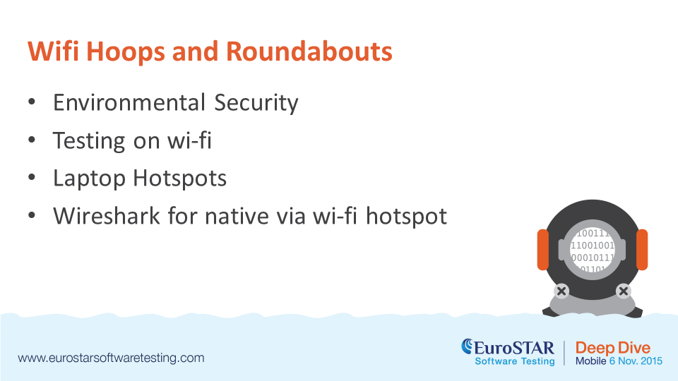\

And we had to go through hoops to test this app.

The way that the environment had been set up we couldn't connect our devices to the main wireless network.

So we had to go through the guest network. All our computers had to connect via the wired network and it's a different network. So it was impossible to setup the phones to proxy through our desktops.

We had to bring in our personal laptops.

We had to set up WI-FI hot spots on the personal laptops to connect to the guest network and then connect our mobile devices through our laptops hot spot so we could route the traffic through a proxy on our computers so that we could see the http traffic sent to and from the device. 

Often environments are too locked down. And that adds risk to the test process, so we have to find workarounds.

The useful thing about that, we're able to do the same approach when we were testing native apps. Because it was harder to configure the native apps to work through proxies on some of the mobile devices that we were using, the traffic just wouldn't route through the proxy. That was a real pain.

At some point, you just give up. 

But if we're not putting these apps through the proxy, then we can use Wireshark. If we are going through wireless hot spot, then the device is on our network and we can monitor the traffic and we've limited it down to the devices so we can see the HTTP traffic that the native apps are using. But only on our little hot spots that we've got on WI-FI and Macs work kind of better for that than the PCs because Wireshark just worked a lot easier.

Of course, these workarounds are often viewed as a security risk to the business. So have to go through the additional overhead of convincing people to let us do our job properly. And if I've learned anything - it is to do that face to face. If you do this via email it takes forever.

## General Proxy Benefits

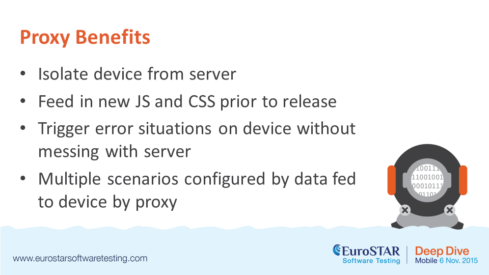\

The good thing about using proxies is that you can then start to test in a more technical way.

When the application is released, or when the developer makes a fix to the JavaScript or the CSS to try and fix a problem on a specific device; you don't have to wait until the mobile software is released on your environment and then install the APK or wait until it is deployed on the server.

You can just take the CSS and JavaScript you're going to deploy, feed it in via the proxy when the device makes a request for that file, and you can be testing against the newer software before it's released. Then you can make faster decisions on whether the fix is going to work or not.

You can have the proxy respond with server errors and malformed data.

You can limit the network traffic to simulate slow network connections.

For me a proxy is essential when observing and manipulating HTTP based applications. Even if they appear to add extra risk into the environment or into the testing.

## Ergonomic Risks

\

My hands have not evolved to use a mobile phone.

Some of the testers I work with are quite happy using phones. I think they have different hands than I do. I think they have smaller hands that work more easily with mobile phones. 

If I'm holding a mobile phone for too long in my hand, my hand goes into a claw. You know this isn't a full grip, it's not relaxed, there's some tension there. My hand after a period of time says: "I really need to close, or I really need to be open now".

This is not a natural position for me to hold things in for too long. You end up driving home, because I was driving home from this company at the time, and your hand is gripping the steering wheel too tightly because it's finally going:

"I am finally able to close my hands and grip, and you can't take your hands off the steering wheel."

When the ergonomics are this horrible, it impacts your personal life.

For some I think there are people who have evolved to use mobile phones and I am not one of them. Those are the people that you let do the manual stuff. 

The rest of us use keyboards. You use stands to hold this thing so that your hands don't turn into a steel claw.

I have yet to find a decent stylus, I can't do it. It also seems like some of the phones themselves are just almost designed not to be testable. They're designed to be horrible to use and test.

So one of the issues I faced when testing is the ergonomics of it all.

I remember when we started testing and I emailed Julian and said:

"Julian the ergonomics of testing mobiles is horrible. "What can we do? 

He went, "I don't know". I think it was a longer email than that but it was basically the gist of it.

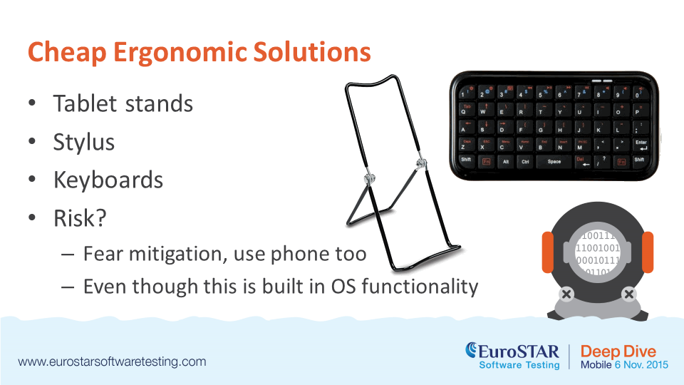\

We went down to the local cheapie shop around the corner and got those rubbishy little coat hanger things, those little coat hanger stands kind of bent wire and used those as accessible stands for mobile.

I tried to find cheap styluses to let us use the phone, but the best thing I found with this was trying to hook up keyboards onto the mobile phone.

That makes a massive difference to the testing.

The problem is it's debatable how much risk that adds. Because keyboards are supposed to be used with these devices, these devices are allowed to be used with keyboards.

And in theory, you're still using the operating system to feed the data in, it's still the same key presses so you really shouldn't be adding a lot more additional risk into the application.

But we don't know.

We don't understand the technicalities of adding keyboards onto these devices. We don't know if it's a new set of drivers. We don't know if it's a new set of events. We don't have the ability to observe at that level to figure that out. 

My favorite keyboard is the solar-powered Logitech Bluetooth One. It's kind of got an Apple layout which is fine, I've learned to use that. But it supports three devices so using Bluetooth I can connect to three different devices at the same time, which makes switching between devices when I'm testing a lot easier assuming that your mobile phone supports Bluetooth. 

If it doesn't, you have to use those horrible little adapters to connect another keyboard.

But out of fear, we use tend to use the in built screen based keyboards.

I say "No!. Trust the operating system. Use physical keyboards for the bulk of our testing."

But, out of fear, we still replicate some of the testing by using our fingers on the screen of the phone.

## Phones make themselves hard to test

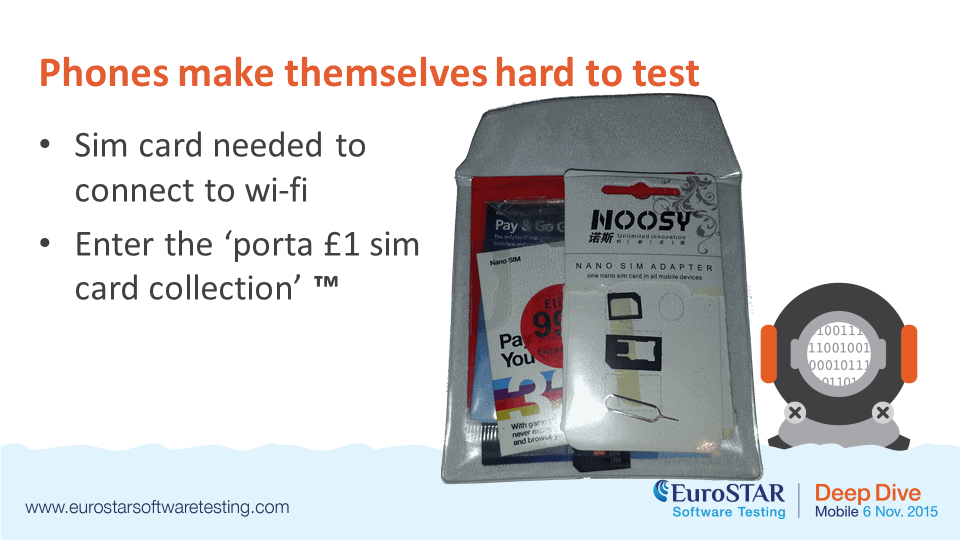\

iPhones annoy me.

We do most of our phones over Wi-Fi. That's a risk, but we accept it. But not the iphone.

iPhones when you switch them on they say, 
"give me a SIM card, I'm not doing anything until you give me a SIM card, I'm not going to move, I need a SIM card, I'm not going to do it."

I just want to set up this phone to connect to the Wi-Fi. 

"I'm not going to do anything unless you give me a SIM card, give me a SIM card."

I ended up buying dummy SIM cards from every mobile phone provider. We'll send you a SIM card for a pound or free SIM cards. You send them, you get them, whatever you get, those little adapters to convert SIM cards and other form of SIM cards. 

You just build up this huge bag of gunk just in order to make the iPhone sail because you don't know what's going to happen the next time they release one.

Most of our testing is done on Wi-Fi and not mobile. 

That is a risk. 

That is a risk that we accept. 

And we have to accept that one because the company isn't going pay for the data providers for the SIM card. 

Companies are cheap when they do mobile development and testing.

Companies seem to think mobile is really cheap so they hire some of the cheapest external vendors to build their mobile games and apps but then it cost a fortune to test because it's been done on the cheap. That's a risk that I haven't figured out how to mitigate yet.

## Reporting to desktop is hard

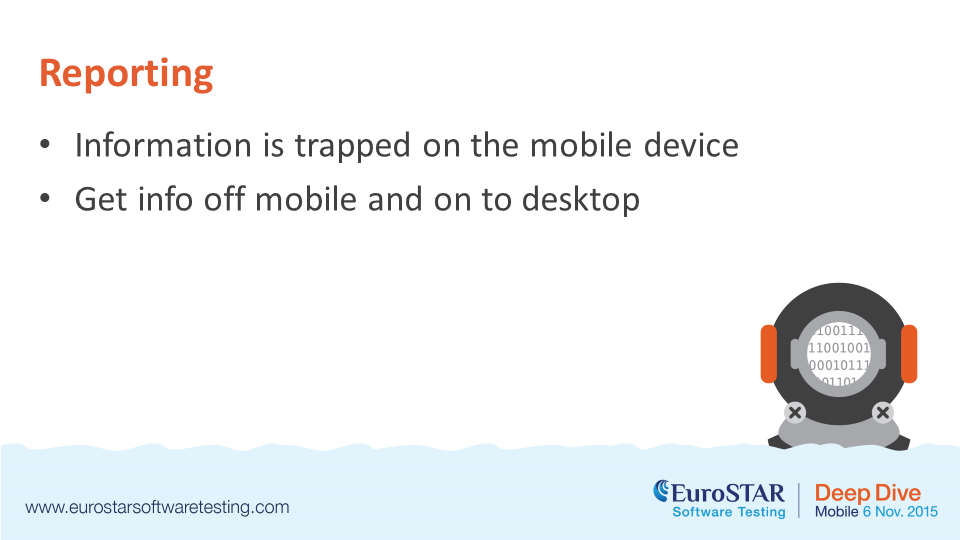\

When I test. I see that information is trapped on the mobile device. And I need to free it to support my reporting.

So I need software that I have to install on the phone itself.

I need to do this because everything else that we do is on the desktop.

All our bug trackers, all our task trackers, all the places that we make notes are over here on our laptops and our desktops but we're testing on the phone.

And there is a risk when I do that.

Perhaps the software interferes with the default behaviour of the phone. We have to take extra time to configure new devices.

But we need to have some way of taking screenshots.

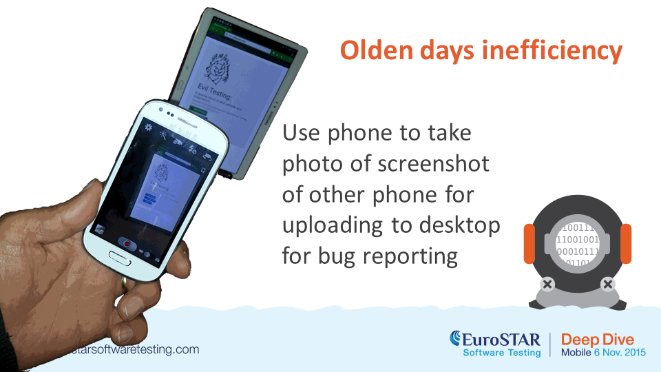\

At one point we had two phones, one phone for doing your testing on, the other phone your camera where you take a shot of the screen which you can then share with the device. 

It's the ultimate de-risk, two phones. 

A digital camera to record this. 

It's a horribly painful thing. I try and have software that will communicate between these two platforms to make it easier but again some of the software needs root access. Some of these need to be installed in different ways.

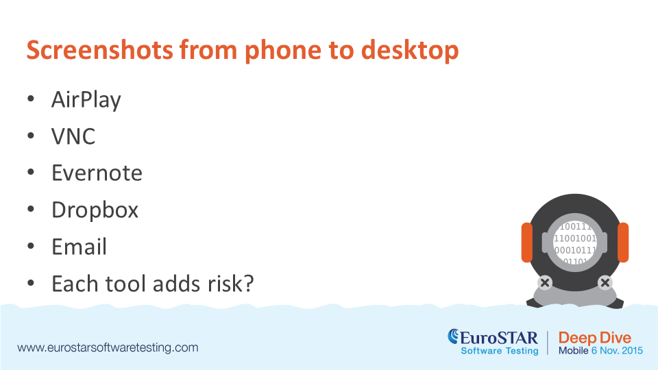\

We need to have some way of getting the screenshots off the phone and onto the device.

That's getting better now. The gallery app data can usually synch automatically onto cloud based systems like Google Drive, or dropbox (Extra app required), or Microsoft livedrive.

The IOS devices will do that external display thing so that they can project their screen into Apple TVs or on your computer and you see the testing you're doing there pretty much in real time and as good enough in real time as for it to count.

You can take screenshots through your normal screen when you do this. You can issue text from your real screen into the device with some of these communication tools. That really helps.

The phones are getting better with this stuff.

But when they didn't we had to use things like VNC.

I still use Evernote on the devices to take a screenshot and share into Evernote and it automatically syncs onto the desktop. I'm trying to find ways of having this phone communicate with the desktop as much as possible. 

You use email, the email is a pain because I have to type in the email address. 

You use Dropbox, saving the Dropbox it syncs across.

Now all these tools are extra things that we're having to add on to the phone. It takes extra time to set the phone up. 

It's not the factory reset condition that we believe want to test against because that's the ultimate risk mitigation.

But real people's phones aren't factory reset. Real people's phones have extra software put in there.

Yes, it's a risk but some risks must be accepted. Otherwise, our test approach is unbelievably inefficient.

## Emulators and Simulators

\

I try not to use the emulators.

One, they're a pain to set up and they can be a bit slow.

However, when you're testing native apps, emulators are enormously useful, particularly if you're going to automate them. Emulators are almost essential then.

I try not to use emulators when I'm doing the interactive testing of applications. Just because they are a pain and by default you're in rooted mode, which you hardly ever are on a native device.

Browser dev tools, I do use. These are essentially simulators. So I test the 'app' through a desktop browser as though it were a mobile device.

The desktop browsers let me change the headers, and change the viewscreen to the same size. And easily go through a proxy server.

My thinking is... "when you're testing a web application, it's just HTML, it's just CSS, it's just JavaScript."

If we could make decisions about the risk of the CSS or JavaScript, and how much we're using and where it is used. Then we could choose how much to test on a device and how much on the simulators.

We can test a lot of functionality through browser dev tools:

* sending the correct headers off to the server to make sure it responds properly,
* checking the layout based on the screen size because the CSS is going to be done that way
* checking the browser and checking the functional paths that don't use lot of JavaScript
* looking at the assets downloaded and make sure they are appropriate sizes for the device

Thing is. If we were really serious about error mitigation on mobile then we would build a self checking app that used all the complicated parts of JavaScript automatically and just run that on the device.

We could run all our JavaScript unit tests on the device and make sure our complicated code works. 

But we tend not to be really serious. So we develop in a way that adds risk into the process.

## Non-Technical Risks

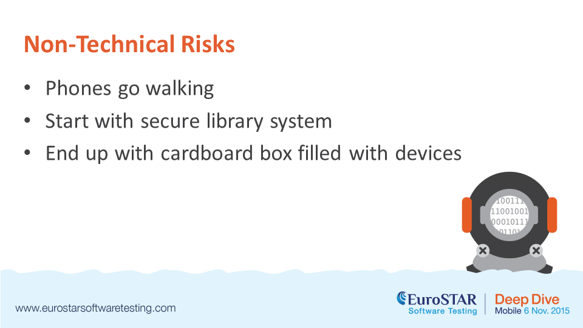\

Some of the risks that we have aren't technical.

As soon as you start doing mobile testing in your organization, one of the biggest risks is that everyone wants your devices.

Everyone wants your mobile phone.

When we were testing a new set of web apps for a company and we were working with the marketing team, they asked "how many devices are you going to need?" We gave them a list of our devices and they  were quite happy because they added a couple of more iPhone 6s or whatever it was so that they could do their testing.

Suddenly those iPhone 6s were never available to test with because they were always out on site or they had left it at home because they were "doing testing at home" and the test phone gradually becomes their main phone. And there are no test phones in the marketing department.

Kit has a tendency to walk when you're doing mobile testing, it's one of the risks.

We started off really well. We started off with our little notebook of device and who has checked the device out and what date and when it came back. 

Eventually that all goes to pot.

You're all testing on multiple things at the same time. You find a problem there and you go, "I'm pretty sure that didn't happen on this device" and you check for it and you go, "I wonder if it happens on this device?" to try and replicate. 

You're checking in and out devices all the time so eventually you're really secure setup for mobile phones becomes a cardboard box with just devices in it, that's what you essentially end up with, a cardboard box with lots of devices in it that you then subsequently use for testing and it's a pain.

Its a risk to the project, but because you are moving so fast and cross checking, its something that we have to put up with. So long as all the kit is back at the end of the day and everyone is in close proximity it usually works out OK.

\

One of the lessons I did learn, however, is not to bring your own kit in.

Just don't bring your own kit in. If you bring your own kit, the entire environment changes.

When we started we didn't have any devices to test against, because the business hadn't bought them.

We wanted to test against real devices because the emulators and browser simulation was only getting us so far.

But suddenly your iPad, the one that you brought in to help the project, is suddenly in the other end of the building and it doesn't come back by 5:00, and you have to go look for it and the other person has left and your iPad has disappeared. 

I've learned never to bring my kit in. I never lend out my kit.

I don't play well with others, and I don't share. That's how I have learned to work.

I never lend my kit.

If companies want to test for mobile, they have to invest in kit. They have to make a decision that they are going to test and commit.

Steve Green at Test Partners does a whole bunch of mobile testing, they have a mobile test lab.

I think at least a third of their devices are bought second hand in order to get the huge range of kit that they want to test against.

For some reason, most organizations don't buy kit second hand. It's a lot cheaper and it still works.

For the length of time frankly that you're going to use it, just buy second hand kit. 

And the benefit for the team is that no one steals second hand kit in the organization. They always go for the shiny, they never go for the scummy little slightly used one.

## Technical Kit Risks

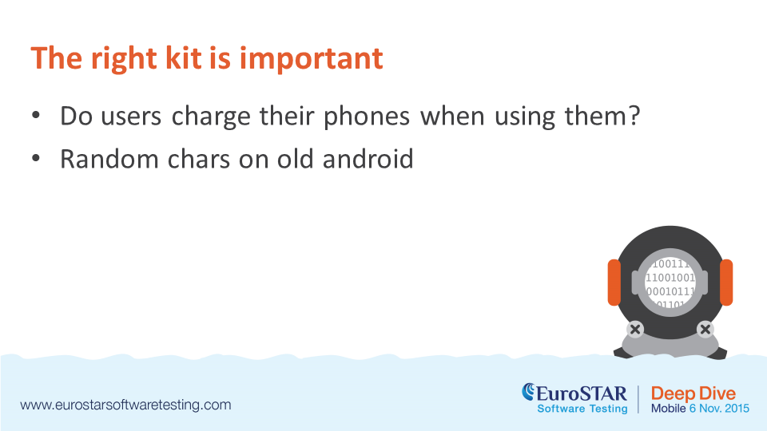\

What's interesting is even simple things become hard with mobile.

You're testing, you're testing all day, the battery runs out.

You stick in the cable to charge your phone as you are testing and it has to be the right cable.

It took me half a day just to figure out what on earth was going on with a device I was using.

I'm using the phone and it worked yesterday and today it's all garbage. Today it's giving random characters when I type and randomly pressing enter when I'm typing.

I'm cleaning the screen. I'm trying to figure out what's going on. I've disabled the alternative keyboard I put on. What is going on? I don't understand. I'm not using an external keyboard. This is the internal thing, there's nothing added. Why am I just not able to type? 

It made my testing so slow. I'd be trying to type in the email address, the worst thing, typing the email address you give alan@ and the editor closes down. You have to get the editor up and it's lost your input because you it didn't save your alan@ and then it loses your input. It's taken a couple of minutes just to type in the email address and hit okay.

Eventually I narrowed it down to this ... on some older android devices, if you're not using the OEM cable that came with the device for charging, you're not using the proper cable, and you get random characters appearing.

This is a bug that has slipped through something else presumably because everyone tests as a user and users clearly don't use their phones when they're being charged. There are subtle interactions in here that we don't understand at the operating system level.

And that makes the huge range of actions that we 'could' do, when testing mobile devices even larger. 

And that makes it even more important to understand as much as possible about the technicalities of what we are building to assess the risk.

Even something as simple as rotating the screen. Knowing how the application handles the rotation and performs redraws, makes it possible to make an informed decision about when to incorporate rotation into the testing. 

Without that knowledge, we're testing blind and randomly turning the device around.

And no user would ever do that.

## Each device is different

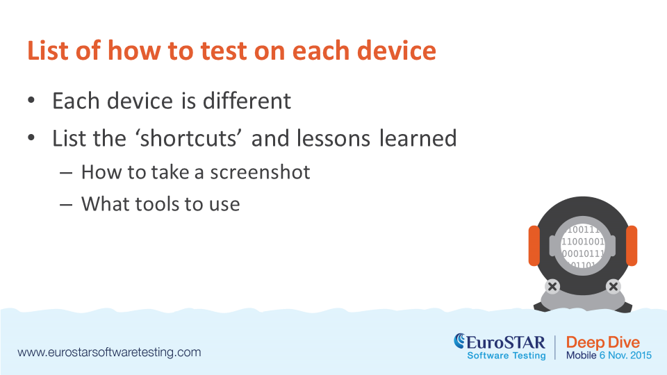\

We also have the issue that every phone is different. And every version of android seemingly has to be changed and seemingly randomly changed, just to be different between vendors and android versions.

So there are things that we have to learn in every phone.

To mitigate this, we had to maintain a checklist of how to perform certain functions on each phone.

* How do I switch this on?
* How do I access settings?
* How do I configure the proxy?
* How do we make a screenshot on this device? 
* Where do the screenshots get saved?
* How do we share the screenshots?
* What tools can be used for a record and capture?
* and the list goes on...

Otherwise it takes too long to get up to speed with each phone.

## Fortunately the future is getting better

\

But things are getting better.

We have technology that is designed to share the screen across different displays. Of course that now means that we have to test the phone, the phone projected on a high definition 42 inch screen etc. But the less I have to test on the device itself, the better.

We now have remote debugging on browsers for mobile devices. And it works on USB and Wifi:

* [developer.mozilla.org/en-US/docs/Tools/Remote_Debugging](https://developer.mozilla.org/en-US/docs/Tools/Remote_Debugging)
* [developer.chrome.com/devtools/docs/remote-debugging](https://developer.chrome.com/devtools/docs/remote-debugging)

This is brilliant, it means that the HTML rendering happens on the device, but I have access to all the dev tools to interrogate and manipulate the dom and see the traffic.

Bigger phones. A pain to carry around. But much easier to test and interact with.

And at some point. 

When we move to SSL2 and all our traffic goes over HTTPs we can stop supporting older phones entirely because they won't just not work with our app, they won't work with the internet.

Hopefully, we'll eventually experience a lot less pain. 

## Testing on a Device is a Risk

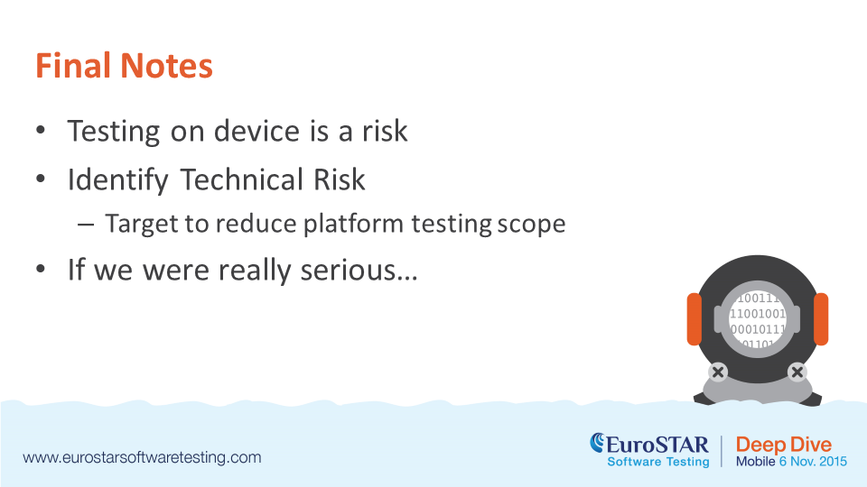\

The fact that I have to test the mobile devices at all is an issue; that's a risk. 

The fact that we've written something that is dependent so much on the technology that we're going to deploy to and that's where we have to do all our testing is a risk. 

The more that we can test outside the actual deployment environment and make sure that it works and understand what is technologically dependent in the application. Then theoretically we can be able to create a subset of the application and test that on the deployed device.

Now, I was testing an application that was primarily an ad-engine but we didn't realize that until we decompiled it.

The same code that was running on the mobile was running on the desktop because it was an inbuilt LUA  interpreter. There was FMV processor - full motion video processor - that just displayed the videos. They were the same assets that were deployed on desktop. In theory we could test a version of the app that had the LUA thing that used most of the LUA code with one game level, with one FMV and test that in different combinations, using a different wrapper app. 

Then test the ad-engine because that was fundamentally what was technologically dependent. We could have tested or derisked much of the application because its not always about testing it and making sure it works. Test that one place and make sure it works. Then you start derisking it on the different technologies.

If we were really serious, we would build ways of allowing us to easily test for technical risk on multiple devices, and one way to do that could involve creating a custom app or harness that self tests for that technical risk.

That's not really the approach that we take for testing mobile. What we test is everything on mobile devices because we have no understanding technologically of how this thing is going to be impacted by moving onto a different device. That's the real problem that we need to solve. 

Back in the 1940s and 1950s when they were making production plants more automated, they realized they had to change the way they built the things they were building to make them automatable. 

That is a lesson that we still have to learn today.

## But the point is

\

But the point is.

If we want an efficient test process. We can't just have a bunch of 'default' devices that are chained to a desk somewhere that we all share for testing. If we do that then we will always have too large a scope of devices and events to incorporate into our testing.

We need to be able to connect the devices to our computers and networks and observe and manipulate the traffic.

We need to understand how the applications are built and the libraries that are used and start making technical decisions about the risk that the technology we use introduces.

And we don't just have the test team do that. We have to involve the developers and the business so that we can mitigate some of the risks through different development approaches.

We do have to accept some of the risk into our test approach so we don't try and do everything and achieve a much smaller coverage.

And if we work together as a team it becomes much easier to communicate the risks and have other people help us.

I hate testing mobile devices when it is a default steel claw manual process. But if we understand and accept risks and allow the test process to feed the device through the tools we normally use to observe and manipulate traffic, and if we can hook up keyboards to make interaction easier then I'm quite happy to use as much technical knowledge and approaches to test the apps as possible.

So...

I think we should view testing on an actual mobile device, as a risk, particularly when we do it out of fear and lack of understanding, because if we don't, we will never take steps to mitigate that risk.

And we can mitigate that risk with a better understanding of the technology involved and a more technical approach to our testing.

\

## Conclusions

That is where the talk finished, now some reflections on the talk.

I tried to emphasise the responsibility that people have to take for their testing and own their pain and take steps to remove it. And that every step we take, can add risk into our process. But we reduce the risk by understanding the technical implementation and really testing that risk.

In the live talk I cut down on the talking over the early slides, but I did try and add humour on the early sections.

I also reference other speakers talks and some talks from Eurostar which would have no relevance in the main talk. I refer to Julian Harty's talk where he described a strategy that a company used for identifying which phones to test on. They basically looked at the bad reviews on the appstores, and looked at what phones those users were using, and then tested on those phones. Those phones were clearly the gap in their strategy. I think that is quite a clever idea, but far more devious mitigation strategy than I would ever have come up with.

I also described 'random' heuristic based testing i.e. turn the phone around to check resizing, switching wi-fi on and off. That only really works as a 'test approach' when we know we have specific code to handle the resizing, and we know when we are monitoring and responding, then we can target it with more precision, otherwise we are 'randomly' triggering the event and 'hoping' that it might show something. But since we have so many points in our testing we could do that, and so many devices to do it on, our scope of testing increases too far. So we narrow our scope by targeting technical risk. I expanded this point with a small case study describing conversion of a flash game to HTML5.

The main difference was in the ending of the talk. Where I emphasise that testing on a device is a risk, if we do that blind and don't understand the technical reasons that the application might fail on each device. To reduce the scope of devices we test on and use the device testing to target technical risk rather than functional flow. I mention that we should run the automated unit test code on physical devices. I also describe creating 'harness' applications which can 'self test' and check for technical risk e.g. does this library call work, do I have permissions to write to the clipboard and read back etc.. This is the kind of thing that old arcade games used to do. They would start-up with a diagnostics screen and check that everything was working in conjunction with the hardware properly. I wrote commercial software, and it would start with a self test routine to check that the libraries it needed for display and accessing the database etc. were installed, because I Wanted to identify early the integration points between my application and the hardware and operating system and point out any potential problems or mismatches early. We could do this for mobile testing, if we were really serious about making an application that worked. And if it self tested then it could automatically report back to a server, allowing us to quickly run the test app on the cloud grids of physical devices. But we don't do that. We are not serious. We mitigate risk through testing functional paths, rather than technical integrations.

I also emphasised the notion that working without technical knowledge is a 'fear' based approach. And that is an approach that does not scale, and leads to the testers experiencing pain, and we will miss things.

Ultimately this is a talk about responsibility and gaining more knowledge so that you can test more responsibly.

Thank you.