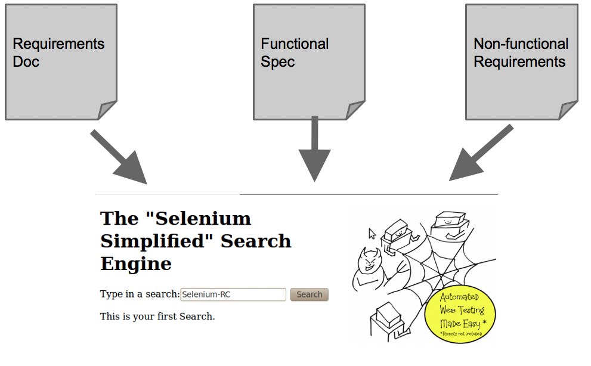
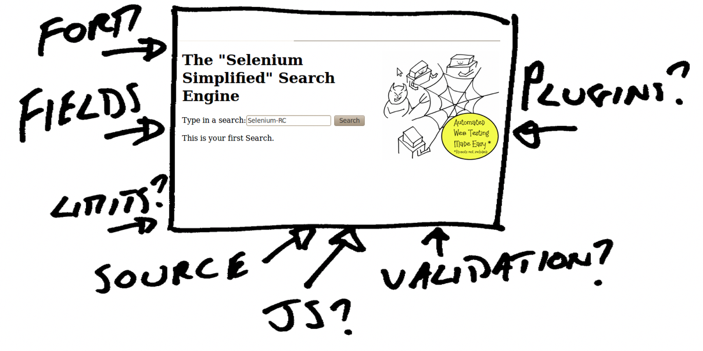
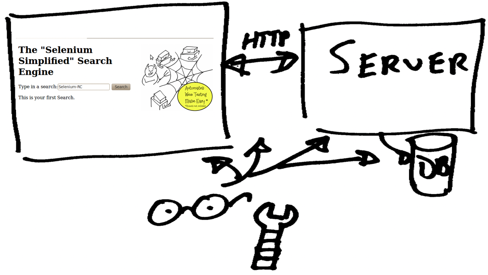
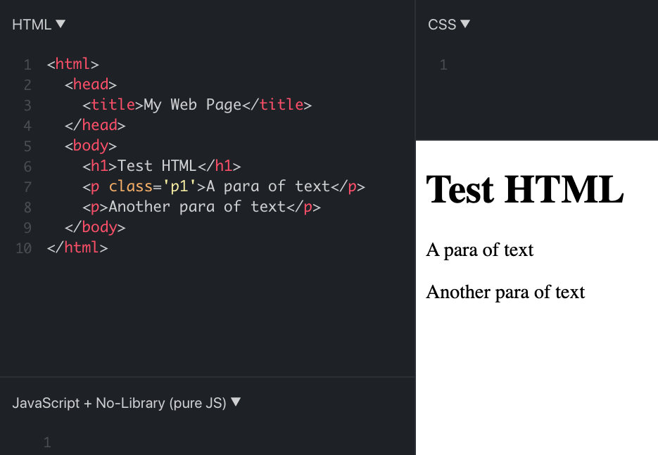
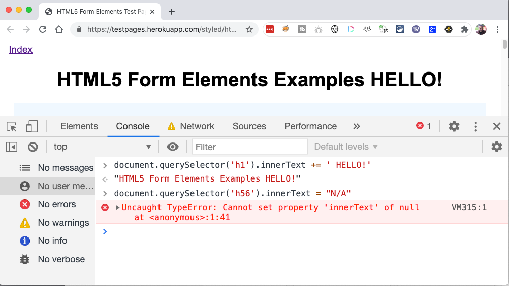
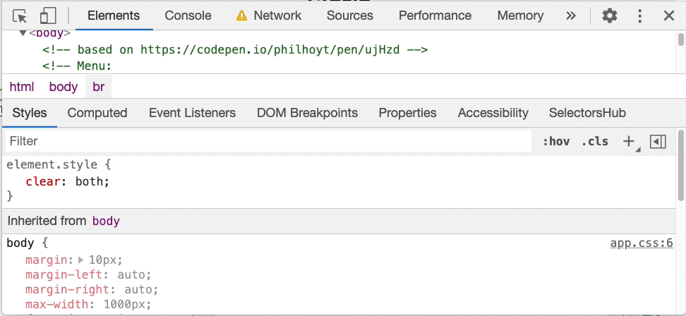

footer: @EvilTester
slidenumbers: true
<!-- page_number: true -->

# Technical Web Testing

Eurostar 2020

Alan Richardson

- [@EvilTester](https://twitter.com/eviltester)
- [EvilTester.com](https://eviltester.com)
- [talotics.com](https://talotics.com)
    - [(digitalonlinetactics.com)](https://digitalonlinetactics.com)

---

# Introduction

This tutorial will focus on the technology of the Web, and how we can improve our Technical Web Testing.

- How do we expand the scope of our testing to increase the possibility of finding issues that other people don’t?
- How can we identify new tools to help us boost our ability to test?

---

# One way is to incorporate the technology of the system into our testing.

---

# How?

Understanding the technology helps us identify more risks, and opens new areas of the system to investigation.

Knowing what tools match the technology, we can increase our ability to observe, interrogate and manipulate the system.

---

# What is Technical Testing?

Technology knowledge

- supporting testing
    - testing below the surface
    - bypassing GUI limitations
- driving testing through
    - technical risks
    - technical gaps

 

---

# Why do people dislike the term?

- "I hate technical testing?"
- "All testing is technical!"
- "There is no such thing as technical testing!"

---

# Because people...

- think that other people think...
- worry that other people will think...

that "Technical"

- excludes everything else
- means "Automation"
- reduces the importance of "The Rest of Software Testing"

---

# Why do I like the term "Technical Testing"

- A specific partition
- for specific skills, tools and knowledge,
- that we can use to augment our testing,
- for specific contexts

i.e. 'Web Testing' is different 'Technical Testing' from 'Desktop Testing' and both build on "Software Testing"

---

# A reminder to keep “going deeper”

- Tool Augmentation
- Technical details will:
    – inspire more testing
     – identify more risks
     – Identify different problems
- Not limit our testing to Acceptance Criteria

---

# Why?

---

# Why do this for testing?

- "identify technology based risks to drive and focus testing"
- reduce the constraints on testing
    - "the more we know how to do what we do, the more we can do"

---

# Why do this for testing?

This requires:

- understanding of the technology
- risk identification
- tools applicable to the technology

---

# Lessons learned:

- Even simple technology can pose risk.
- Combining simple technology can increase risk.
- Understanding technology allows us to evaluate risk

---

# What risks might there be with a web app?

- HTML Risks?
- CSS Risks?
- JavaScript Risks?
- HTTP Risks?

---

# More Risks?

We will cover risks in more detail for each of the technology sections later.

---

## Technical Testing by MORIM

- Modelling
- Observation
- Reflection
- Interrogation
- Manipulation

---

## Technical Testing by MORIM

- **Modelling**
    - the application from multiple view points and multiple technical levels.
- Using tools to:
    - **Observe** the application in action,
- **Reflecting** on what you see to approach the testing with intent based on risks, and at different interface points.

---

## Technical Testing by MORIM

- Using tools to:
    - **Interrogate** the application to more detailed levels
    - **Manipulating** the application at detailed levels

---

# Recommended Test Apps

- You don't have to use these
- I recommend these because:
   - I wrote them as Test Apps
   - I can answer any questions about them
   - You have permission to test them
   - The exercises are based on them

But you are free.

---

# The Pulper

[https://thepulper.herokuapp.com/apps/pulp/](https://thepulper.herokuapp.com/apps/pulp/)

- multi-tenancy app
    - one url
    - every session has unique data

While workshop is live we also have:

- https://thepulper2.herokuapp.com

---

# The Pulper

- multiple versions selectable from admin menu
   - different versions have different technology implementations
        - e.g. v2 form submission edits, v11 XHR JavaScript amend
   - different versions have different bugs
      - e.g. v1 has menu rendering bugs, fixed in v2

---

# The Pulper

[https://thepulper.herokuapp.com/apps/pulp/](https://thepulper.herokuapp.com/apps/pulp/)

- more information, download links etc. at
    - [https://eviltester.com/thepulper/](https://eviltester.com/thepulper/)

---

# The Todo List App

A simple Todo List, uses HTML, CSS, JavaScript and Local Browser Storage.

[https://eviltester.github.io/simpletodolist](https://eviltester.github.io/simpletodolist/todolists.html)

- more information
    - [https://www.eviltester.com/page/tools/thetodoapp/](https://www.eviltester.com/page/tools/thetodoapp/)

---

# The Test Pages

[https://testpages.herokuapp.com](https://testpages.herokuapp.com)

Primarily for practicing automating, but... there are some micro apps:

- HTML Form Validation
- Calculators
- Count Down Timer

---

# API Challenges

If you want to experiment with HTTP REST APIs, or tools like Postman or Insomnia.

[https://apichallenges.herokuapp.com/](https://apichallenges.herokuapp.com/)

- A Documented REST API
- A Display GUI
- Multi-User, your actions do impact other people
- A Set of Challenges to try

---

# API Challenges

[https://apichallenges.herokuapp.com/](https://apichallenges.herokuapp.com/)

More information: [https://www.eviltester.com/apichallenges/](https://www.eviltester.com/apichallenges/)

---

# More Apps?

Check out:

[https://www.eviltester.com/page/tools/](https://www.eviltester.com/page/tools/)

For:

- chrome extensions, image generators
- APIs, more tiny JavaScript apps, JavaScript Games

---

## A Whistlestop Demo Tour

---

## Every Browser Allows Us To

- View HTML Source
- Manipulate DOM
- View HTTP Traffic

We can use this to model the application.

---

## View Source

- Raw, Unformatted
- The code sent from the server
- Might have syntax highlighting
- Might show syntax errors

---

## 'Inspect' to View the DOM

- View the DOM
   - Document Object Model
   - How the HTML is interpreted
   - See Styling

---

## 'Inspect' to Amend the DOM

- Anything in the browser can be amended
    - e.g. change heading text
- Amend Applied CSS styles
    - e.g. "z-index:100", "display:none"
    - Use Pulper v1 - Demo/Fix menu overlap bug
- Edit HTML Blocks
    - e.g. amend ids on items in drop downs
    - Pulper v2, amend book to invalid house author

---

## Summary

- HTML and DOM can be different
- Use Dev Tools to View and Amend DOM
- Dev Tools let you view all sources loaded into browser

---

## "Tool Augmentation"

- Tools to passively observe, maintain history of observation
- Tools to alert on specific conditions
- Tools to observe the unobserved, and interrogate the inaccessible
- Tools to help me model and reflect
- Tools to help me manipulate
- ... etc.

---

# Never tools to control. Tools to augment.

---

# Exercise - Explore and Model an App

- What does it do?
- What technology does it use?
- What risks can you identify?
- What tools might you need?
- What do you not understand?

e.g. https://thepulper.herokuapp.com/

---

## Any Questions or Observations?

---

# SECTION: Basics - HTML, DOM, CSS

---

# Basics of the web - Buzzwords

- HTML
- CSS
- JavaScript
- Browsers
- HTTP

## Even if you know this it is useful to revisit and explore risks and interaction.

---

# Basics of the web

- HTML - code for structure and content
- CSS - code for styling and rendering
- JavaScript - code for in browser custom functionality
- Browsers - tool for rendering and interaction
- HTTP - communication between browser and server

---

## Application Perspectives

- different views of an app change how we test it
- require different domain knowledge
- require different tools

---

## Non-Technical Views of an app

---

## Browser View

---

## Server Communications View

---

## HTML - structure, elements, attributes

~~~~~~~~
<html>
  <head>
    <title>My Web Page</title>
  </head>
  <body>
    <h1>Test HTML</h1>
    
A para of text

    
Another para of text

  </body>
</html>
~~~~~~~~

https://jsfiddle.net/h4qjfxv0/

---

---

## HTML Risks?

- broken links
- syntax errors in the HTML
- missing images
- browser doesn't understand the HTML
- etc.

---

## Useful HTML Browser Dev Tools Summary

- View Source - might be different from DOM
- Selector - for choosing elements (see also $0 in console)
- Mobile - simulates viewport, headers, connection speed
- Lighthouse - in built validator
- Sources View - view the files

_Try these with v1 of The Pulper_

---

## DOM - Document Object Model

- The browser's internal representation of the page.
- Used by JavaScript
- Used by Automation

---

## DOM Risks?

- DOM might not match HTML
- Browsers Fix HTML Errors
- DOM Might change, impacts Automation, "stale element exception"

---

## Useful HTML Browser Dev Tools Summary

- Elements
    - DOM view elements,
    - CSS and JavaScript events

---

## CSS - styling, locators

~~~~~~~~
p {
font-family: verdana;
font-size: 20px;
}

p.p1{
  font-size: 30px;
}
~~~~~~~~

---

## CSS Risks?

- CSS not compatible with browser
- Syntax errors
- missing files
- animation
- interaction with HTML
- Mobile vs Desktop
- etc.

---

## Useful HTML Browser Dev Tools Summary

- Elements
    - DOM view elements,
    - Force Element State e.g. The Pulper menu hover state
    - CSS Styles
    - CSS Computed
- Sources View - view the files

---

## If it validates...

- it has less risk cross browser

---

## Validation Tools

- Lighthouse in Chrome
- https://validator.w3.org/
- https://webhint.io/
    - https://developer.microsoft.com/en-us/microsoft-edge/tools/
- Total Validator
    - https://www.totalvalidator.com/
- Check for Chrome Plugins

---

# Rendering Tools

Test rendering on different browsers.

- http://browsershots.org/
- https://www.browserstack.com/screenshots
- https://www.browserstack.com/responsive
- https://comparium.app/

search "free cross browser testing tool", "free cross browser rendering"

---

# Compatibility Tooling

- [https://caniuse.com/](https://caniuse.com/)
    - reference guide for html/css/javascript features and browser compatibility
- [https://doiuse.herokuapp.com/](https://doiuse.herokuapp.com/)
    - scan page and report on browsers that HTML/CSS is not compatible

---

# Exercises - The pulper v1, v2, v11

- What parts of the dev tools work with HTML, DOM, CSS?
- How can you observe, interrogate, manipulate?
- Find tools that target risks: validation, link checks.
- Explore the technologies of the test apps.
- Explore the HTML. DOM, CSS the dev tools.
- Try the Mobile view and explore the app

---

## Any Questions or Observations?

---

## How could we identify tooling to help?

---

## Questions To Ask

- How can I check if the HTML/JavaScript/CSS is 'good'?
     - valid, complies with standard, syntax check
     - e.g. w3c

---

# Section: JavaScript

---

## JavaScript

- the default coding language of the web
- events
- make things happen

~~~~~~~~
document.querySelector('h1').innerHTML="bob"
~~~~~~~~

---

## JavaScript Risks

- Syntax errors
- compatability, virus checkers
- bugs
- interaction with HTML and CSS
- interaction with HTTP - Ajax etc.
- event firing
- etc.

---

## Browsers

- Chrome, IE, Edge, Firefox, Epic, Safari
- OSX, Windows, Mobile
- Different rendering engines
- Different CSS & JavaScript Support

- [https://caniuse.com/](https://caniuse.com/)

---

# JavaScript AJAX/XHR Browser Risks

- Memory Leaks
- Blocking Code (JavaScript is single threaded) crashing browser
- Cross browser compatibility issues

These risks are not reduced with an API.

---

# More Functionality And Scope for Bypass

- Switching off JavaScript
- Cookies
- Local Storage

These can be amended by 'user', do we validate?

---

# How JavaScript Changes The Risk Profile

- JavaScript increases risk of cross browser issues
- Have we reduced the risk by running JavaScript test in different browsers during build process?
- Do we know how compatible the JavaScript features are with different browser versions?

---

# How JavaScript Changes The Risk Profile

Testing Risks

- Do we know how to tell the difference between CSS/HTML5 and JavaScript implementations?
- Are we testing too much e.g. date controls

e.g. [testpages.herokuapp.com/styled/html5-form-test.html](https://testpages.herokuapp.com/styled/html5-form-test.html)

---

---

---

## Useful JavaScript Browser Dev Tools Summary

- Elements - JavaScript events
- Console - execute JavaScript, view JavaScript errors, debug messages
- Sources - view code, set breakpoints, snippets JS Editor for simple scripting
- Application - view/amend cookies and local storage

---

## Useful JavaScript Browser Dev Tools Summary

- 'Run' to Enable/Disable JavaScript
- Advanced: Performance & Memory - audit and monitor in browser
 
---

## Chrome Task Manager

Bonus: In Chrome try the Task Manager (shift+esc) and see if these JavaScript pages

have any issues.
   - Chrome Menu \ More Tools \ Task Manager
   - sites often have memory leaks, or just doesn't care about your browser

---

## JavaScript Tooling Demo

- view JavaScript in DOM view
- view JavaScript in source view
- run JavaScript from the console
   - 2+2
   - `areYouSureYouWantToShutdown();` v1 home
- Disable JavaScript, try to amend in v11

---

## Suggested Exercises

- View the HTML, is there any JavaScript?
- View the sources, can you see any .js files?
- Does The Pulper v11 work - switch off JavaScript? Search? Amend?
- Set a breakpoint in the js source and trigger it by using the app?
- Advanced: amend v11 HTML in the browser to make amend work without JavaScript?

---

## Any Questions or Observations?

---

## How could we identify tooling to help?

---

# Questions To Ask

- How can I debug JavaScript in the browser?
- How can I check memory usage in the browser?
- How can I amend JavaScript in the browser?
- How can I disable JavaScript in the browser?

---

# HTTP and APIs

---

# All Web Apps Use HTTP to:

- Load HTML, CSS, JavaScript
- Submit Forms
- AJAX, XHR requests to POST/GET data

We can bypass the GUI, by working at the HTTP layer.

---

# Why?

- Bypass Validation
- Load/Stress Testing of Server
- Automate without GUI Synchronisation
- Scrape/Load Data
- Test Conditions we can't test at the GUI

---

# Gaps

If we can't interact with the application at a technical level below the GUI we have gaps in our coverage.

---

## HTTP Basics

Messages sent from browser to server

- Verb - GET, POST, PUT, etc.
- Headers
- Body

---

## Example HTTP Message

~~~~~~~~
GET / HTTP/1.1
Host: caniuse.com
Connection: keep-alive
Pragma: no-cache
User-Agent: Mozilla/5.0 (Macintosh;
Intel Mac OS X 10_13_6) AppleWebKit/537.36
(KHTML, like Gecko) Chrome/69.0.3497.100 Safari/537.36
Accept: text/html,application/xhtml+xml,application/xml;
q=0.9,image/webp,image/apng,*/*;q=0.8
Accept-Encoding: gzip, deflate, br
Accept-Language: en-US,en;q=0.9
Cookie: _gt=1
~~~~~~~~

---

# HTTP Requests - Human or System

- Human
    - user types URL into browser search bar (GET)
    - user submits form (POST)

---

# HTTP Requests - Human or System

- System
    - System automatically polls server for new content via JavaScript
        - AJAX(Asynchronous JavaScript and XML)
        - XHR (XML HTTP Request)
        - GET / POST
        - often returns JSON

---

##  CRUD

- Verbs are not as simple as Create, Read, Update, Delete

| CRUD Action | Verb |
|------|--------|
| Create | POST, PUT |
| Read | GET |
| Update | POST, PUT, PATCH |
| Delete |  DELETE |

---

## What uses What?

- Normal site HTML Site
   - GET - links, navigation, JSON via JavaScript
   - POST - forms, JSON to update and create
- APIs
   - GET, POST, DELETE, PUT, OPTIONS
   - PATCH, HEAD

---

## HTTP Risks

- timeouts
- 404 - missing files
- 500 - server errors
- slow connections
- etc.

---

## Useful HTML Browser Dev Tools Summary

- Network view traffic
    - filter,
    - see status codes
    - preserve log
    - export as HAR file (HTTP Archive File)
        - evidence, later review

---

## Manipulation Tools

- Network Tab
    - block urls (simulate 404s)
    - experiment with caching
    - override files with local copies
- Mobile Tab
    - simulate change speed of network

---

## Overriding HTML/JS etc.

- dev tools
- sources/overrides
- configure folder to save files to
- switch on overrides
- amend HTML/JS
- now loaded from local disk
- e.g. change title / h1 on an html page

Lesson: app should 'trust' nothing from the front end

---

## What is an API?

- Application Programming Interface
- GUI -> API -> System
- GUI can be tooling e.g.
   - Postman (online and desktop)
   - Code
   - HoppScotch.io online API client

---

## The Pulper API

- Pulper has a REST API
- it is not versioned
- requires a custom header X-API-AUTH (see admin screen)
    - - Admin Menu Screen shows API Key
- API is used by the GUI from version 7
- API can be tested directly
- API Documentation linked to from Help menu

---

## API Documentation

- https://eviltester.com/thepulper
- for API documentation link
- for Insomnia Workspace
- for Postman Collection

---

#   API Tooling

- Using HoppScotch.io online API client
    - use X-API-AUTH of current session
    - use search API call listed in network tab
    - repeat search as an API call
- search form has hidden fields, can we use them in the API?
    - `?searchterm=dent&what=author`

---

## Use App against itself

- GUI uses the API via JavaScript
- All the code we need to access the API is in the browser
- on pages which include `api.js`

~~~~~~~~
var myapi = new PulperApi(
                       new CookieAccess().getCookie("X-API-AUTH"));
for(x=1; x<100;x++){
   myapi.createAuthorNamed(
         "bob "+x,function(){}, function(){});
}
~~~~~~~~

---

# Exercise: Explore Network

- use the network tab to view traffic
- filter traffic to see XHR - JavaScript requests
- simulate different network speed e.g. Slow 3G
- 'block' the CSS or other files in network traffic?
- navigate the site with "preserve log" on and off

---

## More Exercises

- use Pulper v11 and Amend/Create/Delete a book or author, compare traffic with v3 amendment process.
- Experiment with the various options
- Advanced - Try HoppScotch.io or Postman on the API v11
    - documentation etc. https://eviltester.com/thepulper
    - use the X-API-AUTH header from your admin screen

---

## Any Questions or Observations?

---

## API

- API does not mean we have to use API tools
- Could use proxy tools to test API
- Could use proxy fuzzers to test API

---

# Extended Practical - Suggested Time Spend

- Focus on an Area: HTML, DOM, CSS, JavaScript, HTTP, API
- Focus on Exploring Tooling: Dev Tools (Chrome, Edge, Firefox), API (Postman, Hoppscotch.io)
- Explore The Apps: The Pulper, Todo App, Test Pages, API Challenges

What have you not done? What did you not 'get'?

Explore, Practice, Ask Questions in the Support Chat

---

## Any Questions or Observations?

---

## Why is drop down menu risky for the web?

e.g. The Pulper v5, v1

---

## DropDownMenu element doesn't exist

~~~~~~~~

<nav id="primary_nav_wrap">
    <ul>
        <li id="menu-home"><a href="/apps/pulp/gui/">Home</a>
            <ul>
                <li id="menu-help">
                     <a href="/apps/pulp/gui/help">Help</a>
                </li>
                <li id="submenu-home">
                      <a href="/apps/pulp/gui/">Menu</a>
                </li>
            </ul>
        </li>
    </ul>
</nav>

~~~~~~~~

---

## Why is drop down menu risky for the web?

- DropDownMenu element doesn't exist
- On Desktop it exists as a native control
- It doesn't exist as a native HTML element
- We have to simulate it
- We have to write code

---

## If it did exist, it might look like

~~~~~~~~
<ddm>
   <mi><a href="/home">Home</a>
        <ddm>
            <mi><a href="/help">Help</a></mi>
            <mi><a href="/home">Home</a></mi>
        </ddm>
   </mi>
</ddm>
~~~~~~~~

**Why would this be less risky?**

---

## Why would this be less risky?

It would be 'just HTML'.

- standard
    - can be compliance checked
- browser implements
    - cross-browser testing reduced
    - don't test browser implementations

---

## Why would this be less risky?

- tool supported
    - automated tools will support
    - automated tools may have abstractions
        - e.g. `new DropDown().select("Home");`
- creates a different set of risks
    - CSS styling
        - rendering of CSS

---

##  Possible Risks?

- Might not render at all - Why?
- Rendering Errors
    - Overlapping Drop Downs
    - Animation Errors
- Links might not work
- Might not be responsive
- Cross Browser JavaScript Errors?
- Ajax JSON Errors Loading Sub Menus?

---

## Without knowing technology

How would we test for these risks?

---

##  Possible Test Approaches For Risks

- Might not render at all
- Rendering Errors
    - Overlapping Drop Downs (see Pulper v1)
    - Animation Errors
- Might not be responsive
- Cross Browser JavaScript Errors?
- Ajax JSON Errors Loading Sub Menus?

---

## General Mitigation

- "Test in all browsers"
- "Test on all platforms"

---

# Too Many Non-Specific Risks!

## Testing Blind

**Reduce Risks by understanding the Technology**

---

## We only need to understand the technology in use.

---

## Learn the technology in use

- Do not need to learn all technology at once
- Learn the technology you are testing
- To the level that the technology is used

This makes developing technical skills sustainable.

---

## Some Mitigation Approaches

- Link checkers
- Spiders
- Validation with proxies
- Standard validation

---

## Follow On

- good reference sites for learning more:
    - https://developer.mozilla.org
    - https://www.w3schools.com

- best way to learn?
   - view source for sites you visit
   - view structure and sources in dev tools

---

## What are the Risks of Technical Testing?

---

## Potential Risks

- How to Justify?
- How to document?
- Might only have time to check the Acceptance
Criteria?
- How to avoid doing too much technical stuff?
- How to get the time to learn?
- Different skill sets on team

---

## Handing Technical Testing Risks & Issues

- Take responsibility for your own testing
- Is anyone really going to stop you from doing
the best testing you can?
- You can learn, as you add value. Take small
steps.
- You can learn, as you pair. Ask questions, take
notes. Apply your 'testing super powers' to the
information you get.
- Use technical testing to 'push' for more access
to environments and system internals

---

## External Tools for HTTP

HTTP Proxy

- sits between browser and site
- e.g. Burpsuite, ZAP Proxy, Fiddler, Charles
- easier to manipulate and view HTTP requests
- Fuzz data to generate data

---

## External Tools for API

- Postman
- PAW

these:

- might be easier to use
- no CORS issues with JavaScript sending from browser
- scripting ability

---

## External Tools to Access Database

- e.g. mysql, mysql workbench
- Connect to database on server
- Observe and Manipulate data
- don't rely on visual in browser check or API results

---

## Each Site is Different

"From a technical perspective, what questions do we need answered to allow us to observe and manipulate this particular system?"

---

## What questions do we need answered?

- How can I log on to the server?
- What are the user name and password?
- What is the hostname?
- How can I access the database?
- Where are the logs?
- Do I have permissions?

Questions will be limited by your technical knowledge.

---

## How does this help us with 'testing'?

- The GUI might not show everything
- The DB might have something different from the
GUI
- We might see something in the log that triggers
a test idea
- We might see errors and exceptions in the logs
- We want to remove all limits to our test ability
- etc.

---

## How to improve your technical skills

- Practice
- Learning
- Experiment
- Model Application -> Identify Technology ->
Learn the Technology -> Tools for technology?
-> Observe? -> Manipulate? -> What do we
learn then? -> Model Application
- Doing

---

## Hints and Tips Section

---

# I've learned some secrets...

- Ask questions
- Catalogue the technologies
    - use the default tools
- Copy others
    - pair and make notes
- Study and learn
    - on your own

---

# I've learned some secrets...

- Identify tools by modelling:
    - Observation, Manipulation, Interrogation
- Experiment
- Keep Learning

---

## "Don't worry about breaking things. It always works the way it has been coded to."

---

## Keep Pushing your Testing

- Identify technical knowledge gaps
- Test and observe in those gaps
- Then Interrogate and Manipulate in those gaps
- Find tools to support your testing

---

## Further Reading

- The OWASP Testing Guide
   - http://www.owasp.org/index.php/OWASP_Testing_Project
- Putting Systems to Work by Derek Hitchins
    - http://systems.hitchins.net/profs-stuff/profs-books/
    - (free download pdfs)

---

## Further Reading

- The Web Application Hacker's Handbook
   - Dafydd Stuttard, Marcus Pinto
- Automating and Testing a REST API
   - Alan Richardson

---

## Online Training

- Test Automation U
    - Automating in the Browser Using JavaScript

[testautomationu.applitools.com/automating-in-the-browser-using-javascript/](https://testautomationu.applitools.com/automating-in-the-browser-using-javascript/)

[EvilTester.com](https://eviltester.com) - YouTube, blog, book support pages, tools

---

## Further Reading - Philosophy of Strategy and Practice

- The Art of War by Sun Tzu
   - provides a generalisable model for technical testing - including
map/territory, observation (use of spies) and manipulation
    - https://suntzusaid.com/
    - www.sonshi.com

---

## Further Reading - Philosophy of Strategy and Practice

- The Book of Five Rings by Miyamoto Musashi
    - How to practice and improve
    - https://archive.org/details/MiyamotoMusashi-BookOfFiveRingsgoRinNoSho/page/n0

---

## Authorative Oracles

- https://www.w3schools.com
- https://developer.mozilla.org
- https://validator.w3.org
- https://caniuse.com/

Find tools and Oracles to help identify/explore risk.

---

## Online Web Coding - HTML, CSS, JS

- https://jsfiddle.net/
- https://codepen.io/pen/
- https://liveweave.com/
- https://jsbin.com
- https://plnkr.co
- http://cssdeck.com/
- https://www.jdoodle.com

---

## Any Questions or Observations?

---

# End Credits

---

## Learn to "Be Evil"

* [www.eviltester.com](http://www.eviltester.com)
* [@eviltester](https://twitter.com/eviltester)
* [www.youtube.com/user/EviltesterVideos](https://www.youtube.com/user/EviltesterVideos)

---

## Learn About Alan Richardson

* [www.compendiumdev.co.uk](http://www.compendiumdev.co.uk)
* [uk.linkedin.com/in/eviltester](http://uk.linkedin.com/in/eviltester)

---

## Follow

- Linkedin - [@eviltester](https://uk.linkedin.com/in/eviltester)
- Twitter - [@eviltester](https://twitter.com/eviltester)
- Instagram - [@eviltester](https://www.instagram.com/eviltester)
- Facebook - [@eviltester](https://facebook.com/eviltester/)
- Youtube - [EvilTesterVideos](https://www.youtube.com/user/EviltesterVideos)
- Pinterest - [@eviltester](https://uk.pinterest.com/eviltester/)
- Github - [@eviltester](https://github.com/eviltester/)
- Slideshare - [@eviltester](www.slideshare.net/eviltester)

---

## BIO
 
Alan is a test consultant who enjoys testing at a technical level using techniques from psychotherapy and computer science. In his spare time Alan is currently programming a [multi-user text adventure game](http://compendiumdev.co.uk/page/restmud) and some [buggy JavaScript games](http://compendiumdev.co.uk/games/buggygames/) in the style of the Cascade Cassette 50. Alan is the author of the books "[Dear Evil Tester](http://www.eviltester.com/page/dearEvilTester/)", "[Java For Testers](http://javafortesters.com/page/about/)" and "[Automating and Testing a REST API](http://compendiumdev.co.uk/page/tracksrestapibook)". Alan's main website is [compendiumdev.co.uk](http://compendiumdev.co.uk) and he blogs at [blog.eviltester.com](http://blog.eviltester.com)

<!--

# Technical Web Testing Blurb

https://conference.eurostarsoftwaretesting.com/event/2020/technical-web-testing/

Tutorial F     Start Time : 14:00     End Time : 17:30

How do we expand the scope of our testing to increase the possibility of finding issues that other people don’t?

How can we identify new tools to help us boost our ability to test?

One way is to incorporate the technology of the system into our testing.

Understanding the technology helps us identify more risks, and opens new areas of the system to investigation.

Knowing what tools match the technology, we can increase our ability to observe, interrogate and manipulate the system.

And the tools themselves will provide new ideas for working with the system.

This tutorial will focus on the technology of the Web, and how we can improve our Technical Web Testing.

By testing a combination of simple online games and applications we will explore the range of technologies in use.

We will examine how the technologies change the risk profile of our testing.

We will experiment with how to observe and interrogate the applications under test at a more technical level.

We will investigate how the features of existing tools we use for testing can boost our ability to go more deeply into the technology.

Key Takeaways:

- Understand the basics of web applications, HTML, DOM, HTTP
- Hands on experience with browser dev tools and basic JavaScript
- How you can use technology to augment your existing testing skills

Intro:

This tutorial will focus on the technology of the Web, and how we can improve our Technical Web Testing.

- How do we expand the scope of our testing to increase the possibility of finding issues that other people don’t?
- How can we identify new tools to help us boost our ability to test?

One way is to incorporate the technology of the system into our testing.

Understanding the technology helps us identify more risks, and opens new areas of the system to investigation.

Knowing what tools match the technology, we can increase our ability to observe, interrogate and manipulate the system.

Each Section

- We will examine how the technologies change the risk profile of our testing.
- We will experiment with how to observe and interrogate the applications under test at a more technical level.
- We will investigate how the features of existing tools we use for testing can boost our ability to go more deeply into the technology.
- And the tools themselves will provide new ideas for working with the system.

By testing a combination of simple online games and applications we will explore the range of technologies in use.

Key Takeaways:

- Understand the basics of web applications, HTML, DOM, HTTP (sections)
- Hands on experience with browser dev tools and basic JavaScript (exercises)
- How you can use technology to augment your existing testing skills (applied theory, sections)

The Pulper Exercises:

/Users/alanrichardson/Documents/docs-git/documents/Documents/Compendium Developments/testing/trainingCourses/ThePulperExercisesAndExamples

TODO: technical exercises for the pulper (in general)

TODO: technical exercises for the pulper (based around the dev tools)

TODO: extended demo scripts/instructions - add to The Pulper Doc

- how I Test Web Apps - Patreon micro course
    - /Users/alanrichardson/Documents/docs-git/documents/Documents/Compendium Developments/online_course_metadata/how-i-test-web-apps

Could edit the transcripts and create a cut down ebook

- Technical Web Testing slides and basics

/Users/alanrichardson/Documents/docs-git/documents/Documents/Compendium Developments/online_course_metadata/technical_web_testing_101

- API Testing Book - sections on HTTP and basic API work

- evil tester talks - subtiles and transcripts etc. need to create more of these

workshop hand on technical testing

/Users/alanrichardson/Documents/docs-git/documents/Documents/Compendium Developments/testing/trainingCourses/HandsOnTechnicalWebTesting

Epic Tutorial

/Users/alanrichardson/Documents/docs-git/documents/Documents/Compendium Developments/testing/conferences/epic-experience-techwell/2020/tutorial

Hacking Javascript

/Users/alanrichardson/Documents/docs-git/documents/Documents/Compendium Developments/books/automatingHackingJavaScript

/Users/alanrichardson/Documents/Documents/Compendium Developments/testing/conferences/eurostar/eurostar2012/evilTestersGuideToTechnicalTesting

https://docs.google.com/document/d/14kWbaMnylHnXD3oVD_Jr6yRdTVAVrXZlrVyv2wG6xww/edit

14:00 - 17:30

3.5
0.5 for breaks

30 min sessions
10 min theory chat
5 min demo (with Q&A)
10 min exercise sections - also use for breaks
5 min questions and follow on demos

Amend the dev tools dom exercises to point to the public github posted versions and update this

/Users/alanrichardson/Documents/docs-git/documents/Documents/Compendium Developments/testing/trainingCourses/HandsOnTechnicalWebTesting

-->
