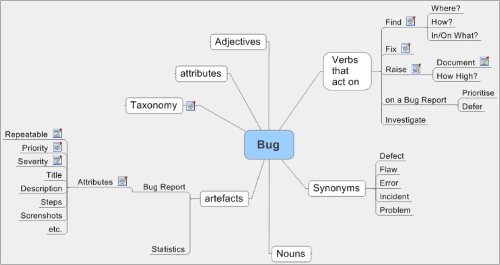

# NLP for Testers — Exercise Collection

Reconstructed from the later exercises master and its six linked documents. The earlier four-page PDF is an incomplete subset and is omitted. The full tutorial handout also includes exercises.

### Sensory Acuity Exercises

What can we be aware of with people?

- Write down some 'things' we can be aware of 'about' the other person? (What can we watch for, what can we see happen? What would we hear?

How can we become aware of this with people?

- Write down some ways that you can become aware of the above items with people?

How might it help you to be aware of this stuff?

- Write down some ways that this knowledge could help you.

What can we be aware of when testing?

- Write down some 'things' we can be aware of when testing

How can we become aware of all this when testing?

- Write down ways that you could become more aware of this stuff when testing?

Awareness of Peripheral Vision

- Become aware of your peripheral vision. Hold your index fingers in front of your face (about a foot away)

- more your hands apart and around your head following an imaginary circle around your head.

- Note where you stop being able to see your fingers

- Were you aware that that was the range of your vision, all the time?

Increase the field of vision while reading

- This exercise to increase your field of vision is taken from speed reading.

- When reading text, speed readers, read the text in chunks. This means that they do not read the text 1 word at a time, they read 3 or 4 words at a time, or half a line at a time. Supposedly super fast readers can read a full line at a time.

- You can pick up any book and start to read it

- Then you can start to increase the number of words that you read in one block.

- Work your way up from 3 or 4 words, or as many as you currently do

- It may help to move the paper further away from you as you increase the number of words

- By working on this you will increase your rate of reading and will take in more of the computer screen at any one time

- Also, read paragraphs from the middle of the page:

- Instead of reading from the left to the right

- Read from the middle of the page and expand your vision out to the left and right in one chunk

- speed readers practice this by drawing a line down the middle of the page and following the line

- after a while, practise this without drawing a line

Reduce Internal Dialog

- reduce subvocalising when reading by subvocally humming

- reduce subvocalising while working with people by putting your tongue just behind your teeth

Watch facial patterns – the lie detector

- Ask 3 questions that elicit a 'yes' response

    - Are we sitting here now together?

    - Is your name &lt;insert their name here&gt;?

    - Are you breathing?

- Watch the patterns of response behaviour

- Ask 3 questions that elicit a 'no' response

    - Are we standing on the moon?

    - Is your name &lt;insert your name here&gt;?

    - Can you levitate?

- Watch the patterns of 'no' response behaviour

- Ask questions that could be only yes, or no, but don't know the answer to, and tell them if it is a 'yes' or 'no'. Have them tell you if you are right or not. This gets you feedback that you need to calibrate the rest of their responses

Who do you love?

- A Calibration exercise

- In Pairs or Threes

- Person A asks questions, person B answers, Person C observes

- Person B thinks of someone they really dislike, and then of someone they really love – but doesn’t tell anyone

- Person A asks questions which gets person B to select one or the other

    - Which one has longer hair?

    - Which one lives closest to you?

    - Which one has been married longest?

    - Which one is older?

    - Etc

- Person A says whether they think person B is thinking of the person they like or dislike to get immediate feedback to calibrate

- Loop around the questions 5 times

- Then swap roles

### Exercises Relating to State

#### What State is your testing in?

List some attributes that are important for a tester:

- Attributes or Qualities of a tester

- Descriptions of a tester

What did you list?

- Adjectives? Phrases? Were the attributes positive?

- Any useful negative attributes?

- How many apply to you?

- When do you exhibit them? When do you 'have' them? In what Context?

Describe some of the important attributes listed above as states:

- name the state,

- can you feel it now? what do you have to do to feel it?

- describe what that state feels like,

- give an example context of when you experienced it during testing

- is it a good state or a bad state?

- did it help you or hinder you?

- were there other states mixed in with that one or was it discrete?

List some states that are important for testers and when they are important:

List some states that you have experienced during testing:

For the above states – make a note of when you experienced them and what those states led to:

For the states that led to a response where you would want a different response in the future, what response do you want it to lead to?

What would it take to have this new response? What resources would you need, what would you have to say to yourself when the response was normally triggered to move to the new response? What state is this new response? What does the new state feel like?

List some activities related to testing and effective states that go with them (remember a state is a process so think through what it would take to maintain that state, what kind of things are you saying to yourself? What is your posture? What is your motivation (what is moving you forward?)::

Can you identify situations where you have a chain of states?

- What is the chain? What triggers each state? What states might be better to have in the chain?

Elicit Effective Testing States in Others

- What can you say to other people to generate those states?

    - Tell a story about a time when you felt that state, not necessarily in a testing context, then relate it to the testing context

    - Ask about time when they felt such and such a state

    - Tell stories about when you felt related states and chain them together

## Beliefs Exercises

### Belief Exercises

What are your current software testing beliefs?

What things do currently always do as part of your process?

What things do you currently always think you have to do as part of your process?

You have beliefs about this.

What things do you think you should be doing as part of your process?

What would be useful beliefs for...

- A Software Tester?

- A Test Manager?

How are the beliefs different ?

## Words &amp; Meta Model Exercises

### Exercises Relating to Meta Model

Generate Meta Model Distinctions

- Generate sentences for each distinction

    - For each sentence:

        - identify the distinction

        - identify a response

        - what information are you expecting to the response?

- Generate sentences for each distinction in pairs

    - Each person creates sentences for each distinction

    - For each sentence, the other person:

        - identifies the distinction

        - identifies a response

        - identifies what information they are expecting to the response?

Choose a document that has been produced in your development process:

- identify meta model disctinctions in the document

In meetings, listen to the people around you and listen out for meta model distinctions

- surreptitiously write down the distinction and the sentence the violates it

When watching TV, listen out for meta model violations

- write down the distinction and the sentence that violates it

3 Way Questioning

- Work in 3s

- Person 1 ask Person 2 to describe something e.g.:

    - their testing project,

    - their application under test,

    - what testing is

- Person 2 responds, Person 1 listens, Person 1 analyses response based on the Meta-Model and asks a follow on question based on the Meta-Model analysis, repeat

- Person 3 takes a meta position for later review

### “Bug” - an exercise

Elements:

- Exercise Requisite Variety

- examine beliefs

- explore presuppositions

- target generalisations

- be provocative

- maintain rapport

#### Notes on the Exercise

When I do testing I occasionally say (and sometimes say it out loud) “oooh, that's a bug!” What's a bug? That? That selection of pixels? What on earth could I be talking about?

This exercise was designed to find out what I was talking about.

I initially set out to define 'bug' and I did, I created several definitions, none of which felt right, none of which were good enough.

I then wondered if 'bug' was perhaps a nominalisation (a processes which has been transformed into a noun) and I thought that it was kind of, but not quite. I knew that I was deleting information from my “oooh, that's a bug!” statement, but when I considered 'bug' in isolation of that statement there was no deletion. But there was plenty of generalisation and presupposition, so I started from there and built a generalisation focussed exercise.

So the exercise was designed to peel away layers of generalisation, not so that the generalisation never appears again, but so that awareness can extend beyond a habitual generalisation, and we can pick and choose from a range of choices.

#### The Exercise – Group Version

- Someone picks a noun/concept related to testing e.g. bug, test case, test script

- Define the non/concept

- List some verbs related to the noun

- challenge the verbs – take extreme stances,, you don't have to justify the challenge, justify/redefine/explore the verb

- challenge the responses to the challenges:

    - look for further generalisations

    - look for ambiguities

    - be provocative, and maintain rapport

- repeat, repeat...

- How do you define the noun/concept now?

#### The Exercise – Self Version

I recommend also doing the exercise on your own. You can see a sample set of my initial results for 'bug' in the mindmap at the head of the document. Ignore this and come up with your own set and clarification.

- The process is the same as the group exercise above but you can probably be more provocative and be less concerned about the rapport after all you can afford to be hard on yourself in order to improve.

- some time later...

- now create a new set of definitions – are they different?

- You may feel that your new definitions are still not good enough – I think that this is good – and I hope you feel that your new definitions are better than your initial ones.

#### Additional Nuances

- for each of the identified verbs, can the verb be used as a noun? If it can then do the same exercise for the verb as a noun in the context of 'bug'

    - e.g. Fix - “we receive a 'fix' from development.

        - But that would be fix as in 'to rig a fight?' right, so we don't trust it

        - what are you, a junkie? You're sacked.

        - We don't receive a 'fix' we get a new .exe which has been built from a set of source files that has changed – what else has changed?

- Do the same for adjectives

- find some adverbs

- what synonyms can you think of? In what way are they not synonyms?

- Can you start categorising your nouns into artefacts (actual physical things found in the test process?)

## Sample Answers for Selected Exercises

### Selected Sensory Acuity Exercise Answers

What can we be aware of with people?

- Movements

- Gestures: Hands, Head, Hair

- Breathing: Rates &amp; Patterns

- Eyes: Movement, Blinking

- Voice: Tone, Speech rate, Rhythms

- Language: Words, Phrases

What can we be aware of when testing?

- Disk Lights

- Tool Tips

- Status Bars

- Response Times

- Text Sizes

- Form Placement

- urls

- Control Placement

- Our feelings and intuition

- Expected Results

- Unexpected Results

- Things to do next

- Disk, Folder, File Sizes

- Memory Usage

- Processor Usage

- Log Files

- Error Messages

- Lack of Error Messages

- etc.

How can we become aware of all this when testing?

- Find tools to help

- Practice looking for it

- Increase Technical knowledge

    - of what the application is doing

    - of what is possible

- Recording tools and review afterwards

- Find other testers and ask them how they do it?

    - Ask them what tools they use
