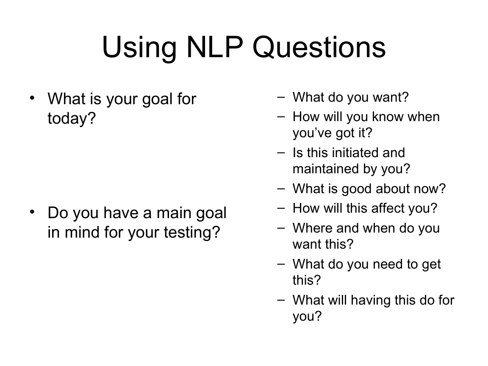
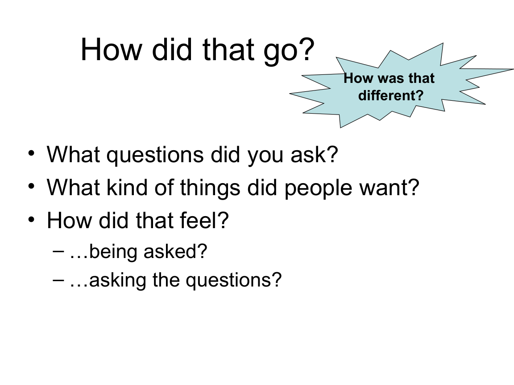
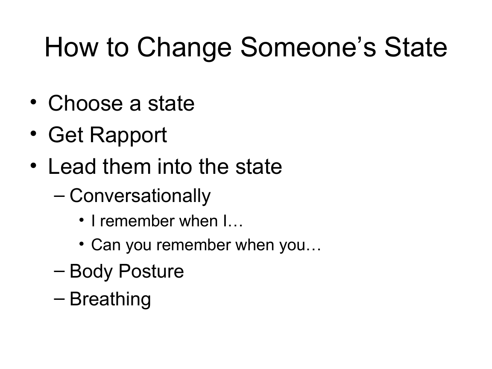

<!-- Slide 1 -->

# \_\_Well Formed Outcomes\_\_

---

<!-- Slide 2 -->

# “What is your goal?”

---

<!-- Slide 3 -->

# Using no NLP

- What are your goals for today?
- Without using any NLP questions or models, just ask someone what their goals are for today.
- Note down the questions that you ask them and the kind of responses that you receive

---

<!-- Slide 4 -->

# How did that go?

- What questions did you ask?
- What kind of things did people want?
- How did that feel?
- Is that the kind of thing you normally ask someone?
- Do you normally think through what you want?

---

<!-- Slide 5 -->

# “Some Well formed outcome questions”

---

<!-- Slide 6 -->

# Using NLP Questions

- What is your goal for today?
- Do you have a main goal in mind for your testing?
    - What do you want?
    - How will you know when you’ve got it?
    - Is this initiated and maintained by you?
    - What is good about now?
    - How will this affect you?
    - Where and when do you want this?
    - What do you need to get this?
    - What will having this do for you?

---

<!-- Slide 7 -->

# How did that go?

- What questions did you ask?
- What kind of things did people want?
- How did that feel?
    - …being asked?
    - …asking the questions?

How was that

different?

---

<!-- Slide 8 -->

# \_\_ Sensory Acuity \_\_

- Who do you love?

---

<!-- Slide 9 -->

# “What can we be aware of with people?”

---

<!-- Slide 10 -->

# Who do you love?

- In Pairs or Threes
- Person A asks questions, person B answers, Person C observes
- Person B thinks of someone they really dislike, and then of someone they really love – but doesn’t tell anyone
- Person A asks questions which gets person B to select one or the other
    - Which one has longer hair?
    - Which one lives closest to you?
    - Which one has been married longest?
    - Which one is older?
    - Etc
- Person A says whether they think person B is thinking of the person they like or dislike to get immediate feedback to calibrate
- Loop around the questions 5 times
- Then swap roles

---

<!-- Slide 11 -->

# Human Lie Detector

- Ask 10 questions that will get a yes response
    - Are you male? Are you wearing shoes? Etc.
- Ask 10 questions that will get a no response
    - Are you wearing a tie? Are you wearing a hat at the moment?
- Ask 10 Y/N questions that you don’t know the answer to:
    - Do you like waffles?
    - Get feedback on the ones that you get right or wrong
    - And ask ‘nice’ questions!

---

<!-- Slide 12 -->

# What happened?

- What were you aware of?
- Were you able to tell?
- Did any questions not distinguish?
    - What happened then?

---

<!-- Slide 13 -->

# \_\_ Beliefs \_\_

---

<!-- Slide 14 -->

# What are your software testing beliefs?

- Identify some of your testing beliefs?
    - What things do you Always do?
    - What things do you think you should be doing?
    - What things do you have to do?
- Limiting?
- Choice?

---

<!-- Slide 15 -->

# What did you get?

- Any beliefs that you didn’t realise?
- Any beliefs that are in your process that are not yours?
- What limiting beliefs were there?
- When might they not be limiting?

---

<!-- Slide 16 -->

# \_\_ Rapport \_\_

---

<!-- Slide 17 -->

# Conversational Leading

- Engage in conversation (with the understanding that B will be leading)
- B matches A (breathing, language patterns, posture, gestures)
- When B thinks rapport has been achieved, B should lead with a body shift. If rapport has been achieved then A will respond to the shift (could take a few seconds)
- Explore leading for a while
- B Mismatches to break rapport
- B regains Rapport and tests by leading

---

<!-- Slide 18 -->

# How did it go?

- Could you tell you had rapport?
- What did you do to lead?
- What response did you get?
- How did you mismatch?

---

<!-- Slide 19 -->

# \_\_ States \_\_

---

<!-- Slide 20 -->

# Exercise: Attributes of a tester

- Identify…
- Attributes or Qualities of a tester
- Descriptions of a tester

---

<!-- Slide 21 -->

# Results: Attributes of a tester

- Adjectives? Phrases?
- Were the attributes positive?
    - Any useful negative attributes?
- How many apply to you?

---

<!-- Slide 22 -->

# Attributes vs States

- Exercise: Convert attributes into states
- Choose an attribute (or 2) – what is the state?
- Can you generate and feel those states in yourself?
- What can you say things to other people to generate those states?
- When would those states be appropriate?
- Can you identify a time when you used those states positively? Negatively?

---

<!-- Slide 23 -->

# How to Change Someone’s State

- Choose a state
- Get Rapport
- Lead them into the state
    - Conversationally
        - I remember when I…
        - Can you remember when you…
    - Body Posture
    - Breathing

---

<!-- Slide 24 -->

# \_\_ Meta Model \_\_

---

<!-- Slide 25 -->

# Meta-Model Questioning Exercise

- Work in 3s
- Person 1 ask Person 2 to describe something e.g.:
    - their testing project,
    - their application under test,
    - what testing is
- Person 2 responds, Person 1 listens, Person 1 analyses response based on the Meta-Model and asks a follow on question based on the Meta-Model analysis, repeat
- Person 3 takes a meta position for later review
