# NLP for Testers — Full-Day Tutorial Handout

Original handout reconstructed from the master document and its linked chapters, including exercises and selected answers. The [original 91-page PDF](export/handout.pdf) preserves its published layout. ICS Test, September 2006 is the assumed event attribution requested by Alan; the original documents do not establish the event date.

NLP For Testers

Alan Richardson

Compendium Developments

[www.compendiumdev.co.uk/nlp](http://www.compendiumdev.co.uk/nlp) [Source link](http://www.compendiumdev.co.uk/nlp)

‘If we spend our time looking for causes instead of structure we may as well give up the idea of therapy and join the group of worrying grandmothers who attack their prey with such pointless questions as “Why did you catch that cold?” “Why have you been so naughty?”’

Fritz Perls,

The Gestalt Approach

## Introduction

Software testing is a skilled profession. Some of our skills are described in testing books, some are people skills, and some are skills that we can learn from interdisciplinary study.

I have found a good source of learning skills useful to my testing, has been in books explaining psychotherapeutic processes and the questioning skills used by therapists.

When doing software testing we learn about, and build up a model of, the system under test. A model helps us identify what questions we need to ask next of that system. Parts of the model are from our experience of similar systems; parts are from requirements and specifications. And parts of the model are built based on our observations of the systems' responses to our questions – our usage and our testing.

### What is this document?

This document is a supporting text for the NLP For Testers, one day tutorial.

It contains a lot of supporting material and essays. Much of the contents are covered in the tutorial. This is your take away tutorial, so that you can read it after the tutorial and be reminded of what we talked about, and can continue to study it.

The tutorial, by its nature is short, but it is experiential and we do a lot of exercises on the tutorial. This document is for your self study.

## What is NLP?

“When dealing with the insane, the best method is to pretend to be sane.”

Hermann Hesse (1877 - 1962) (attributed)

NLP is used in many fields of endeavour, from sales, and training, through to therapy and hypnosis.

The developers of NLP describe it as "the study of the structure of subjective experience and what can be calculated from that". Back in the '70s, the developers of NLP studied the most effective psychotherapists that they could find, to identify how those psychotherapists were able to achieve amazing results with their clients.

The initial study of these therapists resulted in a model of language and communication called the 'Meta Model': the questions (or challenges) that therapists used and the client responses that resulted from, or led to, those questions being asked.

NLP makes accessible some of the techniques of psychoanalytical luminaries such as Virginia Satir, Milton Erickson, Frank Farrelly and Fritz Perls.

### A quick note about therapy and software testing

When psychotherapy works, it gives the client choices about their life. The essence of the therapeutic process is to help the client realise that they have choices and give them whatever skills and resources they need to help them make those choices effectively.

The Meta Model gives therapists choices in how they approach therapy.

In 1948 Theodor Reik wrote ‘Listening with the Third Ear’, an analysis of the experience of a Psychoanalyst. ‘Psychologists…are born, not made. Psychological interest and the gift for psychological observation are as inborn as a musical sense or a mathematical talent. Where it is not present, nothing – not even courses, lectures, and seminars – will produce it.’

The view that Psychology was a talent and not a skill was pervasive, and in some quarters, probably still continues to this day. In this view Psychology was an unconscious process where ‘psychological insights are won either as a result of long and patient mining, or of sudden flashes emerging from unconscious depths’.

Therapy was something that took a long time and could not be taught.

When NLP was being created, Psychoanalysis was going through something of a renaissance. Some therapists were achieving dramatic results, and achieving them quickly, and managing to teach what they were doing. These therapists were looking at ‘how’ clients were doing what they were doing rather than why they were doing it.

NLP set out to learn how these therapists were doing what they did, in order to do it faster and to make it even easier to teach.

I have heard people say that Software Testers are born not made, fortunately I can’t attribute this statement to a printed reference as it seems that the writers of Software Testing know that they have learned to do what they do, and that they continue to learn more in order to do it more effectively.

As testers we examine what we do in order to effectively teach others and to learn how to do it more effectively ourselves. NLP set out to do this with therapy and the techniques that they utilised to do that can be applied to Software testing.

NLP pulled together lots of different techniques and models based on psychotherapy in order to be able to apply them. And this was a process of transformation, which was itself subject to deletions, distortions and generalisations. So what we have in NLP is a useful model of the items that it pulled together. As part of a process of interdisciplinary learning, going back to the original sources and identifying portions that were deleted or distorted for the purposes of constructing NLP, is very useful and is one reason for mentioning the roots of NLP.

Therapists do not simply use the Meta Model. The Meta Model is used to query the client’s model of the world and when the therapist has a rich enough model, the therapist applies their own therapeutic techniques. The Meta Model is not a replacement for Software Testing techniques; it is one more tool for our toolbox.

### Madness, People &amp; Communication

“Insanity: doing the same thing over and over again and expecting different results.”

Albert Einstein (1879 - 1955) (attributed)

I’ve seen development companies doing the same thing over and over again and expecting different results. Just because we failed last time doesn’t mean it will happen again. “We have learned from our mistakes” as we proceed to repeat them again. I’ve been on that project and I suspect that you have too.

Software development is all about people and communication, their beliefs and ability to project internal representations externally.

Software Requirements can be viewed as beliefs about software. Our beliefs change over time and we refine them as we learn more about our world and how we interact with it. As beliefs, the requirements are simply a surface structure communication of that belief, and it should come as no surprise that requirements change, or are refined during a development process. Ofttimes we talk to people and assume that they share our beliefs in the same way as we do, because on the surface, our communication appears to match. Sometimes it is only later that we realise that our beliefs did not match at all.

The construction of software requires hallucination on the part of the people involved in the development process. To imagine how the software will be used, and what it will look like.

The software developer has to communicate his beliefs and hallucinations about the software to the computer in a form that the computer can deal with.

NLP (Natural Language Processing) is where computers process human communication, most of the time we communicate to computers in their own language.

NLP (Neuro Linguistic Processing) looks at how people process human communication, how we communicate with ourselves and how we communicate with other people.

Software testing looks at the mistakes that people make when they communicate, mistakes in understanding between what the user says and what the developer hears (which can result in defects in the system), mistakes that the developer makes when they communicate their beliefs to the computer.

### Sensory Acuity

On NLP trainings, a lot of time is spent in practical exercises to make people aware of how much they can perceive about another person that they, until now, have not been aware of.

- the patterns of gestures that people make, rather than immediately interpreting a single body posture or gesture to 'mean' something in body language.

- the breathing rate and breathing patterns that people exhibit

- eye-blink rates

- where and when people tilt their head

- the eye movements that people have and where they more their eyes

All of the above, in fact, anything you can perceive when working with someone can be useful to build up a model of their strategies and behavior patterns.

Sensory Acuity is an integral part of one-2-one working with people using NLP. One thing that you are taught when learning NLP is to focus your attention externally when working with someone, and to diminish your internal dialog, so that you are not paying attention to what you are internally commenting on about that person, you are paying attention.

And for me it is also a key part of what makes an effective tester.

- James Whittaker (author of “How to Break Software”) exhorts testers to “Brain on... eyes open... test”

- Exploratory testing is often described as “simultaneous test design, execution and learning”- this is going to require testing sensory acuity

#### 'Testing' Sensory Acuity

We have a known problem with fully scripted testing, in that people focus so much on the script and the expected results from the script that they do not notice the subtle, unexpected signs of something going awry. This is known as 'inattentional blindness'. By being aware of the phenomenon of 'inattentional blindness' and training ourselves to expand our peripheral awareness when we are testing, and to test in a more 'aware' state, we can pick up on more error signals. In some ways 'inattentional blindness' with scripted testing occurs because we are using the script as our map of the world, rather than what we are perceiving as we are testing. So the script acts as internal dialog during testing, and then even worse we can compound this by having real internal dialog when testing 'oh this script is too long, the software is too slow, I wonder if I still have the data I need to do the next bit, I bet George never checked the data into subversion, ...' instead of concentrating fully on the reality the software is expressing in front of us. [Source link](http://viscog.beckman.uiuc.edu/djs_lab/demos.html) [Source link](http://home.att.net/~jeff.dean/blind.htm)

I primarily use the following sensory signals when testing: Visual, Kinesthetic, Auditory.

#### Conscious Sensory Acuity

As a tester I primarily use my visual sense to 'spot' problems or unexpected behaviors on screen. I'm watching what is immediately in front of me, but I also expand my field of vision to cover the whole screen.

My auditory skills are often used to 'listen' to people. I get a lot of information visually during testing from the application, and I get a lot of information by asking a lot of questions. But asking questions is no use unless I listen to the answers.

I then take all the visual and auditory information and build models. Now I tend to build models that support visual processing, so I draw a lot of diagrams.

I also build models that I access kinesthetically. By this I mean that I build models that I don't explicitly write down, and while internally I am probably visualising the models, my accessing of them is initially kinesthetically, so I “feel that certain areas need to be explored”, or I “haven't got a handle on certain areas of the system”, or “I'm pretty sure we haven't covered this risk area yet”. And when I get those feelings, I explore them further with visual models by diagramming or using some form of textual notation.

I find that my Auditory and Kinesthetic senses are less used consciously during test execution, unless of course the hard drive is thrashing unexpectedly during testing.

#### Unconscious Sensory Acuity

When testing I find that I have to be in state where I am 'open' to peripheral signals. So while I may be concentrating on the immediate results, I have to be aware of almost imperceptible glitches, a dialog that opens a tad slower, a mouse trace that shouldn't be there, a space where there should be no space.

Sometimes I may not notice these things consciously. So I have to be aware of the signals that my unconscious sends out to me when I'm testing.

- Sometimes when I'm testing something won't 'feel' right. And so I have to be aware of my internal kinesthetic responses when testing.

- I may internally say 'bug' or 'oh oh' without necessarily knowing what I have responded to. So I stop and try and consciously identify what I have already picked up on.

By putting our sense on 'high alert' we can pick up on things that we might otherwise miss.

#### Artificial Sensory Acuity

When we learn about sensory acuity with people we have to ask ourselves, what else could I be aware of? And as we do NLP exercises, we focus on on certain aspects of a person to learn how to be aware of changes in that aspect.

With software we can also ask ourselves. What else can I be aware of that my human senses are not aware of?

Fortunately with software we can have tools that allow us to be aware of:

- the API calls that an application makes

- the files that an application is accessing

- [www.sysinternals.com](http://www.sysinternals.com) has a whole host of tools for expanding our awareness of running applications [Source link](http://www.sysinternals.com/)

And we should also consider the applications that we are testing specifically. If we know that our application writes temporary information into database tables then we could set up small scripts that monitor that table for changes so that we have more awareness of the applications that we are testing.

The more awareness that we have of the application, the more likely we are to spot anomalies in its operation.

I have written more fully on this topic in my “Alternative Test Tools” papers.

- [http://www.compendiumdev.co.uk/page.php?title=alternative\_test\_tools\_in\_action](http://www.compendiumdev.co.uk/page.php?title=alternative_test_tools_in_action)

### Rapport

Rapport is often promoted as one of the key early skills that someone studying NLP should learn.

The ability to:

- build rapport quickly with someone,

- make them feel at ease,

- build up trust,

- recognise when you have achieved a state of rapport

- maintain a state or rapport

Rapport building is a process of reflecting a model of the other person's world to them which they can recognise and understand. Rapport does not mean that we do understand someone else's model of the world, or that we agree with them. Rapport is more about acknowledging and respecting someone else's model of the world.

How do we recognise rapport?

- People adopt the same body posture, at the same time, or a few moments later

- People use the same words and phrases

- People speak at the same rate, or same tone of voice

#### Pacing

In NLP the techniques for building rapport are Pacing skills and are referred to as Matching and Mirroring. What is the difference between mirroring and matching? As near as I can tell:

- Mirroring means using the manifestations of someone else's map directly

- Matching means using similar patterns so that you are perceived as being 'like them'

The various NLP texts seem to use the terms mirroring and matching interchangeably. But mirroring seems to only be applied to behavioral aspects, whereas matching also applies to beliefs, values and ideas.

We can Match and Mirror:

|     - Language Patterns     - Body Posture     - Physical Actions     - Breathing         - at the same rate |     - Voice:         - Tonality         - Rate of speech         - Rhythm         - Volume         - Use the same Words, at later points in the conversation |
| --- | --- |

#### Pacing &amp; Leading

Pacing is the process of feeding back to match their map or model of the world. Leading is the process of getting someone to incrementally adjust their behavior in the same direction that you adjust your behaviour.

When a rapport relationship has been established you can see that when one person moves their head, the other person moves their head. And often neither person is conscious of this or deliberately decides to move their head so that the other person will move theirs. Leading, is a deliberate process, starting from a point of rapport.

##### Mismatching

Mismatching is the process of deliberately producing a different behavior, idea, or value, to the other person. This often leads to a change in behavior of the other person while mirroring leads to a continuation of behavior. When the mismatch difference is large then the change can also lead to a break of rapport.

Mismatching can result in unpredictable behavior in the other person.

##### Leading

On NLP trainings people are taught that “if you want to get someone into a state, you go there first”. This describes the process of leading. If you want someone to relax, then, one approach, is to pace them until you have a rapport feedback loop, and then incrementally change your state to be more relaxed, gradually breathe more deeply, take a deep breath, relax your shoulder muscles. And because you are watching the other person you will be able to see if you are maintaining rapport and if they are following your lead.

#### Process Rapport

The preceding description of Rapport has been the traditional exposition of how rapport works between people.

We can think of rapport as being a systems process where two systems (people) are feeding information to each other to maintain a stable state.

Therefore we can apply the concept of rapport to processes, for example; a test process and a development process, and see if two processes have a rapport.

In an Agile environment, the two processes test and development are working on the same code base at the same time in the same timeframe, are working to the same aims, and have a high degree of interchange and interaction. I view an environment like this as having a high degree of rapport between the processes.

In contrast, a waterfall environment has the test process and the development process working on different things. Testing don't see the code until late, so the feedback loop is delayed. There is a slow dynamic between the two systems. I don't view a high degree of process rapport, even when the people doing the work may have a great deal of rapport individually.

Consider the following questions and how they relate to your specific context:

- Does your test process have rapport with the development process?

- Does your test process Match or Mirror the development process?

- How many things in the development process could you match?

- What in the development process do you ignore and neither mirror nor match?

- Has any TPI or process improvement process been conducted in your environment?

    - Was any one process changed in isolation of the others? i.e. A Test Process Improvement exercise which was conducted in isolation of the development process, which was measured against a 'good' test process?

    - Was the process of improvement one of 'Leading' or was it one of 'Mismatching'?

### Well Formed Outcomes

A key component to NLP when working with people is to examine their goals and outcomes. There is a well-formed outcome model in NLP which expands upon the following 2 questions:

- “What do you want?”

- “How will you know that you have it?”

#### Attributes of a well-formed outcome

Stated in the positive

Describe what you want, not what you don't. We tend to get what we focus on, so focus on what you want, not what you don't want.

Supported by a sensory description

Make sure you can tell when you have it. What will you see that is different? What will you hear? What will it feel like? Is it compelling?

Initiated and maintained by the individual

Make sure that it is within your control to achieve it. That you are not trying to change other people, or other systems, make sure the change is something that you can effect. What resources do you need to achieve it?

Ecological

Make sure that you can live with the consequences of achieving your goal. What will it cost you to achieve it? What will you have to give up? What will happen when you get it? Is the goal achievable? What will having the goal give you that you don't have now? Why do you want it?

Contextualised

When do you want it? Where do you want it? Under what circumstances?

#### Relationship to testing

- Test Execution

- TPI

##### Relationship to Test Execution

The above 2 questions are key questions for testers during testing. As testers we need to be running tests that have value, and a purpose “What is this test for?”, “What question am I asking?” “What do I want?”.

As testers we need to be able to recognise the answer to our questions. We need an oracle. “How will you know that you have it?”. Often in testing we think of oracles as specification documents, or requirements. When we explore well-formed outcomes of people we find that people will know they have achieved an outcome because, it will feel right, or they will feel different. Sometimes when I'm testing, I won't necessarily know the answer to the questions that I ask the system before I ask it, but I'll know it when I see the result because it won't feel right – and then I have to justify it in terms of the consistency of the system, or the user context that the application fits into.

##### Relationship to Test Process Improvement

Does your Test Process improvement process map on to the above model?

Goal: We don't want any defects to slip through.

That is not positive. How could you possibly know that you have achieved it?

Goal: We want the users to be happy.

So slip £100 note into the jewel case of a £25 pound piece of software. That is not a goal for you to initiate and maintain, that is a goal for someone else.

#### Well Formed Outcome Questioning

| Question | Notes |
| --- | --- |
| What do you want? | Is answer stated in the positive? |
| How will you know when you've got it? - What will it feel like? - What will you see? - What will you hear? - What will it taste like? | By going through the questions you start to put them in the state that they will be in when they have what they want. This will help them move towards the goal, and identify what resources and actions are required to get it. |
| Is this outcome initiated &amp; maintained by you? | We can only really change ourselves. |
| What is good about the current situation? What might you lose as a result of getting this? Are there any good reasons not to change? | Ecology check, and looking for 'secondary gain' in the current situation. Build in the 'good' things from the current situation into the goal to make it even more attractive. |
| How will this affect your context? Family?, Job?, Friends? | Further ecology check examines the context and wider system. |
| Where do you want this? When do you want this? | Further ecology check and future pacing. Build the future context. |
| What resources will you need to do this? When have you had those resources before? | If the preson doesn't know what they need then you can always ask. “If you did know what you'd need, what would it be?” Sounds strange but it is a powerful question that works. |
| What will having this do for you? | This is the 'Why?' part, and helps explore motivations. Related to Meta-Programmes. |

## The roots Of NLP

NLP arose as a result of modelling effective therapists, studies of system theory and mathematics, and models of human psychology. This section describes four of those therapists work, and one linguistic model of communication.

This provides some groundwork for an understanding of the Meta Model and for future interdisciplinary study.

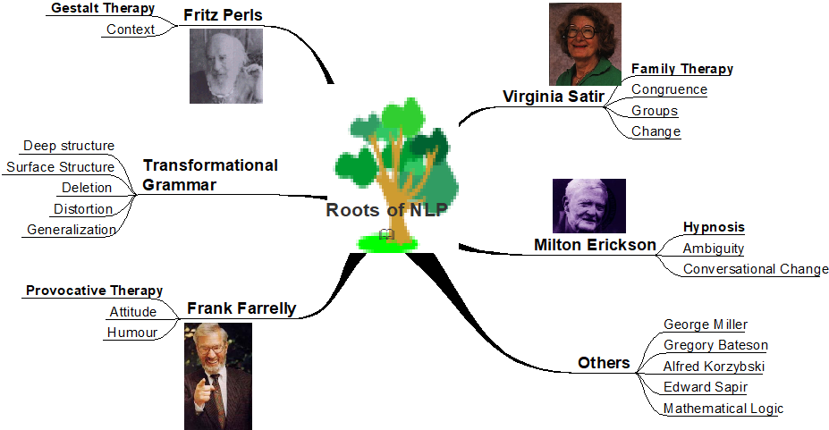

Diagram labels retained from the original vector image:

- Virginia Satir
- Fritz Perls
- Frank Farrelly
- Milton Erickson
- Others
- Transformational
- Grammar
- Roots of NLP
- &amp;
- Family Therapy
- Congruence
- Groups
- Change
- Gestalt Therapy
- Context
- Provocative Therapy
- Attitude
- Humour
- Hypnosis
- Ambiguity
- Conversational Change
- George Miller
- Gregory Bateson
- Alfred Korzybski
- Edward Sapir
- Mathematical Logic
- Deep structure
- Surface Structure
- Deletion
- Distortion
- Generalization

### Transformational Grammar

“What transformational grammarians have done is to develop a formal model of our language, a model of our model of our world, or, simply, a Meta-model.”

The Structure of Magic Vol 1,

Richard Bandler &amp; John Grinder

Transformational Grammar derives from Chomsky’s work in linguistics. NLP used the ‘surface structure &lt;&gt; deep structure’ model.

In order to communicate, we transform our deep structure (our model and experience of the world) into a surface structure (the things that we say). The surface structure is not the entirety of our richer deep structure model and we can transform our deep structure model into numerous surface structure representations.

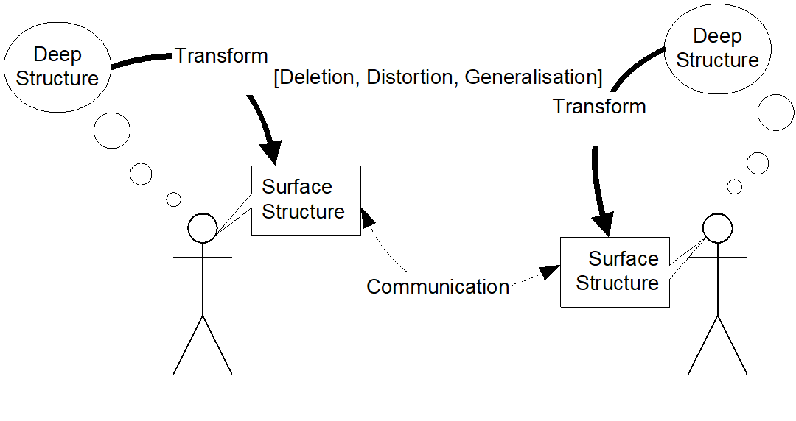

Diagram labels retained from the original vector image:

- Transform
- Deep
- Structure
- Surface
- Communication
- \[Deletion, Distortion, Generalisation\]

NLP Deep/Surface Structure Model

“When humans wish to communicate their representation, their experience of the world, they form a complete linguistic representation of their experience; this is called the Deep Structure. As they begin to speak, they make a series of choices (transformations) about the form in which they will communicate their experience. These choices are not, in general, conscious choices.”

The Structure of Magic Vol 1, pg 35

Deletions, distortions and generalisations occur as part of the transformational process so although we may know what we want to say, we somehow can’t say it effectively, or we miscommunicate it.

Software Requirements can be thought of as surface structure representations of the User’s much richer deep structure representation of the required software.

When using the Meta Model, we analyse the surface structure communication that is presented to us, and then ask a Meta Model question in order to receive more information about the client’s deep structure. This is presented to us in the form of another surface structure representation.

The process can help the client understand that they have a richer representation of the world than their surface structure communication suggests.

For Example: “I bought a Computer” is a surface structure representation of a deep structure. The deep structure contains all my memories of buying a computer, the strategies I used to decide which computer to buy, all the computers I discarded before choosing the one that I chose, how I felt buying the computer, how much it cost, was it value for money, what the shop/salesman was like. All of this has been deleted in my transformation from the Deep Structure to the surface structure statement.

The work of various therapists was examined in Transformational Terms to build a model of what processes the therapists used to examine the transformations the client used, and what transformations the therapist applied to the client’s statements to produce a response for the client.

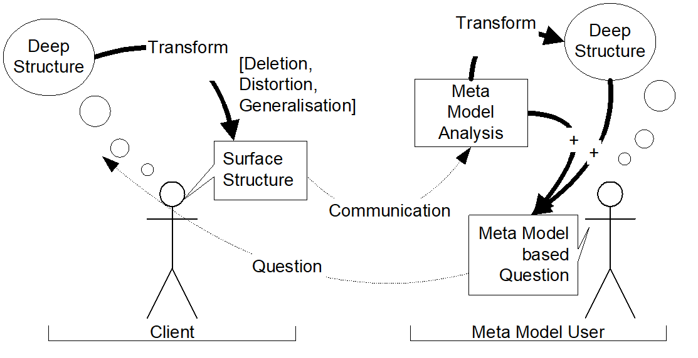

Diagram labels retained from the original vector image:

- Transform
- Deep
- Structure
- Surface
- Meta Model
- based
- Question
- +
- Communication
- \[Deletion,
- Distortion,
- Generalisation\]
- Client
- Meta Model User
- Meta
- Model
- Analysis

NLP Use of Meta Model

### Virginia Satir &amp; Family Therapy

|  | “…I too see, hear, feel something, think something, have a past, and have values and expectations; and my body is doing something. You don’t really know what I am sensing, what I am feeling, what my past is, what my values are, or exactly what my body is doing. You have only guesses and fantasies, and I have the same about you. Unless the guesses and fantasies are checked out, they become the “facts” and as such can often lead to miscommunications and traps.” Virginia Satir The New Peoplemaking |
| --- | --- |

Virginia Satir’s work has been brought to prominence in the software world by Jerry Weinberg. Virginia wrote the foreword to Jerry’s classic ‘Secrets of Consulting’ \[JW1\]. Both ‘Secrets’ and ‘More Secrets’ \[JW2\] are based on Virginia Satir’s self-esteem tools but expanded by Jerry. Virginia Satir’s work has also been presented to testers as a model of change by Joanna Rothman \[JR1\], and mention has been made to her work in many Software Testing papers.

Virginia Satir is famous for her work in the realm of Family Therapy, particularly Conjoint Family Therapy where she worked with the whole family as a group. In this way she was tackling the relationship dynamics of the whole group and helping each member of the group see the position of the other people in the group.

Of all the people that influenced NLP, Software Testing has already been influenced by the work of Virginia Satir. This might suggest that the other therapists modelled by NLP could have some relevance to Software Testing too.

Congruence, Self Worth, Parts Party, Group Dynamics, Growth Model, Survival Stances, Change Model

### Milton Erickson &amp; Hypnosis

|  | “In everyday life you overhear people saying to themselves, “Now just how did I do that?” What they mean is, they don’t know how they did it. They have only an incomplete view of how they did it. They then have to recover, step by step, the manner in which they did it.” Milton H. Erickson Hypnotic Realities |
| --- | --- |

Milton Erickson was incredibly influential in the field of Hypnosis and there is a whole field of hypnosis called ‘Ericksonian Hypnosis’ based on his work with non-inductive hypnosis.

Erickson influenced NLP based on his approach to communication and leading people to different states of trance in a conversational manner. His approach was modelled in 2 NLP books ‘Patterns of the Hypnotic Techniques of Milton Erickson’ volumes 1 &amp; 2 in a model known as the ‘Milton Model’. The Meta Model is used to remove ambiguity in communication whereas the Milton Model is used to create ambiguity in communication in order to induce trance and communicate via metaphor.

It sometimes seems to me that software development documents have been produced in accordance with the Milton Model to deliberately induce states of trance and harness the power of ambiguity. So that everyone thinks they agree on the contents and yet each person has managed to personalise it and create their own conflicting model of it. Software Testing documentation is not excluded from this statement, watch what happens when you hand someone a document and say “This is my testing strategy” – did you notice their eyes just glaze over?

### Fritz Perls &amp; Gestalt Therapy

|  | “…contact always occurs on the surface, it is the surface that the therapist must see. But make no mistake about it, that surface is much broader and more significant than the orthodox therapist will admit. First of all, their preconvictions prevent them from seeing much of it. And second of all, they tend to take it for granted, to talk about it contemptuously as ‘obvious.’ This is where they make their biggest mistake. As long as we take anything for granted and dismiss it as obvious we have not the slightest inclination to make a change nor do we have the tools with which to do it.” Fritz Perls, The Gestalt Approach |
| --- | --- |

The context in which we apply our trade as testers is become more widely discussed in the testing literature. Gestalt therapy deals with the context that the client deals with, reconnecting their context to what is actually happening now instead of what they want to happen or what they imagine is happening, or constantly dwelling on what has happened. Moving from their representation of the world to become aware of the world.

Fritz would ask his clients to fill in the gaps in their experience to explore the Gestalt of their experience. To help identify the communication elements that were not communicated.

Test Process Improvement can be viewed as a process whereby we connect our testing process to the ‘Now’ of the software development process. Become connected with and aware of the realities and the needs of our context, to perform more appropriately in that context and improve our dealings with it.

Context, Analysis, What is happening now instead of idealised representations of what should be happening, Awareness

### Frank Farrelly &amp; Provocative Therapy

|  | Q.: Do you keep provoking the client or do you drop this in the fourth stage of process when the client is bringing in a lot of data that he’s changed? R.: Why quit betting on a winning horse? No, I keep it up. Clients by this time will usually ask the therapist to be friends and “straight” with them, to which the provocative therapist characteristically responds, “Friends!? Do I look like the kind of guy who would take an emotional crip home to dinner? For my hourly fee I’ll talk with you, but be friends…? Come on, be reasonable now” Extract from Question &amp; Response #24 Provocative Therapy, [www.provocativetherapy.com](http://www.provocativetherapy.com) Frank Farrelly and Jeff Brandsma [Source link](http://www.provocativetherapy.com/) |
| --- | --- |

Frank Farrelly expanded the remit of therapy to include humour, honesty and provocative statements.

His aim being to provoke the client into

- affirming their self worth,

- asserting themselves appropriately,

- defending themselves realistically,

- engaging in reality testing and adaptive responses

- engaging in risk-taking behaviours in personal relationships, especially communicating affection and vulnerability.

Software Testing communication can be perceived as provocative by other roles involved in the software development process. Reading Frank Farrelly may give you ideas on how to harness that and use it deliberately so that you provoke when you want to, and avoid provocation when you don’t

Attitude, Honesty, Courage in our dealings with people

### Presuppositions of NLP

NLP is not something that was derived from an initial set of theories. NLP was derived through a process of modelling and usage. As such NLP does not have a fundamental set of axioms, it has a set of presuppositions and corollary presuppositions, or core concepts, which have been identified as NLP has grown.

The NLP Presuppositions can trace their routes back to the fields which NLP has drawn from, including cybernetics, general semantics, gestalt therapy, systems theory.

Dilts (@at [www.nlpu.com](http://www.nlpu.com)) lists the following as the main presuppositions, to which the others are corollary. [Source link](http://www.nlpu.com/)

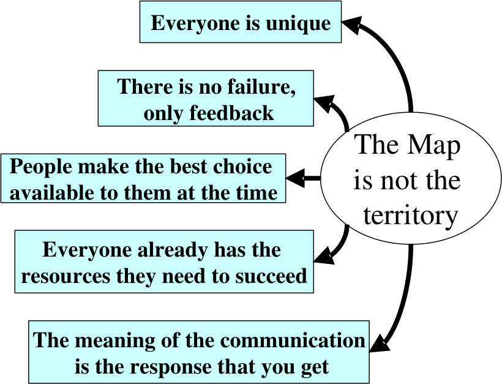

Diagram labels retained from the original vector image:

- The Map
- is not the
- territory
- Everyone is unique
- People make the best choice
- available to them at the time
- The meaning of the communication
- is the response that you get
- There is no failure,
- only feedback
- Everyone already has the
- resources they need to succeed

- The map is not the territory

- Biological Interactions are systemic (Cybernetic) as opposed to linear

The presuppositions are not always presented as formally as Dilts' and from the top of my head I remember the following para-phrasings as NLP presuppositions:

- The map is not the territory

- Everyone is unique

- People make the best choice available to them at the time

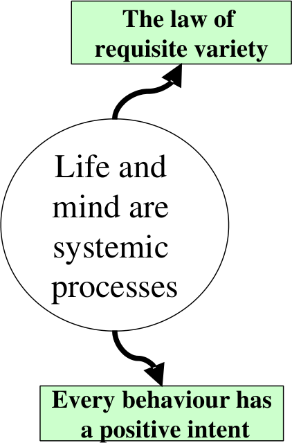

Diagram labels retained from the original vector image:

- Life and
- mind are
- systemic
- processes
- Every
- behaviour
- has
- a positive intent
- The law of
- requisite variety

- Every behaviour has a positive intent

- The meaning of the communication is the response that you get

- There is no failure, only feedback

- Everyone already has the resources they need to succeed

- Mind and body are a single system

- The law of requisite variety – the one with the most flexibility of thought and action is most likely to succeed

I find the presuppositions useful, because they:

- help build up a model of how people who use NLP view and interact with the world.

- Guide my understanding of NLP

- trigger deeper understandings of the more detailed conceptual elements of NLP

#### NLP Presuppositions and Testing

We will look at general presuppositions later when we examine the meta model.

For now, I want to take the presuppositions listed above and quickly examine them in the context of testing.

##### The map is not the territory

Because this is one of the core presuppositions we will find elements of it creeping in to the corollary presuppositions.

This presupposition is from General Semantics – particularly Alfred Korzybski's work “Science and Sanity”. The presupposition can also be found in the change oriented psychotherapies such as: Gestalt Therapy, Rational Emotive Behaviour Therapy, Provocative Therapy.

The basic point here is that we deal with our model of the world, or our 'map' of the world, and sometimes the world and our map differ. We shouldn't expect our map to be correct and we have to deal with the 'reality' of the situation rather than cling on to our 'map' or set of expectations of the world.

We have to be contextual in our dealings with the world and our software testing.

###### Everyone is unique

Test Scripting is a concept that seems to view uniqueness as a 'bad' thing and tries to mitigate the 'risk' of uniqueness. Almost as though saying “it doesn't matter how unique people are, by scripting our testing, we can avoid the uniqueness getting in the way”.

Is it possible to harness the uniqueness that people bring to a process or test team?

Various team population theorists, like Belbin, and Myers-Briggs, try to classify people to help management construct effective teams. While I am not a great fan of these classification systems, I do attempt to take into account the unique aspects of people in the team. By unique aspects I try to consider:

- testing skills

- people skills

- writing skills

- current predilictions

- learning aims

- speed of learning

- default approaches

- flexibility

- what information they need to learn and is it avaiable on the project

- etc.

###### People make the best choice available to them at the time

In testing our 'choices' are illustrated in our Test Strategies and Approaches. An hopefully we actually choose what to do rather than following some sort of prescriptive methodology.

'at the time' includes: a point in time, given our current knowledge of the system, given our current skill set, given the people on the team, given the process being adopted.

If our 'choice' is to follow a methodology because we have a methodology, then that can only be a 'best' choice politically, but not in terms of effectiveness.

But that doesn't mean we should stick with it, when at a later date we identify 'better' choices.

Our test strategies and approaches, our 'choices', will depend on what we know, and as we learn more

###### The meaning of the communication is the response that you get

Communication is not simply 'saying something'. Communication is defined in terms of an output and a response, and the response is what lets you know what was communicated.

Consider the following communications on a project:

- You release your test plan for review and no-one reads it

- You publish metrics which no-one asks questions about

- You explain your test process but people keep coming back with the same questions about testing:

    - When will you be finished? Is the software ready for release?

- You find a serious defect and your defect report gets marked down to a low severity

- Your defect reports are marked as 'cannot replicate'

We could try dealing with the reality of the above situations and assume that what we think we are communicating it not being received, and by analysing the responses that we receive, we can adjust and re-target the communication that we give out.

###### There is no failure, only feedback

For me, testing is all about feedback.

What would be the value in conducting testing without telling people the results?

When we conduct testing on an area and can't find any problems. Does that mean that there are no problems or does that mean that we haven't adopted an approach that finds the problems?

How many people try to adopt automated testing, only to have the automated testing cost too much, or involve too much maintenance, and then assume that “automated testing does not work in their environment” or “they can't do automated testing”. When the lesson that they should have picked up was not one of 'failure' but one of 'feedback' and use the feedback to re-evaluate the approach or bring new skills into the team.

###### Everyone already has the resources they need to succeed

Typically in NLP when dealing with people's problems and they say “I can't do X” then very often when you ask them to explore the situation and identify what they would need to be able to do X, then you find that they have that resource in other areas of their life or have worked that way in the past.

In testing, many of the skills that it will take to be a competent tester are not the techniques that we learn related to software testing they are the people skills, the thinking skills, the learning skills, the attitudes that we have adopted.

Many testers do not bring their full life skills to their testing environment.

##### Mind and body are a single system

The notion of systems;Systems Thinking and Systems Theory, is important in Software Testing. Our ability to see the application that we work with in terms of interconnected systems allows us to spot failure points and test for them. Our ability to view the processes in place as interconnecting communication processes is essential for being able to identify ambiguity. The construction of an effective test approach can be boosted by examining the context of the development process and business process, as a system and adapting any test approach to fit in with this system.

Testing does not exist in isolation, it is a system of interconnected systems, which interconnects with other systems. Treating Software Testing in isolation is a fast way of building an inappropriate Software Testing process.

###### The law of requisite variety [Source link](http://pespmc1.vub.ac.be/ASHBBOOK.html)

The law of requisite variety is taken from Cybernetics.

“The larger the variety of actions available to a control system, the larger the variety of perturbations it is able to compensate.”

In essence, a system can only control an input if it is able to model it internally, i.e. if it has enough variety to be able to represent it. And it has the capability to deal with that internal representation.

To look at this quickly for software testing:

- Does your testing process have the capability to handle the variety of the environment that it finds itself in:

- lack of signed off documentation

- timescales being squeezed

- no tools

- refinements to requirements and designs as the development process goes on

If your responses to some of the above are consistent, and don't necessarily work in the environment that you find yourself then you may lack the requisite variety to respond effectively in the environment that you find yourself.

e.g. The requirements change late in the process causing a lot of rework to your test documentation, if you carry on with your current process this means that you will have to extend the planned dates. Can you cope with this another way?

If your software development process has more requisite variety than the test process then you will struggle to work in that environment.

###### Every behaviour has a positive intent

This is a useful presupposition to keep in mind when dealing with people. 'Positive intent' really means 'perceived as appropriate for the context'. It doesn't mean 'good' since your 'good' may well be different from someone else's 'good'. But by examining what lies behind a behaviour then we can not only respond to the core 'need' we can also build up a model of that person's 'map' of the world, or more specifically, the context that you are working with.

#### The Law of Requisite Variety

This section expands on the Law of Requisite Variety to explores it in the context of software testing in more detail.

Stafford Beer, in “Diagnosing the System for Organizations”, describes requisite variety as “Only Variety can Absorb Variety”. Requisite variety is also described as “Only variety can destroy variety”. Stafford Beer's interpretation seems more relevant to organisation and process systems.

##### Relevance of Requisite Variety to Test Process

Consider how requisite variety applies to yourself in the following testing contexts.

- Team Process

    - More or less variety than development process?

    - Less Variety = Standard Process?

    - Must do X (if context does not justify it then reduced variety)

    - Never do Y (if context does not justify it then reduced variety)

    - How often does the test process change?

    - Does the test process match the documented dev process and not the ‘real’ dev process?

    - How often do you change the test strategy?

- Personal Process

    - Do you have enough technique knowledge &amp; experience?

    - Do you know the limitations of the techniques?

    - Do you use the techniques explicitly?

- Test Automation Environment

    - Tech environment has endless variety, does the automation have enough variety to survive?

        - Other apps interfere

        - Unexpected popups or windows from AUT

        - OS interference

        - Defects interfere

Online References for further study:

- [http://www.panarchy.org/ashby/variety.1956.html](http://www.panarchy.org/ashby/variety.1956.html)

- [http://artsandscience.concordia.ca/edtech/ETEC606/requisite.html](http://artsandscience.concordia.ca/edtech/ETEC606/requisite.html)

- [http://pespmc1.vub.ac.be/REQVAR.html](http://pespmc1.vub.ac.be/REQVAR.html)

- [http://nlpuniversitypress.com/html2/L09.html](http://nlpuniversitypress.com/html2/L09.html)

- [http://nlpuniversitypress.com/html3/R56.html](http://nlpuniversitypress.com/html3/R56.html)

### States

State: A condition or mode of being, as with regard to circumstances

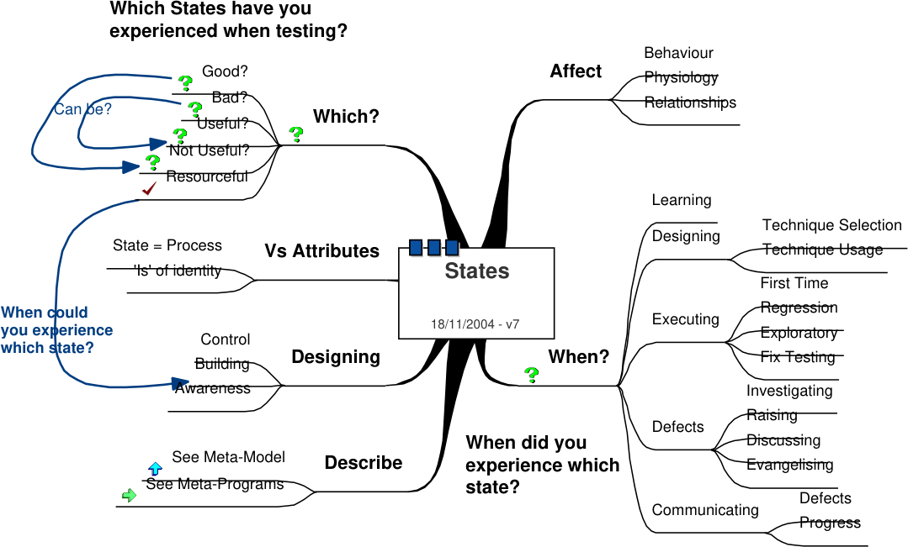

Diagram labels retained from the original vector image:

- Affect
- Vs Attributes
- When?
- Designing
- Which?
- Describe
- States
- 18/11/2004 - v7
- Behaviour
- Physiology
- Relationships
- State = Process
- 'Is' of identity
- Learning
- Technique Selection
- Technique Usage
- Executing
- First Time
- Regression
- Exploratory
- Fix Testing
- Defects
- Investigating
- Raising
- Discussing
- Evangelising
- Communicating
- Progress
- Control
- Building
- Awareness
- Good?
- Bad?
- Useful?
- Not Useful?
- Resourceful
- See Meta-Model
- See Meta-Programs
- Can be?
- Which States have you
- experienced when testing?
- When did you
- experience which
- state?
- When could
- you experience
- which state?

States are one of the inner secrets of NLP, and only once you are initiated into the mysteries of the NLP mythos do you get told how important they are.

How many things have you not done well because you were not in the 'right mood'? Even though you applied the relevant techniques, when you didn't 'feel like it', did it work out?

Have you ever heard a statement like “He doesn't have the technique but he has the right attitude and he's going for it?” being applied to someone?

One of the keys to doing NLP well is:

- constructing the right state,

- getting in to the right state for the context,

- maintaining the state.

Many NLP interventions are based around changing a person's state in certain contexts.

#### Attributes vs States

##### Attributes

Attribute: A quality or characteristic inherent in or ascribed to someone or something

On various testing courses I've heard people list and identify attributes of a good tester.

A good tester should be .... Curious, Tenacious, Courageous, Honest, Objective, Methodical

We can build a list of attributes that we can associate with a tester. But it is not enough to just name an attribute, a name is not the thing. An attribute is something that someone has. People have attributes in reserve, they don't display them all at the same time. An attribute manifests at different times. And if possible manifests at an appropriate time, and is manifested consciously and skillfully.

An NLP Assumption: The Map is not the territory

##### States

A State is something experienced - what having, and manifesting, attributes feels like, for example:

Curiosity: When was the last time you have become curious about something? What was it? How did you become curious? How did you know you were curious?

##### Attribute Identity

One of the many things that psychotherapy has identified that can be a problem for people is the identification with an attribute. “I'm a shy person”, “I'm just not smart”, “I'm not curious”

Korzybski \[KOR1\] calls this the 'is' of identity and in General Semantics - “Science and Sanity” in particular, removing the 'is' of identity is described as a method for becoming more sane and aware.

The identification of this process, and removal of it from a person's language is a common element in the psychotherapy process.

The process of changing the identification might be done as follows:

- attributes are converted in to states. “I feel shy”.

- Made conditional “I feel shy at times”.

- Made specific “I feel shy when I'm with people I don't know”.

- Which can be moved on to “I sometimes feel shy when I'm with people I don't know”

- and, by adding some responsibility for the state, can become “I sometimes choose to feel shy when I'm with people I don't know”.

- Which is very different from “I'm a shy person”.

#### A State is a process

We know from years of psychology research that our Mental State affects our Physiology. i.e when we feel sad, we get lethargic and our body posture changes, we don't think quickly etc. And when we feel happy we smile, we produce good chemicals, our posture straightens, we have engergy, we feel good.

We have to maintain states. We can see with children that they get sad and unhappy when they don't get their own way but then when they are distracted by something that they want then their state changes into a happy state, instantly.

Maintaining a state can be hard work. When you are unhappy how do you maintain that state? Do you keep visualising the event that you are unhappy about? Do you grumble and moan internally? All of this is maintaining the state. And if we can do it for bad states, we can do it for good states, and useful states.

##### A State is an outcome

- positively stated,

- well-formed (testable and demonstrable in sensory experience),

- sensory specific (what does the state look like and feel like when achieved),

- initiated and maintained by the subject,

- appropriately and explicitly contextualised

#### When to have which states

The most obvious example of states, for testing, that comes to mind are the states associated with dealing with defects.

If I am in a bad state when raising a defect then it can show in the writing that I use, I may use non-objective language, and emotive language. I may not think clearly about the way I'm writing the description and the defect may not be clear, I may not review the defect in a way that allows me to identify these flaws and I may end up writing a poor defect report..

Now the phrase 'a bad state 'doesn't really tell you anything about the state but one such state would be:

When I've found another simple defect in the software. I may be 'blaming' the developer by yabbering inside my head “... wasting my time, foisting poor quality software on the user without testing it first, such a basic error all they had to do was type this in...” yada yada yada. Everyone pretty much knows how to generate that state in them.

But it is not a conducive state for writing defect reports in. Other states which are not conducive to defect report writing:

- when I'm feeling tired and thinking about going home

- When I'm thinking about the tests that I still have to run instead of the defect that I'm writing

A conducive state, and a resourceful state, would be one that lets me focus on the defect objectively, so I'm looking at it dispassionately from a distance. A state that allows me to ask questions of the defect report to ensure it is complete. A state that allows me to evaluate and edit the language. I can't think of an obvious single name for that state since it contains a whole set of attributes, so that is my “Defect Raising State”.

#### Maintaining State

In State Transition Diagrams we are used to seeing the system 'being' in a certain state, and then moving from one state to another in a very definite way, with no blur between the states. People don't always do that. Creating discrete states isn't always easy. States are actually a dynamic process: in software in that there is usually a loop, and unless some input occurs which causes us to change state then we keep the software in the same state.

When people maintain state, they do it the same way, we have a loop going and then some stimulus comes along and we choose to react to it and change state. And if we are not doing it discretely then we might even believe we are still in the same state and not notice the change. People are good like that.

State Control is one of the skills that underpins NLP and is something that NLP'ers practice.

- Can knowledge of a technique help get you in the right state?

- Can knowledge of a technique compensate for not being in the right state?

- Can a state compensate for lack of technique?

- Can the right state be made better?

#### Testing States

Looking at testing states in a little more detail, there are a number of explicit states that I have identified and use regularly.

- Writing a Defect Report

- Investigating a Defect

- On Finding A Defect

- Planning Testing

- Estimating Testing

- Exploratory Test Execution

I change states regularly when testing and the following is a simple state change trail when testing:

Execute Test → Stumble across bug → Reaction → Investigate bug → Write Defect Report

The above shows a fairly simple state change trail when testing, each of the above activities has, at least one and possibly more, states associated with it. If we get distracted, or we overhear something, or we think of something that has been on our mind.

- Are you aware that you have different states when you are testing?

- Are your testing states different?

- Are your testing states ideal?

- Are your states 'clean'?

- Are these effective states documented in your test strategy? Or your how to write a defect guideline pack?

##### Clean vs muddled states

A muddled state would be carrying forward the reaction from stumbling across a bug into the investigation and then carrying it forward into writing the defect report. These are not states that we are in control of. These are states that affect us rather than states that we consciously decide to use.

#### Other Notes

Writing a Defect Report

Objective, standing back from the problem, simple and clear, states observed facts

Investigating a Defect – to repeat

When I want to know the basic setup that it takes to recreate the defect that I just stumbled across.

Curious

Investigating a Defect – to explore

Just how serious is this defect? Can I exploit it? Is it really something else?

##### How to Change State

##### How to Investigate a State

##### What is the Right State?

##### Language used to describe states

This leads on to the Meta-Model and to Meta-Programmes

When we talk about states we are really talking about processes, and by naming them we are engaging in a process of nominalisation, and when we combine states and name them then we are engaging in a process of generalisation.

References

\[KOR1\] Science and Sanity, Alfred Korzybski, related web links: online version \[[http://www.esgs.org/uk/art/sands.htm\]](http://www.esgs.org/uk/art/sands.htm]), institute of General Semantics \[[http://www.generalsemantics.org/\]](http://www.generalsemantics.org/])

### State Example: “Stuck”

Be extremely subtle, even to the point of formlessness;

Be extremely mysterious, even to the point of soundlessness;

Thereby you can be the director of the opponent’s fate.

Sun Tzu, The Art of War

This section is a worked example through the 'state' Stuck. I have found this a particularly important state to work through because sometimes when I ask testers “How do you know you've done enough testing” I get the answer “when I can't think of anything else to do.” or, as hear it “When I'm stuck”.

#### Stuck is a State, A State is a process:

Being stuck is a process, you might think that you are not doing anything, but you are. The ultimate key to becoming unstuck, or avoiding being stuck at all – is awareness.

#### Stuckedness differences between exploratory and scripted:

I have found that being stuck in exploratory testing is different from being stuck in scripted testing. When I have been stuck in scripted testing it was because I did what I set out to do and I think I couldn’t find anything else ‘worthwhile’ to do because:

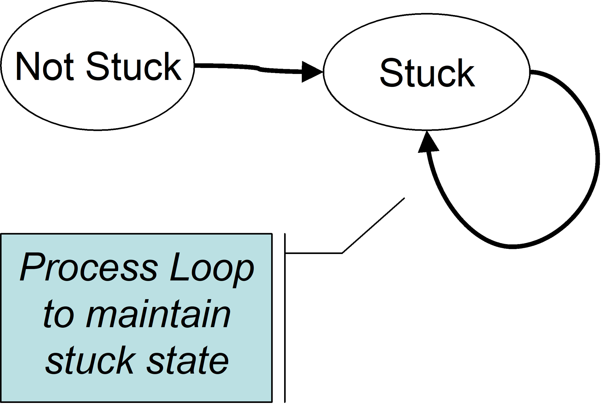

- I did not have the models I required to allow me to generate something new to do.

- I was not expanding the models and learning as I tested so I did not identify anything new to do.

The value associated with ‘worthwhile’ was the main stopper, because there was obviously more that I could have done. Not worthwhile in this case was a result of: I had a flow model, data model, condition model, all of which had achieved the initially planned coverage levels. So I was evaluating the ‘worth’ of future tests in terms of these models.

I have also been stuck in scripted testing because of external events that stopped me from running the tests I had written. When external events happen in exploratory testing we are more ready to try something, anything, with what we have to hand. Exploratory testing is aligned with “The art of advantage”.

#### Some Types of Stuckedness

- Replay of past

- Don’t know what to do next

    - Missing next

        - nothing to choose from – lack of ideas

        - I think I’m finished

    - Choice of next

        - Too many

        - Inadequate choice

            - Choices are too similar to what has been done

            - Available choices may not give desired results

            - Choices don’t seem like good ones

        - \[identify/improve your decision making strategies\]

- Don’t know how to do next

    - Don’t know how to do what I’m supposed to be doing now

- Don’t know how to move to next

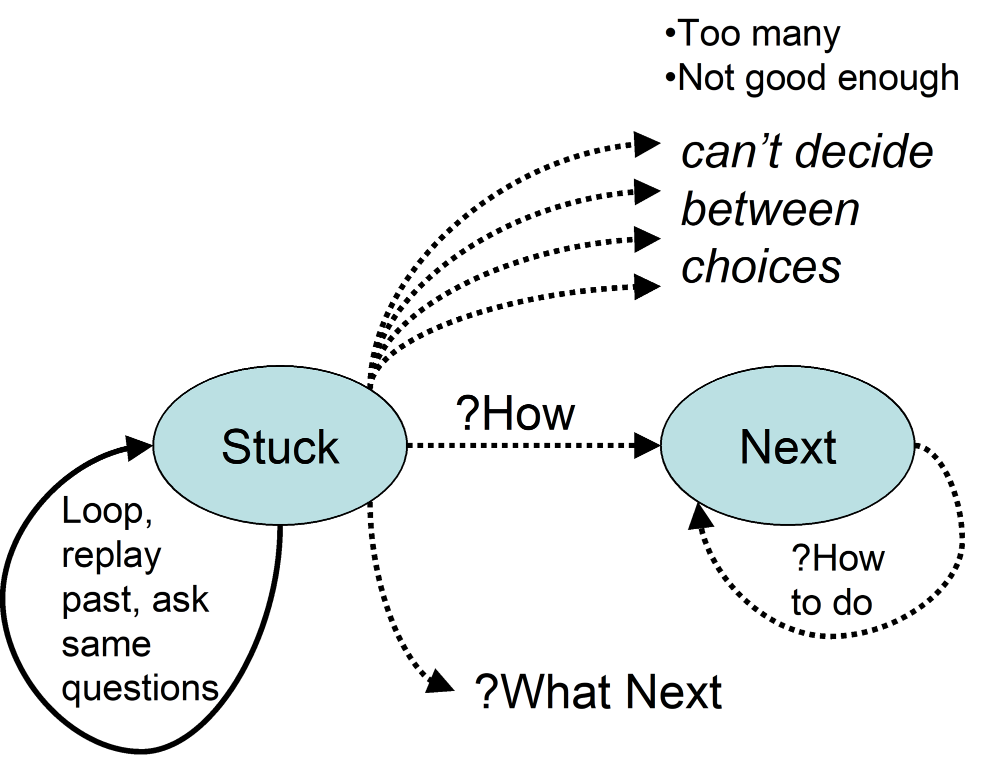

#### Examples of Stuck:

- Stuck for what to do next

    - After an hour into a 1.5 hour session, haven’t found any problems…aargh. Stuck: (what to do)\*, \[insert strategy\], ok…

    - \[=&gt;Not Stuck (explore, coverage expands)\]\[Stuck (what to do)\*\]\[...break loop with external strategy…\]\[Not Stuck =&gt;\]

    - Questions:

        - You have loads still to do. What do you mean by stuck?

            - I don’t know what will generate a problem

        - So the problem is that of all the things you could do, you don’t know which one would be best to do.

            - Action: evaluate choices, choose one

- I think I’m done, I can’t think of anything else to do

    - Generated Heuristics or lessons learned:

        - Have an ideas list which is added to (but not acted on) during a test session

        - External strategy generation strategies – stickomancy

        - Other people’s heuristics

        - Questions:

            - What have you not done?

        - Over reliance on models may hamper learning – generalise to over reliance on any tool may hamper learning, and flexibility.

- Stuck on a specific condition

    - Generated Heuristics or lessons learned:

        - Always have something else to do

        - Time box your testing

        - Time box the time you spend thinking about what to do next

        - Provide yourself with ongoing feedback of effectiveness

            - Monitor how you spend your testing time

#### Posture

With some states, simply changing your posture will change your state.

Changing your posture changes your physiology, and changing your physiology changes your blood chemistry, which changes the chemicals in your brain, which changes what you’re thinking.

#### Feldenkrais

Moshe Feldenkrais defined stuch as “...the obstacle a diffusion, damping, deviation, loss of impetus, break of continuity, or an impossibility due to one of the transformations.” (see NLP Encyclopaedia Moshe Feldenkrais entry @ [www.nlpuniversitypress.com/html/F12.html](http://www.nlpuniversitypress.com/html/F12.html))

#### States &amp; Resources

It is possible to change state by adding extra resources. Add a dash of humour, some irreverence, a little curiosity, now, is that person stuck?

We can do this because states are more than words. Sometimes people confuse states with words. We we say “I’m stuck” we are not describing how we feel, or how we know we are stuck, we have labelled the state, which makes it much more real. If we decompose the state into what the attributes of that state are: a little fear, a little frustration, a little confusion, a little annoyance. Then we can add a dash of something useful into the mix and change the state.

#### Questions

I would rather be able to work out what to do from first principles and if I’m stuck then I should be able to work out how I’m maintaining that stuck state and generate new options for myself.

When I was a developer I used to find myself talking through a problem with someone. And without them saying anything, I would eventually get to the point where I had an answer. We hold the key to the solutions of our own problems since so many of them are of our own making. Stuckedness is one of those problems of our own making.

It may be that we know what to do, but we don’t know how to make a decision that results in us doing what we decide what do.

What have you not done?

- to answer this you have to know what you have done, so maybe it is time to end the session early, work out what you have done and assess the gaps.

When there are too many choice:

- What can be done quickly?

- What can be started from where you are now?

Challenge the words.

- I’m stuck.

    - What do you mean stuck?

        - Well I don’t know what to do.

        - Well I don’t know how to…

        - Well I could do this, or this, I’m not sure which would be best.

Because you are dealing with yourself, you don’t have to worry about rapport so you can be as provocative as you like. (for more info read Provocative Therapy by Frank Farrelly [www.provocativetherapy.com](http://www.provocativetherapy.com)) [Source link](http://www.provocativetherapy.com/)

This is a change now because we have identified different types of stuckedness, each of which will require different questions to move on.

- Do about what?

- What do you mean by best?

- So who does know how to…?

- How could you come up with an idea to do something and then not know how to do it?

Continue to change questions until unstuckedness is achieved.

You may notice that in the margins of this document are responses to the statement “I’m Stuck” – use them, or make up your own.

#### Avoiding future Stuckedness through awareness

- Stuckedness is a loop process.

- Need to recognise stuckedness and exit the loop.

- Recognise the type of stuckedness and tackle it appropriately

- Avoid getting stuck in the first place – bypass the stuck state

- Be hard on yourself. If you are stuck you are procrastinating – shout at yourself and berate yourself. Drill sergeant yourself out of it.

- Be gentle on yourself. If you are stuck and you don’t have the resources you need to succeed. Counsel yourself out of it.

#### Change the loop, Change the state

- Examine the loop, identify the structure of your experience. Are you saying the same things over and over again? Say them in a different way. Faster, slower, different voice

- What do you think that this stuck stage is helping you achieve? What is the positive benefit that you are deriving from being stuck?

- Are you adopting the same posture? Change posture: stand up, wave your hands, smile like a Cheshire cat.

- Lighten up, have some fun

#### Exit the loop

- Stickomancy – the art and science of random divination

- Swap tasks

- Heuristics or “Unstuckedness Cheat Sheet Models”

- Write something down. Where are you, what are you stuck with?

- Ask yourself questions.

- Provoke yourself.

- Do something else

- Talk it out with someone

- Identify a state you would rather have, and start to generate that state in yourself

- Now, for something completely different

Products:

Here is an illustration of the notebook I use when I’m working and testing.

- In order to avoid being stuck I make sure I know what I’m supposed to be doing Now (Todos).

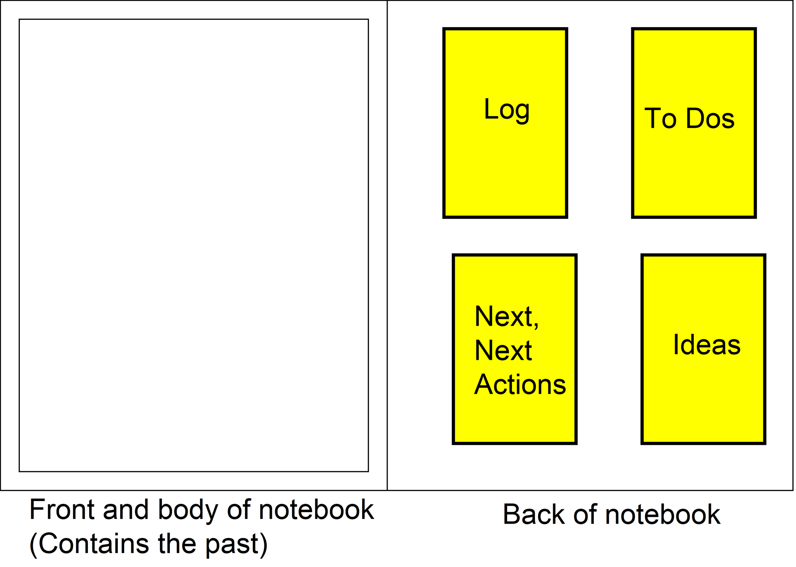

- What I’ve done (log).

- I note down ideas I’ve had that I will want to do, but don’t want to do now, or think about now because that would interrupt my current flow and may cause me to get stuck.

- “Next, Next Actions” which if I run out of things to do then I always have other things to do.

I use PostIt notes on the back of a notebook , using the notebook for larger notes and diagrams. (It is easy to flip to the back of the notebook so I stick them at the back).

#### End Notes

The side notes, of the form, “I'm stuck”, “Well stop wearing velcro then.” Are there because if we do say “I'm stuck” to ourselves, then we should challenge it. Engage in some provocative therapy, and move on.

Stickomancy, just in case you don't know what it is, is a form of divination where you open a book at random, and use the text in front of you as the answer to your query. This can be a useful technique for finding new test ideas. If you want to be professional about it then you could use a bug taxonomy as your oracle, but you can probably get value from trying to interpret any book to hand. In discussions at the LEWT 1 conference, in London June 2005. Stickomancy was described as a “Heuristic Trigger” to help stimulate some new creative thought.

If all else fails remember…

v. stuck, stick·ing, sticks v. tr.

To kill by piercing.

### Beliefs In Testing

One of the reasons we react the way we do, or adopt the states that we adopt, or decide what to do in a situation is because of the beliefs that we hold.

And we may not be aware of the beliefs that we hold. NLP has a model of beliefs which can be useful to help understand what we believe, and then we can use that to change the beliefs that we hold.

#### Methodology Monster

I have changed the way I do testing and view testing. And I have done that by examining, and changing, the beliefs that I have about software testing. I've done so much changing and examining I'm not even sure if I have any fixed beliefs about software testing any more. But I'm sure I must do since I adamantly disagree with some things I hear about software testing and that means that I'll have to do some more investigation to qualify those beliefs.

I certainly used to have a lot of fixed beliefs, I used to believe:

- Testing had to be fully documented

- We had to write test scripts before testing

- Test Scripts had to be detailed down to the test step level

- We could not test without documentation

- Requirements had to be signed off

- Test Artifacts had to be in the test repository database

- blah de blah de blah de blah... on and on and on I was a “Methodology Monster” and I don't think that is a good thing.

And sometimes the above beliefs are useful some of the time. But not ALL the time. I'm absolutely certain about that.

If I come in with a set of fixed beliefs, then those beliefs are going to define the context that I am going to work within. And if that is the case then I'm not going to analyse the context of what is actually going on. Or if I do then I'm going to analyse it through my belief filters.

It is hard to be contextual with a lot of fixed beliefs.

In NLP when working with someone we are trying to identify which beliefs are limiting, are restricting their choices, are decreasing their requisite variety.

We can do the same for testing.

I encourage you, implore you, plead with you; to analyse your testing beliefs.

If you identify any which act as limiting in the context that you find yourself testing then dumping them will improve your testing process immediately, instantly, and easily, and the only thing you change is yourself, and then your behaviour changes.

And if you find some beliefs that are present in your context that aren't yours then question them, challenge them, go around them.

### The NLP Model of Beliefs

The NLP model of beliefs is presented in "Changing Belief Systems with NLP" by Robert Dilts.

The logical levels model is a model of levels of processing:

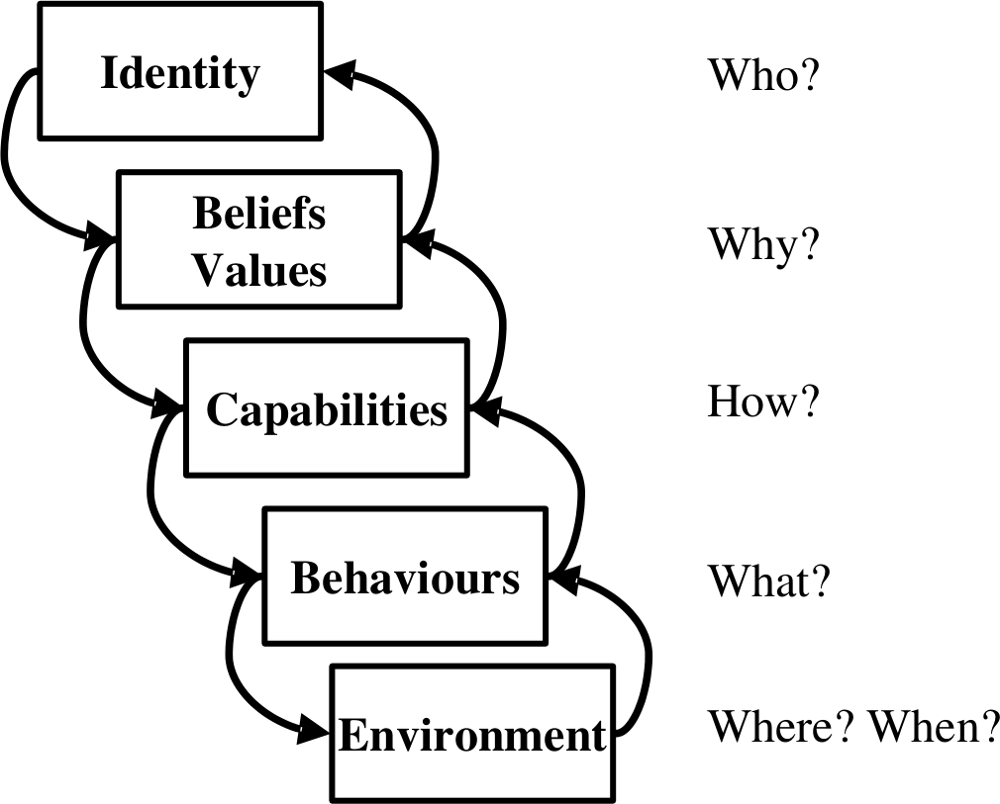

Diagram labels retained from the original vector image:

- Identity
- Beliefs
- Values
- Capabilities
- Behaviours
- Environment
- Who?
- Why?
- How?
- What?
- Where? When?

- The most basic level is Environment where there are the external influences and constraints.

- Our behaviour operates on the environment.

- Our capabilities are defined by our mental models and strategies and these guide our behaviour.

- The cababilities are organized by our belief systems.

- And beliefs are organized by identity:

During an NLP session if someone is having a difficulty then we can work with the logical level model to identify:

- if the difficulty is coming from the environment,

- or is it a response to the environment or an inappropriate behaviour in the environment?

- Do they have the capability for a more appropriate behaviour?

- Is there a lack of belief or an inappropriate belief which is interfering?

- Or is there an identification which is interfering? "I'm not the kind of person that does that."

Items at different levels change in different ways. It is possible to change behaviour by demonstrating a new behaviour and having the person try it out. If they don't have the capability to perform that behaviour then they can be trained.

Beliefs work at a different level than environmental, behaviour and capability so it is possible for a belief to be held in complete disregard for all evidence to the contrary, although this can make it hard to hold on to the belief, particularly if a belief is being developed and the capabilities, behaviours and environment are not there to support it.

Beliefs aren't really about reality. As a result of this beliefs can provide a motivation and vision for the future so that our capabilities and behaviours can expand and develop to meet them.

Example:

Many testers haven't had experience with test automation and haven't worked in an environment where automation exists. But they may hear things about it:

- Automation reduces the need for manual testing

- Automation is expensive but pays for itself over time

- With tool X, Automation is easy

When they start automating, they will have the above as a working set of beliefs.

If the tester doesn't have the capabilities associated with automation – which when they are learning they won't. And if they are working in an environment where automation is not suitable or is harder then they may come to change their beliefs, that:

- Automation is too hard

- Tool X is a bad automation tool

- Automation is bad

These will then change how they approach automation and analyse the automation contexts in future companies and projects.

#### Beliefs as generalizations

"A belief is a generalization about a relationship between experiences"

Robert Dilts – Changing belief systems with NLP, pg 20

Dilts goes on to define beliefs as:

- a generalization about Causal relationships

    - e.g.

        - "gaps in testing are caused by poor specifications"

        - "we have poor testing because none of the testers we have are certified"

    - what you believe the cause is, will change where you look for a solution

    - we often find what we are looking for, and if we believe it is there then we will find it there, even if it is not the true cause

- a generalization about Meaning relationships

    - if something happens, regardless of what causes it, what does it mean?

    - e.g.

        - If we have gaps in the testing then it means that the software is untested and we can't go live

        - If we have gaps in the testing then it means that we have to spend more time testing and delay the release date

        - if we have gaps in the testing then it means that we will have to monitor the software in live and be prepared to patch it quickly

    - The meaning we give it determines how we respond

- a generalization about Limits

    - Limits = Boundaries

    - "Testers shouldn't read the code" - there is a limit to how much they are allowed to know

    - "Our testers can't code" – so automation will not be considered

Generalisations will determine how we respond, our options for responding, and the solutions we are able to consider.

People change their own beliefs. People can be led to establishing a new belief. But the belief is established by the person themselves.

You own your own beliefs.

#### An existing belief model in Software Testing – Schools of Testing

The most obvious and well known discussion of beliefs in Software Testing is Bret Pettichord's 'Schools of Testing' model.

Bret Pettichord has presented a model of testing as having 4 schools of testing ([http://www.io.com/~wazmo/papers/four\_schools.pdf](http://www.io.com/~wazmo/papers/four_schools.pdf) ) [Source link](http://www.io.com/~wazmo/papers/four_schools.pdf%20) [Source link](http://www.io.com/~wazmo/papers/four_schools.pdf%20) [Source link](http://www.io.com/~wazmo/papers/four_schools.pdf%20) [Source link](http://www.io.com/~wazmo/papers/four_schools.pdf%20)

For Bret a school is defined by: Standards of criticism, Exemplar Techniques and the Hierarchy of values.

Bret's four schools are:

- Analytical – sees testing as rigorous and technical with many proponents in academia

- Factory – sees testing as a way to measure progress with emphasis on cost and repeatable standards

- Quality Assurance – emphasizes process, policing developers and acting as the gatekeeper

- Context Driven – emphasizes people, setting out to find the bugs that will be most important to stakeholders

I find that many people disagree with these classifications because they can't fit themselves completely in to one of them. The testers that I discuss the schools of testing with seem to hold beliefs that map on to multiple shools.

The way the 'schools of testing' model is presented, people interpret the schools in terms of 'identity': "I am a Factory tester" "People are 'Factory' testers" "People are Context Driven". Most people, at least those that I have spoken to, believe themselves to be Context Driven and that even when the description of a Factory test process is closer to the process that they currently use than the Context Driven description, they will still consider themselves to be 'contextual' because the Factory variant that they have in place is what they believe their context requires.

The Context Driven school can be viewed as a 'meta' school in that, there may well be a context where the 'Factory' school is the best fit. However, the context driven school has particular principles which are outlined @ [http://www.context-driven-testing.com](http://www.context-driven-testing.com) which may not be shared by the Factory school. [Source link](http://www.context-driven-testing.com/)

However, because it is possible to be Context Driven and put in place a process which resembles a 'Factory' test process because that might be most appropriate for the context. People will argue that they are contextual.

To me, ultimately it doesn't matter, what matters, at least to me, anyway, is the degree of flexibility the person exhibits and that their belief system allows them flexibility.

What follows are Bret Pettichord's words, which I have categorised into the NLP model:

|  | Analytical | Factory | Quality | Context |
| --- | --- | --- | --- | --- |
| Identity | - Software is a logical artifact. - Testing is a branch of Computer Science/ Mathematics | - Software development is a project - Testing is a measure of development progress |  | - Testing is multidisciplinary - Testing is a skilled, mental activity |
| Beliefs/ Values | - Testing techniques must have a logico-mathematical form - Testing is technical - Testing is based around the question of – which techniques should we use? - Code coverage provides an objective measure of testing - Testing is verifying that software behaviour conforms to specification | - Testing must be cost-effective – low-skilled workers require direction - Testing must be managed : predicatable, repeatable, planned - Testing is following rules | - Software quality requires discipline - Testing determines whether development processes are being followed - Testers protect users from bad software - "Quality Assurance" is better than "Testing" - Testing is a stepping stone to "process improvement" |  |
| Capability |  | - What metrics should we use? - How can we measure that we're making progress? - When will we be done? - All requirements must be traced to tests - Testing standards, "best practices" and certification |  | - Testing finds bugs. A Bug is anything that could bug a stakeholder. - Testing provides information to the project |
| Behaviour |  | - All requirements must be tested | - Testers may need to police developers to follow rules | - What testing would be most valuable right now? |
| Environment | - Precise and detailed specifications are prerequisites for testing | - V-Model - Requires clear boundaries between testing and other activities (Start/stop criteria) | - A good process must be in place and followed | - Software is created by people. People set the context - Exploratory Testing - Expect changes, unchallenged assumptions are dangerous, Pragmatism, focus on skill over practice |

#### Beliefs about Expectancy

When you try to change your test process, what do you think will happen?

Types of Expectancy Beliefs (from "pathways to health and well-being")

- Outcome expectancy

    - What you expect to happen. Whether you believe a goal is achievable.

    - No Outcome Expectancy = Hopelessness

- Self-efficacy expectancy

    - you have what it takes to achieve a goal

    - No Self-efficacy expectancy = Helplessness

- Response expectancy

    - what you expect to happen in response to the actions you take

    - e.g placebo effect

    - Response Expectancy = Response Achieved

The expectancy beliefs that we have may direct the outcome, regardless of the steps we take to reach that outcome.

#### Why is this important?

- When we want to change a test process we are going to

    - impact other people's beliefs – and they will defend them

    - be impacted by our own beliefs - and we may try to defend them

Most people don't know what their beliefs about software testing are, or even that they have beliefs about software testing.

People assume that what they do in software testing, or think about software testing is:

- normal,

- standard,

- what everyone else thinks,

- has nothing at all to do with belief, and everything to do with reality

And all of the above are probably wrong.

Every test project I have been on, has been different. I have had to do different things, and apply different weightings of importance to the techniques and tasks that I do. I have had to produce different formats of document, aimed at different stakeholders.

And over the years, I have been justifying what I do, in terms of the context that I'm working in, rather than what I believe is important about software testing. Because my beliefs are not geared around systemic thinking and contextual analysis rather than 'Factory', 'Academic' or 'Quality' testing styles.

#### To Change Beliefs [Source link](http://www.ivorcutler.org/) [Source link](http://www.pixelhead.com/weblog/2005/05/i_believe_in_bu.html)

I don't think it is really that hard to change most people's beliefs about software testing. After all software testing isn't that important. Most people have the beliefs that they have about software testing because they haven't really questioned them. Or because that is what they did in the past. Or because that is what they learned to do.

Unless you are some world renowned guru on software testing and have to hold on to the statements you made in the past because you don't want to look stupid, but then you are going to look stupid since everyone gets things wrong, and everyone changes their mind.

Chances are your beliefs can change quickly to at least have possibilities in them. And that is one of the early steps of belief change. Is it even possible to belief something else?

- Identify old belief

- Identify a new belief to change to.

- Belief that it is possible to hold that belief

- Belief that it is possible to change beliefs

- Change belief

    - Identify structure of belief (strategy)

    - Add resources

    - Possibly change the goal of the new belief incrementally to get to the new belief

Can target beliefs at different levels:

If it is a capability belief - is it possible to develop that capability?

How could you go about developing that capability?

Have you had that capability in the past?

#### Viewing Software Requirements as Beliefs

How many projects have software requirements that are incontrovertible? How many projects end up blaming the requirements as being wrong? How many projects complain that the requirements changed?

What if we thought of requirements as beliefs? We know that our beliefs can be flawed. We know that we don't really understand our beliefs very well and that sometimes there isn't a very firm framework for believing some of the things we believe. We know that beliefs change over time.

What if Software Requirements were viewed as some stakeholders' beliefs about the software. That might then cause us to think that:

- they might not actually match the reality of what is required

- they might not have been thought through enough to be thought incontrovertible

- we should probably expect them to change overtime as they learn more about the reality of the thing they believe that they already know

And how would that affect testing?

It would mean that we would be skeptical of them.

We would be skeptical of:

- the firmness of the framework they are based on,

- their completeness,

- their unchanging nature

And this would lead us to:

- Question the beliefs

- Question the decisions and follow on work based on them

- Work in a way that anticipates and expects changes to the beliefs

The above is a model of that I find useful when deciding how I am going to document my testing and pursue the information that I need to conduct my testing.

#### Functional Fixedness

Beliefs can lead to functional fixedness.

Functional Fixedness is a psychological concept (originating in Gestalt Psychology) where people apply the things they have learned to other situations without thinking through alternatives or applicability. Duncker defined functional fixedness as being a "mental block against using an object in a new way that is required to solve a problem."

In one sense, all the 'things' we have are tools: processes, skills, techniques, attitudes, states, documents etc. These are all tools. And how we choose to apply them can make us more or less flexible, more or less capable, and more or less successful.

If our beliefs lead us to Funtional Fixedness so that we always approach testing problems or situations by introducing signed off requirements documents then we have entered the land of 'Functional Fixedness' and this may not be the most effective way to approach the situation.

Further Reading on Functional Fixedness:

- [http://en.wikipedia.org/wiki/Functional\_fixedness](http://en.wikipedia.org/wiki/Functional_fixedness)

- Controlling Functional Fixedness: the Essence of Successful Reuse, Liesbeth Dusink, Larry Latour, \[[http://www.cs.umaine.edu/~larry/latour/ECAI/paper-sent/paper-sent.html\]](http://www.cs.umaine.edu/~larry/latour/ECAI/paper-sent/paper-sent.html])

### Belief Chain:

Tester Certification is a good thing

Factory: Yes, it makes testers easier to hire, train and manage

Quality: Yes it increases their status in the organisation

Context: No, it is based on doctrine and practice, not skill and effectiveness

Analytic: No, testing requires a university degree

Testers can test without specifications

Context: Yes, we can still ask questions and test the software, the spec is probably wrong anyway

Analytical: Bret says impossible: I don't think they do believe that

Factory: You need a spec

Quality: Irrelevant, you need a spec, it is part of the process

### Beliefs and Meta Model

- Beliefs: generalisations

- Beliefs are Deep structure constructs

    - the surface structure changes with our state

- Universal Quantifiers:

    - Always, Never

- Modal Operators

    - Permission, obligation, volition, possibility, necessity, prediction

    - Should, Must (logical level: environment, behaviour, identity)

    - Can't, (logical level: cabability)

    - will, won't (see also cause effect)

    - Context Testing Modal Operators

        - May, Could, might

## What can the NLP Meta Model do for testers?

“…the goal of the Meta Model is not to find the ‘right’ answers, but rather to ask better questions – to widen our map of the world rather than to find the ‘right map of the world’. The purpose of the Meta Model inquiry system is to help identify missing links, unconscious assumptions and reference experiences that make up the ‘deeper structure’ of our conscious models of the world.”

NLP Encyclopaedia,

Robert Dilts

The Meta Model provides testers with a simple model of 12 communication violations that can be found in software development communication (both verbal and written). Communication violations can be the source of ambiguity, missing information, distorted information, and potential defects.

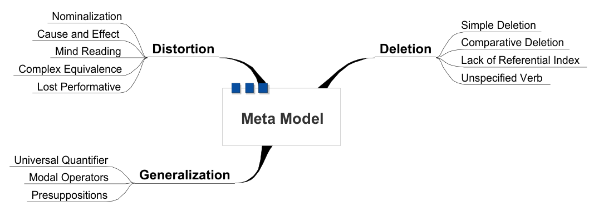

Diagram labels retained from the original vector image:

- Deletion
- Distortion
- Generalization
- Meta Model
- Simple Deletion
- Comparative Deletion
- Lack of Referential Index
- Unspecified Verb
- Nominalization
- Cause and Effect
- Mind Reading
- Complex Equivalence
- Lost Performative
- Universal Quantifier
- Modal Operators
- Presuppositions

The NLP Meta Model

I have outlined below, some of the ways in which knowledge of the Meta Model can be useful to testers:

- Apply the Meta Model to the communication we receive, identify ambiguity and possible mistakes early, before being encoded in the system

- Apply the Meta Model to the communication we give to,

    - Improve defect reporting

    - Help people understand what we aim to do

    - Improve development team/test team relationships

- Apply the Meta Model to the system to identify areas of test and as a test derivation aid

    - “The docs say the system will Always do this, if I can find a situation under which it doesn’t then...”

- Teach testers an easy, effective and repeatable approach to documentation analysis

- Apply the Meta Model to our beliefs about our environment and provide a framework for thinking about our context of testing

### A Questioning Model

One aspect of Software testing is a lot of questions of the system. How does an effective Software tester know what test to carry out? How does an effective therapist to know what question to ask next of the client?

A therapist that knows the Meta Model can use the framework it provides to ask a question based on the information that has been given by the client and assimilated into a model by the therapist.

The tester does a similar thing. By building a model of the system, the tester can apply the Meta Model to the answers received in response to previous questions and based on their model of the system to ask more questions of the system.

The use of the Meta Model and the process of Software Testing are very similar. One of the things that the Meta Model does is direct us towards targeted and specific questions based on the semantic illformedness in the communication that we encounter.

One of the things I used to do, and indeed still do, when viewing documentation is to view it with a very simple “Why? Where? When? What? How? Who?” model. This is a very generic model and it is often possible to ask all 6 questions against any statement in the requirements document.

The Meta Model gives us questions to ask within a more contextual framework, based on the semantic illformedness in a given communication.

Skilled usage of the Meta Model depends on knowing when to ask one question above others, to know which semantic illformedness to follow up. Sometimes we may want to expose a generalisation and reveal an ambiguity so that the communicators take the document away and reformulate the communication (this is one of the aims in Tom Gilb's ‘Agile Review Inspections’ process in Competitive Engineering). Do we want to get more information in order to provide a counter example?

A key skill for testers is the ability to answer, “What is going to go wrong with this system?” I find parallels between this skill and the Meta Model structure of ‘presuppositions’.

### Communication we give and receive

| 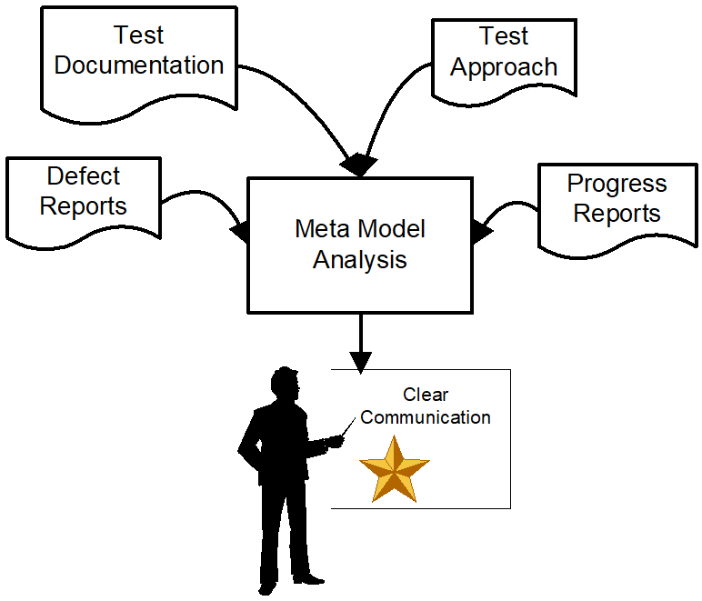 Diagram labels retained from the original vector image: - Meta Model - Analysis - Test - Documentation - Approach - Defect - Reports - Progress - Clear - Communication | 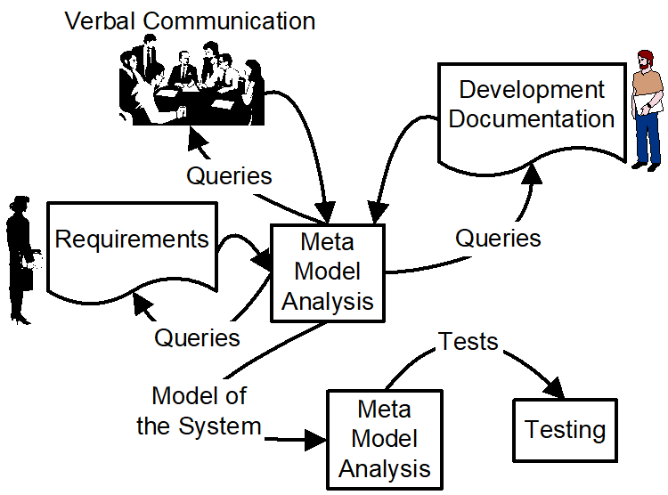 Diagram labels retained from the original vector image: - Meta - Model - Analysis - Requirements - Development - Documentation - Verbal Communication - Queries - Model of - the System - Testing - Tests |
| --- | --- |
| Apply the Meta Model to our own work and communicate clearly | Build a clearer model, and question the system, by applying the Meta Model |

We can gain some control over the interactions we have with others. We cannot control the people we deal with, and it may at times seem that we cannot control the systems we test. But we can control how we react to the communication we receive, we can control how we provide information to people. The Meta Model gives us more control over the aspects of the communication process that we can control.

The Meta Model deals with structure of communication. It deals with how a model of the world is constructed, not why. Software Testing deals with How. Even when we write a defect report and investigate how the defect occurred, we are looking at how the defect occurred and what evidence we have to support it. If we introduce Whys into the defect report we risk alienating the reader by providing an explanation that they do not agree with. Filtering defect reports through the Meta Model helps improve the communication of defects.

### Make Conscious What we do

“…to talk about it contemptuously as ‘obvious.’ This is where they make their biggest mistake.” Fritz Perls

In some sense, the Meta Model is commonsense and some testers may look at the Meta Model and say “I do all this anyway” as they have previously asked some of the questions documented by the Meta Model.

| “This is all stuff I know.” “This is all stuff I do as a tester | } | Do you apply it consciously? Could you teach me to do it? |
| --- | --- | --- |

The benefit of learning about the Meta Model is that we can have a greater understanding of what prompts us to ask certain questions. We can return to the model when under pressure to remind ourselves of possible questions we can ask.

The Meta Model: by naming and describing certain violations, by giving specific questions, by giving ways of practising these questions and identifying when to ask them, allows you to apply these processes more consciously, and enables you to explain what you do.

Some of the skills associated with use of the Meta model for testing are skills that testers probably develop as they get more experienced with testing. By learning the Meta Model we can short cut a path to the attainment of those skills.

### Simple to Apply

Diagram labels retained from the original vector image:

- "The daily trade file must be processed in under 5 seconds when the system starts up"
- LP
- SD (1)
- MO
- UV (1)
- SD (3)
- SD (4)
- UV (2)
- SD (2)
- Effect
- Cause
- CE

An example requirement annotated using the Meta Model

When reading requirements documentation, I make notes on the requirement documentation and build adhoc summary diagrams. I apply the Meta Model when I go through the document by annotating the document with LP(Lost Performative), RI(Referential Index), D (Deletion), etc.

I prefer to go through a requirement document several times, and each time I can identify whether my concerns about a Lost Performative are justified (my question may have been answered later in the document). Using the Meta Model has meant that I can go through requirement documentation faster and produce less long hand notes to represent my concerns.

## What is the NLP Meta Model?

The NLP Meta Model is a system of inquiry to explore areas of communication that are susceptible to ambiguity.

The Meta model was described in the books “The Structure of Magic” by Richard Bandler and John Grinder. It is a study of the language of therapy and is a description of the application of how language was being used during therapy in the 70s.

The Meta Model is open ended in that it is a method of inquiry and each application of the Meta Model elicits another surface structure description of the client’s deep structure. This surface structure description can then be subjected to another Meta Model inquiry. In much the same way that testing is an open ended task, there is always another test that could be run.

Just as Testing is not just to test for the sake of testing, the Meta Model is not just to get information for the sake of information. Testers get information to effect change in the development team’s beliefs about the system. The Meta Model is used to get information to allow therapists to elicit a change in the client.

Testers can ask questions to get the information if it seems to you that the transformation has resulted in a communication that may be ambiguous enough to cause problems of understanding.

There is a lot of overlap between the questions in the Meta Model and with a single statement; there are usually a number of Meta Model questions that are applicable. In order to identify which question is suitable, we have to have in mind the kind of information that we want to obtain. Much like testing, in order to decide what test we want to run, we have to know what we want to know about the system.

Diagram labels retained from the original vector image:

- Deletion
- Distortion
- Generalization
- Meta Model
- Simple Deletion
- Comparative Deletion
- Lack of Referential Index
- Unspecified Verb
- Nominalization
- Cause and Effect
- Mind Reading
- Complex Equivalence
- Lost Performative
- Universal Quantifier
- Modal Operators
- Presuppositions

Categorisation taken from the Appendix of ‘Persuasion Engineering’

There is overlap between each of the Meta Model elements and arguments can be made for putting them in different classifications e.g. Complex Equivalence could be classified as Deletion if we were to focus on the equivalence as being deleted from the statement. As you examine the Meta Model elements in more detail you will identify which ones can be placed in different categorisations.

What is important is not the Classification but the impetus behind asking the Meta Model question, i.e. when we identify a Meta Model element what is the information that we want to get from asking the question.

Recognition of Distortion, Deletion and Generalization allows us to apply a less detailed analysis to a statement:

- What is missing from this communication that might cause problems,

- What is distorted in this communication, and presented, without adequate specification

- What is generalized in this communication and what is implied by that generalisation

When I analyse previous testing projects from the point of view of the Meta Model, I find that much of the testing I have derived from the Meta Model is associated with Generalizations and Deletions. Many of the requirements and specification issues that I identify are also associated with Generalization and Deletion.

However, much of the inter-team communication problems were associated with Distortion.

Note: Each of the Meta Model elements are not wrong or bad. Depending on the context, they may be highly appropriate and exactly right. They can be sources of ambiguity, and ambiguity, in software development communication, can be a source of error and sources of self-fulfilling prophecy.

### Generalization

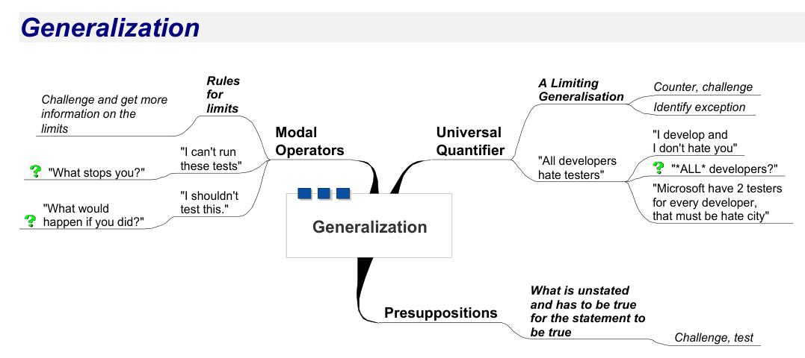

Diagram labels retained from the original vector image:

- Universal
- Quantifier
- Modal
- Operators
- Presuppositions
- Generalization
- A Limiting
- Generalisation
- Counter, challenge
- Identify exception
- "All developers
- hate testers"
- "I develop and
- I don't hate you"
- "\*ALL\* developers?"
- "Microsoft have 2 testers
- for every developer,
- that must be hate city"
- Rules
- for
- limits
- Challenge and get more
- information on the
- "I can't run
- these tests"
- "What stops you?"
- "I shouldn't
- test this."
- "What would
- happen if you did?"
- What is unstated
- and has to be true
- for the statement to
- be true
- Challenge, test

I have had a lot of benefit from the use of presupposition analysis in my testing, and this one aspect of the Meta Model alone, has been worth the study time.

I have encountered the results of unidentified processes of generalization in software construction that led to special cases being inserted into code during testing process, which gradually led to chunks of code that were more complicated to test and prone to failure if change was necessary.

I also find the Generalization constructs useful for quickly deriving tests to run against systems.

#### Presuppositions

“…Up until this stage, a grandmaster’s thoughts have been based on general ideas and strategic principles. Now, at long last, he will start looking for the best next move. He will establish what moves are possible, and how they fit in with his plan. Then he will begin analysing many variations. For each of the moves he will examine he will foresee the opponent’s reply, then his best answer and so on. Only after finishing this immense task, now purely analytical, will Smyslov move a piece and stop his clock. Thinking over, move made!”

Think Like a Grandmaster,

Alexander Kotov, 1971

A presupposition is an element in a statement that must be true for the statement to be true.

- “The test tool doesn’t generate the test cases”

    - There is a test tool, I wonder which one it is?

    - Test Cases are generated.

    - What does generate the test cases?

Presuppositions may be presented as assumptions that are so taken for granted that they don’t need to be checked.

In requirement documents you can often identify unstated requirements by examining the presuppositions.

Presupposition analysis can help identify potential problems early.

“The daily trade file must be processed in under 5 seconds when the system starts up”

Some of the presuppositions in the above statement and some of the responses that a tester might have to those presuppositions:

| There is a daily trade file | what if it doesn’t exist? |
| --- | --- |
| The trade file is generated in some way | by what system? |
| The trade file is accessible | is it on our environment, where does it reside? What if the permissions are set wrong? |
| The trade file can be processed | What if it is corrupt? |
| The trade file is a file | What kind of file? Binary, Text?) |
| The system will startup on a daily basis | What if the system doesn’t start up one day, does the trade file get overwritten or something worse? What if the system starts up more than once? |

Presupposition analysis can help us identify preconditions for tests, and possibly help us order the tests

Presuppositions can be used by testers to generate Test Conditions.

We can generate 2nd, 3rd, 4th, …, order presuppositions by subjecting our presuppositions and the questions we ask of those presuppositions to presupposition analysis. The quote from Kotov at the head of this section illustrates the process of bifurcating presupposition questions well.

I can either ask those questions of the development team before the application

is created, if this is a requirement. Or I can target them with testing.

The notion of presuppositions can be used on GUI systems too.

When faced with a screen, what has to be true for this screen to be true?

- The item displayed exists (what if it doesn't?)

- The item displayed must have those details (what if it doesn't? what if it has been changed elsewhere?)

Testers learn to do this process as they become experienced with testing. For me, having a name for it ('presupposition analysis') has allowed me to do this more consciously, practice it, use it more often, and get more benefit from it.

When a Chess Grand master is playing, they work with a constructed model of the opponent that stretches for several moves ahead. Presuppositions are key to the construction of that model.

When I receive a communication from someone, what is presupposed by that person's statement that has to be true for their statement to be true. Because if any of those presuppositions are not true then that may invalidate that person's overall statement, and if the statement is one which is not helpful to their world view then we can go some way towards helping them explore a new world view, give them choices and conduct effective therapy.

If I am faced with a screen, or a requirement or a set of functionality in a system and I start thinking about the presuppositions associated with that. Then an approach to testing is to see if I can invalidate any of those presuppositions.

Warning, Rapport Buster, Assumptions are not presuppositions

Sometimes when faced with a Meta Model element. We ask questions that are not associated with the surface structure presented, there is nothing wrong with this, the questions suggestions, and we are pursuing information so if we identify information we want we should go after it. But the Meta Model is not a mechanism for building rapport between speakers and if used injudiously can lead to communication complications. And so can non-Meta Model communication, but with knowledge of the Meta Model you might have a better chance of figuring out how you got a specific response to your communication.

E.g. faced with the statement

“It is wrong to test without writing test scripts.”

A questioner might fill in a deletion and expand on the unspecified verb

“It is wrong to &lt;perform test execution&gt; without writing test scripts &lt;first&gt;.”

Then tackle the modal operator ‘first’ with the question

“What would happen if you did?”

Now if the questioner has filled in the gaps with the correct assumptions then they have managed to jump ahead in the Meta Model questioning.

If they got the wrong assumptions, or the speaker wasn’t ready to have their model of the world questioned so quickly, a statement of resistance might be forthcoming.

“Look, its just wrong, I can’t believe you’re even asking, I thought you knew what you were doing!”

At which point the questioner might want to drop their assumptions and target the surface structure presented.

“Yeah, you’re probably right, I just wondered where you got that rule from?”

#### Universal Quantifier

(All, Never, Every) M : 1 (Just that, Only)

“They never listen to me”, “He always puts me down”. In a therapeutic context, these statements can lead to the client having limited beliefs about their world, which the therapist can challenge and expand the range of possibilities open to the client.

When universal quantified statements are present in software documentation “The system will always…” “The system will never…” then this leads to a number of obvious thoughts that the tester can consider:

- These kinds of statements are crying out for a counter example. The statement may be a limiting belief about the software that should be challenged early in the project, to ensure that the exceptions have been considered.

- Specifically constructing tests to try and identify any exceptions to the statement, exceptions that would then be classed as defects.

- The tester may need to consider a test data strategy based on combinatorial test data generation techniques (orthogonal arrays, allpairs) to provide comprehensive data sets to test against.

Part of a Test Process Improvement involves examining our beliefs about the Software Test process and identifying which beliefs are useful and which are not. I have seen situations where a test process has reached a high level of maturity with rigorously defined processes and rules about how testing must be conducted.

Effective TPI deal with appropriateness. And it is useful to examine the Universally Quantified rules in a test process to see how universal they actually are.

- “Never let software testers see the source code”

- “Never let the same person that coded it, test it”

- “Always write a test script before running a test”

- “All tests must be cross referenced to requirements”

We may discover that we cannot readily justify these statements on all our projects and that our process of TPI has gone a step to far and generated generalisations rather than increasing our ability to do more effective testing.

#### Modal Operators

Should, Must, Could, Need, Might

In people modal operators can be used as motivators for change. We can achieve different results in communication by changing the modal operator in a statement. “I must wash the dishes.”, “I should wash the dishes.”, “I could wash the dishes”, “I need to wash the dishes”. Try it out for yourself, some statements motivate you to do it, others have presuppositions of choice and you might choose to ignore it and put it off, others might build feelings of resistance due to the language used.

In requirement documents some modal operators of possibility can add ambiguity. {Might, May, Often} “The system might need to reset itself” Under what circumstances? Does it Always do it under those circumstances or just sometimes? Is it random?

Being aware of the modal operator when reviewing documentation allows us to ask specific questions to quantify requirements when necessary to remove ambiguity.

Note: Use of the Meta Model does not have to be done in a way that bludgeons the people you work with an endless series of questions. Skilled Testers have to be able to work with some level of ambiguity and missing information. Skilled testers analyse what they know and learn to identify if the current level of ambiguity in their model is acceptable, and then assess and report on the level of risk posed by that ambiguity. Sometimes questions may not be answered, and testing may have to continue anyway. Fortunately, testers can pose their questions as tests and ask the system.

### Deletions

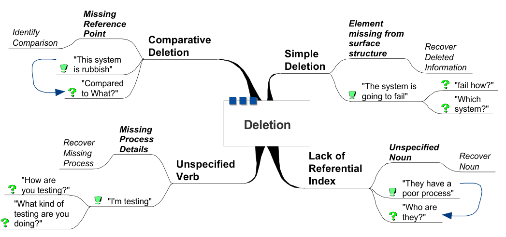

Diagram labels retained from the original vector image:

- Simple
- Deletion
- Comparative
- Lack of
- Referential
- Index
- Unspecified
- Verb
- Element
- missing from
- surface
- structure
- Recover
- Deleted
- Information
- "The system is
- going to fail"
- "fail how?"
- "Which
- system?"
- Missing
- Reference
- Point
- Identify
- Comparison
- "This system
- is rubbish"
- "Compared
- to What?"
- Noun
- "They have a
- poor process"
- "Who are
- they?"
- Process
- Details
- "I'm testing"
- "How are
- you testing?"
- "What kind of
- testing are you
- doing?"

At the end of an information gathering interview or meeting I often ask a paraphrased form of, “Is there anything that you not told me, that my not knowing, will prevent me from being able to do what I need to do to help you?”

This is a question I have used during consultancy which I have long forgotten the source of, and subsequently cannot attribute for your future study, but I have found it enormously useful and it relies on the identification of deletions for its impact.

In this way I search for deletions outside of the scope of what I was able to identify. Have you ever encountered a situation where you didn’t test an area of the system because you didn’t know anything about it? Deletions can cause major problems in the software process.

#### Simple Deletion

A Simple Deletion is information that is missing from the statement. Information that would complete the statement and remove ambiguity.

“I’m tired”. We could assume what the speaker is tired of, they may have said they were tired about their job and we assume that that is what they mean, but they may only be tired of a specific aspect of their work, they may love their job. So we target the deletion to get more information. “Tired of what?”

“The input file is received via email” has the obvious deletion, “received from whom?”. There are slightly more subtle deletions in the statement “Sent to whom?” and there are a whole set of deletions about the input file:

- What format is the file?

- What size is the file?

- What does the file contain?

The hardest deletions to spot, and the ones that give most problems, are those that have no indication of their existence in the surface structure statements. That is why the question at the start of this section “Is there anything you have not told me…” is so powerful. We spot these deletions by applying the Meta Model questions to the model of the system that we build from all the questions that we ask. It may be that only by putting together all the surface structure statements that we can identify a deletion.

#### Comparative Deletion

| “You’re Finding too many bugs” “You’re not finding enough bugs” | } | Compared to Who? Compared to What? |
| --- | --- | --- |

A Comparative Deletion occurs when the reference source is not defined. When communicated the statement may be received as a value judgement instead of a comparison.

Sometimes things are held up to comparison in such a way that only the negatives are noticed and that none of the superior attributes are acknowledged. This can be seen development projects when comparisons are made to estimates given at the start of the project and then used to bludgeon staff with later in the project. “You haven’t run enough test cases.” Compared to what? “This estimate”, Ah, the estimate we produced before knew what we were doing and before we new the real scope of the task, it may be time to revisit that estimate.

“The system is running too slowly.” Compared to what? Possibly compared to what the user needs. Which may have been an unidentified requirement.

#### Lack of Referential Index

A Referential Index is an object referred to in the statement. The lack of a referential index is when the object is replaced by It, They, Them, We, Us, That.

The question response is to identify what object is referred to.

“The Users will want to do this.” Deletes information about which users specifically will want to do this. The notion of Roles and different types of users can be very important during testing to help identify risk associated with activities and generate test scenarios.

#### Unspecified Verb

An unspecified verb refers to a statement with a verb that has limited information about how the verb is carried out. “The system will process this”, process it how?

Lack of information about verbs can cause problems when testing, if assumptions are made about the deleted information.

### Distortion

Distortions are a common source of assumptions.

Have you ever worked on a system where some functions were added because the software development team used Mind Reading to generate requirements?

Distortion can also be a source of inter team conflict and as a manager it can be useful to identify distortions in the communication of your staff when they talk about teams that they are having problems with.

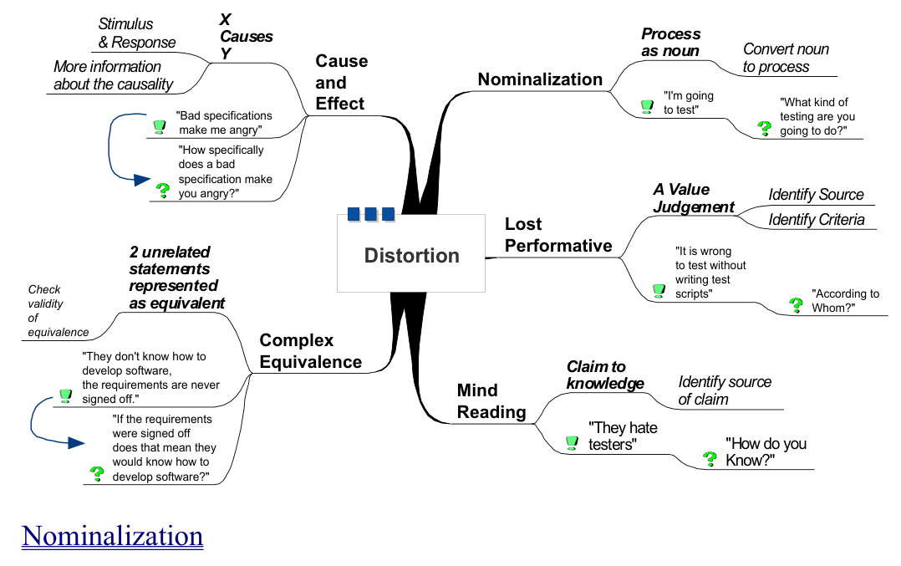

Diagram labels retained from the original vector image:

- Nominalization
- Cause
- and
- Effect
- Mind
- Reading
- Complex
- Equivalence
- Lost
- Performative
- Distortion
- Process
- as noun
- Convert noun
- to process
- "I'm going
- to test"
- "What kind of
- testing are you
- going to do?"
- X
- Causes
- Y
- Stimulus
- &amp; Response
- More information
- about the causality
- "Bad specifications
- make me angry"
- "How specifically
- does a bad
- specification make
- you angry?"
- Claim to
- knowledge
- Identify source
- of claim
- "They hate
- testers"
- "How do you
- Know?"
- 2 unrelated
- statements
- represented
- as equivalent
- Check
- validity
- of
- equivalence
- "They don't know how to
- develop software,
- the requirements are never
- signed off."
- "If the requirements
- were signed off
- does that mean they
- would know how to
- develop software?"
- A Value
- Judgement
- Identify Source
- Identify Criteria
- "It is wrong
- to test without
- writing test
- scripts"
- "According to
- Whom?"

#### Nominalization

“Testers don’t get any respect”

Nominalization refers to converting a verb into a noun.

Software Development is full of nominalizations, in fact Software Development is a nominalization, and we distort all the activities and roles involved in the process of Software Development when we nominalize it.

A Nominalization can be an assumption on the part of the communicator that the other person has the same view of the process that they do, it may also be a cover up for a lack of knowledge about that process.

#### Lost Performative

“This system sucks”

Who says? According to Whom? Where did you hear that?

A lost performative refers to the missing authority from a statement. Who is it that is saying this statement.

When dealing with people we want to know if this is a self-generated part of their model or an outside influence.

If it is an outside influence then it can be countered with a conflicting statement of someone equally authoritative, and maybe neither authority’s statement is true.

If it is internally influenced statement then we can trace the chain of belief and offer an alternative view (if this structure is not helpful).

A Lost performative may lead on to Mind Reading:

“The system really must do this”

“Who says?”

“The users do”

“Where did they say this?”

“Look I just know OK.”

#### Mind Reading

| “The development team don’t respect us testers” | } | “How do you know?” |
| --- | --- | --- |

Mind reading is any claim to knowledge where the source is unknown.

In verbal communication, mind reading can lead to assumptions which create unproductive beliefs about the situation, when the situation may not really be like the communication.

In written documentation, particular requirements documentation, mind reading can lead to assumptions of authority. One justification for test processes insisting on cross-referencing tests back to requirements is to demonstrate a source for those tests.

Unsubstantiated statements might mean that the requirements analyst has put words in to the mouth of the user and we may have extra functionality and requirements that are not strictly required and may detract the development team from producing the requirements that are necessary.

#### Cause and Effect

Cause and effect is a chaining together of statements that leads to some evidence for a generalized conclusion.

A cause and effect statement may need to be questioned to get more information on exactly How X causes Y, as we question this we may identify a series of deletions in one of the follow on surface structures.

Cause and effect brings to mind the Stimulus and Response theories from behaviourism \[John B. Watson, Behaviourism, The University of Chicago Press, 1966\]

By thinking in behaviouristic terms we can question the conditioning associated with the stimulus and the response.

If a stimulus has a response, behaviourism experimented with conditioning to condition the stimulus to trigger a different response. Does X always cause Y? Are there any situations where X doesn’t cause Y?

Is the response only triggered by that stimulus or are their other ways to achieve that response?

Behaviouristic work led to conditioning by over exposure. Is it possible to continually trigger stimulus X until the response does not happen? In computer systems this may be the result of a memory leak for example, or overload of the system in a denial of service attack.

#### Complex Equivalence

“The development team don’t respect us testers because they never give us signed off design documents early enough to write our test scripts.”

Complex Equivalence is a causal model that results in a conclusion. The statements that make up a complex equivalence are often not joined with a specific conjunction (and, but, because), but are presented in sequence with an implied conjunction. E.g. “They don’t know what they are doing, the requirements are never signed off.” We can suspect that there may be an equivalence between those two statements in the speaker’s model. And we can question it by testing the equivalence. “So if the requirements were signed off, that would mean that they know what they are doing?”

A source of problems in communication is when the equivalences aren’t valid.

Testers should watch for complex equivalences in their defect reports as it is very easy to cause conflict with the development team if the equivalence conclusion is not one that is shared by developers.

“The system crashes every time I open a file, the file load routine is broken”. Well, maybe it isn’t, all we can say for sure is that the system has crashed each of the different ways you tried to have it open specific files.

A perfect way to create conflict in a software development team is to use cause and effect in your defect reports and document a generalization conclusion statement that is not shared by the development team. If you really want to annoy them try “The system crashes every time I open a file, the file load routine is broken because you are lousy developers”.

### Application of the Meta Model

Apply the Meta Model by taking the statements that are communicated to you literally.

One reason I believe that the Meta Model is so suitable for Software Testers is that Software Testers learn to use some of the approaches and questions taught in the Meta Model through experience. By specifically learning the Meta Model we can gain more control over what we do as testers, to have more conscious awareness of how we choose to do certain types of tests and how we know to ask certain questions.

We can also more easily explain to others what prompted us to ask certain types of questions and can minimise the communication that we make to others which can cause resistance.

How, Not Why

In the Meta Model questions there were no ‘Why?’ questions. Fritz Perls, and Virginia Satir comment:

Fritz Perls: “’Why’ opens up an endless series of questions which can only be answered by a first cause that is self-caused…If our patient learns the how … he can work through his interruptions into his real self and the activities he wants to carry out”.

The Gestalt Approach, page 54

Virginia Satir: “People can ask ‘how’ questions instead of ‘why’ questions. Generally speaking, ‘how’ questions lead to information and understanding, and ‘whys’ imply blame and so produce defensiveness. Anything contributing to defensiveness contributes to low pot and leads to potentially unsatisfying outcomes.”

The New PeopleMaking, page 136

Fritz Perls: “There is, however, one way of asking questions – used by most orthodox therapists – which seems to me of little therapeutic value. These are the questions starting with ‘Why?’…The ‘why’ questions produce only pat answers, defensiveness, rationalizations, excuses, and the delusion that an event can be explained by a single cause. They why does not discriminate purpose, origin, or background. Under the mask of inquiry it has contributed perhaps more to human confusion than any other single word. Not so with the ‘how.’ The how inquires into the structure of an event, and once the structure is clear all the whys are automatically answered.”

The Gestalt Approach, page 77

How many ‘Why?’ questions have you asked in the course of your testing career? Did any of them result in a negative response? Why isn’t necessarily a bad question to ask, but sometimes we ask, or talk about, ‘Why?’ When we really mean ‘How?’

### Case Study: Presupposition Based Exploratory Testing

Exploratory testing involves building a model of (learning) the system as we use and test it. This short example demonstrates the use of NLP presupposition based techniques during exploratory testing. A very simple area of a real system will be explored.

#### Introduction to the system

I know quite a bit about this system and the functionality because I wrote it. But that doesn’t invalidate this testing in fact it makes it quite interesting to see what a presupposition driven approach to testing leads me to do.

This is a side panel for a system and it is designed to show all models loaded and various bits of information about them.

The ScratchPad is a temporary storage area for model elements. I know that I can create folders under the scratchPad and that the ScratchPad can hold model elements from any of the loaded models.

We can delete some items from the sidebar by pressing delete, and move some around by using the mouse, e.g. when an item is in the scratchpad we can move it to a folder under the scratchpad etc.

Items in the tree can be double clicked to open for editing in the main system.

#### NLP analysis

Taking some of the statements from the introduction we can apply the meta-model to those statements.

All models are displayed under the models tab

The universal qualifier All, can be explored.

Delete key deletes some items from the tree

The modal operator some needs to be explored, to ask which ones specifically? And I can do that by trying to delete items from the tree.

- Exploration reveals that structural branches can not be deleted ‘Models’, ‘ScratchPad’

- Windows, Shortcuts and folders can be deleted

- When the main window for the model is deleted the model closes

- ‘Model’ branches can not be deleted – should we be able to close the model by deleting it from the tree? (raise issue) (action taken: close model on delete key of a Model branch)

#### Presuppositions Used

The following is a list of 1st order presuppositions. i.e. What has to be true, for the descriptions given in the introduction to be true. From these I can ask questions directly of the presupposition, or create 2nd or 3rd order follow on presuppositions which I can chose to subject to tests.

This list is the set of presuppositions that I explored when testing, you can see that it is a novel form of test analysis based on a 'knock on effect' questioning of identified presuppositions from the 'facts' or 'requirements' or 'observations'.

All the presuppositions were derived while exploring the system and have been written down as I was exploring, and they represent a flow of thought processes during the process of exploratory testing. The issues found have been moved to the next section so as not to disrupt the documentation of the presuppositions.

- Multiple models can be active in the system (1st).

    - ‘What if they can’t be?’ - because I’m focussing on the display function I’m going to ignore this question for the moment, but trying to negate each presupposition is a good way to build up error scenarios in the application.

    - New models are displayed in the side panel (2nd), which can be tested by creating a new model.

    - Loaded models are displayed in the side panel (2nd) , which can be tested by hiding the panel and loading a model, and by loading a model when the panel is open.

    - When a loaded model is closed it is removed from the side panel (2nd)

        - “Can the side panel trigger removal?” - try this as a test

    - Can’t do anything to the models branch when no models are loaded (2nd)

- Top scratch pad is independent of the models (1st)

    - Can create folders and move folders when no models are loaded (2nd)

        - when testing the create folder option I noted that “Created folders all have name ‘NewFolder’” this leads to a new set of presuppositions based on this new 'fact' about the system

            - multiple folders of same name is allowed (1st)

            - Rules for All Folders apply to folders of same name as well as named folders (1st)

            - folders can be renamed (1st) -&gt; Y, space bar, or click when selected

                - names are valid (raise issue – see valid names below)

                    - a valid name is ascii only

                    - a valid name has length limits

                        - question, “What limits?”

                            - &gt;0 chars

                            - &lt;? chars

    - All folders can be moved around (2nd)

        - Question the Universal Quantifier ALL?

            - Move folder from scratchpad to models?

            - Parent to child? Assume N

            - Sibling to child? Assume Y

            - Parent's parent to child? Assume N

            - Parent's sibling to child? Assume Y

            - Parent's parent's sibling to child? Assume Y

            - Child to parent? Assume N

    - Items from any model can be added here

- Model items can be displayed in the top scratchPad (1st)

    - Model has to be active to add model items to scratchpad (2nd)

    - Model items in scratchpad are independent of the model so the model does not have to be loaded to use them (2nd)

    - Displayed element in scratchpad exists (2nd)

        - what if it doesn’t? (raise issue)

    - Displayed Elements in scratchpad can be dragged to models (2nd)

    - Double clicking an element in the scratchpad opens it for editing (2nd)

        - (Q) even if the model is not loaded? (raise issue)

#### Issues Found

This section describes the issues found during the exploration of the presuppositions.

##### Valid Names Explored

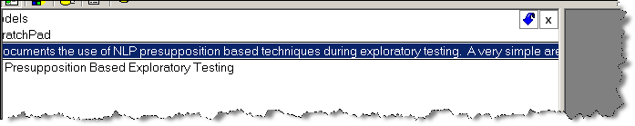

We can add very large names, cannot see the end of the edit, don’t actually see the end to edit it. Looks like we can add another char but hard to tell.

Go into edit mode, select text and copy to clipboard.

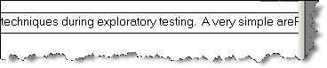

Paste this to the end of the field and it looks like it has just added it based on the ‘P’ that we can just see. So (still in field edit mode) select and copy info to the clipboard manager.

Comparing the two states in the clipboard manager we see that:

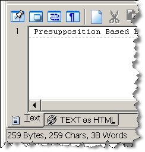

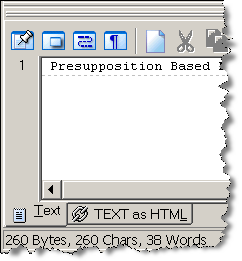

The edit field can hold 260 chars but only 259 are saved into the system.

So 259 is our upper limit.

We cannot add NULL names, but we can add names with only spaces

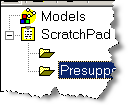

These are subject to the same 259 char limit.

Raise issue (action taken: prevent blanks, trim spaces, restrict length to 50 chars)

##### Model has to be added to display elements at top level

- Presupposition: ScratchPad items are independent of the model so the model does not have to be loaded to use them

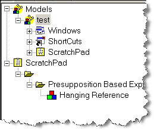

Close model and reference is left in the scratch pad.

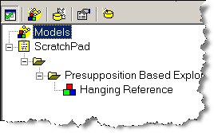

Is this a problem? I Don’t know yet.

Reload model and try to use them

Can’t add them back to the model. They are not independent.

Double clicking a model element when the model is not loaded has no effect.

(raise issue) (action taken: remove scratchpad items for closed models)

- Presupposition: displayed element in scratchpad exists

Creating a shortcut to a model element and then deleting the model element from the model, then double clicking on the scratchpad item opens a blank form because the model element is deleted.

Refreshing the display does not remove the deleted item from the display

(raise issue) (action taken: check for existence before opening and remove if not exists)

#### Summary

This was a very quick test session of less than 15 minutes.

Readers unfamiliar with presupposition analysis, or people who haven't tried it will point out that I could have found the defects in other ways:

- I could have used boundary value analysis on the input fields.

- I could have looked through ‘How to break software’ and identified attacks.

- I could have used my experience.

With presupposition analysis testing we use the information that the system gives us to determine how we proceed. And the system gives lots of information, as with many things, when we learn to observe, and then learn effective ways of questioning and modelling what we observe, we can achieve results quickly.

In the same way that a therapist, questions and observes and builds a model, and then applies their techniques and experiences to that model. Based on observed information I can apply my experience as a tester and developer to ask questions. And some of these questions are questions that a novice might not ask, so we can not discount experience, but we should also not assume that it takes a long time to build up the experience required to test in this way.

We can build up experiential knowledge to draw on by reading books such as “Lessons learned in Software Testing”, “How to Break Software”. And by reading information at websites such as [www.testingeduction.org](http://www.testingeduction.org), and [www.satisfice.com](http://www.satisfice.com). [Source link](http://www.testingeduction.org/) [Source link](http://www.satisfice.com/)

Although having said that, I do find it difficult to remember other peoples’ models:

- James Whitacker’s attacks

- James Bach’s Heuristics

- Jerry Weinberg’s lists of observations

I find it easier to have tools that lead me to a test based on first principles, and apply my experience too that. Then I can build my own models and lists. But I do cheat and have lists of other peoples’ models nearby to refer to them. Is that cheating, or is that being resourceful?

I also take the system at face value, take it literally and ask questions based on the Meta Model to guide my testing. This approach can be taught. Easily. This approach can be practised and remembered easily.

The Meta Model is a very simple way of exploring what we do.

Tools used:

- Compendium-TA the system under test

- SnagIt the screen capture tool

- ClipMate the clipboard manager

## Future Learning

“…our Meta-Model does not, by any means, exhaust the choices or possibilities of what a therapist might do in the therapeutic encounter. Rather, it is designed to be integrated with the techniques and methods in already established fields of psychotherapy. The integration of the explicit Meta-model with the techniques and methods of therapy in which you are already skilled will not only expand the choices you have as a therapist, but it will increase the potency of your style of therapy by making the interventions you use directed explicitly at expanding your client’s model of the world.”

The Structure of Magic, Volume 1, page 157

NLP is a TM’d commodity, as such it is a heavily packaged and well sold item. New books on NLP appear on a weekly basis and there are some very expensive courses that you can go on. Choose what to buy well and research the courses and books before committing to them.

Remember that the people who invented NLP did it by reading the books and papers of the practitioners that they wanted to study. They studied videos of those practitioners, build up models of their approaches and tried using those models and refined them until they worked. That avenue is still open to you. Self study and going back to the roots and sources of NLP is still a possibility.

### Training

If you are going to be trained in NLP then make sure that you study some NLP before you go for training. This way you will understand the broad scope of the subject and be familiar with some of the terminology.

And if you are going to be trained in NLP then find a course that has some of the original founders of NLP doing the training. This way you can avoid the Chinese whispers training effect – being trained by someone who was trained by someone who was trained by … someone who created NLP.

Do some research to identify if you respond better to the Bandler approach to NLP or the Grinder approach to NLP and find a course to suit.

Training can be enormously beneficial in this area, NLP is a doing skill and training will give you the opportunity to put into practise some of the techniques that you have read about. I have invested in being trained in NLP, and if you are keen to learn then I recommend some training.

### Transcripts

Read transcripts and apply the Meta Model to those. But this also applies to read transcripts of testing. Look at your own testing. How did you know to ask that question of the software?

If a question that you asked of software didn’t get you, what you thought was, any useful information then ask yourself was there any question that would have given you useful information? How would you have known to ask that question? What useful information did you want to get?

Psychology is littered with transcripts. Software Testing is less so. But examine “How to Break Software” probably the closest book that software testing has to a set of transcripts and analyse it. How did they know to ask that question? What would it have taken for you to ask that question? How will you know to ask that question when you are testing?

## References

\[RBJV\] Persuasion Engineering, Richard Bandler and John LaValle, Meta Publications, 1995

\[SoM1\] The Structure of Magic, Volume 1, Richard Bandler &amp; John Grinder, Science and Behaviour books, 1975

\[FP1\] The Gestalt Approach &amp; Eye-Witness to Therapy, Fritz Perls, Bantam, 1976

\[RD1\] NLP Encyclopaedia, Robert Dilts, [http://www.nlpuniversitypress.com/](http://www.nlpuniversitypress.com/)

\[VS1\] The New PeopleMaking, Virginia Satir, Science and Behaviour books, 1989

\[AK71\] Think Like a Grandmaster, Alexander Kotov, Batsford, 1971

\[FFJB\] Provocative Therapy, Frank Farrelly and Jeff Brandsma, Meta Publications, 1974

\[JR1\] Manager Heal Thyself, Joanna Rothman

[http://www.jrothman.com/Papers/ManagerHealThyself.html](http://www.jrothman.com/Papers/ManagerHealThyself.html)

\[JW1\] Secrets of Consulting, Gerald Weinberg, Dorset House, 1985

\[JW2\] More Secrets of Consulting, Gerald Weinberg, Dorset House , 2002

Then he shook the rug!

CRACK!

Now the bed had the spot!

And all I could say was,

“Now what, Cat?

NOW What?”

The Cat in the Hat Comes Back,

Dr Seuss

## Appendices List

The following appendices are designed to be printed out for easy reference outside the context of this paper.

- An Annotated Example

    - Expands upon the presuppositions, and meta model elements examples presented earlier. This shows the depth of ambiguity present in a simple statement and the range of testing that can be performed.

- Meta Model Summary

    - The Meta Model Mind Map from the paper with a table summary of the meta model elements.

- Meta Model Summary Diagrams

    - All 3 Meta Model Summary Mind Maps from the paper on a single.

- An Imaginary Transcript

    - This is a simple example of how a test manager might use the Meta Model when dealing with staff to identify inter-team communication issues.

- Well Formed Outcomes Questions

    - The set of questions and notes for eliciting well formed outcomes

## An Annotated Meta Model Example

“The daily trade file must be processed in under 5 seconds when the system starts up”

The above requirement is an amalgam of a number of different requirements from past projects. The ambiguity in similar requirements caused problems in the system implementation because some of the questions identified below were not asked or answered on those projects.

Identifying the Meta Model elements and Presupposition analysis are enormously useful skills to develop. Practise on the systems and requirements that you are faced with as you perform your testing tasks.

#### Meta Model Elements

Diagram labels retained from the original vector image:

- "The daily trade file must be processed in under 5 seconds when the system starts up"
- LP
- SD (1)
- MO
- UV (1)
- SD (3)
- SD (4)
- UV (2)
- SD (2)
- Effect
- Cause
- CE

LP – Lost Performative

MO – Modal Operator

US – Unspecified Verb

SD – Simple Deletion

CE – Cause Effect

- Identify the Meta Model Elements

- What questions can we ask?

- Identify the presuppositions

- What do they lead to?

- Ask the questions early

- Use the questions as test conditions

- Use the questions to guide your exploratory testing

#### Presuppositions

| Presupposition | Leads to… |
| --- | --- |
| There is a daily trade file | what if it doesn’t exist? |
| The trade file is generated in some way | by what system? |
| The trade file is accessible | is it on our environment, where does it reside? What if the permissions are set wrong? |
| The trade file can be processed | What if it is corrupt? Locked? Too Big? |
| The trade file is a file | What kind of file? Binary, Text?) |
| The system will startup on a daily basis | What if the system doesn’t start up one day, does the trade file get overwritten or something worse? What if the system starts up more than once? |
| There is only one daily trade file |  |
| The system can process a trade file in under 5 seconds | What if it is too big? What if the transactions are very complicated? |
| There are knock on effects if the file is not processed in under ‘5’ seconds : ‘must’ | What happens if it doesn’t? |
| The daily trade file only contains trades for a day? | What does the File contain? What does a trade look like? What is a trade? What kinds of trades? |
| The system knows how to find the file | Is the location hard coded? Is the location passed as a parameter? Is the location in a config file? |
| The trade file has a specific name format | Is it always named the same thing? |
| The daily transaction file has transactions in it | What if the file is empty? |
| The daily transaction file is produced daily | Produced by what system? Produced when? |
| The daily transaction file is generated before our system starts up | What if the system starts up as the file is being generated? |
| The system is closed down at some point (in order to start up again) | What if the system is not closed down? |

## Meta Model Summary

Diagram labels retained from the original vector image:

- Deletion
- Distortion
- Generalization
- Meta Model
- Simple Deletion
- Comparative Deletion
- Lack of Referential Index
- Unspecified Verb
- Nominalization
- Cause and Effect
- Mind Reading
- Complex Equivalence
- Lost Performative
- Universal Quantifier
- Modal Operators
- Presuppositions

| Meta Model Element | Examples | Questions |
| --- | --- | --- |
| Nominalization (N) A process represented as a noun | “The Software Testing is inadequate” “Testers don’t get any respect” | Convert object to a process “What is involved in your software testing?” “How do you know you are not respected?” |
| Cause &amp; Effect (CE) X Causes Y Stimulus and response | “Late delivery of software makes me angry” | Identify missing information associated with the causality “How specifically does it make you angry?” “Does it always make you angry?” |
| Mind Reading (MR) Claim to knowledge (often about someone else’s internal state) | “They hate testers” | Identify source of claim “How do you know?” |
| Complex Equivalence (EQ) 2 statements represented as equivalent | “They really don’t know how to develop software, the requirements are never signed off.” | Check validity of the equivalence “So if the requirements were signed off, that would mean that they knew how to develop software? Is that all it takes?” |
| Lost Performative (LP) A value judgment with a missing judge and criteria. | “It is wrong to test without writing Test Scripts first” | Identify Source and criteria “Who says?”, “According to whom?” |
| Simple Deletion (SD) Element missing from surface structure. | “This system is going to fail” | Recover deleted information. “Fail how?”, “which system?” |
| Comparative Deletion (CD) Missing reference point. | “This system is the worst” “This system is rubbish” | Identify the unstated comparison. “Compared to what?” |
| Lack of Referential Index (RI) Noun not specified | “They have a poor process” | Identify the unstated reference. “Who are they?” |
| Unspecified Verb (UV) Missing process details | “They want me to test this” | Identify &amp; expand the unstated verb \- “How specifically do they want you to test this?” |
| Universal Quantifier (UQ) A Generalisation | “Nobody will ever do that” | Find a counter example to counter a limiting generalization - “I just did it” |
| Modal Operator (MO) Rules for limits | “We must add this requirement now” “I can’t run these tests” | Explore the rule “What would happen if you didn’t add that requirement now?” “What stops you running these tests?” |
| Presupposition (P) What has to be true for this statement to be true? | “If they know how much work unsigned-off requirements caused us they would make sure they were all signed.” | Challenge presuppositions and test our analysis “How do you know they don’t know?” |

Table: Meta Model Elements, examples, questions and objectives

## Meta Model Summary Diagrams

Diagram labels retained from the original vector image:

- Universal
- Quantifier
- Modal
- Operators
- Presuppositions
- Generalization
- A Limiting
- Generalisation
- Counter, challenge
- Identify exception
- "All developers
- hate testers"
- "I develop and
- I don't hate you"
- "\*ALL\* developers?"
- "Microsoft have 2 testers
- for every developer,
- that must be hate city"
- Rules
- for
- limits
- Challenge and get more
- information on the
- "I can't run
- these tests"
- "What stops you?"
- "I shouldn't
- test this."
- "What would
- happen if you did?"
- What is unstated
- and has to be true
- for the statement to
- be true
- Challenge, test

Diagram labels retained from the original vector image:

- Simple
- Deletion
- Comparative
- Lack of
- Referential
- Index
- Unspecified
- Verb
- Element
- missing from
- surface
- structure
- Recover
- Deleted
- Information
- "The system is
- going to fail"
- "fail how?"
- "Which
- system?"
- Missing
- Reference
- Point
- Identify
- Comparison
- "This system
- is rubbish"
- "Compared
- to What?"
- Noun
- "They have a
- poor process"
- "Who are
- they?"
- Process
- Details
- "I'm testing"
- "How are
- you testing?"
- "What kind of
- testing are you
- doing?"

Diagram labels retained from the original vector image:

- Nominalization
- Cause
- and
- Effect
- Mind
- Reading
- Complex
- Equivalence
- Lost
- Performative
- Distortion
- Process
- as noun
- Convert noun
- to process
- "I'm going
- to test"
- "What kind of
- testing are you
- going to do?"
- X
- Causes
- Y
- Stimulus
- &amp; Response
- More information
- about the causality
- "Bad specifications
- make me angry"
- "How specifically
- does a bad
- specification make
- you angry?"
- Claim to
- knowledge
- Identify source
- of claim
- "They hate
- testers"
- "How do you
- Know?"
- 2 unrelated
- statements
- represented
- as equivalent
- Check
- validity
- of
- equivalence
- "They don't know how to
- develop software,
- the requirements are never
- signed off."
- "If the requirements
- were signed off
- does that mean they
- would know how to
- develop software?"
- A Value
- Judgement
- Identify Source
- Identify Criteria
- "It is wrong
- to test without
- writing test
- scripts"
- "According to
- Whom?"

## Imaginary Transcript 1

This imaginary transcript is included to provide a quick sample of a possible Meta Model questioning session as most of the examples given in the text are short and don’t demonstrate the chaining effect of the Meta Model where one question leads to another.

T Tester

MM Meta Modeller (Test Manager)

T “You know, the development manager hates testers.”

MM “Really? Who says?” (Tackle the lost performative)

T “well, me, I say it, he hates testers”

MM “how do you know?” (Tackle the mind reading)

T “well because he never turns up for meetings with us and never has a good word to say about what we do”

MM “ah, so he gets lost constantly and swears all the time as though he has Tourettes. Do you even know what he looks like?” (Tackle the generalisation in a provocative way)

T “ok, so he turns up for some meetings but he always cancels meetings with testers to go through the test design documents because he just hates testers”

MM “so if he turned up for those meetings that would mean that he liked testers?” (Tackle complex equivalence)

T “well, probably not, there is a whole bunch of things that he doesn’t do”

MM “what specifically?” (Tackle deletion)

T “well….”

(Then we get a list of specific tasks that seem to be causing problems with the Test Team/Development manager relationship, which as a test manager we can try, and deal with)

MM “maybe he doesn’t do those things for the development team either.”

T “nah, he must do, he’s the development manager”

MM “How do you know? Maybe he doesn’t meet anyone, maybe he hates everyone?” (Tackle the model operator)

T “ha, maybe, but we still need all these things doing…”

MM “OK, we can deal with that.”

The questioning could continue, but the manager has enough information to help his staff out and has helped reduce the level of generalization that was affecting the relationship between this tester and the development manager.

## Well Formed Outcomes Questioning

| Question | Notes |
| --- | --- |
| What do you want? | Is answer stated in the positive? |
| How will you know when you've got it? - What will it feel like? - What will you see? - What will you hear? - What will it taste like? | By going through the questions you start to put them in the state that they will be in when they have what they want. This will help them move towards the goal, and identify what resources and actions are required to get it. |
| Is this outcome initiated &amp; maintained by you? | We can only really change ourselves. |
| What is good about the current situation? What might you lose as a result of getting this? Are there any good reasons not to change? | Ecology check, and looking for 'secondary gain' in the current situation. Build in the 'good' things from the current situation into the goal to make it even more attractive. |
| How will this affect your context? Family? Job? Friends? | Further ecology check examines the context and wider system. |
| Where do you want this? When do you want this? | Further ecology check and future pacing. Build the future context. |
| What resources will you need to do this? When have you had those resources before? | If the preson doesn't know what they need then you can always ask. “If you did know what you'd need, what would it be?” Sounds strange but it is a powerful question that works. |
| What will having this do for you? | This is the 'Why?' part, and helps explore motivations. Related to Meta-Programmes. |

## Exercises

### Exercises Relating to State

#### What State is your testing in?

List some attributes that are important for a tester:

- Attributes or Qualities of a tester

- Descriptions of a tester

What did you list?

- Adjectives? Phrases? Were the attributes positive?

- Any useful negative attributes?

- How many apply to you?

- When do you exhibit them? When do you 'have' them? In what Context?

Describe some of the important attributes listed above as states:

- name the state,

- can you feel it now? what do you have to do to feel it?

- describe what that state feels like,

- give an example context of when you experienced it during testing

- is it a good state or a bad state?

- did it help you or hinder you?

- were there other states mixed in with that one or was it discrete?

List some states that are important for testers and when they are important:

List some states that you have experienced during testing:

For the above states – make a note of when you experienced them and what those states led to:

For the states that led to a response where you would want a different response in the future, what response do you want it to lead to?

What would it take to have this new response? What resources would you need, what would you have to say to yourself when the response was normally triggered to move to the new response? What state is this new response? What does the new state feel like?

List some activities related to testing and effective states that go with them (remember a state is a process so think through what it would take to maintain that state, what kind of things are you saying to yourself? What is your posture? What is your motivation (what is moving you forward?)::

Can you identify situations where you have a chain of states?

- What is the chain? What triggers each state? What states might be better to have in the chain?

Elicit Effective Testing States in Others

- What can you say to other people to generate those states?

    - Tell a story about a time when you felt that state, not necessarily in a testing context, then relate it to the testing context

    - Ask about time when they felt such and such a state

    - Tell stories about when you felt related states and chain them together

### Sensory Acuity Exercises

What can we be aware of with people?

- Write down some 'things' we can be aware of 'about' the other person? (What can we watch for, what can we see happen? What would we hear?

How can we become aware of this with people?

- Write down some ways that you can become aware of the above items with people?

How might it help you to be aware of this stuff?

- Write down some ways that this knowledge could help you.

What can we be aware of when testing?

- Write down some 'things' we can be aware of when testing

How can we become aware of all this when testing?

- Write down ways that you could become more aware of this stuff when testing?

Awareness of Peripheral Vision

- Become aware of your peripheral vision. Hold your index fingers in front of your face (about a foot away)

- more your hands apart and around your head following an imaginary circle around your head.

- Note where you stop being able to see your fingers

- Were you aware that that was the range of your vision, all the time?

Increase the field of vision while reading

- This exercise to increase your field of vision is taken from speed reading.

- When reading text, speed readers, read the text in chunks. This means that they do not read the text 1 word at a time, they read 3 or 4 words at a time, or half a line at a time. Supposedly super fast readers can read a full line at a time.

- You can pick up any book and start to read it

- Then you can start to increase the number of words that you read in one block.

- Work your way up from 3 or 4 words, or as many as you currently do

- It may help to move the paper further away from you as you increase the number of words

- By working on this you will increase your rate of reading and will take in more of the computer screen at any one time

- Also, read paragraphs from the middle of the page:

- Instead of reading from the left to the right

- Read from the middle of the page and expand your vision out to the left and right in one chunk

- speed readers practice this by drawing a line down the middle of the page and following the line

- after a while, practise this without drawing a line

Reduce Internal Dialog

- reduce subvocalising when reading by subvocally humming

- reduce subvocalising while working with people by putting your tongue just behind your teeth

Watch facial patterns – the lie detector

- Ask 3 questions that elicit a 'yes' response

    - Are we sitting here now together?

    - Is your name &lt;insert their name here&gt;?

    - Are you breathing?

- Watch the patterns of response behaviour

- Ask 3 questions that elicit a 'no' response

    - Are we standing on the moon?

    - Is your name &lt;insert your name here&gt;?

    - Can you levitate?

- Watch the patterns of 'no' response behaviour

- Ask questions that could be only yes, or no, but don't know the answer to, and tell them if it is a 'yes' or 'no'. Have them tell you if you are right or not. This gets you feedback that you need to calibrate the rest of their responses

Who do you love?

- A Calibration exercise

- In Pairs or Threes

- Person A asks questions, person B answers, Person C observes

- Person B thinks of someone they really dislike, and then of someone they really love – but doesn’t tell anyone

- Person A asks questions which gets person B to select one or the other

    - Which one has longer hair?

    - Which one lives closest to you?

    - Which one has been married longest?

    - Which one is older?

    - Etc

- Person A says whether they think person B is thinking of the person they like or dislike to get immediate feedback to calibrate

- Loop around the questions 5 times

- Then swap roles

### Exercises – Rapport

Body Matching

- stand facing someone else

- Person B matches what person A does

    - e.g. If they raise their right arm, you raise your right arm

Body Mirroring

- stand facing someone else

- Person B mirrors what person A does

    - e.g. If they raise their right arm, you raise your left arm

Cross Over Matching

- if they raise their right arm, raise your eyebrow

Conversational Leading

- engage in conversation (with the understanding that B will be leading)

- B matches A (breathing, language patterns, posture, gestures)

- When B thinks rapport has been achieved, B should lead with a body shift. If rapport has been achieved then A will respond to the shift (could take a few seconds)

- explore leading for a while

- B Mismatches to break rapport

- B regains Rapport and tests by leading

### Exercises – Well Formed Outcomes

What are your goals? – no NLP

- Without using any NLP questions or models, just ask someone what their goals are.

- Note down the questions that you ask them and the kind of responses that you receive

What are your goals? Using well formed outcome questions

- Using the well formed outcome questions – and similar questions – explore the same goal

- Note down what is different about the questioning this time.

    - What do you want?

    - How will you know when you’ve got it?

    - Is this initiated and maintained by you?

    - What is good about now?

    - How will this affect you?

    - Where and when do you want this?

    - What do you need to get this?

    - What will having this do for you?

Ask the well formed outcome questions for yourself:

- the goals for the projects that you are engaged in

- your personal goals

- what are the goals for some of the tasks you have to do

### Exercises – Presuppositions

View an existing situation with a presupposition

- select a situation at work that you are currently not happy about

    - pick one of the presuppositions, or their corollaries, how does that change your perception of the situation?

    - If you had that presupposition as a belief, how would you act differently?

    - If you had that presupposition as a belief, how would you interpret the situation differently?

Adopt a presupposition for a day

- Choose one of the presuppositions or their corollaries and adopt it as a belief for a day, how does it affect your perceptions?

- Work through each of the presuppositions in this way and note down your insights about the presupposition

### Belief Exercises

What are your current software testing beliefs?

What things do currently always do as part of your process?

What things do you currently always think you have to do as part of your process?

You have beliefs about this.

What things do you think you should be doing as part of your process?

What would be useful beliefs for...

- A Software Tester?

- A Test Manager?

How are the beliefs different ?

### Exercises Relating to Meta Model

Generate Meta Model Distinctions

- Generate sentences for each distinction

    - For each sentence:

        - identify the distinction

        - identify a response

        - what information are you expecting to the response?

- Generate sentences for each distinction in pairs

    - Each person creates sentences for each distinction

    - For each sentence, the other person:

        - identifies the distinction

        - identifies a response

        - identifies what information they are expecting to the response?

Choose a document that has been produced in your development process:

- identify meta model disctinctions in the document

In meetings, listen to the people around you and listen out for meta model distinctions

- surreptitiously write down the distinction and the sentence the violates it

When watching TV, listen out for meta model violations

- write down the distinction and the sentence that violates it

3 Way Questioning

- Work in 3s

- Person 1 ask Person 2 to describe something e.g.:

    - their testing project,

    - their application under test,

    - what testing is

- Person 2 responds, Person 1 listens, Person 1 analyses response based on the Meta-Model and asks a follow on question based on the Meta-Model analysis, repeat

- Person 3 takes a meta position for later review

### “Bug” - an exercise

Elements:

- Exercise Requisite Variety

- examine beliefs

- explore presuppositions

- target generalisations

- be provocative

- maintain rapport

#### Notes on the Exercise

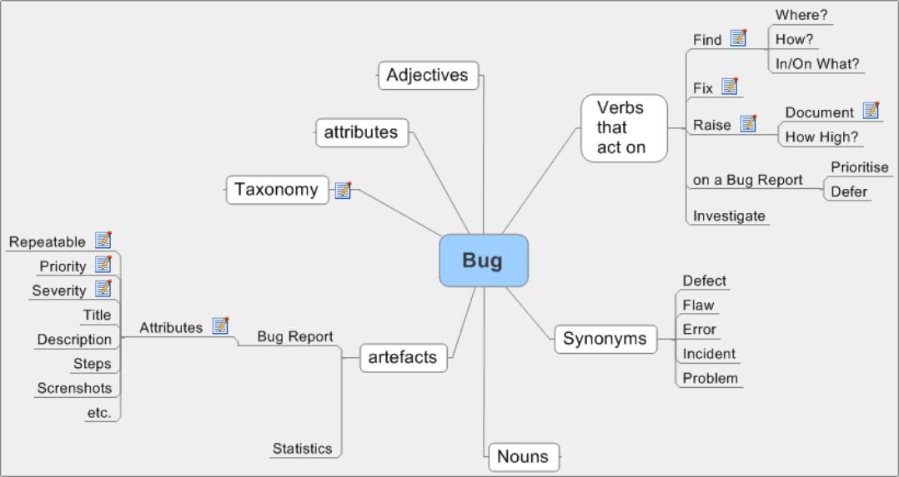

When I do testing I occasionally say (and sometimes say it out loud) “oooh, that's a bug!” What's a bug? That? That selection of pixels? What on earth could I be talking about?

This exercise was designed to find out what I was talking about.

I initially set out to define 'bug' and I did, I created several definitions, none of which felt right, none of which were good enough.

I then wondered if 'bug' was perhaps a nominalisation (a processes which has been transformed into a noun) and I thought that it was kind of, but not quite. I knew that I was deleting information from my “oooh, that's a bug!” statement, but when I considered 'bug' in isolation of that statement there was no deletion. But there was plenty of generalisation and presupposition, so I started from there and built a generalisation focussed exercise.

So the exercise was designed to peel away layers of generalisation, not so that the generalisation never appears again, but so that awareness can extend beyond a habitual generalisation, and we can pick and choose from a range of choices.

#### The Exercise – Group Version

- Someone picks a noun/concept related to testing e.g. bug, test case, test script

- Define the non/concept

- List some verbs related to the noun

- challenge the verbs – take extreme stances,, you don't have to justify the challenge, justify/redefine/explore the verb

- challenge the responses to the challenges:

    - look for further generalisations

    - look for ambiguities

    - be provocative, and maintain rapport

- repeat, repeat...

- How do you define the noun/concept now?

#### The Exercise – Self Version

I recommend also doing the exercise on your own. You can see a sample set of my initial results for 'bug' in the mindmap at the head of the document. Ignore this and come up with your own set and clarification.

- The process is the same as the group exercise above but you can probably be more provocative and be less concerned about the rapport after all you can afford to be hard on yourself in order to improve.

- some time later...

- now create a new set of definitions – are they different?

- You may feel that your new definitions are still not good enough – I think that this is good – and I hope you feel that your new definitions are better than your initial ones.

#### Additional Nuances

- for each of the identified verbs, can the verb be used as a noun? If it can then do the same exercise for the verb as a noun in the context of 'bug'

    - e.g. Fix - “we receive a 'fix' from development.

        - But that would be fix as in 'to rig a fight?' right, so we don't trust it

        - what are you, a junkie? You're sacked.

        - We don't receive a 'fix' we get a new .exe which has been built from a set of source files that has changed – what else has changed?

- Do the same for adjectives

- find some adverbs

- what synonyms can you think of? In what way are they not synonyms?

- Can you start categorising your nouns into artefacts (actual physical things found in the test process?)

## Selected Exercise Answers

The next few sections have answers to some of the exercises in the previous sections.

The answers were not put in at the same page as the exercise as this would spoil all the fun of having the exercise in the first place.

### Selected Sensory Acuity Exercise Answers

What can we be aware of with people?

- Movements

- Gestures: Hands, Head, Hair

- Breathing: Rates &amp; Patterns

- Eyes: Movement, Blinking

- Voice: Tone, Speech rate, Rhythms

- Language: Words, Phrases

What can we be aware of when testing?

- Disk Lights

- Tool Tips

- Status Bars

- Response Times

- Text Sizes

- Form Placement

- urls

- Control Placement

- Our feelings and intuition

- Expected Results

- Unexpected Results

- Things to do next

- Disk, Folder, File Sizes

- Memory Usage

- Processor Usage

- Log Files

- Error Messages

- Lack of Error Messages

- etc.

How can we become aware of all this when testing?

- Find tools to help

- Practice looking for it

- Increase Technical knowledge

    - of what the application is doing

    - of what is possible

- Recording tools and review afterwards

- Find other testers and ask them how they do it?

    - Ask them what tools they use
