<!-- Slide 1 -->

# NLP for Testers Tutorial

Alan Richardson

Compendium Developments

[http://compendiumdev.co.uk/nlp](http://compendiumdev.co.uk/nlp)

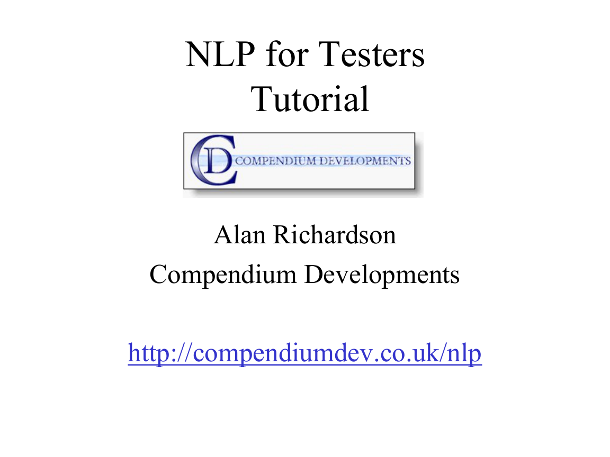

---

<!-- Slide 2 -->

# \_\_ Introduction \_\_

---

<!-- Slide 3 -->

# Subset …of NLP techniques and models

Can be used to:

- improve your software testing process
- increase your awareness for your testing context

Map is not

the Territory

States &amp;

Beliefs &amp;

Outcomes

Meta Model

Attitude

Identify

(Sensory

Acuity)

Model &amp;

Change

Presuppositions

Key

Life &amp; Mind Systemic Processes

Rapport

Variety?

How to Learn?

What is NLP?

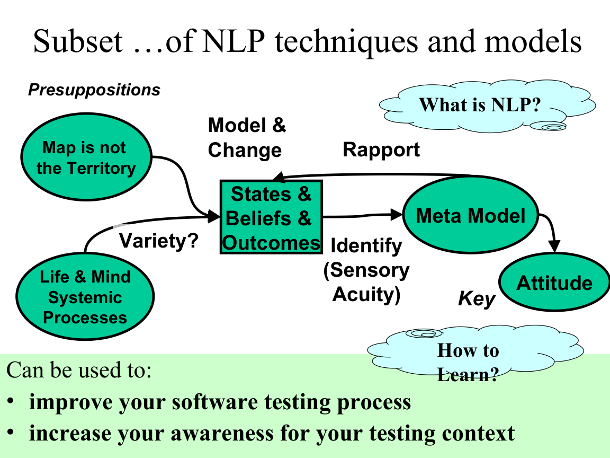

---

<!-- Slide 4 -->

# Differences NLP &amp; Testing

Testing

- “How to break it down?”
- First Responses:
    - “That couldn’t work”
    - “What is a counter example to that possibly working?”
- Find ways to break what I’m learning
- Find ways that it wouldn’t work
- Mismatching

NLP

- “What Opportunities?”
- First Responses:
    - How can I aquire this better?
    - How can I apply this?
    - What ways have I not yet thought of that this could work?
- Find ways of using it
- Matching

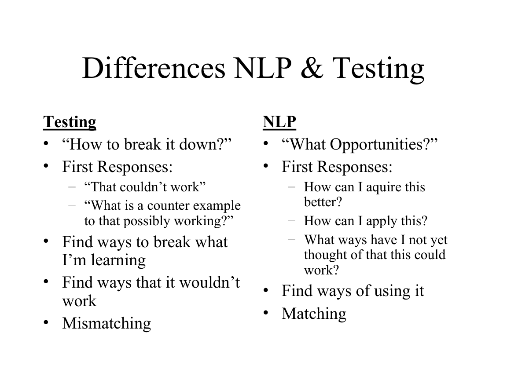

---

<!-- Slide 5 -->

# What is your goal?

Attitude

- What can I learn?
- How can this help me?
- How can I benefit from this?

Your context will determine what you are going to get from today

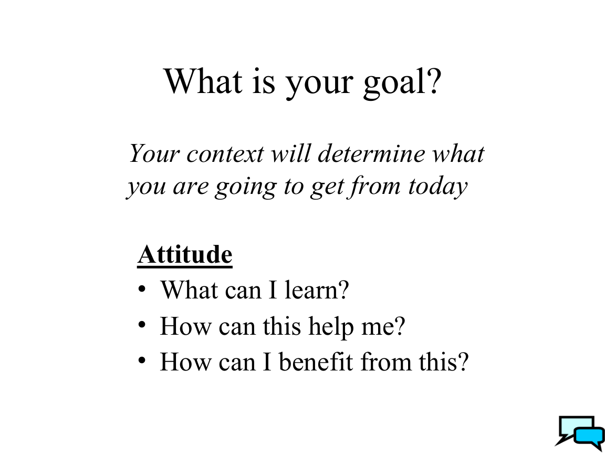

---

<!-- Slide 6 -->

# Using no NLP

- What are your goals for today?
- Without using any NLP questions or models, just ask someone what their goals are for today.
- Note down the questions that you ask them and the kind of responses that you receive

---

<!-- Slide 7 -->

# How did that go?

- What questions did you ask?
- What kind of things did people want?
- How did that feel?
- Is that the kind of thing you normally ask someone?
- Do you normally think through what you want?

---

<!-- Slide 8 -->

# \_\_ Well Formed Outcomes\_\_

- What do you want?
- How will you know that you have it?

---

<!-- Slide 9 -->

# Outcomes are Well Formed When…

- Stated in the positive
- Supported by a sensory description
- Initiated and maintained by the individual
- Ecological
- Contextualised

A well formed outcome is achievable

---

<!-- Slide 10 -->

# Some Well Formed Outcome Questions

- What do you want?
- How will you know when you’ve got it?
- Is this initiated and maintained by you?
- What is good about now?
- How will this affect you?
- Where and when do you want this?
- What do you need to get this?
- What will having this do for you?

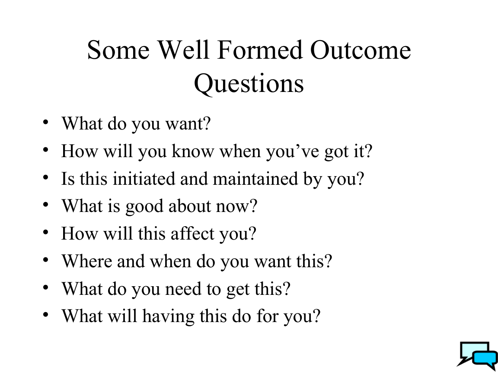

---

<!-- Slide 11 -->

# Using NLP Questions

- What is your goal for today?
- Do you have a main goal in mind for your testing?
    - What do you want?
    - How will you know when you’ve got it?
    - Is this initiated and maintained by you?
    - What is good about now?
    - How will this affect you?
    - Where and when do you want this?
    - What do you need to get this?
    - What will having this do for you?

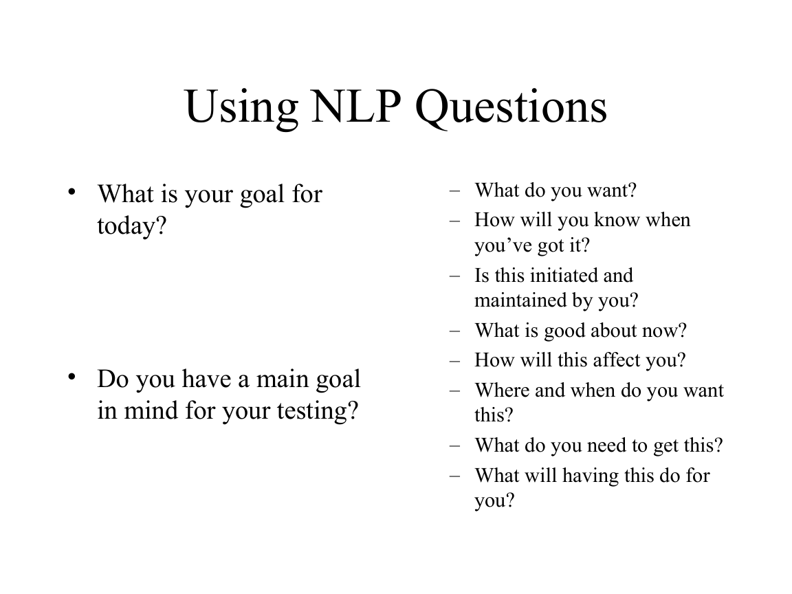

---

<!-- Slide 12 -->

# How did that go?

- What questions did you ask?
- What kind of things did people want?
- How did that feel?
    - …being asked?
    - …asking the questions?

How was that

different?

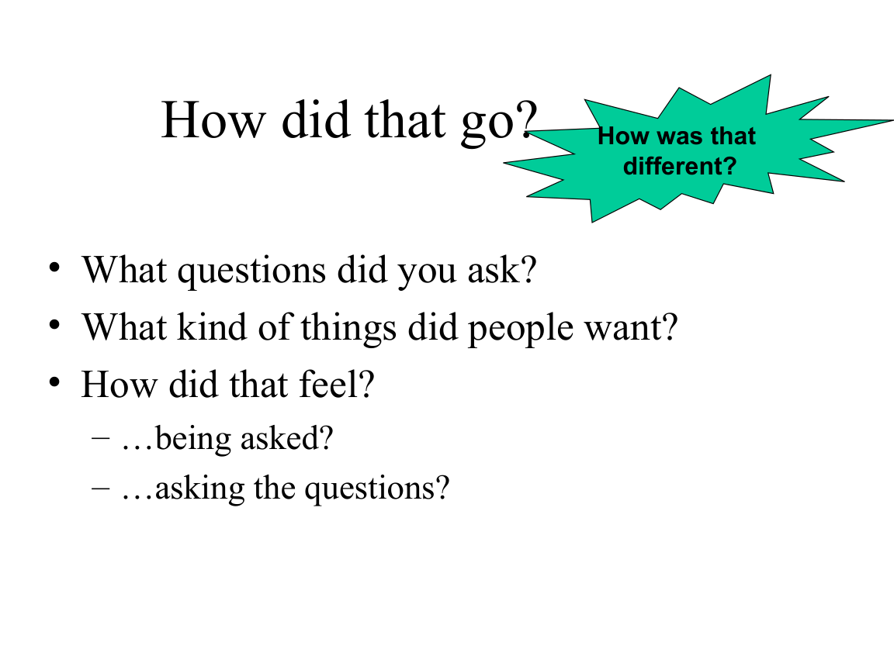

---

<!-- Slide 13 -->

# Why Question Outcomes?

Sometimes people say they want things, that they don’t really want.

Sometimes people say they want things, that they can’t achieve

People are often too vague about what they want

Question outcomes to make them well formed

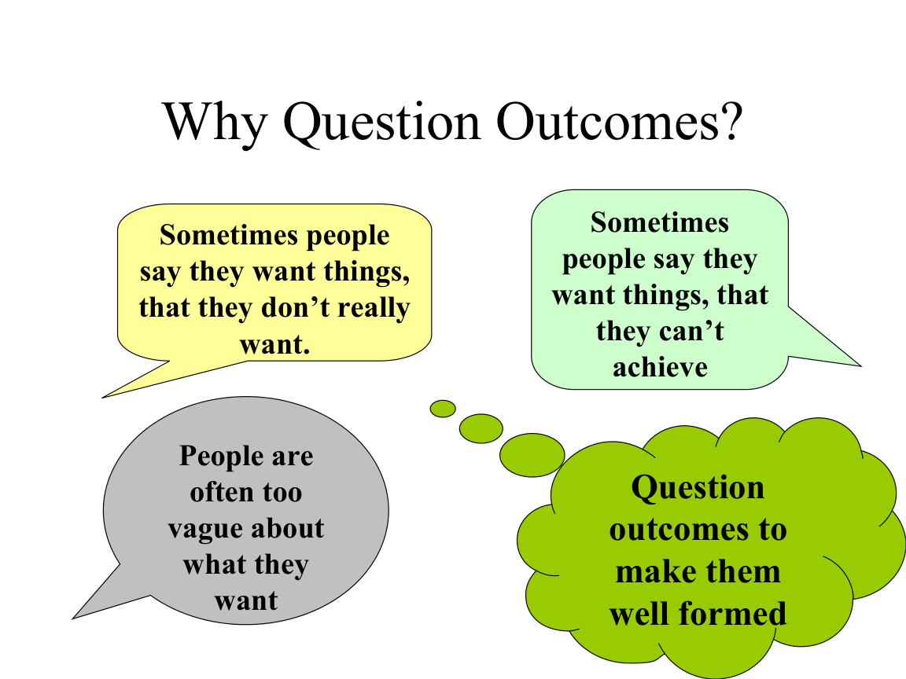

---

<!-- Slide 14 -->

# Testing is Questioning

- Test Criteria:
    - What do you want?
- Oracle:
    - How will you know that you have it?

When do we ask questions?

Whenever we want answers...

…or provoke thought

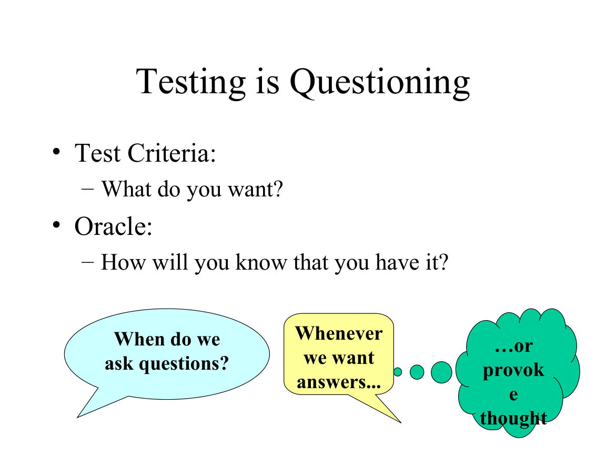

---

<!-- Slide 15 -->

# Know Answer?

- Test Criteria:
    - What do you want?
- Oracle
    - ?

Sometimes we ask questions without knowing what the answer is

Belief Question: Is this valid for Testing?

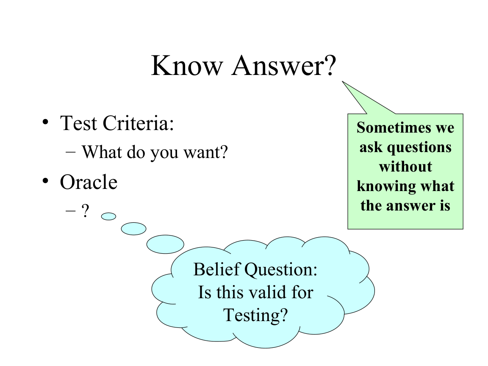

---

<!-- Slide 16 -->

# Relationships to testing

- Can you demonstrate a negative?
- Are you taking control and responsibility?
- Are you asking the right questions?
- Are you getting what you really want?

---

<!-- Slide 17 -->

# What is NLP?

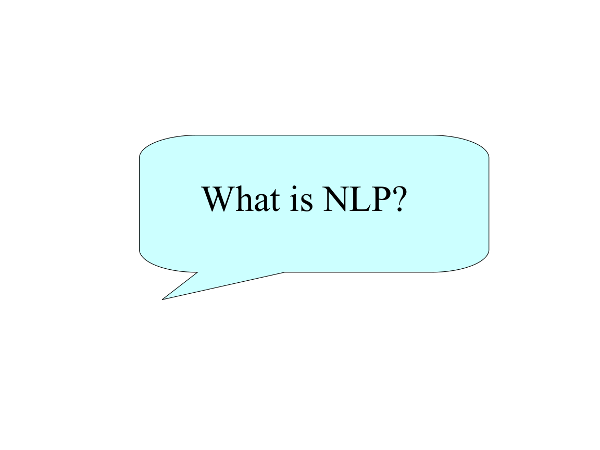

---

<!-- Slide 18 -->

# What NLP Have you Experienced?

- Trainings
- Books
- Anything at all?

---

<!-- Slide 19 -->

# How is NLP advertised?

- Improve your relationships,
- master rapport with anyone in moments,
- sell anything to anyone, and do it ethically,
- gain more flexibility,
- cure any phobia in seconds,
- get more of what you really want,
- Create instant motivation and confidence

---

<!-- Slide 20 -->

# What is it really?

---

<!-- Slide 21 -->

# Neuro Linguistic Programming

Linguistic

Language and nonverbal communication systems through which neural representations are coded, ordered, and given meaning.

Programming

The ability to organize our communication and neurological systems to achieve specific desired goals and results.

Neuro

Nervous system through which experience is received and processed through the five senses.

[http://www.purenlp.com/nlpis1.htm](http://www.purenlp.com/nlpis1.htm)

“…the study of the structure of subjective experience.”

[www.richardbandler.tv](http://www.richardbandler.tv)

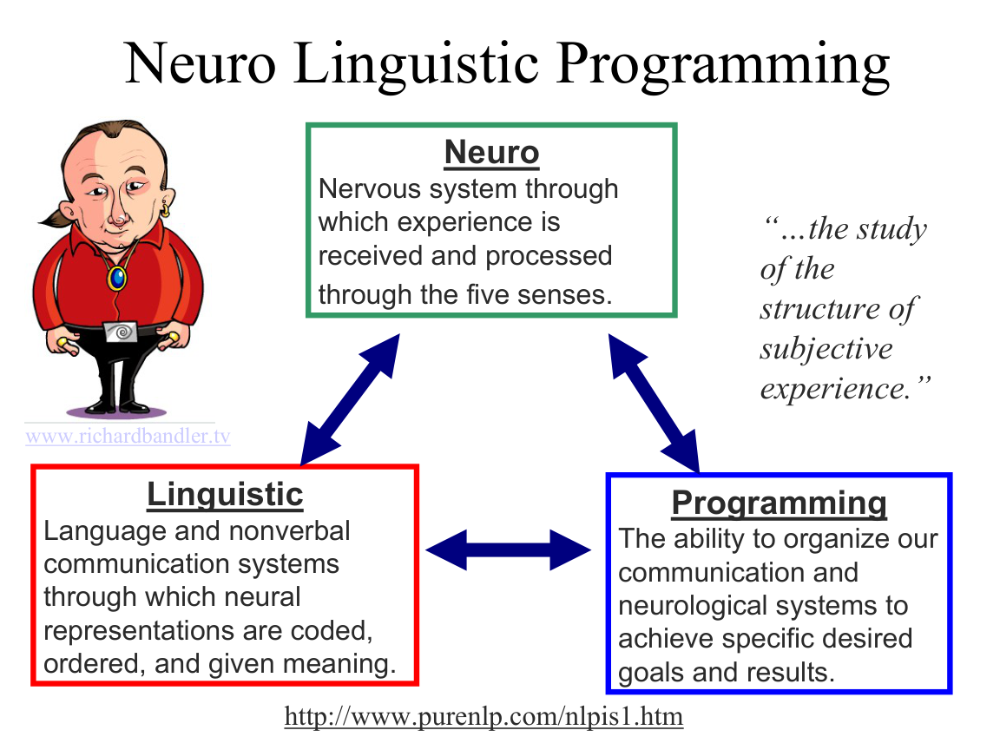

---

<!-- Slide 22 -->

# No, What is it really?

---

<!-- Slide 23 -->

# NLP is…

ATTITUDE

…sense of curiosity and adventure … desire to learn the skills to be able to find out what kinds of communication influences somebody and the kinds of things worth knowing ... to look at life as a rare and unprecedented opportunity to learn

METHODOLOGY … all behavior has a structure . . . and that structure can be modeled, learned, taught, and changed (re-Programmed). The way to know what will be useful and effective are the perceptual skills

TECHNOLOGY

enabling the practitioner to organize information and perceptions in ways that allow them to achieve results that were once inconceivable

[http://www.purenlp.com/nlpis2.htm](http://www.purenlp.com/nlpis2.htm)

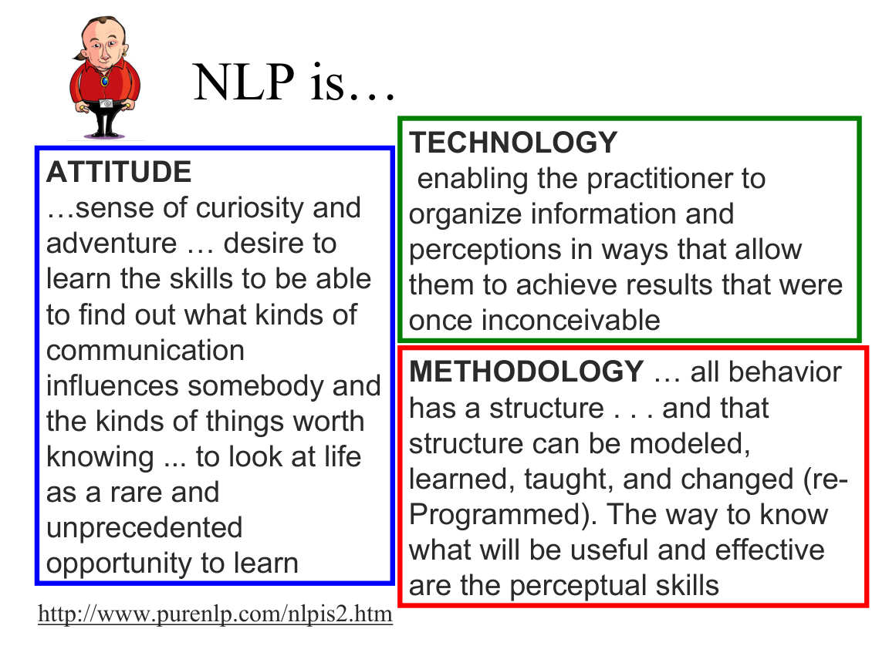

---

<!-- Slide 24 -->

# Roots of NLP

“The Structure of Magic” volume 1, Richard Bandler &amp; John Grinder

\[NLP is a Synthesis\]

## Embedded Diagram Text

Virginia Satir

Fritz Perls

Frank Farrelly

Milton Erickson

Others

Transformational Grammar

Family Therapy

Congruence

Groups

Change

Gestalt Therapy

Context

Provocative Therapy

Attitude

Humour

Challenge

Explore limits

Honesty

Hypnosis

Ambiguity

Conversational Change

George Miller

Gregory Bateson

Alfred Korzybski

Edward Sapir

Mathematical Logic

Deep structure

Surface Structure

Deletion

Distortion

Generalization

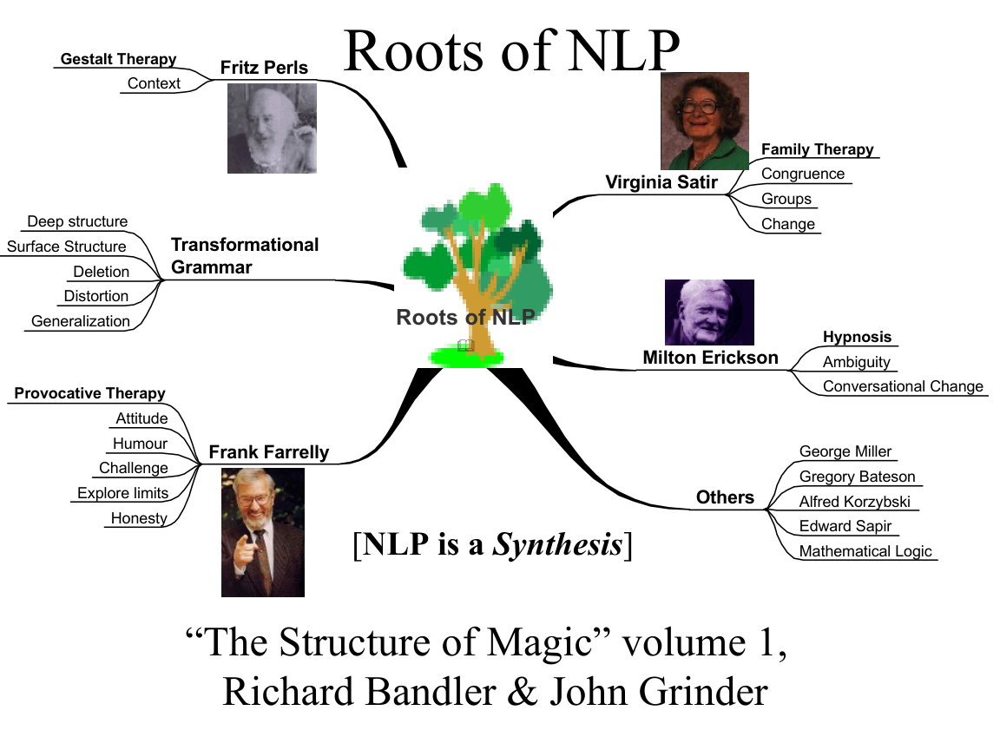

---

<!-- Slide 25 -->

# What is NLP?

- Neuro-Linguistic Programming™ (NLP™)
- Techniques and models drawn from a wide range of disciplines:
    - mathematics, linguistics, psychotherapy, systems theory, cybernetics, general semantics, philosophy, psychotherapy.
- Used to identify, change, and allow people flexibility in their behavior to achieve desired goals effectively and quickly.

---

<!-- Slide 26 -->

# An NLP Session

- “What” is the person doing?
- “How” is the person doing what they are doing?
- A context of…

Questioning, Modelling, Communication, Attitude, Effectiveness, Literalism, Identify Ambiguity, Honesty

- Approach testing like an NLP Session

---

<!-- Slide 27 -->

# \_\_Sensory Acuity\_\_

---

<!-- Slide 28 -->

# Sensory Acuity

“Watch and Listen”

- Peripheral awareness
- Patterns
- Internal Silence

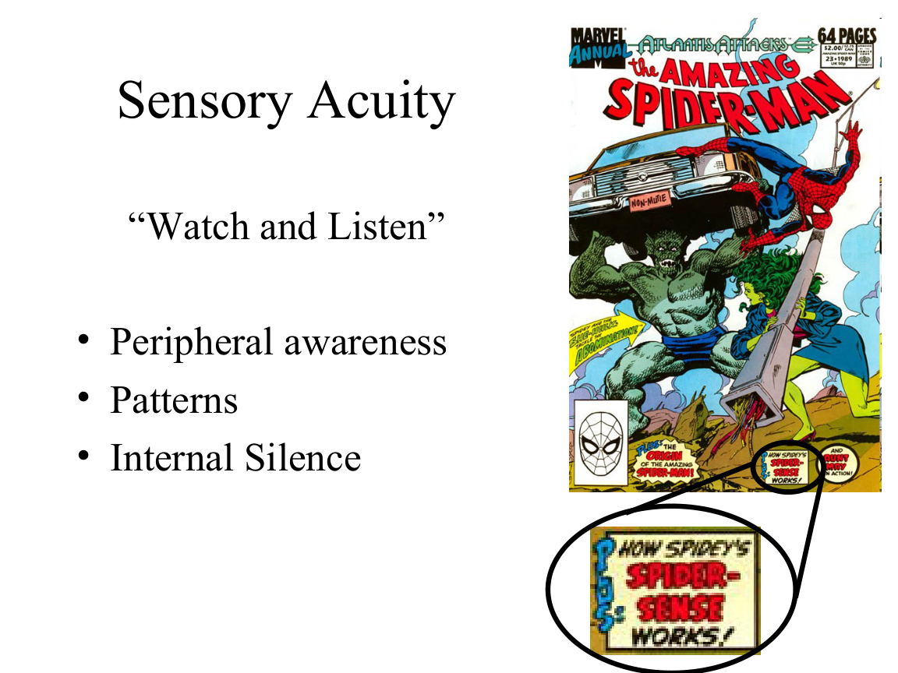

---

<!-- Slide 29 -->

# What can we be aware of with People?

- …and that would that help us, how?
- …and we can become more aware, how?

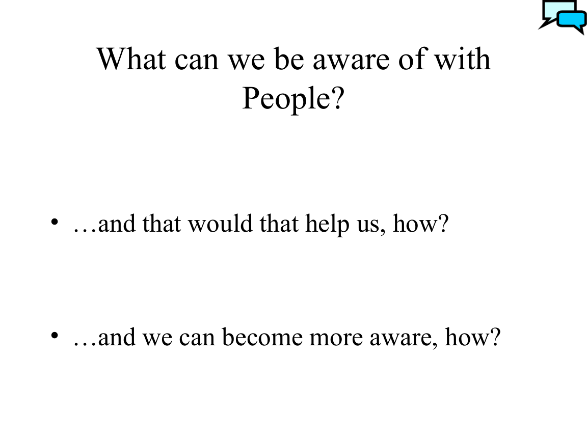

---

<!-- Slide 30 -->

# Human Lie Detector

- Ask 10 questions that will get a yes response
    - Are you male? Are you wearing shoes? Etc.
- Ask 10 questions that will get a no response
    - Are you wearing a tie? Are you wearing a hat at the moment?
- Ask 10 Y/N questions that you don’t know the answer to:
    - Do you like waffles?
    - Get feedback on the ones that you get right or wrong
    - And ask ‘nice’ questions!

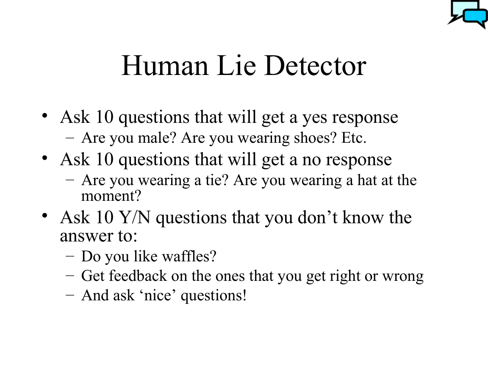

---

<!-- Slide 31 -->

# What happened?

- What were you aware of?
- Were you able to tell?
- Did any questions not distinguish?
    - What happened then?

---

<!-- Slide 32 -->

# Looking for patterns, not interpretation

- Calibration
- Meet them at their map of the world

---

<!-- Slide 33 -->

# Testing Sensory Awareness

“Brain On… Eyes Open… Test”

James Whittaker

“How to Break Software

“Exploratory testing is simultaneous learning, test design, and test execution”

James Bach

“Exploratory Testing Explained”

---

<!-- Slide 34 -->

# What Can we be aware of when testing?

- …and that would that help us, how?
- …and we can become more aware, how?

---

<!-- Slide 35 -->

# Beliefs

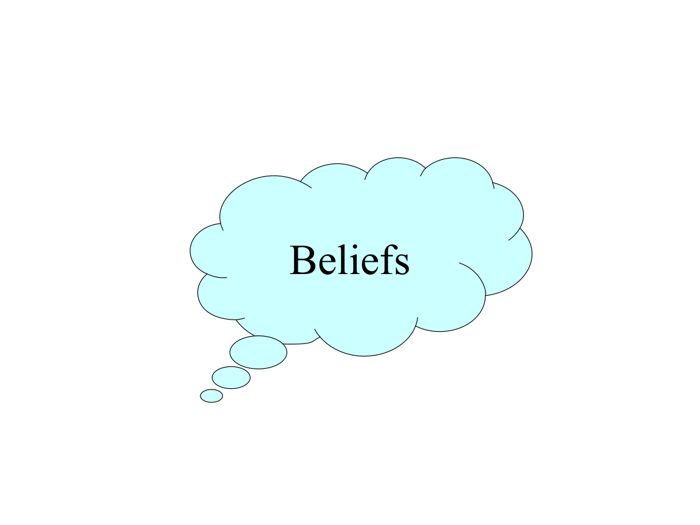

---

<!-- Slide 36 -->

# I was a teenage methodology monster!

\*Gasp in amazement\*

As you see him know exactly what do do, before he is even on site.

\*You will Be shocked\*

As the rework mounts to truly heroic proportions

\*Can you bear to see\*

Him justify his actions by quoting text book after text book and expert after expert.

Coming soon to a project near you…

Methodology

He can do

no wrong.

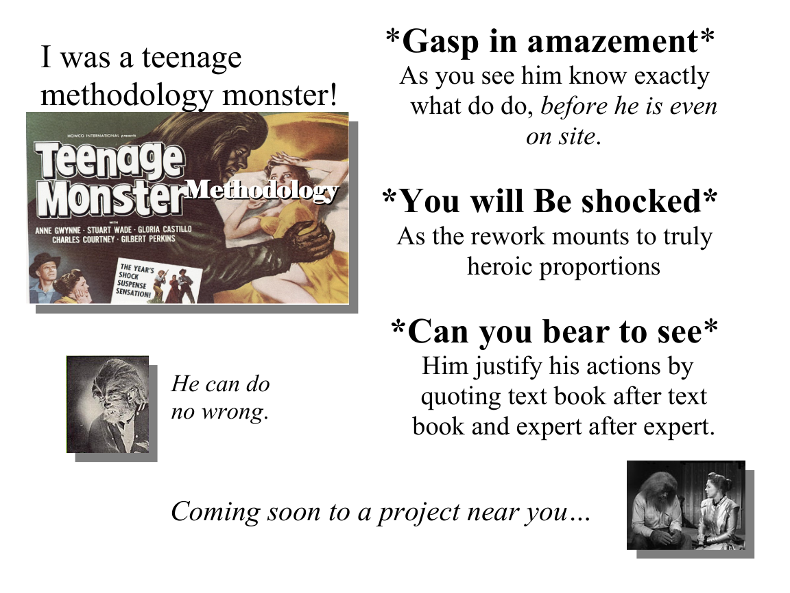

---

<!-- Slide 37 -->

# Example Beliefs About Testing

- We cannot test without specifications
- We must write test scripts before testing
- Test Scripts must be runnable, unambiguously, by anybody
- Testing has to be fully documented
- Test Scripts have to be fully detailed down to the test step level
- We must raise a defect report for every defect found
- Requirements must be signed off
- Test Artefacts must be in the test repository database

…that I have held

…and let go

---

<!-- Slide 38 -->

# The Test anything… belief

“…I can test anything under any conditions in any time frame…”

James Bach

“Becoming a Software Testing Expert”

[http://www.satisfice.com/presentations/bste.pdf](http://www.satisfice.com/presentations/bste.pdf)

Useful

Belief?

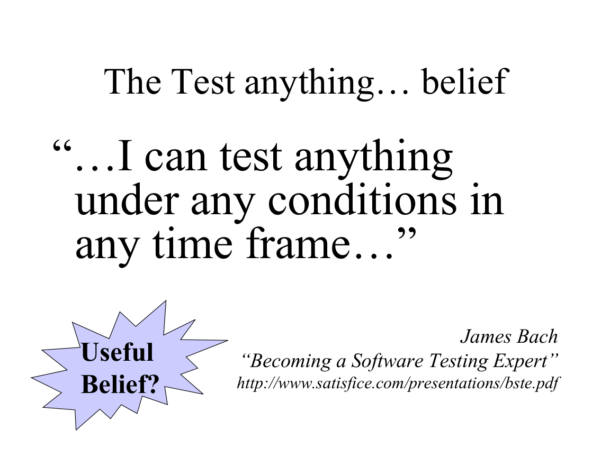

---

<!-- Slide 39 -->

# “Relative to…”

“Relative to…My standing in the local community…How hard I try…My technical insight…

I can…Test anything…Under any conditions…In any time frame…

Such that; I deliver useful results in a usable form, I perform at least as well as any other expert would…”

James Bach

“Becoming a Software Testing Expert”

[http://www.satisfice.com/presentations/bste.pdf](http://www.satisfice.com/presentations/bste.pdf)

What is different?

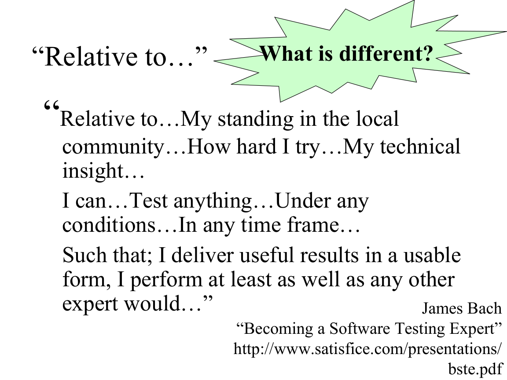

---

<!-- Slide 40 -->

# Evaluate Beliefs in terms of…

- Useful, Not useful
- Expansive, Limiting
- Choice, Fixed

---

<!-- Slide 41 -->

# What are your Software Testing beliefs?

What are

you doing?

What would

happen if you

didn’t do that?

Why are you

doing that?

what do you

think you should

be doing?

Statement

of Belief

Identify

and

Question

Your

Beliefs…

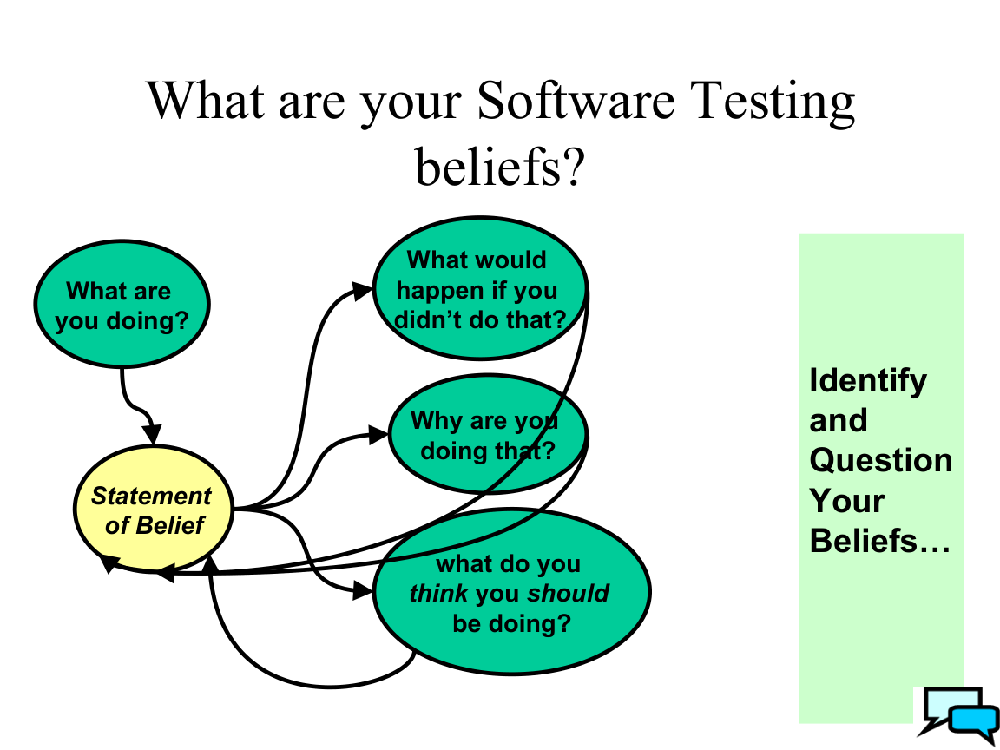

---

<!-- Slide 42 -->

# What are your software testing beliefs?

- Identify some of your testing beliefs?
    - What things do you Always do?
    - What things do you think you should be doing?
    - What things do you have to do?
- Limiting?
- Choice?

---

<!-- Slide 43 -->

# What did you get?

- Any beliefs that you didn’t realise?
- Any beliefs that are in your process that are not yours?
- What limiting beliefs were there?
- When might they not be limiting?

---

<!-- Slide 44 -->

# Context Driven Testing

## Embedded Diagram Text

Product is

a solution

Constant judgment &amp;

Skill

Projects often not predictable

[www.context-driven-testing.com](http://www.context-driven-testing.com)

Value depends on

People most

Important No Best Practices

Testing (vb) =

intellectual

process

What about X?

Unit Testing, Regression Testing, End to End, Automation, Tools, etc.

Good in

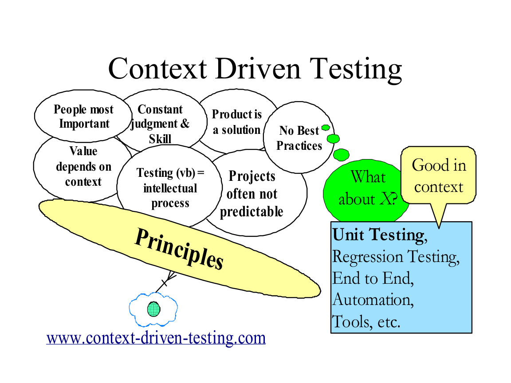

---

<!-- Slide 45 -->

# What can you expect from context-driven testers?

- “It depends...” on the context, but generally (I suspect they will)...
    - Ask a lot of questions of you and of themselves to explore the context and avoid assumptions
    - Change their minds, Re-plan
    - Be able to justify what they are doing, in terms of the context as they perceive it, not in calls to authority
    - Know their techniques and practices – assumptions, presuppositions, pros &amp; cons

I Ceased my evil ways, over time, kind of…

---

<!-- Slide 46 -->

# Logical Levels

Identity

Beliefs

Values

Capabilities

Behaviours

Environment

Who?

Why?

How?

What?

Where?

When?

Mission

Goals

Questions

Permission

Motivation

Direction

Action

Reaction

Boundaries &amp;

Constraints

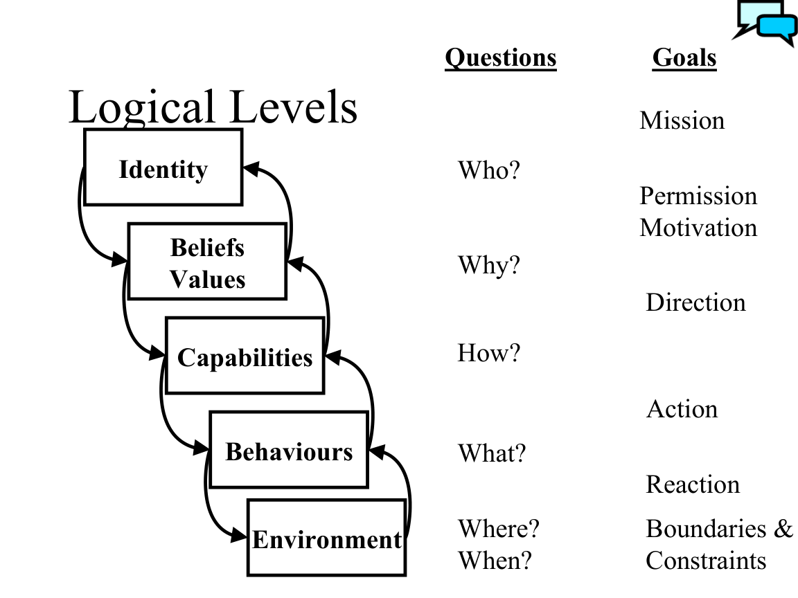

---

<!-- Slide 47 -->

# Beliefs are Generalisations

Robert Dilts,

Changing belief systems with NLP,

pg 20

"A belief is a generalization about a relationship between experiences"

---

<!-- Slide 48 -->

# Beliefs are Generalisations about…

- Causal Relationships
- Meaning Relationships
    - If X happens what does it mean
    - If a bug is found in live then it means I am a bad tester
- Limits

---

<!-- Slide 49 -->

# \_\_ NLP &amp; Testing \_\_

---

<!-- Slide 50 -->

# NLP and Testing are related

- Questioning
- Modelling
- Communication
- Effectiveness
- Attitude
- Synthesis Knowledge Systems
- Literalism
- Identify Ambiguity
- Honesty

---

<!-- Slide 51 -->

# Modelling

“The NLP modeling process involves finding out about how the brain (“Neuro”) is operating by analyzing language patterns (“Linguistic”) and non-verbal communication. The results of this analysis are then put into step-by-step strategies or programs (“Programming”) that may be used to transfer the skill to other people and areas of application.”

Modeling with NLP,

Robert Dilts

Meta Publishing, 1998

Most techniques and tools of NLP have been derived by…

---

<!-- Slide 52 -->

# \_\_Rapport\_\_

---

<!-- Slide 53 -->

# Rapport Ability…

- make people feel at ease,
- build up trust,
- recognise when you have achieved a state of rapport
- maintain a state or rapport

---

<!-- Slide 54 -->

# Recognising Rapport

- People adopt the same body posture, at the same time, or a few moments later
- People use the same words and phrases
- People speak at the same rate, or same tone of voice

---

<!-- Slide 55 -->

# Pacing

Meet someone at their model of the world…

…using Matching &amp; Mirroring

What can we match and mirror?

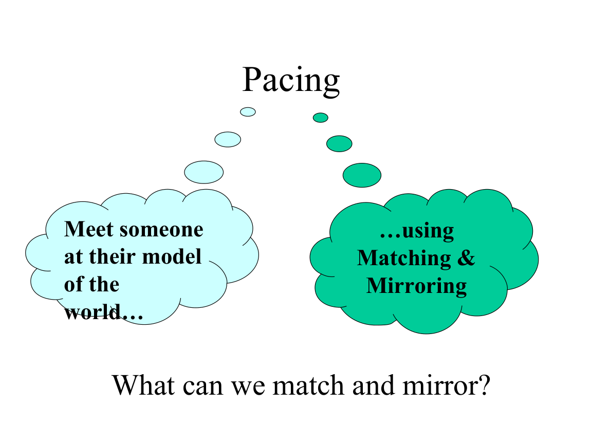

---

<!-- Slide 56 -->

# Matching and Mirroring

- Language Patterns – words and phrases (VAK)
- Body Posture
- Eye movements
- Physical Actions
- Breathing
- Tonality
- Rate of Speech
- Rhythm
- Same Words &amp; Phrases
- Key Gestures
- Etc.

---

<!-- Slide 57 -->

# Leading

Leading

Pacing

Where?

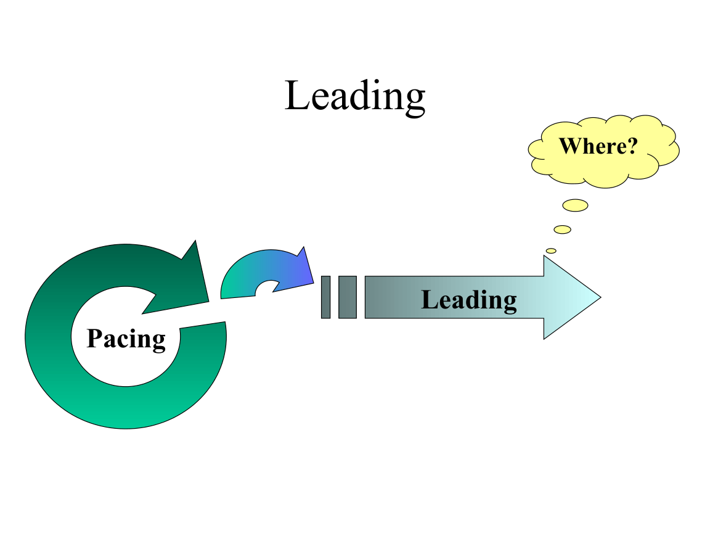

---

<!-- Slide 58 -->

# Mismatching

- If Deliberate – Why?

Pacing

Mismatch

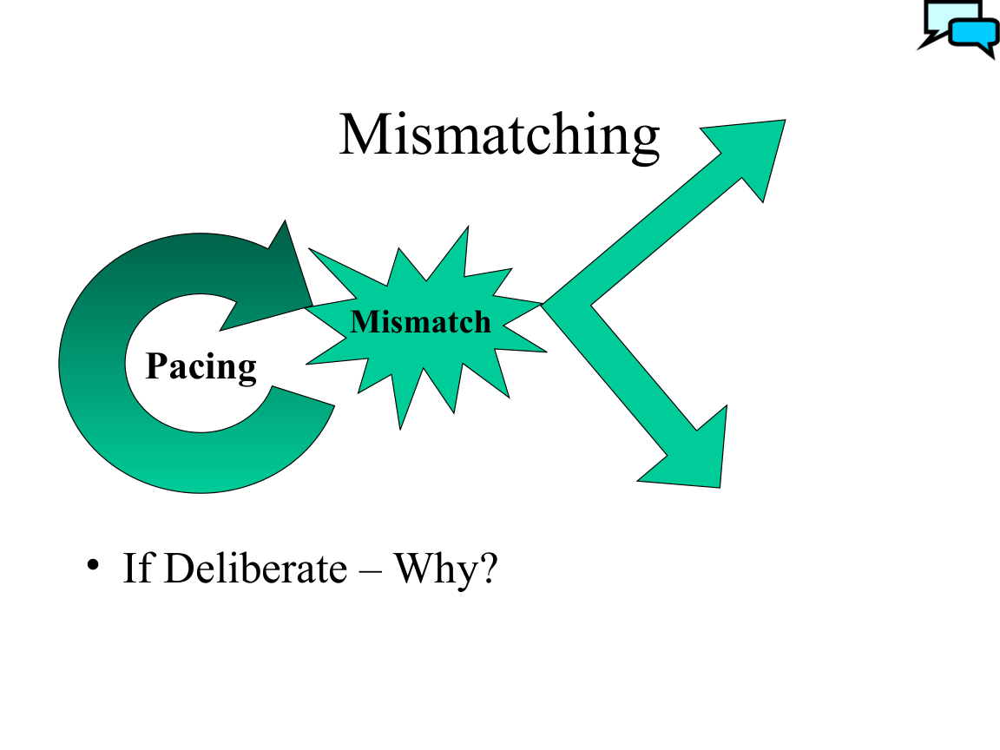

---

<!-- Slide 59 -->

# Conversational Leading

- Engage in conversation (with the understanding that B will be leading)
- B matches A (breathing, language patterns, posture, gestures)
- When B thinks rapport has been achieved, B should lead with a body shift. If rapport has been achieved then A will respond to the shift (could take a few seconds)
- Explore leading for a while
- B Mismatches to break rapport
- B regains Rapport and tests by leading

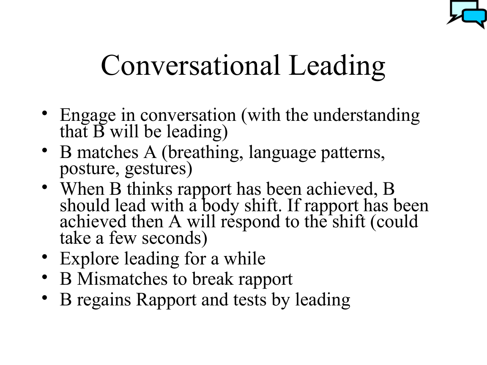

---

<!-- Slide 60 -->

# How did it go?

- Could you tell you had rapport?
- What did you do to lead?
- What response did you get?
- How did you mismatch?

---

<!-- Slide 61 -->

# Process Rapport

- Does your test process have rapport with the test process?
- Does your TPI pace, then lead?
- Does your test process have mismatching?
- Is the mismatching deliberate?

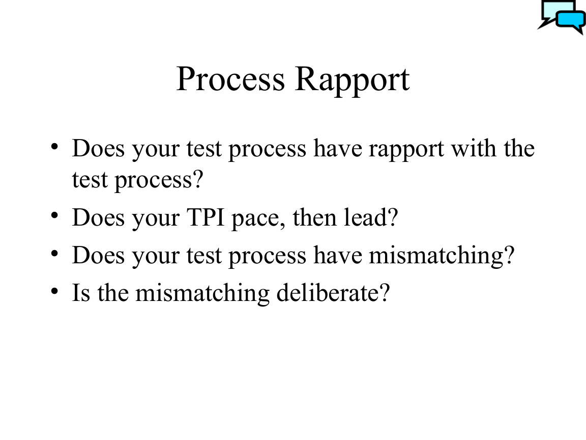

---

<!-- Slide 62 -->

# \_\_ States \_\_

---

<!-- Slide 63 -->

# Attributes of a Tester

- What are the Attributes that are associated with a ‘good’ tester?

---

<!-- Slide 64 -->

# Attributes vs States

Attributes

- Person ‘has’
- Context?
- “IS” of identity

States

- Person ‘feels’
- Context State
- Behaviour

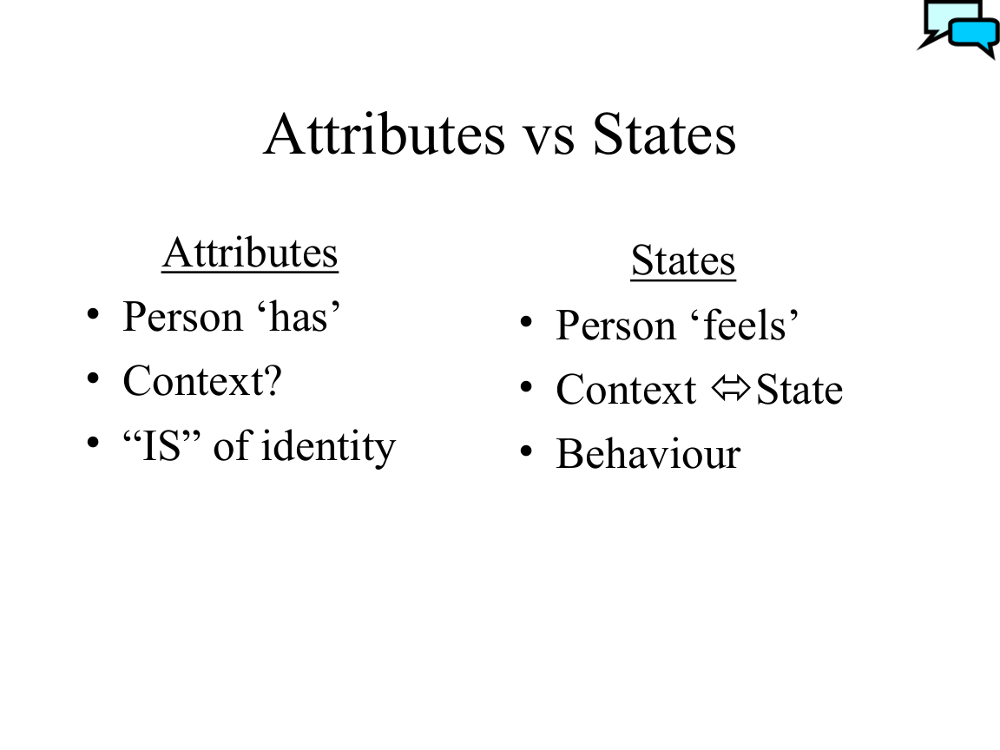

---

<!-- Slide 65 -->

# Attributes vs States

- Exercise: Convert attributes into states
- Choose an attribute (or 2) – what is the state?
- Can you generate and feel those states in yourself?
- What can you say things to other people to generate those states?
- When would those states be appropriate?
- Can you identify a time when you used those states positively? Negatively?

---

<!-- Slide 66 -->

# States make a difference

Attributes

- Person ‘has’
- Context?
- “IS” of identity

States

- Person ‘feels’
- Context State
- Behaviour

Make a difference to your testing by identifying the most effective states for you. And generate them.

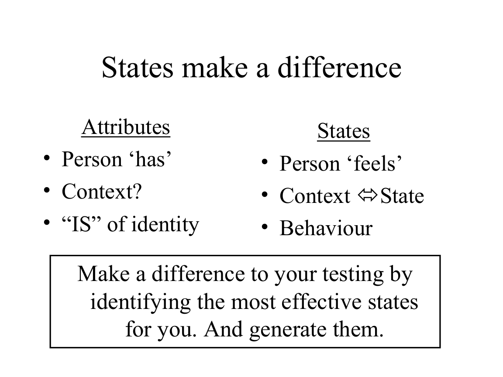

---

<!-- Slide 67 -->

# How to Build States

- Resources
- How to generate a resource
- How to stack resources
- How to maintain states

---

<!-- Slide 68 -->

# Which makes the more effective defect reporting state?

- Angry
- Uptight
- Rapid Breathing
- Internal Dialog
- Controlled
- Objective
- Calm
- Thoughtful

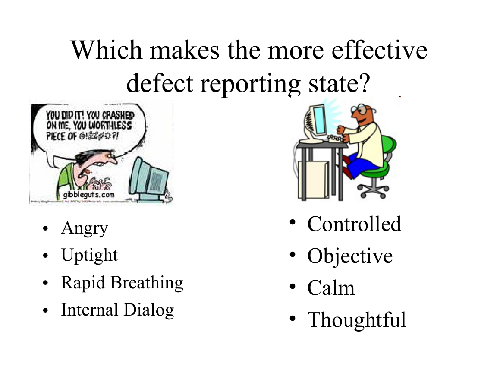

---

<!-- Slide 69 -->

# Choosing effective states

- Are you aware of having different states?
- Do you pick your states?
- Have you tried different states?
- When you have a good state do you know how you can make it better?

Its obvious which state was more effective but…

---

<!-- Slide 70 -->

# States

- What State is your defect process in?

Find

a

Defect

State?

Investigate

To Repeat

To Exploit

Report

- Ecstatic?
- Angry?
- Frustrated?

Maintain \*

State Process

State?

State?

Physiology

Mental

- Clean?
- Effective?
- Deliberate?

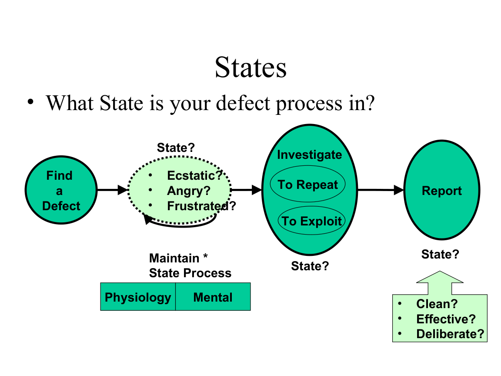

---

<!-- Slide 71 -->

# States

- Be aware of your states
    - How are you maintaining the state?
- Be aware of the activities you do
    - Partition the activities you do
        - What states have you been in?
        - Whick ones worked well?
- Clean your states
    - What would an effective state for this activity be?
    - What resources do you need?
    - When have you ever had that resource before?
    - What would it feel like to be in that ultimate clean state? What would your physiology be like?

---

<!-- Slide 72 -->

# How to Change Someone’s State

- Elicitation
- Go there first
- How will you know?
    - How will they evidence a change of state?

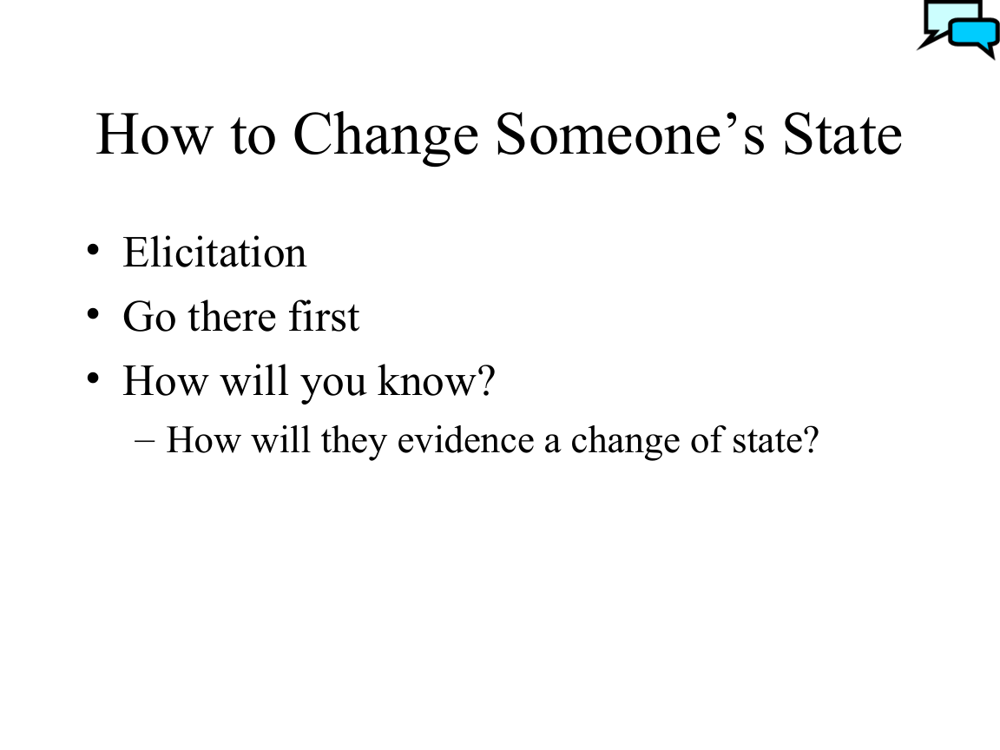

---

<!-- Slide 73 -->

# Exercise: Change Someone’s State

- Choose a state
- Get Rapport
- Lead them into the state
    - Conversationally
        - I remember when I…
        - Can you remember when you…
    - Body Posture
    - Breathing

---

<!-- Slide 74 -->

# Stuck

Not Stuck

Stuck

Process Loop to maintain stuck state

Stuck

Next

?How

?What Next

Loop, replay past, ask same questions

can’t decide between choices

- Too many
- Not good enough

?How to do

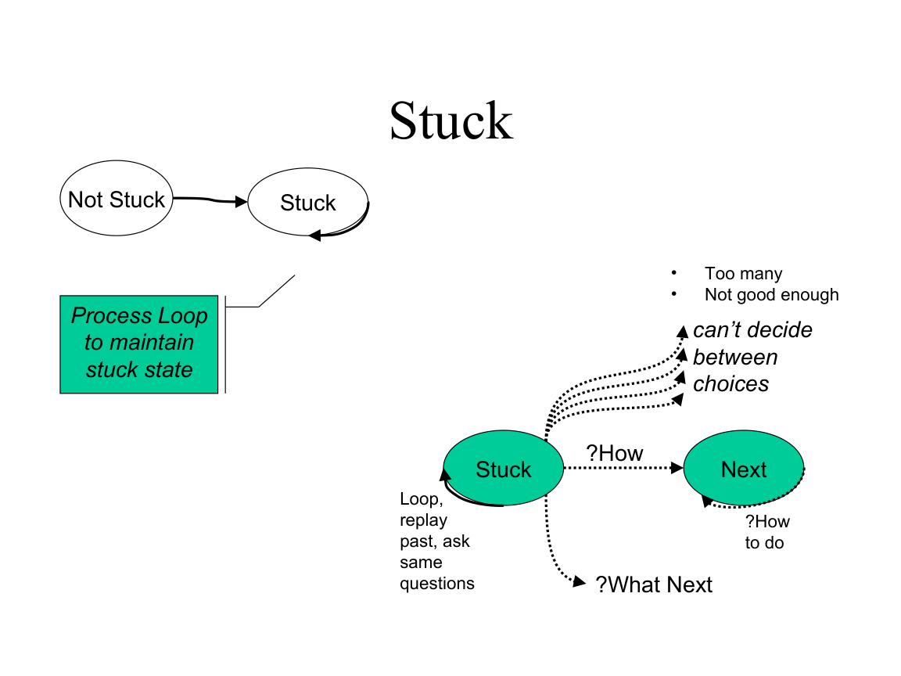

---

<!-- Slide 75 -->

# What state is your testing in?

- When do you have different states in testing? (Enumerate)
- What are the states like? (Describe)
    - How are they different?
- When did you last have that state? (Elicit)
- States to avoid? When?

---

<!-- Slide 76 -->

# Useful States For Testing

- To Elicit in others…
    - Doubt
    - Are you sure? You’re not unsure, that this is a problem?
- To Identify in yourself…
    - Stuck
- To Elicit from yourself…
    - Curious, Tenacious, Mischevous

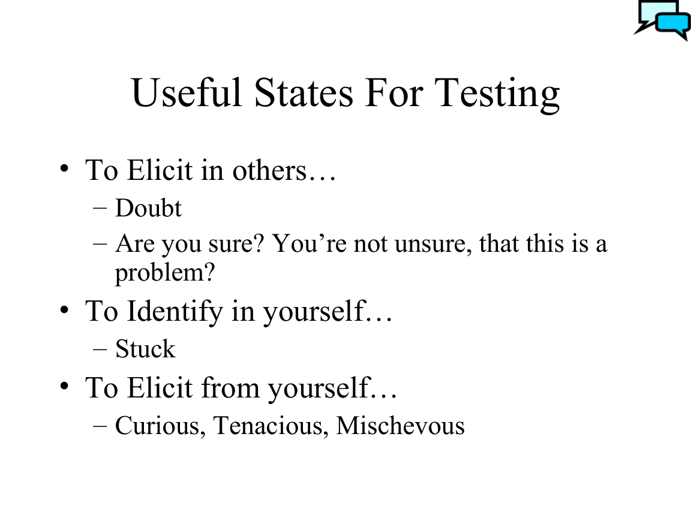

---

<!-- Slide 77 -->

# \_\_ Presuppositions \_\_

---

<!-- Slide 78 -->

# Presuppositions of NLP

The Map

is not the

territory

Life and

mind are

systemic

processes

Everyone is unique

People make the best choice

available to them at the time

Every behaviour has

a positive intent

The meaning of the communication

is the response that you get

There is no failure,

only feedback

Everyone already has the

resources they need to succeed

The law of

requisite variety

…and their corollaries

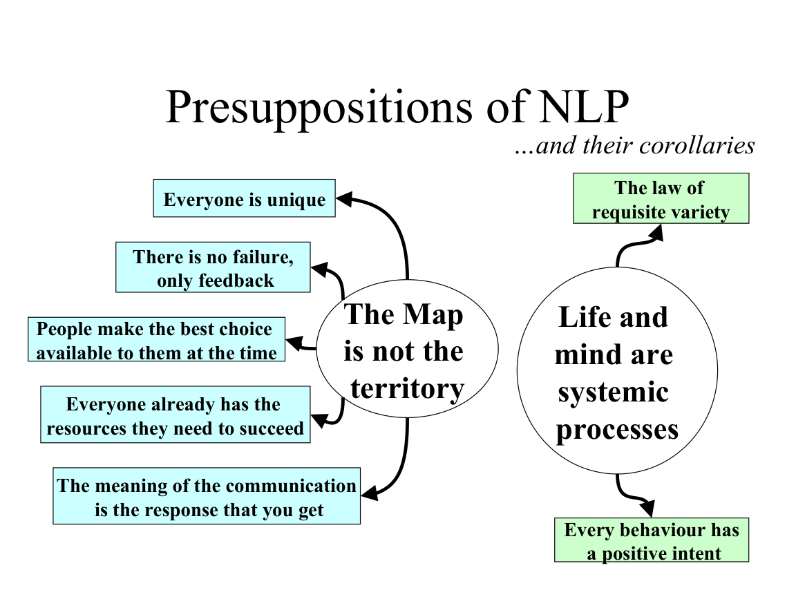

---

<!-- Slide 79 -->

# Example Software Testing Maps

- Stated Requirements
- Specification
- Test Script
- Test Case

Maps

- Needs
- Code
- Application Path
- Task

Territory

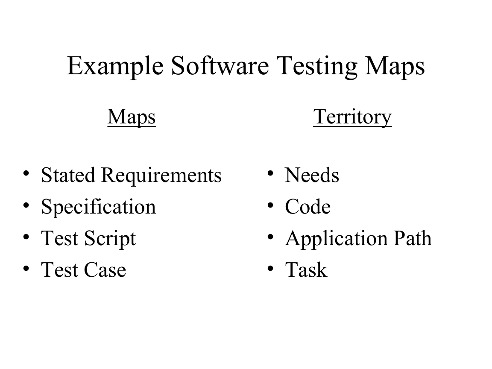

---

<!-- Slide 80 -->

# The Map is not the territory

- Expect maps to be different from the Territory
- Work as close to the territory as you can
- Context Driven uses the territory not the map

The Map

is not the

territory

Everyone is unique

People make the best choice

available to them at the time

The meaning of the communication

is the response that you get

There is no failure,

only feedback

Everyone already has the

resources they need to succeed

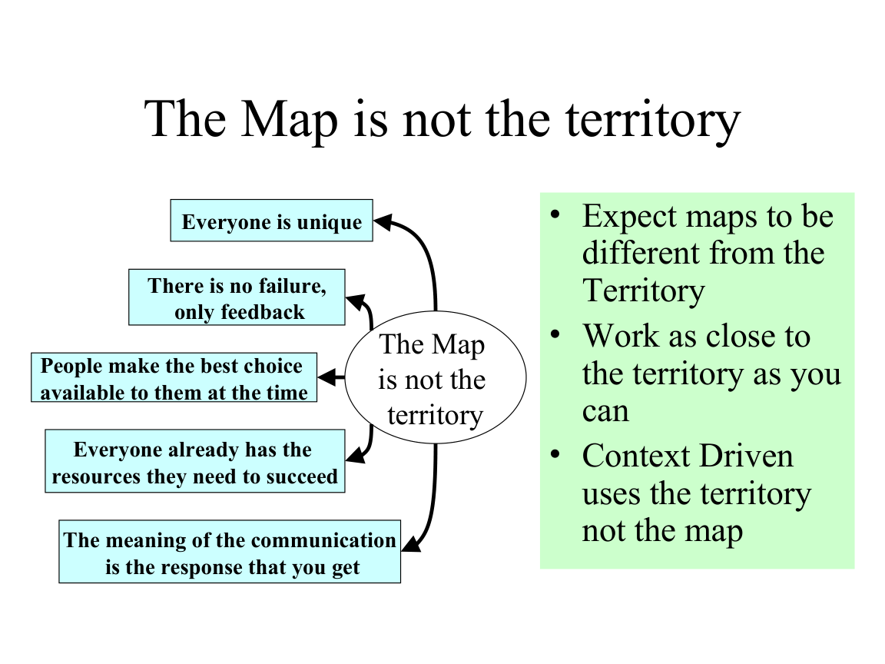

---

<!-- Slide 81 -->

# Life and Mind are systemic processes

- We are systems
- Our mental state affects our physiology
- Our relationships with other people are systems

Life and

mind are

systemic

processes

Every behaviour has

a positive intent

The law of

requisite variety

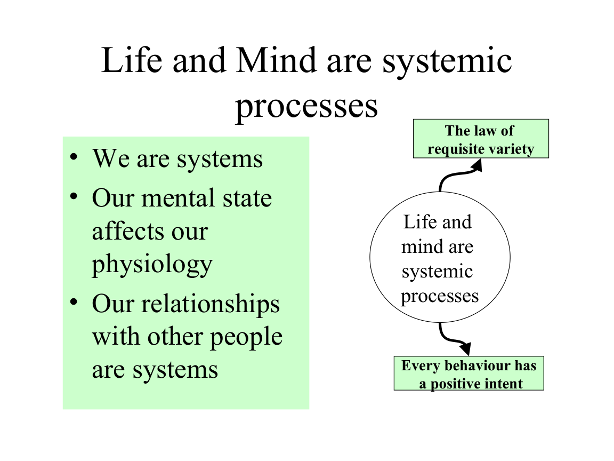

---

<!-- Slide 82 -->

# Law of Requisite Variety

“…in any cybernetic system the element or person in the system with the widest range of behaviours or variability of choice will control the system”

---

<!-- Slide 83 -->

# Law of Requisite Variety

- In your situation what has the greater variety?
    - Development or Testing?
    - Project or Programme?
    - Amongst your testers?
- What skills are important for testing variety?
    - Familiarity with test techniques
    - Questioning
    - Context Analysis
- Do your maps lend themselves to variety?

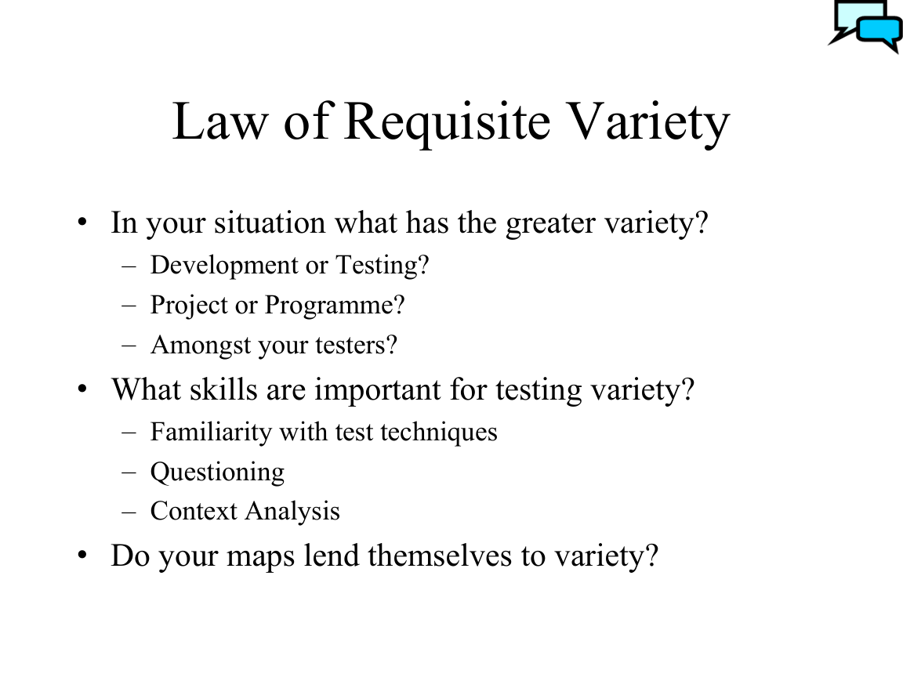

---

<!-- Slide 84 -->

# Presuppositions for context

- What has to be true for a person for their action to make sense?
- What are the presuppositions behind a particular process?
- What does your test process presuppose?

---

<!-- Slide 85 -->

# \_\_ Meta-Model \_\_

---

<!-- Slide 86 -->

# Deep Surface

- Meta-Model based on transformational grammar model
- Words affect experience

Deep Structure

Surface Structure

Primary Experience

Sensory &amp; Emotional

Secondary Experience

Linguistic Derivation

Transformation

Surface Structure

Surface Structure

Surface Structure

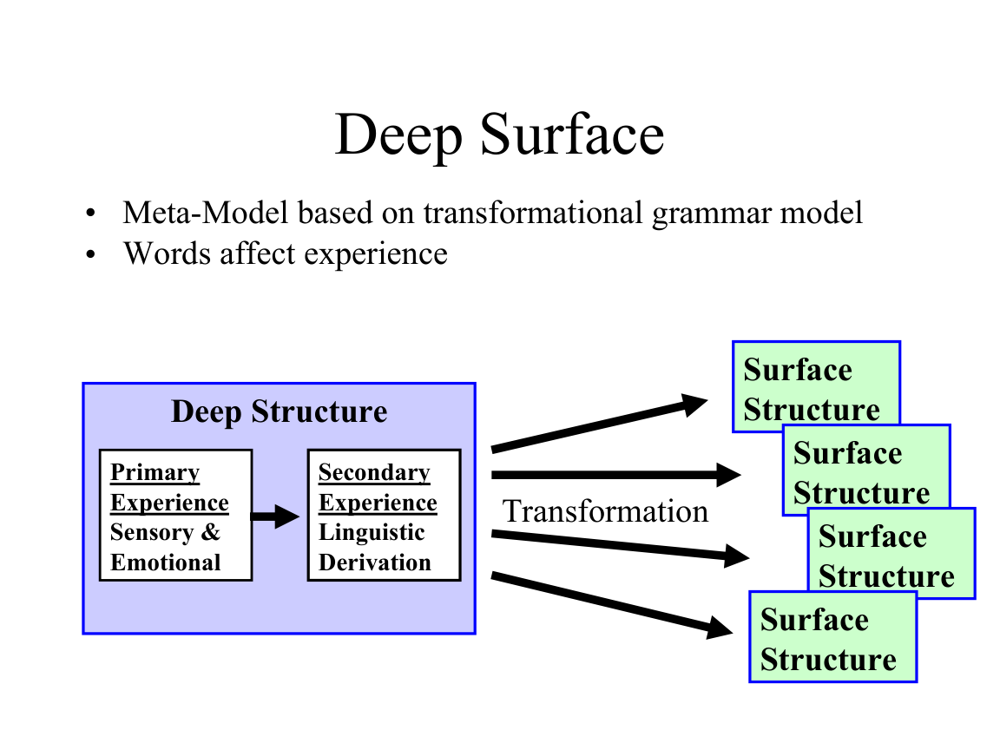

---

<!-- Slide 87 -->

# Ambiguity

- What we say is ambiguous
- Is this a problem?

Ambiguity

Assumptions

Assumptions

Message

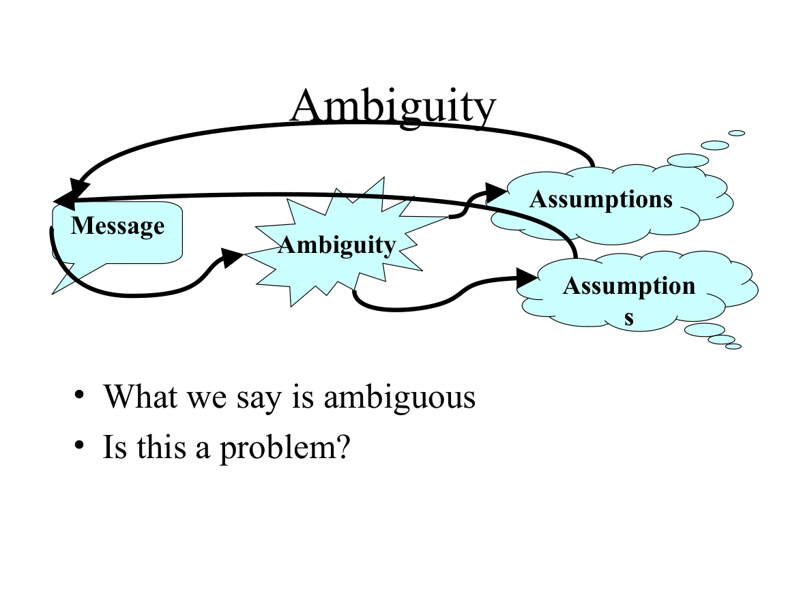

---

<!-- Slide 88 -->

# Slide 88

- Transformations (Distortion, Deletion, Generalization) can create ambiguity
- Identify Ambiguity (in the system, in the docs, in the communication) and target it with questions (Tests, Challenges)

Meta-Model

## Embedded Diagram Text

Deletion Distortion

Simple Deletion

Comparative Deletion

Lack of Referential Index

Unspecified Verb

Nominalization

Cause and Effect

Mind Reading

Complex Equivalence

Lost Performative

Universal Quantifier

Modal Operators

Presuppositions

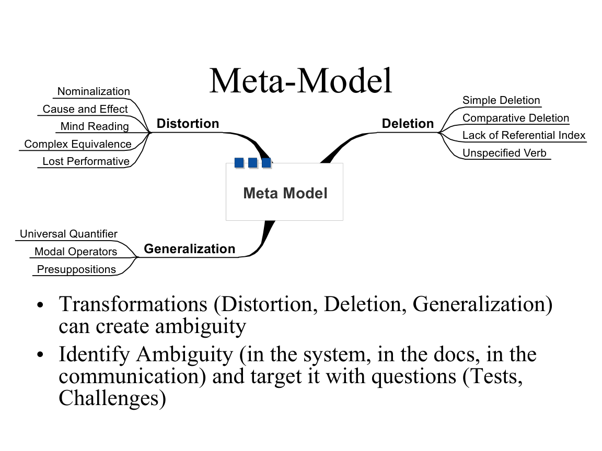

---

<!-- Slide 89 -->

# Slide 89

- Processed by what? How?
- Daily trade file – contains what? From where?
- 5 seconds – based on what?
- Starts up? How, When, How often?

Example Meta-Model Application

## Embedded Diagram Text

"The daily trade file must be processed in under 5 seconds when the system starts up"

LP

SD (1) MO UV (1) SD (3) SD (4) UV (2) SD (2)

Effect Cause CE Example Meta-Model Application

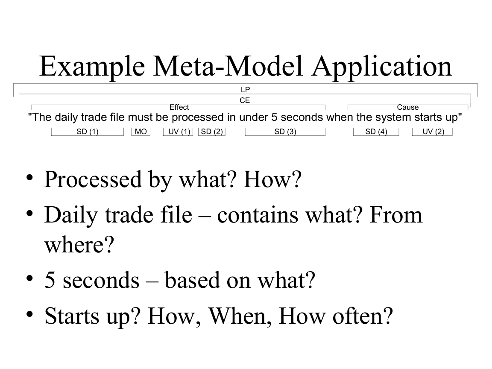

---

<!-- Slide 90 -->

# Generalization

- Universal Quantifier: The system will always process the daily trade file at start up. Even if the system is restarted in the middle of the day?
- Modal Operator: The system might ask the user to save the file.
- Presuppositions: Daily trade file exists. What if it doesn’t? The daily trade file can be processed. What if it is corrupt?

## Embedded Diagram Text

Universal Quantifier Modal Operators

A Limiting Generalisation Counter, challenge

Identify exception

"All developers hate testers"

"I develop and I don't hate you"

"\*ALL\* developers?"

"Microsoft have 2 testers for every developer, that must be hate city"

Rules for limits Challenge and get more information on the limits

"I can't run these tests" "What stops you?"

"I shouldn't test this." "What would happen if you did?"

What is unstated and has to be true for the statement to be true Challenge, test

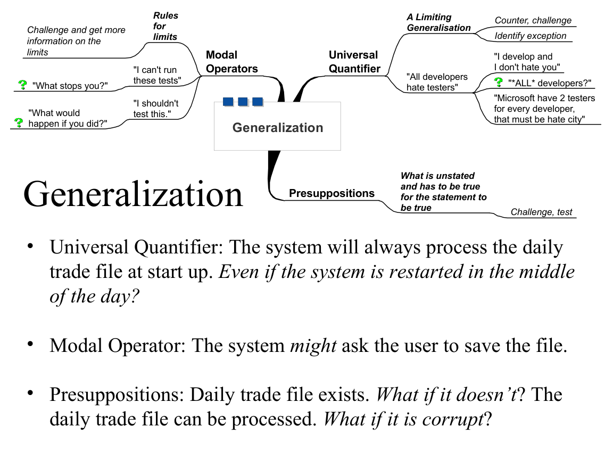

---

<!-- Slide 91 -->

# Universal Quantifiers

- All, Always
- Never
- Every
- Just That
- Only
- Counter examples
- Agree and take to nth degree

M:1

---

<!-- Slide 92 -->

# Modal Operators

- Should
- Must
- Have to
- Might
- Could
- Suggestive of time &amp; stance
- What would happen if you did?
- What would happen if you didn’t?

Possibility

Permission

- Can
- May
- Will
- Shall
- Need

Necessity

Obligation

Prediction

Volition

Ability

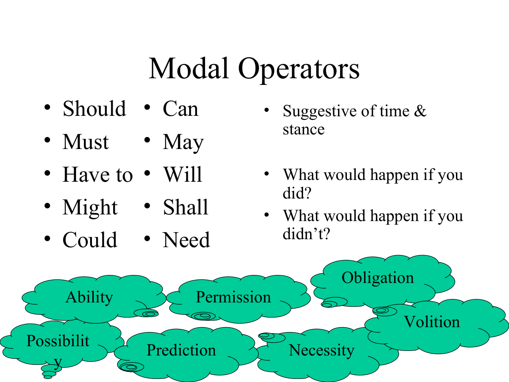

---

<!-- Slide 93 -->

# Presuppositions

- 1st order
- 2nd order, from identified presuppositions
- Etc.

Presupposition Based Test Analysis

- Break the presupposition
- Make it not true

What has to be true for the statement to be true?

---

<!-- Slide 94 -->

# Identify The Generalizations

- “Only admin users can delete records”
- “All records must be validated by the front end when they are amended”
- “All test cases must be scripted”

Modal Operators,

Universal Quantifiers

Presuppositions

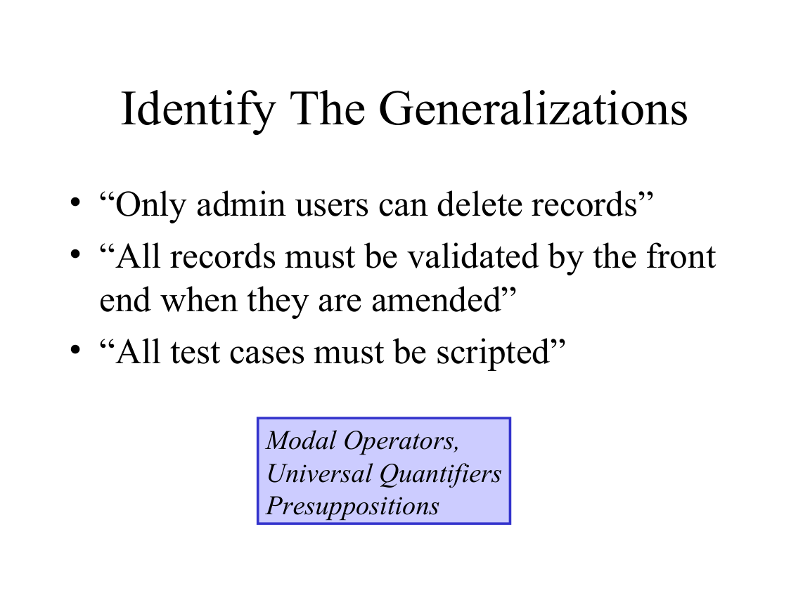

---

<!-- Slide 95 -->

# Slide 95

- Deletion can cause special cases not to be identified
- Deep Structure deletions identified through presupposition analysis &amp; model building

Deletion

## Embedded Diagram Text

Simple Deletion

Comparative Deletion

Lack of Referential Index

Unspecified Verb

Element missing from surface structure Recover Deleted Information

"The system is going to fail"

"fail how?"

"Which system?"

Missing Reference Point Identify Comparison

"This system is rubbish"

"Compared to What?"

Unspecified Noun Recover Noun

"They have a poor process"

"Who are they?"

Missing Process Details Recover Missing Process

"I'm testing"

"How are you testing?"

"What kind of testing are you doing?" Deletion

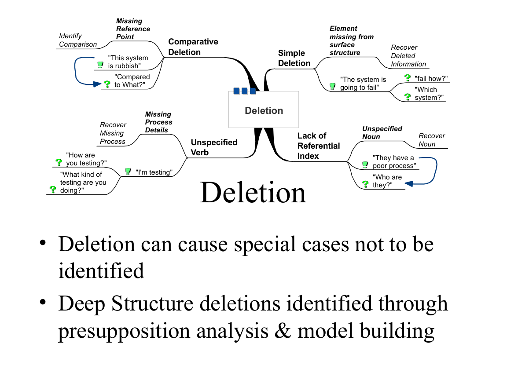

---

<!-- Slide 96 -->

# Comparative Deletion

- Reference source not defined
    - Something compared to something else, but the ‘something else’ is not specified
- Compared to what/who?

---

<!-- Slide 97 -->

# Unspecified Verb

- A verb without enough information to specify how it is carried out
- Verb = Process
- Should we make assumptions about the missing information?
- The more information we get the more detailed our testing can be

---

<!-- Slide 98 -->

# Simple Deletion

- Information that supplies the context
- Did not make it into the surface structure
- What are the inputs?
- What are the outputs?
- What are the attributes?
- Might be hard to spot

“Is there anything that you have not told me that my not knowing will compromise my ability to do what needs to be done?”

---

<!-- Slide 99 -->

# Lack of referential index

- Who/What? Specifically
- Is it a generalisation? Or is it specific?

It, They, Them, We, Us, That, This

---

<!-- Slide 100 -->

# Identify The Deletions

- “This system must be the fastest on the market”
- “The admin user will amend user details”

Simple,

Comparative,

Verb,

Noun (referential index)

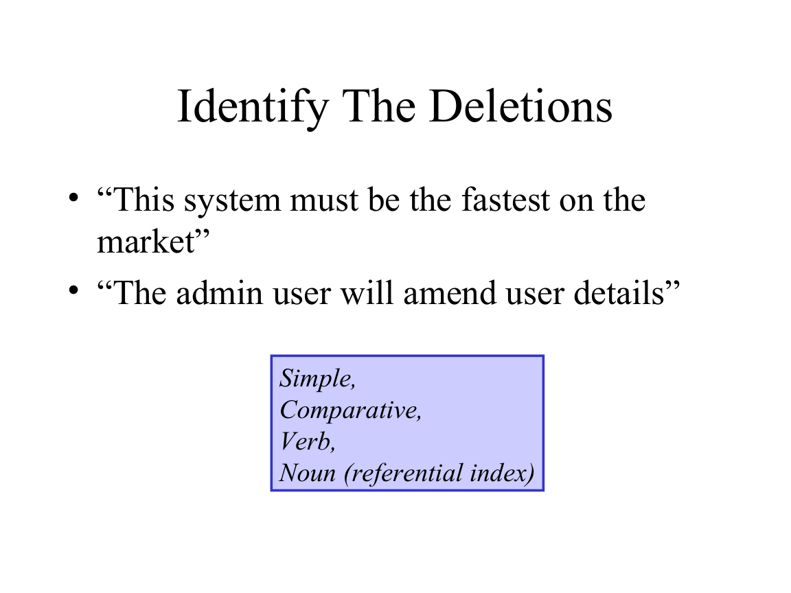

---

<!-- Slide 101 -->

# Distortion

- Distortions can taint beliefs and attitudes
- Good source of resistance in communication

## Embedded Diagram Text

Nominalization Cause and Effect

Mind Reading

Complex Equivalence

Lost Performative Distortion

Process as noun Convert noun to process

"I'm going to test" "What kind of testing are you going to do?"

X Causes Y

Stimulus &amp; Response

More information about the causality

"Bad specifications make me angry"

"How specifically does a bad specification make you angry?"

Claim to knowledge Identify source of claim

"They hate testers" "How do you Know?"

2 unrelated statements represented as equivalent Check validity of equivalence

"They don't know how to develop software, the requirements are never signed off."

"If the requirements were signed off does that mean they would know how to develop software?"

A Value Judgement Identify Source

Identify Criteria

"It is wrong to test without writing test scripts" "According to Whom?"

---

<!-- Slide 102 -->

# Cause and Effect

- Chaining together statements that leads to some evidence for a generalised conclusion
- How specifically does X cause Y?
- Does X always Cause Y?
- When does X not cause Y?
- Does X really cause Y?

---

<!-- Slide 103 -->

# Complex Equivalence

- An implied conjunction
- Should the conjunction be specific?
- Are X and Y not connected?
- Test the equivalence
- Is the equivalence an assumption?
    - “the system crashes when I open a file, the file open routine is broken”

---

<!-- Slide 104 -->

# Nominalization

- Convert a verb into a noun
- Not acknowledged as a process or relationship (someone else’s problem)
    - Testers don’t get any respect
- Assumption of shared knowledge of a process
- Cover up of lack of knowledge of a process

Wheelbarrow

test

---

<!-- Slide 105 -->

# Lost Performative

- Missing Authority from a statement
- Questions:
    - Who says?
    - According to whom?
    - Where did you hear that?
- Internal: Can target belief chain
- External Authority – provide a contradictory authority

---

<!-- Slide 106 -->

# Mind Reading

- Claim to knowledge when source is unknown
- Identify the source of the claim
- “how do you know?”
- Great source of additional, unwanted requirements – anti-agile

---

<!-- Slide 107 -->

# Identify The Distortions

- “Obviously, developers deliver code late because they don’t give the testers any respect.”
- “When developers don’t do any unit testing it makes testers really annoyed”

Cause Effect

Complex Equivalence

Lost Performative

Mind Reading

Nominalization

---

<!-- Slide 108 -->

# Commonalities

- Questions
- Get more information
- Be goal oriented
    - What are you going to do with the information?
    - How will knowing the answer help you?
    - How will knowing the answer help them?

---

<!-- Slide 109 -->

# Meta-Model Questioning Exercise

- Work in 3s
- Person 1 ask Person 2 to describe something e.g.:
    - their testing project,
    - their application under test,
    - what testing is
- Person 2 responds, Person 1 listens, Person 1 analyses response based on the Meta-Model and asks a follow on question based on the Meta-Model analysis, repeat
- Person 3 takes a meta position for later review

---

<!-- Slide 110 -->

# Meta-Model Uses

- Identify Ambiguity Early
- Apply to the communication we give
- Presupposition analysis of the system
- A Model of Analysis (Req, Spec, etc.)
- Question our beliefs and values about testing
- A System of Heuristics

---

<!-- Slide 111 -->

# Meta-Model for Influence

- Embedded Commands
- Presuppositions
- Conversational Postulates
- Deliberate use of ambiguity
    - use their deep structure

---

<!-- Slide 112 -->

# Meta-Model usage Guidelines

- Remember Rapport
- What do you want to know?
    - You do not have to question every distinction
- Stop at some point
- Build a model:
    - By listening
    - Using only what they tell you
    - What is limiting? What is missing? What is confusing?

---

<!-- Slide 113 -->

# \_\_ Attitude \_\_

---

<!-- Slide 114 -->

# NLP as attitude and methodology

"NLP is an attitude and a methodology that leaves behind a trail of techniques."

Richard Bandler

---

<!-- Slide 115 -->

# \_\_Analysing Context\_\_

- Context
    - Structure, Content
- Test Techniques deal with Content
- NLP deals with structure
- Relationships between processes

---

<!-- Slide 116 -->

# \_\_ Learning NLP \_\_

---

<!-- Slide 117 -->

# What is left to learn?

- Strategies,
    - Meta Programs,
    - Accessing Cues,
    - Anchoring,
    - Belief Systems,
    - Submodalities,
    - Hypnosis,
    - Ambiguity,
    - Metaphor,
        - Isomorphic
        - Homomorphic
    - Sleight of Mouth,
    - And more …

---

<!-- Slide 118 -->

# Further Reading

NLP Books

- Richard Bandler
    - The structure of Magic (vols I &amp; II)
        - Persuasion Engineering
    - Robert Dilts
        - Modelling with NLP

IT Books

- Gerald Weinberg
    - Are your lights on?
        - (More) Secrets of Consulting

NLP is best experienced… Try it, Apply it

Online

- [www.compendiumdev.co.uk/nlp](http://www.compendiumdev.co.uk/nlp)
    - [www.nlpu.com](http://www.nlpu.com)

Grammar Books

- David Crystal
    - Making Sense of Grammar
        - Rediscover Grammar

---

<!-- Slide 119 -->

# On The Web

- [www.purenlp.com](http://www.purenlp.com)
- [www.nlpmp3.com](http://www.nlpmp3.com)
- [www.richardbandler.tv](http://www.richardbandler.tv)
- [www.paulmckenna.com](http://www.paulmckenna.com)
- [www.saladltd.co.uk](http://www.saladltd.co.uk)
- [www.nlp.biz/NLP](http://www.nlp.biz/NLP)
- [www.compendiumdev.co.uk/nlp](http://www.compendiumdev.co.uk/nlp)
- [www.23nlpeople.com/NLP\_links.htm](http://www.23nlpeople.com/NLP_links.htm)

---

<!-- Slide 120 -->

# How to learn

- CDs
    - Videos
    - Practise groups
    - Study the roots of NLP
    - Take some Training – and choose wisely

[www.nlp-london.com](http://www.nlp-london.com)

Transcribe CDs &amp; Videos

…other than reading…

---

<!-- Slide 121 -->

# \_\_ End Notes \_\_

---

<!-- Slide 122 -->

# Subset …of NLP techniques and models

Can be used to:

- improve your software testing process
- increase your awareness for your testing context

Map is not

the Territory

States &amp;

Beliefs &amp;

Outcomes

Meta Model

Identify

(Sensory

Acuity)

Model &amp;

Change

Presuppositions

Life &amp; Mind Systemic Processes

Rapport

Variety?

How to

Learn?

What is NLP?

That can help you change your testing process.

Attitude

---

<!-- Slide 123 -->

# The techniques and models are…

…Simple

- you can be put them in practice now
    - using the information given in this session

…Subtle

- continued usage,
    - and further study
    - will increase effectiveness
    - and practical application.

---

<!-- Slide 124 -->

# NLP is…

ATTITUDE

…sense of curiosity and adventure … desire to learn the skills to be able to find out what kinds of communication influences somebody and the kinds of things worth knowing ... to look at life as a rare and unprecedented opportunity to learn

METHODOLOGY … all behavior has a structure . . . and that structure can be modeled, learned, taught, and changed (re-Programmed). The way to know what will be useful and effective are the perceptual skills

TECHNOLOGY enabling the practitioner to organize information and perceptions in ways that allow them to achieve results that were once inconceivable

[http://www.purenlp.com/nlpis2.htm](http://www.purenlp.com/nlpis2.htm)

---

<!-- Slide 125 -->

# Playtime
