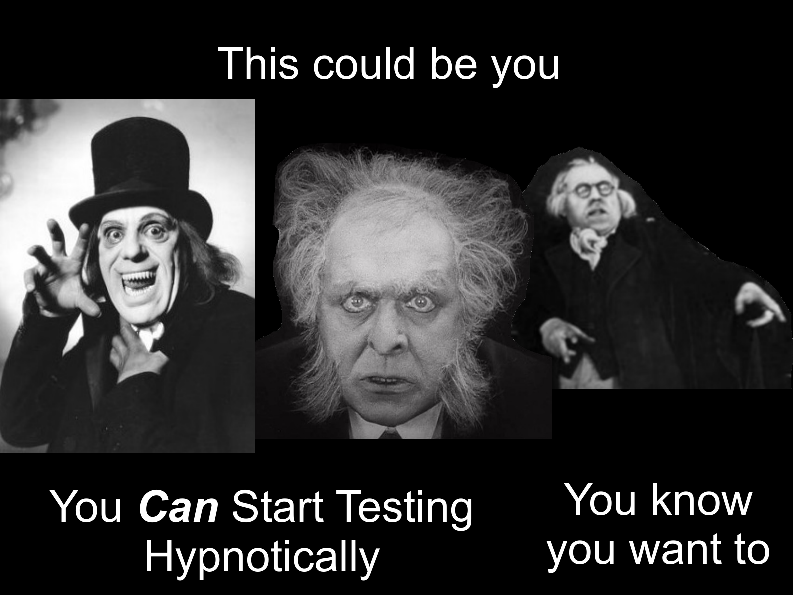
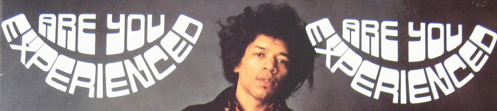

<!-- Slide 1 -->

# Testing Hypnotically

Alan Richardson

www.eviltester.com

---

<!-- Slide 2 -->

# Testing Hypnotically

“People react to words”

---

<!-- Slide 3 -->

# “People react to images”

---

<!-- Slide 4 -->

# MoRim Model of Software Testing

TM pending

- Model
- Observe
- Reflect
- Intent
- Manipulate

---

<!-- Slide 5 -->

# “Do not drive or operate heavy machinery while listening to this talk...”

---

<!-- Slide 6 -->

# As a Young Hypnotist

I learned the arts of High Weirdness.

---

<!-- Slide 7 -->

# “Megalomania is addictive”

---

<!-- Slide 8 -->

# This is not metaphor, analogy, or simile

But...

- When I say Hypnotist, hear tester
- When I say Hypnosis, hear testing
- When I say trance, hear process
- When I say patient, hear system

“Hear whichever words are

most appropriate for you”

---

<!-- Slide 9 -->

# This could be you

You know you want to

You Can Start Testing Hypnotically

---

<!-- Slide 10 -->

# “You already know hypnosis”

---

<!-- Slide 11 -->

# “There is no such thing as hypnosis”

---

<!-- Slide 12 -->

# “I am trained, and certified”

---

<!-- Slide 13 -->

# “I don't study Psycholgy”

- e.g Albert Mehrabian 7:38:55

---

<!-- Slide 14 -->

# Software Therapy

“Psychotherapy is one of the arts of High Weirdness that we can apply to Software”

---

<!-- Slide 15 -->

# Uncle Al's Brief History of Hypnosis

- Animal Magnetism
- Auto-Suggestion
- Hypnotic Scripts
- Standardised Tests
- Classical vs Conversational

---

<!-- Slide 16 -->

# “What do hypnotists do?”

---

<!-- Slide 17 -->

# “Hypnotists are pragmatists”

---

<!-- Slide 18 -->

# Context, Utilisation &amp; Requisite Variety

“Work in context with the patient you have and utilise what they give you”

---

<!-- Slide 19 -->

# Automation in Hypnosis

- Out of Context
- Works great for reinforcement
- Cannot harness utilisation
- Tapes, CDs, Mind-machines

---

<!-- Slide 20 -->

# Tools of the Hypnotist

---

<!-- Slide 21 -->

# Some Tools of The Hypnotist

- Confidence
- Language
- Ambiguity
- Observation
- Presupposition
- Feedback

---

<!-- Slide 22 -->

# Confidence

- Would you trust a hypnotist without confidence?

- Own your approach
- Go beyond the script

- Trust your observations: use and test them
- Trust your model: use and test it

---

<!-- Slide 23 -->

# “Language is the main weapon of a hypnotist, and it is ours too.”

---

<!-- Slide 24 -->

# Ambiguity

“It's simpler than that”

---

<!-- Slide 25 -->

# Observation

- Physiological &amp; Verbal
- Subjective &amp; Objective
- There &amp; Not there

---

<!-- Slide 26 -->

# “Not theories. Presuppositions. From these, models build, you will.”

“Not theories. Presuppositions. From these, models build, you will.”

- Challenge Presuppositions

---

<!-- Slide 27 -->

# Feedback

- -ve, +ve, which has the highest value?

---

<!-- Slide 28 -->

# Hypnotic Techniques

---

<!-- Slide 29 -->

# Some Relevant Hypnotic Techniques

- Induction
- Post Hypnotic Suggestion
- Dissonance/Confusion
- Pattern Interrupt
- Future Pacing
- Go there first
- Embedded Command

---

<!-- Slide 30 -->

# “Induction”

The hypnotic setup process.

---

<!-- Slide 31 -->

# “Post Hypnotic Suggestion”

And the effects just keep on coming.

---

<!-- Slide 32 -->

# “Dissonance and Confusion”

Go inside and learn.

---

<!-- Slide 33 -->

# “Pattern Interrupt”

Antici... pation

---

<!-- Slide 34 -->

# “Go there first”

The Essence of a 'persona'.

---

<!-- Slide 35 -->

# “Future Pacing”

Become the wizard of speed and Time.

---

<!-- Slide 36 -->

# “Embedded Commands”

The art of bypassing validation.

---

<!-- Slide 37 -->

# All Hypnosis is Self-Hypnosis

“Take Responsibility for your trance and defend yourself against bad hypnosis”

---

<!-- Slide 38 -->

# A Model of “Effective Communication”

---

<!-- Slide 39 -->

# “Effective Communication” Model

- You can not not communicate
- All communication is suggestion
- Communication is the message received
- Communication is more than one way

---

<!-- Slide 40 -->

# A Testing Model of “Effective Communication”

---

<!-- Slide 41 -->

# You can not not test

- Testing is {Setup, Usage, Teardown, pause, \[.\*\]}
- Different order might have a different effect
- Track Everything &amp; review. You don't get to decide significance

“In the real world I seek out happy paths”

Note: The system is testing you

---

<!-- Slide 42 -->

# All communication is suggestion

- I tell the system what to do
- I can not allow myself to believe that I have commanded the system
- I don't know what the system has done unless I check

Note: the system suggests things to you

---

<!-- Slide 43 -->

# Communication is the message received

- Not the intent, medium or message
- What was the message sent?
- What appeared to be the message received?
- What does it respond differently to?
- Does it prefer simple or complex?

Note: what did the system communicate to you?

---

<!-- Slide 44 -->

# Communication is more than one way

- You are involved
- The app is involved
- What else is involved?

Note: remember yourself and “others”

---

<!-- Slide 45 -->

# The Management Impact

“What will happen when you think of your management approach as effective communication?”

test plans, strategies, meetings, etc. etc.

---

<!-- Slide 46 -->

# MoRim Model of Software Testing

TM pending

- Model
- Observe
- Reflect
- Intent
- Manipulate

Can you see a hypnotic influence yet?

---

<!-- Slide 47 -->

# www.eviltester.com

www.eviltester.com

