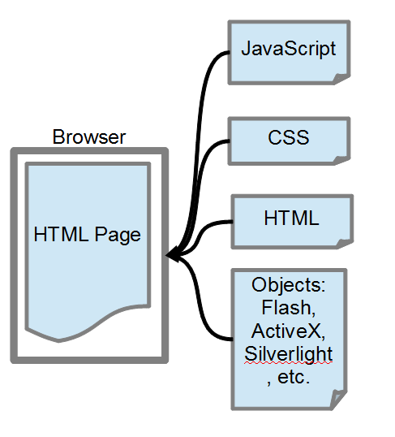
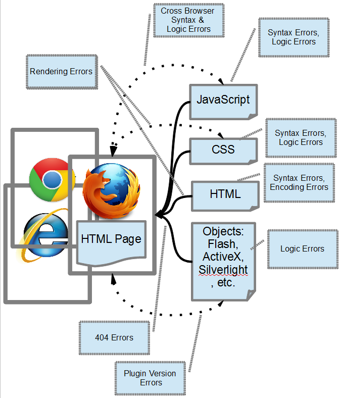
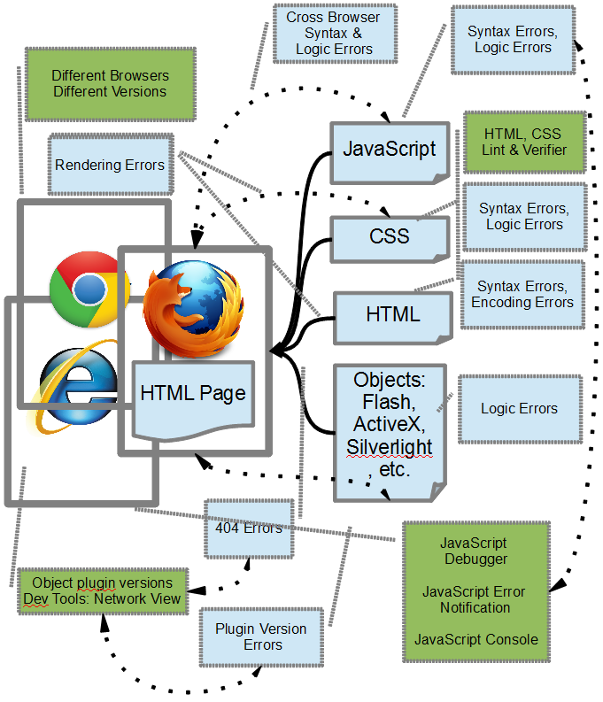
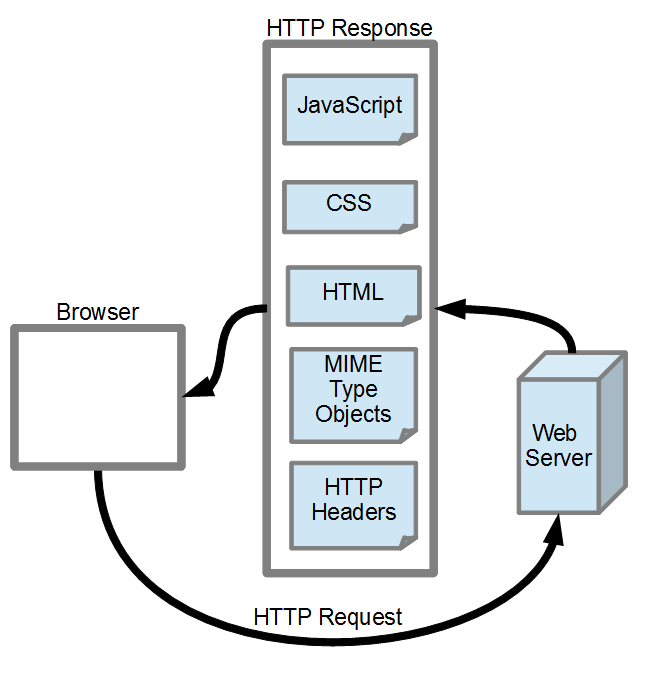
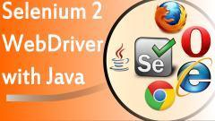
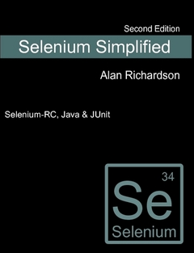

<!-- Original slide footer: @EvilTester | http://unow.be/at/letstest2013 -->

<!-- Slide 1 -->

# The Evil Tester's Guide to Web Testing

Let's Test 2013

Alan Richardson

@eviltester

[www.eviltester.com](http://www.eviltester.com/)

[www.compendiumdev.co.uk](http://www.compendiumdev.co.uk/)

[www.seleniumsimplified.com](http://www.seleniumsimplified.com/)

Slides available at <http://unow.be/at/letstest2013>

---

<!-- Slide 2 -->

# Blurb

I assert that Tester’s need technical skills when testing ‘anything’. Since I primarily test web applications, I will describe my technical view of Web Testing.

In this session I will describe some of the tools that I use when testing, not because technical web testing revolves around tools, but because the technical testing thinking process leads to the finding and utilisation of tools.

Tools are the draw, the quick win for attendees. But thought processes sit at the core of this talk. They lead to tool augmentation, to exploring the built in capabilities of the browsers, and to the skills we need to test technically.

I will talk a little around theory, and, dangerously for a live session, I will provide a demonstration of tool augmented technical testing.

---

<!-- Slide 3 -->

# Technical Testing

---

<!-- Slide 4 -->

# What is Technical Testing? To You?

- How does the phrase make you feel?
- To you as a manager?
- To you as a tester?
- Can you identify with it?

---

<!-- Slide 5 -->

# What is Technical Testing? To Me?

- A reminder to keep "going deeper"
- It means "Tool Augmentation"
- How I describe what I do

---

<!-- Slide 6 -->

# A reminder to keep going deeper

MORIM - Model through Observation, Reflection, Interrogation and Manipulation

- Model == what I think I currently understand
- Observations can corroborate or invalidate my model
- Reflect to find gaps and lack of depth and derive intent
- Interrogate - focused observation with intent
- Manipulation - hypothesis exploration

---

<!-- Slide 7 -->

# It means "Tool Augmentation"

- Tools to passively observe, maintain history of observations
- Tools to alert on specific conditions
- Tools to observe the unobserved, and interrogate the inaccessible
- Tools to help me model and reflect
- Tools to help me manipulate
- ... etc.

Never tools to control. Tools to augment.

---

<!-- Slide 8 -->

# How I describe what I do

- Not a definition
- A description of my current approaches
- I try get as deep and technical as I can
- I need to keep learning so that I can understand the technology

---

<!-- Slide 9 -->

# Go beyond the surface structure

- Transformational Grammar
    - Surface & Deep Structure
- Questions operate as tools to investigate Surface to Deep mapping in people
- Bug?
    - Surface != Deep
    - Surface1 != Surface2

---

<!-- Slide 10 -->

# Transformational Grammar

- Terminology originated with Chomsky
- Multiple surface structures
- Single Deep structure
- Deep structure
    - filtered, biased, distorted
        - Surface Structure

**NB: I'm reinterpreting this. Abusing it for my own purpose- to model Technical Testing**

---

<!-- Slide 11 -->

# Questions operate as tools to investigate Surface to Deep mapping in people

"Login doesn't work"

- How Specifically?
- How do you know?
- Ever?
- ... etc.

**We ask the system questions.**

---

<!-- Slide 12 -->

# Some ways we notice bugs?

- Surface != Deep

  When we can't transform from our Deep Structure to the observed Surface Structure

- Surface1 != Surface2

  When we spot different surface structures than we would expect from our transformations

Surface == Model, Deep == Model, Model != Reality

---

<!-- Slide 13 -->

# How to do Technical testing TM?

- Identify tools to work with System Surface Structures
- Questioning Systems at different surface levels
- Learning System Structure Technology
- Modelling System Surface Structures

---

<!-- Slide 14 -->

# Technical Web Testing

---

<!-- Slide 15 -->

# Technical Web Testing

- Understand and model the Project context
    - scope of testing, aims of testing, stakeholders, etc.
- Understand and model the System context
    - the web context
    - the application context
    - the deployment context
    - the usage context
- For each identify
    - Technical Risks
    - Test Ideas

---

<!-- Slide 16 -->

# Technicalities for Web Testing

- Understand and model the System context
    - the web context
    - the application context
    - the deployment context
    - the usage context
- For each identify
    - How can we observe it?
    - How can we interrogate it?
    - How can we manipulate it?

- Summary, Log, etc.
- Details & Different views
- Change & Amend

---

<!-- Slide 17 -->

# Web Context: A Browser View

---

<!-- Slide 18 -->

# Web Context: A Browser View - Technical Risks

---

<!-- Slide 19 -->

# Web Context: A Browser View - Technical Tooling Augmented

---

<!-- Slide 20 -->

# Exercise: Let's Elaborate this Model

---

<!-- Slide 21 -->

# Exercise: What other models might we build?

---

<!-- Slide 22 -->

# Model suggests... Tool suggests...

We can work from model to tool...

We can also work from tool function to model.

---

<!-- Slide 23 -->

# "All together now" - a tool augmented group exploration demo

- Using only out of the box browser functionality.
- When exploring a web app
- What do we get out of the box to observe, manipulate, interrogate?
- What can't we do?
- What tools might let us do it?
- What does the tool functionality suggest for us?

---

<!-- Slide 24 -->

# Summary

- Technical Testing works with multiple models of the System
- Model for:
    - Understanding
    - Risk
    - Test Ideas
    - Tooling ideas
- Tool Augmentation
    - Observe
    - Interrogate
    - Manipulate

---

<!-- Slide 25 -->

# About Alan Richardson

Alan Richardson is an Independent Test Consultant based in the UK. He offers training and consultancy in Selenium WebDriver, exploratory and technical web testing.

- [uk.linkedin.com/in/eviltester](http://uk.linkedin.com/in/eviltester)

Contact Alan for training and consultancy tailored to your needs:

[alan@compendiumdev.co.uk](mailto:alan@compendiumdev.co.uk)

## Blogs and Websites

- [SeleniumSimplified.com](http://seleniumsimplified.com)
- [EvilTester.com](http://eviltester.com)
- Testing Papers and Tools
    - [CompendiumDev.co.uk](http://compendiumdev.co.uk)

## Online Training Courses

- Technical Web Testing 101
    - [Unow.be/at/udemy101](http://unow.be/at/udemy101)
- Intro to Selenium
    - [Unow.be/at/udemystart](http://unow.be/at/udemystart)
- Selenium 2 WebDriver API
    - [Unow.be/at/udemyapi](http://unow.be/at/udemyapi)

## Videos

[youtube.com/user/EviltesterVideos](http://youtube.com/user/EviltesterVideos)

## Books

Selenium Simplified

[Unow.be/rc/selsimp](http://unow.be/rc/selsimp)

