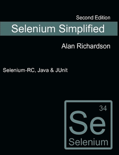
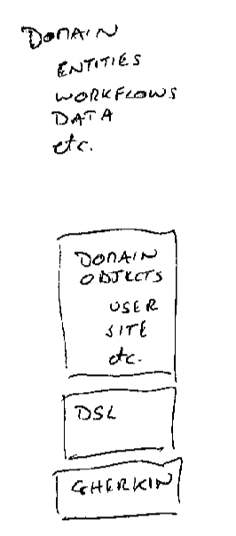
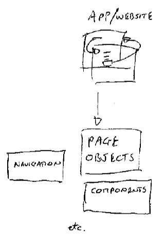
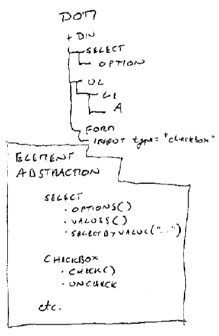
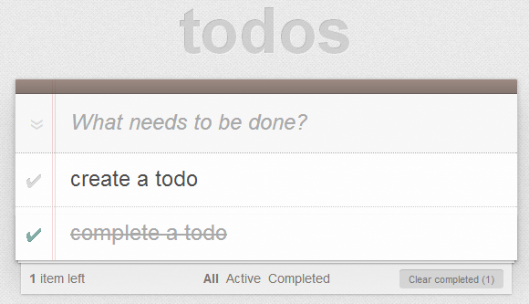

<!-- footer: @EvilTester -->

<!-- Slide 1 -->

# Hands on exploration of Page Objects and Abstraction Layers with Selenium WebDriver

A Half Day Tutorial

Alan Richardson

@eviltester

alan@compendiumdev.co.uk

www.SeleniumSimplified.com

www.EvilTester.com

www.CompendiumDev.co.uk

www.JavaForTesters.com

---

<!-- Slide 2 -->

# Alan Richardson - Blogs, Books, and Courses

Blogs and Websites

- CompendiumDev.co.uk
- SeleniumSimplified.com
- EvilTester.com
- JavaForTesters.com
- Twitter: @eviltester

Online Training Courses

- Technical Web Testing 101
- Intro to Selenium
- Selenium 2 WebDriver API

Videos

youtube.com/user/EviltesterVideos

Books

Selenium Simplified

Java For Testers

leanpub.com/javaForTesters

Alan Richardson

uk.linkedin.com/in/eviltester

Independent Test Consultant &amp; Custom Training

Contact Alan

http://compendiumdev.co.uk/contact




---

<!-- Slide 3 -->

# Tutorial Overview

After gaining some experience of web automation tools, you start to realise that “yes, you have to learn the API”, but the real challenge is modeling the application and building an abstraction layer which supports different approaches to automation. And when we build an abstraction layer, we have lots of options to choose between.

- Do you use the Page Factory?
- What counts as a page object?
- Should a page object offer logical functions like “loginAs” or does it only model the physical world?
- How do we deal with navigation? Return page objects, or with a different set of objects?
- Do we need abstractions for Dom elements like input fields or is WebElement enough?
- When do we synchronise with WebDriverWait and when do we use SlowLoadableComponent?
- Should we build our own abstractions on top of SlowLoadableComponent?

By using a simple web application, we will use these, and other questions, to discuss and experiment with, the most challenging parts of Web Automation – the modeling and construction of robust and re-usable abstraction layers.

Existing practitioners, be prepared to discuss the choices you have made in the past, what worked, and what didn’t, so that we can learn and possibly build on some of those decisions.

This is open to novices and experienced practitioners, but if you want to take part then make sure you have a functioning Selenium WebDriver installation. All examples will be presented using Java, but that doesn’t stop you writing experiments in Python, .Net, or whatever other language you favour.

Bring your laptop, and you’ll have the opportunity to explore different ways of building Page Objects and abstraction layers.

---

<!-- Slide 4 -->

# Logistics &amp; Plan

- 11:00 – 12:30 == 1.5
    - Intro
    - General Abstractions Overview
    - Example Implementations &amp; Discussions
    - Exercise (till lunch)
        - Given some scenarios, create some tests and abstraction layers to support your tests
- 13:30 – 15:00 == 1.5
    - Continue exercises and debrief
    - Examples and Comparison with group
    - Exercise (till end)
        - Adjust your code, refactor to other approaches

---

<!-- Slide 5 -->

# Code Examples &amp; Slides

- https://xp-dev.com/svn/AutomationAbstractions

---

<!-- Slide 6 -->

# Experiences Check

- Used WebDriver?
- What Languages?
- Abstraction Layers?
- Frameworks?
- Current setup
    - Laptop With You?
    - Ready to code?

---

<!-- Slide 7 -->

# General Abstraction Concepts

---

<!-- Slide 8 -->

# Creating Systems - William Blake

“I must create a system. or be enslav'd by another Mans; I will not reason &amp; compare: my business is to create”

William Blake,

Jerusalem: The Emanation of the Giant Albion


http://www.blakearchive.org/exist/blake/archive/object.xq?objectid=jerusalem.e.illbk.10&amp;java=no

---

<!-- Slide 9 -->

# What is Abstraction?

- Discuss

---

<!-- Slide 10 -->

# Abstraction

- Modelling
- Separation of concerns
- Logical vs Physical
- Functional vs Structural
- Interfaces vs Implementations
- Data / Entities / Persistence
- Functionality / Task Flow
- Goals / Strategies
- Layers – GUI, DB, HTTP
- Etc.

---

<!-- Slide 11 -->

# Example Test Without Abstraction

```java
    @Before
    public void startDriver(){
        driver = new FirefoxDriver();
    }
```

```java
    @Test
    public void canCreateAToDoWithNoAbstraction(){
        driver.get("http://todomvc.com/architecture-examples/backbone/");

        int originalNumberOfTodos = driver.findElements(
									By.cssSelector("ul#todo-list li")).size();

        WebElement createTodo = driver.findElement(By.id("new-todo"));
        createTodo.click();
        createTodo.sendKeys("new task");
        createTodo.sendKeys(Keys.ENTER);

        assertThat(driver.findElement(
						By.id("filters")).isDisplayed(), is(true));

        int newToDos = driver.findElements(
								By.cssSelector("ul#todo-list li")).size();
        assertThat(newToDos, greaterThan(originalNumberOfTodos));
    }
```

```java
    @After
    public void stopDriver(){
        driver.close();
        driver.quit();
    }
```

NoAbstractionTest.java

---

<!-- Slide 12 -->

# Example Test With Abstraction

```java
    @Before
    public void startDriver(){
        driver = new FirefoxDriver();
    }
```

```java
    @Test
    public void canCreateAToDoWithAbstraction(){
        TodoMVCUser user = new TodoMVCUser(driver, new TodoMVCSite());

        user.opensApplication().and().createNewToDo("new task");

        ApplicationPageFunctional page =
              new ApplicationPageFunctional(driver, new TodoMVCSite());
        assertThat(page.getCountOfTodoDoItems(), is(1));
        assertThat(page.isFooterVisible(), is(true));
    }
```

```java
    @After
    public void stopDriver(){
        driver.close();
        driver.quit();
    }
```

NoAbstractionTest.java

---

<!-- Slide 13 -->

# Why Abstraction?

- Change implementations
- Single Responsibility – only changes when necessary
- Makes automation readable and maintainable

---

<!-- Slide 14 -->

# The Name of the Song - Lewis Carroll

“...The name of the song is called ‘Haddocks' Eyes.’” “Oh, that's the name of the song, is it?" Alice said, trying to feel interested. “No, you don't understand,” the Knight said, looking a little vexed. “That's what the name is called. The name really is ‘The Aged Aged Man.’” “Then I ought to have said ‘That's what the song is called’?” Alice corrected herself. “No, you oughtn't: that's quite another thing! The song is called ‘Ways And Means’: but that's only what it's called, you know!” “Well, what is the song, then?” said Alice, who was by this time completely bewildered. “I was coming to that,” the Knight said. “The song really is ‘A-sitting On A Gate’: and the tune's my own invention.””

Lewis Carroll, Through The Looking Glass

---

<!-- Slide 15 -->

# Common Abstraction Approaches

---

<!-- Slide 16 -->

# Abstraction Layers Categorised

- Data

- Generic Data Abstractions e.g. email, postcode

- Physical

- Physical layout of your application e.g. pages, components
- Navigation across pages

- Domain

- Your application Entities domain e.g. user, account

- Logical

- User actions, workflows

---

<!-- Slide 17 -->

# Common Automation Abstractions

- Page Objects
- Element Abstractions: select, textbox, etc.
- Domain Objects
- Gherkin (Given/When/And/Then)
- Domain Specific Languages
- Any More?
    - Create a List to discuss
    - Any public examples?
    - Any examples in the room that can be shared?

---

<!-- Slide 18 -->

# Abstractions







---

<!-- Slide 19 -->

# Abstraction != Implementation

- Abstraction != Tool / Framework / Implementation
- Gherkin != Cucumber
- Page Object != Page Factory
- DSL != Keyword Driven

If we want to get good at abstraction then we need to model, split apart, and make the relationships clear

---

<!-- Slide 20 -->

# WebDriver as an Abstraction Layer

- Dom Abstraction
    - WebElement
- Browser Abstraction
    - WebDriver
        - FireFox, Chrome, Remote etc.
- HTML Abstractions
    - Cookies, Frames, etc.
- 'Support' classes augment WebDriver
    - e.g. com.seleniumsimplified.selenium.support

---

<!-- Slide 21 -->

# Model the application under test

---

<!-- Slide 22 -->

# Given an App – todomvc.com



---

<!-- Slide 23 -->

# TodoMVC.com Functional Overview Demo

- Single Page App
- Shows Counts
- Data held in HTML5 local storage
- Create/Edit/Complete a 'todo'
- Clear Completed
- Filter active/completed/all
- Delete a todo


---

<!-- Slide 24 -->

# Exercise Given an App – todomvc.com

- What Abstractions might we build?
- What thoughts do we have?
- What underpins our analysis?


...Then Debrief

---

<!-- Slide 25 -->

# Example Implementations Overview

---

<!-- Slide 26 -->

# Page Objects

- The most obvious automation abstraction
- What is it?
    - A page? A Component?
- Experiences?
- Do web applications still have pages?


---

<!-- Slide 27 -->

# Page Object Design Decisions

- What methods does it have?
    - Functional
        - login(username, password),
        - loginAs(user)
    - Structural
        - enterName(username), enterPassword(password), clickLogin(), submitLoginForm(username, password)
- Does it expose elements or not?
    - public WebElement loginButton;
    - public WebElement getLoginButton();
    - public clickLoginButton();

---

<!-- Slide 28 -->

# Navigation Design Decisions

Does a Page Object return other pages?

```java
  public IssueListPage submit(){
    driver.findElement(By.id(“submit”)).click();
    return new IssueListPage(driver);
  }
```

- Pros?
- Cons?
- Experiences

---

<!-- Slide 29 -->

# Page Objects

- What rules / guidelines / biases do you use for page objects?

---

<!-- Slide 30 -->

# Implementing Page Objects

- POJO
    - Plain object, driver in constructor, methods use driver.&lt;method&gt;
- Page Factory
    - Annotated elements, lazy instantiation via reflection
- LoadableComponent
    - Common interface (load, isLoaded), isLoaded throws Error
- SlowLoadableComponent
    - Common interface, waits for on isLoaded
- Other approaches?

---

<!-- Slide 31 -->

# Implicit or Explicit Wait?

## Implicit Wait

```java
driver.manage().timeouts().
implicitlyWait(15L, TimeUnit.SECONDS);

assertThat(driver.findElement(                					By.id("filters")).isDisplayed()
				 , is(true));
```

## Explicit Wait

```java
driver.manage().timeouts().
implicitlyWait(0L, TimeUnit.SECONDS);
WebDriverWait wait = new WebDriverWait(driver,15);

wait.until(ExpectedConditions.elementToBeClickable(By.id("filters")));
```

Example: 'NoAbstractionTest.java'

---

<!-- Slide 32 -->

# Exercise Automate Scenarios

- Create a ToDo (check: count, text)
- Can Delete a ToDo (check: footers, count)
- Can Mark a ToDo as completed
- Can create a bunch of ToDos and delete, mark as complete etc.
- Add additional checks as required
- Create Abstraction layers as appropriate
- We will discuss your compare your examples with the group and the examples

---

<!-- Slide 33 -->

# Example Implementations

---

<!-- Slide 34 -->

# POJO

- 'ApplicationPage.java'
    - Used in 'SequentialCreationOfTest.java'
    - Not much refactoring in the example
- Simple Class
- WebDriver passed to constructor
- Composition of any components

---

<!-- Slide 35 -->

# POJO Discussion

- Pros
- Cons

---

<!-- Slide 36 -->

# Functional vs Structural

- Compare 'ApplicationPage' with 'ApplicationPageFunctional'
- Functional
    - loginAs(username, password)
- Structural
    - enterUsername
    - enterPassword
    - clickLoginButton
    - submitLoginForm(username, password)
- Navigation
    - Should Page Objects return Page Objects?

---

<!-- Slide 37 -->

# Functional Vs Structural Example

- One way of answering “what methods to put on a page object”
    - Is it functional / behavioural?
    - Is it structural?
- Functional 'uses' Structural implementation
- See
    - com.seleniumsimplified.page.functionalvsstructural

---

<!-- Slide 38 -->

# Page Factory

- Compare ApplicationPageStructural with ApplicationPageStructuralFactory
- Annotate fields with @FindBy
- Instantiate in constructor using PageFactory.initElements
    - Can create your own page factory initialiser

---

<!-- Slide 39 -->

# Page Factory Example

```java
    @FindBy(how = How.CSS, using="#todo-count strong")
    private WebElement countElementStrong;

    @FindBy(how = How.CSS, using="#todo-count")
    private WebElement countElement;

    @FindBy(how = How.CSS, using="#filters li a")
    List<WebElement> filters;

    @FindBy(how = How.ID, using="clear-completed")
    List<WebElement> clearCompletedAsList;

    @FindBy(how = How.ID, using="clear-completed")
    WebElement clearCompletedButton;

    public ApplicationPageStructuralFactory(WebDriver driver, TodoMVCSite todoMVCSite) {

        PageFactory.initElements(driver, this);

	this.driver = driver;

	...
```

---

<!-- Slide 40 -->

# Page Factory Discussion

- Pros
- Cons

---

<!-- Slide 41 -->

# Loadable Component

- Extends LoadableComponent
    - Get
        - If isLoaded, return this
        - Else load()
        - Check isLoaded()
- Implement load
    - Add any synchronisation in load to wait for the loading. Exit only when 'loaded'.
- Implement isLoaded
    - Check, and throw Error if not loaded

---

<!-- Slide 42 -->

# Loadable Component Example

- Compare ApplicationPageStructural with ApplicationPageStructuralLoadable

---

<!-- Slide 43 -->

# Loadable Component Discussion

- Pros
- Cons

---

<!-- Slide 44 -->

# SlowLoadable Component Example

- Extends SlowLoadableComponent
- Constructor has to additionally call
    - super(new SystemClock(), 10);
    - Where 10 is a timeout # of seconds
- get()
    - If isLoaded then return this Else load
    - While not loaded{ wait for 200 millseconds}
- Implement load and isLoaded
    - But can remove sync loops from load

---

<!-- Slide 45 -->

# SlowLoadable Component Example

- Compare ApplicationPageStructural with ApplicationPageStructuralSlowLoadable

---

<!-- Slide 46 -->

# SlowLoadable Component Discussion

- Pros
- Cons

---

<!-- Slide 47 -->

# Fluent Page Objects

- Methods return the page object or other objects
    - e.g. get() on LoadableComponent
- Instead of
    - void clickDeleteButton();
    - PageObject clickDeleteButton();
- Syntactic sugar methods:
    - and(), then(), also()
- Work well at high levels of abstraction
    - See SequentialCreationOfTestFluentSubset and ApplicationPageFunctionalFluent
    - Compare ApplicationPageFunctional with ...Fluent

---

<!-- Slide 48 -->

# Navigation Options

- Direct in Test
- Instantiate new pages based on test flow
    - Navigation as side-effect, may have to bypass 'get'
    - Loadable pages, non-loadable, support classes
- Page Object methods might return other Pages
    - e.g. a method on the login page might be
        - MyAccountPage clickLogin();
            - Returns a new page
        - void clickLogin();
- We might use navigation objects
    - direct, or Path based (current page → desired page)
        - Navigate.to(MyAccountPage.class)
        - Jump.to(MyAccountPage.class)

---

<!-- Slide 49 -->

# Possible Domain Abstractions

- Logical Objects
    - ToDo
    - ToDoList
- Physical Objects
    - LocallyStoredToDo
- Actors
    - User
- Environment
    - Site
    - Implementation


---

<!-- Slide 50 -->

# Page Objects &amp; Domain Objects

- Instead of
    - todoMVC.enterNewToDo(“New Item”)
- We could have have
    - ToDoItem newItem = new ToDoItem(“New Item”);
    - todoMVC.enterNewToDo(newItem);
- Discuss

- See code in DomainBasedTest

---

<!-- Slide 51 -->

# Domain Objects That Span Logical &amp; Physical

e.g. User

- user.createNewToDo(“new item”)
- user.createNewToDo(newItem)

- Discuss
- See use in NoAbstractionTest

---

<!-- Slide 52 -->

# Element Abstractions


---

<!-- Slide 53 -->

# Element Abstractions

- Existing support: Select,
- Possible: TextBox, Checkbox, TextBox, File etc.
- Can enforce Semantics
    - Checkbox: isChecked, check(), uncheck(), toggle()
    - TextBox: clear(), enterText()
    - etc.
- Pass back from Page Objects into test?
- e.g. Checkbox in ElementWrapperTest
    - new CheckBox(driver, By);
    - new CheckBox(element)

---

<!-- Slide 54 -->

# Element Abstraction Examples

- Would you include 'toggle'?

```java
public interface Checkbox {

    public boolean isChecked();
    public Checkbox check();
    public Checkbox uncheck();
    public Checkbox toggle();
}
```

---

<!-- Slide 55 -->

# Element Abstraction Pros and Cons

- May have to create a custom page factory
- Can help 'restrict' code i.e. check or uncheck, rather than click, enforces 'semantics'
- I make sure to return WebElement so that I can go beyond the abstraction layer if I need to. Not required if it is just a WebElement wrapper.

---

<!-- Slide 56 -->

# Component Abstractions

- Components on the screen
    - e.g. ComponentTest
- e.g. VisibleToDoEntry, Filters, Footer, Header, VisibleToDoList, etc.
- Could have 'functional' representation for repeated items e.g. login forms
- Could have 'structural' representation
- Likely use : page object composition

---

<!-- Slide 57 -->

# Component Abstraction Example

- See 'ComponentTest.java'
    - ApplicationPageStructuralComponents (compare with ApplicationPageStructural
    - VisibleToDoEntry
        - (this also uses Element Abstraction)

```java
page.getToDoEntryAt(todoMVC.getCountOfTodoDoItems()-1).
            markCompleted();
```

---

<!-- Slide 58 -->

# Gherkin as an abstraction layer

- Implement steps using highest appropriate abstraction layer
- CucumberJVM as 'DSL implementor'
- 'Expressibility' vs 'Step Re-use'
- See todomvc.feature and ToDoMvcSteps

```gherkin
Feature: We can create and edit To Do lists in ToDoMvc

  We want to amend todos in ToDoMVC because that is
  the set of exercises on the abstraction tutorial

  Scenario: Create a ToDo Item
    Given a user opens a blank ToDoMVC page
    When the user creates a todo "new task"
    Then they see 1 todo item on the page
```

---

<!-- Slide 59 -->

# Additional Debrief

- Did anyone do anything different?
- Any other abstraction approaches you used?
- Anything else to add?

---

<!-- Slide 60 -->

# Final Exercise Section

- Continue to automate the site
- Build abstraction layers to cover the functionality
- Experiment with additional approaches mentioned that you haven't used
- Or, use code and amend and experiment

---

<!-- Slide 61 -->

# Final Debrief

---

<!-- Slide 62 -->

# My bias model has Driver as core

- Driver
    - Build around that so instantiate any page or component as required at any time
- Synchronisation
    - To make sure that the desired object is available and ready for use (as defined by synchronisation)
- Navigation
    - Implicit (via actions)
    - Explicit
        - Open/jump (via driver.get)
        - To (state model from current, to desired)

---

<!-- Slide 63 -->

# Biases

- Examine some common biases and discuss pros/cons based on experience

---

<!-- Slide 64 -->

# Are there rights and wrongs?

- Right / Wrong?
- Decisions?
- Project/Team/Organisation Standards?

---

<!-- Slide 65 -->

# Should we add asserts into abstraction layers?

- e.g.

---

<!-- Slide 66 -->

# Should Page Objects consume and return domain objects?

- e.g.
    - loginAs(user)
    - List&lt;User&gt; getUsersList()

---

<!-- Slide 67 -->

# Should Page Objects return WebElements?

---

<!-- Slide 68 -->

# Decisions

- The 'limits' and overlap of Abstraction Layers
- Build it now, or 'refactor to' later
- How much change is anticipated?
    - To which layer? GUI, Business domain, Workflow?
- Who is working with the automation code?
    - Skill levels? Support needed?
- How/When with the automation execute?

---

<!-- Slide 69 -->

# Decisions

- The 'limits' and overlap of Abstraction Layers
- Build it now, or 'refactor to' later
- How much change is anticipated?
    - To which layer? GUI, Business domain, Workflow?
- Who is working with the automation code?
    - Skill levels? Support needed?
- How/When with the automation execute?

---

<!-- Slide 70 -->

# Every Action Is an Experiment

“To the creative mind there is no right or wrong. Every action is an experiment, and every experiment yields its fruit in knowledge.”

The Illuminatus Trilogy

Robert Anton Wilson

---

<!-- Slide 71 -->

# Other Useful Links

- Jeff “Cheezy” Morgan – page-object ruby gem, data_magic gem and stareast code
    - https://github.com/cheezy?tab=repositories
- Marcus Merrell
    - Self-Generating Test Artifacts for Selenium/WebDriver
    - https://www.youtube.com/watch?v=mSCFsUOgPpw

---

<!-- Slide 72 -->

# Alan Richardson - Blogs, Books, and Courses

Blogs and Websites

- CompendiumDev.co.uk
- SeleniumSimplified.com
- EvilTester.com
- JavaForTesters.com
- Twitter: @eviltester

Online Training Courses

- Technical Web Testing 101
- Intro to Selenium
- Selenium 2 WebDriver API

Videos

youtube.com/user/EviltesterVideos

Books

Selenium Simplified

Java For Testers

leanpub.com/javaForTesters

Alan Richardson

uk.linkedin.com/in/eviltester

Independent Test Consultant &amp; Custom Training

Contact Alan

http://compendiumdev.co.uk/contact


---

<!-- Slide 73 -->

# Notes: Install app locally

- https://github.com/tastejs/todomvc/commit/f57e0b773db14f094ef09274af90042f83328412
- https://github.com/tastejs/todomvc/archive/f57e0b773db14f094ef09274af90042f83328412.zip
- Point Site url to file:// location unarchive and run tests – absolute links won't work without a server
