<!-- footer: @EvilTester -->

<!-- Slide 1 -->

# Why you should learn skills that have no real application in life

Or... Skill Acquisition and Transfer Explored

A workshop

Alan Richardson

www.CompendiumDev.co.uk

www.EvilTester.com

www.JavaForTesters.com

www.SeleniumSimplified.com

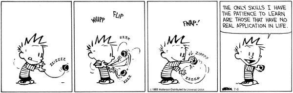

Calvin and Hobbes by Bill Watterson

http://www.gocomics.com/calvinandhobbes/2013/07/06

---

<!-- Slide 2 -->

# Workshop Overview

In this session we will explore skills that have no ‘real’ application in life.

You know you have them – those skills that you spent weeks, months, possibly even years learning. Which have no real application in your day to day life, or your professional life.

Come prepared to share them. You don’t have to justify them. You just have to share them.

We’ll start with a discussion of those skills. And list the skills in the room.

Then your brave, and incredibly talented, session host – Alan Richardson, will demonstrate for you a few skills with no ‘real’ application in life – to the extent that he has learned them: juggling, pen twirling, dice stacking, and the riffle shuffle.

One, or more of those skills will be selected by the gathered skill sharers. And a demonstration exercise of sharing that skill with a volunteer, someone who does not have that skill, will follow – much hilarity may well ensue during this demonstration.

Then the room will break out into chaos as you split into smaller groups and learn a skill from someone else. We will do this at least twice so that people who share, also get to learn.

Then we will debrief about what we learned about the value of sharing, and learning skills, that have little or no perceived value.

Come prepared to share a skill. Expect to laugh, and be challenged, and if you come expecting not to learn anything of value – then you might well return having learned something of real and lasting value.

---

<!-- Slide 3 -->

# Logistics

- 09:30 – 10:30
    - Intro
    - Theory
    - Demo
    - Exercise
    - Debrief

- 10:30 – 11:00 Break

- 11:00 – 12:00
    - Reminder
    - Amended Demo
    - Exercise
    - Debrief
    - Exercise
    - Final Debrief

---

<!-- Slide 4 -->

# Intro &amp; Aims

---

<!-- Slide 5 -->

# Remember what it is like to learn?

web.archive.org/web/20050205225705/http://www.fingerdexterity.com/brainrewire/brainrewire.htm

| 1 | 2 | 3 | 4 | 5 | 6 |
| --- | --- | --- | --- | --- | --- |
|  | 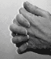 | 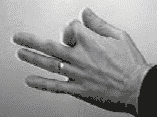 | 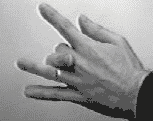 | 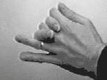 |  |
| 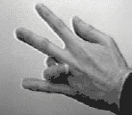 | 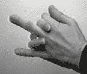 | 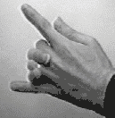 | 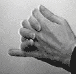 | 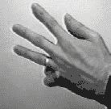 |  |
| 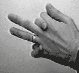 | 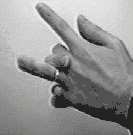 | 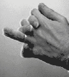 | 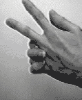 | 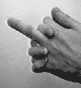 | 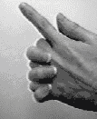 |

---

<!-- Slide 6 -->

# Theory

---

<!-- Slide 7 -->

# What are skills?

- Skills that have no 'real' application in life
- Skills for testing?

- Thoughts? Concepts? Lists? Comments?

---

<!-- Slide 8 -->

# What skills are in the room?

- What skills are you prepared to share?
- List
- Overlaps?
- How long did it originally take to learn these?
- Can we learn these in 10 minutes?
    - Catalogue
    - Expectations

---

<!-- Slide 9 -->

# Motivation

Calvin and Hobbes by Bill Watterson

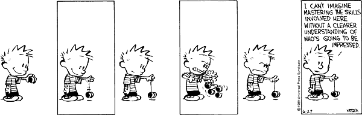

http://www.gocomics.com/calvinandhobbes/2010/08/10

---

<!-- Slide 10 -->

# “patterns that connect”

“What pattern connects the crab to the lobster and the orchid to the primrose and all the four of them to me? And me to you? And all the six of us to the amoeba in one direction and to the back-ward schizophrenic in another?”

Gregory Bateson

Mind And Nature: a necessary unity

---

<!-- Slide 11 -->

# Motivation

- Why?
- To what end?
- What do you get out of it?

---

<!-- Slide 12 -->

# They're a natural born X'er

- (tester, guitar player, footballer, etc.)
- Nature vs Nurture
- This can be done

---

<!-- Slide 13 -->

# Knowing What to Do - John Dewey

“...there was one superstition current among even cultivated persons. They suppose that if one is told what to do, if the right end is pointed out to them, all that is required in order to bring about the right act is will or wish on the part of the one who is to act.”

John Dewey Human Nature and Conduct (1921)

---

<!-- Slide 14 -->

# Practice

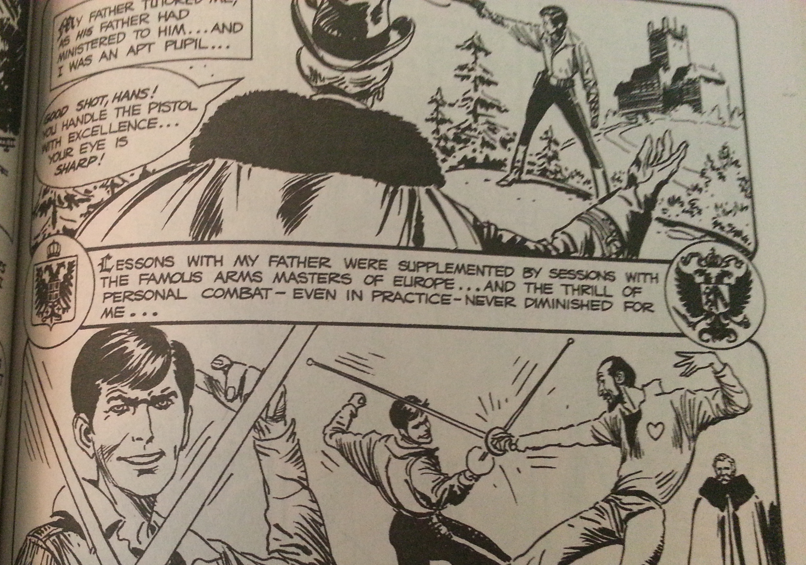

Enemy Ace #139, DC Comics, by Joe Kubert

---

<!-- Slide 15 -->

# Practice

- What do we know about practice?
    - What is practice?
    - How do we practice?
        - Examples from 'skills'?
        - What have we learned?
    - How do we practice testing?
        - Compare and contrast?
        - What have we learned?

---

<!-- Slide 16 -->

# Learning Through Experience

“...a child, when told to do a certain thing, will do it incorrectly. You will find this most common in actions which have to be performed with the hands – the method of holding a pen, for example. The teacher explains and demonstrates, and yet most of the children do a simple thing wrongly, to the great exasperation and irritation of the teacher.”

I.G. Griffith

The F. Matthias Alexander Technique and its relation to education

---

<!-- Slide 17 -->

# Teaching

- How to teach skills?
    - Styles?
    - Approaches?
    - What is important for success?
    - What is detrimental to success?

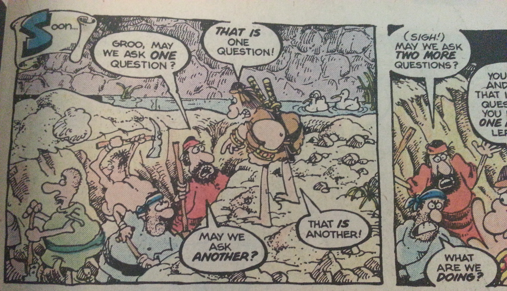

Groo #20, Marvel, by Sergio Aragonés

---

<!-- Slide 18 -->

# Teaching

- How to teach skills?
    - Styles?
    - Approaches?
    - What is important for success?
    - What is detrimental to success?

---

<!-- Slide 19 -->

# Caveats

---

<!-- Slide 20 -->

# Caveats - KISS Super Special

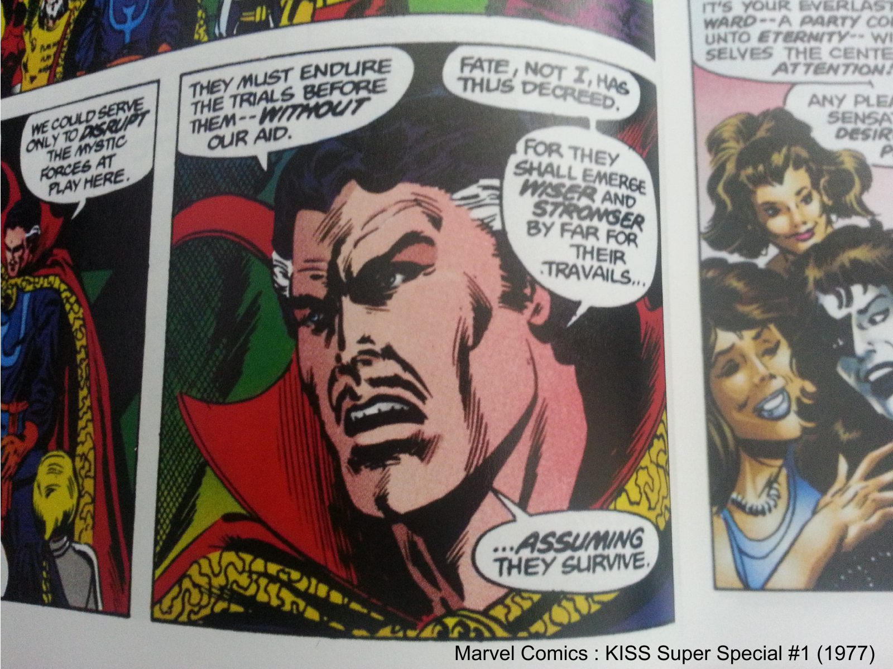

Marvel Comics : KISS Super Special #1 (1977)

---

<!-- Slide 21 -->

# Caveats and Aims

- Use what you know
- Throw out your rule books
- Experience 'teach' - to impart a skill
- Experience 'learn' – to acquire a skill
- Observe, yourself &amp; others
- Manipulate, yourself &amp; others
- Adjust, your approach and techniques

---

<!-- Slide 22 -->

# Demos

Who wants to learn?

Marvel Comics, “The Man Called Nova”, Fabulous First Issue, 1976

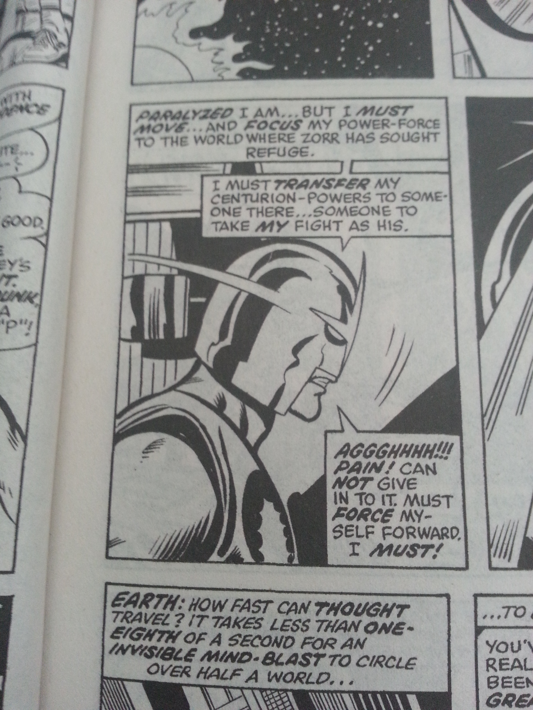

---

<!-- Slide 23 -->

# Caution, Demo in progress...

---

<!-- Slide 24 -->

# Demo Debrief

How did we do?

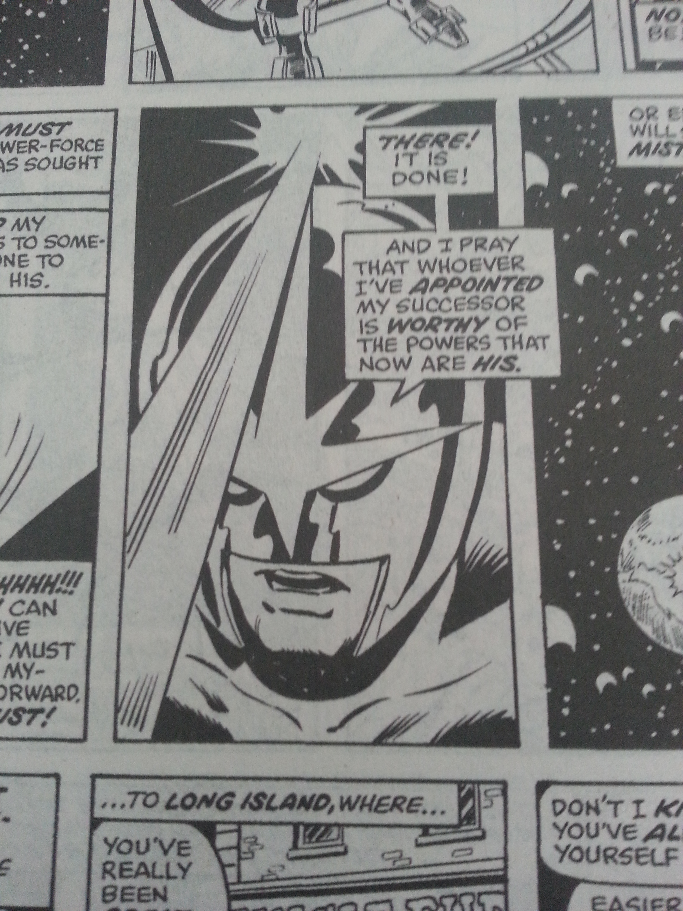

Marvel Comics, “The Man Called Nova”, Fabulous First Issue, 1976

---

<!-- Slide 25 -->

# Skill Transfer Exercise

- Split into small groups
- Teacher transfers skills to group using whatever means seem suitable for the skill and the group

---

<!-- Slide 26 -->

# Skill Transfer Exercise End

- Thank the teacher

---

<!-- Slide 27 -->

# Debrief

- What worked?
    - For you as a student?
    - For you as a student?
- What didn't work – for you
- What would you do differently as a teacher?
- What would you do differently as a learner?

---

<!-- Slide 28 -->

# Testing Debrief #1

- How does this relate?
- How do you 'teach', 'mentor', 'tutor', 'pair' testers?
- What lessons can you take to testing?

---

<!-- Slide 29 -->

# Previously we learned...

---

<!-- Slide 30 -->

# Demos

---

<!-- Slide 31 -->

# Skill Transfer Exercise

- Teachers teach for 15 – 20 mins
- Students can move between groups as and when they want to

---

<!-- Slide 32 -->

# Debrief

---

<!-- Slide 33 -->

# Skill Transfer Exercise

- Teachers teach for 15 – 20 mins
- Students stick with the teachers
- Students feedback often to the teacher
- Teacher adjust based on feedback

---

<!-- Slide 34 -->

# Final Debriefs

- Debrief
- Relation to testing

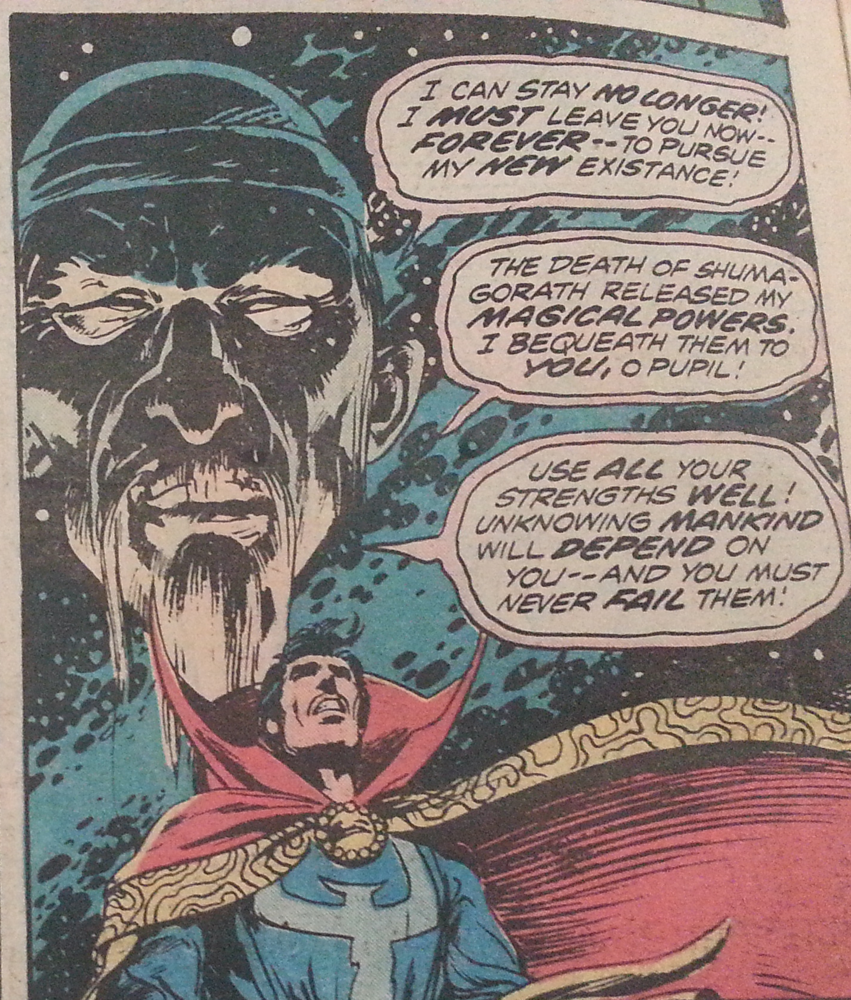

Marvel Treasury Edition #6

Dr Strange

---

<!-- Slide 35 -->

# Marvel Treasury Edition #6 - Dr Strange

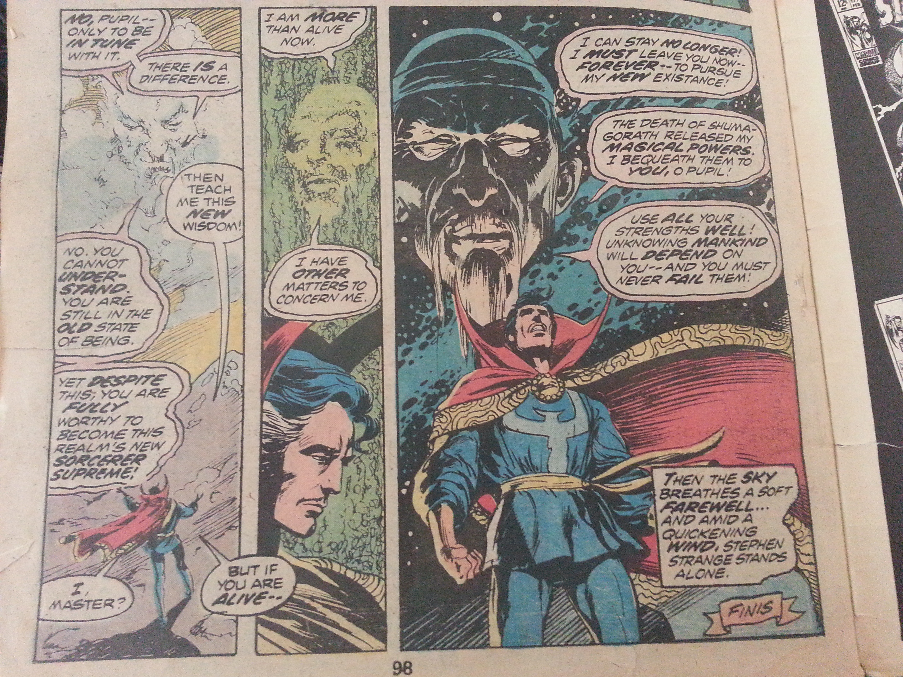

Marvel Treasury Edition #6 - Dr Strange
