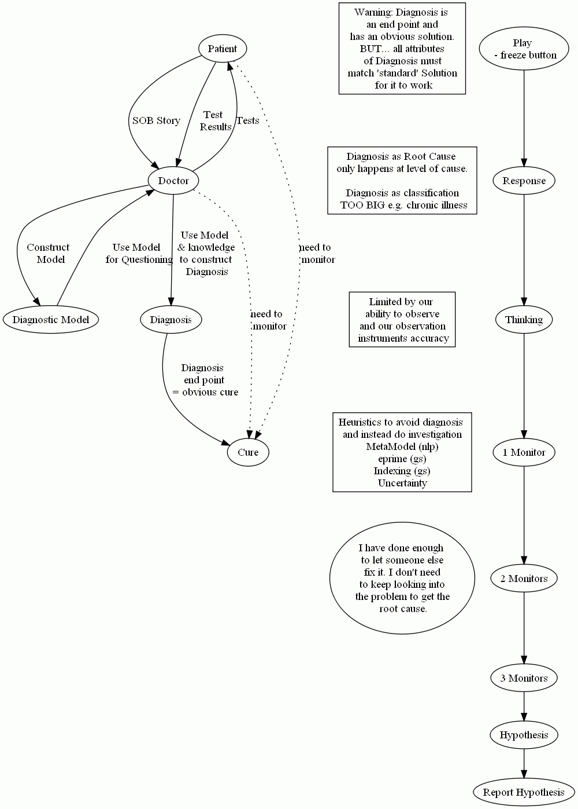

# Diagnosis (as a noun) considered dangerous in the testers dictionary

Original diagram and prepared comments for LEWT 5, 15 December 2007. These notes are not a transcript. The comments retain the original anecdotes, questions and uncertainty.

- [Original DOT source, including all comments](diagnosis.dot)
- [Diagram PDF generated from the DOT source](export/diagnosis.pdf)

## Original Prepared Comments

### Comment 1

I was coughing and sneezing for over 3 weeks so I went to the doctor. Explained the Symptoms, Observations and Behaviours (SOB story)

### Comment 2

Symptoms, Observations, Behaviours

### Comment 3

The doctor asked some questions, and got some more SOB back. Doctor did some Tests to Check for stuff - presumeably building a model internally

### Comment 4

Doctor came up with a diagnosis "probably not bacterial - prescribe some antibiotics just in case"

### Comment 5

Solution was not monitored - sideeffects from antibiotics so did not lead to a cure

### Comment 6

Notes: "You have a cough" is not a diagnosis. Surely that statement describes a symptom.

### Comment 7

Sub story: I have a great 3 monitor setup at work. Laptop on the right with an external monitor. Laptop sits on a desktop and I have maxivista to let me use the desktop monitor as part of my laptop desktop so I get 3 screens on my laptop. I was testing an outsource delivered app and playing "what button makes it freeze" and I was doing pretty well Finding at least 1 menu item in each app that made it freeze. So I wrote an email with the problem "in App Y clicking X makes the app freeze" etc. Done deal. Diagnosis - app freezing bug Got responses back from dev "can you send me a screenshot?" "Function Z can take a long time" And "App Y displays a dialog box"....oooh

### Comment 8

I did not see a dialog box I wonder if this is related to my observation tools Dialog Scan - and lo, there is a dialog present, but I can't see it Reconfigure monitor (single monitor) Dialog in center of screen Reconfigure monitor (2 monitors) Dialog is half off screen to right Reconfigure monitor (3 monitors) Can't see the dialog (off the screen)

### Comment 9

My hypothesis is that desktop is being used as the dialog parent rather than the app,and that the monitor width is being used, without realising that the left most point of the desktop is not 0 it is actually -2056 (-1028 + -1028) I report the hypothesis as observation and supposition (includes uncertainty) but not a diagnosis as I haven't looked at the code. Taking my observation and supposition should allow the 'Fixer' to do a Diagnosis, which leads to a fix.

### Comment 10

I was training some non-testers in exploratory testing using a small JS App I wrote for the purpose and they raised the comment ...
