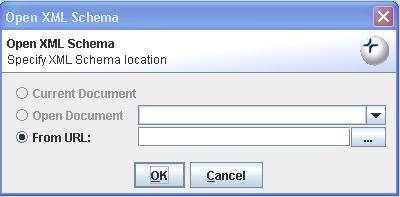
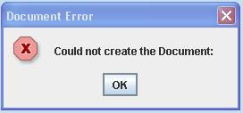
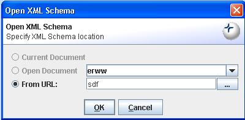
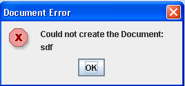
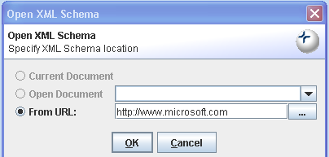
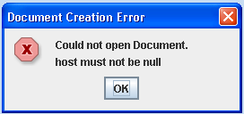
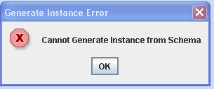

# Exploratory testing should be a spectator sport

Original exploratory-testing write-up from the LEWT source folder. The event number and date are not confirmed. Wording, screenshots and the incomplete draft ending are retained. Filename placeholders are replaced by their embedded screenshots.

Someone at work asked me to explain what exploratory testing is, so I showed him.

"pick an app on your system, pick an app, any app. And I'll demonstrate exploratory testing"

So he picked an xml editor that he was eval'ing. exchangerXML - freexmleditor.com

So we start the app and then start looking for stuff. At this point I'm being guided by a heuristic notion derived from the following presupposition "If the system lets me do it, then it must be valid" and then naturally (but what if I shouldn't be able to?) and the heuristic is "look for things that I probably shouldn't be able to do"

&lt;mode: scan the menu items&gt; (a lot of greyed out - which is good)

The found one that I might not be supposed to do because it looks like it is predicated on having a file open, and I don't, so I try it "Schema Instance Generation" \[OK\]\[CANCEL\]

Try attack - use defaults \[OK\]

Get an error message - could raise a bug against that as I wasn't doing anything bad and the message says "could not create the document:" but I wasn't creating anything!

put in some data in teh dialog

Get an error

But now I know what file it is trying to create, which seems strange as it is from url - (oh, now it isn't the dialog is just badly lain out - GUI error)

So let us try something it really can't create

and we get this error

In fact we got 2 because one wasn't good enough

Now let us try and blow it up 1000 char string 0123456789, copy \*9, select all, copy, paste \* 9

\- actually it was the sign document dialog on Security

"Sign Document" - presupposition - document exists (I have no document - may be a problem)

Dialog \[OK\]\[Cancel\]

\[OK\] reports a - cannot create document "null"

could raise an error against that, but reporting "null" - makes me think that there could be more to this and I wasn't trying to create doc.

so back in the dialog again and put in a big text in the file name (why did I pick this attack?)

0123456789\*100 - pause - blue screen of death.

Job done.
