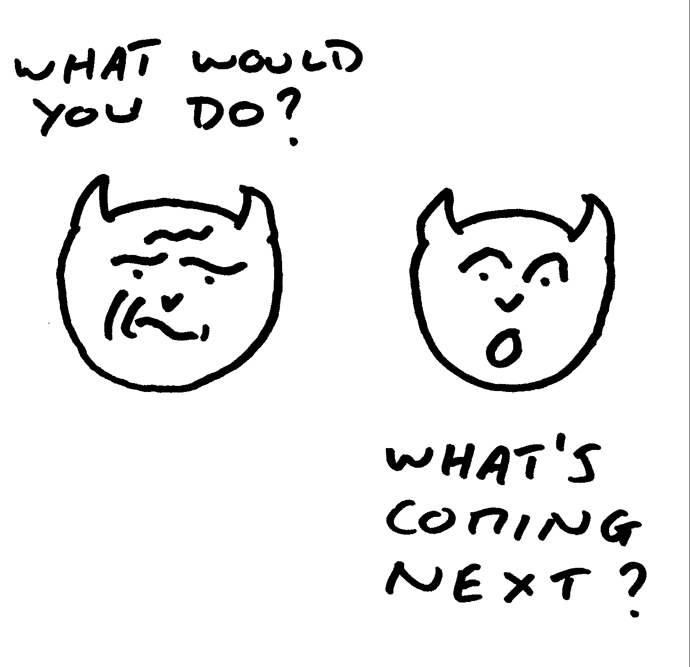
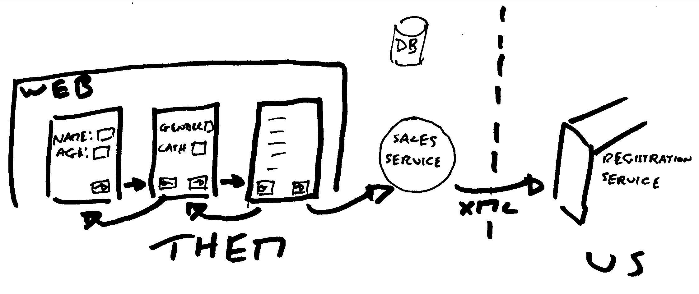
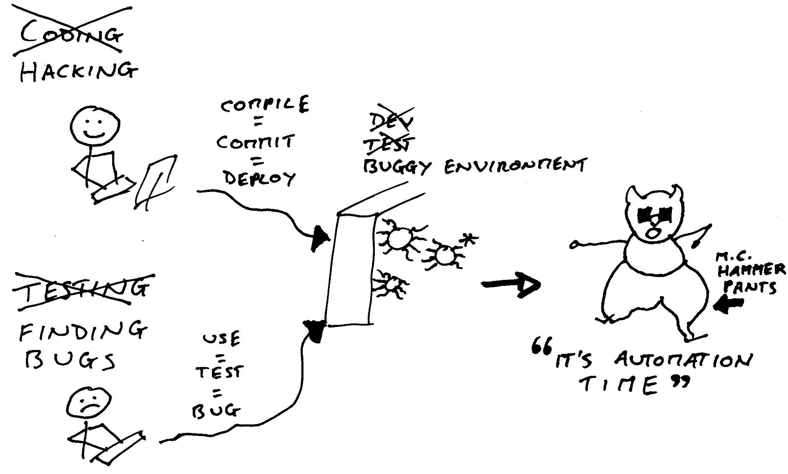
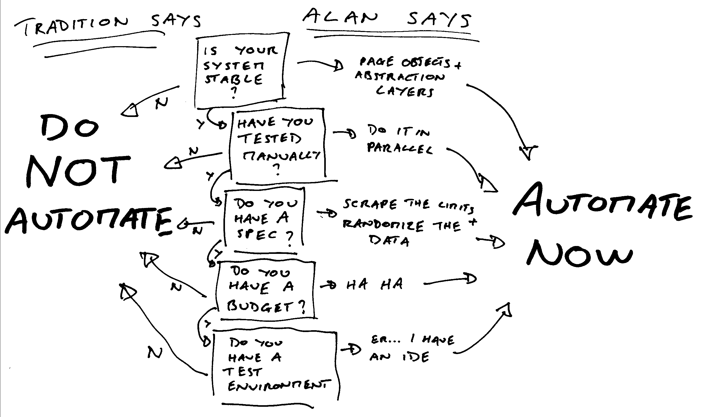
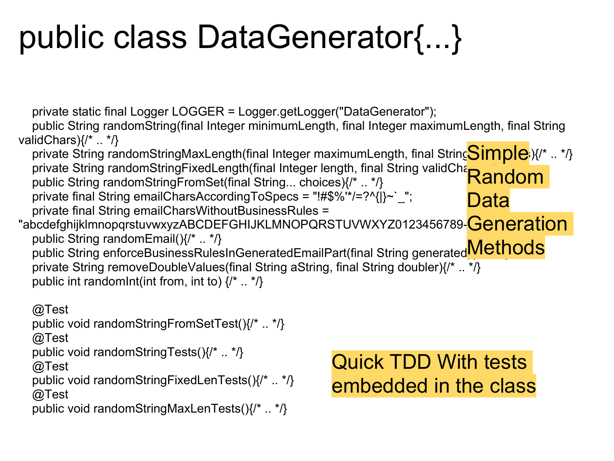
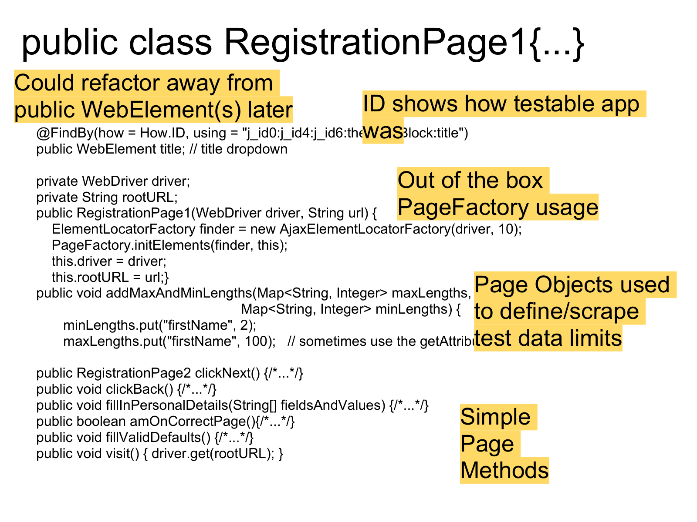
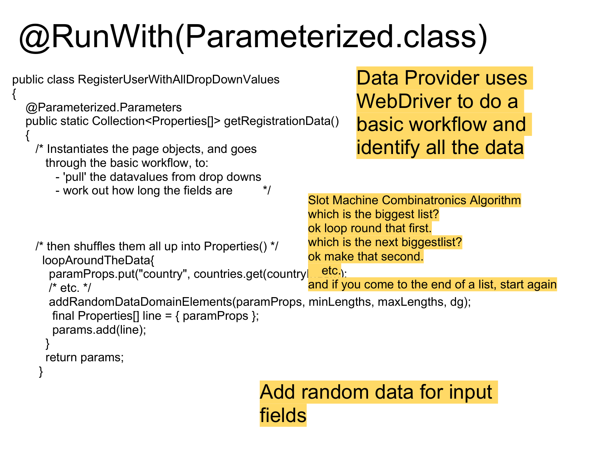
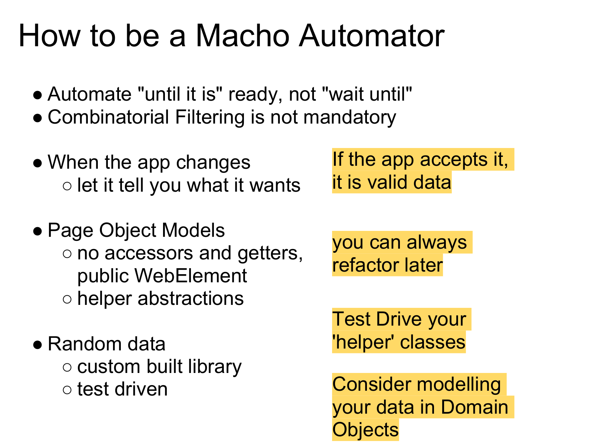
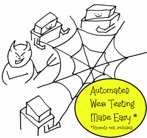

<!-- Slide 1 -->

# "Web scraping as a Test Design Approach using Selenium 2.0" or "Macho Web Automation in Action"

Alan Richardson

eviltester.com

seleniumsimplified.com

---

<!-- Slide 2 -->

# This is a story about...

...Automation design thought processes

...Macho Test Automation

...How to automate when you shouldn't

---

<!-- Slide 3 -->

# Background - Play along at home



---

<!-- Slide 4 -->

# Background - the system

- Registration system
- Multiple Languages
- multi page form workflow
- submits details to another system



---

<!-- Slide 5 -->

# Background - The rationale

- registration not core functionality
- some issues with registration previously


---

<!-- Slide 6 -->

# Outsourced suppliers love Agile

You say:

- "We don't really have testers, we have team members. No one person has responsibility for Quality. We don't do much documentation. We don't underestimate the value of F2F communication. We value released and working software."
- They hear:
- "blah blah DON'T blah HAVE TESTERS, blah blah NO-ONE blah HAS RESPONSIBILITY FOR QUALITY. blah blah DON'T DO blah DOCUMENTATION. blah blah DON'T blah VALUE blah COMMUNICATION. WE blah VALUE blah RELEASED blah blah SOFTWARE"

---

<!-- Slide 7 -->

# Reality Bites

- Anything in this system can change, and it probably will.



---

<!-- Slide 8 -->

# Thinking about automation

- Automate to decide if system is ready for Manual Testing
- 'Throwaway'
- 'Get it running quick'
But we shouldn't automate yet because ...

---

<!-- Slide 9 -->

# Automation Do's and Don'ts Thinking



---

<!-- Slide 10 -->

# Model Based Automation Thinking

All Testing stems from models

Recognise the models in your automation

- every single script implements a path
- data driven = model data separate from path
- multi-path = paths triggered by data

---

<!-- Slide 11 -->

# Thinking about The Model

- Application Pages
    - Page Objects
- Workflow
    - Controlled by Data
    - Abstracted in Page Object Methods
- Data
    - Randomly Generated
    - All 'valid'
    - Scrape upper limits from site
- Pulled together in the @test

---

<!-- Slide 12 -->

# Thinking about Combinatronics

Tradition automatically says "too many combinations"

- "Combinatorial" filtering techniques
    - Orthogonal Array
    - All Pairs
Sometimes with Automation you don't want to filter

You just let the tests run for a long time

---

<!-- Slide 13 -->

# Thinking about Test Data Generation

- Fixed Data
    - controls the flow
    - randomize like a reel slot machine
- Fixed Scope but Variable Data
    - Drop Downs, Radio Buttons
    - Scrape and turn the handle
- Randomize Input Field Data
    - Scrape Lengths
    - Hard code formats
    - Randomly generate

---

<!-- Slide 14 -->

# Code Snippets... Why?

Everything was proprietary

Hints and Snippets encourage you to experiment

Explain the principles (this is not a code review)

But really...

... I just don't love you enough to

rewrite everything for a demo

---

<!-- Slide 15 -->

# DataGenerator

```java
public class DataGenerator{...}
    private static final Logger LOGGER = Logger.getLogger("DataGenerator");
    public String randomString(final Integer minimumLength, final Integer maximumLength, final String validChars){/* .. */}
    private String randomStringMaxLength(final Integer maximumLength, final String validChars){/* .. */}
    private String randomStringFixedLength(final Integer length, final String validChars){/* .. */}
    public String randomStringFromSet(final String... choices){/* .. */}
    private final String emailCharsAccordingToSpecs = "!#$%'*/=?^{|}~`_";
    private final String emailCharsWithoutBusinessRules = "abcdefghijklmnopqrstuvwxyzABCDEFGHIJKLMNOPQRSTUVWXYZ0123456789-";
    public String randomEmail(){/* .. */}
    public String enforceBusinessRulesInGeneratedEmailPart(final String generated){/* .. */}
    private String removeDoubleValues(final String aString, final String doubler){/* .. */}
    public int randomInt(int from, int to) {/* .. */}
    @Test
    public void randomStringFromSetTest(){/* .. */}
    @Test
    public void randomStringTests(){/* .. */}
    @Test
    public void randomStringFixedLenTests(){/* .. */}
    @Test
    public void randomStringMaxLenTests(){/* .. */}
```

Quick TDD With tests embedded in the class

Simple

Random

Data

Generation

Methods



---

<!-- Slide 16 -->

# RegistrationPage1

```java
public class RegistrationPage1{...}
    @FindBy(how = How.ID, using = "j_id0:j_id4:j_id6:thePageBlock:title")
    public WebElement title; // title dropdown
    private WebDriver driver;
    private String rootURL;
    public RegistrationPage1(WebDriver driver, String url) {
        ElementLocatorFactory finder = new AjaxElementLocatorFactory(driver, 10);
        PageFactory.initElements(finder, this);
        this.driver = driver;
        this.rootURL = url;}
    public void addMaxAndMinLengths(Map<String, Integer> maxLengths,
                                                         Map<String, Integer> minLengths) {
           minLengths.put("firstName", 2);
           maxLengths.put("firstName", 100);   // sometimes use the getAttribute("size"); /*...*/}
    public RegistrationPage2 clickNext() {/*...*/}
    public void clickBack() {/*...*/}
    public void fillInPersonalDetails(String[] fieldsAndValues) {/*...*/}
    public boolean amOnCorrectPage(){/*...*/}
    public void fillValidDefaults() {/*...*/}
    public void visit() { driver.get(rootURL); }
```

Could refactor away from public WebElement(s) later

Out of the box PageFactory usage

Simple Page Methods

Page Objects used to define/scrape test data limits

ID shows how testable app was



---

<!-- Slide 17 -->

# Parameterized registration data

```java
@RunWith(Parameterized.class)
public class RegisterUserWithAllDropDownValues
{
    @Parameterized.Parameters
    public static Collection<Properties[]> getRegistrationData()
    {
       /* Instantiates the page objects, and goes
          through the basic workflow, to:
             - 'pull' the datavalues from drop downs
             - work out how long the fields are         */
       /* then shuffles them all up into Properties() */
         loopAroundTheData{
           paramProps.put("country", countries.get(countryIndex));
           /* etc. */
           addRandomDataDomainElements(paramProps, minLengths, maxLengths, dg);
            final Properties[] line = { paramProps };
            params.add(line);
          }
          return params;
        }
```

Slot Machine Combinatronics Algorithm

which is the biggest list?

ok loop round that first.

which is the next biggestlist?

ok make that second.

etc.

and if you come to the end of a list, start again

Data Provider uses WebDriver to do a basic workflow and identify all the data

Add random data for input fields



---

<!-- Slide 18 -->

# @test

The flow

- loop
    - pumps in data from data provider
        - private List&lt;String&gt; getDataForStep3(Properties testContext)
    - relies on ajax Implicit waits in factory
    - next page
    - check we are on the page
- then tries to log into system

---

<!-- Slide 19 -->

# Benefits

- it found bugs
- it found changes
    - failing tests found new data controlled workflows
- fire &amp; forget
- every failing test was either
    - a failure to model app
    - an application bug
- when all tests passed, it was good enough for manual testing
- saved wasting time on manual testing

---

<!-- Slide 20 -->

# Type of Bugs Found...

- Really odd combination errors
- Front end &lt;-&gt; Backend mismatches
    - length
    - validation
    - encoding
- Character Combination Errors
- Broken workflow

... because this was

what I modelled

---

<!-- Slide 21 -->

# How to be a Macho Automator

- Automate "until it is" ready, not "wait until"
- Combinatorial Filtering is not mandatory
- When the app changes
    - let it tell you what it wants
- Page Object Models
    - no accessors and getters, public WebElement
    - helper abstractions
- Random data
    - custom built library
    - test driven

Test Drive your 'helper' classes

you can always refactor later

If the app accepts it, it is valid data

Consider modelling your data in Domain Objects



---

<!-- Slide 22 -->

# Alan Richardson and Selenium Simplified

Alan Richardson

www.compendiumdev.co.uk

www.eviltester.com

You can buy the book "Selenium Simplified"

visit www.seleniumsimplified.com


